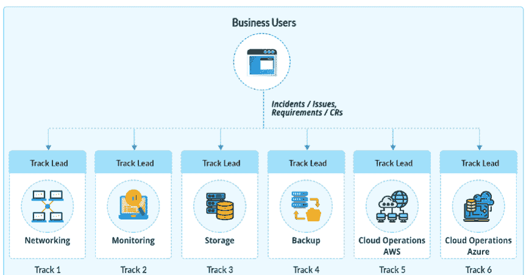
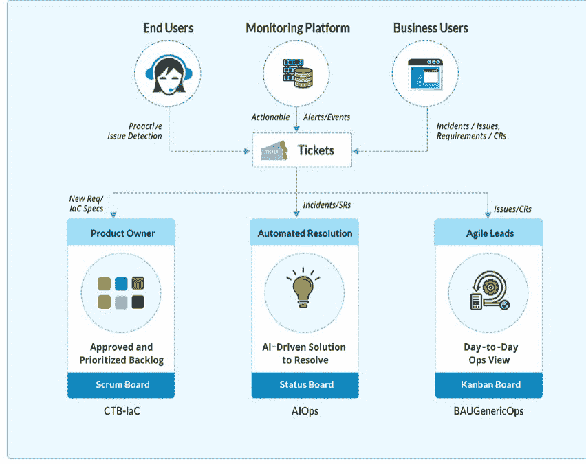

# 第 9 章

## 成功路径

本章介绍了一个关于 AgileOps 的案例研究。本章将涵盖以下主题：

- AgileOps 实施案例研究
- 我们企业 Alpha 的新运营模式
- 成果

在上一章中，我们研究了不同的敏捷方法、框架和实施方法，以规划和执行基础设施运营领域的敏捷之旅。没有一种完美的方法适用于所有组织。选择哪种方法的决定很棘手，有时也很令人困惑。每个框架都以敏捷原则为支撑，且没有必须遵循的严格强制规定。渴望转向敏捷工作方式的 IT 组织了解自身组织，因此可以决定哪种方法/框架最有利于他们。在多个行业中，许多组织在初始迭代中使用一种方法取得了成功，而其他行业无法使用“现状”方法成功，但通过定制方法以满足其需求仍取得了成功。应用程序团队采用敏捷文化时，转型基础设施运营团队是一项挑战。大型企业以人员和自动化为关键基础支柱规划为期两到三年的转型路线图。在团队接受新技能和仪式培训的同时，他们也发现了自动化的新机会，并组建了新的团队和角色。

## 案例研究：实施敏捷运营

我们深入研究了流程和最佳实践，并看到了这些实践在基础设施即代码场景中如何逐步应用的实际示例。我们现在将根据迄今为止学到的知识，详细探讨团队结构如何创建。我们的虚构公司 Alpha 在全球范围内分布，执行董事会已决定赞助其基础设施运营团队的转型。当前的基础设施运营团队拥有多个团队，负责管理本地硬件、网络、监控、存储和备份，并最近开始支持 AWS 和 Azure 上的云运营。见图 9-1。

图 9-1. 基础设施 IT 运营的传统模型

Alpha 还决定不会“一刀切”，而是首先以监控团队为起点推动敏捷化。当前的监控团队管理并支持多种工具，用于监控数千台服务器和应用程序。这些工具中嵌入了预定义的阈值，可通过电子邮件主动向基础设施工程师发出警报。该工程师手动检查警报、解决潜在问题并更新知识数据库（KEDB）。首先过渡该团队的关键期望是使警报处理方式现代化。此外，应用程序正在向云迁移。Alpha 制定了一份路线图，明确了在两年内采用人工智能驱动运营的愿景。资金正在为这一新的组织变革以及投资新工具和对团队进行新技术技能提升进行规划和批准。

成立了一个集中且专用的团队 AIOps，用于实施、跟踪和执行这一新的转型路线图。该团队的成员是顾问和从业者，他们撰写细节并定义待推广的新结构。他们从以下关键因素评估当前的监控团队：

- Scrum/Kanban 的敏捷能力
- 新技术专业知识
- 当前运营工作量
- 当前项目工作量
- 团队绩效指标，如周期时间
- 过去实施的自动化场景

在先决条件得到评估和基线化后，团队决定按表 9-1 所示重组团队。

### 表 9-1. 传统 IT 运营与敏捷 IT 运营比较

| Team Name | Agile Method | Remarks |
|---|---|---|
| BAU-Generic ops | Kanban | 将监控的传统运营支持向敏捷方式过渡。团队成员“主动领取”工作并承担更多责任。 |
| CTB-Infrastructure ops | Scrum | 从 BAU 中创建了一个新团队，用于为自动化优先用例创建 IaC 流水线。 |
| AIOps team | Scrum | 通过再培训和招聘相结合的方式组建了另一个新团队，负责 AIOps 工作。该团队运行用于在环境中部署 AIOps 的冲刺。 |

团队还将创建一个工作流，定义转型后监控警报如何响应。每个监控警报都将通过 ITSM 工具进行跟踪。这些警报可由 AIOps 或终端用户或业务用户创建。还为 AIOps 设立了明确的愿景，将在新生态系统中改变警报响应方式。

只有当 AIOps 能够与智能运行手册自动化工具集成时自动解决监控问题时才会有帮助。Alpha 管理层评估了具有事件关联能力的工具，并资助了其分阶段推广的实施。

请注意，有许多工具可用，如 Moogsoft、Splunk、Zenoss，以及像 DRYiCE iAutomate 这样的自动化修复工具，它们使组织能够加快事件解决流程，并也成为 SRE 的合适工具。见图 9-2。

图 9-2. 基础设施 IT 运营的新工作模型

## Alpha 的新运营模式

以下是新的运营模式：

- *CTB-IaC team:* 这是自动化团队。与基础设施设置相关的新需求将通过 IaC 流水线进行管理。该团队将以 Scrum 模式工作，并根据优先且已批准的需求交付流水线。该团队将构建可重用的模板，这些模板经过版本控制并通过 ITSM 工具编排。在构建流水线时，他们还将关注网络、防火墙、RBAC 实施等各种重要基础设施组件。
- *AIOps team:* 这是一个将配置新解决方案以监控和自动解决常见问题的团队。他们将识别用例并将数据输入解决方案。AIOps 系统将利用分析和机器学习功能做出正确决策；例如，它将自动解决该问题并更新 ITSM 工具。所有已识别的用例都将在 BAU-GenericOps 团队的帮助下在系统中讨论和配置。AIOps 解决方案将管理的每个用例都旨在减少工单量并确保系统可用性提升。该团队将以 Scrum 模式启动项目以交付核心特性和功能，然后在项目进入运营阶段时转向 Kanban，同时仍继续运行用于增强和更新的冲刺。
- *BAU-GenericOps:* 这是传统的<|message|> 基础设施运营团队，将通过实践 Kanban 来解决中断和其他日常运营活动，从而转型为敏捷运营团队。未被 AIOps 解决方案解决的警报或工单将由该团队主动领取以快速解决。该团队将继续跟踪问题和解决方案，并更新其知识数据库（KEDB）。他们还将与其他两个团队协作，尽可能将 AIOps 解决方案中的用例自动化。

## 成果

最终目标是在监控领域尽可能优化和自动化。在启动阶段将有三个团队，但随着 AIOps 日益成熟，其他 BAU-GenericOps 团队应变得精简。Alpha 通过实施此类模式将获得多项益处。

- *Collaboration:* 高度互联的工程团队具备跨技能，并与产品团队密切合作，怀有一个共同愿景，为终端客户交付和支持高质量系统。
- *Resiliency:* 设计、构建和部署经过充分测试且合规的系统的能力。
- *Self-service:* 使产品团队能够在其交付管道中按需扩展系统的能力。
- *Shift-left security:* 在系统每个阶段嵌入安全策略的能力。
- *Continuous improvement:* 随着每次迭代学习和扩展的能力。尽可能使用 AIOps 自动化，以为敏捷和 SRE 团队提供所需工具和技术，实现快速减少手工操作和提高可用性的目标。

## 总结

每个组织都有独特的需求、工作方式、当前结构和业务目标。本章介绍了使用敏捷基础设施运营可组织基础设施团队的各种方式。这可在设计组织结构和流程时作为指导。转型需要根据组织需求和限制分阶段规划。团队应准备好测试、失败然后改进。每个模型都强调敏捷和 DevOps 实践，如 CI/CD、基础设施即代码、站点可靠性工程、Scrum、Kanban 等。归根结底，重要的是转型应创造和培育信任和可见性的文化。新工具和技术确实赋能团队，但如果使用不当，敏捷愿景将逐渐消退。
