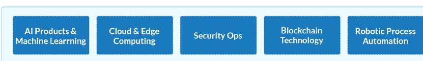

# 第十章

## 经验教训与前进方向

本章将讨论企业下一步该做什么。本章将涵盖以下主题：

- 我们的经验教训
- 需要关注的新兴趋势
- 下一步
- 结论

随着云、微服务架构、站点可靠性工程等领域的增长，组织正在重新思考其运营方式。他们学到敏捷性、弹性与自动化是当务之急。虽然许多组织已开始向这一新常态转型，但仍有一些团队需要在为时已晚之前迅速切换到新的工作方式。因此，本章涵盖了我们学到的内容以及如何向前推进。

## 我们的经验教训

我们学到的内容如下：

- 设置一个小型团队来自动化基础设施；该团队采用基础设施即代码原则和工具。该团队可以驻留在基础设施层级中，也可以位于应用团队和运维团队之间。一些组织称这些团队为 DevOps 团队。

- 创建一个可重用的构件和模板的中央存储库，供开发人员也可以使用。这样您就可以赋予应用团队自行设置环境的能力。如果您想加快运营速度，请投资于云生命周期管理和 AIOps 工具，如 Moogsoft、Zenoss、DRYiCE iAutomate 和 DRYiCE MyCloud。
- 识别并优先考虑可以自动化的用例，例如探索将基础设施管道与应用管道集成的方式。
- 确定当前的基础线并定期跟踪改进情况。这将成为其他团队参考和采用的良好案例。
- 如果您走在数字化道路上，那么请计划采用 AIOps。自动化是推动敏捷性的关键杠杆。
- 在整个管道中嵌入安全原则，以避免漏洞并确保工作按照定义的合规规则交付。
- 如果需要，重新审视团队结构并定义新角色以提升团队士气。同时向团队成员介绍新技术培训。

## 需要关注的新兴趋势

技术可以加快能力的部署，但最终是人们需要充分利用这些技术并实现其效益。因此，人力和文化变革是实现敏捷基础设施运营成熟度的关键。正在引入新角色以鼓励团队采用这种新的文化变革，在这种变革中，团队朝着共同愿景努力，利用共同的工具和平台，并提升对云、基础设施即代码、AIOps 等新技术以及敏捷等方法论的技能。标准化基础设施设置、合理化工具、识别自动化机会以及消除浪费都是运行 AgileOps 团队的关键驱动因素。面对所有这些新趋势，如果团队未准备好应对变化，路线图将会放缓。因此，团队需要在新技术和流程方面得到提升，并且投资需要经过深思熟虑。

### 图 10-1. 一些关键 IT 趋势

仅实施敏捷工具是不够的。理解需求并实践概念很重要。此外，成功在于团队协作以及在通往敏捷的道路上团队规模扩大时的持续改进。从传统到敏捷的转型在敏捷教练或从业者的指导下会取得成功，他们会制定包含里程碑的路线图，指导团队摆脱耗时流程，采用新的现代平台，衡量并跟踪指标，并指导团队掌握新方法和实践。教练与团队合作定义分阶段推行的新战略，并持续监控进展以在需要时重新调整计划。然而，由于将敏捷应用于基础设施运营是一个利基且新兴的领域，本书旨在提供来自实际实施的指导，可用于加速通往敏捷基础设施运营的旅程。新的指导和数据将不断在配套网站 http://agileinfraops.com 上提供并更新，以便读者能够持续增强对该主题的了解。 我们很乐意听取读者的评论、反馈以及在云、基础设施和应用运营中部署敏捷的成功案例，联系方式为 feedback@agileinfraops.com。

组织也在思考如何为承载遗留应用的遗留基础设施带来敏捷性。新的客户需求为重新审视应用的开发方式以及与其他组件或应用的交互方式铺平了道路。一些组织计划使用云原生和容器技术对遗留应用进行现代化改造并将其迁移到云端。容器化帮助许多组织随时随地部署应用，而无需面对配置、连接性、兼容性等方面的问题。支持该技术需要智能工具来赋能应用团队构建和部署应用。Docker、Kubernetes 等工具正被团队试点和采用，以更好地管理资源和应用。

团队通过实施合适的技术并以迭代方式实践敏捷，可以获得最大收益。当前时代一切都关于遗忘旧知识、学习新技能并持续演进。团队只有配备了专注于消除团队间障碍的正确生态系统，才能朝着这一目标迈进。无论是 Scrum 还是 Kanban，直到团队理解方法论的重要性，他们才能够取得进展。如果一个组织正在开始使用 IaC，那么 Scrum 是理想的选择。另一方面，如果要改造传统运维，那么 Kanban 就是理想的选择。教练的帮助可以轻松做出这一决定，教练可以评估团队结构和当前工作模式并提出相关建议。此类建议会被优先考虑并与具有明确时间线的里程碑相映射。

我们也接受这样一个事实：基础设施运维不能再以僵化的流程在孤岛中工作。他们必须与开发团队、QA 团队和安全团队协作，以确保产品交付得到良好集成，并且能够快速触达终端客户。而这正是通过找到弥合这些团队之间差距的用例来实现的。对团队进行使用提供灵活性和端到端可见性的现代平台的教育，确保从长远来看这些团队变得具有凝聚力。云、Serverless 计算、边缘计算、软件定义基础设施和 AIOps 等现代技术都在鼓励组织转向能够更快交付成果的敏捷工作模式。因此，将基础设施推向现代化和数字化的需求是因为应用也在升级或现代化。开发和运营两个世界需要连接和协作以交付高效成果。这只有在他们停止抵制变化并更快部署这些变化时才有可能。敏捷思维在这一方向上起到了助推器的作用。指导团队了解敏捷的好处并帮助他们变得敏捷，对于持续增长至关重要。是的，激励措施和资金对于点燃这一旅程至关重要。需要一个规划良好的企业战略，在以敏捷为基础的前提下解决安全、合规、法规、风险和弹性问题。

## 下一步

敏捷自 2001 年以来不断演进，如今已成为每个需要生存的 IT 组织必备的能力。有人称其为项目管理方法，有人称其为工作方式。其他人则将其视为“通向精益的过程变革”。无论如何，“敏捷组织”这一术语正在流行，它意味着应用、运营和其他相关团队以敏捷模式工作的组织。这些机构设计、开发和运营产品的速度是原来的五倍。各种敏捷方法也已被修改，并有适用于不同场景的混合版本可供使用。协作、保持相关性、迅速克服意外变化，以及从“做敏捷”到“成为敏捷”的转变，都是组织无法忽视的不断演进的旅程。随着这一旅程的推进，以价值为基础的决策将变得重要。公司需要为客户提供价值，而不仅仅关注数量。他们需要与客户保持紧密联系以获取反馈并持续改进。

谈到基础设施运营团队，他们能够提供的价值在于他们运营和设置环境的方式、沟通模式，以及最重要的是“做敏捷”。这将通过交付所需内容的优化流程来实现。团队之间必须有信任和透明度，每个人都有单一事实来源、可利用的标准工具集和自动化，以及一个定义良好的可重用和改进的框架。自我管理的团队将会出现，并将继续推动成功因素。随着公司不断 reinvent 自身，团队将变得更易管理。事实上，当权力和问责制得到分配时，有人称之为扁平结构。

与安全的协作将不再局限于孤岛；并且将引入方法与工具，在开发和运营管道的每个阶段自动化安全检查。例如，IaC 团队将继续在其管道中引入安全检查，以检查合规评分、漏洞问题、策略合规性等方面，并在成功后才继续进行。技术债务将被监控以捕捉改进情况。重复性操作将继续被自动化，从而实现精益和 AI 驱动的运营。

## 结论

如果您尚未开始敏捷之旅，现在还不晚。您应该识别自己的需求，选择合适的敏捷框架并不断演进。结合敏捷、DevOps、SRE、精益和 DevOps 的最佳实践将有助于促进协作、提高生产力并朝着“成为敏捷”成熟。

最重要的是，您需要一个具有清晰愿景的计划，使您逐步走向成功。敏捷的需求已不再是可选项；它是新的运营方式，现在是您团队采用这种方法并为负责、跨技能且准备好迎接新挑战的自我管理团队构建生态系统的时候了！

## 索引

## A
- A/B 测试，64, 65
- 敏捷方法论，1
  - 自下而上方法，2
  - 数据/利用技术，1
  - 开发/运维，7
- DevOps，7
- 历史，4, 5
- 基础设施/云运维，3
- 基础设施运维，5, 8
- 内部/外部客户，1
- 宣言，9, 10
- 产品生命周期，5–7
- 需求，2
- AgileOps 实施
  - 对比，201, 202
  - 关键因素，201
  - 知识数据库（KEDB），200
  - 成果，204
  - 传统模型，200
  - 工作模型，202
- AIOps 系统，203
- Alpha 运营模型，203

## B
- BAU-GenericOps，203
- 行为驱动开发（BDD）测试，58
- 黑盒测试，61, 62
- 蓝绿部署策略，54

## C
- 金丝雀部署，55, 56
- 混沌工程/测试，64
- 云计算，45–51
- 置信/构建验证测试，60
- 持续集成/交付（CI/CD），53

## D, E, F, G, H
- 部署模式/自动化
  - 蓝绿部署，54
  - 金丝雀部署，55, 56
  - 持续交付与部署对比，53
  - 滚动更新部署，54, 55
- DevOps
  - 采用流程，30
  - 优势，34, 35
  - 协作/生产力，35
  - 持续之旅，36
  - 交付，38
  - 环境，38
  - 框架/产品生命周期，37–39
  - 集成，38
  - 监控/反馈，39
  - 原则
    - 协作，32
    - 持续反馈，34
    - 客户满意度，30
    - 频繁交付，31
    - 交付可工作的软件，32

## I, J
- DevOps（续）
  - IT/技术，32
  - 反思/调整，33
  - 自组织团队，33
  - 简洁性，33
  - 可持续开发，33
  - 信任/支持，34
  - 拥抱变化，31
  - 规模化敏捷，35
  - 孤岛团队/利用自动化，36
  - 测试，39
- 纪律敏捷交付（DAD），139–143
- 改进流程，25
- 增量部署，参见金丝雀部署
- 信息技术基础设施库（ITIL），13
- 信息技术基础设施库（ITSM）
  - 变更管理流程，21
  - 持续服务，24–26
  - 设计服务
    - 可用性管理，18
    - 容量管理，18
    - 目录管理，18
    - 连续性管理，19
    - 设计协调，19
    - 流程，16
    - 风险框架，19
    - 服务等级管理，17
  - 事件管理，22
  - 事故管理，22, 23
- InfraOps 团队，13
- IT4IT
  - 检测到纠正（D2C），116
  - IT4IT 与 ITIL 对比，119
  - 参考架构，115, 118
  - 请求到履行（R2F），116
  - 需求到部署（R2D），116
  - 策略到组合（S2），116
  - 价值流，115, 117
  - 工作流程，118
  - 运营，22–24
  - 原则，114
  - 问题管理生命周期，24
  - 流程，12
  - 流程/产品/合作伙伴/人员，14
  - 快速数字化/新兴需求，113
  - 现实检验，13
  - 变更请求（RFCs），114
  - 角色，14
  - 顺序方式，114
  - 策略，15, 16
  - 时间盒计划，114
  - 传统方法，12
  - 过渡，20–22
  - 可工作软件，114
- 基础设施即服务（IaaS），46, 47
- 基础设施即代码（IaC），152, 177
  - 验收标准，186, 187
  - 应用和基础设施工作流，193
  - 应用流水线，194
  - AWS CodeCommit，190
  - 优势，180
  - 蓝绿部署，192
  - 云原生工具，190
  - 组件，183
  - 控制/管理基础设施，178
  - 定义，177
  - 细节，191
  - 开发流水线，192, 193
  - 史诗/相关用户故事，187
  - 扩展工具，193–195
  - 功能点分析（FPA）
    - 方法，184
  - HCL DRYiCE MyCloud，179
  - 基础设施，187, 188
  - 基础设施和应用流水线，195
  - 关键实践（Scrum），196
  - 多种工具，190
  - 流水线阶段，188, 189
  - 规划扑克，184
  - Scrum 术语，180–183
  - 自助服务，190
  - 故事估算方法，183–186
  - T 恤尺寸/等效故事点，185
  - 用户故事格式，187
- 基础设施运维，157
  - 敏捷方法，161
  - 敏捷模型，160
  - AgileOps，158
  - 优势，157
  - 大爆炸实施，166
  - 仪表板，166
  - 扩展集成，163
  - 框架，159
  - 框架/方法，157
  - 初始时间段，167
  - 间隔，160
  - IT 运维，161
  - 管理技术，160
  - 指标跟踪，165–167
  - 项目管理工具，162, 163
  - 拉取/推送工作，164
  - 拉取工作/推送工作，159
  - 角色和职责，164
  - 自我评估，158
  - 自助服务，166
  - 小队，161
  - 吞吐量/速度，165
  - 传统运维（参见传统基础设施运维）
  - 转换计划
    - 持续评估，172, 173
    - 持续改进，172
    - 扩展/优化，170, 171
    - 初始化阶段，173
    - 成熟度评估，174
    - 里程碑，168
    - 阶段，167
    - 试点/加速，168–170
    - 自助服务，172
    - 标准化/优化，172
    - 持续维护，171–174
    - 零接触部署，172
  - 升级团队，163, 164
  - 工作定义，158, 159

## K
- 看板
  - 活动分类，93
  - 看板，88, 89
  - 仪式，88
  - 尽早识别工作流状态，103
  - 实施，85
  - 基础设施运维，161
  - JIRA 项目
    - 看板状态，102
    - 配置，98, 101
    - 创建，91
    - 水平泳道，101
    - 命名选项，92
    - 项目模板，90
    - 查看选项（WIP 限制），99, 100
  - WIP 限制，98, 99
  - 工作流，91
  - 关键方面，85
  - 前置时间 vs. 周期时间，90
  - 生命周期模型，85, 86
  - 含义，84
  - 指标，89, 90
  - 运营活动，84
  - 角色，86, 87
  - 规范，90
  - 增加价值（VA）/非增加价值（NVA）活动，93–99
  - 工作流状态，103, 104
  - 在制品（WIP），88, 92, 93, 96–98
- 关键绩效指标（KPI），31
- Kubernetes 架构，52

## L
- 大规模 Scrum（LeSS）
  - 区域产品负责人（APO）/产品负责人（PO），134, 135
  - 客户需求，133
  - 框架，133
  - 概述，134
  - 角色和团队结构，135
  - 结构，136
- 精益 IT（信息技术）
  - 敏捷方法，124
  - DOWNTIME，120
  - 集成系统，119
  - 关键要素，123
  - 概述，119
  - 原则，121, 122
  - 产品开发，123
  - 价值流评估，122
- 学习流程
  - 协作，209
  - 新兴趋势
    - 优势，206, 207
    - 教练/从业者，207
    - 关键 IT 趋势，207
    - 遗留基础设施，207
    - 僵化流程，208
  - 平面结构，209
  - 我们的学习，205, 206
  - 项目管理方法，208

## M
- 微服务架构，51, 52
- 最小可行产品（MVP），5, 30

## N
- Nexus 模型，137–139

## O
- 运营
  - 架构，65–67
  - 云计算（参见云计算）
  - 基于容器的应用，66
  - 依赖/流程，67
  - 部署模式/自动化，53–56
  - 数字组织，41
  - 幂等性，66
  - 学习流程，41
  - 成熟度模型，41
  - 微服务架构，51, 52
  - 原则/优势，44, 45
  - 转变，43, 44

## P, Q
- 平台即服务（PaaS），47

## R
- 滚动更新部署，54, 55

## S
- 左移测试，56–65
- 传统 IT 运维，44
- 传统运维，42
- 虚拟机，66
- 规模化敏捷框架（SAFe®）
  - 敏捷发布列车（ART），125
  - 框架，125
  - 原则，124
  - 程序增量（PIs），125
- Scrum
  - 敏捷产品生命周期，71
  - 自动化/精简流程，69
  - 积压，74
  - 仪式，75, 76
  - 每日会议，72
  - 每日站会，76
  - 开发项目，70
  - 环境构建/退役活动，69
  - 特性/最佳实践，83, 84
  - 信息辐射器
    - 活动快照，82
    - 看板/模板，76
    - 燃尽图，77
    - 燃起图，78
    - 仪表板，78, 79
    - 史诗和用户故事，80, 81
    - JIRA 仪表板，83
    - 产品积压，81
    - Sprint 积压，82
    - 速度图，79, 80
  - 基础设施运维，161
  - 方法论，70
  - 支柱，70, 71
  - 计划会议，75
  - 产品积压，71
  - 产品开发团队，71
  - 产品/增量，76
  - 需求分解，74
  - 回顾，76
  - 角色，73, 74
  - Sprint 积压，72
  - Sprint，74
  - 利益相关者，72
  - 任务执行，72
  - 工作项，74
- Scrumban
  - 活动，105, 107
  - 积压，106
  - 桶规划，105
  - 仪式，106
  - 当前桶，108
  - 设计流程，107
  - DevOps/维护团队，105
  - 特性/最佳实践，109, 110
  - 混合方法，104
  - 基础设施运维，161
  - 含义，105
  - 计划会议，108
  - 需求，107
  - 角色，106
  - 安排会议，108
  - 基于团队的视图，107
  - 工作方法，106
  - 在制品限制，108

## 索引
- 安全测试, 63, 64
- 服务交付经理 (SDM), 86
- 服务等级协议 (SLAs), 145
- 服务等级目标 (SLOs), 145
- 左移测试
  - A/B 测试, 64, 65
  - BDD 测试, 58
  - 混沌工程/测试, 64
  - 功能和性能测试, 61, 62
  - 基础设施测试, 60, 61
  - 安全, 62, 63
  - 烟雾测试, 60, 61
  - 静态代码分析, 58, 59
  - 测试生命周期, 57
  - 传统与测试方法论, 56, 57
  - 单元测试, 58
- 用户验收测试 (UAT), 63
- 站点可靠性工程 (SRE), 3, 43
  - 自动化工具, 146
  - 平衡 (Dev/Ops), 153–155
  - CI/CD/测试工具, 152
  - 失败成本, 149
  - DevOps 结构, 150
  - 拥抱风险, 144
  - 错误预算, 148
  - 演进, 152
  - 监控工具, 146
  - 原则, 144
  - 流程, 144
  - 发布工程, 147
  - 弹性测试, 153
  - 尽早回滚/经常回滚, 150
  - Scrum 产品 backlog, 154
  - 服务级别, 145, 146
  - 简洁性, 148
  - 系统可靠性, 144
  - 团队结构, 151
  - 工具和技术, 151
  - 将运营视为代码, 148
- 烟雾测试, 61, 62
- 软件即服务 (SaaS)
  - 预算/治理控制, 51
  - 消费, 48
  - 详尽规划, 50
  - 功能, 47, 48
  - 基础设施元素, 51
  - 冗长流程, 48
  - 网络/存储设备, 49
  - 本地部署 vs. 云计算, 49, 50
  - 标准化, 50
  - 技术限制, 49
- Spotify 模式
  - 音频流服务, 126
  - 章节/工会, 127
  - 框架, 126
  - 水平服务, 132
  - InfraOps, 132
  - 本地部落/云转型, 131
  - 组织结构, 131
  - 先决条件, 130
  - 要求, 128
  - 角色定义, 129
  - 小队, 128
  - 小队团队, 127
  - 结构需求, 128
  - 部落, 127
  - 三人组/联盟, 127
  - 经充分测试的框架, 129
- 静态应用程序安全测试 (SAST), 194

## T
- 传统基础设施运营劣势, 26
- InfraOps, 27
- 内部/外部客户, 11
- ITSM（参见信息技术基础设施库 (ITIL)）
- 学习过程, 11
- 传统运营模式, 178

## U, V
- 单元测试, 58
- 用户验收测试 (UAT), 63

## W, X, Y, Z
- 白盒测试, 参见单元测试
- 工作分解结构 (WBS), 74
