# 第1章

# Python 3 简介

我欢迎大家踏上使用 Matplotlib 以及 NumPy、Pandas 和 Seaborn 等相关库进行数据可视化的激动人心的旅程。

本章涵盖 Python 编程语言的基础知识，包括其历史、安装和应用。您将编写一些简单和入门的 Python 3 程序，并学习如何在各种操作系统平台上执行它们。

然后，我们将开始探索科学 Python 生态系统。我们将简要讨论科学 Python 生态系统的成员库，并在最后探索 Jupyter Notebook，以便我们在本书其余部分中使用它。

具体来说，本章涵盖的主题如下：

+   - Python 编程语言
+   - 在各种平台上安装 Python
+   - Python 模式
+   - Python IDE
+   - 科学 Python 生态系统
+   - Jupyter Notebook 的概述和设置
+   - 在 Jupyter Notebook 中运行代码
+   - Anaconda

阅读完本章后，您将能够在各种平台上的各种模式下舒适地安装和使用 Python 3 编程语言。

# 介绍 Python 3 编程语言

Python 3 是一种通用、高级和解释型编程语言。在本节中，我们将讨论 Python 编程语言及其哲学。

## Python 编程语言的历史

Python 是 ABC 编程语言的继任者，而 ABC 本身受 ALGOL 68 和 SETL 编程语言的启发。Python 由 Guido van Rossum 在 1980 年代末在荷兰 Centrum Wiskunde & Informatica（英文：“数学与计算机科学国家研究学院”）工作期间的假期中作为一个副项目创建。Van Rossum 出生并成长于荷兰。他在阿姆斯特丹大学获得了数学和计算机科学硕士学位。他曾在 Google 和 Dropbox 工作，之后退休。然而，在 2020 年 11 月，他加入了 Microsoft。

从 Python 编程语言的初始发布到 2018 年 7 月，Guido 一直是该项目的首席开发者和终身仁慈独裁者（BDFL）。他通过 2019 年在 Python 指导委员会工作，但在 2020 年，他撤回了连任指导委员会的提名。

以下是 Python 发布时间线中的重要里程碑：

+   - *1991 年 2 月*：Van Rossum 将代码（标记为 0.9.0 版本）发布到 alt.sources。
+   - *1994 年 1 月*：发布了 1.0 版本。
+   - *2000 年 10 月*：发布了 Python 2.0。
+   - *2006 年 12 月*：发布了 Python 3.0。
+   - *2019 年 12 月*：Python 2.x 正式退役，不再由 Python 软件基金会支持。

正如您所见，Python 2.x 版本不再受支持，因为 Python 2 已退役。Python 3 与 Python 2 不向后兼容。Python 3 是 Python 编程语言的最新和受支持版本。因此，我们将在全书中使用 Python 3 编程来演示所涵盖的概念。除非明确提及，否则本书中 Python 指的都是 Python 3。


## Python 增强提案

为了指导 Python 的开发、维护和支持，Python 领导层提出了 *Python 增强提案*（PEPs）的概念。它们是建议新特性和修复 Python 项目中问题的主要机制。你可以在以下网址阅读有关 PEPs 的更多信息：

```
https://www.python.org/dev/peps/
https://www.python.org/dev/peps/pep-0001/
```

## Python 编程语言的哲学

Python 的哲学在 PEP20 中有详细说明。它被称为 Python 之禅，网址为 https://www.python.org/dev/peps/pep-0020/。以下是该 PEP 中的要点。其中一些很有趣。

- 美胜于丑。
- 显式胜于隐式。
- 简单胜于复杂。
- 复杂胜于繁琐。
- 扁平胜于嵌套。
- 稀疏胜于密集。
- 可读性很重要。
- 特殊情况不足以打破规则。
  - 然而实用性胜于纯粹性。
- 错误绝不应静默通过。
  - 除非明确被静默。
- 面对不确定性，抵制猜测的诱惑。
- 应该有一种——最好只有一种——显而易见的方法来做某事。
  - 然而这种方法在你不是荷兰人的情况下可能一开始并不明显。
- 现在胜于从不。
- 然而从不往往胜于*现在就做*。
- 如果实现难以解释，那是个坏主意。
- 如果实现容易解释，那可能是一个好主意。
- 命名空间是一个了不起的想法——让我们多做一些！

这些是继续影响 Python 编程语言开发的一般哲学指导方针。

## Python 的应用

如你所学，Python 是一种通用编程语言；它在以下领域有众多应用：

- Web 开发
- GUI 开发
- 科学和数值计算
- 软件开发
- 系统管理

你可以在 https://www.python.org/success-stories/ 阅读 Python 的案例研究。

## 在各种平台上安装 Python

Python *实现* 是一个程序（Python 解释器的实际二进制可执行文件），它支持执行用 Python 编程语言编写的程序。由 Guido van Rossum 创建的原始实现被称为 *CPython*，并作为参考实现。在整本书中，我们将使用 CPython。它可在 Python 网站上获得，你将在本节学习如何在 Windows 操作系统上安装它。我喜欢在 Windows 计算机或装有 Raspberry Pi OS 的 Raspberry Pi 计算机上编写 Python 程序。你可以在 https://www.python.org/download/alternatives/ 找到替代 Python 实现的列表。

我认为现在是讨论各种 Python 发行版的好时机。你看到 Python 的实际解释器程序被称为 *实现*。当它捆绑了一些有用的东西，如集成开发环境（IDE）、工具和库时，它被称为 *发行版*。你可以在 https://wiki.python.org/moin/PythonDistributions 找到 Python 发行版的列表。
现在，让我们看看如何在两个平台上安装 Python。

## 在 Windows 计算机上安装

访问位于 https://www.python.org/downloads/ 的 Python 3 下载页面并下载适用于你的计算机的 Python 3 安装文件。该页面将自动检测你计算机上的操作系统并显示适当的下载文件，如图 1-1 所示。

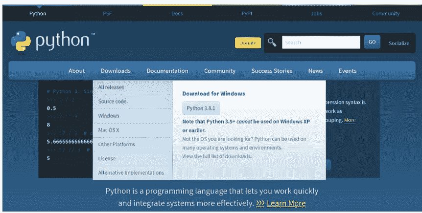

图 1-1. 带有下载选项的 Python 项目主页

运行安装文件以安装 Python 3。在安装过程中，选择与将 Python 3 添加到 PATH 变量相关的复选框（图 1-2）。

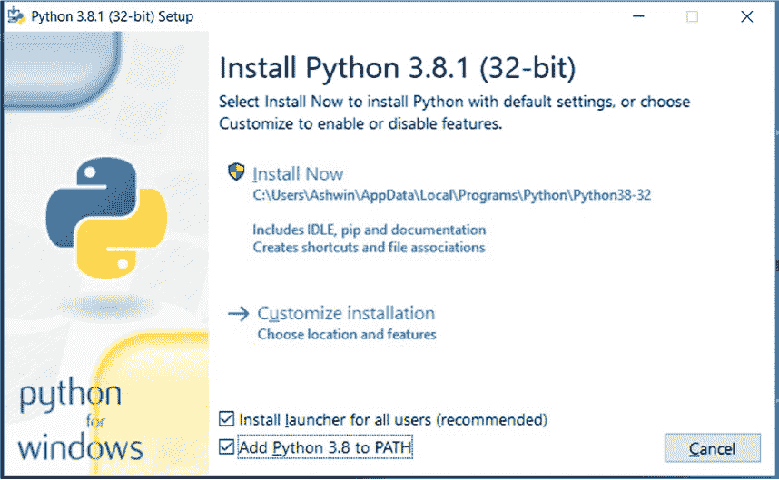

*图 1-2. Python 安装向导*

另外，选择“自定义安装”选项。这将带你进入更多选项，如图 1-3 所示。

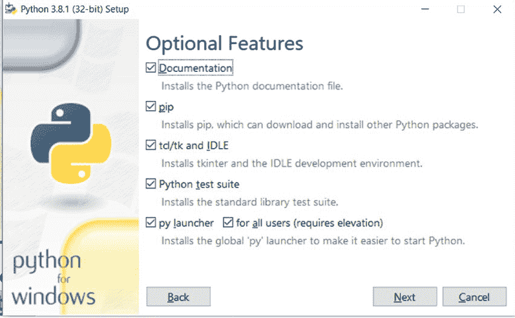

# 图 1-3. Python 安装选项

选择所有复选框并单击下一步按钮以继续设置。完成设置。Python 的二进制可执行程序名称在 Windows 上为 python。安装完成后，在 Windows 命令提示符 cmd 中运行以下命令：

```
python -V
```

这将返回 Python 3 的版本如下：

```
Python 3.8.1
```

你也可以按如下方式检查 pip 的版本：

```
pip3 -V
```

pip 是一个递归缩写，代表“Pip installs Python”或“Pip installs packages”。它是 Python 编程语言的包管理器。你可以使用 pip 实用程序为我们的演示安装其他需要的 Python 库。

要找到 Python 的确切位置，你可以按如下方式运行 where 命令：

```
where python
```

这返回以下结果：

```
C:\\Users\\Ashwin\\AppData\\Local\\Programs\\Python\\Python38-32\\python.exe
```

同样，你可以通过运行以下命令找到 pip3 实用程序的位置：

```
where pip3
```

在整本书中，我们将大量使用此实用程序来安装和管理我们正在使用的计算机上的 Python 3 库。以下命令列出所有已安装的包：

```
pip3 list
```

## 在 Ubuntu/Debian 衍生版上安装

Debian 是一个流行的发行版。Ubuntu Linux 和 Raspberry Pi OS 是基于 Debian 的其他流行发行版。Python 3 和 pip3 已预装在所有 Debian 发行版及其衍生版（如 Ubuntu 或 Raspberry Pi OS）上。因此，我们无需单独安装它们。我在配备 8 GB RAM 的 Raspberry Pi 4B 上使用 Raspberry Pi OS 作为我的 Linux 计算机。两个主要的 Python 版本，Python 2 和 Python 3，都预装在所有 Debian 衍生版上。它们的解释器可执行文件分别命名为 python 和 python3，分别对应 Python 2 和 Python 3。我们将使用 python3 进行演示。要查找所需二进制可执行文件版本和位置，请依次运行以下命令：

```
python3 -V
pip3 -V
which python3
which pip3
```

几乎所有其他流行的 Linux 发行版也预装了 Python。

另一种方式是从命令提示符（cmd）启动它，运行以下命令：

```
idle
```

这将启动图 1-5 所示的窗口。

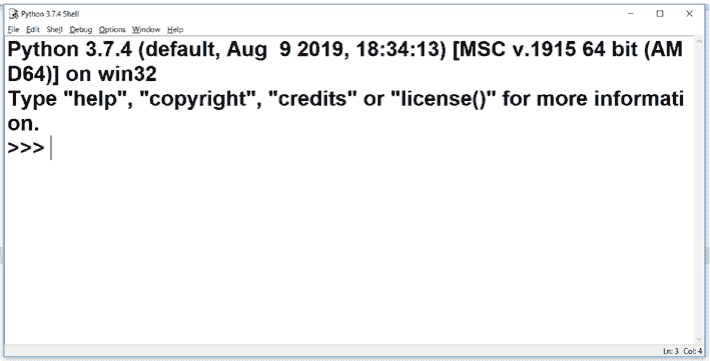

图 1-5. Python IDLE

在继续之前，你需要自定义 IDLE 使其适合你。你可以通过选择 Options ► Configure IDLE 来更改字体，如图 1-6 所示。

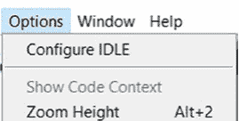

图 1-6. 配置 IDLE

图 1-7 所示的窗口打开，以便你可以更改 IDLE 中字符的字体和大小。

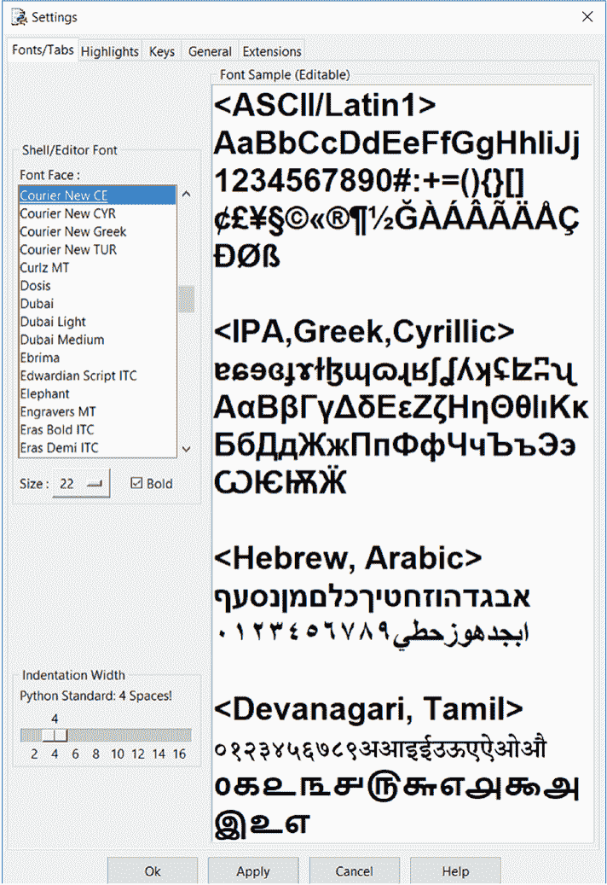

*图 1-7. IDLE 配置窗口*

根据自己的喜好调整选项。

并非所有 Linux 发行版都预装了 IDLE。你可以在 Debian 及衍生版（Ubuntu 和 Raspberry Pi OS）上通过按顺序运行以下命令安装它：

```
sudo apt-get update
sudo apt-get install idle3
```

安装完成后，你可以在菜单中（在此例中为 Raspberry Pi OS 菜单）找到 IDLE，如图 1-8 所示。

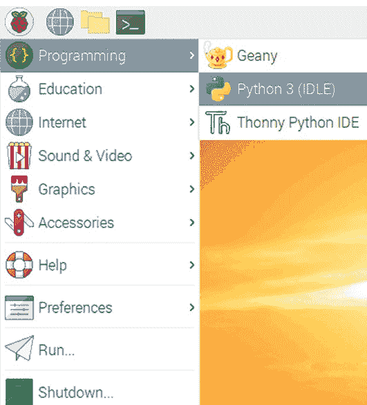

图 1-8. Raspberry Pi OS 菜单中的 IDLE

你也可以通过运行以下命令在 Linux 上启动 IDLE：

```
idle
```

现在让我们讨论 Python 的各种模式。

```
C:\Users\Ashwin>python
Python 3.8.3 (tags/v3.8.3:6f8c832, May 13 2020, 22:20:19) [MSC v.1925 32 bit (Intel)] on win32
Type "help", "copyright", "credits" or "license" for more information.
>>> 
```

> 图 1-10. Python 交互模式，Windows 命令提示符

## 脚本模式

你可以编写一个 Python 程序并将其保存到磁盘。然后你可以以多种方式启动它。这被称为 *脚本模式*。让我们在 IDLE 中演示它。你可以使用任何文本编辑器编写 Python 程序。但由于 IDLE 是一个 IDE，使用 IDLE 编写和运行 Python 程序很方便。让我们先看看。 在 IDLE 中，选择 File ► New File。这将创建一个新的空白文件。向其中添加以下代码：

```
print('Hello World!')
```

然后以 prog01.py 的名称将其保存到磁盘（图 1-11）。

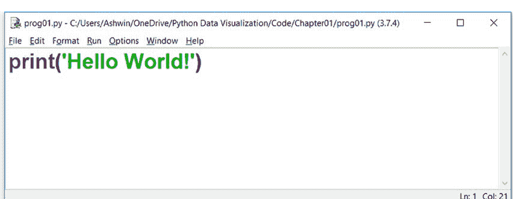

> 图 1-11. IDLE 代码编辑器中的一个 Python 程序

在菜单中选择 Run ► Run Module。这将在 IDLE 提示符下执行程序，如图 1-12 所示。


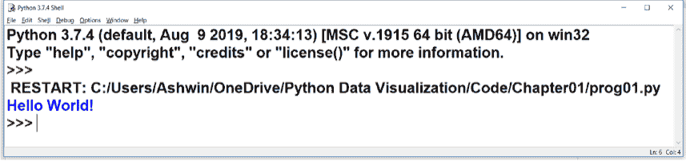

你甚至可以在操作系统的命令提示符下使用 Python 的解释器启动程序。打开操作系统的命令提示符并导航到程序存储的目录。在 Windows 命令提示符下，运行以下命令：

```text
python prog01.py
```

在 Linux 终端中，你必须运行以下命令：

```text
python3 prog01.py
```

然后解释器将在命令提示符下运行程序，输出（如果有）将显示在那里。

在 Linux 中，还有另一种无需显式使用解释器即可运行程序的方法。你可以在代码文件开头添加 shebang 行。例如，假设我们的代码文件如下所示：

```python
#!/usr/bin/python3
print('Hello World!')
```

第一行被称为 *shebang* 行。它告诉 shell 使用哪个解释器以及其位置。然后运行以下命令将文件权限更改为使其对所有者可执行，如下所示：

```text
chmod 755 prog01.py
```

然后你可以直接像其他任何可执行文件一样使用 `./` 启动你的 Python 程序文件，如下所示：

```text
./prog01.py
```

shell 将执行程序并在终端中打印输出。请注意，这仅适用于类 Unix 系统（Linux 和 macOS），因为它们支持以这种方式执行程序。你将在本书中继续学习更多关于 Python 编程的知识。

## 使用 Python IDE

你已经学习了如何使用 Python 解释器和 IDLE 来运行 Python 3 语句和程序。你可以使用其他免费可用的 IDE 和 IDE 插件来使用 Python。以下是一些著名的 Python 3 IDE 和插件的列表，以及它们主页的网址：

- PyCharm Community Edition ([https://www.jetbrains.com/pycharm/](https://www.jetbrains.com/pycharm/))
- Spyder IDE ([https://www.spyder-ide.org/](https://www.spyder-ide.org/))
- Thonny Python Editor ([https://thonny.org/](https://thonny.org/))
- Mu Editor ([https://codewith.mu/](https://codewith.mu/))
- PyDev plugin for Eclipse ([https://www.pydev.org/](https://www.pydev.org/))

所有这些 IDE 和插件都可免费下载和使用。作为本章的练习，你可能想探索它们以找到你最舒适的 IDE。

## 探索科学 Python 生态系统

科学 Python 生态系统是一组用于科学计算的开源 Python 库。它具有以下核心组件：

- *Python*: 这是一种编程语言。
- *NumPy*: 这是数值计算的基础库。科学 Python 生态系统中的几乎所有库都基于 NumPy。它提供了一种多功能的数据结构，称为 *Ndarray*（“N 维数组”）。
- *SciPy*: 该库有许多用于科学计算的例程。
- *Matplotlib*: 这是一个用于可视化的库。其 pyplot 模块具有 Matlab 风格可视化的例程。

所有这些组件一起提供了类似 Matlab 的功能：

- *Pandas*: 这是一个用于数据科学的库，提供高性能、易于使用的数据结构，如 series 和 dataframes 用于存储数据。
- *SymPy*: 这用于符号数学和代数。
- *NetworkX*: 这是一个用于表示和可视化图和网络的库。
- *Scikit-image*: 这是一个用于图像处理的库。
- *Scikit-learn*: 这是一个用于机器学习和人工智能的库。

除了这些库之外，IPython 还为 Python 解释器提供了一个更好的交互式环境。IPython 的交互式环境可以通过使用 Jupyter Notebook 的基于 Web 的笔记本进行访问。

本章的其余部分重点介绍 Jupyter Notebook。

## 介绍 Jupyter Notebook

在本章前面，你学习了运行 Python 语句的各种方法。你在脚本中以及解释器的交互模式中运行了 Python 语句。使用交互模式的主要优点是即时反馈。这种模式的主要缺点是，如果你在输入的语句中犯了任何错误，你必须重写整个语句才能重新执行它。此外，很难将其保存为程序。保存要运行在解释器上的语句的选项可以在菜单的 File 选项中找到。但是，所有语句及其输出都将以 .py 扩展名的纯文本格式保存。如果有任何图形输出，它会单独显示并且无法与语句一起存储。

由于解释器交互模式的局限性，我们将使用一个更好的工具在 Web 浏览器中交互式运行 Python 语句。该工具称为 Jupyter Notebook。它是一个服务器程序，可以在 Web 浏览器中创建交互式笔记本。

Jupyter Notebook 是一个基于 Web 的笔记本，用于交互式编程各种编程语言，如 Python、Octave、Julia 和 R。它在从事研究领域的人们中很受欢迎。Jupyter Notebook 可以在一个文件中保存代码、可视化、输出和富文本。与 Python 自身的交互式提示相比，Jupyter Notebook 的优点是你可以在编辑代码的同时立即看到新的输出，而在 Python 的交互模式中这是不可能的。另一个优点是，你可以在磁盘上的同一个文件中拥有代码、富文本元素以及代码的输出（可以是图形或富文本格式）。这使得分发变得容易。你可以通过互联网或使用便携式存储设备保存和共享这些笔记本。网上有许多服务可以帮助你在云服务器上存储和执行你的笔记本脚本。

## 设置 Jupyter Notebook

你可以通过在命令提示符下运行以下命令在任何计算机上轻松安装 Jupyter Notebook 服务器程序：

```bash
pip3 install jupyter
```

让我们看看现在如何使用 Jupyter Notebook 编写和执行 Python 语句。在操作系统的命令提示符中运行以下命令以在那里启动 Jupyter Notebook 服务器进程：

```bash
jupyter notebook
```

Jupyter Notebook 服务器进程将被启动，命令提示符窗口显示服务器日志，如图 1-13 所示。

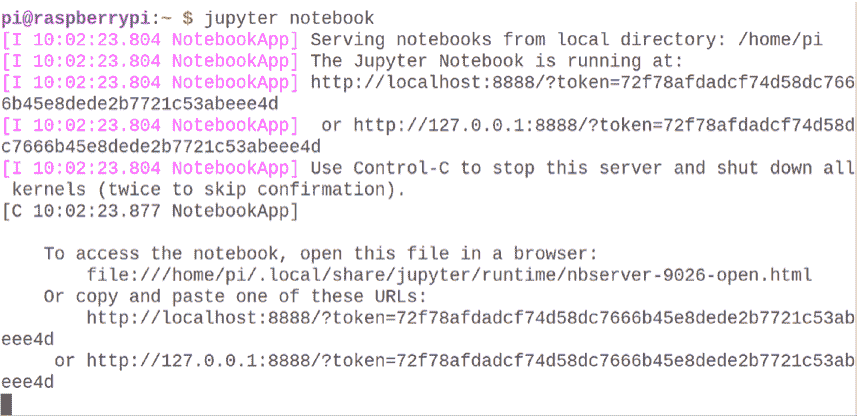

**Figure 1-13.** *Launching a new Jupyter Notebook process*

它还在操作系统的默认浏览器中启动一个网页。如果浏览器窗口已打开，则它将在同一浏览器窗口的新标签页中启动页面。另一种打开页面的方法（以防你关闭正在运行 Jupyter Notebook 的此浏览器窗口）是在浏览器中访问 `http://localhost:8888/`。它显示如图 1-14 所示的页面。

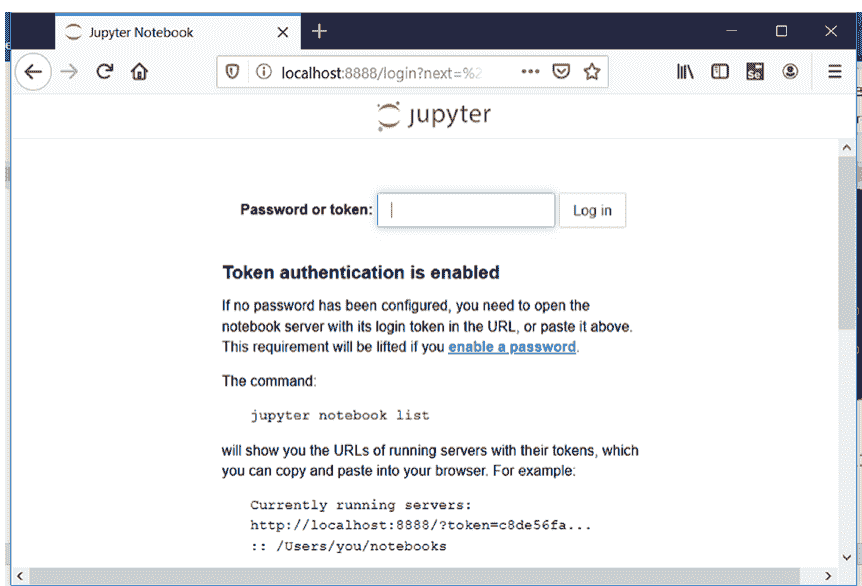

**Figure 1-14.** *Logging in with a token*

以下是服务器日志的文本。

要访问笔记本，请在浏览器中打开此文件：

```text
file:///C:/Users/Ashwin/AppData/Roaming/jupyter/runtime/nbserver-8420-open.html
```

或复制并粘贴以下其中一个 URL：

```text
http://localhost:8888/?token=e4a4fab0d8c22cd01b6530d5daced19d32d7e0c3a56f925c
http://127.0.0.1:8888/?token=e4a4fab0d8c22cd01b6530d5daced19d32d7e0c3a56f925c
```

在之前的日志中，你可以看到几个 URL。它们引用的是同一页面（localhost 和 127.0.0.1 是相同的 hosts）。你可以直接复制并粘贴这些 URL 中的任何一个到浏览器标签的地址栏中并打开 Jupyter Notebook 主页，或者你可以访问 http://localhost:8888/ 如前所述，然后粘贴服务器日志中的 token（在我们的例子中是 e4a4fab0d8c22cd01b6530d5daced19d32d7e0c3a56f925c）并登录。这将带你到同一个主页。

请注意，Jupyter Notebook 服务器的每个实例都有自己的 token，因此书中显示的 token 将无法与你的笔记本一起使用。token 仅对该服务器进程有效。

因此，如果你遵循前面解释的任何一条路径，你将在浏览器窗口中看到一个主页标签，如图 1-15 所示。

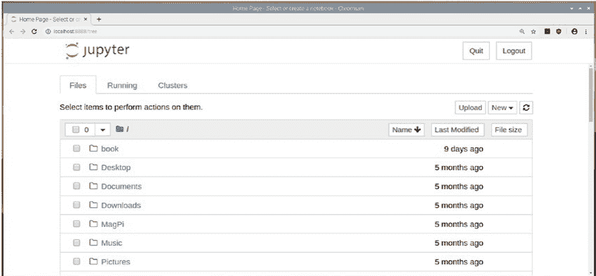

**Figure 1-15.** *A new home page tab of Jupyter Notebook*

正如你所见，网页上有三个标签：Files、Running 和 Clusters。Files 标签显示从命令提示符启动笔记本服务器时所在的目录中的目录和文件。在之前的示例中，我从我的 Raspberry Pi 的 lxterminal 执行了命令 jupyter notebook。并且当前工作目录是 pi 用户的主目录 /home/pi。这就是为什么你在图 1-15 中可以看到我的 Raspberry Pi 计算机主目录中的所有文件和目录。

在右上角，你可以看到 Quit 和 Logout 按钮。如果你点击 Logout 按钮，则会从当前会话注销，并且要登录，你再次需要来自笔记本服务器日志的 token 或带有嵌入 token 的 URL，如前所述。如果你点击 Quit 按钮，则会停止在命令提示符下运行的笔记本服务器进程并显示如图 1-16 所示的模态消息框。


## CHAPTER 1  INTRODUCTION TO PYTHON 3

Server stopped

You have shut down Jupyter. You can now close this tab.
To use Jupyter again, you will need to relaunch it.


To work with the Jupyter Notebook, you need to execute the command jupyter notebook again at the command prompt.

On the top-right side, just below the Quit and Logout buttons, you can see a small button with a refresh symbol. This button refreshes the home page. You also have the New button. Once clicked, it shows a drop-down, as shown in Figure 1-17.

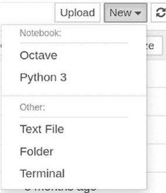

*Figure 1-17. Options for a new notebook*

As you can see, the drop-down is divided into two sections, Notebook and Other. You can create the Octave and Python 3 notebooks. If your computer has more programming languages installed that are supported by Jupyter Notebook, then all those languages will show up here. You can also create text files and folders. You can open a command prompt in the web browser by clicking Terminal. Figure 1-18 shows terminal running in a separate web browser tab.

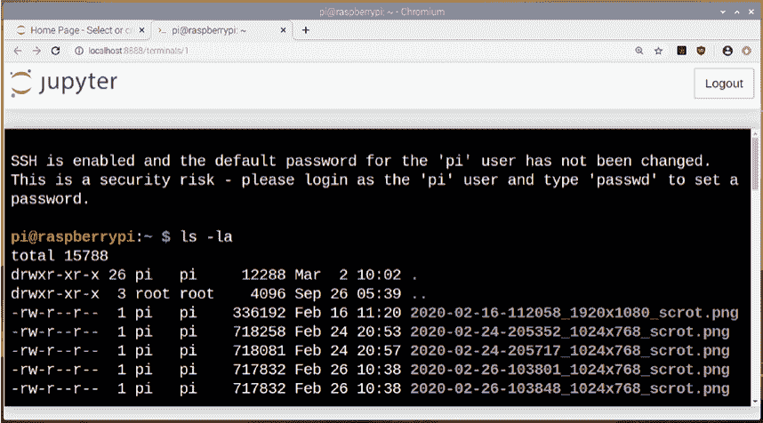

*Figure 1-18.* A new terminal window within the browser

Clicking Python 3 in the drop-down creates a new Python 3 notebook, as shown in Figure 1-19.

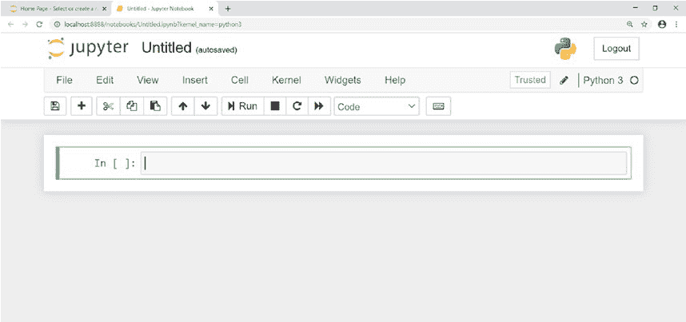

*Figure 1-19.* A new Python 3 notebook

If you go to the home page again by clicking the home page tab in the browser and then open the Running tab in the home page, you can see the entries corresponding to the terminal and the Python 3 notebook, as shown in Figure 1-20.

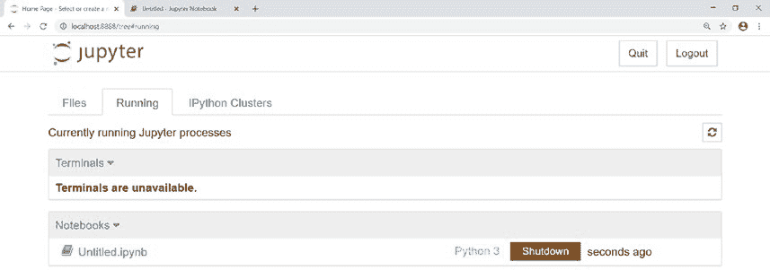

Figure 1-20. Summary of current Jupyter Notebook subprocesses

## Running Code in Jupyter Notebook

Go to Python 3’s Untitled1 tab again and type in the following statement in the text area (also known as a cell):

```
printf("Hello, World!\n");
```

Then click the Run button. Jupyter will execute the statement as a Python 3 statement and show the result immediately below the cell, as shown in Figure 1-21.

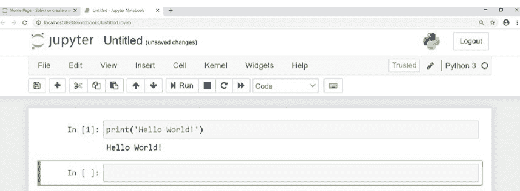

Figure 1-21. Code output in Jupyter Notebook

As you can see, after execution, it automatically creates a new cell below the result and sets the cursor there. Let’s discuss the menu bar and the icons above the programming cells. You can save the file by clicking the floppy disk icon. You can add a new empty cell after the current cell by clicking the + icon. The next three icons are Cut, Copy, and Paste. Using the up and down arrows can shift the position of the current cell up and down, respectively. The next option is to run the cell, which you already saw. The next three icons are for interrupting the kernel, restarting the kernel, and rerunning all the cells in the notebook. Next to that, you have a drop-down that tells you what type of cell it should be. Figure 1-22 shows the drop-down when clicked.

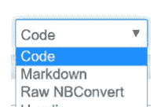

Figure 1-22. Types of cells in Jupyter Notebook

The cell is treated as a Python 3 code cell when you choose the Code option. It is treated as a Markdown cell when you choose the Markdown option. Markdown is a markup language that can create rich-text output. For example, anything followed by # creates a heading, anything followed by ## creates a subheading, and so on. Just type the following lines in a Markdown cell and execute them:

```
# Heading 1
## Heading 2
```

During our Python 3 demonstrations, we will mostly use Markdown for headings. However, you can further explore Markdown on your own by visiting https://jupyter-notebook.readthedocs.io/en/stable/examples/Notebook/Working%20With%20Markdown%20Cells.html. Figure 1-23 shows the output of the previous demonstration.

You can clear the output of a cell or the entire notebook. In the menu bar, click the Cell menu. In the drop-down, Current Outputs and All Output have a Clear option that clears the output of cells. Figure 1-25 shows the options.

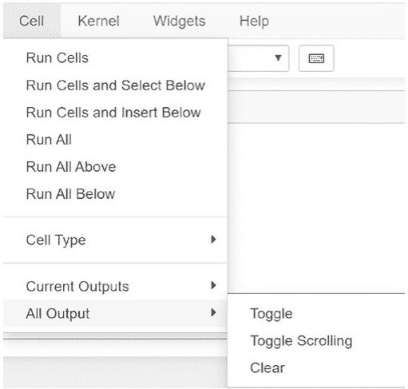

Figure 1-25. Clearing the output in Jupyter

One of the most significant advantages of Jupyter Notebook is that you can edit an already executed cell if there is any syntax error or you simply want to change the code. Jupyter Notebook is like an IDE that runs within a web browser and produces the output in the same window. This interactivity and facility to keep code, rich text, and output in the same file has made Jupyter Notebook project hugely popular worldwide. The kernel for running Python programs comes from the IPython project. As I mentioned earlier, you can use it for other programming languages too. I have used it for running GNU Octave programs.

You can find more information about Jupyter Notebook and IPython at the following URLs:

```
https://jupyter.org/
https://ipython.org/
```

## Anaconda

Before we can conclude the chapter, we need to discuss the Python distributions. A Python distribution is nothing more than the Python interpreter bundled with Python libraries. One such popular distribution is Anaconda. You can download and install Anaconda on Linux, Windows, and macOS. Anaconda has many versions. One of them is free and meant for individual usage. You can find it at https://www.anaconda.com/products/individual.

Anaconda comes with an open source package manager that can install packages for Python and other programs. It is known as Conda. You can find more information about the Conda package manager at https://docs.conda.io/en/latest/.

If you have already installed Python from Python’s website, I recommend using another computer to install Anaconda. Having multiple interpreters and distributions of Python can be confusing.

## Summary

In this chapter, you learned the basics of Python programming language. You learned how to write basic Python programs and how to execute them in various ways. You learned to work with Python on various operating systems such as Windows and Linux. You also learned various modes of the Python programming language and how to launch Python from the command prompts of various operating systems. You learned the basics of the built-in package manager of Python, called pip. We also briefly discussed other IDEs for Python.

Then, you got a brief introduction to the scientific Python ecosystem. We will explore many components of this ecosystem in the coming chapters. You also learned how to install Jupyter Notebook on various platforms and explored how you can run simple Python statements in Jupyter Notebook. You learned that you can store the code and the output of the same code in a single file that can be shared easily over the Internet and other media such as portable storage devices.

In the next chapter, we will get started with NumPy.
