## CHAPTER 4

## Revisiting Matplotlib Visualizations

在上一章中，你学习了 NumPy 库中创建和操作 Ndarrays 的许多例程。你将在本书中多次需要这些例程。

本章专门用于探索使用 Matplotlib 准备的可视化的美学方面。你将学习如何自定义 Matplotlib 可视化的外观。具体来说，我们将详细探讨以下主题：

- Single-line plots
- Multiline plots
- Grid, axes, and labels
- Colors, lines, and markers
- Subplots
- Object-oriented style
- Working with the text

阅读本章后，你将能够以编程方式自定义可视化的美学方面，使其更具表现力。

## Single-Line Plots

当图形中只有一个使用函数 plot() 的可视化时，它被称为单线图。在本节中，你将看到绘制单线图的几种方法。我们已经使用函数 plot() 绘制了单线图。让我们通过更多具体的示例进一步详细探讨这一概念。

## CHAPTER 4 REVISITING MATPLOTLIB VISUALIZATIONS

为本章的演示创建一个新的笔记本。你也可以按如下方式使用 Python 列表来可视化绘图：

```
```python
%matplotlib inline
import matplotlib.pyplot as plt
x = [4, 5, 3, 1, 6, 7]
plt.plot(x)
plt.show()
```
```

Figure 4-1 显示了输出。

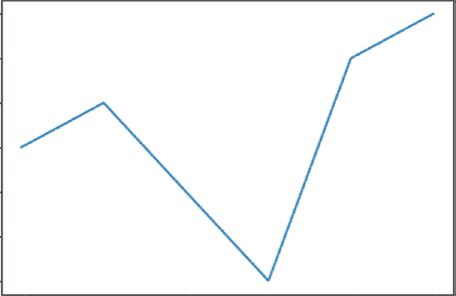

***Figure 4-1.*** *Demonstrating a simple single-line graph*

在这种情况下，y 轴的值被假定。

以下是另一个使用 Ndarray 的单线图的示例：

```
```python
import numpy as np
x = np.arange(25)
plt.plot(x)
plt.show()
```
```

Figure 4-2 显示了输出。

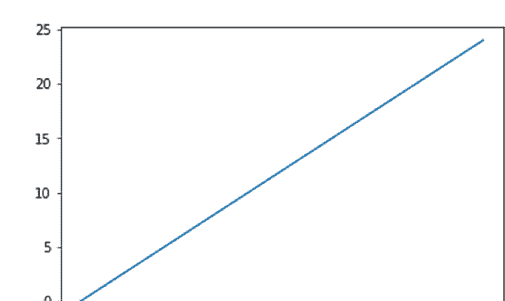

Figure 4-2. A simple single-line graph with arange()

让我们可视化二次图 y = f(x) = x³+1。代码如下：

```
plt.plot(x, [(y**3 + 1) for y in x])
plt.show()
```

Figure 4-3 显示了输出。

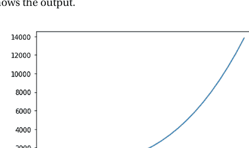

Figure 4-3. y = f(x) = x³+1

## CHAPTER 4   REVISITING MATPLOTLIB VISUALIZATIONS

你可以按如下方式以更简单的方式编写相同的代码：

```
```python
plt.plot(x, x**3 + 1)
plt.show()
```
```

## Multiline Plots

可以在同一输出中可视化多个绘图。让我们看看如何在同一可视化中显示多条曲线。以下是简单示例：

```
```python
%matplotlib inline
import numpy as np
import matplotlib.pyplot as plt
x = np.arange(7)
plt.plot(x, -x**2)
plt.plot(x, -x**3)
plt.plot(x, -2*x)
plt.plot(x, -2**x)
plt.show()
```
```

Figure 4-4 显示了输出。

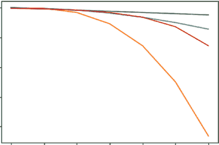

**Figure 4-4.** *Multiline graph*

正如你所见，Matplotlib 自动为曲线分别分配颜色。

你可以按如下方式以更简单的方式编写相同的代码：

```
```python
plt.plot(x, -x**2, x, -x**3,
         x, -2*x, x, -2**x)
plt.show()
```
```

输出将与 Figure 4-4 相同。

让我们看另一个示例：

```
```python
x = np.array([[3, 2, 5, 6], [7, 4, 1, 5]])
plt.plot(x)
plt.show()
```
```

Figure 4-5 显示了输出。

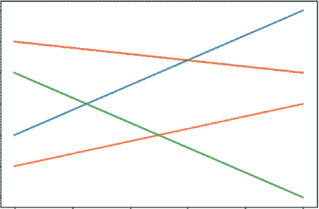

**Figure 4-5.** *Multiline graph, another example*

你也可以按如下方式使用随机数据创建多线图：

```
```python
data = np.random.randn(2, 10)
print(data)
plt.plot([data[0], data[1]])
plt.show()
```
```

Figure 4-6 显示了输出。

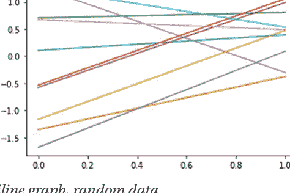

Figure 4-6. Multiline graph, random data

在这个示例中，我们使用例程 np.random.randn() 以随机方式生成数据。由于此例程会生成随机数据，因此每次执行时的输出都会不同。所以，你每次执行代码时看到的输出都会不同。

## Grid, Axes, and Labels

现在你将学习如何在可视化中启用网格。这可以通过语句 plt.grid(True) 来完成。你还将学习如何操作坐标轴的限制。但在此之前，你将快速学习如何将可视化保存为硬盘上的图像。查看以下代码：

```
x = np.arange(3)
plt.plot(x, -x**2, x, -x**3, x, -2*x, x, -2**x)
plt.grid(True)
plt.savefig('test.png')
plt.show()
```

语句 plt.savefig('test.png') 将图像保存到 Jupyter Notebook 文件的当前目录。Figure 4-7 显示了输出。


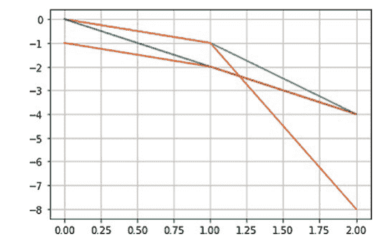

**Figure 4-7. Multiline graph**

You can see that the limits of the axes are set by default as follows:

```python
x = np.arange(3)
plt.plot(x, -x**2, x, -x**3, x, -2*x, x, -2**x)
plt.grid(True)
print(plt.axis())
plt.show()
```

Figure 4-8 shows the output.

```
(-0.1, 2.1, -8.4, 0.4)
```

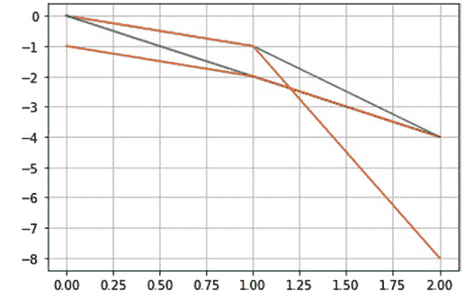

**Figure 4-8. Seeing the values of axes**

## CHAPTER 4 REVISITING MATPLOTLIB VISUALIZATIONS

You can also customize the values of the axes as follows:

```python
x = np.arange(3)
plt.plot(x, -x**2, x, -x**3, x, -2*x, x, -2**x)
plt.grid(True)
plt.axis([0, 2, -8, 0])
print(plt.axis())
plt.show()
```

The statement `plt.axis([0, 2, -8, 0])` sets the values of the axes. The first pair, (0, 2), refers to the limits for the x-axis, and the second pair, (-8, 0), refers to the limits for the y-axis. You can write the previous code with different syntax using the functions `xlim()` and `ylim()` as follows:

```python
x = np.arange(3)
plt.plot(x, -x**2, x, -x**3, x, -2*x, x, -2**x)
plt.grid(True)
plt.xlim([0, 2])
plt.ylim([-8, 0])
print(plt.axis())
plt.show()
```

Both the examples produce the same output, as shown in Figure 4-9.

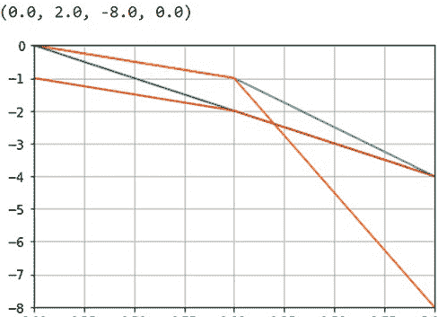

**Figure 4-9. Customizing the axes**

You can add the title and the labels for the axes as follows:

```python
x = np.arange(3)
plt.plot(x, -x**2, x, -x**3, x, -2*x, x, -2**x)
plt.grid(True)
plt.xlabel('x = np.arange(3)')
plt.xlim([0, 2])
plt.ylabel('y = f(x)')
plt.ylim([-8, 0])
plt.title('Simple Plot Demo')
plt.show()
```

This produces output with the labels and the title shown in Figure 4-10.

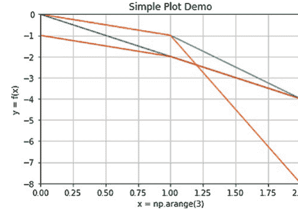

**Figure 4-10. Title for the visualization and labels for the axes**

You can pass an argument for the parameter label in the plot() function and then call the function legend() to create a legend as follows:

```python
x = np.arange(3)
plt.plot(x, -x**2, label='-x**2')
plt.plot(x, -x**3, label='-x**3')
plt.plot(x, -2*x, label='-2*x')
plt.plot(x, -2**x, label='-2**x')
plt.legend()
plt.grid(True)
plt.xlabel('x = np.arange(3)')
plt.xlim([0, 2])
plt.ylabel('y = f(x)')
plt.ylim([-8, 0])
plt.title('Simple Plot Demo')
plt.show()
```

This code produces output with legends for the curves, as shown in Figure 4-11.

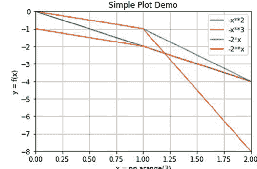

**Figure 4-11. Output with legends**

Instead of passing the legend string as an argument to the function plot(), you can pass the list of strings as an argument to the function legend() as follows:

```python
x = np.arange(3)
plt.plot(x, -x**2, x, -x**3, x, -2*x, x, -2**x)
plt.legend(['-x**2', '-x**3', '-2*x', '-2**x'])
plt.grid(True)
plt.xlabel('x = np.arange(3)')
plt.xlim([0, 2])
plt.ylabel('y = f(x)')
plt.ylim([-8, 0])
plt.title('Simple Plot Demo')
plt.show()
```

This produces the same output as Figure 4-11.

You can also change the location of the legend box by making the following changes to plt.legend() from the previous code:

```python
x = np.arange(3)
plt.plot(x, -x**2, x, -x**3, x, -2*x, x, -2**x)
plt.legend(['-x**2', '-x**3', '-2*x', '-2**x'],
            loc='lower center')
plt.grid(True)
plt.xlabel('x = np.arange(3)')
plt.xlim([0, 2])
plt.ylabel('y = f(x)')
plt.ylim([-8, 0])
plt.title('Simple Plot Demo')
plt.show()
```

Figure 4-12 shows the output.

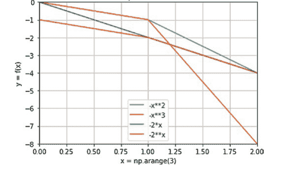

**Figure 4-12. Output with legends in lower center position**

Finally, let's save the visualization to disk with the following code:

```python
x = np.arange(3)
plt.plot(x, -x**2, x, -x**3, x, -2*x, x, -2**x)
plt.legend(['-x**2', '-x**3', '-2*x', '-2**x'],
            loc='lower center')
plt.grid(True)
plt.xlabel('x = np.arange(3)')
plt.xlim([0, 2])
plt.ylabel('y = f(x)')
plt.ylim([-8, 0])
plt.title('Simple Plot Demo')
plt.savefig('test.png')
plt.show()
```

### Colors, Styles, and Markers

Up until now, in the case of multiline plots, you have seen that Matplotlib automatically assigned colors, styles, and markers. You saw a few examples of how to customize them. Now, in this section, you will learn how to customize them in detail.

Let’s start with colors. The following code lists all the primary colors supported by Matplotlib (we are not customizing styles and markers in this example):

```python
%matplotlib inline
import matplotlib.pyplot as plt
import numpy as np

x = np.arange(5)
y = x
plt.plot(x, y+0.4, 'g')
plt.plot(x, y+0.2, 'y')
plt.plot(x, y, 'r')
plt.plot(x, y-0.2, 'c')
plt.plot(x, y-0.4, 'k')
plt.plot(x, y-0.6, 'm')
plt.plot(x, y-0.8, 'w')
plt.plot(x, y-1, 'b')
plt.show()
```

Figure 4-13 shows the output.

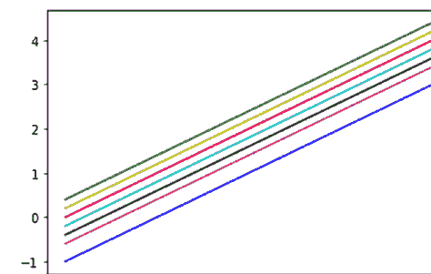

**Figure 4-13. Demo of colors**

You can also write the previous code as follows:

```python
plt.plot(x, y+0.4, 'g', x, y+0.2, 'y', x, y, 'r', x, y-0.2, 'c', x, y-0.4, 'k', x, y-0.6, 'm', x, y-0.8, 'w', x, y-1, 'b')
plt.show()
```

The output will be the same as Figure 4-13.

You can customize the line style as follows:

```python
plt.plot(x, y, '-', x, y+1, '--', x, y+2, '-.', x, y+3, ':')
plt.show()
```

Figure 4-14 shows the output.

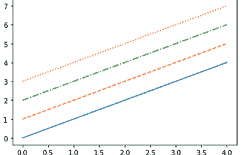

**Figure 4-14. Line styles**

You can even change the markers as follows:

```python
plt.plot(x, y, '.')
plt.plot(x, y+0.5, ',')
plt.plot(x, y+1, 'o')
plt.plot(x, y+2, '<')
plt.plot(x, y+3, '>')
plt.plot(x, y+4, 'v')
plt.plot(x, y+5, '^')
plt.plot(x, y+6, '1')
plt.plot(x, y+7, '2')
plt.plot(x, y+8, '3')
plt.plot(x, y+9, '4')
plt.plot(x, y+10, 's')
plt.plot(x, y+11, 'p')
plt.plot(x, y+12, '*')
plt.plot(x, y+13, 'h')
plt.plot(x, y+14, 'H')
plt.plot(x, y+15, '+')
plt.plot(x, y+16, 'D')
plt.plot(x, y+17, 'd')
plt.plot(x, y+18, '|')
plt.plot(x, y+19, '_')
plt.show()
```

These are the basic customizations you can do in Matplotlib. You can customize everything in great detail. Here is a code example:

```python
plt.plot(x, y, color='g', linestyle='--', linewidth=1.5, marker='^', markerfacecolor='b', markeredgecolor='k', markeredgewidth=1.5, markersize=5)
plt.grid(True)
plt.show()
```

Figure 4-17 shows the output.

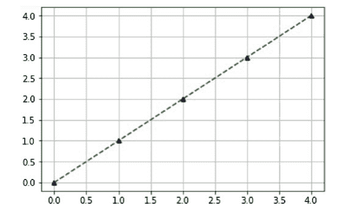

**Figure 4-17. Customizing everything in greater detail**

You can even customize the values on the x- and y-axes as follows:

```python
x = y = np.arange(10)
plt.plot(x, y, 'o--')
plt.xticks(range(len(x)), ['a', 'b', 'c', 'd', 'e', 'f', 'g', 'h', 'i', 'j'])
plt.yticks(range(0, 10, 1))
plt.show()
```

Figure 4-18 shows the output.

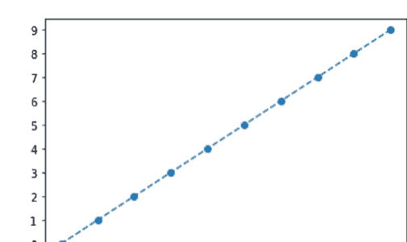

**Figure 4-18. Customizing the ticks on the axes**

### Object-Oriented Plotting

You can create plots in an object-oriented way. Let’s rewrite one of our earlier code examples as follows:

```python
fig, ax = plt.subplots()
ax.plot(x, -x**2, label='-x**2')
ax.plot(x, -x**3, label='-x**3')
ax.plot(x, -2*x, label='-2*x')
ax.plot(x, -2**x, label='-2**x')
ax.set_xlabel('x = np.arange(3)')
ax.set_ylabel('y = f(x)')
ax.set_title('Simple Plot Demo')
ax.legend()
ax.grid(True)
plt.show()
```

Note that we are using the axis object to plot and set the labels and a title. Figure 4-19 shows the output.

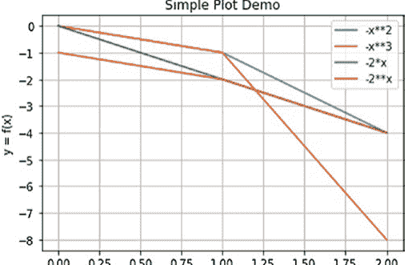

**Figure 4-19. Output of object-oriented plotting**

You can also add the text with the functions ax.text() or the function plt.text(). The functions accept the coordinates and the text to be displayed. The following is an example:

```python
fig, ax = plt.subplots()
ax.plot(x, -x**2, label='-x**2')
ax.plot(x, -x**3, label='-x**3')
ax.plot(x, -2*x, label='-2*x')
ax.plot(x, -2**x, label='-2**x')
ax.set_xlabel('x = np.arange(3)')
ax.set_ylabel('y = f(x)')
ax.set_title('Simple Plot Demo')
ax.legend()
ax.grid(True)
ax.text(0.25, -5, "Simple Plot Demo")
plt.show()
```

Figure 4-20 shows the output.

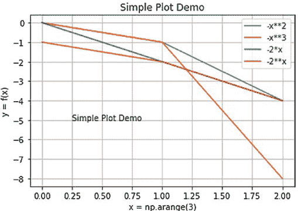

**Figure 4-20. Rendering text**

### Subplots

You can show multiple separate graphs in the same output. The technique is known as *subplotting*. Subplots can have their own titles, own labels, and other specifications. Subplots are created in a grid. The first subplot position is at the top left. The other subplot positions are relative to the first position. The following is an example:

```python
x = np.arange(3)
plt.subplots_adjust(wspace=0.3,
                    hspace=0.3)
plt.subplot(2, 2, 1)
plt.plot(x, -x**2)
plt.subplot(2, 2, 2)
plt.plot(x, -x**3)
plt.subplot(2, 2, 3)
plt.plot(x, -2*x)
plt.subplot(2, 2, 4)
plt.plot(x, -2**x)
plt.show()
```

The first two arguments passed to `plt.subplot()` represent the grid size, and the third argument indicates the position of that particular subplot. Figure 4-21 shows the output.


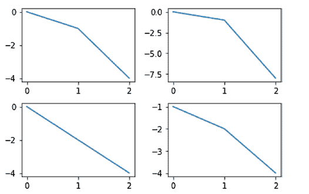

**Figure 4-21. Subplots**

You can write the same code in object-oriented fashion as follows:

```
fig, axs = plt.subplots(2, 2)
plt.subplots_adjust(wspace=0.3,
                    hspace=0.3)
axs[0, 0].plot(x, -x**2)
axs[0, 1].plot(x, -x**3)
axs[1, 0].plot(x, -2*x)
axs[1, 1].plot(x, -2**x)
plt.show()
```

The code produces the same output as shown in Figure 4-21.

### Summary

This chapter focused on visualizations and various customizations. You learned a great deal about visualizing the data and customizing the visualizations as per the requirements. You also learned about the object-oriented style of plotting and subplots. The concepts you learned in this chapter will be used throughout this book to visualize the data.

In the next chapter, we will explore more stylesheets, legends, and layout computations.
