# 第 6 章

# 线图、条形图和散点图

在上一章中，你了解了与 Matplotlib 可视化相关的许多高级概念。

在本章及接下来的几章中，你将学习一些创建数据可视化的技巧。具体来说，本章你将学习如何创建以下数据可视化：

- 线图与对数图
- 误差条
- 条形图
- 散点图

读完本章后，你将能够熟练使用线图、对数图、条形图和散点图。

## 线图与对数图

你已经在前面章节中看到了如何绘制线图。这里先热个身，再看一个线图示例：

```
%matplotlib inline
import numpy as np
import matplotlib.pyplot as plt
data = np.linspace(0, 9, 10)
```

图 6-2 显示了输出结果。

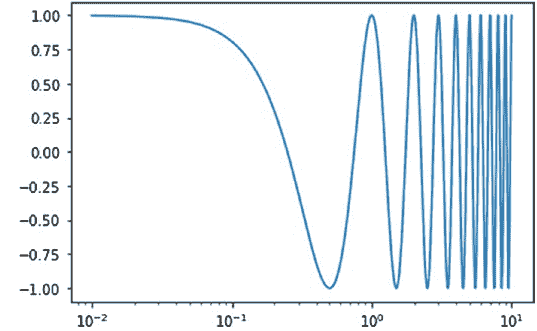

图 6-2：普通 y 轴与对数 x 轴

类似地，你可以按如下方式创建对数 y 轴和普通 x 轴：

```
plt.semilogy(t, np.cos(2 * np.pi * t))
plt.show()
```

图 6-3 显示了输出结果。

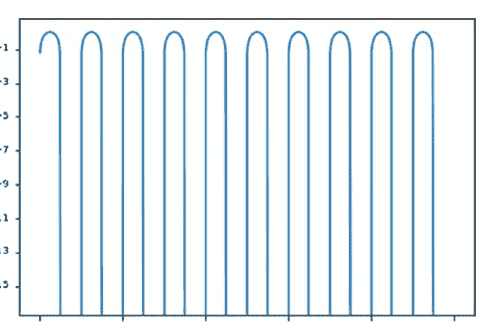

图 6-3：普通 x 轴与对数 y 轴

你也可以让两个轴都是对数轴，如下所示：

```
plt.loglog(t, np.cos(2 * np.pi * t))
plt.show()
```

图 6-4 显示了输出结果。

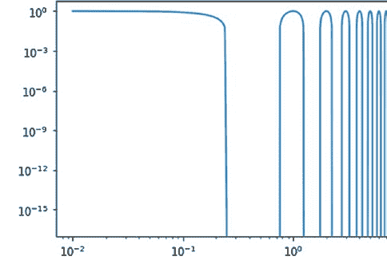

图 6-4：双对数轴

## 误差条

你也可以使用可视化来展示数据中的误差。当观测数据可能存在误差时，通常需要在观测结果中提及这一点。你可能会说“有 96% 的置信区间”，这意味着给定数据中可能有 4% 的误差。这能让人们对数据的精度有一个大致了解。当你想要表示这种置信度（或置信度的缺乏）时，可以使用误差条。

你必须使用 errorbar() 函数来实现这一点。你可以创建一个 Ndarray 或列表来存储误差数据。我们既可以使用真实数据，也可以像下面这样模拟数据：

```
x = np.linspace (0, 2 * np.pi, 100)
y = np.sin(x)
ye = np.random.rand(len(x))/10
plt.errorbar(x, y, yerr = ye)
plt.show()
```

在这个示例中，我们展示的是 y 轴上的误差。图 6-5 显示了输出结果。

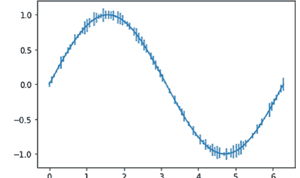

图 6-5：y 轴上的误差

类似地，你也可以在 x 轴上显示误差数据。

```
xe = np.random.rand(len(x))/10
plt.errorbar(x, y, xerr = xe)
plt.show()
```

图 6-6 显示了输出结果。

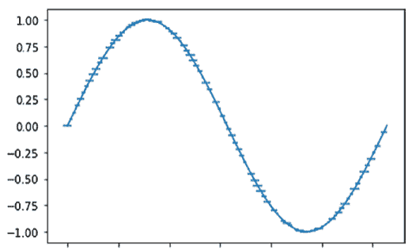

图 6-6：x 轴上的误差

你可以按如下方式在两个轴上同时显示误差：

```
plt.errorbar(x, y, xerr = xe, yerr = ye)
plt.show()
```

图 6-7 显示了输出结果。

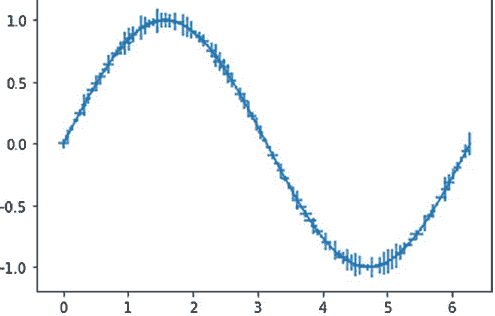

图 6-7：两个轴上的误差

## 条形图

条形图是用条形表示离散分类数据项的一种可视化形式。你可以用垂直或水平条形来表示数据。条形的高度或长度始终与数据的数值大小成比例。当你拥有离散的分类数据时，可以使用条形图。下面是一个简单的条形图示例：

```
x = np.arange(4)
y = np.random.rand(4)
plt.bar(x, y)
plt.show()
```

图 6-8 显示了输出结果。

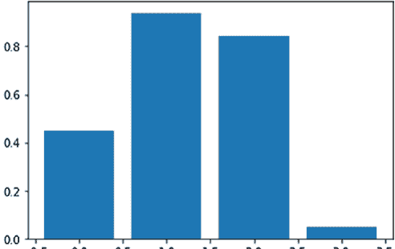

图 6-8：条形图

你可以按如下方式创建组合条形图：

```
y = np.random.rand(3, 4)
plt.bar(x + 0.00, y[0], color = 'b', width = 0.25)
plt.bar(x + 0.25, y[1], color = 'g', width = 0.25)
plt.bar(x + 0.50, y[2], color = 'r', width = 0.25)
plt.show()
```

图 6-9 显示了输出结果。

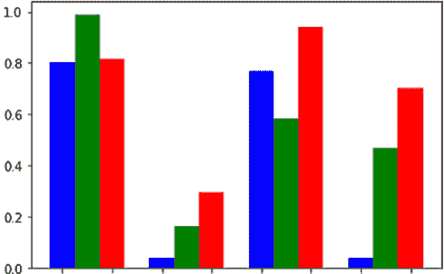

图 6-9：组合条形图

前面的图都是垂直条形图的示例。类似地，你也可以创建水平条形图，如下所示：

```python
x = np.arange(4)
y = np.random.rand(4)
plt.barh(x, y)
plt.show()
```

图 6-10 显示了输出结果。

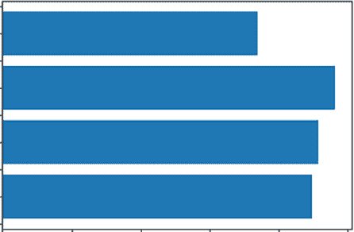

图 6-10：水平条形图

你还可以创建组合水平条形图，如下所示：

```python
y = np.random.rand(3, 4)
plt.barh(x + 0.00, y[0], color = 'b', height=0.25)
plt.barh(x + 0.25, y[1], color = 'g', height=0.25)
plt.barh(x + 0.50, y[2], color = 'r', height=0.25)
plt.show()
```

图 6-11 显示了输出结果。

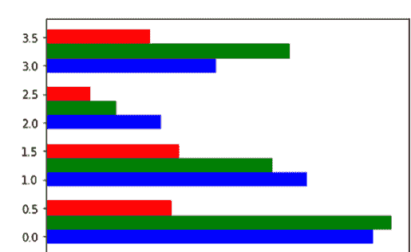

图 6-11：组合水平条形图

## 散点图

你也可以使用散点图来可视化数据。通常，你会用散点图来可视化一组包含两个变量的数据：一个变量分配给 x 轴，另一个变量分配给 y 轴，然后为每一对 x-y 值绘制一个点。x 和 y 的大小必须相同（它们总是一维数组）。你可以通过调整点的颜色和大小来展示额外的变量。在这种情况下，表示 x、y、颜色和大小的各一维数组的长度必须相同。

在下面的示例中，我们为 1,000 个点随机分配 x 轴和 y 轴的值以及颜色。所有点的大小均为 20。

```
N = 1000
x = np.random.rand(N)
y = np.random.rand(N)
colors = np.random.rand(N)
size = (20)
plt.scatter(x, y, s=size, c=colors, alpha=1)
plt.show()
```

图 6-12 显示了输出结果。

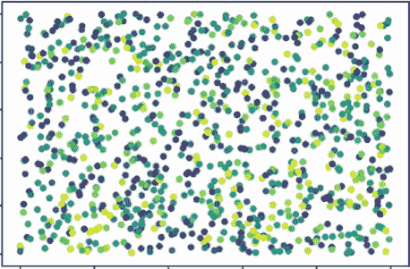

图 6-12：散点图

在这个示例中，点的大小是固定的。你也可以根据图上的位置（取决于 x 和 y 坐标的值）来设置大小。下面是一个示例：

```
N = 1000
x = np.random.rand(N)
y = np.random.rand(N)
colors = np.random.rand(N)
size = (50 * x * y)
plt.scatter(x, y, s=size, c=colors, alpha=1)
plt.show()
```

图 6-13 显示了输出结果。

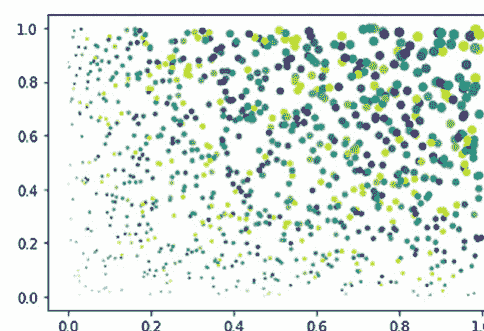

图 6-13：散点图

你刚刚学习了如何创建散点图。

## 小结

在本章中，我们先从线图的小热身开始。接着你学习了如何创建各种对数图，还学习了如何显示误差范围以及如何创建条形图。最后，你学习了如何创建散点图。

在下一章中，你将学习更多创建数据可视化的技巧，包括如何创建直方图、等高线图、流图和热力图。
