# 第 7 章

# 直方图、等高线图和流图

在上一章中，你学习了使用线图、条形图和散点图创建可视化的多种方法。

在本章中，我们将继续探索使用 Matplotlib 创建各种可视化。你将学习如何创建直方图和等高线图，还将学习如何使用流图绘制向量。

## 直方图

在开始学习如何创建各种类型的直方图之前，你需要先了解它们是什么。首先，你需要知道什么是频数表。

假设你有一组具有不同取值的成员。你可以创建一个表，其中一列包含多个数值范围区间（bucket），每个区间至少包含一个值。然后你可以统计落入每个区间的成员数量，并将这些计数标注在对应的区间旁。

让我们看一个简单的例子。请为此新建一个 notebook，如下所示：

```python
%matplotlib inline
import numpy as np
import matplotlib.pyplot as plt
```

现在，我们手动创建一个数据集，并将区间的数量设为该集合的基数（不同元素的数量）。

```python
x = [1, 3, 5, 1, 2, 4, 4, 2, 5, 4, 3, 1, 2]
n_bins = 5
```

可以使用以下代码显示输出：

```
plt.hist(x, bins=n_bins)
plt.show()
```

图 7-1 显示了输出结果。

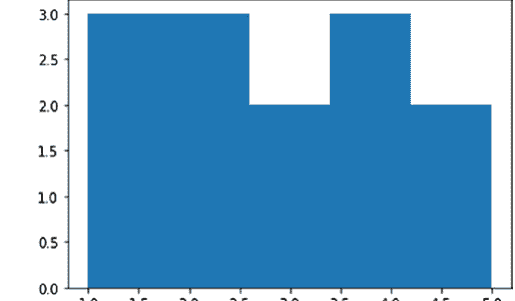

图 7-1：简单直方图

正态（或高斯）分布是一种连续概率分布，通常呈现钟形曲线。我们来创建一个带有正态分布曲线的直方图。为了创建数据，我们将使用 NumPy 的一个例程。下面绘制一个正态分布随机数据的直方图：

```
np.random.seed(31415)
n_points = 10000
n_bins = 15
x = np.random.randn(n_points)
plt.hist(x, bins=n_bins)
plt.show()
```


Figure 7-2 shows the output.

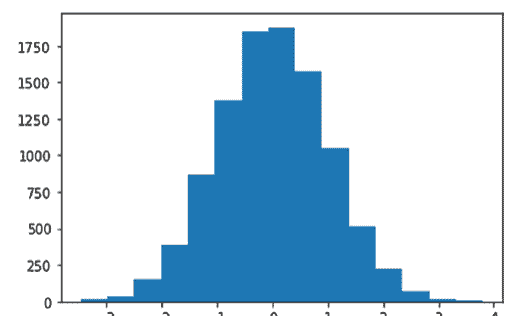

Figure 7-2. Simple histogram of random data

The histogram of one-dimensional data is a 2D figure (as shown in Figure 7-2). When you want to create a histogram of 2D data, you have to create a 3D figure with the data variables on the x- and y-axes and the histogram on the z-axis. In other words, you can use 2D coordinates to show this 3D visualization and view the histogram from the top (top view). The bars can be color coded to signify their magnitude.

```
y = np.random.randn(n_points)
plt.hist2d(x, y, bins=50)
plt.show()
```

Figure 7-3 shows the output.

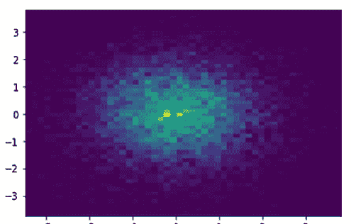

Figure 7-3. Simple histogram of 2D data

You can customize the histogram by setting the transparency and the color as follows:

```
plt.hist(x, 20, density=True,
    histtype='stepfilled',
    facecolor='g', alpha=0.5)
plt.show()
```

Figure 7-4 shows the output.

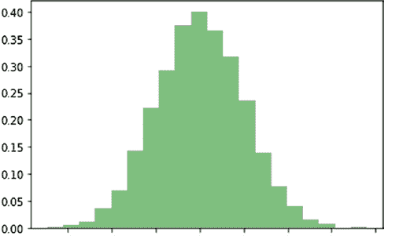

Figure 7-4. Customized histogram

You can also show just the outline of the histogram as follows:

```
```python
plt.hist(x, 20, density=True,
         histtype='step')
plt.show()
```
```

Figure 7-5 shows the output.

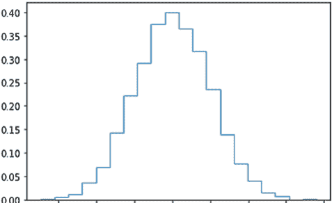

**Figure 7-5.** Customized histogram with outline only

## Contours

Contours represent the outline of an object. Contours are continuous (and closed, in many cases) lines highlighting the shape of objects. Contours are useful in the area of cartography, which means map-making. On maps, a contour joins points of equal height. So, all the points on a contour line are at an equal elevation (from the sea level). In other applications where we use contours, all the points on the same contour line have the same values (or magnitude).

Let’s draw a simple contour. We will create and visualize our own data by creating circular contour as follows:

```
```python
x = np.arange(-3, 3, 0.005)
y = np.arange(-3, 3, 0.005)
X, Y = np.meshgrid(x, y)
Z = (X**2 + Y**2)
```
```

```
out = plt.contour(X, Y, Z)
plt.clabel(out, inline=True,
          fontsize=10)
plt.show()
```

Figure 7-6 shows the output.

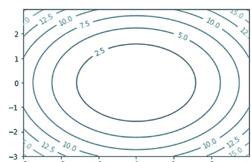

*Simple labeled contour*

You can also add a color bar to the output as follows:

```
out = plt.contour(X, Y, Z)
plt.clabel(out, inline=True,
          fontsize=10)
plt.colorbar(out)
plt.show()
```

Figure 7-7 shows the output.

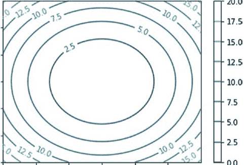

**Figure 7-7.** Simple labeled contour with a color bar

You can also set the colors of the contour as follows:

```
out = plt.contour(X, Y, Z,
                  colors='g')
plt.clabel(out, inline=True,
           fontsize=10)
plt.show()
```

Figure 7-8 shows the output.

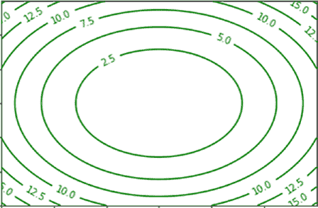

**Figure 7-8.** Simple labeled contour with custom colors

You can also have a filled contour. The styles are used to highlight the various areas in the contour visualization. Let’s visualize filled contours as follows:

```
plt.contourf(X, Y, Z,
    hatches=['-', '/', '\\', '//'],
    cmap='cool',
    alpha=0.75)
plt.show()
```

Figure 7-9 shows the output.

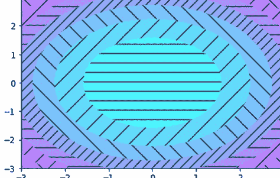

Figure 7-9. Filled contour

## Visualizing Vectors with Stream Plots

Up to now, we have visualized scalar entities, which have magnitudes. All the visualizations you have learned about up to this point are great for scalars. Vectors, by contrast, are entities that have magnitude and direction. For example, force has a magnitude and a direction. A specific example is a magnetic force field. You can visualize vectors with stream plots. Let’s create our own dataset to visualize this. We will create a mesh with X and Y. Then we will create U and V to show the magnitude.

```
Y, X = np.mgrid[-5:5:200j, -5:5:300j]
U = X**2 + Y**2
V = X + Y
```

You can create a simple stream plot as follows:

```
plt.streamplot(X, Y, U, V)
plt.show()
```

Figure 7-10 shows the output.

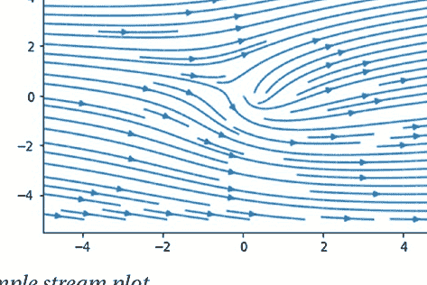

Figure 7-10. Simple stream plot

You can also have stream plots of variable densities as follows:

```
plt.streamplot(X, Y, U, V,
    density=[0.5, 0.75])
plt.show()
```

Figure 7-11 shows the output.

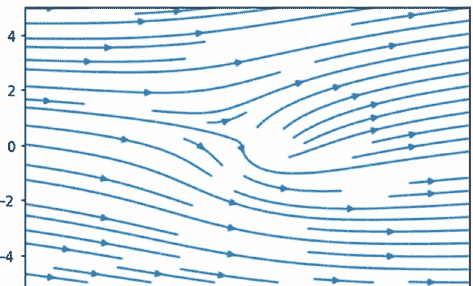

Figure 7-11. Stream plot with variable densities

You can also assign colors to the stream plot as follows:

```
plt.streamplot(X, Y, U, V, color=V,
    linewidth=1, cmap='cool')
plt.show()
```

Figure 7-12 shows the output.

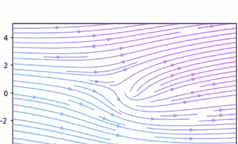

Figure 7-12. Stream plot with variable colors

You can also create a stream plot with variable line widths as follows:

```
plt.streamplot(X, Y, U, V,
    density=0.6,
    color='k',
    linewidth=X)
plt.show()
```

Figure 7-13 shows the output.

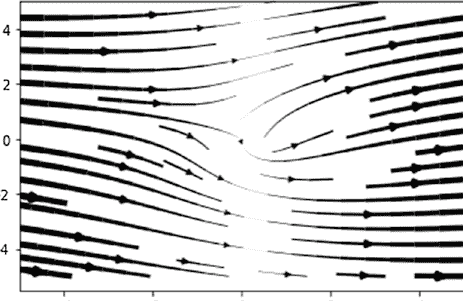

Figure 7-13. Stream plot with variable line widths

You can also use quiver plots for the vector visualizations as follows:

```
X = np.arange(-5, 5, 0.5)
Y = np.arange(-10, 10, 1)
U, V = np.meshgrid(X, Y)
plt.quiver(X, Y, U, V)
plt.show()
```

Figure 7-14 shows the output.

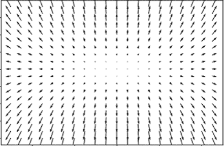

**Figure 7-14.** *Visualizing vector fields with a quiver plot*

## Summary

In this chapter, you learned about histograms, contours, and stream plots.

In the next chapter, you will learn how to visualize images and audio. You will also learn interpolation methods for images.
