## CHAPTER 8

## Image and Audio Visualization

In the previous chapter, you learned how to create visualizations with histograms, contours, and stream plots.

In this chapter, you will learn how to process and visualize images and audio with Matplotlib. Specifically, you will learn about the following topics in this chapter:

- Visualizing images
- Interpolation methods
- Audio visualization
- Audio processing

After reading this chapter, we will be able to visualize images and audio with Matplotlib.

### Visualizing Images

You can read digital images with Matplotlib, which supports many image formats, although you do have to install a library called *pillow*. Install pillow as shown here:

```
```python
!pip3 install pillow
```
```

I recommend that you create a fresh notebook for this chapter. Import the library with the following statements:

```
```python
%matplotlib inline
import numpy as np
import matplotlib.pyplot as plt
```
```

## CHAPTER 8 IMAGE AND AUDIO VISUALIZATION

You can read digital images with the function `imread()` on Windows as follows:

```
```python
img1 = plt.imread("D:/Dataset/4.2.03.tiff")
```
```

The code is similar for Linux and Mac, as follows:

```
```python
img1 = plt.imread("~/Dataset/4.2.03.tiff")
```
```

Let’s see the contents of the variable now, as shown here:

```
```python
print(img1)
```
```

The output is as follows:

```
```text
array([[[164, 150,  71],
        [ 63,  57,  31],
        [ 75,  43,  10],
        ...,
        [  5,   8,   5],
        [  2,   5,   0],
        [  4,   5,   2]]], dtype=uint8)
```
```

I have removed the middle part of the output to save space, but this is an Ndarrray after all. We can confirm this with the following code:

```
```python
type(img1)
```
```

The output is as follows:

```
```text
numpy.ndarray
```
```

To learn more about the image, you can check the properties of the Ndarray that is storing the image data. A color image is stored as a 3D matrix, and each individual dimension of that matrix is used to visualize the intensity of the color channel. Color images are read and stored in red, green, blue (RGB) format. Since there are no colors in grayscale images, there is only a single plane (a 2D matrix) that stores the intensities of the grayscale values.

You can use the routine `imshow()` to show any Ndarray as an image as follows:

```
```python
plt.imshow(img1)
plt.show()
```
```


图 8-1 展示了输出结果。

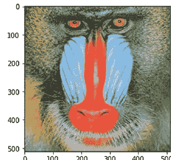

## 图 8-1. 可视化一张图像

这是一张彩色图像。Matplotlib 库会自动检测到图像具有多个通道，并将其显示为彩色图像。但是，当显示灰度图像时，它会有一些小问题。

```
img2 = plt.imread("D:/Dataset/5.1.11.tiff")
plt.imshow(img2)
plt.show()
```

图 8-2 展示了输出结果。

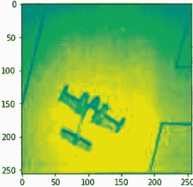

## 图 8-2. 可视化一张灰度图像

图像数据被正确解析，但颜色似乎有些问题。对于灰度图像，Matplotlib 使用默认的颜色映射，因此你需要手动指定颜色映射，如下所示：

```
plt.imshow(img2, cmap = 'gray')
plt.show()
```

图 8-3 展示了输出结果。

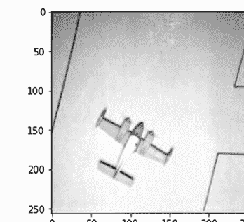

图 8-3. 使用正确的颜色映射可视化灰度图像

颜色映射是一个定义可视化颜色的值矩阵。让我们尝试另一种颜色映射来处理这张图像，如下所示：

```
plt.imshow(img2, cmap = 'cool')
plt.show()
```

图 8-4 展示了输出结果。

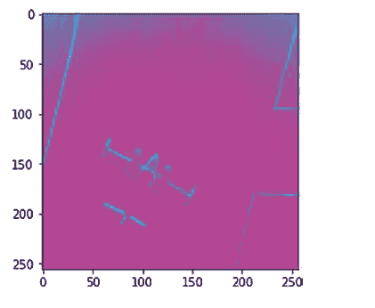

**图 8-4**. 使用冷色映射可视化灰度图像

你可以通过以下语句显示当前版本 Matplotlib 中的颜色映射列表：

```
plt.colormaps()
```

输出如下：

```
['Accent',
'Accent_r',
........
'twilight_r',
'twilight_shifted',
'twilight_shifted_r',
'viridis',
'viridis_r',
'winter',
'winter_r']
```

为了节省篇幅，我删除了输出中的大部分内容。你可以根据可视化需求使用其中任何一种颜色映射。作为练习，请尝试为灰度图像应用几种不同的颜色映射。

## 图像掩蔽

你可以使用一个圆形来掩蔽图像的某些区域，如下所示：

```
import matplotlib.patches as patches
fig, ax = plt.subplots()
im = ax.imshow(img1)
patch = patches.Circle((245, 200),
                    radius=200,
                    transform=ax.transData)
im.set_clip_path(patch)
ax.axis('off')
plt.show()
```

在这个代码示例中，我们使用 `Circle()` 例程在 XY 坐标 (245, 200) 处创建一个圆形，半径为 200 像素。然后，我们使用 `set_clip_path()` 例程用该圆形裁剪图像并显示它。图 8-5 展示了输出结果。


图 8-5. 使用圆形裁剪图像

## 插值方法

你可以将简单的 NumPy Ndarray 显示为图像，如下所示：

```
img3 = [[1, 2, 3, 4],
        [5, 6, 7, 8],
        [9, 10, 11, 12],
[13, 14, 15, 16]
plt.imshow(img3)
plt.show()
```

图 8-6 展示了输出结果。

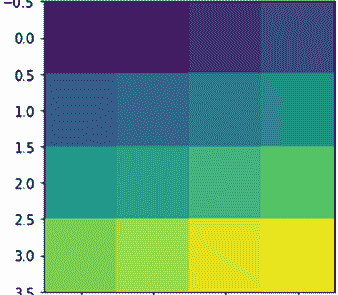

*图 8-6.* 将 NumPy Ndarray 视为图像

该图像在可视化时没有使用任何插值方法。我们可以按如下方式演示插值方法：

```
methods = ['none', 'antialiased', 'nearest', 'bilinear',
           'bicubic', 'spline16', 'spline36', 'hanning',
           'hamming', 'hermite', 'kaiser', 'quadratic',
           'catrom', 'gaussian', 'bessel', 'mitchell',
           'sinc', 'lanczos', 'blackman']

fig, axs = plt.subplots(nrows=4, ncols=6, figsize=(9, 6),
                        subplot_kw={'xticks': [], 'yticks': []})

for ax, interp_method in zip(axs.flat, methods):
    ax.imshow(img3, interpolation=interp_method, cmap='hot')
    ax.set_title(str(interp_method))

plt.tight_layout()
plt.show()
```

## 第 8 章 | 图像与音频可视化

输出如下：

```
<class 'numpy.ndarray'>
(2601617, 2)
2
int16
5203234
10406468
```

正如你所看到的，音频数据被检索并存储在 NumPy 中。它被存储在一个二维矩阵中。假设音频数据有 N 个数据点（也称为*采样点*），那么 NumPy 数组的大小为 N×2。如你所见，音频有两个通道，左声道和右声道。因此，每个通道存储在一个大小为 N 的独立数组中，所以我们得到 N×2。这被称为*立体声音频*。在此示例中，我们有 2,601,617 个点（样本）。每个点或样本使用一对 16 位（2 字节）整数表示。因此，每个样本需要四个字节。所以，我们可以通过将样本大小乘以 4 来计算存储音频数据所需的总原始内存。当我们可视化音频时，我们显示样本两个通道的值。让我们可视化前 2,000 个数据点，如下所示：

```
plt.plot(data[:2000])
plt.show()
```

图 8-8 展示了输出结果。

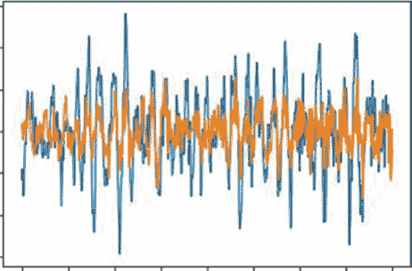

**图 8-8.** *音频文件的可视化*

你可以按如下方式检查音频样本的数量：

```
samples = data.shape[0]
print(samples)
```

输出如下：

2601617

你可以使用以下方式创建数据的另一种可视化：

```
plt.plot(data[:10*samplerate])
plt.show()
```

图 8-9 展示了输出结果。

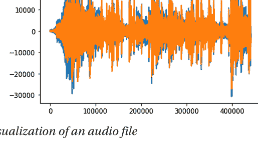

图 8-9. 音频文件的可视化

让我们按如下方式分离两个通道的数据：

```
channel1 = data[:, 0]
channel2 = data[:, 1]
print(channel1, channel2)
```

输出如下：

[-204 -233 -191 ... 646 679 623] [ 23 32 34 ... 676 707 650]

让我们按如下方式可视化数据：

```
plt.subplot(2, 1, 1)
plt.plot(channel1[:10*samplerate])
plt.subplot(2, 1, 2)
plt.plot(channel2[:10*samplerate], c='g')
plt.show()
```

图 8-10 展示了输出结果。

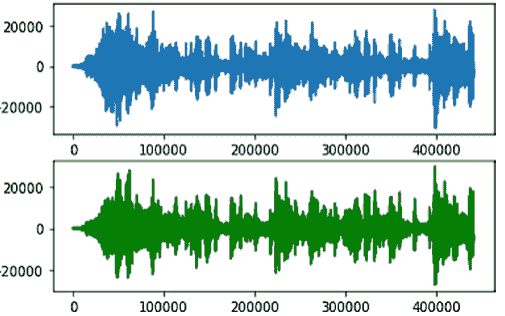

图 8-10. 两个音频通道的可视化

## 音频处理

傅里叶变换将时域中表示为波的数据转换到频域。因此，当你计算傅里叶变换并对其进行可视化时，你看到的是频域中的表示。

快速傅里叶变换（FFT）是一种高效计算波形数据傅里叶变换的方法。FFT 减少了计算次数，因此速度很快；这就是它被称为快速傅里叶变换的原因。让我们按如下方式计算音频信号的快速傅里叶变换：

```
import scipy.fftpack
datafft = scipy.fftpack.fft(data)
fftabs = abs(datafft)
print(fftabs)
```

输出如下：

```
[[ 181.  227.]
[ 201.  265.]
[ 157.  225.]
...
[1322.   30.]
[1386.   28.]
[1273.   27.]]
```

让我们计算频率并绘制图形，如下所示：

```
freqs = scipy.fftpack.fftfreq(samples, 1/samplerate)
plt.plot(freqs, fftabs)
plt.show()
```

图 8-11 展示了输出结果。

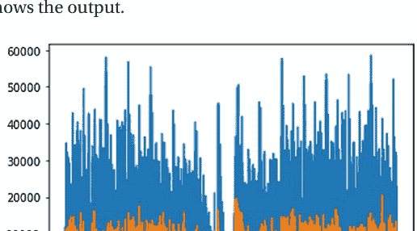

图 8-11. 快速傅里叶变换的可视化

## 总结

在本章中，你学习了如何为图像和音频创建可视化。

在下一章中，你将学习如何可视化饼图和极坐标图。

你还可以将饼图的各个部分稍微分离，如下所示：

```
explode = [0.0, 0.05, 0.1, 0.15]
plt.pie(data,
         labels = mylabels,
         explode = explode)
plt.show()
```

输出结果中饼图的部分会按照 `explode` 参数中的值分离。图 9-3 展示了输出结果。


*图 9-3.* 带有标签和分离效果的简单饼图

你也可以启用阴影，如下所示：

```
plt.pie(data,
         labels = mylabels,
         explode = explode,
         shadow = True)
plt.show()
```

你可以为图例添加标题，如下所示：

```
plt.pie(data,
    labels = mylabels,
    explode = explode,
    shadow = True)
plt.legend(title='Data :')
plt.show()
```

图 9-6 展示了输出结果。

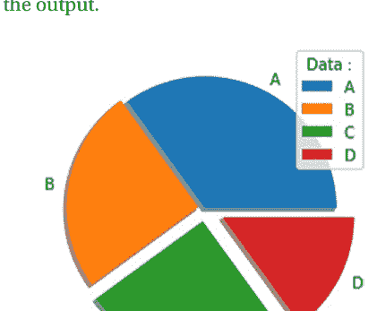

图 9-6. 带有图例和图例标题的简单饼图

你刚刚学习了如何创建极坐标图。

## 极坐标图

你也可以创建形状为饼图的极坐标图。然而，与笛卡尔（X-Y）坐标系的一个根本区别是，在极坐标图中，坐标系是径向排列的，因此你需要角度（theta）和距原点的距离（r 为半径）来可视化一个点或一组点。让我们创建一个数据集，如下所示：


N = 20
theta = np.linspace(0.0, 2 * np.pi, N)
r = 10 * np.random.rand(N)

点集可以通过如下方式可视化：

```
plt.subplot(projection='polar')
plt.bar(theta, r, bottom=0.0,
    color=['r', 'g', 'b'], alpha=0.2)
plt.show()
```

图 9-7 显示了输出结果。

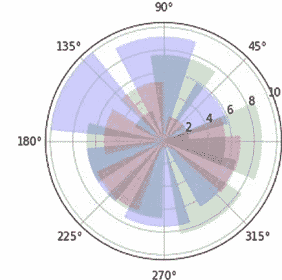

# 图 9-7. 简单的极坐标图

可以看到，这会创建一个柱状图，如图 9-7 所示。YouTube 上有一些有用的视频教程，你可以从中了解更多关于在极坐标系中创建可视化的知识。

```
https://www.youtube.com/watch?v=mDT_DG_A0JA
https://www.youtube.com/watch?v=GMcRqtm4mNo
https://www.youtube.com/watch?v=VmQ1isayjJI
```

我们来创建一个简单的图形。首先为它创建数据集，如下所示：

```
r = np.arange(0, 5, 0.2)
theta = 2 * np.pi * r
plt.subplot(projection='polar')
plt.plot(theta, r)
plt.show()
```

这会在极坐标图上创建一个简单的线性可视化。由于这是极坐标图，你会看到类似螺旋的结构，如图 9-8 所示。

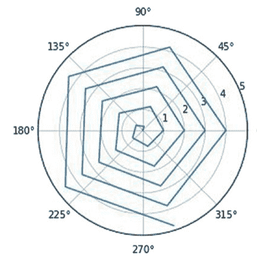

图 9-8. 极坐标图上的简单线性可视化

这并不是一个完美的螺旋，因为相邻点之间的距离是 0.2。如果减小这个距离，你就会得到一个完美的螺旋。我们将数据调整如下：

```
r = np.arange(0, 5, 0.01)
theta = 2 * np.pi * r
plt.subplot(projection='polar')
plt.plot(theta, r)
plt.show()
```

这会创建一个完美的螺旋，如图 9-9 所示。

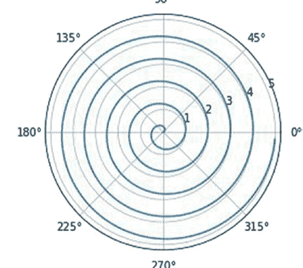

图 9-9. 螺旋可视化

让我们来看几个极坐标图上散点图的示例。首先，准备如下数据：

```
N = 150
r = np.random.rand(N)
theta = 2 * np.pi * np.random.rand(N)
size = r * 100
```

你可以通过如下方式可视化这些数据：

```
plt.subplot(projection='polar')
plt.scatter(theta, r, c=theta,
    s=size, cmap='hsv',
    alpha=0.5)

plt.show()
```

输出结果只显示了整个极坐标图的一部分，如图 9-11 所示。

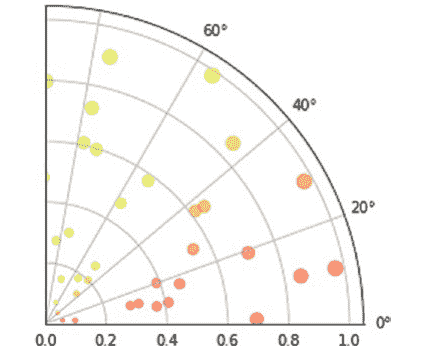

图 9-11. 局部散点图

作为练习，你可以尝试创建局部螺旋和柱状图。

# 小结

在本章中，你详细学习了如何创建饼图和极坐标图。

在下一章中，你将学习如何创建更多可视化，即使用 pColor()、pColormesh() 和 colorbar() 这些例程。
