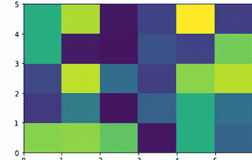
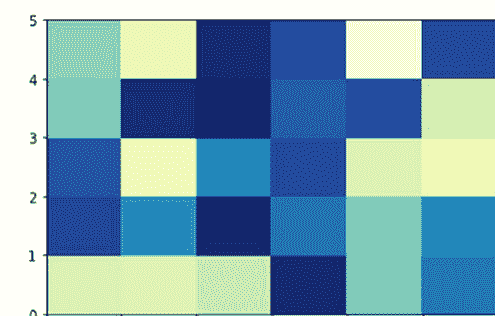
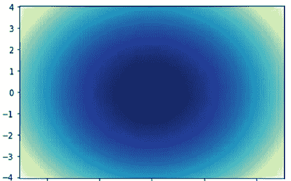
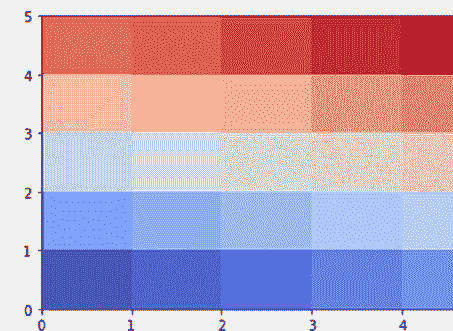
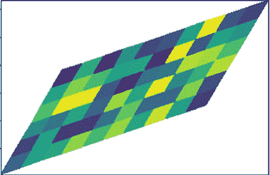
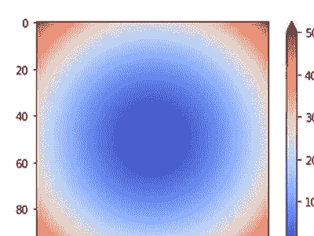

# 第 10 章

# 使用颜色

在上一章中，你学习了如何使用 Matplotlib 可视化饼图和极坐标图。

在本章中，你将学习如何处理颜色。以下是本章要学习的例程：

- pcolor()
- pcolormesh()
- colorbar()

阅读完本章后，我们将能够在 Matplotlib 中处理颜色。

## pcolor()

例程 pcolor() 使用矩形（非正方形）网格创建伪彩色图。伪彩色意味着对象或图像以与其记录时不同的颜色渲染。让我们为本章创建一个新的 notebook，如下所示：

```
%matplotlib inline
import matplotlib.pyplot as plt
import numpy as np
```

让我们创建一个非正方形矩阵，并使用例程 pcolor() 将其可视化，如下所示：

```
data = np.random.rand(5, 6)
plt.pcolor(data)
plt.show()
```

图 10-1 显示了输出结果。



图 10-1. pcolor() 的简单演示

你也可以使用自定义颜色映射，如下所示：

```
plt.pcolor(data, cmap='YlGnBu_r')
plt.show()
```

图 10-2 显示了输出结果。



图 10-2. 使用颜色映射的 pcolor() 简单演示

图 10-4 显示了输出结果。



图 10-4. 使用 nearest 进行着色

## pcolormesh()

例程 pcolormesh() 的行为与 pcolor() 相同；不过，它渲染大型数据集的速度要快得多。让我们使用 pcolormesh() 对图 10-4 中使用的同一数据集进行可视化。代码如下：

```
plt.pcolormesh(X, Y, Z,
    cmap='YlGnBu_r',
    shading='auto')
plt.show()
```

让我们看一个带有着色和颜色映射的示例，如下所示：

```
nrows = ncols = 5

x = np.arange(ncols + 1)
y = np.arange(nrows + 1)
z = np.arange(nrows * ncols).reshape(nrows, ncols)
plt.pcolormesh(x, y, z,
    shading='flat',
    cmap='coolwarm')

plt.show()
```

图 10-5 显示了输出结果。



图 10-5. 结合着色与颜色映射使用 pcolormesh()

使用不同参数运行以下示例：

```
plt.pcolormesh(x, y, z,
    shading='auto',
    cmap='cool')
plt.show()
```

你也可以对数据集应用简单的几何变换，如下所示：

```
z = np.random.rand(6, 10)
x = np.arange(0, 10, 1)
y = np.arange(4, 10, 1)
T = 0.5
X, Y = np.meshgrid(x, y)
X = X + T * Y
Y = Y + T * X
plt.pcolormesh(X, Y, Z,
    shading='auto')
plt.show()
```

图 10-6 显示了输出结果。



**图 10-6.** *使用 pcolormesh() 进行简单变换*

## colorbar()

你还可以添加一个与可视化中数据点大小相关的颜色条。例程 colorbar() 可以实现这一功能。代码如下：

```
N = 100
X, Y = np.meshgrid(np.linspace(-5, 5, N),
                   np.linspace(-5, 5, N))
Z = (X**2 + Y**2)
img = plt.imshow(Z, cmap='YlGnBu_r')
plt.colorbar(img)
plt.show()
```

你也可以按如下方式扩展颜色条：

```
img = plt.imshow(Z, cmap='coolwarm')
plt.colorbar(img, extend='both')
plt.show()
```

图 10-9 显示了输出结果。



图 10-9. 扩展颜色条

# 小结

在本章中，你学习了如何处理颜色。在下一章中，你将学习如何创建 3D 可视化。
