# CHAPTER 13

# More Visualizations
with Matplotlib

In the previous chapter, you learned how to work with animations in Matplotlib.
In this chapter, you will learn a few more techniques for using Matplotlib. This chapter is the culmination of all the knowledge you have gained up to now. The chapter has an assortment of techniques for using Matplotlib that I did not cover in the earlier chapters. Specifically, the following are the topics you will learn in this chapter:

- Visualizing a function as an image and a contour
- Using 3D vignettes
- Decorating scatter plots
- Working with time plots and signals
- Working with filled plots, step plots, and hexbins
- Using XKCD style

After reading this chapter, you will be able to create all sorts of new visualizations in Matplotlib.

## Visualizing a Function as an Image and a Contour

Let’s visualize a numerical function. Import all the needed libraries as follows:

```
%matplotlib inline
import numpy as np
import matplotlib.pyplot as plt
```

Let’s define the function as follows:

```
def f(x, y):
    return (x ** 3 + y ** 2)
```

Let’s visualize it as an image, as follows:

```
n = 10
x = np.linspace(-3, 3, 8 * n)
y = np.linspace(-3, 3, 6 * n)
X, Y = np.meshgrid(x, y)
Z = f( X, Y )
plt.imshow(Z, interpolation='nearest',
           cmap = 'cool', origin='lower')
plt.axis('off')
plt.show()
```

Figure 13-1 shows the output.

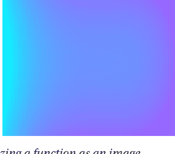

# Figure 13-1. Visualizing a function as an image

You can visualize the function as a contour too.

```
n = 256
x = np.linspace(-3, 3, n)
y = np.linspace(-3, 3, n)
X, Y = np.meshgrid(x, y)
plt.contourf(X, Y, f(X, Y), 8,
```

```
alpha = 0.75, cmap='hot'
C = plt.contour(X, Y, f(X, Y), 8,
    colors='black')
plt.clabel(C, inline=1, fontsize=10)
plt.axis('off')
plt.show()
```

Figure 13-2 shows the output.

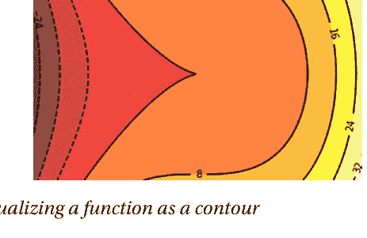

Figure 13-2. Visualizing a function as a contour

## 3D Vignettes

You can create a 3D vignette visualization as follows:

```
%matplotlib qt
fig = plt.figure()
ax = plt.axes(projection='3d')
X = np.arange(-4, 4, 0.25)
Y = np.arange(-4, 4, 0.25)
X, Y = np.meshgrid(X, Y)
R = np.sqrt(X ** 2 + Y ** 2)
Z = np.sin(R)
ax.plot_surface(X, Y, Z, rstride=1,
    cstride=1, cmap='hot')
ax.contourf(X, Y, Z, zdir='z',
    offset=-2, cmap='hot')
ax.set_zlim(-2, 2)
```

```
plt.axis('off')
ax.set_zticks()
plt.show()
```

Figure 13-3 shows the output.

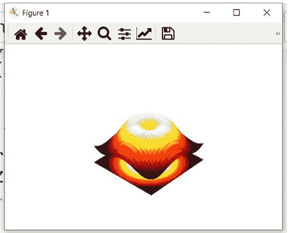

Figure 13-3. Visualizing a 3D vignette

## Decorated Scatter Plots

You can create decorated scatter plots with Matplotlib. You need to pass the color and size as arguments. Here’s an example:

```
%matplotlib inline
n = 1024
X = np.random.normal(0, 1, n)
Y = np.random.normal(0, 1, n)
color = np.arctan2(Y, X)
plt.scatter(X, Y, s=75, c=color, alpha=0.5)
plt.xlim(-1.5, 1.5)
```

```
plt.ylim(-1.5, 1.5)
plt.axis('off')
plt.show()
```

Figure 13-4 shows the output.

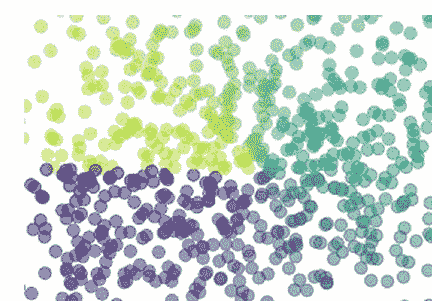

Figure 13-4. Visualizing a decorated scatter plot

## Time Plots and Signals

You can visualize time plots and signals as follows:

```
N = 100
x = np.arange(N) # timestamps
y1 = np.random.randn(N)
y2 = np.random.randn(N)
y3 = np.random.randn(N)
y4 = np.random.randn(N)

plt.subplot(2, 1, 1)
plt.plot(x, y1)
plt.plot(x, y2, ':')
plt.grid()
plt.xlabel('Time')
plt.ylabel('y1 and y2')
plt.axis('tight')
plt.subplot(2, 1, 2)
```

```
plt.plot(x, y3)
plt.plot(x, y4, 'r')
plt.grid()
plt.xlabel('Time')
plt.ylabel('y3 and y4')
plt.axis('tight')
plt.show()
```

Figure 13-5 shows the output.

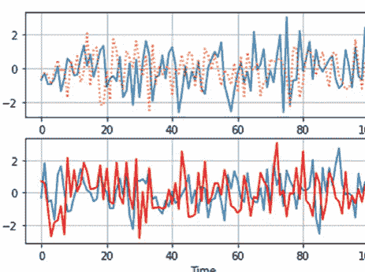

# Figure 13-5. Visualizing time plots and signals

You can also multiply two signals. In the following code example, we are using the same x-axis to show all three graphs.

```
f = 1
t = np.arange( 0.0, 4.0, 0.01)
s1 = np.sin(2 *np.pi * f * t)
s2 = np.exp(-t)
s3 = s1 * s2
f = plt.figure()
plt.subplots_adjust(hspace=0.001)
ax1 = plt.subplot( 311 )
ax1.plot(t, s1)
plt.yticks(np.arange(-0.9, 1.0, 0.4))
plt.ylim(-1, 1)
```

```
ax2 = plt.subplot(312, sharex=ax1)
ax2.plot(t, s2)
plt.yticks(np.arange(0.1, 1.0, 0.2))
plt.ylim(0, 1)
ax3 = plt.subplot(313, sharex = ax1)
ax3.plot(t, s3)
plt.yticks(np.arange(-0.9, 1.0, 0.4))
plt.ylim(-1, 1)
xticklabels = ax1.get_xticklabels() + ax2.get_xticklabels()
plt.setp(xticklabels, visible=False)
plt.show()
```

Figure 13-6 shows the output.

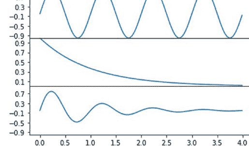

Figure 13-6. Multiplying signals

## Filled Plots

You can fill in the empty spaces within the boundaries of plots as follows:

```
N = 1000
x = np.linspace(0, 1, N)
y = np.sin(4 * np.pi * x) + np.exp(-5 * x)
plt.fill(x, y, 'g', alpha = 0.8)
plt.grid(True)
plt.show()
```

Figure 13-7 shows the output.

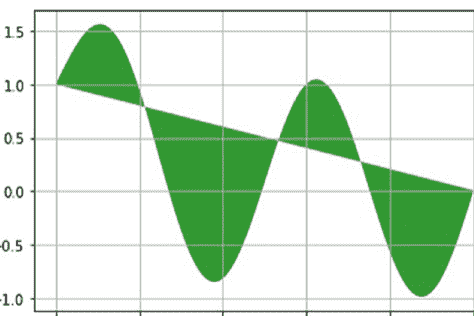

Figure 13-7. Filled-in plots

## Step Plots

Let’s visualize some sine waves first.

```
N = 100
x = np.linspace(-np.pi, np.pi, N)
y1 = 0.5 * np.sin(3*x)
y2 = 1.25 * np.sin(2*x)
y3 = 2 * np.sin(4*x)
plt.plot(x, y1, x, y2, x, y3)
plt.show()
```

Figure **13-8** shows the output.

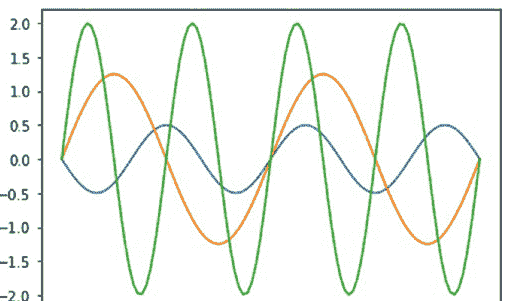

**Figure 13-8.** Sinusoids

You can show them as step plots as follows:

```
```
plt.step(x, y1)
plt.step(x, y2)
plt.step(x, y3)
plt.show()
```
```

Figure **13-9** shows the output.

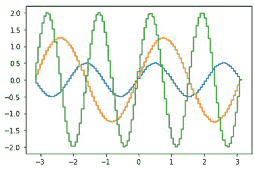

**Figure 13-9.** Sinusoids with step plots


# 六边形分箱

你可以按如下方式将数据展示为六边形分箱：

```
x, y = np.random.normal(size=(2, 10000))
plt.hexbin(x, y,
    gridsize=20,
    cmap='cool')
plt.colorbar()
plt.show()
```

图 13-10 显示了输出。

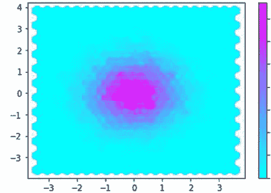

图 13-10. 六边形分箱可视化

## XKCD 风格

你可以用 XKCD 风格可视化图表。XKCD 是一个广受欢迎的网络漫画。https://xkcd.com 是该网络漫画的主页。

```
y = np.random.randn(1000)
plt.xkcd()
plt.hist(y)
plt.show()
```

图 13-11 显示了输出。

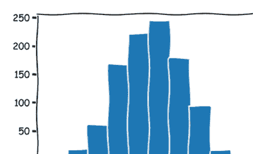

# 图 13-11. XKCD 直方图

另一个示例如下：

```
y = np.random.randn(1000)
plt.xkcd()
plt.hist(y, bins = 30,
    range=[-3.5, 3.5],
    facecolor='r',
    alpha=0.6,
    edgecolor='k')
plt.grid()
plt.show()
```

图 13-12 显示了输出。

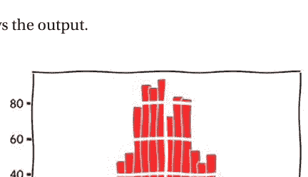

# 图 13-12. 另一个 XKCD 直方图

你也可以用同样的方式可视化二维直方图，如下所示：

```
data = np.random.randn(1000, 1000)
plt.xkcd()
plt.hist2d(data[0], data[1])
plt.show()
```

图 13-13 显示了输出。

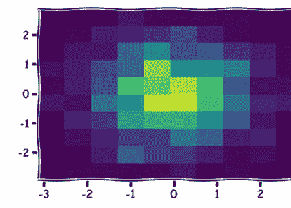

图 13-13. 第三个 XKCD 直方图

## 本章小结

在本章中，你学习了如何使用 Matplotlib 应用一些额外的可视化技术。

在下一章中，你将了解一个名为 Pandas 的数据科学库。
