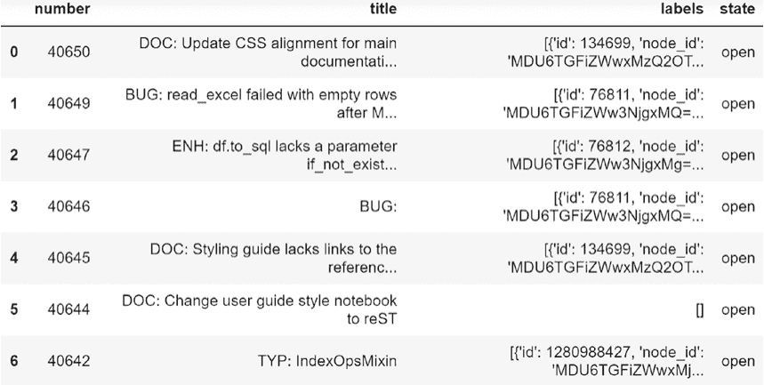
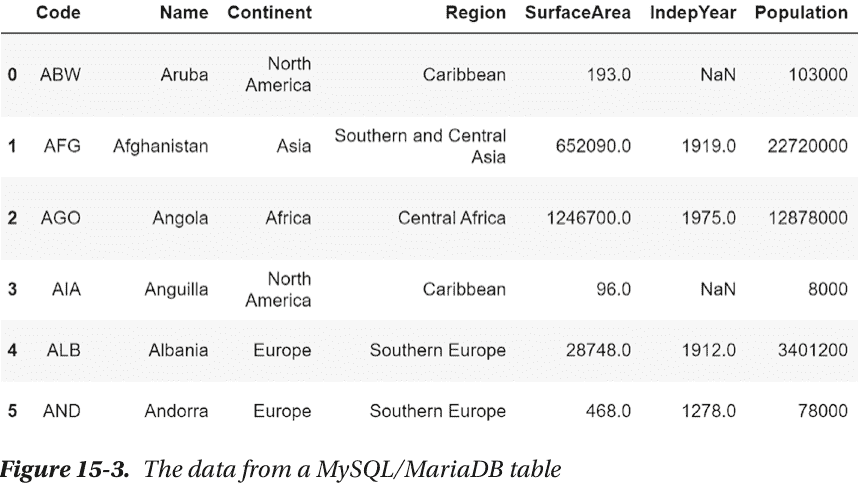

## CHAPTER 15

# Data Acquisition

在上一章中，你学习了使用 Pandas 两种数据结构的基础知识，即 series 和 dataframe。

本章重点介绍使用 Python 获取数据，使用到目前为止你所学习过的所有库（NumPy、Matplotlib 和 Pandas）。本章中你将学习以下主题：

- 处理纯文本文件
- 使用 Python 处理 CSV 文件
- 使用 Python 和 Excel
- 使用 NumPy 写入和读取文件
- 使用 NumPy 从 CSV 文件读取数据
- 使用 Matplotlib CBook
- 从 CSV 文件读取数据
- 从 Excel 文件读取数据
- 从 JSON 文件读取数据
- 从 Pickle 文件读取数据
- 从 Web 读取数据
- 从关系数据库读取数据
- 从剪贴板读取数据

阅读本章后，你将能够从各种文件格式读取数据并保存数据。

## Plain-Text File Handling

让我们学习如何从纯文本文件读取数据并向其写入数据。Python 带有读取和写入纯文本文件的功能。我们有四种打开文件的方式，如下所示：

- `w`: Write
- `r`: Read
- `a`: Append
- `r+`: Read and write mode

你可以使用它们（一次一个）如下：

```python
f = open('testfile.txt', 'w')
print(f)
```

此代码以写模式打开 testfile.txt 文件。如果文件不存在，则 Python 会在磁盘的当前位置创建此文件。如果文件已存在，它会覆盖文件的内容。之前的代码会按如下方式打印文件对象：

```
<_io.TextIOWrapper name='testfile.txt' mode='w' encoding='cp1252'>
```

让我们向文件写入一些数据。在这种情况下，数据由多字符字符串组成。

```python
f.write('This is a test string.\n')
f.write('This is the middle line.\n')
f.write('This is the last line.')
```

你可以按如下方式关闭文件对象（也称为 *file handle*）：

```python
f.close()
```

你知道再次以写模式打开文件会覆盖其数据。所以，这次让我们以追加模式打开同一个文件如下：

```python
f = open('testfile.txt', 'a')
f.write('\nThis is the appended line.')
f.close()
```

我们向文件写入一行然后关闭文件。让我们读取数据并按如下方式打印它：

```python
f = open('testfile.txt', 'r')
print(f.read())
f.close()
```

输出如下：

```
This is a test string.
This is the middle line.
This is the last line.
This is the appended line
```

你可以按如下方式在列表中检索行（文件中的每一行对应列表中的一个元素）：

```python
f = open('testfile.txt', 'r')
print(f.readlines())
f.close()
```

输出如下：

```
['This is a test string.\n', 'This is the middle line.\n', 'This is the last line.\n', 'This is the appended line.']
```

你也可以按如下方式逐行检索文件中的数据：

```python
f = open('testfile.txt', 'r')
for line in f:
    print(line)
f.close()
```

输出如下：

```
This is a test string.

This is the middle line.

This is the last line.

This is the appended line.
```

## Handling CSV Files with Python

让我们了解一些关于逗号分隔文件（CSV）格式的信息。CSV 文件以纯文本格式存储数据，数据项要么是固定长度，要么由分隔符分隔，例如逗号（,）、竖线（|）或冒号（:）。最常见的 CSV 格式使用逗号作为分隔符，并且很多时候第一行用于存储列名。

在本节中，你将学习如何使用 Python 3 处理 CSV 文件。Python 3 带有内置库来处理 CSV 文件。你不需要安装任何东西。你可以按如下方式导入库：

```python
import csv
```

你可以按如下方式以读模式将文件打开为纯文本文件：

```python
file = open('test.csv', 'r')
print(file)
```

打开文件后，你可以将文件句柄传递给 csv.reader() 例程如下：

```python
csvfile = csv.reader(file, delimiter=',')
print(csvfile)
```

这会按如下方式打印对象的值：

```
<_csv.reader object at 0x0590AC68>
```

你可以按如下方式逐行检索数据：

```python
for row in csvfile:
    print(row)
```

这会产生以下输出：

```
['Banana', 'Yellow', '250']
['Orange', 'Orange', '200']
['Grapes', 'Green', '400']
['Tomato', 'Red', '100']
['Spinach', 'Green', '40']
['Potatoes', 'Gray', '400']
```

Wheat
Brown
500
Barley
Yellow
500

让我们按如下方式关闭文件句柄：

```python
file.close()
```

## Python and Excel

让我们看看如何从 Excel 读取数据。你需要一个外部库来实现。以下代码安装了本节将使用的库：

```python
!pip3 install openpyxl
```

你可以按如下方式导入它：

```python
import openpyxl
```

你可以按如下方式打开 Excel 文件：

```python
wb = openpyxl.load_workbook('test.xlsx')
print(wb)
print(type(wb))
```

输出如下：

```text
<openpyxl.workbook.workbook.Workbook object at 0x0E87F7D8>
<class 'openpyxl.workbook.workbook.Workbook'>
```

你可以按如下方式检索所有工作表的名称：

```python
print(wb.sheetnames)
```

输出如下：

```python
['Sheet1', 'Sheet2', 'Sheet3']
```


## 15 数据获取

你可以按如下方式选择一个工作表：

```python
currSheet = wb['Sheet1']
print(currSheet)
print(type(currSheet))
```

输出如下：

```text
<Worksheet "Sheet1">
<class 'openpyxl.worksheet.worksheet.Worksheet'>
```

同样，以下代码具有相同的效果：

```python
currSheet = wb[wb.sheetnames[0]]
print(currSheet)
print(type(currSheet))
```

你可以按如下方式打印当前工作表的名称：

```python
print(currSheet.title)
```

输出如下：

Sheet1

你可以按如下方式打印单元格的值：

```python
var1 = currSheet['A1']
print(var1.value)
```

输出如下：

Food Item

完成相同操作的另一种方法是如下所示：

```python
print(currSheet['B1'].value)
```

你也可以按如下方式进行：

```python
var2 = currSheet.cell(row=2, column=2)
print(var2.value)
```

行数和列数可以按如下方式获取：

```python
print(currSheet.max_row)
print(currSheet.max_column)
```

输出如下：

```text
11
3
```

让我们按如下方式打印电子表格中的所有数据：

```python
for i in range(currSheet.max_row):
    print('---Beginning of Row---')
    for j in range(currSheet.max_column):
        var = currSheet.cell(row=i+1, column=j+1)
        print(var.value)
    print('---End of Row---')
```

输出非常长，这里已截断。请自行运行代码查看。

### 使用 NumPy 读写文件

让我们看看如何使用 NumPy 读写文件。让我们按如下方式使用 NumPy 创建一个数据集：

```python
import numpy as np
x = np.arange(100)
print(x)
```

输出如下：

```text
[  0  1  2  3  4  5  6  7  8  9 10 11 12 13 14 15 16 17 18 19 20 21 22 23
  24 25 26 27 28 29 30 31 38 33 34 35 36 37 38 39 40 41 42 43 44 45 46 47
  48 49 50 51 52 53 54 55 56 57 58 59 60 61 62 63 64 65 66 67 68 69 70 71
  72 73 74 75 76 77 78 79 80 81 82 83 84 85 86 87 88 89 90 91 92 93 94 95
  96 97 98 99]
```

你可以按如下方式将其保存到文件中（NumPy 数据格式）：

```python
np.save('test.npy', x)
```

你可以按如下方式从文件中将数据加载到变量中：

```python
data = np.load('test.npy')
print(data)
```

输出如下：

```text
[ 0  1  2  3  4  5  6  7  8  9 10 11 12 13 14 15 16 17 18 19 20 21 22 23
 24 25 26 27 28 29 30 31 32 33 34 35 36 37 38 39 40 41 42 43 44 45 46 47
 48 49 50 51 52 53 54 55 56 57 58 59 60 61 62 63 64 65 66 67 68 69 70 71
 72 73 74 75 76 77 78 79 80 81 82 83 84 85 86 87 88 89 90 91 92 93 94 95
 96 97 98 99]
```

### 使用 NumPy 从 CSV 文件读取数据

CSV 文件也可以使用 NumPy 按如下方式读取：

```python
import numpy as np
# Reads only numeric data
data = np.loadtxt('data.csv', delimiter=',')
print(data)
```

输出如下：

```text
[[ 0.   1.  18.   2.]
 [ 1.   6.   1.   3.]
 [ 2.   3. 154.   0.]
 [ 4. 978.   3.   6.]
 [ 5.   2.  41.  45.]
 [ 6.  67.   2.   3.]
 [ 7.   5.  67.   2.]]
```

你也可以按如下方式跳过行和列：

```python
data = np.loadtxt('data.csv', delimiter=',',
                  skiprows=3, usecols=[1, 3])
print(data)
```

输出如下：

```text
[[978.   6.]
 [  2.  45.]
 [ 67.   3.]
 [  5.   2.]]
```

### Matplotlib CBook

你可以读取存储在 Matplotlib CBook 格式中的数据。Matplotlib 附带了一些该格式的示例文件。让我们看看如何读取数据：

```python
import matplotlib.cbook as cbook
datafile = cbook.get_sample_data('aapl.npz')
r = np.load(datafile)
print(r.files)
```

这将打印数据文件的名称，如下所示：

```text
['price_data']
```

让我们从该数据文件中读取数据：

```python
print(r['price_data'])
```

这会显示 Apple 股价数据如下：

```text
[('1984-09-07', 26.5, 26.87, 26.25, 26.5, 2981600, 3.02)
 ('1984-09-10', 26.5, 26.62, 25.87, 26.37, 2346400, 3.01)
 ('1984-09-11', 26.62, 27.37, 26.62, 26.87, 5444000, 3.07) ...
 ('2008-10-10', 85.7, 100., 85., 96.8, 79260700, 96.8)
 ('2008-10-13', 104.55, 110.53, 101.02, 110.26, 54967000, 110.26)
 ('2008-10-14', 116.26, 116.4, 103.14, 104.08, 70749800, 104.08)]
```

### 从 CSV 读取数据

如前所述，CSV 文件包含由逗号分隔的值。你可以使用 Pandas 中多功能的 `read_csv()` 函数读取 Web 上的 CSV 文件或本地/网络磁盘上的 CSV 文件。以下是我们将在本演示中使用的 CSV 文件的内容：

```text
rank,discipline,phd,service,sex,salary
Prof,B,56,49,Male,186960
Prof,A,12,6,Male,93000
Prof,A,23,20,Male,110515
Prof,A,40,31,Male,131205
Prof,B,20,18,Male,104800
Prof,A,20,20,Male,122400
AssocProf,A,20,17,Male,81285
```

第一行是标题行。大多数 CSV 文件会有标题行，尽管不是必需的。如你所见，值由逗号分隔。这是 CSV 文件的常见格式。根据系统和应用程序，你可以使用空格、分号（;）或竖线（|）等各种分隔符。此外，CSV 文件可以使用固定数量的字符来存储列中的数据。在本示例中，如讨论所述，我们使用的是存储数据的最常见 CSV 格式之一。

让我们学习如何使用 Pandas 从此类文件读取数据。为本章创建一个新的笔记本。

按如下方式导入 Pandas 库：

```python
import pandas as pd
```

让我们按如下方式读取位于 Web 上的 CSV 文件：

```python
df1 = pd.read_csv("http://rcs.bu.edu/examples/python/data_analysis/Salaries.csv")
print(df1)
```

你也可以按如下方式读取存储在本地磁盘上的 CSV：

```python
df2 = pd.read_csv("Salaries.csv")
print(df2)
```

你也可以按如下方式将数据框的数据转储到磁盘位置的 CSV 文件中：

```python
df2.to_csv('output.csv', index=True, header=False)
```

代码将在当前目录的磁盘上创建 CSV 文件。

### 从 Excel 文件读取数据

要将数据从 Excel 文件读取到 Pandas 数据框中，你需要外部包的支持。让我们按如下方式安装一个包：

```bash
!pip3 install xlrd
```

现在让我们按如下方式读取存储在磁盘上的 Excel 文件：

```python
excel_file = 'test.xlsx'
df1 = pd.read_excel(excel_file)
```

这里（以及之前的示例中），文件存储在与笔记本文件相同的目录中。如果需要在其他位置读取文件，必须指定该文件的完整路径。执行前面的代码后，将加载 Excel 文件的内容到 Pandas 数据框中。你可以使用以下代码行查看内容：

```python
print(df1)
```

图 15-1 显示了输出。

|   | Fruit | Color | Weight |
|---|---|---|---|
| 0 | Banana | Yellow | 250 |
| 1 | Orange | Orange | 200 |
| 2 | Grapes | Green | 400 |
| 3 | Tomato | Red | 100 |
| 4 | Spinach | Green | 40 |
| 5 | Potatoes | Gray | 400 |
| 6 | Rice | White | 300 |
| 7 | Rice | Brown | 400 |
| 8 | Wheat | Brown | 500 |
| 9 | Barley | Yellow | 500 |

图 15-1. 来自 Excel 工作表的数据

### 从 JSON 读取数据

你可以按如下方式将 JSON 字符串的数据读取到数据框中。首先创建一个 JSON 字符串。

```python
obj = """
{"name": "Ashwin",
"places_lived": ["Nashik", "Hyderabad", "Bangalore"],
"pet": null,
"siblings": [{"name": "Scott", "age": 30, "pets": ["Zeus", "Zuko"]},
{"name": "Katie", "age": 38,
"pets": ["Sixes", "Stache", "Cisco"]}]
}
"""
```

你可以按如下方式打印字符串：

```python
print(obj)
```

你也可以按如下方式检查变量的类型（它是一个 JSON 格式的字符串）：

```python
print(type(obj))
```

你可以按如下方式将此 JSON 格式的字符串转换为字典：

```python
import json
result = json.loads(obj)
print(result)
```

让我们按如下方式检查新创建变量的数据类型：

```python
print(type(result))
```

这将产生以下结果：

```text
<class 'dict'>
```

让我们按如下方式将数据加载到数据框中：

```python
df1 = pd.DataFrame(result['siblings'], columns=['name', 'age'])
print(df1)
```


下面我们来获取对象和数据的详细信息：

```python
print(df1)
len(df1)
type(df1)
df1[0].head()
```

你也可以解析这个取回的 HTML 文本，并从标签中获取重要信息，如下所示：

```python
from lxml import objectify
from io import StringIO
```

下面是一个 HTML 标签字符串及其解析方式：

```python
tag = '<a href="http://www.google.com/">Google</a>'
root = objectify.parse(StringIO(tag)).getroot()
```

你可以按如下方式获取该对象的根元素和文本：

```python
print(root)
root.get('href')
print(root.text)
```

这将产生以下输出：

Google
Google

## 与 Web API 交互

我们来学习如何与 Web API 交互，以检索数据并将其存储到 Pandas DataFrame 中。首先按如下方式安装所需的库：

```python
!pip3 install requests
```

接着按如下方式导入库：

```python
import requests
```

图 15-2 显示了输出结果。

| 编号 | 标题 | 标签 | 状态 |
|---|---|---|---|
| 0 40650 | DOC：更新主文档中的 CSS 对齐方式... | [{'id': 134699, 'node_id': 'MDU6TGFIZW...' | 开启 |
| 1 40649 | BUG：read_excel 在 M... 之后出现空行而失败 | [{'id': 76811, 'node_id': 'MDU6TGFIZW3NjgxMQ...' | 开启 |
| 2 40647 | ENH：df.to_sql 缺少 if_not_exist 参数... | [{'id': 76812, 'node_id': 'MDU6TGFIZW3NjgxMg...' | 开启 |
| 3 40646 | BUG： | [{'id': 76811, 'node_id': 'MDU6TGFIZW3NjgxMQ...' | 开启 |
| 4 40645 | DOC：样式指南缺少指向参考资料的链接... | [{'id': 134699, 'node_id': 'MDU6TGFIZW...' | 开启 |
| 5 40644 | DOC：将用户指南样式的 notebook 改为 reST | [] | 开启 |
| 6 40642 | TYP：IndexOpsMixin | [{'id': 1280988427, 'node_id': 'MDU6TGFIZW...' | 开启 |



*图 15-2. 来自 HTTPS GET 响应的数据*

这便是处理 Web 上可用数据的方式。

## 从关系数据库表中读取数据

你可以读取 MySQL 或 MariaDB 等关系数据库表中存储的数据。你可以在以下网址了解更多安装与使用信息：

https://www.mysql.com/
https://mariadb.org/

你必须按如下方式安装外部库：

```python
!pip3 install pymysql
```

然后需要按如下方式将该库导入 notebook：

```python
import pymysql
```

# 第 15 章 数据采集

你可以按如下方式连接到 MySQL 或 MariaDB 数据库实例：

```python
db = pymysql.connect(host="localhost", user="root",
                     password="test123", database="world")
```

然后你可以将 SELECT 查询的输出读入 DataFrame，如下所示：

```python
df1 = pd.read_sql('select * from country', db)
print(df1)
```

这会生成图 15-3 所示的输出。

|   | 代码 | 名称 | 大洲 | 地区 | 面积 | 独立年份 | 人口 |
|---|---|---|---|---|---:|---:|---:|
| 0 | ABW | 阿鲁巴 | 北美洲 | 加勒比地区 | 193.0 | NaN | 103000 |
| 1 | AFG | 阿富汗 | 亚洲 | 南亚和中亚 | 652090.0 | 1919.0 | 22720000 |
| 2 | AGO | 安哥拉 | 非洲 | 中非 | 1246700.0 | 1975.0 | 12878000 |
| 3 | AIA | 安圭拉 | 北美洲 | 加勒比地区 | 96.0 | NaN | 8000 |
| 4 | ALB | 阿尔巴尼亚 | 欧洲 | 南欧 | 28748.0 | 1912.0 | 3401200 |
| 5 | AND | 安道尔 | 欧洲 | 南欧 | 468.0 | 1278.0 | 78000 |



## 从剪贴板读取数据

你可以读取存储在剪贴板中的数据。剪贴板是计算机主内存（RAM）中一个临时且未命名的缓冲区，一些操作系统提供它用于在程序内部和程序之间短期存储和传输数据。例如，每当你从文件复制文本数据时，它都会存储在操作系统的剪贴板中。

选中以下数据，然后按键盘上的 Ctrl+C 组合键，将其复制到计算机剪贴板。

|   | A | B | C |
|---|---|---|---|
| x | 1 | 2 | a |
| y | 2 | 3 | b |
| z | 3 | 4 | c |

你可以使用以下代码将其加载到 Pandas DataFrame 中：

```python
df = pd.read_clipboard()
```

你也可以通过编程方式将数据复制到剪贴板，如下所示：

```python
import numpy as np
df = pd.DataFrame(np.random.randn(5, 3))
df.to_clipboard()
```

如前所述，你可以通过编程方式将剪贴板读取到 DataFrame 中查看这些数据，也可以使用 Ctrl+V 命令将其粘贴到文本编辑器中，例如 Windows 上的记事本（Notepad），或 Linux 上的 Leafpad、gedit。

## 小结

在本章中，你学习了如何从多种文件格式读取数据，以及如何将这些数据加载到 Python 变量中。

在下一章中，你将学习如何使用 Matplotlib 可视化 Pandas 数据。
