# 第 16 章

## 使用 Pandas 和 Matplotlib 可视化数据

在上一章中，你学习了如何使用 NumPy、Pandas 和 Matplotlib 将存储在各种文件格式中的数据读取到 Python 变量中。

现在你应该已经能够自如地处理数据了。在本章中，你将练习编写与数据科学领域另一个重要且实用的方面——数据集可视化——相关的程序。本章包含大量简短代码片段示例，演示如何创建数据集的可视化。那么，让我们继续数据科学之旅，学习本章的以下主题：

- 简单图形
- 柱状图
- 直方图
- 箱线图
- 面积图
- 散点图
- 六边形分箱图
- 饼图

学完本章后，你将能够使用 Pandas 和 Matplotlib 创建令人印象深刻的数据集可视化。

# 第 16 章 使用 Pandas 和 Matplotlib 可视化数据

## 简单图形

让我们直接进入数据可视化的动手示例。你将首先学习如何绘制简单图形。我建议你为本章中的代码示例新建一个 notebook。

首先，让我们从导入所有必需库的魔术命令开始，如下所示：

```python
%matplotlib inline
import matplotlib.pyplot as plt
import pandas as pd
import numpy as np
```

接下来，我们使用 cumsum() 函数创建一些数据，如下所示：

```python
df1 = pd.DataFrame(np.random.randn(100, 2), columns=['B', 'C']).cumsum()
df1['A'] = pd.Series(list(range(100)))
print(df1)
```

最终的数据集将有三列，如下所示：

```text
      B          C    A
0   -0.684779  -0.655677   0
1   -0.699163  -1.868611   1
2   -0.315527  -3.513103   2
3   -0.504069  -4.175940   3
4    0.998419  -4.385832   4
..         ...        ...  ...
95   1.149399  -1.445029  95
96   2.035029  -1.886731  96
97   0.938699   0.188980  97
98   2.449148   0.335828  98
99   2.204369  -1.304379  99

[100 rows x 3 columns]
```

输出如下：

```text
B    0.998419
C   -4.385832
A    4.000000
Name: 4, dtype: float64
```

让我们使用 `bar()` 例程，用这些数据绘制一个简单的柱状图。其代码片段如下：

```python
plt.figure()
df1.iloc[4].plot.bar()
plt.axhline(0, color='k')
plt.show()
```

在这个代码示例中，我们使用 `axhline()` 绘制一条与 x 轴对应的水平线。图 16-2 显示了输出结果。

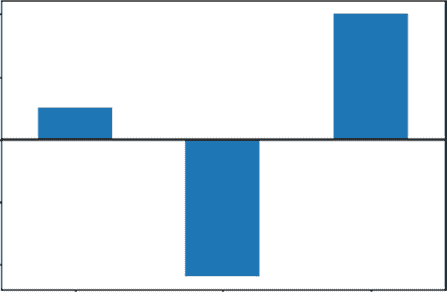

**图 16-2.** *可视化一个简单的柱状图*

下面讨论一个更复杂的柱状图示例。让我们创建一个新数据集，如下所示：

```python
df2 = pd.DataFrame(np.random.rand(10, 4), columns=['a', 'b', 'c', 'd'])
print(df2)
```

输出如下：

|   | a       | b       | c       | d       |
|---|---------|---------|---------|---------|
| 0 | 0.352173 | 0.127452 | 0.637665 | 0.734944 |
| 1 | 0.375190 | 0.931818 | 0.769403 | 0.927441 |
| 2 | 0.830744 | 0.942059 | 0.781032 | 0.557774 |
| 3 | 0.977058 | 0.594992 | 0.557016 | 0.862058 |
| 4 | 0.960796 | 0.329448 | 0.493713 | 0.971139 |
| 5 | 0.364460 | 0.516401 | 0.432365 | 0.587528 |
| 6 | 0.292020 | 0.500945 | 0.889294 | 0.211502 |
| 7 | 0.770808 | 0.519468 | 0.279582 | 0.419549 |
| 8 | 0.982924 | 0.458197 | 0.938682 | 0.123614 |
| 9 | 0.578290 | 0.186395 | 0.901216 | 0.099061 |

在之前的示例中，我们只可视化了一行。现在，让我们可视化整个数据集，如下所示：

```python
plt.figure()
df2.plot.bar()
plt.show()
```

这将为每一行创建一个柱状图。每个行对应的图形将按行分组显示，如图 16-3 所示。

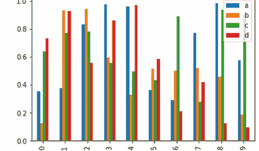

图 16-3. 可视化一个更复杂的柱状图


你可以看到，索引显示在x轴上，数值标记在y轴上。这是一个未堆叠的垂直条形图。只需传递一个简单的参数，即可创建堆叠版本，如下所示：

```
plt.figure()
df2.plot.bar(stacked=True)
plt.show()
```

图 16-4 显示了输出结果。

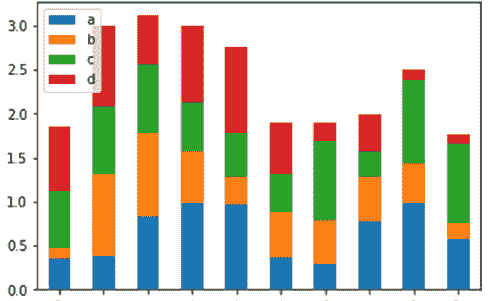

图 16-4. 可视化垂直堆叠条形图

你还可以创建水平堆叠和未堆叠的条形图。让我们使用`barh()`例程创建一个水平堆叠的条形图，如下所示：

```
plt.figure()
df2.plot.barh(stacked=True)
plt.show()
```

图 16-5 显示了输出结果。

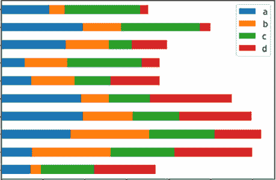

**图 16-5.** *可视化水平堆叠条形图*

让我们省略参数，编写一个未堆叠水平条形图的代码片段，如下所示：

```
```python
plt.figure()
df2.plot.barh()
plt.show()
```
```

图 16-6 显示了输出结果。

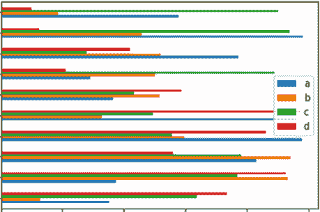

**图 16-6.** *可视化水平未堆叠条形图*

你刚刚学习了如何创建各种类型的条形图。

让我们将此数据集可视化，如下所示：

```
plt.figure()
df4.diff().hist(color='k', alpha=0.5, bins=50)
plt.show()
```

图 16-11 显示了输出结果。

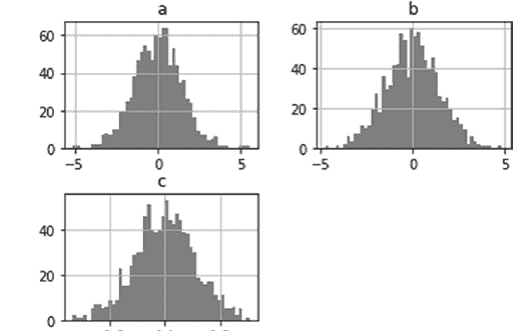

图 16-11. 逐列直方图

你刚刚学习了如何将数据集可视化为直方图。

## 箱线图

你也可以使用箱线图可视化数据。箱线图（也拼写为boxplots）通过四分位数显示数值数据的分组。让我们创建一个数据集，如下所示：

```
df = pd.DataFrame(np.random.rand(10, 5),
    columns=['A', 'B', 'C', 'D', 'E'])
print(df)
```

生成的数据集如下：

|    | A       | B       | C       | D       | E       |
|----|---------|---------|---------|---------|---------|
| 0  | 0.684284| 0.033906| 0.099369| 0.684024| 0.533463|
| 1  | 0.614305| 0.645413| 0.871788| 0.561767| 0.149080|
| 2  | 0.226480| 0.440091| 0.096022| 0.076962| 0.674901|
3  0.541253  0.409599  0.487924  0.649260  0.582250
4  0.436995  0.142239  0.781428  0.634987  0.825146
5  0.804633  0.874081  0.018661  0.306459  0.008134
6  0.228287  0.418942  0.157755  0.561070  0.740077
7  0.699860  0.230533  0.240369  0.108759  0.843307
8  0.530943  0.374583  0.650235  0.370809  0.595791
9  0.213455  0.221367  0.035203  0.887068  0.593629

你可以按照以下方式绘制箱线图：

```
```python
plt.figure()
df.plot.box()
plt.show()
```
```

这将把数据集展示为箱线图，如图 16-12 所示。

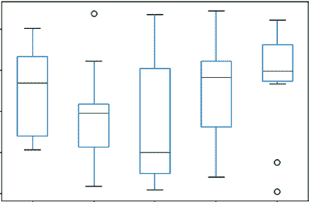

**图 16-12.** *垂直箱线图*

这里显示的颜色是默认值。你可以更改它们。首先，你需要创建一个字典，如下所示：

```
```python
color = dict(boxes='DarkGreen',
             whiskers='DarkOrange',
             medians='DarkBlue',
             caps='Gray')
print(color)
```
```

输出如下：

```
{'boxes': 'DarkGreen', 'whiskers': 'DarkOrange', 'medians': 'DarkBlue',
'caps': 'Gray'}
```

最后，你将该字典作为参数传递给绘制箱线图的例程，如下所示：

```
plt.figure()
df.plot.box(color=color, sym='r+')
plt.show()
```

图 16-13 显示了输出结果。

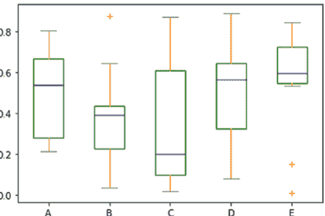

图 16-13. 带有定制颜色的垂直箱线图

以下示例创建了一个水平箱线图可视化：

```
plt.figure()
df.plot.box(vert=False, positions=[1, 2, 3, 4 , 5])
plt.show()
```

图 16-14 显示了输出结果。

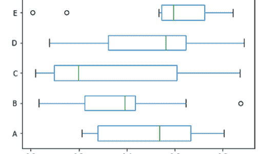

# 图 16-14. 水平箱线图

让我们看看另一个例程`boxplot()`，它也能创建箱线图。为此，让我们创建另一个数据集，如下所示：

```
df = pd.DataFrame(np.random.rand(10, 5))
print(df)
```

输出数据集如下：

|    | 0       | 1       | 2       | 3       | 4       |
|----|---------|---------|---------|---------|---------|
| 0  | 0.936845| 0.365561| 0.890503| 0.264896| 0.937254|
| 1  | 0.931661| 0.226297| 0.887385| 0.036719| 0.941609|
| 2  | 0.127896| 0.291034| 0.161724| 0.952966| 0.925534|
| 3  | 0.938686| 0.336536| 0.934843| 0.806043| 0.104054|
| 4  | 0.743787| 0.600116| 0.989178| 0.002870| 0.453338|
| 5  | 0.256692| 0.773945| 0.165381| 0.809204| 0.162431|
| 6  | 0.822131| 0.486780| 0.453981| 0.612403| 0.614633|
| 7  | 0.062387| 0.958844| 0.247515| 0.573431| 0.194665|
| 8  | 0.453193| 0.152337| 0.062436| 0.865115| 0.220440|
| 9  | 0.832040| 0.237582| 0.837805| 0.423779| 0.119027|

你可以按照以下方式绘制箱线图：

```
plt.figure()
bp = df.boxplot()
plt.show()
```

图 16-15 显示了输出结果。

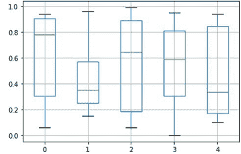

图 16-15. 箱线图实战

例程`boxplot()`的主要优点是，你可以在单个输出中获得逐列的可视化。让我们创建一个合适的数据集，如下所示：

```
df = pd.DataFrame(np.random.rand(10, 2), columns=['Col1', 'Col2'] )
df['X'] = pd.Series(['A', 'A', 'A', 'A', 'A', 'B', 'B', 'B', 'B', 'B'])
print(df)
```

输出数据集如下：

    Col1      Col2  X
0  0.469416  0.341874  A
1  0.176359  0.921808  A
2  0.135188  0.149354  A
3  0.475295  0.360012  A
4  0.566289  0.142729  A
5  0.408705  0.571466  B
6  0.233820  0.470200  B
7  0.679833  0.633349  B
8  0.183652  0.559745  B
9  0.192431  0.726981  B

让我们创建逐列的可视化，如下所示：

```
plt.figure();
bp = df.boxplot(by='X')
plt.show()
```

输出将默认带有一个标题，说明数据是如何分组的，如图 16-16 所示。

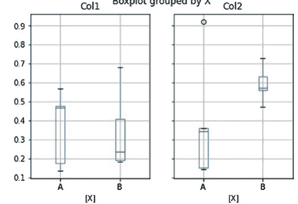

图 16-16. 带分组的箱线图

让我们看一个稍复杂的例子。以下是新数据集的代码：

```
df = pd.DataFrame(np.random.rand(10,3), columns=['Col1', 'Col2', 'Col3'])
df['X'] = pd.Series(['A','A','A','A','A','B','B','B','B','B'])
df['Y'] = pd.Series(['A','B','A','B','A','B','A','B','A','B'])
print(df)
```

这段代码创建了以下数据集：

Col1    Col2    Col3    X   Y
0  0.542771  0.175804  0.017646  A
1  0.247552  0.503725  0.569475  A   B
2 0.593635 0.842846 0.755377 A
3 0.210409 0.235510 0.633318 A B
4 0.268419 0.170563 0.478912 A
5 0.526251 0.258278 0.549876 B
6 0.311182 0.212787 0.966183 B A
7 0.100687 0.432545 0.586907 B
8 0.416833 0.879384 0.635664 B A
9 0.249280 0.558648 0.661523 B

你可以创建多列分组的箱线图（这意味着分组条件将有多个列）。

```
plt.figure();
bp = df.boxplot(column=['Col1', 'Col2'], by=['X', 'Y'])
plt.show()
```

图 16-17 显示了输出结果。

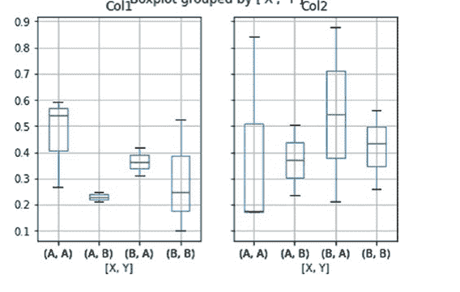

图 16-17. 带分组的箱线图（分组条件中有多个列）

让我们看一个更复杂的例子，使用一个变化更多的数据集。以下代码创建了这样一个数据集：

```
np.random.seed(1234)
df_box = pd.DataFrame(np.random.randn(10, 2), columns=['A', 'B'])
```

另一个例子如下：

```
bp = df_box.groupby('C').boxplot()
plt.show()
```

图 16-19 显示了输出结果。

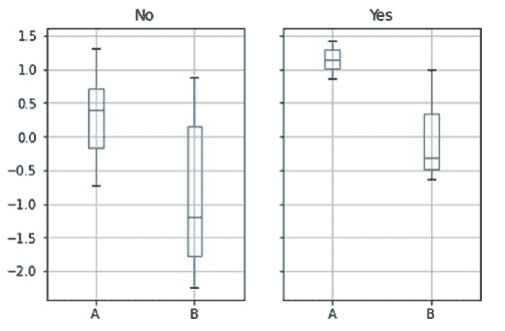

图 16-19. 按C列分组的箱线图可视化

这就是如何将数据集可视化为箱线图。

## 面积图

你也可以将数据集可视化为面积图。让我们创建一个包含四列的数据集，如下所示：

```
df = pd.DataFrame(np.random.rand(10, 4),
                  columns=['A', 'B', 'C', 'D'])
print(df)
```

这将创建以下数据集：

|   | A       | B       | C       | D       |
|---|---------|---------|---------|---------|
| 0 | 0.982005| 0.123943| 0.119381| 0.738523|
| 1 | 0.587304| 0.471633| 0.107127| 0.229219|
| 2 | 0.899965| 0.416754| 0.535852| 0.006209|
| 3 | 0.300642| 0.436893| 0.612149| 0.918198|


您可以使用`area()`例程将所有数据可视化，如下所示：

```
plt.figure()
df.plot.area()
plt.show()
```

上面的示例将创建一个堆叠面积图，如图16-20所示。

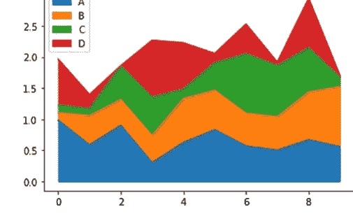

图16-20. 堆叠面积图

您还可以通过向`area()`例程传递参数来创建非堆叠面积图，如下所示：

```
plt.figure()
df.plot.area(stacked=False)
plt.show()
```

非堆叠面积图默认是透明的，以便所有单独的面积图都可见。图16-21显示了输出结果。

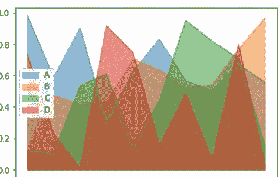

图16-21. 非堆叠面积图

这就是创建面积图的方法。

## 散点图

您还可以将任何数据集可视化为散点图。让我们创建一个数据集，如下所示：

```
df = pd.DataFrame(np.random.rand(10, 4),
    columns=['A', 'B', 'C', 'D'])
print(df)
```

输出数据集如下：

|   | A       | B       | C       | D       |
|---|---------|---------|---------|---------|
| 0 | 0.593893| 0.114066| 0.950810| 0.325707|
| 1 | 0.193619| 0.457812| 0.920403| 0.879069|
| 2 | 0.252616| 0.348009| 0.182589| 0.901796|
| 3 | 0.706528| 0.726658| 0.900088| 0.779164|
| 4 | 0.599155| 0.291125| 0.151395| 0.335175|
| 5 | 0.657552| 0.073343| 0.055006| 0.323195|
| 6 | 0.590482| 0.853899| 0.287062| 0.173067|
| 7 | 0.134021| 0.994654| 0.179498| 0.317547|
| 8 | 0.568291| 0.009349| 0.900649| 0.977241|
| 9 | 0.556895| 0.084774| 0.333002| 0.728429|

您可以将A列和B列可视化为散点图，如下所示：

```python
plt.figure()
df.plot.scatter(x='A', y='B')
plt.show()
```

图16-22显示了输出结果。

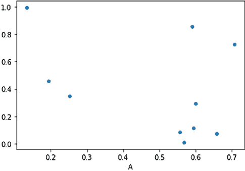

**图16-22.** *简单散点图*

您可以按如下方式可视化多个组：

```python
ax = df.plot.scatter(x='A', y='B',
                     color='Blue',
                     label='Group 1')
plt.figure()
df.plot.scatter(x='C', y='D',
                 color='Green',
                 label='Group 2',
                 ax=ax)
plt.show()
```

图16-23显示了输出结果。

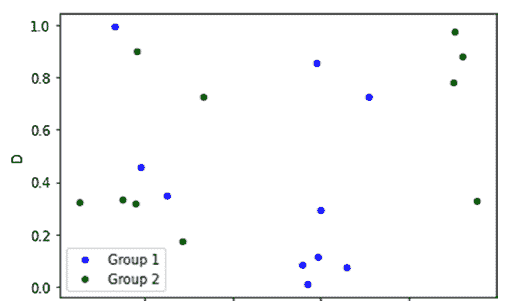

# 图16-23. 多组散点图

让我们看看如何自定义散点图。您可以自定义点的颜色和大小。颜色或大小可以是常量，也可以是变量。以下是一个数据点颜色可变、大小恒定的示例。当颜色可变时，默认会在输出中添加一个颜色条。

```
plt.figure()
df.plot.scatter(x='A', y='B', c='C', s=40)
plt.show()
```

图16-24显示了输出结果。

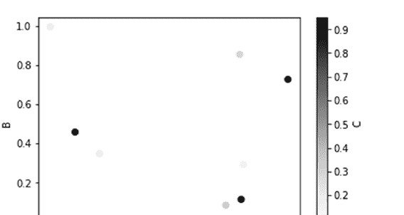

# 图16-24. 数据点颜色不同的散点图

我们将大小设置为可变，如下所示：

```
plt.figure()
df.plot.scatter(x='A', y='B', s=df['C']*100)
plt.show()
```

图16-25显示了输出结果。

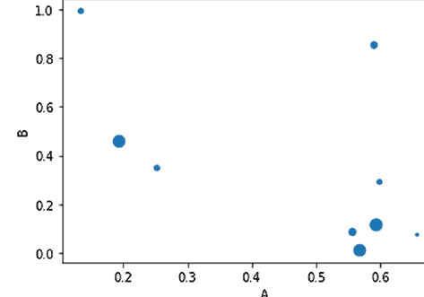

图16-25. 数据点大小不同的散点图

最后，让我们看一个完全自定义的可变大小和可变颜色的示例，如下所示：

```
plt.figure()
df.plot.scatter(x='A', y='B', c='C', s=df['D']*100)
plt.show()
```

图16-26显示了输出结果。

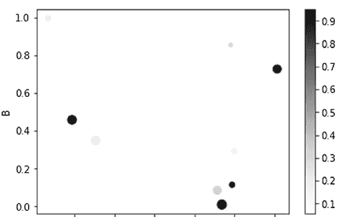

图16-26. 数据点大小不同的散点图

您刚刚学习了如何创建和自定义散点图。

## 六边形分箱图

您还可以使用六边形分箱（hexbin）图来可视化数据。让我们准备一个数据集，如下所示：

```
df = pd.DataFrame(np.random.randn(100, 2),
                  columns=['A', 'B'])
df['B'] = df['B'] + np.arange(100)
print(df)
```

输出如下：

|    | A        | B        |
|----|----------|----------|
| 0  | 0.165445 | -1.127470 |
| 1  | -1.192185| 1.818644 |
| 2  | 0.237185 | 1.663616 |
| 3  | 0.694727 | 3.750161 |
| 4  | 0.247055 | 4.645433 |
| .. | ...      | ...      |
| 95 | 0.650346 | 94.485664 |
| 96 | 0.539429 | 97.526762 |
| 97 | -3.277193| 95.151439 |
| 98 | 0.672125 | 96.507021 |
| 99 | -0.827198| 99.914196 |

[100 rows x 2 columns]

让我们使用六边形分箱图来可视化这些数据，如下所示：

```
plt.figure()
df.plot.hexbin(x='A', y='B', gridsize=20)
plt.show()
```

图16-27显示了输出结果。

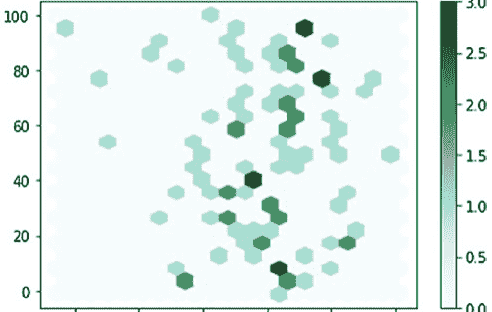

**图16-27.** *六边形分箱图示例*

如您所见，您可以自定义网格的大小。

## 饼图

最后，您将学习如何创建饼图来可视化数据集。让我们创建一个数据集，如下所示：

```
series = pd.Series(3 * np.random.rand(4),
                  index=['A', 'B', 'C', 'D'],
                  name='series')
print(series)
```

这将生成以下数据：

|   | X        | Y        |
|---|----------|----------|
| A | 1.701163 | 2.983445 |
| B | 0.536219 | 0.036600 |
| C | 1.370995 | 2.795256 |
| D | 2.538074 | 1.419990 |

图16-29显示了输出结果。

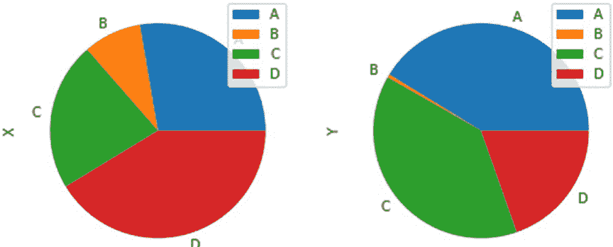

**图16-29.** *多列数据集的简单饼图*

您可以自定义饼图。具体来说，您可以自定义字体、颜色和标签，如下所示：

```
plt.figure()
series.plot.pie(labels=['A', 'B', 'C', 'D'],
                 colors=['r', 'g', 'b', 'c'],
                 autopct='%.2f', fontsize=20,
                 figsize=(6, 6))
plt.show()
```

图16-30显示了输出结果。

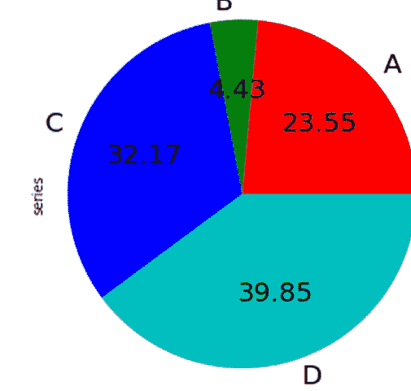

# 图16-30. 简单而自定义的饼图

让我们通过传递总和小于1.0的值来创建部分饼图。以下是相关数据：

```
series = pd.Series([0.1] * 4,
    index=['A', 'B', 'C', 'D'],
    name='series2')

print(series)
```

这将创建以下数据集：

```
A    0.1
B    0.1
C    0.1
D    0.1
Name: series2, dtype: float64
```

部分饼图可以按如下方式可视化：

```
plt.figure()
series.plot.pie(figsize=(6, 6))
plt.show()
```

这将创建一个部分饼图（或半圆），如图16-31所示。

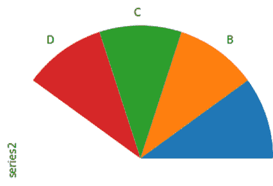

图16-31. 简单而自定义的饼图

您刚刚学习了如何使用饼图可视化数据。

## 总结

在本章中，您学习了如何使用各种技术来可视化数据。您可以在实际项目中使用这些可视化技术。在接下来的章节中，我们将探索用于在Python中创建数据可视化的其他库。

在下一章中，您将学习如何使用一个名为Seaborn的新库来创建数据可视化。
