## 第17章

## 使用Seaborn进行数据可视化入门

在上一章中，您学习了如何可视化存储在Pandas序列和DataFrame中的数据。

在本书的前几章中，您广泛学习了数据可视化库Matplotlib，以及另外两个重要的数据科学库NumPy和Pandas。在本章中，您将暂时告别Matplotlib，学习如何使用另一个相关的数据可视化库Seaborn。以下是您将在本章中学习的主题：

- 什么是Seaborn？
- 绘制统计关系
- 绘制线条
- 可视化数据分布

读完本章后，您将能够熟练使用Seaborn库，并能够创建出色的数据集可视化。

## 什么是Seaborn？

您已经学习了如何使用Matplotlib库进行数据可视化。Matplotlib并不是Python中唯一的数据可视化库。Python中有许多库可以对数据进行可视化。科学数据可视化库支持NumPy和Pandas的数据结构。其中一个用于科学Python可视化的库就是Seaborn（https://seaborn.pydata.org/index.html）。Seaborn基于并构建在Matplotlib之上。它提供了许多绘制美观的功能


图形。它内置了对 Pandas 中序列和 DataFrame 数据结构以及 NumPy 中 N 维数组的支持。

让我们为本章的演示创建一个新的笔记本。现在，让我们使用以下命令安装 Seaborn：

```
```python
!pip3 install seaborn
```
```

你可以使用以下语句将库导入到笔记本或 Python 脚本中：

```
```python
import seaborn as sns
```
```

你知道 Seaborn 库支持 Pandas DataFrame。Seaborn 库中还存储了许多填充了数据的 DataFrame。因此，我们可以使用它们进行演示。让我们看看如何检索这些 DataFrame。以下命令返回所有内置样本 DataFrame 的列表：

```
```python
sns.get_dataset_names()
```
```

以下是输出：

```
```python
['anagrams',
 'anscombe',
 'attention',
 'brain_networks',
 'car_crashes',
 'diamonds',
 'dots',
 'exercise',
 'flights',
 'fmri',
 'gammas',
 'geyser',
 'iris',
 'mpg',
 'penguins',
 'planets',
 'tips',
 'titanic']
```
```

你可以按如下方式将这些 DataFrame 加载到 Python 变量中：

```
iris = sns.load_dataset('iris')
```

让我们使用以下语句查看存储在 iris 数据集中的数据：

```
iris
```

图 17-1 显示了输出。

In [6]: iris
Out[6]:
|  | sepal_length | sepal_width | petal_length | petal_width | species |
|---|---|---|---|---|---|
| 0 | 5.1 | 3.5 | 1.4 | 0.2 | setosa |
| 1 | 4.9 | 3.0 | 1.4 | 0.2 | setosa |
| 2 | 4.7 | 3.2 | 1.3 | 0.2 | setosa |
| 3 | 4.6 | 3.1 | 1.5 | 0.2 | setosa |
| 4 | 5.0 | 3.6 | 1.4 | 0.2 | setosa |
| ... | ... | ... | ... | ... | ... |
| 145 | 6.7 | 3.0 | 5.2 | 2.3 | virginica |
| 146 | 6.3 | 2.5 | 5.0 | 1.9 | virginica |
| 147 | 6.5 | 3.0 | 5.2 | 2.0 | virginica |
| 148 | 6.2 | 3.4 | 5.4 | 2.3 | virginica |
| 149 | 5.9 | 3.0 | 5.1 | 1.8 | virginica |

图 17-1. iris 数据集

## 绘制统计关系

你可以使用 Seaborn 中的各种函数来绘制两个变量之间的统计关系。执行此操作的一般绘制函数是 relplot()。你可以使用此函数绘制各种类型的数据。默认情况下，relplot() 函数绘制散点图。以下是一个示例：

```
%matplotlib inline
import numpy as np
import pandas as pd
```

```
```python
import matplotlib.pyplot as plt

sns.relplot(x='sepal_length',
            y='sepal_width',
            data=iris)
plt.grid('on')
plt.show()
```
```

这生成了图 17-2 中所示的散点图。

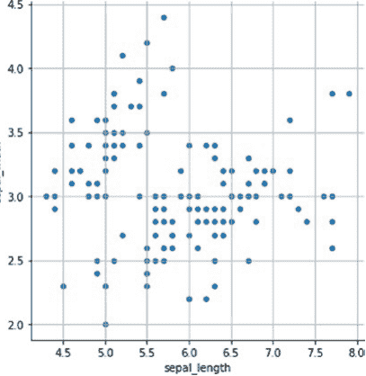

**图 17-2。** *散点图*

你可以按如下方式明确指定图形类型：

```
```python
sns.relplot(x='sepal_length', y='sepal_width',
            data=iris, kind='scatter')
plt.grid('on')
plt.show()
```
```

你还可以使用 `scatterplot()` 函数按如下方式编写：

```
```python
sns.scatterplot(x='petal_length',
                y='petal_width',
                data=iris)
plt.grid('on')
plt.show()
```
```

你可以自定义图形，并使用颜色编码显示额外的列，如下所示：

```
```python
sns.relplot(x='sepal_length',
            y='sepal_width',
            hue='species',
            data=iris)
plt.grid('on')
plt.show()
```
```

图 17-4 显示了输出。

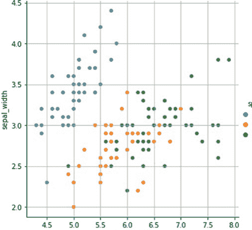

**图 17-4。** *带颜色的散点图*

使用以下代码，你可以获得与图 [17-4](#) 中所示相同的结果：

```
```python
sns.scatterplot(x='sepal_length',
                y='sepal_width',
                hue='species',
                data=iris)
plt.grid('on')
plt.show()
```
```

你还可以按如下方式为散点图的数据点（标记）分配样式：

```
```python
sns.relplot(x='sepal_length', y='sepal_width',
            hue='petal_length', style='species',
            data=iris)
plt.grid('on')
plt.show()
```
```

你可以在图 [17-5](#) 中看到输出。

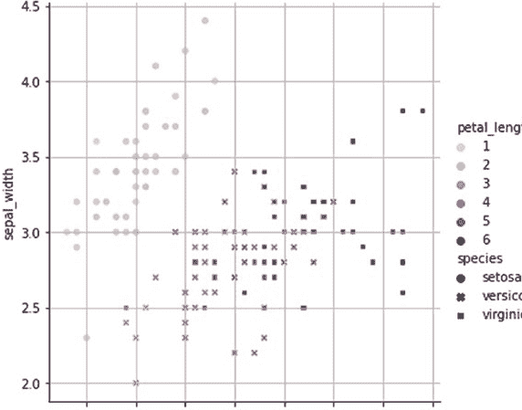

**图 17-5。** *带颜色和自定义样式的散点图*

以下代码产生与图 17-5 中所示相同的输出：

```
```python
sns.scatterplot(x='sepal_length', y='sepal_width',
                hue='petal_length', style='species',
                data=iris)
plt.grid('on')
plt.show()
```
```

你还可以按如下方式调整标记的大小：

```
```python
sns.relplot(x='sepal_length', y='sepal_width',
            size='petal_length', style='species',
            hue='species', data=iris)
plt.grid('on')
plt.show()
```
```

图 17-6 显示了输出。

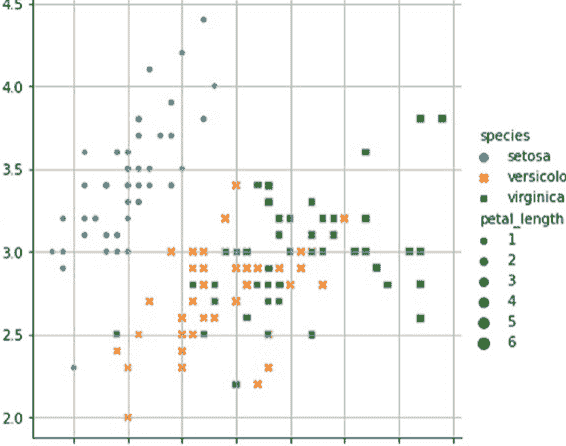

**图 17-6。** *带颜色、自定义样式和标记大小的散点图*

以下代码产生与图 17-5 中所示相同的结果：

```
sns.scatterplot(x='sepal_length', y='sepal_width',
    size='petal_length', style='species',
    hue='species', data=iris)
plt.grid('on')
plt.show()
```

## 绘制线条

你还可以沿线条显示连续数据，例如时间序列数据。时间序列数据至少在一列中具有时间戳数据，或者具有索引。时间序列的一个很好的例子是每日温度记录表。让我们创建一个时间序列 DataFrame 来演示线条绘制。

```
df = pd.DataFrame(np.random.randn(100, 4),
    index=pd.date_range("1/1/2020",
        periods=100),
    columns=list("ABCD"))
df = df.cumsum()
```

你可以使用 relplot() 函数按如下方式绘制线条：

```
sns.relplot(x=df.index, y='A', kind="line", data=df)
plt.xticks(rotation=45)
plt.show()
```

图 17-7 显示了输出。

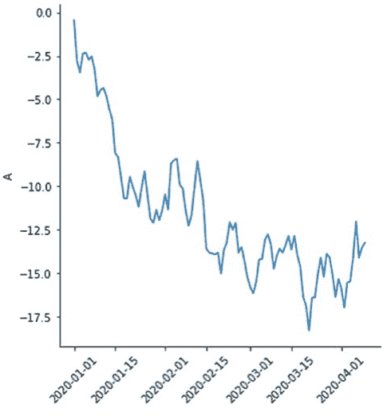

**图 17-7。** *时间序列数据的线条图*

你还可以使用以下代码生成图 17-7 中所示的输出：

```
sns.lineplot(x=df.index,
             y='A', data=df)
plt.xticks(rotation=45)
plt.show()
```

在下一节中，你将学习如何可视化数据的分布。

## 可视化数据分布

可视化数据分布的一个最突出的例子是频率表或频率分布表。你可以创建数据可以具有的值范围桶（定义域），然后列出满足该桶标准的项数。你还可以改变桶的大小，最小大小为 1。

你可以使用条形图和线条在视觉上显示频率分布的信息。如果你使用条形图，则称为*直方图*。你可以使用 displot() 函数来可视化频率数据。让我们从虚拟的单个变量数据开始。

```
x = np.random.randn(100)
sns.displot(x)
plt.show()
```

图 17-8 显示了输出。

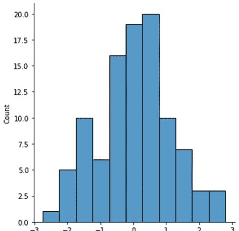

*图 17-8. 直方图*

你还可以按如下方式明确指定输出中需要直方图：

```
sns.displot(x, kind='hist')
plt.show()
```

直方图是默认的图形类型。你还可以按如下方式显示高斯核密度估计（KDE）：

```
sns.displot(x, kind='kde')
plt.show()
```

图 17-9 显示了输出。

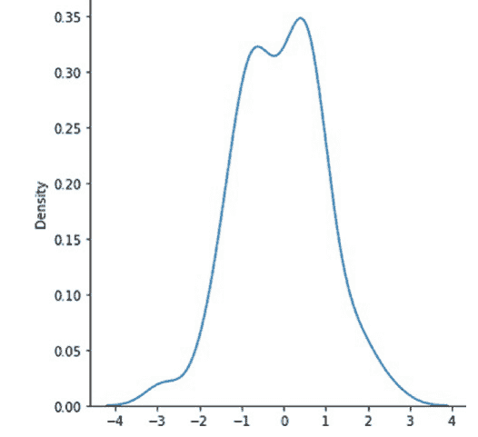

图 17-9. KDE 图

你可以按如下方式可视化经验累积分布函数（eCDF）：

```
sns.displot(x, kind='ecdf')
plt.show()
```

图 17-10 显示了输出。

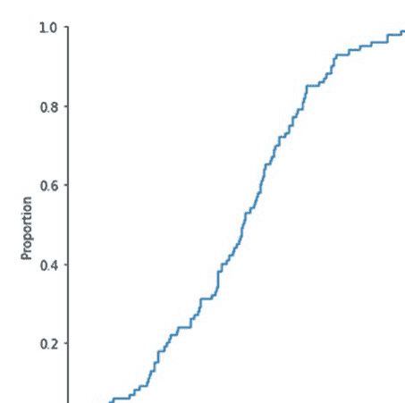

图 17-10. eCDF 图

你可以按如下方式组合直方图和 KDE：

```
sns.displot(x, kind='hist', kde=True)
plt.show()
```

图 17-11 显示了输出。

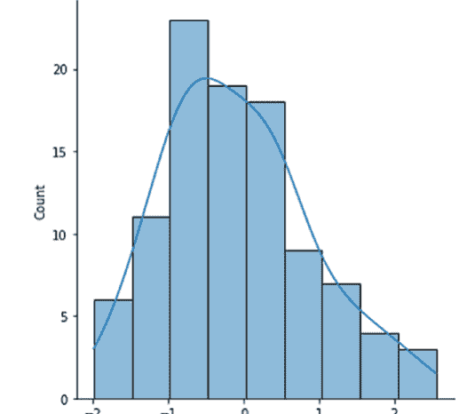

图 17-11. 与 KDE 组合的直方图

现在让我们使用一些真实世界的数据，如下所示：

```
tips = sns.load_dataset("tips")
sns.displot(x='total_bill', data=tips, kind='hist')
plt.show()
```

图 17-12 显示了输出。

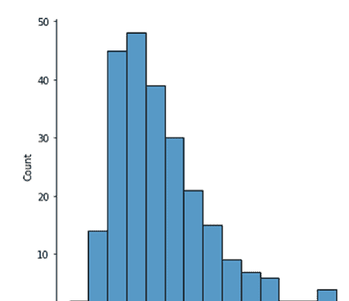

图 17-12. 以直方图可视化的真实世界数据

你可以按如下方式自定义可视化中箱（或桶）的大小：

```
sns.displot(x='total_bill', data=tips,
    kind='hist', bins=30, kde=True)
plt.show()
```


Figure 17-13 shows the output.

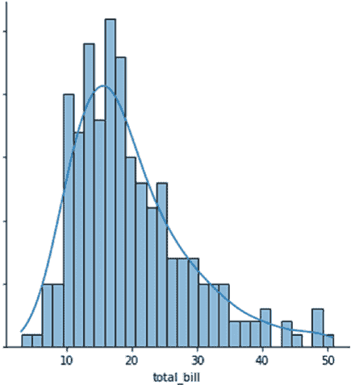

**Figure 17-13.** *Customized buckets in a histogram*

You can adjust the hue of the plots based on a criterion of your choice as follows:

```
sns.displot(x='total_bill', data=tips,
            kind='kde', hue='size')
plt.show()
```

Figure 17-14 shows the output.

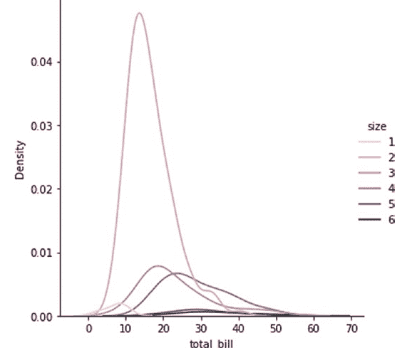

## Figure 17-14. Customized colors in a KDE plot

Up to now, we have used a single variable to show the plot. When you use two variables for plotting, it is known as a bivariate plot. Here is a simple example:

```
sns.displot(x='total_bill',
            y='tip', data=tips)
plt.show()
```

Figure 17-15 shows the output.

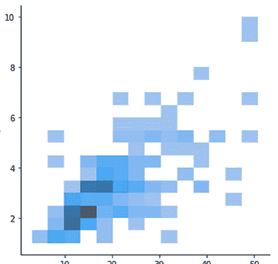

Figure 17-15. A simple bivariate histogram

You can add color to this example as follows:

```
sns.displot(x='total_bill', y='tip',
    hue='size', data=tips)
plt.show()
```

Figure 17-16 shows the output.

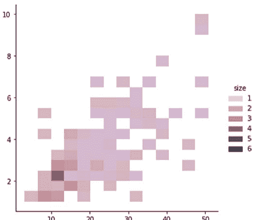

Figure 17-16. A simple bivariate histogram with color

You can also customize the size of bins and add ticks on the x- and y-axes (known as a rug plot) as follows:

```
sns.displot(x='total_bill', y='tip',
    data=tips, rug=True,
    kind='hist', bins=30)
plt.show()
```

Figure 17-18 shows the output.

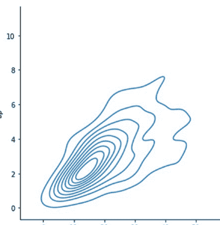

Figure 17-18. A simple bivariate KDE plot

You can add a rug plot to the output as follows:

```
sns.displot(x='total_bill', y='tip',
    data=tips, rug=True,
    kind='kde')
plt.show()
```

The output has KDE and rug visualizations, both as shown in Figure 17-19.

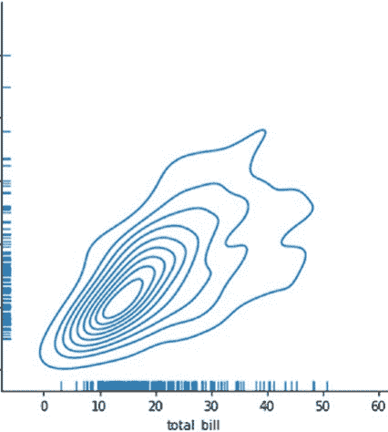

**Figure 17-19.** *A simple bivariate KDE plot with a rug plot*

Based on the columns in the dataframe, you can create individual visualizations arranged in rows or columns. Let’s create a visualization based on the size of tips as follows:

```
```python
sns.displot(x='total_bill', y='tip',
            data=tips, rug=True,
            kind='kde', col='size')
plt.show()
```
```

In the previous example, we are enabling the rug plot feature, and the plots will be separately generated based on the sizes of the tips. Figure 17-20 shows the output.

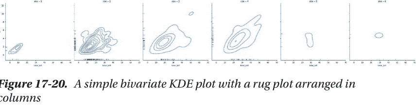

You can also arrange the individual graphs in rows as follows:

```
sns.displot(x='total_bill', y='tip',
            data=tips, rug=True,
            kind='kde', row='size')
plt.show()
```

Figure 17-21 shows the output.

You’ve just learned how to visualize the distribution of data.

## Summary

This chapter contained lots of demonstrations. You explored the Seaborn data visualization library of Python in detail. Seaborn is a vast library, and we have just scratched its surface in this chapter. You can refer to the home page of the Seaborn project at https://seaborn.pydata.org/index.html for the API documentation, tutorials, and an example gallery.

In the next and final chapter of this book, you will learn how to visualize the real-life data of the currently ongoing COVID-19 pandemic with the Matplotlib and Seaborn data visualization libraries.

There are multiple organizations in the world that collect and share real-time data for pandemics. One is Johns Hopkins University (https://coronavirus.jhu.edu/map.html), and the other one is Worldometers (https://www.worldometers.info/coronavirus/). Both of these web pages have data about the COVID-19 pandemic, and they are refreshed quite frequently. Figure 18-1 shows the Johns Hopkins page for COVID-19.

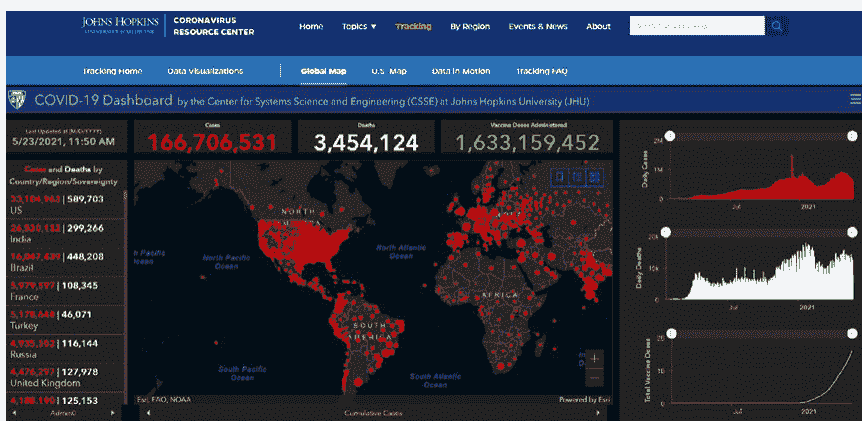

Figure 18-1. Johns Hopkins COVID-19 home page

Figure 18-2 shows the Worldometers website.


**Figure 18-2.** *Worldometers COVID-19 home page*

As I mentioned, the data is refreshed on a frequent basis, so these websites are quite reliable for up-to-date information.

## Fetching the Pandemic Data Programmatically

In this section, you will learn how to fetch both datasets (Johns Hopkins and Worldometers) using Python programs. To do that, you need to install a library for Python. The library’s home page is located at https://ahmednafies.github.io/covid/, and the PyPI page is https://pypi.org/project/covid/. Create a new notebook for this chapter using Jupyter Notebook. You can easily install the library with the following command in the notebook:

```
```python
!pip3 install covid
```
```

You can import the library to a notebook or a Python script/program as follows:

```
```python
from covid import Covid
```
```

You can create an object to fetch the data from an online source. By default, the data source is as follows for Johns Hopkins:

```
```python
covid = Covid()
```
```

Note that due to high traffic, sometimes the servers are unresponsive. I experienced this multiple times.

You can explicitly mention the data source as follows:

```
```python
covid = Covid(source="john_hopkins")
```
```

You can specify Worldometers explicitly as follows:

```
```python
covid = Covid(source="worldometers")
```
```

You can see the source of the data as follows:

```
```python
covid.source
```
```

Based on the data source, this returns a relevant string, as shown here:

```
```python
'john_hopkins'
```
```

You can get status by country name as follows:

```
```python
covid.get_status_by_country_name("italy")
```
```

This returns a dictionary, as follows:

```
```python
{'id': '86',
 'country': 'Italy',
 'confirmed': 4188190,
 'active': 283744,
 'deaths': 125153,
 'recovered': 3779293,
 'latitude': 41.8719,
 'longitude': 12.5674,
 'last_update': 1621758045000}
```
```

You can also fetch the status by country ID, although only the Johns Hopkins dataset has this column, so the code will return an error for Worldometers.

```
```
# Only valid for Johns Hopkins
covid.get_status_by_country_id(115)
```
```

The output is similar to the earlier example, as shown here:

```
```python
{
'id': '115',
'country': 'Mexico',
'confirmed': 2395330,
'active': 261043,
'deaths': 221597,
'recovered': 1912690,
'latitude': 23.6345,
'longitude': -102.5528,
'last_update': 1621758045000}
```
```

You can also fetch the list of countries as follows:

```
```python
covid.list_countries()
```
```

Here is part of the output:

```
```json
[{ 'id': '179', 'name': 'US'},
{ 'id': '80', 'name': 'India'},
{ 'id': '24', 'name': 'Brazil'},
{ 'id': '63', 'name': 'France'},
{ 'id': '178', 'name': 'Turkey'},
{ 'id': '143', 'name': 'Russia'},
{ 'id': '183', 'name': 'United Kingdom'},
....
```
```

You will continue using the Johns Hopkins dataset throughout the chapter.

You can get active cases as follows:

```
```python
covid.get_total_active_cases()
```
```

The output is as follows:

```
```text
27292520
```
```

You can get the total confirmed cases as follows:

```
covid.get_total_confirmed_cases()
```

The output is as follows:

```
166723247
```

You can get the total recovered cases as follows:

```
covid.get_total_recovered()
```

The output is as follows:

```
103133392
```

You can get total deaths as follows:

```
covid.get_total_deaths()
```

The output is as follows:

```
3454602
```

You can fetch all the data with the function call covid.get_data(). This returns a list of dictionaries where every dictionary holds the data of one country. The following is the output:

```
[{'id': '179',
'country': 'US',
'confirmed': 33104963,
'active': None,
'deaths': 589703,
'recovered': None,
'latitude': 40.0,
'longitude': -100.0,
'last_update': 1621758045000},
{'id': '80',
'country': 'India',
'confirmed': 26530132,
```

```
```python
'recovered': 23425467,
'latitude': 20.593684,
'longitude': 78.96288,
'last_update': 1621758045000},
......
```
```

## Preparing the Data for Visualization

You have to prepare this fetched data for visualization. For that you have to convert the list of dictionaries in the Pandas dataframe. It can be done as follows:

```
```python
import pandas as pd
df = pd.DataFrame(covid.get_data())
print(df)
```
```

Figure 18-3 shows the output.

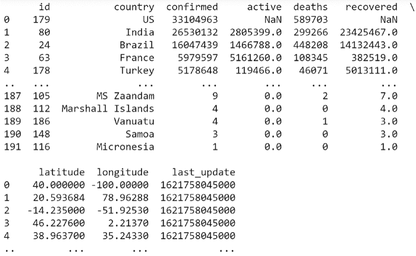

***Figure 18-3.*** *Pandas dataframe for COVID-19 data*


你可以按如下方式进行排序：

```
sorted = df.sort_values(by=['confirmed'], ascending=False)
```

然后你需要排除世界和大洲的数据，这样只剩下各国的数据。

```
excluded = sorted [ ~sorted.country.isin(['Europe', 'Asia', 'South America', 'World', 'Africa', 'North America'])]
```

让我们找出前十条记录。

```
top10 = excluded.head(10)
print(top10)
```

然后你可以按如下方式将列分配给各个变量：

```
x = top10.country
y1 = top10.confirmed
y2 = top10.active
y3 = top10.deaths
y4 = top10.recovered
```

## 使用 Matplotlib 和 Seaborn 创建可视化

让我们使用 Matplotlib 和 Seaborn 对数据进行可视化。首先按如下所示导入所有需要的库：

```
%matplotlib inline
import matplotlib.pyplot as plt
import seaborn as sns
```

可以按如下方式获得简单的线性图：

```
plt.plot(x, y1)
plt.xticks(rotation=90)
plt.show()
```

图 18-4 显示了输出。

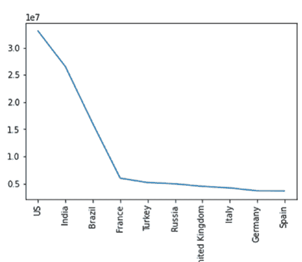

### 图 18-4. 使用 Matplotlib 的线性图

你可以为此图添加标题。你也可以使用 Seaborn 库。下面是使用 Seaborn 的折线图示例：

```
sns.set_theme(style='whitegrid')
sns.lineplot(x=x, y=y1)
plt.xticks(rotation=90)
plt.show()
```

在代码示例中，我们使用了 `set_theme()` 函数。它为整个笔记本的 Matplotlib 和 Seaborn 可视化设置主题。你可以将字符串 'darkgrid'、'whitegrid'、'dark'、'white' 或 'ticks' 中的一个作为参数传递给此函数。图 18-5 显示了输出。

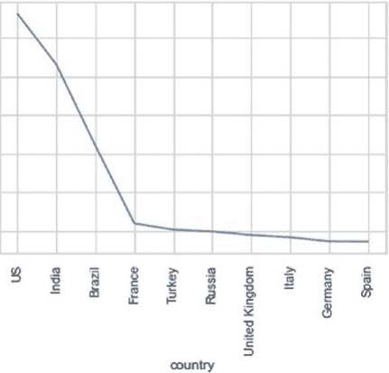

**图 18-5.** *使用 Seaborn 的线性图*

你可以使用 Matplotlib 按如下方式创建简单的条形图：

```
```python
plt.bar(x, y1)
plt.xticks(rotation=45)
plt.show()
```
```

图 18-6 显示了输出。

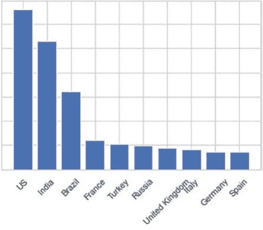

**图 18-6.** *使用 Matplotlib 的条形图*

同样的可视化也可以使用 Seaborn 制作，它在美观上会产生更好的条形图。

```
sns.barplot(x=x, y=y1)
plt.xticks(rotation=45)
plt.show()
```

图 18-7 显示了输出。

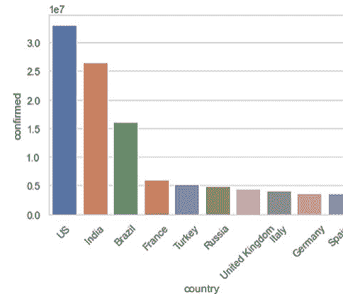

图 18-7. 使用 Seaborn 的条形图

你甚至可以按如下方式更改颜色调色板：

```
sns.barplot(x=x, y=y1,
    palette="Blues_d")
plt.xticks(rotation=45)
plt.show()
```

图 18-8 显示了输出。

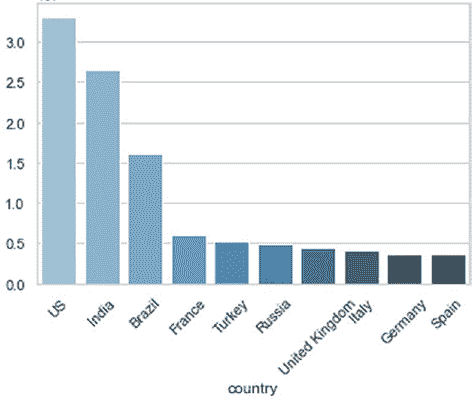

***图 18-8.*** 使用 Seaborn 自定义调色板的条形图

你可以按如下方式创建多线图：

```
labels = ['Confirmed', 'Active', 'Deaths', 'Recovered']
plt.plot(x, y1, x, y2, x, y3, x, y4)
plt.legend(labels, loc='upper right')
plt.xticks(rotation=90)
plt.show()
```

图 18-9 显示了输出。

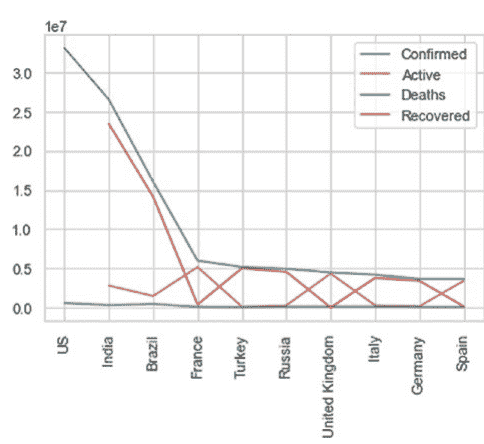

# **图 18-9.** 多线图

你可以使用 Seaborn 库按如下方式创建相同的图：

```
```
# sns.lineplot(x=x,  y=y1)
# sns.lineplot(x=x,  y=y2)
# sns.lineplot(x=x,  y=y3)
# sns.lineplot(x=x,  y=y4)
plt.legend(labels, loc='upper right')
plt.xticks(rotation=45)
plt.show()
```
```

图 18-10 显示了输出。

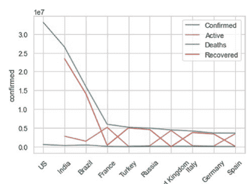

# 图 18-10. 使用 Seaborn 的多线图

你现在将看到如何使用 Matplotlib 按如下方式创建多条形图：

```
df2 = pd.DataFrame([y1, y2, y3, y4])
df2.plot.bar()
plt.legend(x, loc='best')
plt.xticks(rotation=45)
plt.show()
```

你可以使用 Seaborn 按如下方式创建散点图：

```
sns.scatterplot(x=x, y=y1)
sns.scatterplot(x=x, y=y2)
sns.scatterplot(x=x, y=y3)
sns.scatterplot(x=x, y=y4)
plt.legend(labels, loc='best')
plt.xticks(rotation=45)
plt.show()
```

图 18-13 显示了输出。

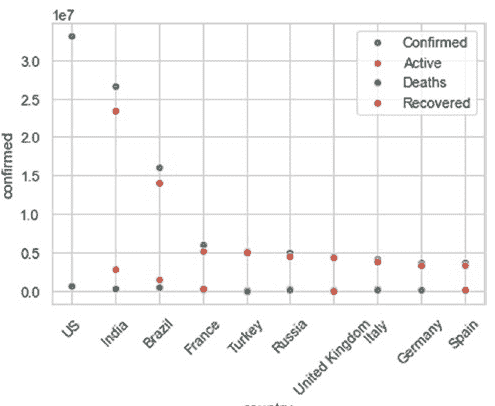

图 18-13. 多线水平条形图

你甚至可以使用以下代码使用 Matplotlib 创建面积图：

```
df2.plot.area()
plt.legend(x, loc='best')
plt.xticks(rotation=45)
plt.show()
```

图 18-14 显示了输出。

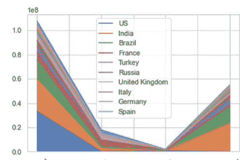

# 图 18-14. 堆叠面积图

你可以按如下方式为数据创建未堆叠且透明的面积图：

```
df2.plot.area(stacked=False)
plt.legend(x, loc='best')
plt.xticks(rotation=45)
plt.show()
```

图 18-15 显示了输出。

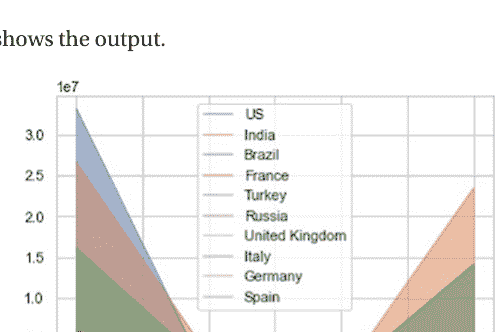

# 图 18-15. 堆叠面积图

图 18-17 显示了输出。

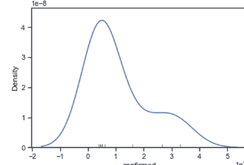

图 18-17. KDE 图

## 创建动物疾病数据的可视化

你也可以为其他真实数据集创建可视化。让我们为动物疾病数据创建可视化。让我们首先从在线仓库读取它。

```
df = pd.read_csv("https://github.com/Kesterchia/Global-animal-diseases/blob/main/Data/Outbreak_240817.csv?raw=True")
```

让我们查看前五条记录。

```
df.head()
```

图 18-18 显示了输出。

```
Out[36]:
```

|   | Id | source | latitude | longitude | region | country | admin1 | localityName |
|---|----|--------|----------|-----------|--------|---------|--------|--------------|
| 0 | 230399 | OIE | -27.900000 | 30.800000 | Africa | South Africa | KwaZulu-Natal | HPAI_H5N8_2017_019 |
| 1 | 230381 | OIE | 54.837037 | 73.354155 | Europe | Russian Federation | Omskaya Oblast | Novaya Stanica |
| 2 | 230333 | OIE | -21.077740 | 30.211620 | Africa | Zimbabwe | Masvingo | Mwambe |
| 3 | 230396 | OIE | -26.000000 | 28.300000 | Africa | South Africa | Gauteng | HPAI_H5N8_2017_020 |
| 4 | 230371 | OIE | 49.237900 | 17.700200 | Europe | Czech Republic | Jihomoravsky | Hvozdná |
5 rows × 24 columns

# 图 18-18. 动物疾病数据

让我们按如下方式获取有关列的信息：

```
df.info()
```

输出如下：

```
<class 'pandas.core.frame.DataFrame'>
RangeIndex: 17008 entries, 0 to 17007
Data columns (total 24 columns):
#  Column            Non-Null Count  Dtype
--- ------            --------------  -----
0  Id                17008 non-null  int64
1  source            17008 non-null  object
2  latitude          17008 non-null  float64
3  longitude         17008 non-null  float64
4  region            17008 non-null  object
5  country           17008 non-null  object
6  admin1            17008 non-null  object
7  localityName      17008 non-null  object
8  localityQuality   17008 non-null  object
9  observationDate   16506 non-null  object
10 reportingDate    17008 non-null  object
11 status           17008 non-null  object
12  disease          17008 non-null  object
13  serotypes         10067 non-null  object
14  speciesDescription 15360 non-null  object
15  sumAtRisk         9757 non-null   float64
16  sumCases          14535 non-null  float64
17  sumDeaths         14168 non-null  float64
18  sumDestroyed      13005 non-null  float64
19  sumSlaughtered    12235 non-null  float64
20  humansGenderDesc  360 non-null    object
21  humansAge         1068 non-null   float64
22  humansAffected    1417 non-null   float64
23  humansDeaths      451 non-null    float64
dtypes: float64(10), int64(1), object(13)
memory usage: 3.1+ MB
```

让我们对列 `country` 执行“group by”操作并计算总病例数的总和，如下所示：

```
df2 = pd.DataFrame(df.groupby('country').sum('sumCases')['sumCases'])
```

现在让我们排序并选择前十个病例。

```
df3 = df2.sort_values(by='sumCases', ascending = False).head(10)
```

让我们使用以下代码绘制条形图：

```
df3.plot.bar()
plt.xticks(rotation=90)
plt.show()
```

图 18-19 显示了输出。

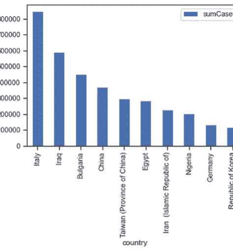

# 图 18-19. 条形图

你可以按如下方式将索引转换为列：

```
df3.reset_index(level=0, inplace=True)
df3
```

输出如下：

|   | country | sumCases |
|---|---------|----------|
| 0 | Italy | 846756.0 |
| 1 | Iraq | 590049.0 |
| 2 | Bulgaria | 453353.0 |
| 3 | China | 370357.0 |
| 4 | Taiwan (Province of China) | 296268.0 |
| 5 | Egypt | 284449.0 |
| 6 | Iran (Islamic Republic of) | 225798.0 |
| 7 | Nigeria | 203688.0 |
| 8 | Germany | 133425.0 |
| 9 | Republic of Korea | 117018.0 |


让我们按如下方式制作饼图：

```
plt.pie(df3['sumCases'],
    labels=df3['country'])
plt.title('Death Toll')
plt.show()
```

图 18-20 显示了输出。

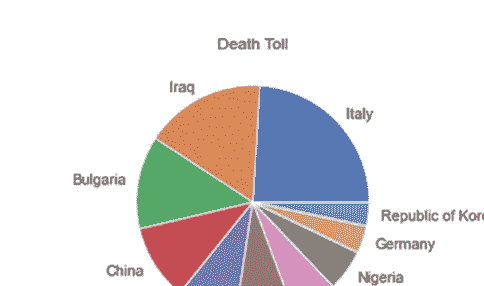

### 图 18-20. 饼图

你可以用 Seaborn 按如下方式创建更美观的条形图：

```
sns.barplot(x='country',
    y='sumCases',
    data=df3)
plt.xticks(rotation=90)
plt.show()
```

图 18-21 显示了输出。

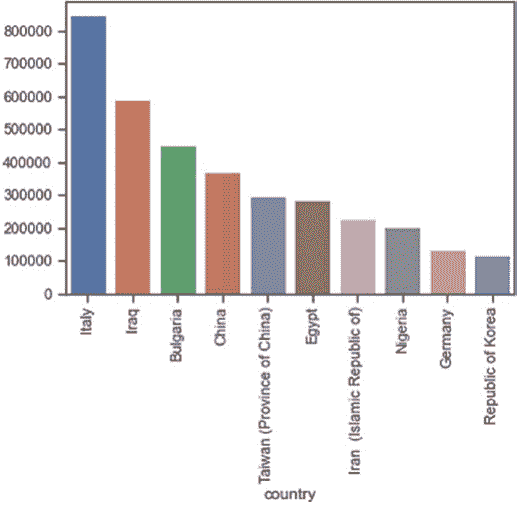

*图 18-21.* 使用 Seaborn 的条形图

你刚刚学会了可视化真实的动物疾病数据。

## 摘要

在本章中，你探索了 Seaborn 数据可视化库的更多功能，该库是科学 Python 生态系统的一部分。你还学习了如何将真实数据导入 Jupyter Notebook。你使用 Matplotlib 和 Seaborn 库来可视化数据。

如你所知，这是本书的最后一章。虽然我们对 Matplotlib 进行了详细探讨，但我们只是触及了庞大知识体系和编程 API 的表面。你现在拥有了知识，可以自行进一步探索 Matplotlib 和其他数据可视化库。Python 有许多用于科学数据的可视化库。例如 Plotly、Altair 和 Cartopy。凭借你对数据可视化基础知识的了解，继续享受深入数据科学和可视化的旅程吧！
