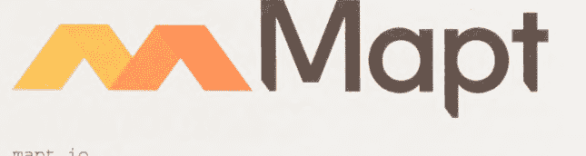

# Adobe After Effects CC 动态图形实用指南：作为视觉特效和动态图形艺术家提升技能

mapt.io

Mapt 是一个在线数字图书馆，提供超过 5,000 本书籍和视频的完整访问权限，以及行业领先的工具，帮助您规划个人发展并推进职业生涯。更多信息，请访问我们的网站。

## 为什么订阅？

- 使用来自 4,000 多名行业专业人士的实用电子书和视频，减少学习时间，增加编码时间
- 使用专为你打造的技能计划更好地学习
- 每月获得一本免费电子书或视频
- Mapt 可完全搜索
- 复制、粘贴、打印和书签内容

## Packt.com

您是否知道 Packt 为每本出版的书籍提供电子书版本，提供 PDF 和 ePub 文件？您可以在 www.Packt.com 升级到电子书版本，作为印刷书籍客户，您有权享受电子书副本的折扣。欲了解更多详情，请联系 customercare@packtpub.com。

在 www.Packt.com，您还可以阅读一系列免费技术文章，订阅多种免费通讯，并获得 Packt 书籍和电子书的独家折扣和优惠。

## 贡献者

## 关于作者

**David Dodds** 是一位艺术家，终生热爱学习和教学，这促使他在 UCLA 从事教学职业。他通过与公司合作并为娱乐行业创建动态图形，保持在动态图形行业的前沿。David 在与令人兴奋的动态图形行业相关的各种活动中授课、指导学生并演讲。他目前居住并工作于洛杉矶。

> 我要感谢我的家人和朋友的支持。
> 特别感谢我的伴侣 Bradley Hankey 相信我，并始终鼓励我追求我所有的创意热情！
> 我还要感谢 Packt Publishing 的同事们和 UCLA 的学生们；我从你们那里学到了很多。感谢你们帮助我成为更好的讲师！

## 关于审阅者

**Luis Medrano** 于 1995 年在巴拿马巴拿马城开始了他的职业生涯，担任手绘卡通动画师，后来成为 3D 和 After Effects 艺术家。2003 年，他移居美国，他独特的电影风格使他在竞争激烈的纽约市电视市场中作为设计总监和动画师获得了认可。他的丰富经验涵盖营销、动画、广播制作、虚拟集成和现场电视。自称动画科学家，他目前正在撰写关于 Motion Orchestration™ 的理论。Luis 因其动画作品获得了两项艾美奖和三项 Promax 奖。他目前在纽约地区担任 CGI 艺术家和顾问。

## Packt 正在寻找像你这样的作者

如果你有兴趣成为 Packt 的作者，请访问 authors.packtpub.com 并立即申请。我们已与数千名开发人员和技术专业人士合作，就像你一样，帮助他们与全球技术社区分享他们的见解。你可以提交一般申请，申请我们正在招聘作者的特定热门主题，或提交你自己的想法。

由 Internet Archive 数字化
于 2022 年获得资助
Kahle/Austin Foundation

## Preface

欢迎阅读这本关于使用Adobe After Effects进行动态图形制作的入门指南，它是您了解动态图形的向导，动态图形是当今世界上最令人兴奋的领域。本书将为读者提供使用After Effects有效沟通所需的知识和技能，并能够通过使用电影级合成工具创建信息图表。其他涵盖的主题包括编辑、摄像和灯光。您将学习如何创建令人惊叹的视觉效果和令人兴奋的动画3D排版。本书将训练读者掌握动态设计的概念，探讨一系列多样化的问题，例如将平面设计和动画与电影叙事技巧相结合。

### Who this book is for

本书面向学生、专业人士、YouTuber以及对视频编辑、动画和动态图形感兴趣的人士。它也为希望让自己的创作动起来的插画师设计。所有这些群体都会非常喜欢阅读本书。

### What this book covers

第1章《开始使用After Effects》解释了主要工具和菜单的位置。重点将放在形状和文本图层上，以及动画位置、缩放、旋转、不透明度和遮罩。

第2章《为电视节目创建下三分之一》讨论了预合成。这是After Effects非常重要的一部分。它可以帮助您快速创建复杂的动画。一旦您理解了这一概念，我们将使用更复杂的图层创建一个下三分之一项目。

第3章《使用形状图层创建动画歌词视频》在理解更复杂的图层方面建立在前一章的基础上。我们还将开始使用文本动画师。文本动画师是更复杂的文本工具，可让您使用文本预设实现详细的动画。

第4章《使用Character Animator创建信息图表》将您的文本动画提升到更高级的水平并用于传达信息。您将动态制作图标动画。了解图表编辑器将使您的动画更逼真、更专业。您还将了解用于在项目中制作简单角色动画的不同工具。

第5章《使用文本动画师制作电影标题项目》解释了开场电影标题是如何营造氛围并传达电影内容的绝佳方式（根据开创动态图形和当代电影标题的平面设计师Saul Bass的说法）。在本章中，我们将创建一个动态的电影标题开场序列。

第6章《使用合成效果制作体育图形动画》开始了我们对视频素材的工作。了解如何编辑视频并为素材添加效果是After Effects中的重要工具。您将学习如何使用娱乐行业常用的工具来合成和跟踪视频。

第7章《使用3D摄像机跟踪器开发VFX项目》在娱乐行业常用的专业级视觉效果方面更进一步。了解如何将物体与其背景分离为特效开辟了大量可能性。我们还将学习如何使用粒子系统。

第8章《创建2.5D环境摄像机飞越》将您的图层置于3D空间中。After Effects拥有强大的3D工作区。了解如何在3D空间中制作动画为创建动态视频提供了许多选择。在本章中，您将使用所有3D工具开始工作。

第9章《构建3D C4D Lite标志项目》教您如何在After Effects中建模、灯光和合成您的3D项目。

### To get the most out of this book

在使用本书之前，您应该对计算机有基本的工作知识。您应该知道如何使用鼠标以及如何打开、保存和关闭文件。

After Effects CC不包含在本图书中。您需要购买并安装它。本书中的一些课程使用Adobe Bridge、Photoshop、Illustrator和Character Animator。您必须从Adobe Creative Cloud安装这些程序。

要完成本书中的项目，您需要下载课程文件。链接在第2章《为电视节目创建下三分之一》的技术要求部分提供。

### Download the color images

我们还提供了一份PDF文件，其中包含本书中使用的屏幕截图/图表的彩色图像。您可以在此处下载：https://www.packtpub.com/sites/default/files/downloads/9781789345155_ColorImages.pdf.

### Conventions used

本书通篇使用了多种文本约定。

CodeInText: 表示文本中的代码词、数据库表名、文件夹名、文件名、文件扩展名、路径名、虚拟URL、用户输入和Twitter账号。示例：“创建一个分辨率为1920 x 1080、帧率为29.97的合成。”

Bold: 表示新术语、重要词语或屏幕上显示的词语。例如，菜单或对话框中的词语在文本中以这种方式出现。示例：“转到图层 | 新建 | 纯色，并将颜色更改为蓝色。”

警告或重要说明以这种方式显示在框中。

提示和技巧以这种方式显示。

### Get in touch

我们始终欢迎读者的反馈。

General feedback: 如果您对本书的任何方面有疑问，请在邮件主题中提及书名并发送邮件至customercare@packtpub.com。

Errata: 尽管我们已尽一切努力确保内容的准确性，但错误难免。如果您在本图书中发现错误，我们将不胜感激您向我们报告。请访问www.packt.com/submit-errata，选择您的图书，点击勘误提交表单链接并输入详细信息。

**盗版：** 如果您在互联网上以任何形式遇到我们作品的非法复制品，我们将不胜感激您能提供其位置地址或网站名称。请通过 `copyright@packt.com` 联系我们，并附上该材料的链接。

**如果您有兴趣成为作者：** 如果您擅长的主题，并且您有兴趣撰写或为一本书做出贡献，请访问 `authors.packtpub.com`。

## 评论

请留下评论。阅读并使用本书后，为什么不在您购买的网站上留下评论呢？潜在读者可以查看并使用您的公正意见来做出购买决定，我们 Packt 可以了解您对我们产品的看法，而我们的作者可以看到您对他们书籍的反馈。谢谢！

更多关于 Packt 的信息，请访问 `packt.com`。
