## 1 开始使用 After Effects

欢迎踏上这段令人兴奋的 **After Effects** 之旅！在本章中，我将带您全面参观这个强大的程序。

您将学习如何使用 After Effects 进行导航并找到工具和效果。您将[content]
**盗版：** 如果您在互联网上以任何形式遇到我们作品的非法复制品，我们将不胜感激您能提供其位置地址或网站名称。请通过 `copyright@packt.com` 联系我们，并附上该材料的链接。

**如果您有兴趣成为作者：** 如果您擅长的主题，并且您有兴趣撰写或为一本书做出贡献，请访问 `authors.packtpub.com`。

## 评论

请留下评论。阅读并使用本书后，为什么不在您购买的网站上留下评论呢？潜在读者可以查看并使用您的公正意见来做出购买决定，我们 Packt 可以了解您对我们产品的看法，而我们的作者可以看到您对他们书籍的反馈。谢谢！

更多关于 Packt 的信息，请访问 `packt.com`。

# 第 1 部分：文本、图层、字符、动画

在本节中，您将了解主要工具和菜单的位置。重点是形状和文本图层，以及位置、缩放、旋转、不透明度和遮罩的动画。

本节包含以下章节：

- 第 1 章，开始使用 After Effects
- 第 2 章，为电视节目创建下三分之一
- 第 3 章，使用形状图层创建动画歌词视频
- 第 4 章，使用角色动画创建信息图表
- 第 5 章，使用文本动画师制作电影标题项目

## 1 开始使用 After Effects

欢迎踏上这段令人兴奋的 **After Effects** 之旅！在本章中，我将带您全面参观这个强大的程序。

您将学习如何使用 After Effects 进行导航并找到工具和效果。您将被介绍图层面板、时间线和关键帧，并学习导入文件。您还将学习创建、动画化和遮罩图层。

我们将从程序的界面开始，以帮助您了解如何导航。到本章结束时，您将知道如何创建一个简单的动画幻灯片。本章中我们将学习的概念很简单；然而，我们将学习使用的工具对于未来的项目至关重要（插图、摄影和 David Dodds 的所有艺术内容）。

本章将涵盖以下主题：

- After Effects 界面
- 遮罩图层
- 创建项目
- 介绍图层属性
- 基础动画
- 创建动画幻灯片

### 技术要求

要使用本书，您需要 Photoshop、Illustrator、Character Animator 和 After Effects CC。您需要对标准菜单和命令有良好的理解。本书中的一些课程使用 Adobe-Character Animator、Adobe Bridge、Adobe Media Encoder、Adobe Illustrator 和 Adobe Photoshop。您必须从 Adobe Cloud 安装这些应用程序。具备 Adobe Photoshop 和 Illustrator 的一些知识将有助于您完成本书中的项目。

### 计算机要求

After Effects 至少需要 8 GB 的 RAM。

### 探索界面

现在，让我们看看 After Effects 界面。当您第一次打开 After Effects 时，您会看到一个开始菜单。通过点击右上角的红色 X 关闭它：

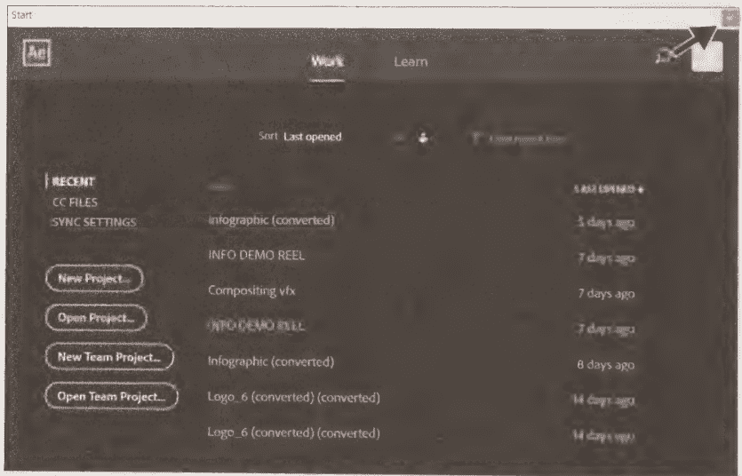

开始菜单

如果您需要找到最近打开的项目，此菜单会有所帮助。我认为最好关闭它并在程序本身中查找我们需要的内容。

### 重置布局

您的工作区是所有面板和工具所在的位置。这是程序的核心。您的工作区可以以不同的方式配置；让我们确保它设置为默认状态。

转到 **窗口** | **工作区** | 重置“标准”到已保存的布局。这是标准工作区：

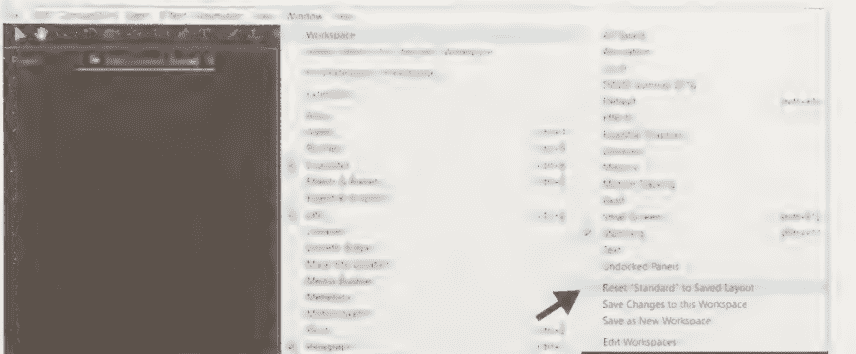

重置工作区

这样，一切都在我们的界面中处于应有的位置；没有任何东西放错地方。

### 保存您的项目

保存项目始终是一个好习惯。让我们通过保存它来创建一个新文件来开始我们的项目：

1. 转到左上角的选项卡，**文件**。选择 **另存为** | **另存为...** 并将文件命名为 `test`。
2. 导航到您想要保存 After Effects 项目的位置。给项目编号是一个好主意。让我们将我们的命名为 `projects_01`。

我们已经开始保存我们的第一个项目。立即开始保存东西很重要。

### 项目面板

**项目面板** 是您引入所有资产的地方。After Effects 通常用于后期制作。您通常会使用许多不同类型的资产。您的项目很快就会变得非常杂乱无章。这就是您保持所有资产整洁的地方。当您的项目变得更困难时，您会非常高兴您花时间保持井然有序。当项目整洁时，更容易找到东西。它还有助于您更快地工作。项目面板底部有图标。选择名为文件夹的那个：

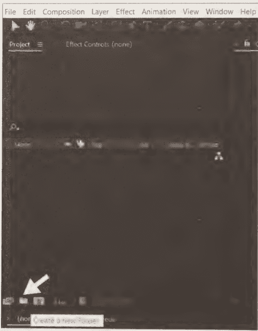

创建新文件夹

让我们通过以下步骤学习如何在项目面板中创建文件夹：

1. 点击文件夹图标
2. 将这个新命名为 `comp-main comp`

当您将媒体导入 After Effects 时，请确保将所有媒体组织到适当的文件夹中。

您可以创建以下文件夹：

- MAIN
- AUDIO
- PRECOMP
- Images
- Footage

您应该有五个文件夹。右键单击文件夹以重命名它们。

本书中的项目将使用这五个文件夹。我们创建它们是为了正确组织所有内容。

### 导入图像

让我们通过双击开放区域导入一张大图像（至少 1,920 x 1,080）。这会打开您的媒体文件夹。您可以在下一张截图中我站立的区域的任何地方点击：

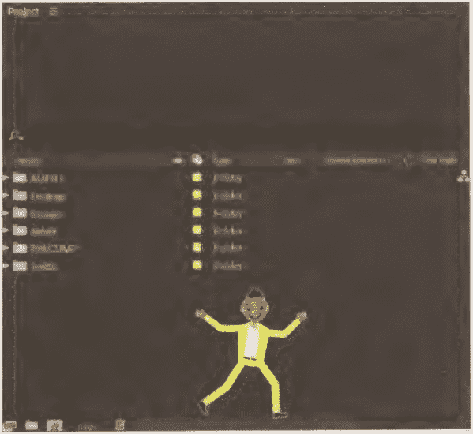

项目面板

将此图像拖动并移动到 Images 文件夹中。您可以通过右键单击图层来重命名图像。

After Effects 引用素材。它实际上不会在项目中保留任何内容；它引用事物。您绝不能在 After Effects 外部重命名文件。当您将图像导入 Photoshop 文档时，它会保存文档的副本。然而，After Effects 链接到您导入项目的资产。您应始终保持名称不变，因为 After Effects 将无法为其引用找到新名称，您将收到错误消息。

与其在 After Effects 中重命名或删除文件，不如创建副本或不移动它。如果需要替换文件，您必须右键单击图层并选择替换或重新加载素材：

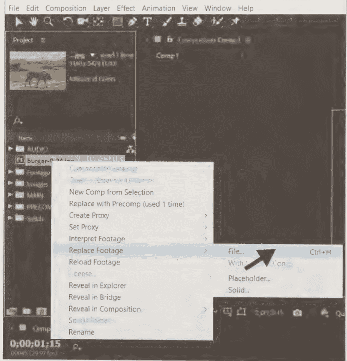

替换素材

练习几次重命名和重新链接文件，以确保您理解该概念。

如果需要删除任何内容，将其拖入垃圾箱；这在以下截图中突出显示：

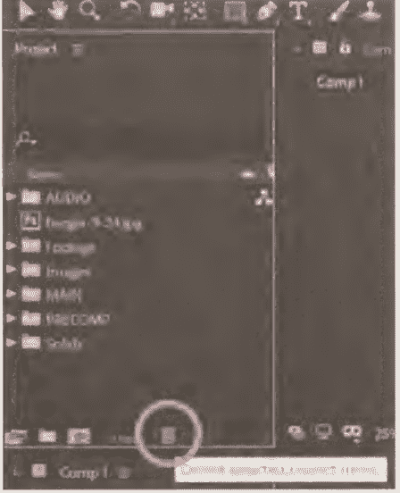

垃圾箱

### 首选项 – 自动保存

现在我们将把注意力转向为您的项目设置自动保存。设置它很重要，这样即使您忘记手动保存，项目也会自动保存。以下步骤将向您展示如何设置自动保存：

1. 转到 编辑 | 首选项 | 自动保存...
2. 将自动保存设置为 20 分钟间隔。

3. 您可以调整项目自动保存的最大版本数。默认数量为 5：

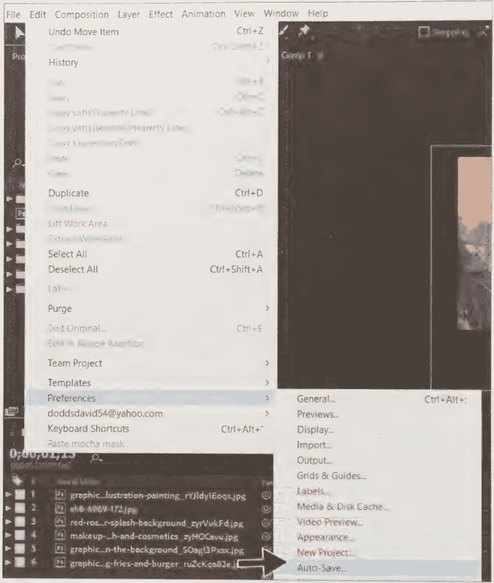

自动保存项目

设置自动保存可以挽救您的生命。如果项目崩溃，您会很高兴在自动保存文件夹中有备份副本保存。这位于您保存项目的位置。

### 创建合成

After Effects 使用合成来放置和排列元素。请记住在排列元素时考虑有助于创建强大合成的设计原则。在 After Effects 中，这些合成被称为 comps。我将通过点击新的合成图标来创建一个合成。如果您仔细观察图标，您会看到它看起来像一个带有形状的合成符号：

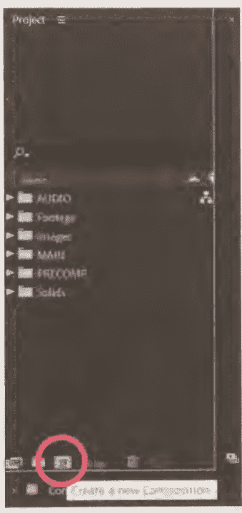

新建合成

保持所有这些设置不变，但将合成大小设为 1,920 x 1,080，并将时间持续时间设为 0:04:00:00。将合成命名为 MAIN：

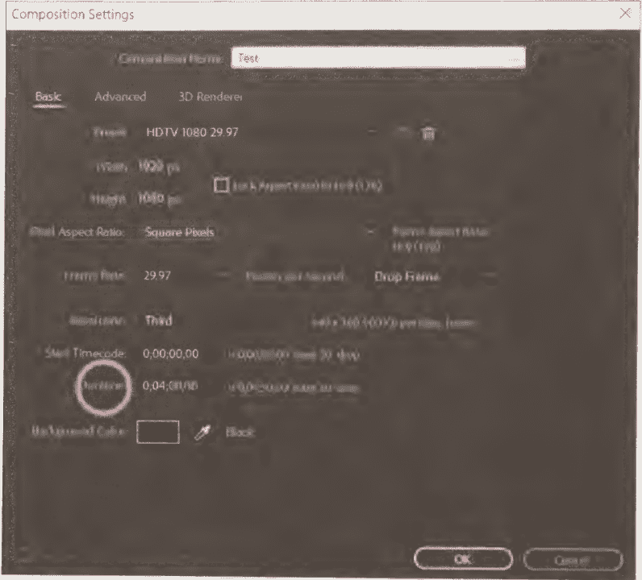

合成设置

将主合成拖入 MAIN 合成文件夹：

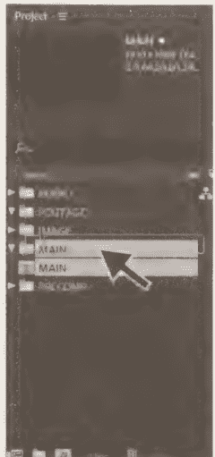

项目组织

## 时间线和工具栏

看屏幕下三分之一部分。这称为时间线面板。时间线是你创建关键帧的工作区。在这里你让图层随时间动画。你还组织图层的堆叠顺序。这种堆叠顺序与 Photoshop 相似。顶部的图层会显示在其他图层之上：

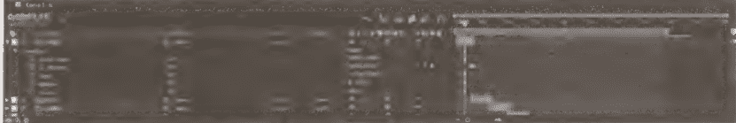

时间线面板

在简要了解时间线面板后，让我们讨论如何将图层带入你的合成。

## 将图层带入合成

将图层带入合成很容易。图层是创建电影的基本构建块。图层可以是图像、视频素材或音频文件。

按以下步骤操作：

- 1. 进入 IMAGE 文件夹。
- 2. 将图像拖到时间线上。
- 3. 如果图像为 1,920 x 1,080，它将完美适配并填满屏幕。它会居中进入合成：

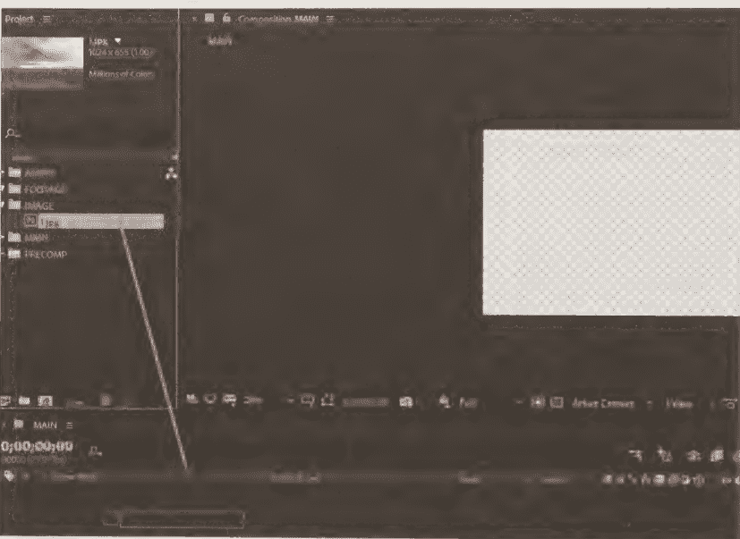

将图像带入时间线

## 工具面板

让我们回顾一下我们的工具！工具面板是你找到编辑图层的所有工具的地方。在这里，你可以找到移动图层和在合成中导航的工具：

- **选择工具 (V)**：前往屏幕左上角。这称为工具栏：
- **手工具 (H)**：手工具位于箭头工具右侧。此工具让你在合成中移动：
- **缩放工具 (Z)**：缩放工具位于手工具旁边。此工具会放大合成中的图像。选择缩放工具，或使用键盘快捷键 Z，并在合成中的图像上点击几次：

选择工具

最左侧的箭头图标称为选择工具。

手工具

现在选择手工具或使用键盘快捷键 H。你可以使用手工具在视图中移动或在合成中导航。

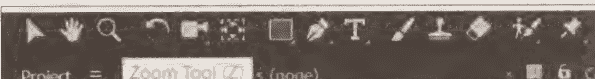

缩放工具

- **旋转工具 (W)**：旋转工具是缩放工具旁边的圆形工具：

旋转工具

让我们探索如何使用旋转工具。屏幕中央显示图像的位置称为**合成窗口**。左下角有一个名为**放大比例弹出窗口**的图标。选择适合 100%。这将缩小以便我们可以看到正在发生的事情：

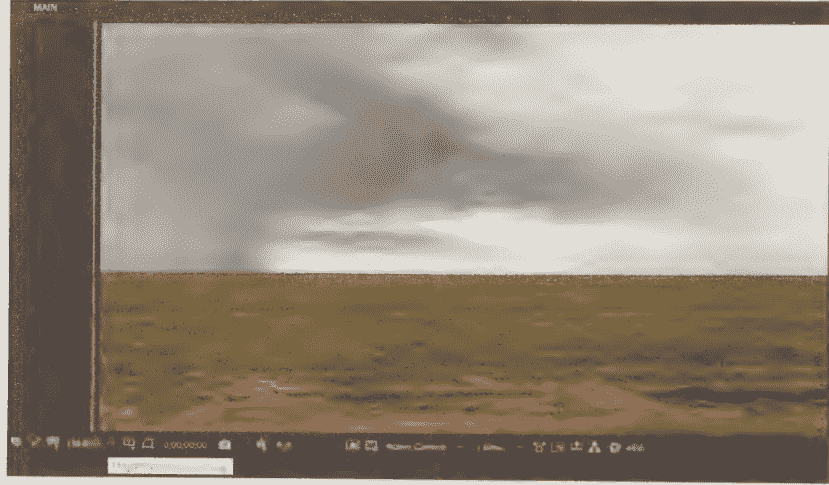

放大

选择旋转工具，或使用键盘快捷键 W，并调整图像：

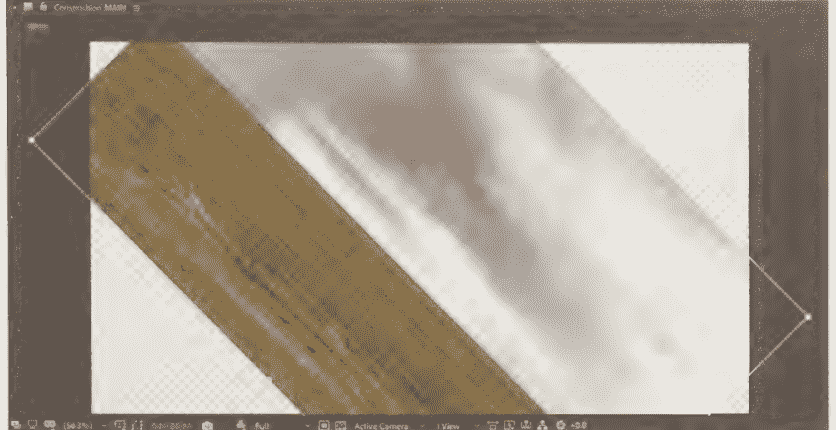

旋转

要撤销操作，请前往左上角并选择 编辑 | 撤销旋转对象：

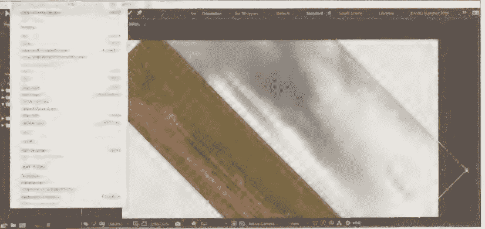

撤销

- **后移 (锚点) 工具 (Y)**：我暂时跳过摄像机工具。摄像机工具旁边是后移工具。用它来移动你的锚点。在 After Effects 中，事物沿锚点动画。了解如何移动锚点很有用，因为它让你控制事物动画的方式：

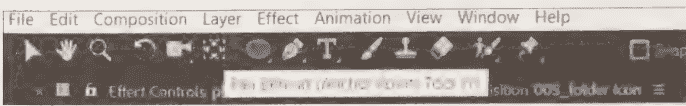

后移工具

- **遮罩工具**：右侧是我们的遮罩工具。列表中的第一个形状是矩形工具。使用这些遮罩工具，你可以点击并拖动来创建形状。点击此工具按钮左下角的三角形图标。你会找到圆角矩形工具、椭圆工具和星形工具：

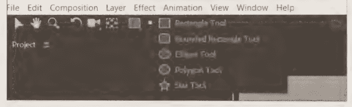

遮罩工具

- **钢笔工具 (G)**：矩形工具旁边是钢笔工具。它用于在 After Effects 中制作自定义形状。
- **文字工具**：钢笔工具右侧是文字工具。
- **画笔工具**：下一个带有画笔图标的图标是画笔工具。
- **图章工具**：带有图章图标的图标是克隆图章工具。

我们稍后会介绍更多这些工具。

希望你开始熟悉 After Effects 的界面。四处探索并尝试这些工具，以便熟悉它们。工具按钮旁边的三角形意味着你可以访问该工具的更多选项。如果工具变灰，只需点击你的合成，它就会激活。

## 预览面板

让我们回顾一下预览面板。它位于屏幕右上角：

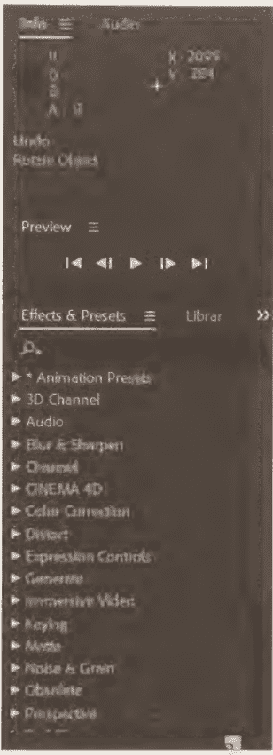

预览面板

此预览面板提供诸如在电影中移动等选项。项目由帧组成，就像真实的视频素材一样。在 After Effects 中，在项目中移动被称为*沿时间线向下移动*。此时间线以帧、秒和分钟等单位表示。此预览面板允许你逐帧向前或向后移动。按下**播放**按钮可预览你的项目。你也可以使用**RAM 预览**，它让你能够以更快的速度观看项目。你也可以按空格键预览动画。

## 合成窗口

在合成窗口底部，有几个选项。让我们回顾一下其中一些。

合成右下角的图标是你找到指南选项的地方。这些指南选项用于排列图层并创建构图精美的图像。然而，这些指南不会被渲染；它们仅用于预览目的：

- **指南**：用于对齐和排列图层。要删除指南，请选择 视图 | 清除指南。
- **标题/动作安全区**：这些是视频安全区，用于标准视频监视器。
- **标尺**：用于将指南拖到合成中以对齐和排列图层。
- **网格**：这是一个模块化网格，有助于组织图层并创建强有力的合成：

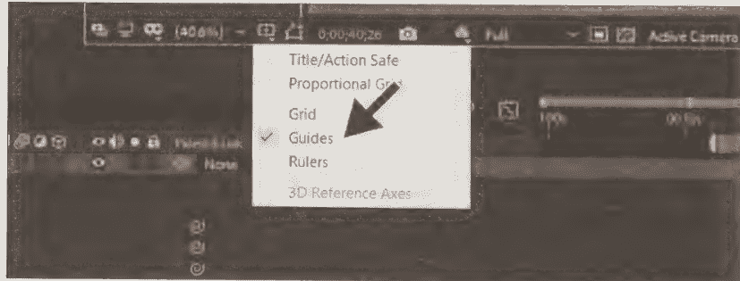

指南

再往右一点是分辨率按钮。你可以将质量降低到**四分之一**。这让你能够更快地查看和播放，但质量较低：

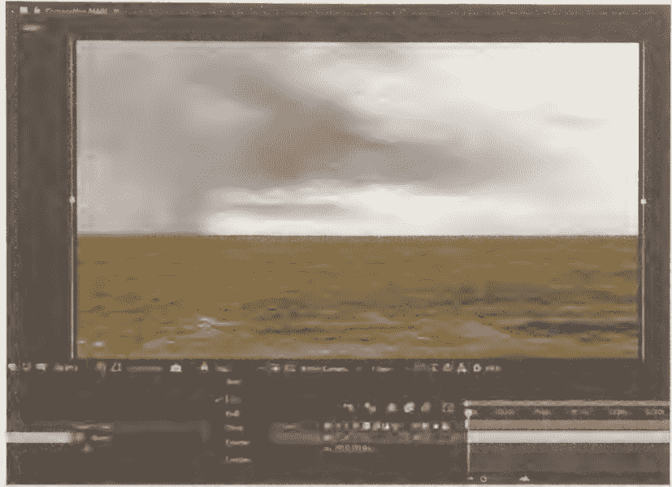

分辨率

接下来，我们将介绍我们的**效果和预设**面板。效果面板是一个主要工具箱，包含大量效果，可让你的视频看起来惊艳！此面板为你提供数百种效果的访问权限，可帮助你创建动画、校正颜色或修复视频或图像的各种问题。

## 效果面板

效果面板位于最右侧，预览面板下方。其中许多效果与 Photoshop 中使用的效果相同。你可能熟悉**亮度**、**对比度**、**曲线**等。在点击效果之前，请确保在时间线中选择了你的图层。

你可以通过以下方式向图层添加效果：

- 1. 展开类别名称
- 2. 在选择图层的情况下点击效果，或输入效果名称
- 3. 在选择图层的情况下双击效果

让我们在搜索栏中输入效果（自动色阶）。双击效果将其添加到我们的图层：

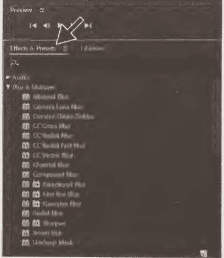

效果和预设

你可以在效果控件面板中调整这些效果。此面板嵌套在主项目面板旁边：

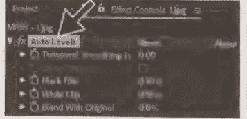

自动色阶

这些效果与 Photoshop 的主要区别在于，你可以在时间线上对它们进行动画，我们将在下一节中介绍。你还可以向图层添加多个效果，以创建复杂的视觉图像。

## 介绍图层属性

复制图层是你需要快速掌握的基本工具。这很有帮助，因为你可以在项目中重用图层：

- 1. 选择你的图层。
- 2. 你可以分别在 Windows 或 macOS 上按 Ctrl + D / command + D，或直接从菜单中选择 编辑 | 复制：

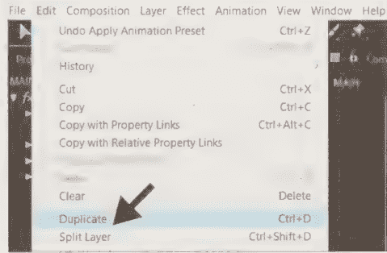

复制图像

当你遵循此过程时，你的图层将被复制。此复制的图层是图层的精确副本。仔细查看你的图层并找到最右侧的三角形。点击此三角形。这称为展开：

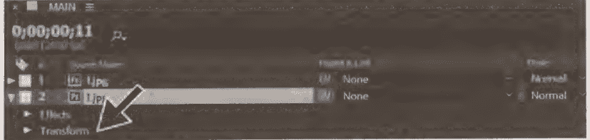

展开属性

展开图层会显示变换属性。点击 Transform 单词左侧的三角形图标展开。你会看到变换属性：缩放、旋转、不透明度和位置。所有这些都有快捷键。

以下是图层变换属性的快捷键：

- 缩放的快捷键是 S
- 旋转的快捷键是 R
- 不透明度的快捷键是 T
- 对于位置，快捷键是.. 没错，你猜对了，P

这些快捷键很容易记住。唯一不直观的快捷键是用于不透明度的 T。记住它的一种简单方法是想 T 代表透明度，或者 T 是 opacity 的最后一个音节（opaci-T）：

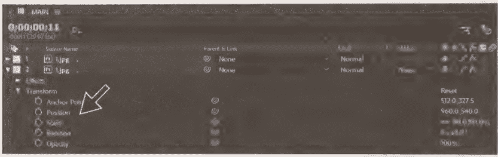

变换属性

在 After Effects 中选择任何内容时，需要选中选择工具。在屏幕左上角工具栏中导航到该工具。选择时间线的顶层图层：

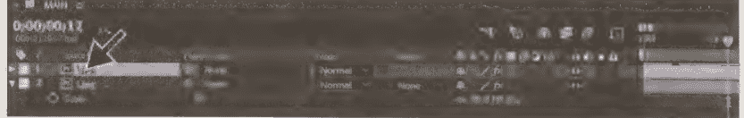

选择顶层图层

在选中此图层后，我们将选择缩放属性。要使用快捷键，只需按字母 S。你会看到这仅显示缩放属性。让我们调整缩放参数。在 scale 单词的最右侧，你会看到两个数字。将其中任一参数向左拖动。这会使图层缩小：

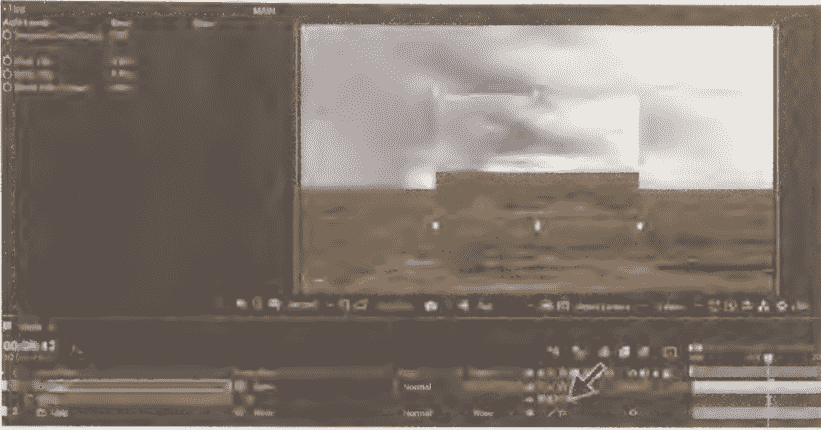

缩小图像

如你所见，此图层在屏幕中央缩小。

## 图层面板

现在我将向你介绍我们的图层和时间线。了解界面这一部分非常重要。这个图层面板是你控制图像移动方式的方式。在这里，你可以一目了然地看到电影中发生了什么。这个面板类似于 Photoshop 的图层面板。图层右侧的每个图标都有重要功能。如果你将选择箭头悬停在任何这些图标上，屏幕上会出现说明：

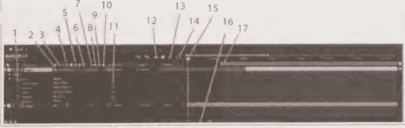

图层面板

让我们更仔细地看看图层面板的一些按钮和开关：

- 1. 动画秒表
- 2. 隐藏按钮
- 3. 连续光栅化按钮
- 4. 特效按钮
- 5. 运动模糊
- 6. 3D 按钮
- 7. 隐藏开关
- 8. 音频开关
- 9. 独奏按钮
- 10. 锁定开关
- 11. 父级选择鞭
- 12. 隐藏开关
- 13. 运动模糊
- 14. 图表编辑器
- 15. 当前时间编辑器
- 16. 放大时间线
- 17. 工作区

看着所有这些按钮和开关可能会让人不知所措。让我们看看几组对组织图层有帮助的开关：

- #7 眼睛开关：它位于图层的最右侧。关闭图层旁边的眼睛将决定该图层是否可见。
- #9 独奏开关：图层最右侧的圆形图标称为独奏开关。独奏开关会隔离已打开独奏的图层。
- #10 锁定开关：用于锁定图层。
- #12 隐藏开关：如果在这两个位置都打开，你将看不到该图层。
- #13 运动模糊开关：这也需要在这两个位置（#5 和 #13）都激活；这将启用运动模糊。

## 素材面板

素材面板用于预览素材。还有一些工具仅在素材面板中工作。

要访问素材面板，双击图层。然而，这个面板经常被意外访问。双击图层时就会访问它。当你在底部看到白色条时，就说明你在这个面板中。在这个图层中可以做一些特定的事情，但我们通常不需要在这个面板中。以下是素材面板的截图：

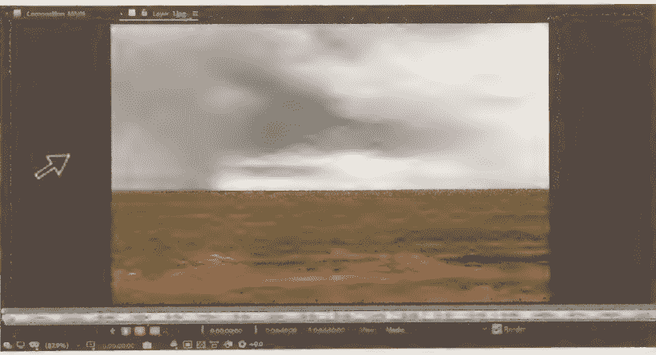

素材面板

你会发现这是经常发生的错误。要退出此面板，请转到该面板顶部并选择主合成的名称。或者你可以将工作区重置回保存的布局：

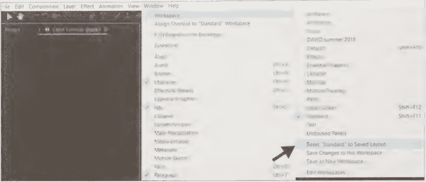

重置布局

重置此操作不会改变项目中的任何内容。它只是将工作区恢复为默认标准布局。

## 时间线面板

让我们谈谈时间。时间线面板是 After Effects 与 Photoshop 不同的主要因素之一。与 Photoshop 不同，After Effects 能够让事物随时间发生。After Effects 与 Photoshop 之间的另一个重大区别是 3D 空间。你可以创建具有 3D 深度的合成。After Effects 电影由帧组成，就像真正的电影一样。

## 时间线生命周期

把时间线想象成一个生命周期。开始是时间线的诞生，在工作区的末端，被认为是死亡或生命周期的结束。

## 放大时间线

你可以使用时间线底部中央的按钮放大时间线的任何一点。或者你可以通过移动滑块来放大时间线。仔细看，你可以看到（F），它代表帧：

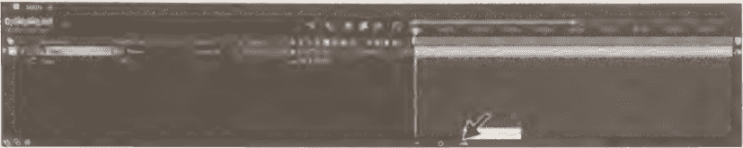

放大滑块

时间线以时间码测量。时间线数字旁边的 F 代表帧。

## 在时间线中导航

时间线始终从左到右移动：

- 使用 Page Up 键作为快捷键逐帧向前导航时间线，使用 Page Down 逐帧向后导航时间线。
- 在时间线中向下移动一帧的快捷键是 Page Down 或 Ctrl + 右箭头（在 PC 上）或 Page Down 或 command + 右箭头（在 macOS 上）。你也可以使用预览面板中的箭头：

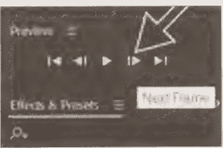

预览面板

时间线上的 f 代表帧；数字代表帧数：

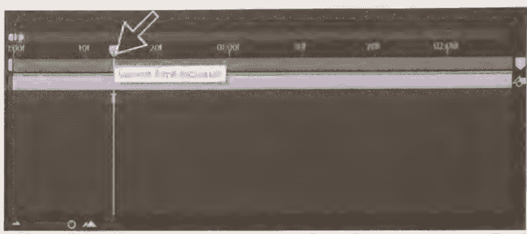

帧

转到时间线的开头。快捷键是按下数字键盘上的 Home 键。

## 当前时间指示器

以下截图中突出显示的吉他拨片形状的对象称为当前时间指示器图标。移动此时间指示器是浏览时间线的另一种方式：

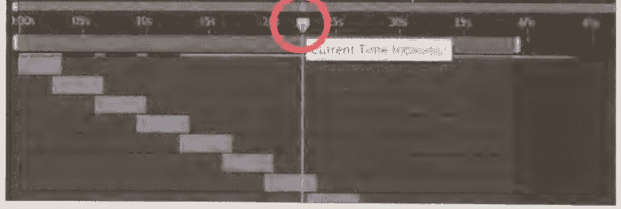

当前时间指示器

## 工作区

时间线是合成的整个长度。你的工作区是电影的长度。这也称为渲染区域。当我按下播放按钮预览电影时，它会在该空间内发生。这可以被修剪和编辑。要修剪工作区，请执行以下步骤：

- 1. 将时间指示器移动到时间线上的所需位置
- 2. 按字母 N 激活修剪工作区的快捷键

在 After Effects 中通常有不止一种方法来完成某事。要手动修剪工作区，请执行以下步骤：

- 1. 将鼠标移动到时间线的开头并悬停在蓝色条上。这是工作区的开始。
- 2. 将此条向右拖动，以修剪工作区。

你可以拖动工作区的开始或结束。修剪它会缩短合成的持续时间。这对于预览电影或预览电影的小部分很有用。记住当你导出或渲染电影时，这个工作区需要被修剪，以反映你想要导出的确切内容。工作区的持续时间是唯一会被导出或渲染的内容：

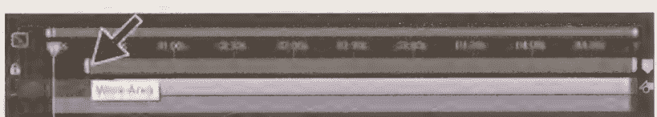

修剪工作区

## 修剪图层

你可以通过修剪来编辑图层的持续时间。修剪图层可以让你控制图层在电影中出现的时机：

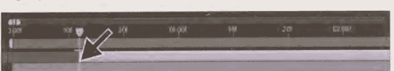

修剪图层

To trim your layer, perform the following steps:

- 1. 将时间指示器移动到时间线上所需的位置
- 2. 按 Alt + | 或 macOS 上的 Option + | 激活修剪图层的快捷方式

To manually trim your layer, perform the following steps:

- 1. 将时间指示器移动到时间线上所需的位置。
- 2. 将选择工具带到图层的最开始位置并悬停在图层起始处。你会看到由两个箭头表示的修剪图层图标。（必须看到它，否则你是在拖动图层，这与修剪图层不同。）使用它来拖动并修剪图层。

你可以使用上述方法修剪任何类型的图层。该图层将在时间指示器所在位置精确修剪。在时间线上将时间指示器在此修剪后的图层上前后移动。看看图层在图像被修剪到的位置是如何显示的？这就是图层如何在时间上显示的方式。

## 在时间线上创建合成标记

你可以通过向时间线添加信息来进一步组织时间线。你还可以在时间线上创建标记、注释和元数据。这些标记也可以用于将图层与时间线上的某一点对齐。以下是创建合成标记的步骤：

- 1. 按 Shift 和一个数字。
- 2. 双击该数字以输入注释：

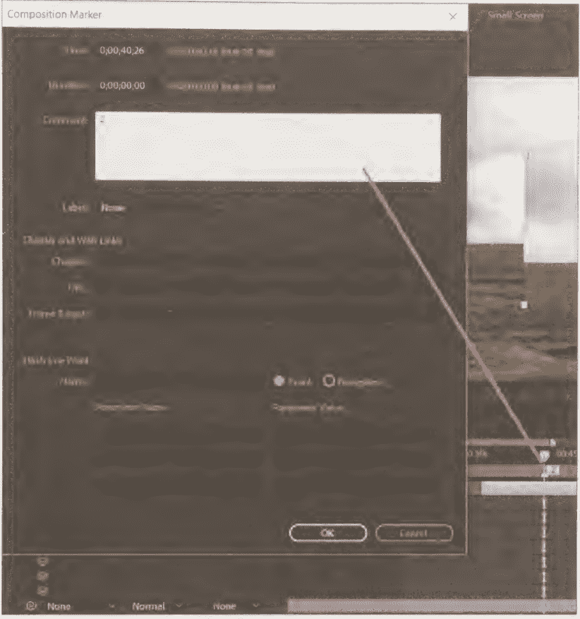

合成标记

这些标记和注释在组织项目以及记录客户和团队成员的笔记时特别有帮助。

## 动画化属性

动画化属性本质上是在时间上标记一个参数，并在时间线更下方调整该属性。我们通过创建至少两个关键帧来创建动画。动画化属性的步骤很简单。但你需要确保每次都遵循这些步骤。当你想要动画化任何属性时，需要执行以下步骤：

- 1. 首先点击秒表，它会自动为你创建一个关键帧。
- 2. 在时间线上向下移动，并将变换属性更改为你想要的任何值。这会自动为你创建一个蓝色菱形关键帧。但你必须确保先按下秒表。

创建关键帧后，你可以自由移动和调整这些关键帧。稍后，我将详细介绍调整关键帧的内容。

## 动画化缩放

你可以动画化缩放参数，使图层随时间改变缩放比例。按照以下步骤开始你的动画之旅：

- 1. 按键盘快捷键 S 使缩放参数出现。
- 2. 在时间线上指示你想要动画开始的位置。
- 3. 点击缩放的秒表。
- 4. 向右翻页，接近此动画的结束。
- 5. 拖动缩放参数。这将自动创建一个蓝色菱形关键帧。

让我们预览一下。如果我想给图层一点模糊，我会点击模糊图标。查看时间线：

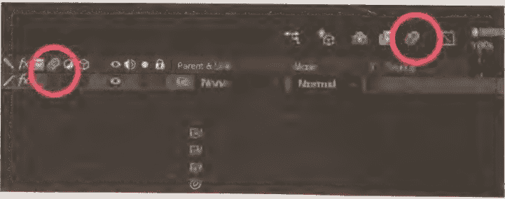

运动模糊

这是一个需要在两个地方打开的效果。它必须在时间线中打开，就在时间线上方。如果你点击预览按钮，你会看到它如何产生漂亮的模糊效果。这就是现实生活中物体移动的方式。物体快速移动时总会有某种模糊。

## 实体图层和遮罩

**实体图层**是基本的彩色图层。它们可用于为视频背景提供纯色。我们也可以使用实体图层创建更复杂的遮罩。让我们花更多时间了解基本的实体图层。实体图层是可使用遮罩工具编辑的简单颜色图层。你将学习如何创建实体图层、编辑它们并为其遮罩：

- 1. 创建一个新的合成。
- 2. 将合成尺寸设为 1,920 x 1,080。
- 3. 将此合成命名为 `solids test`。
- 4. 将此合成移入主 `comp` 文件夹。
- 5. 创建一个基本的实体图层，**图层** | **新建** | **纯色**，或你可以使用快捷键 `Ctrl + Y` 或 macOS 上的 `command + Y`。
- 6. 点击颜色框并将颜色更改为黄色：

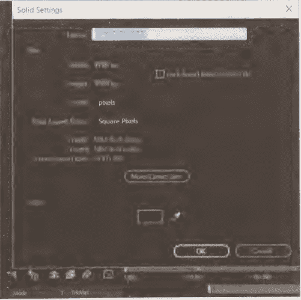

实体设置

干得好！你已经创建了你的第一个实体图层。请注意，当你创建实体图层时，After Effects 会在你的项目窗口中创建一个名为 solids 的文件夹。每当你创建新的实体图层时，它会自动进入该文件夹。现在，你的合成中只有一个图层。当合成中有许多图层时就会变得复杂。让我们创建更多图层，以便习惯同时处理多个图层：

- 1. 创建另一个实体图层，或使用快捷键 Ctrl + Y 或 macOS 的 command+ Y。
- 2. 将此实体图层设为橙色。
- 3. 将这个新的橙色图层移动到右下角。
- 4. 创建另一个实体图层，或使用快捷键 Ctrl + Y 或 macOS 的 command + Y。
- 5. 将此实体图层设为蓝色。将此图层移动到左上角。

请记住，After Effects 中堆叠顺序非常重要。你会先看到最上面的图层，其次是下面的图层，即背景。此合成是由图层堆叠在一起创建的。你可以看到该图层下面的内容。你可以看到背景中还有其他东西。该图层下面有一个实体。此时，你应该能看到所有不同颜色的图层：有些在其他图层前面，有些在后面。这是对堆叠顺序的一个很好的视觉表示。查看时间线；你可以看到堆叠顺序与你在合成中看到的内容如何对应：

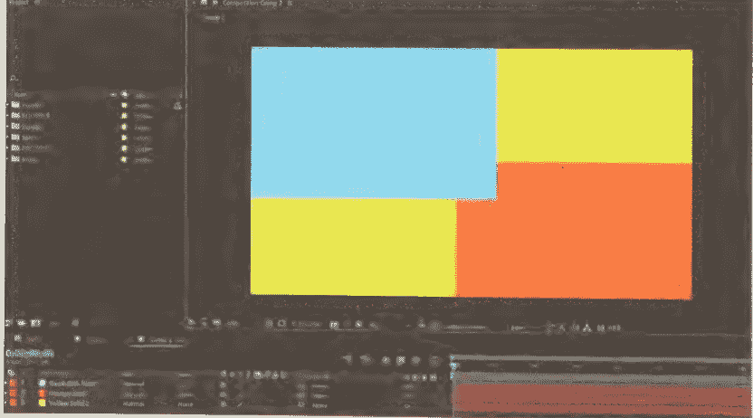

堆叠顺序

让我们查看实体图层的透明度参数。你可以通过按字母 T 来访问它。拖动此参数以降低不透明度，然后降低不透明度。注意你仍然可以通过它看到其他图层：

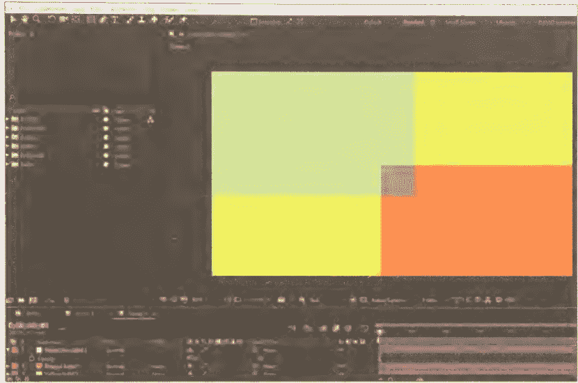

透明度

现在你已经学会如何更改图层不透明度，让我们学习如何复制图层。

## 复制图层

在 After Effects 中，复制图层将创建图层的精确副本，包括其上的任何关键帧和效果。要复制图层，请执行以下步骤：

- 1. 首先，选择图层，复制你的最新图层
- 2. 按 Ctrl + D，或 macOS 的 command + D

- 3. 要更改实体图层的设置，请按 Shift + Ctrl + Y 或 macOS 的 Shift + command + Y

> 如果你使用的是 macOS，你的快捷键可能不同。请参考 After Effects 面板右侧的选项卡，| 帮助 | 键盘快捷键...：

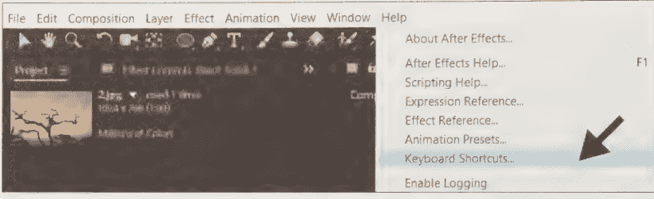

键盘快捷键

如果你发现自己经常做某件事，就找到它的快捷键。学习这些快捷键将大大加快你在 After Effects 中的工作流程。

## 识别和关闭图层

当你更熟练使用 After Effects 时，时间线中会有许多图层。识别图层的一种方法是关闭所有其他图层。暂时关闭图层的另一个原因是查看没有该图层的合成效果。这些眼睛图标用于关闭图层：

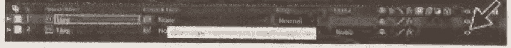

眼睛图标

请记住，当眼睛图标可见时，表示图层可见。当它不可见时，图层将不会在合成中显示。

## 独奏图层

对图层进行独奏可以救命。它可以帮助你暂时显示一个或多个图层。这个开关如此重要的原因是它可以在不更改任何原始图层的情况下轻松打开和关闭。你也可以轻松辨别哪些图层已独奏，从而在需要时轻松关闭独奏开关。要激活独奏开关，只需打开独奏按钮即可。如果对某物进行独奏，你会看到它后面的网格，而这个网格表示它是透明背景。关闭独奏开关即可将图层恢复到原始状态。当你有很多图层并且想要定位、识别并仅处理一个图层时，这变得非常有帮助；你可以对它进行独奏：

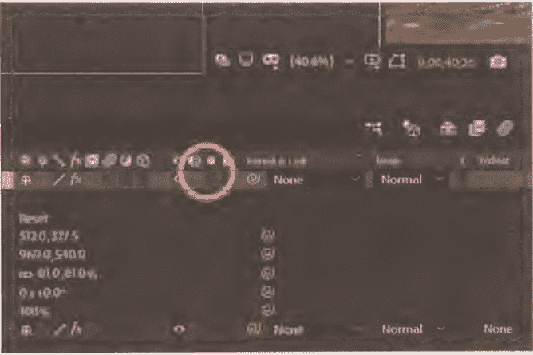

独奏图层

了解如何对图层进行独奏将帮助你快速打开和关闭数百个图层，而不必担心破坏任何东西。尝试在图层上练习独奏按钮。

## 为图层添加标签

为图层添加标签对于在时间线上识别和整理图层特别有帮助。你可以把这些标签更改为任何你想要的颜色。当你需要快速编辑某样东西时，有时可以选中它，但有时却很难找到它。识别图层是 After Effects 的重要组成部分。当你有一个非常复杂的项目时，能够识别你的图层非常重要。这时正确命名和为图层添加标签就变得非常重要。组织非常重要：

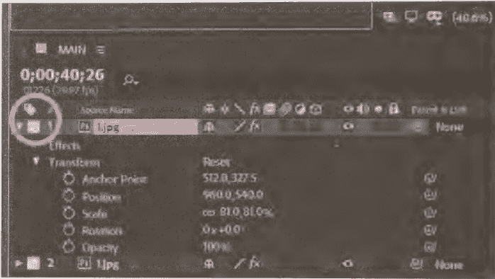

标签

在 After Effects 中，你的合成窗口就像一个舞台。你可以看到超出框架或舞台的图像。你也可以将东西拖入或拖出主舞台区域。当你想让动画从屏幕外开始并最终出现在屏幕上时，这很有帮助。

## 查看变换属性

你的图层具有变换属性，它们是动画的精髓。任何旁边带有秒表图标的东西都可以被动画化。所有这些参数乍一看可能令人不知所措。让我们逐一回顾每个属性快捷键，以便你熟悉它们。展开“Transform”一词以查看所有属性：

- Anchor Point: The shortcut is Y
- 锚点：快捷键是 Y
- Position: The shortcut is P
- 位置：快捷键是 P
- Scale: The shortcut is S
- 缩放：快捷键是 S
- Rotation: The shortcut is R
- 旋转：快捷键是 R
- Opacity: The shortcut is T
- 不透明度：快捷键是 T
- Reveal all key frames: The shortcut is U
- 显示所有关键帧：快捷键是 U

在图层被选中的情况下按下这些键盘快捷键中的任何一个都会调出该参数：

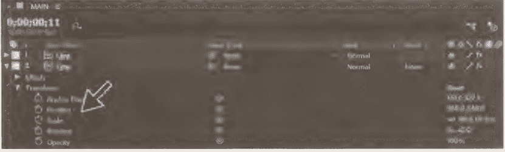

变换属性

所有这些变换属性都可以随时间进行动画化。所有此类属性都带有秒表图标，表示可以在时间线上对其进行动画化的功能。

## 标尺和参考线

After Effects 附带了不同的参考线，你可以用它们来创建对象的更精确对齐。如果查看工具面板的右上角，你可以启用吸附：

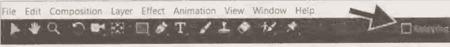

吸附

这将使你的对象吸附到参考线上。在“Guides”部分，你会找到各种参考线和网格，可以在 After Effects 中超越对齐对象的猜测工作。用于视频监视器的参考线是标题/动作安全参考线。这些参考线可以通过点击合成窗口底部的网格图标来访问：

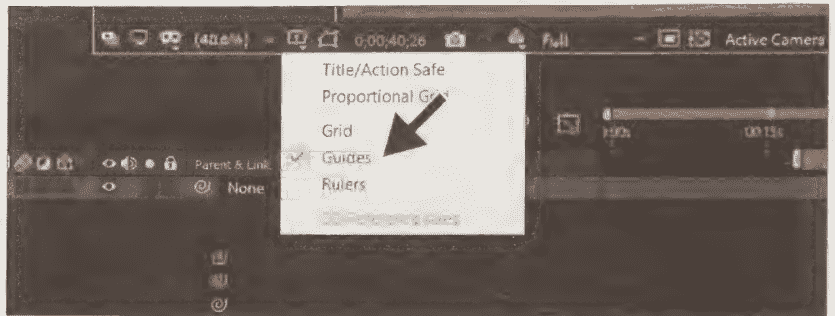

参考线

如果你选择“标尺”选项，你可以访问可以在合成中拖动并将对象与之对齐的参考线：

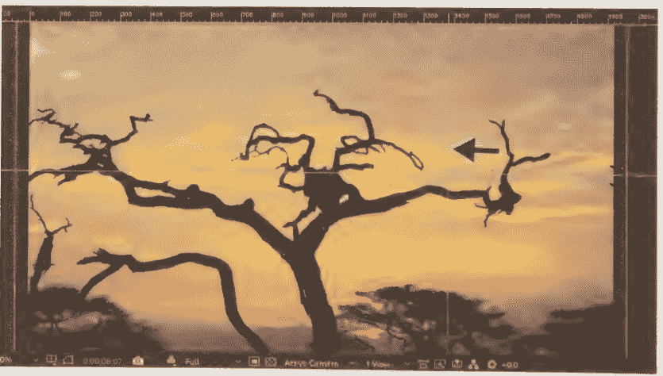

自定义参考线

参考线对于布局合成和精确排列文本非常有帮助。

## 编辑蒙版

在本节中，我们将讨论蒙版以及编辑图层和纯色。我们将遮挡或剪切纯色的部分以创建形状。以下步骤将说明如何操作：

- 1. Create a 1,920 x 1,080 comp.
- 1. 创建一个 1,920 x 1,080 的合成。
- 2. Create a new solid layer, Layer | New | Solid, or Ctrl + Y or Command + Y for macOS.
- 2. 创建一个新的纯色图层，图层 | 新建 | 纯色，或按 Ctrl + Y 或 macOS 的 Command + Y。
- 3. Make the solid yellow.
- 3. 将纯色设为黄色。

查看工具栏的右上角。在矩形工具下方，你有一系列蒙版形状可用于编辑纯色。这些是 After Effects 中用于塑形的蒙版工具。你可以选择矩形工具、圆角矩形工具、椭圆工具、多边形工具或星形工具：

蒙版工具

我们将练习使用椭圆工具来剪切出我们的形状：

- 1. Choose Ellipse Tool
- 1. 选择椭圆工具
- 2. Choose where you want to create your shape
- 2. 选择你想要创建形状的位置
- 3. Click and drag
- 3. 点击并拖动

拖动这些工具时，蒙版可能会被拉伸。如果你不希望这样，在拖动时按住 Shift。那样会创建完美的形状。

## 编辑蒙版形状

单击边界框中的一个方块，然后插入蒙版纯色的图像：

选择单个点

方块将被填充，你将获得贝塞尔手柄。这使你能够编辑单个蒙版点：

编辑单个点

要编辑整个蒙版：

- 1. Double-click one of these squares.
- 1. 双击其中一个方块。
- 2. You will get a square bounding box.
- 2. 你将获得一个方形的边界框。
- 3. Drag this bounding box to edit all the points at the same time:
- 3. 拖动此边界框以同时编辑所有点：

蒙版边界框

这是在遮挡纯色的其余部分。在蒙版属性下，有一个蒙版列，你可以在其中选择其他参数。这将隐藏你的蒙版或提供不同的蒙版选项。

## 编辑蒙版

你可以取这些基本形状并制作其他更复杂的形状。你也可以通过点击蒙版中的颜色框来更改蒙版的颜色。After Effects 还有其他你可以使用的参数。点击蒙版会显示其他可以编辑的参数。你可以通过调整羽化参数来编辑此蒙版。调整羽化量意味着蒙版的外侧将被羽化。当然，羽化也可以设置关键帧。你也可以扩展蒙版。扩展也可以朝相反方向进行，这样你实际上会在负方向上侵蚀蒙版。我希望你尝试所有这些蒙版编辑参数。

## 使用减去蒙版功能

蒙版是一种非常强大的工具，用于抠像和创建形状。你可以控制蒙版的行为，并选择添加或从蒙版形状中减去。我们将重点关注减去功能：

- 1. Drag another shape on top of the current solid shape.
- 1. 将另一个形状拖到当前纯色形状之上。
- 2. Find the new mask parameter on that solid in the lower-left side of the timeline.
- 2. 在时间线的左下侧找到该纯色上的新蒙版参数。
- 3. To the right of the mask is a tab called Add with an arrow pointing down. Click on that.
- 3. 蒙版右侧有一个名为 Add 的选项卡，箭头向下。点击它。
- 4. Choose Subtract from that list:
- 4. 从该列表中选择 Subtract：

减去蒙版

看它是如何剪切出那个形状的？这就是你在 After Effects 中创建有趣形状的方法。尽情享受吧；你可以用它做很多事情——可能性无限！当你需要剪切图层、视频、图像等时，蒙版变得非常重要。把图层想象成剪刀，用来剪掉你不想看到的东西。我希望你们玩玩这些形状。开始编辑这些蒙版点。你可以用这些技术创建复杂有趣的形状。

## 创建动画幻灯片

在我们迄今为止获得的所有知识之后，迫切需要我们付诸实践。让我们制作一个简单的动画幻灯片，使用本章迄今为止学到的技巧和窍门。按照以下步骤操作：

- 1. Create a 1,920 x 1,080 comp and call it `slideshow`. Make the comp 20 seconds long.
- 1. 创建一个 1,920 x 1,080 的合成并将其命名为 `slideshow`。使合成长度为 20 秒。
- 2. Move into the main `comp` folder.
- 2. 进入主 `comp` 文件夹。
- 3. Import four photos (each with 1,920 x 1,080 dimensions).
- 3. 导入四张照片（每张尺寸为 1,920 x 1,080）。
- 4. Put the photos into the `image` folder.
- 4. 将照片放入 `image` 文件夹。
- 5. Make a new solid: Layer | New | Solid. Call this back, and make the color black.
- 5. 创建一个新的纯色：图层 | 新建 | 纯色。将此命名为 back，并将颜色设为黑色。
- 6. Bring your first image into the timeline.
- 6. 将你的第一张图像带入时间线。
- 7. Hit S to get your scale. Adjust this so your image fits in the frame.
- 7. 按 S 获取缩放。调整它以使图像适合框架。
- 8. Spend some time adjusting your image in the comp. You may not need to adjust the scale. However, if you need to adjust the size of your image, press S to get the scale parameter.
- 8. 花一些时间在合成中调整你的图像。你可能不需要调整缩放。然而，如果你需要调整图像的大小，按 S 获取缩放参数。
- 9. Scrub the scale parameter to get the desired size:
- 9. 拖动缩放参数以获得所需大小：

缩放图像

让我们向幻灯片项目添加更多图像。按照以下步骤将图像添加到你的合成中：

- 1. Bring in a second image
- 1. 引入第二张图像
- 2. Adjust the scale
- 2. 调整缩放
- 3. Repeat these steps for the remaining images
- 3. 对剩余图像重复这些步骤
- 4. Select these layers and trim them so they are 3 seconds long
- 4. 选择这些图层并修剪它们，使其长度为 3 秒

我们将在时间线上修剪图层。这将确保每张图像在幻灯片中显示一定的时间：

修剪图层

让我们按照以下步骤修剪图层：

- 1. Select all layers to go to 3 seconds in the timeline
- 1. 选择所有图层，使其在时间线中达到 3 秒
- 2. Select Alt + ] / Option + ] (macOS) to trim the layers, or you can drag the layers to trim them
- 2. 选择 Alt + ] / Option + ]（macOS）来修剪图层，或你可以拖动图层来修剪它们

了解如何为本项目和其他项目修剪图层非常重要。确保你的图层排列整齐且已修剪：

对齐图层

After Effects 提供了多种辅助功能来帮助您进行动画操作。我们将使用序列图层。这将按时间对图层进行排序。您可以在项目窗口顶部的动画选项卡上找到此动画辅助功能：

序列图层

选择所有图层 | 动画 | 关键帧辅助 | 序列图层....

注意 After Effects 会将您的图层均匀地在时间线上进行排序！我们幻灯片的下一步在结尾处：

图层末尾

下一步是从图层的末尾往回数 20 帧（从图层末尾倒数）：

20 个关键帧

接下来我们将为图像创建淡出动画：

- 1. 按 T 调出不透明度参数。
- 2. 点击不透明度的秒表。这会创建关键帧，这是任何动画的第一步。
- 3. 向前移动 20 个关键帧。将不透明度调至 0。

您的时间线应有两个关键帧。第一个关键帧是不透明度 100%，最后一个将是不透明度 0%。

您可以通过拖动时间指示器经过关键帧来测试动画。图像应正在淡出：

不透明度

为了使此图像下方的图层在顶部图像淡出时淡入，我们需要调整此第二张图像：

- 1. 选择顶部图层下方的图层。
- 2. 拖动底部图层，或选择 Alt + 左方括号以将图层修剪到该点。

顶部图层开始淡出时，下一个显示的图层将出现或淡入：

调整第二层

目标是让每张照片淡入下一层。这将在 20 帧的时间内发生。这将是一个缓慢的淡入淡出。重复前面的步骤为每个图层操作，然后按如下操作：

- 1. 添加一个黑色纯色图层，作为背景
- 2. 将此图层移至图层的底部

新 After Effects 用户最常忘记做的事情之一是在项目结束时修剪工作区：

幻灯片修剪工作区

- 3. 从右侧拖动蓝色条。
- 4. 将其拖动到图层的末尾，或将时间指示器移动到最后一个图层的末尾并按键盘快捷键 N，以修剪工作区。

最后一步是预览您的幻灯片。查看是否有您想要调整的内容。您可以在创建项目后随时微调任何设置。

恭喜！您已在本书中创建了第一个动画项目！

按空格键预览您的动画幻灯片！

## 摘要

我希望您喜欢这次 After Effects 的全面游览。我们学习了界面以及如何导入、编辑和遮罩图层。最重要的是，我们学习了如何制作动画！动画的基础知识在您处理项目时至关重要。掌握这些基础知识将推动您向前理解更复杂工具和概念。学习界面和基础动画是基础但重要的构建块，用于打造您在动态图形方面的精彩未来！

在第 2 章《为电视节目创建下三分之一》中，我们将使用 Easy Ease 助手进行动画制作。我们还将使用空对象来为下三分之一项目制作动画。我们将使用本章介绍的遮罩和动画工具。您还将学习如何创建文字以及如何使用预合成。

## 问题

- 1. 创建动画的步骤是什么？
- 2. 如何在时间线上修剪或扩展图层？
- 3. 如何修剪或扩展工作区？
- 4. 安全指南位于何处？
- 5. 如何在时间线上向下推进一个关键帧？
- 6. 如何预览电影？
- 7. 如何创建纯色图层？
- 8. 遮罩形状位于何处？
- 9. 如何编辑单个遮罩点？
- 10. 如何同时编辑所有遮罩点？
- 11. 如何应用减去遮罩？
- 12. 什么是关键帧？
- 13. 关键帧在时间线上如何表示？
- 14. 秒在时间线上如何表示？

## 延伸阅读

- 要了解有关指南和视图使用的更多信息，请查看以下内容：
  https://helpx.adobe.com/after-effects/using/modifying-using-views.html
- 要了解有关 After Effects 中时间线的更多信息，请点击此链接：
  https://helpx.adobe.com/after-effects/using/composition-basics.html#timeline_panel
- 有关遮罩工具的更多信息可在以下位置找到： https://helpx.adobe.com/after-effects/using/creating-shapes-masks.html#create_a_shape_or_mask_by_dragging_with_shape_tools
- 要了解有关关键帧和动画的更多信息，请遵循此链接：
  https://helpx.adobe.com/after-effects/using/setting-selecting-deleting-keyframes.html#Whatarekeyframes

## 2
