## 2 创建下三分之一
用于电视节目

在本章中，我们将创建一个电视下三分之一。下三分之一用于电视广告。它们提供有关节目的信息。了解如何创建下三分之一很有用，因为理解它们有助于您了解如何为电视图形设计。您还将学习有关排版以及如何在屏幕的下三分之一中工作。

本章将涵盖以下主题：

- 使用分镜设计
- 编辑遮罩和使用预合成
- 嵌套预合成和使用钢笔工具
- 父级关系和空对象动画
- 父级空对象动画
- 定位下三分之一
- 调整颜色
- 调整遮罩
- 文字工具
- Easy ease
- 渲染选项

## 技术要求

您必须在计算机上安装 Adobe Media Encoder 和 Adobe Bridge。

本章的技术要求与第 1 章《开始使用 After Effects》相同。

购买本书可获得每个章节的项目文件，以便您边学边做。请按照以下链接下载项目文件。

密码链接：

```
http://www.daviddodds.net/password.html
```

下载链接：

```
http://daviddodds.net/login.php?redirect=/after-effects-intro-assets.html
```

## 使用预合成和空对象为电视下三分之一制作动画

在本部分，我们将学习预合成。这是 After Effects 中非常重要的一部分。它可以帮助您快速创建复杂的动画。一旦您理解了它，我们将能够使用更复杂的图层创建下三分之一项目。

## 使用分镜设计

本书的重要部分是了解如何设计强大的合成。在本章中，您将创建一个下三分之一。现在让我们逐步了解该项目的设计。在设计任何项目时，构思阶段非常重要；这是您生成想法并为项目开发概念的时候。在想法生成阶段保持井然有序非常重要。我对此使用 Adobe Bridge。您可以将照片和视频带入 Adobe Bridge，并在其中组织它们。您也可以以多种方式标记和组织它们。

所有设计项目都有参数。问问自己项目的标准是什么。当您创建项目时，了解您的受众以及视频将在何处观看非常重要。这将帮助您为受众设计合适的项目。请记住这一点，特别是在选择字体、颜色和图像时。问问自己：设计是否易读？

以下屏幕截图显示了一个分镜；您可以使用它来规划项目的想法。它可以是一个非常基础的分镜来帮助您组织和规划项目。当您设计分镜时，您有机会查看排版和图像是否配合良好。您需要确保您的设计可读且可以有效传达：

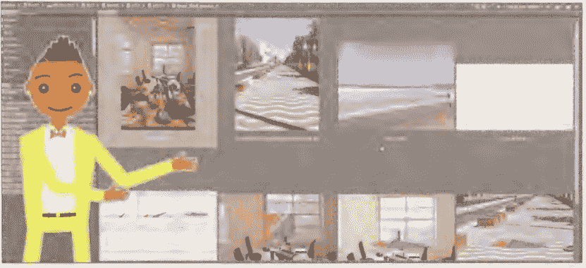

Adobe Bridge

请参考以下链接了解有关电视下三分之一的更多信息：
https://www.jbistudios.com/blog/lower-thirds-chyron-subtitles-dubbing-video-translation.

## 编辑遮罩和使用预合成

让我们开始我们的电视下三分之一。查看以下屏幕截图；这就是我们正在创建的内容。我们现在正在创建此项目的 6:30 部分：

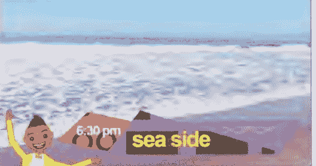

最终图像


首先，我们将创建一个包含纯色层的合成（comp），并使用遮罩技术编辑这些纯色层，具体如下：

- 1. 创建一个分辨率为 1920 x 1080、帧率为 29.97 的新合成。
- 2. 将合成时长设为 9 秒 — 0:00:09:00。将其命名为 `pattern`。
- 3. 转到 **层 | 新建 | 纯色**，并将颜色更改为蓝色。
- 4. 使用椭圆工具创建一个圆形形状。
- 5. 将另一个椭圆拖到合成层上。
- 6. 选择一个减去遮罩：

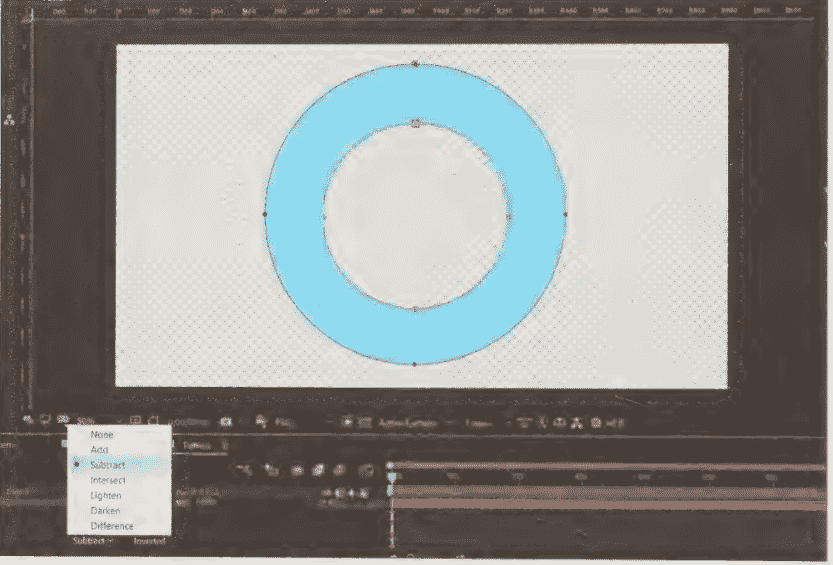

减去遮罩

- 7. 这将允许你在第一个遮罩内剪出一个形状。
- 8. 选择“在后平移工具”。这将允许你移动锚点，并在该点周围进行变换。
- 9. 缩小图层。

- 10. 将其移至左上角。
- 11. 复制此图层。
- 12. 按以下示例重新定位此图层：
- 13. 重复此过程，直到你的合成中至少有六个圆形形状。

就像 Photoshop 一样，你可以在 After Effects 中将各种素材放在一个文件夹中。在 After Effects 中，这称为预合成。这是一个简单的预合成过程。然而，其背后的概念稍微复杂一些。对场景中的对象进行预合成的方式是拥有透明背景并选择合成中的所有内容。

转到屏幕左上角面板中的“层”选项卡并选择“预合成...”选项：

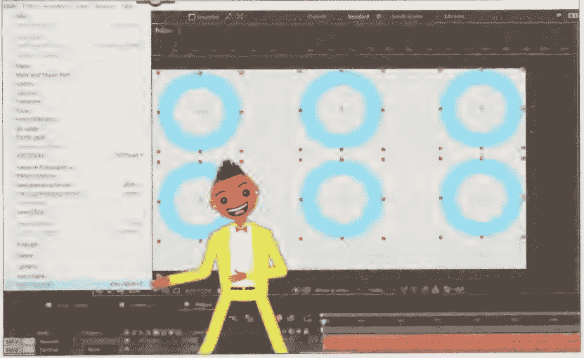

预合成 1

当你预合成某物时，会出现一个对话框。这会给你命名预合成的选项。选择将所有属性移入新合成的选项，如以下屏幕截图所示：

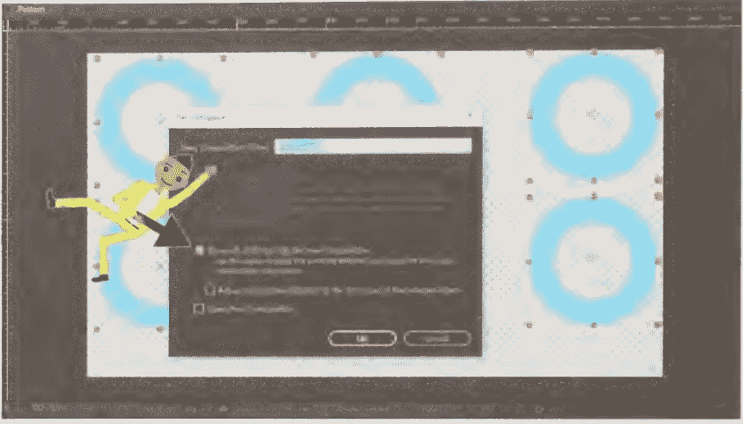

预合成 2

## 预合成嵌套和使用钢笔工具

让我们按如下方式为你的形状创建背景：

- 转到左上角面板并选择 层 | 新建 | 纯色
- 将这个新的纯色图层移至合成图层的底部
- 接下来，创建一个主合成以移动所有素材

创建新合成后，将其命名为 Main comp，然后我们可以应用与第一个合成相同的设置。

要将预合成移至另一个合成，只需在项目窗口中找到预合成并将其拖动到 Main comp 中：

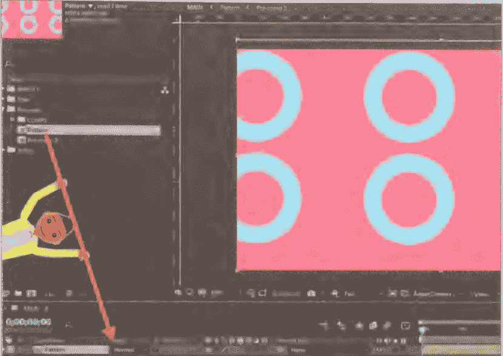

拖动预合成

现在，你应该在 Main comp 中看到一个预合成。让我们进一步调整此预合成。选择钢笔工具，如以下屏幕截图所示：

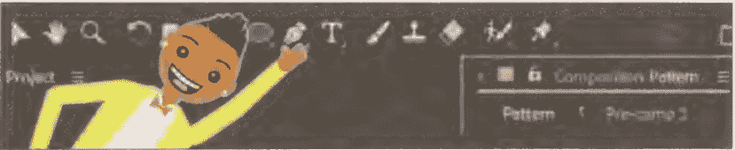

钢笔工具

我们将使用钢笔工具在预合成上遮罩出一个形状。要使用钢笔工具，只需选择要使用钢笔工具的图层。在本例中，它是预合成。在遮罩的所需起点单击钢笔图标。

将钢笔工具移动到下一个所需点，然后再次单击。当你准备关闭形状时，将光标悬停在想要关闭的位置附近。你会看到钢笔工具附近出现一个小圆圈图标，表示你可以关闭形状。当你完成对该预合成的遮罩时，它应如下图所示：

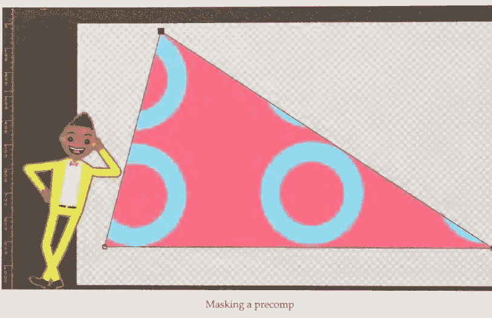

遮罩预合成

接下来，我将为我将在下三分之一中使用的额外形状创建一个新的合成。使用与之前合成相同的尺寸和时长创建一个新合成。我基本上将重复之前为创建的形状所做的完全相同的过程。不过，这次我将使用矩形工具制作一些形状。

对于这些新形状，我们将不使用减去遮罩功能。我们制作一系列矩形形状并对其进行组织以创建图案，如下图所示：

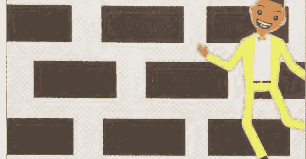

创建矩形图案

接下来，我们将使用以下步骤对这些新形状进行预合成：

- 1. 只需选择所有矩形形状并选择合成预合成。当你预合成某物时，会出现一个对话框。这会给你命名预合成的选项。
- 2. 选择 **将所有属性移入新合成** 选项。
- 3. 下一步是为你的形状创建背景。转到 **层 | 新建 | 纯色**，并将颜色设为黄色。

由于这将是我们设计的背景，你需要将这个新的 **纯色** 图层移至堆叠顺序的底部。

现在你有了新的设计，你需要将其移入 `Main` 合成。将预合成移入你的 `Main` 合成的步骤如下：

- 1. 在项目文件夹中导航到 `Main` 合成。双击 `Main` comp。
- 2. 在你的 `Precomp` 文件夹中找到预合成并将其拖入 `Main` comp。

此时保持井然有序非常重要，因为这样你就可以轻松识别所有预合成的位置。当你创建一个不是 `Main` comp 的新合成时，立即将其放入 `Precomp` 文件夹中。`Main` comp 文件夹中应只有主合成。这是你打算导出/渲染的合成。

重复之前的相同过程，并使用钢笔工具在 Main comp 中遮罩设计周围：

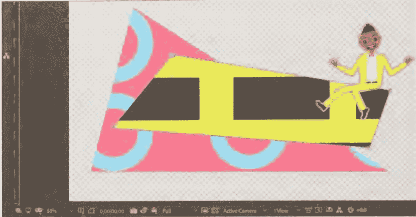

遮罩第二个图案

## 动画、空对象、文本和渲染

在本节中，我们将学习如何使用空对象进行动画制作。我们还将学习如何渲染项目。

## 父级关系和空对象动画

现在，我们将对设计进行动画制作。我们创建的设计位于 Precomp 文件夹中。双击你制作的第一个预合成。在此预合成中，你有一个嵌套合成和一个为背景制作的纯色图层。选择并居中顶部预合成形状图层：

- 1. 按 R 按钮显示旋转参数
- 2. 转到面板左侧，并点击旋转参数的秒表
- 3. 在时间线上向右移动 90 个关键帧
- 4. 拖动旋转参数

这将自动创建关键帧，如下图所示：

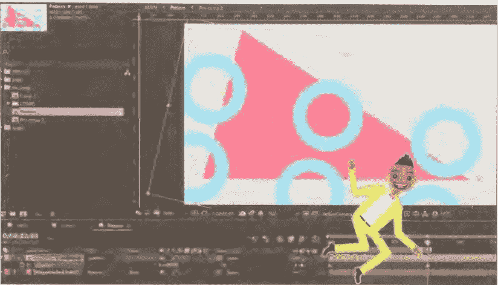

动画旋转

返回到 `Main` comp，并按空格键预览你的动画。为自己创造第一个动画而鼓掌吧！让我们通过观察以下步骤来为我们创建的下一个图案预合成制作动画：

- 1. 在 `Main` comp 中，双击剩余的图案预合成。
- 2. 让我们使用之前使用过的相同步骤来为此预合成制作动画。我们将使用 **位置** 参数进行动画制作。
- 3. 为此 **图案** 图层制作动画，使其向右移动。
- 4. 按 P 显示 **位置**。
- 5. 转到时间线的开头。
- 6. 点击 **位置** 秒表。
- 7. 在时间线上向下移动 90 个关键帧。
- 8. 拖动 **位置** 参数。

你应该会看到矩形形状向右移动，如下图所示：

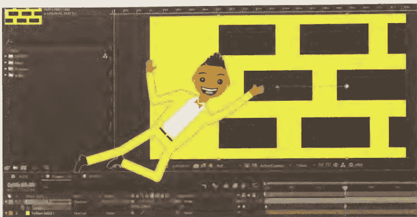

动画位置

让我们回到 Main comp 并预览我们的动画。按空格键预览我们的工作：

- 1. 在 Main comp 中，让我们导入一张 1920 x 1080 的图像，用于下三分之一项目的背景
- 2. 将背景图像拖入 Main comp
- 3. 将此图像移至时间线中的最底层
- 4. 如有必要，重新缩放图像

## 父级空对象动画

另一种我想介绍给你的动画技术称为父级动画。通过父级关系过程，你将任何图层设为父级时，该图层将跟随该图层的移动或动画。在父级关系过程中，你将有一个父级和一个子级。子级是连接到父级或由父级控制的任何内容。子级可以自由移动。然而，它始终保持连接，因此会随父级移动。使用父级动画，我们可以创建复杂的二级动画。我们将把两个形状图层设为 Null 对象的父级。Null 对象本质上是一个不可见的图层。然而，这个 Null 对象可以被动画化，并且可以将其设为父级。


以下是创建父级动画的步骤：

- 1. 通过前往 **Layer** 选项卡并选择一个新的 **Null** 对象来创建一个 **Null** 对象。
- 2. 选择两个预合成的动画图案。
- 3. 在图层的右侧查找 **Parent & Link** 选项卡。查找线圈图标。
- 4. 单击并拖动线圈图标（这称为拾取鞭）。
- 5. 将此线圈拾取鞭连接到 **Null** 对象，如以下屏幕截图所示：

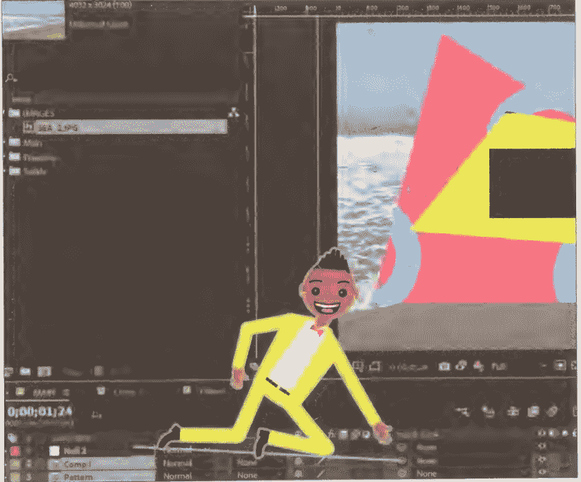

父级链接

## 父级链接

将这些对象父级链接到 Null 对象后，您将在这两个图层的 Parent & Link 选项卡中看到单词 Null。这意味着这些图层会随 null 移动。就像任何图层一样，这个 null 会沿锚点进行动画。这是我们想要调整的第一件事。确保它位于正确的中心位置。使用 Null 对象缩小两个预合成。按 S 调整缩放参数并缩小对象。将对象移动到合成的下部区域，如以下屏幕截图所示。将对象放置在与以下屏幕截图类似的布局中。您可以通过在合成窗口中选择它们来定位对象，或者按 P 调整位置并在时间线上拖动位置参数。您还可以独立于 Null 对象调整每个对象的缩放比例。如有必要，调整预合成的蒙版。对这些对象的调整不会影响父级关系。如前所述，子对象已父级链接并服从父对象，但它们可以自由移动：

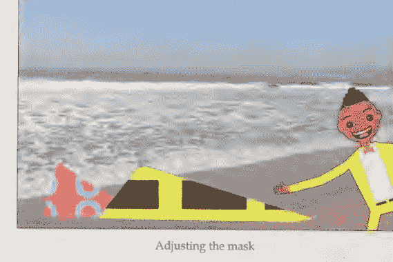

调整蒙版

## 定位下三分之一

现在，我们将创建一个没有任何动画的基础形状。您将有两个带有动画形状的预合成和一个没有任何形状的纯色图层。

## 创建深蓝色纯色图层

在该项目中，我们从纯色图层构建下三分之一。我们将向项目添加另一个 Solid 图层并使用 Parenting 工具将其连接到我们的 Null 对象，如下所示：

- 1. 使用钢笔工具创建一个三角形形状。
- 2. 进一步调整对象的 Position 参数。
- 3. 将此新对象移动到两个形状下方。如有必要，调整此 Solid 图层的蒙版并重新定位它。
- 4. 将此对象父级链接到 Null 对象。
- 5. 选择三角形形状并在图层的右侧查找 Parent & Link 选项卡。查找线圈图标。单击并拖动拾取鞭线圈。
- 6. 将此线圈拾取鞭连接到 Null 对象，如以下屏幕截图所示：

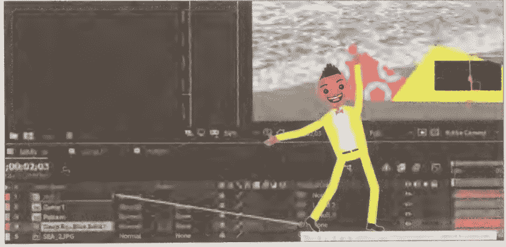

使用拾取鞭

## 三角形拾取鞭

现在我们已将所有对象父级链接到 **Null** 对象，我们可以对它们进行动画。让我们使用 null 对象将下三分之一动画化到屏幕上，如下所示：

- 1. 选择 **Null** 对象。
- 2. 按 P 调整 **Position**。
- 3. 在时间线上向下移动约 30 个关键帧。
- 4. 将工作区域修剪到此点（按 N）。
- 5. 为 **Null** 对象点击 **Position** 秒表。
- 6. 移回时间线的开头。
- 7. 选择 **Null** 对象。
- 8. 拖动 **Null** 对象的 **Position** 参数，使下三分之一移出屏幕。
- 9. 以角度移动时，您将看到一条沿对角线方向进行的运动路径线，如以下屏幕截图所示。预览您的动画：

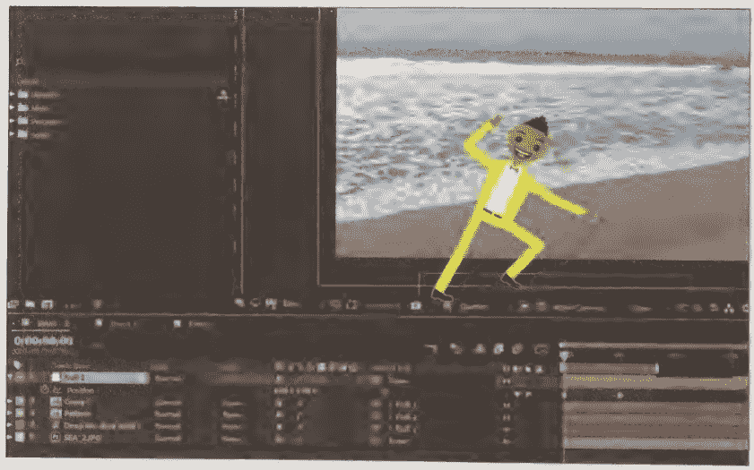

动画 null 对象的定位

现在您已让对象在屏幕上移动，您将创建一个次要动画。我们将独立地对父级链接对象的子对象进行动画。创建这种偏移运动将增强对象的视觉趣味性，执行方法如下：

- 1. 在时间线中前往 Null 对象最后一个关键帧之后 10 个关键帧。
- 2. 选择屏幕最左侧的预合成对象之一。
- 3. 按 P 调整位置参数。
- 4. 点击位置秒表。
- 5. 从第一个关键帧向下约 10 个关键帧。
- 6. 以角度将形状动画化移出屏幕，如以下屏幕截图所示。
- 7. 预览您的动画，如下所示：

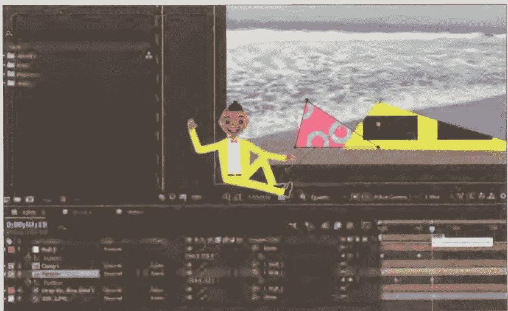

以角度动画化第一个对象

这将为对象创建偏移动画。运动路径显示了对象的移动方向。如果您在动画化对象的位置时注意到，合成窗口中会出现一条运动路径。此路径是一条虚线，称为运动路径。将此偏移动画技术应用于另一个纯色形状。运动路径对于理解移动和时序非常重要。时序在动画中至关重要。控制动画速度的一种方法是时间线中关键帧的位置。您可以通过选择关键帧并在时间线中滑动它们来调整关键帧。您的关键帧应如下面的屏幕截图所示：

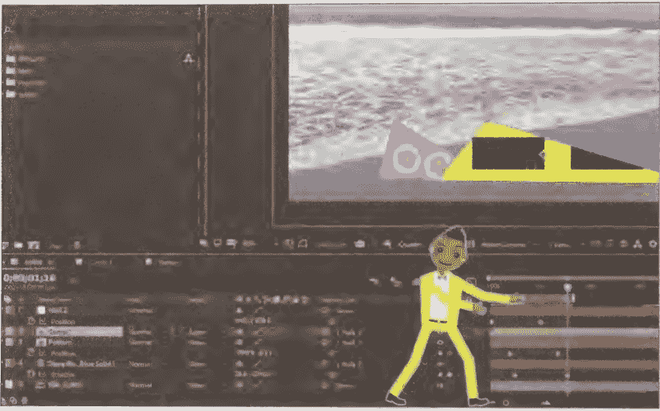

附加对象的偏移动画

## 颜色校正和调整蒙版

我们将更改一些形状的颜色。当我发现 After Effects 中所有可用的颜色校正工具时，我发誓我跳了一小段舞！这些颜色校正工具是非破坏性的，因此您可以随时更改它们。其中许多工具也在 Photoshop 中可用。因此，如果您熟悉 Photoshop 中的颜色校正，其中一些工具和概念会让您感到熟悉。在进行颜色校正时，将自己想象成一名调色师，使用颜色来帮助传达某种情感。我们还将微调蒙版形状。请记住，您的预合成和蒙版始终可编辑。

## 调整颜色

要编辑黄色三角形形状的颜色，您可以双击时间线中的预合成，如下所示：

- 1. 选择底部的黄色图层
- 2. 前往 **Effect & Presets** 面板
- 3. 输入 `fill`
- 4. 双击 **Fill** 效果

这将把效果添加到您选择的任何内容上。如您所见，您会得到一个 **Effects** 面板，它会弹出在项目面板旁边。此效果的默认颜色为红色。通过选择 **Color** 框并选择新颜色来调整颜色：

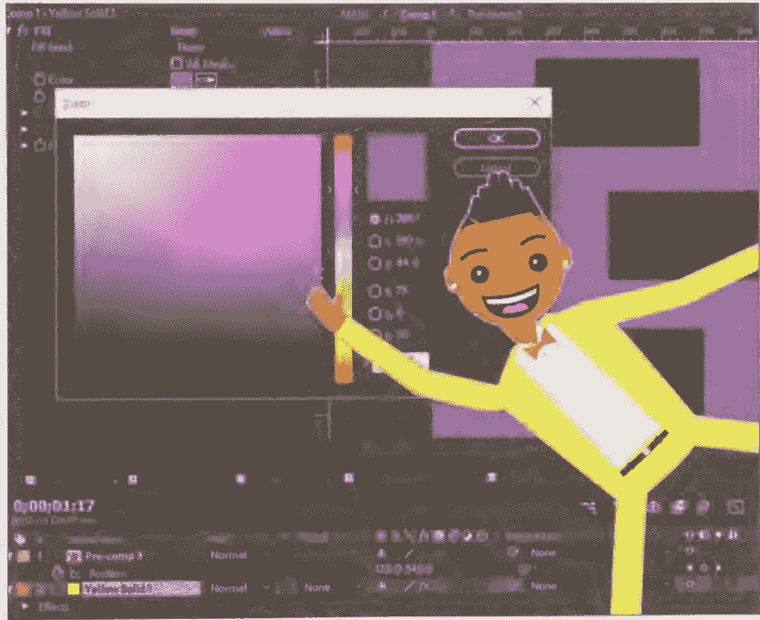

填充效果

现在返回到您的 Main comp。您会看到背景颜色不同了。花点时间调整形状和背景的颜色。对您想要更改颜色的任何内容使用相同的 Fill 效果。您希望下三分之一的文字从这些形状的背景中脱颖而出。

在 After Effects 中，您可以使用 Photoshop 提供的许多图像编辑工具。我们将使用其中一个名为 Curves 的工具：

- 1. 选择您的照片背景图层。
- 2. 在 Effects & Preset 面板中找到名为 Curves 的效果。
- 3. 点击此效果将其添加到您的照片图层。
- 4. 查看项目窗口旁边的 Effect Controls 面板。
- 5. 使用底部名为 Auto 的按钮调整曲线效果：

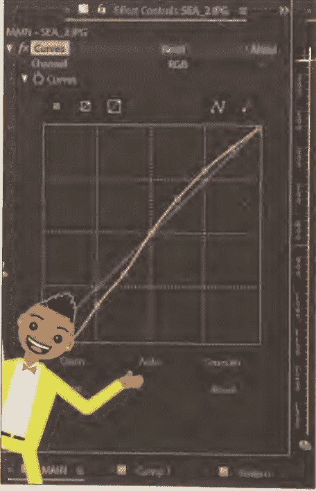

自动曲线效果

- 6. 接下来，我们将向图像添加照片滤镜效果。在效果面板中输入 `photo filter` 找到它。双击并将此效果添加到图层。此效果将为图像提供整体色彩效果。选择一个不错的冷却滤镜（例如 80）。

## 调整蒙版

您还可以在 `Main comp` 窗口中调整形状的蒙版。请记住，通过选择选择工具并单击蒙版路径点一次来编辑蒙版的单个点。一旦您看到点被填充（如下面的屏幕截图所示），这意味着它已准备好进行编辑。如果您研究下面的屏幕截图，您会看到只有一个点被填充。其他两个点是空的。这演示了如何编辑蒙版点：

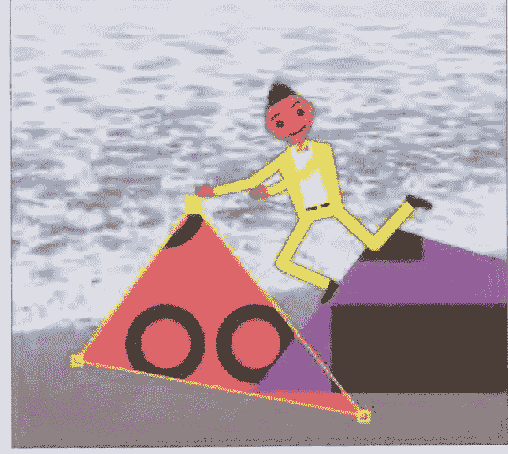

编辑单个蒙版点


你也可以通过选择钢笔工具并将鼠标悬停在想要添加点的蒙版上，为蒙版添加点。你会看到一个 + 号。点击蒙版以添加额外点。添加蒙版点后，将此点拖动到所需位置以编辑蒙版形状：

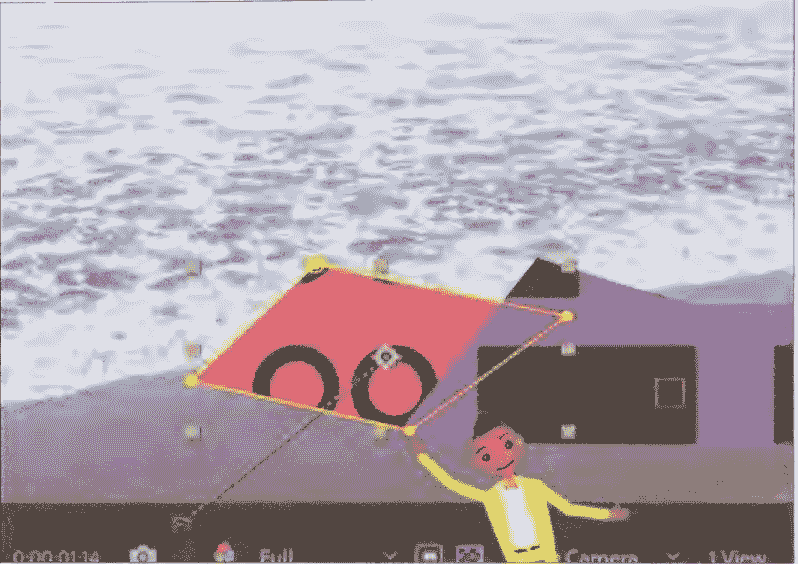

钢笔工具编辑路径

你现在将为你的下三分之一对象添加节目信息。

## 创建文字、轻松缓动关键帧和渲染

想象自己已经非常接近终点了！我们几乎完成了这个下三分之一项目。你应该为自己感到非常自豪。在本节中，我们将使用文字工具为节目添加一些信息。请特别注意文字工具。它是 After Effects 中使用的主要沟通工具之一，也是传达信息的主要方式之一。了解如何使用此工具非常重要。我们还将学习如何进一步编辑关键帧以实现更自然的运动。然后，我们将学习几种渲染影片的方法。

### 文字工具

文字工具是 After Effects 中最通用的工具之一。文字图层适用于许多用途，包括下三分之一、动画标题和动态排版。你可以完全编辑文字图层、间距、大小和描边。你可以为文字图层设置动画，或为颜色、大小和位置设置动画。还有一套完整的工具可用于以复杂方式为文字设置动画。创建动态排版使该程序区别于任何其他程序。

你可以使用文字工具按以下方式向合成中添加文字：

- 1. 我们将首先在顶部工具面板中选择文字工具。
- 2. 接下来，点击你的合成以在主合成中添加文字。这会在你的合成中立即创建一个文字图层。确保你的文字图层位于所有其他图层的上方。
- 3. 查看屏幕左侧，你会找到一些文字工具选项。
- 4. 你可以通过选择填充颜色选项来更改文字颜色；这是位于字体选项右侧的框。
- 5. 要调整文字的缩放比例，按 S 快捷键进行缩放，并像调整其他图层一样进行调整：

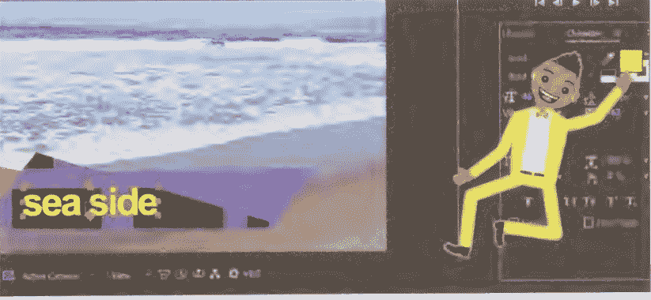

文字颜色填充

### 文字填充

花时间为节目信息创建单独的文字图层。使用一个形状表示节目的日期。使用另一个形状表示节目的时间。最后，在其中一个形状上包含节目的名称。我们将介绍更多这些文字工具，但现在，只需调整文字使其适合所有形状，如以下屏幕截图所示：

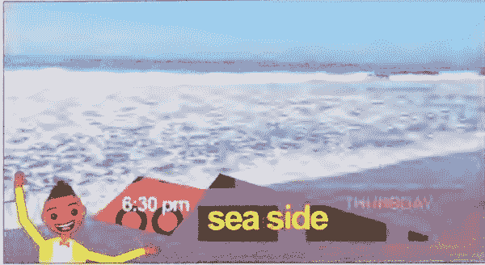

调整文字

### 调整文字

现在，你将把文字设为父对象，父对象为其所在的形状。你的文字应随其所在的形状一起移动。转到时间线上动画已完成、下三分之一完全就位且构图正确的位置。

接着选择每行文字并将其设为对应对象的子对象。你按以下步骤将文字设为父对象：

- 1. 选择文字图层并使用拾取工具
- 2. 将螺旋工具拖动到适当的形状

动画基本上就是让事物随时间移动。After Effects 让你能够控制事物在帧之间的移动方式。了解如何控制事物的移动方式将使你的动画看起来更自然。实现这一点的一种方法是为关键帧添加缓动。这是一个高级主题，我们将在今后的章节中更详细地介绍。

学习关键帧的第一步是理解选择工具。为了掌握它，请转到时间线并点击拖动一个方框选中所有关键帧。以下屏幕截图演示了如何选择关键帧：

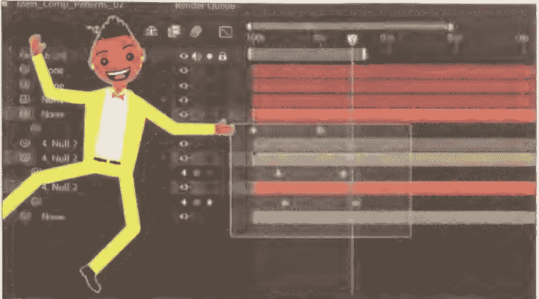

选择关键帧

我们的下一个任务是为关键帧添加缓动。编辑关键帧对于创建流畅的运动至关重要：

- 1. 右键单击关键帧
- 2. 选择关键帧助手选项
- 3. 选择易缓动

以下屏幕截图演示了如何访问关键帧助手面板：

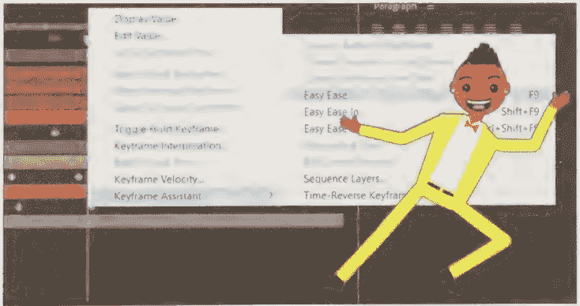

易缓动

请记住始终为关键帧添加缓动。查看以下屏幕截图，了解缓动后的关键帧应是什么样子：

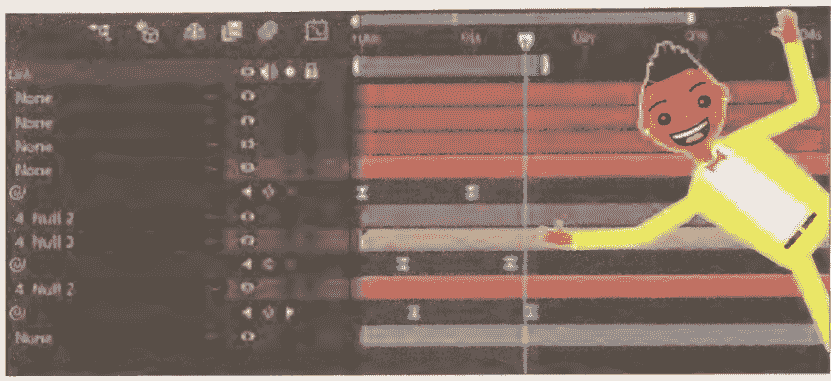

易缓动 2

### 渲染选项

下三分之一通常用于电视节目并放置在视频素材之上。为了将素材放置在视频上，合成需要具有透明背景。渲染是我们创建项目视频的方式。如果你想单独渲染下三分之一，请在透明背景上执行以下步骤：

- 1. 转到主合成
- 2. 关闭除下三分之一之外的所有内容
- 3. 添加到渲染队列
- 4. 选择无损
- 5. 选择 QuickTime 格式
- 6. 选择 RGB + Alpha
- 7. 导航到要保存的文件夹
- 8. 为你的视频命名

> 你的渲染时长应仅为项目的长度。在渲染之前检查项目的最后一帧，以避免出现空白帧。

你也可以使用 Adobe Media Encoder 渲染项目。我建议这样渲染，特别是如果你不需要视频具有透明背景。你可以在 Adobe Media Encoder 渲染时在 After Effects 中工作。你需要确保 Adobe Media Encoder 已下载到你的电脑上：

- 1. 转到合成。
- 2. 选择添加到 Adobe Media Encoder。
- 3. 在 Adobe Media Encoder 中，你应该能看到你的项目。
- 4. 你应该在标题下看到 h264。如果没有，请在下拉菜单中找到它。
- 5. 点击 h264 图标。
- 6. 导出设置选项应出现。
- 7. 转到基本视频设置。
- 8. 将目标比特率/最大比特率调整到五或更低（数字越小 = 文件越小；数字越大 = 文件越大）。注意，当你调整目标比特率时，此屏幕底部的估计文件大小会下降。
- 9. 选择屏幕右上角的绿色开始按钮三角形。

## 总结

在本章中，我们进一步了解了纯色图层、蒙版、关键帧、关键帧助手、文字工具、空对象、预合成以及如何为电视节目创建下三分之一。我们还学习了易缓动以及如何渲染项目。阅读本章后，你可以将图层分组为预合成并编辑蒙版。这在我们进入下一章时至关重要，在下一章中我们将使用形状图层进行设计，并更多地进行蒙版编辑和动画制作。我们将在本章学到的技能基础上继续学习，并了解形状图层、文字预设、编辑音频以及如何为社交媒体创建动画歌词视频。

## 问题

- 1. 钢笔工具有什么作用以及如何使用它来创建自定义蒙版？
- 2. 如何调整你的关键帧？
- 3. 什么是关键帧助手？
- 4. 什么是易缓动？
- 5. 如何激活文字工具？
- 6. 如何使用空对象？
- 7. 如何创建预合成？
