## 3 使用形状图层创建动画歌词视频

在本章中，我们将使用形状图层。形状图层类似于纯色图层，只是功能更强大！本质上，形状图层有点像 Illustrator，你可以创建自定义形状并编辑它们，但你也可以访问大量的动画参数。形状图层是上一章中纯色图层和蒙版的自然延续。纯色图层和形状图层都是矢量对象。它们可以无限缩放而不会损失质量。

我们将在项目中使用形状图层作为转场元素。每当你创建一个动画项目时，请问自己是否有创造性的方式进入或退出这个场景？到本章结束时，你将知道几种有趣的场景转场方式。

本章将涵盖以下主题：

- 形状图层动画
- 蒙版动画
- 编辑音频
- 文字动画

## 使用形状图层创建转场和背景图形

在这个形状图层项目中，我们将复制并重复使用大量元素。我们将改变形状的颜色并偏移关键帧以创建复杂的动画设计。这个项目将让你初步接触形状图层；不过，形状图层还有更高级的功能我们不会涉及。请在我在介绍形状图层概念后自行探索。

我们正在为一部虚构的儿童电影制作循环歌词视频。这类视频用于在社交媒体上制造人们对一首歌或一部电影的兴奋感。了解如何以动感的方式为文字动画是运动图形领域中的重要技能。移动的文字比静态文字更能以更具娱乐性的方式传达你的信息。让我们开始使用形状图层。

### 创建形状 1

形状图层的界面可以在两个地方找到：在界面顶部的工具面板中，也在时间线上：

- 1. 转到 层 | 新建 | 形状图层 | 添加 | 椭圆。
- 2. 将其命名为 Circle 1。
- 3. 展开 Ellipse Path 1。
- 4. 将大小增加到 1000。
- 5. 转到 添加 | 描边。
- 6. 将描边宽度增加到 90：

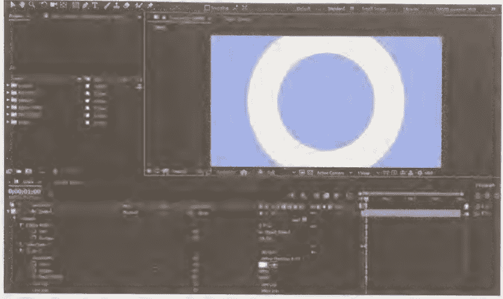

描边宽度

添加纯色背景：

- 1. 转到 添加 | 修剪路径。
- 2. 转到 开始 | 100。
- 3. 转到时间线的开头并点击停止表。
- 4. 转到第 20 个关键帧并将开始参数设置为 0。
- 5. 按 N 快捷键来修剪你的工作区域。
- 6. 按空格键预览，就这样，你创建了第一个形状图层动画！
- 7. 打开形状图层。
- 8. 增加描边宽度大小。
- 9. 复制形状图层。
- 10. 右键单击此图层。
- 11. 将你的圆图层重命名为 2。
- 12. 展开 内容 | 描边 1。

13. 更改描边颜色：

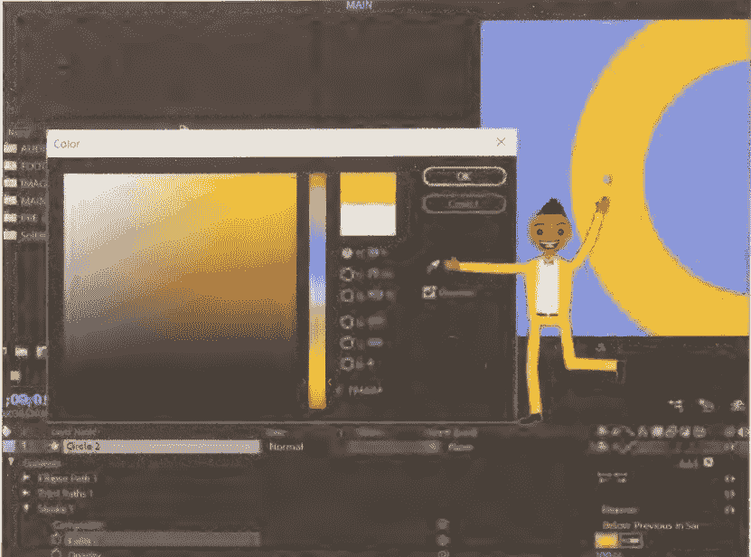

描边颜色

14. 转到 描边 1 | 描边宽度。

15. 将描边宽度减小到 30。

16. 因此这些路径将在不同时间动画化，转到 **Trim path** | **Start** | **Offset keyframes**：

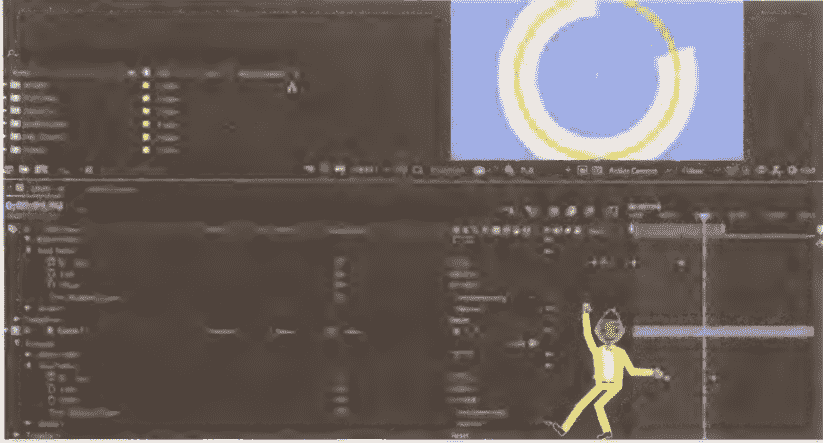

偏移关键帧

选择修剪路径的关键帧。拖动关键帧使其偏移。查看我在前一张截图中指出的偏移关键帧：

- 1. 将 Circle 1 重命名为 `Thick line`
- 2. 将 Circle 2 重命名为 `Thin line`
- 3. 复制 Thick line
- 4. 移到顶部
- 5. 更改 `Thick line 2` 的描边颜色

接下来，仔细查看 **Stroke 1** 选项。在 **Stroke 1** 选项下是 **Dashes**。慢慢看向 **Dashes** 的右侧，你会看到 + 和 -，它们被称为 **Dashes**。点击 + 将允许你在对象上添加虚线：

- 1. 在 **Dashes** 对面，找到 + 和 - 符号。
- 2. 点击 + 两次。在 **Dashes** 下，你有三个参数称为 **Dash**、**Gap** 和 **Offset**。
- 3. 将间隙调整为 120：

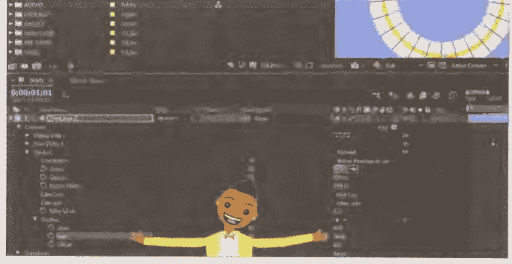

间隙参数

4. 将 Gap 增加到 120。

偏移修剪路径的关键帧，以便这些元素在不同时间被动画化。记住，时机就是一切。在动画中，你希望这些关键帧偏移，以便每个动画在偏移关键帧之后几帧发生。

5. 将 **Thick line 2** 的描边宽度调整为 500。

### 创建新的多边星形状图层

我们需要你创建一个新的转场形状图层。这将帮助我们以创造性的方式过渡到下一个场景：

- 1. 创建一个新的形状图层。
- 2. 向我们的图层添加一个 Polystar 形状：

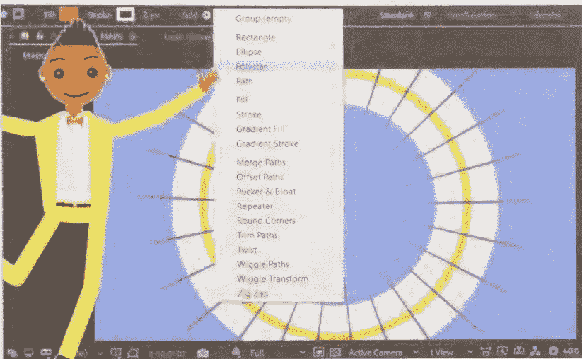

Polystar 形状

向空的形状图层添加一个 Polystar 形状。默认情况下，当你向项目添加形状图层时，它是空的。你必须添加你想要看到的任何形状。你可以在时间线中内容选项卡右侧向形状图层添加项目，或者你也可以使用右上角的栏添加它们：

- 1. 添加填充。
- 2. 展开多边星。
- 3. 添加 30 个点：

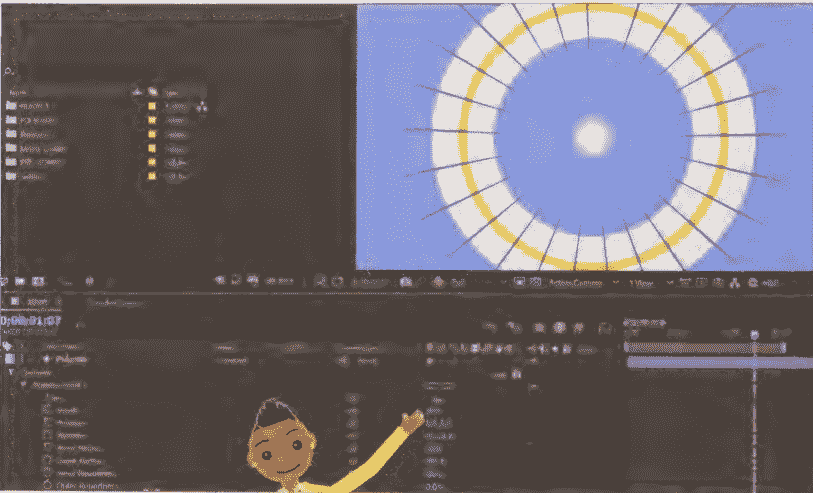

添加点

- 4. 接下来，将外半径扩展到 1250。
- 5. 转到动画的最后一个关键帧并为外半径创建一个关键帧。

- 6. 转到圆圈动画进行到一半的中点。
- 7. 将你的外半径设为 0。
- 8. 在时间线的同一位置，点击内半径的停止表。
- 9. 跳到最后一个关键帧并将内半径扩展到 1080。
- 10. 花点时间偏移你的内半径关键帧以实现以下截图：

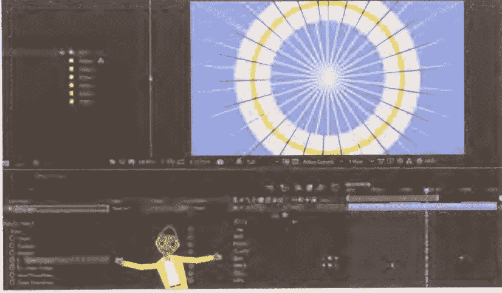

内/外半径

### 创建转场形状

我们将为形状 1 添加最终的转场形状。

现在你需要转到时间线中最后一个形状几乎完全覆盖屏幕的位置。参见以下截图：

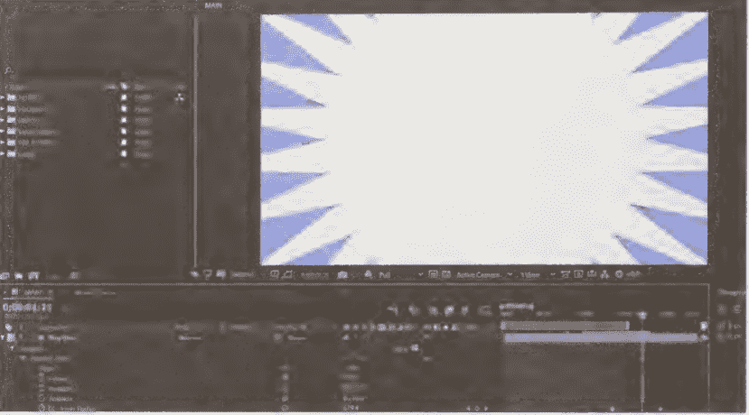

时间线位置 新形状

要创建转场动画形状，请按照以下步骤操作：

- 1. 创建一个新的形状图层。
- 2. 将此图层命名为 Transition stroke。
- 3. 添加一个椭圆。
- 4. 添加描边。
- 5. 更改描边的颜色。
- 6. 展开转场描边图层的内容。
- 7. 找到 Ellipse Path 1。
- 8. 通过改变其大小来动画化椭圆，将其放大并最终使其离开场景。

- 9. 转到大小更改的第一个关键帧。
- 10. 为描边宽度添加一个关键帧。
- 11. 转到最后一个大小关键帧，选择描边参数，并增加描边宽度，以便在该帧上你的描边看起来像以下截图：

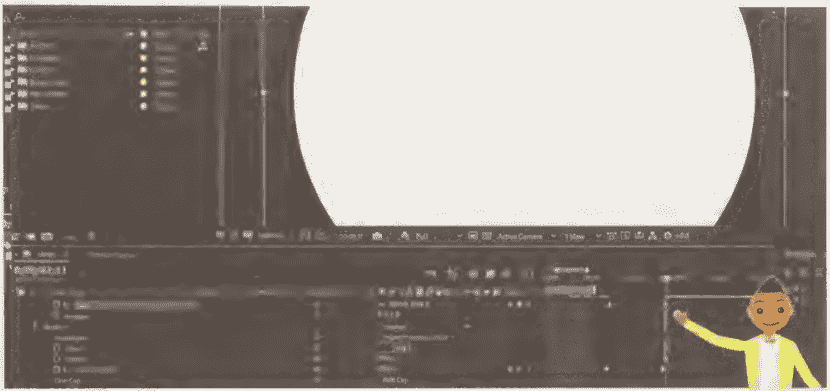

Circle 2 转场描边宽度

我们使用这个形状来揭示下面的角色。我们已经创建了动画遮罩形状。现在我们将使用额外的遮罩来剪切多边形形状的中心：

- 1. 选择最后创建的形状图层。
- 2. 在工具栏顶部，选择椭圆工具。

3. 在最右侧，星形旁边，选择 Tool Creates Mask 工具：

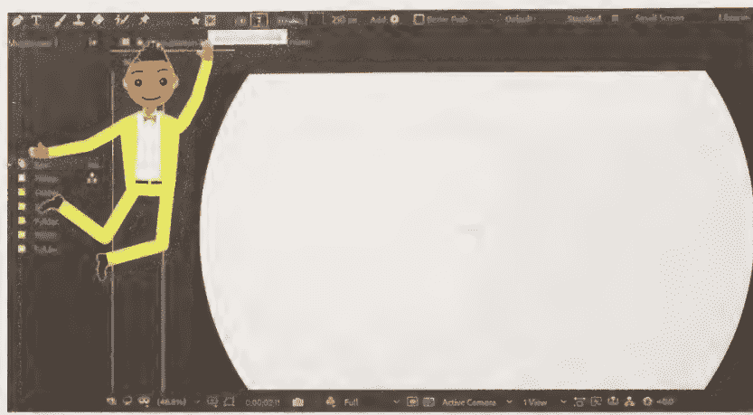

工具创建遮罩

使用此工具点击并拖动以制作一个形状来穿过此遮罩形状：

- 1. 将鼠标放在此形状的中心。
- 2. 按 Ctrl + Shift 来约束此形状。这将创建一个完美的遮罩形状。从中心开始形状将使其完美居中。查看在多边星图层上创建的新遮罩。
- 3. 点击反转以剪切出形状的中心：

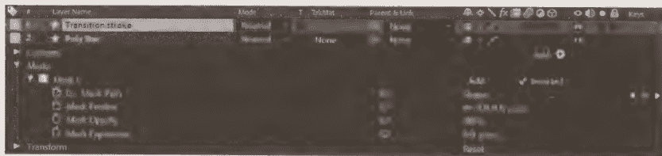

反转

当你点击反转选项时，它会使你的遮罩反转。这将有效地穿过你的遮罩。以下截图演示了你如何通过剪切出的形状看到背景：

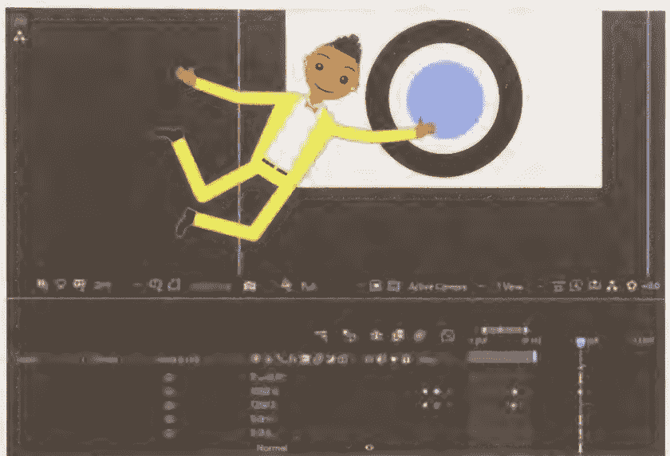

剪切出来

我们需要为此遮罩设置动画并使其与转场描边图层的关键帧对齐。这将确保遮罩动画与转场描边图层同步：

- 1. 转到转场描边图层的第一个关键帧。
- 2. 选择多边星图层上的遮罩。
- 3. 为遮罩创建一个关键帧。
- 4. 转到转场描边图层的最后一个关键帧。

5. 调整遮罩使其与转场描边遮罩一起从屏幕上动画化。要选择所有遮罩点，双击一个遮罩形状直到你得到遮罩边界框。这将允许你调整遮罩并保持完美的椭圆形：

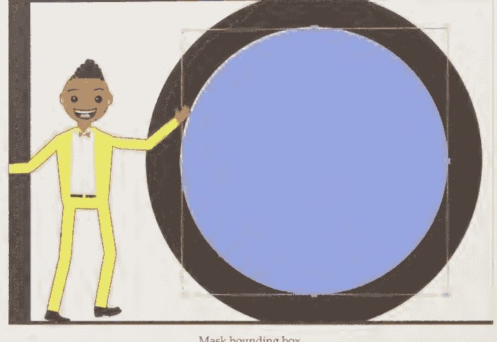

遮罩边界框

第一个关键帧遮罩形状会非常小，几乎不可注意。对最后一个遮罩进行关键帧设置，使其完全填满屏幕。

这个过程被称为创建擦除转场。这在运动图形中经常用于场景的进出转场。由于这是圆形形状，此转场将被称作径向擦除。我们需要修剪除转场图层、背景图层和多边星图层之外的其他形状图层：

- 1. 转到多边星图层遮罩图层的第一个关键帧。
- 2. 选择除背景、多边星图层和转场描边图层之外的所有图层。
- 3. 修剪你的图层。按 Alt + | 或按住 Shift 并将图层向左拖动。

按住 Shift 将使你的图层吸附到时间指示器停靠的位置。确保你看到修剪图标。

## 导入音频、文字动画预设和背景图形

我们将通过添加音乐、创建动态动画排版以及创建动画背景来完成歌词视频。

## 导入音频并创建合成标记

你导入音频图层的方式与导入任何内容的方式相同。音频图层就像其他任何图层一样，只是它没有一些变换属性。任何由视觉图像表示的图层都会具有位置、缩放和旋转变换属性。然而，音频图层在视觉上没有表示；因此，你没有通常的变换属性。你将可以访问波形，它们会显示音频图层上的声音变化。

要显示你的波形，只需执行以下操作：

- 1. 展开音频图层以显示波形：

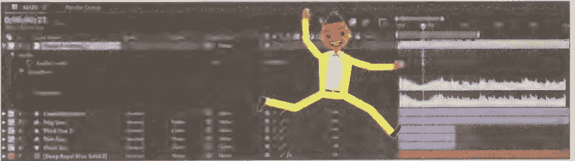

音频

这些音频图层具有可以动画化的音量。

- 2. 要调整并关键帧你的音频音量，请显示秒表音频参数。

- 3. 在负方向上对音频电平进行关键帧设置。当你的音频归零时，你可以通过波形变为一条直线来判断。任何具有音频轨道的图层上都有音频控件：

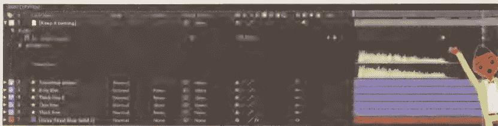

音频关键帧设置

- 4. 接下来，我们将收听音频并聆听歌词，为我们的文字制作合成标记。要添加合成标记，请按 *Shift* 并按一个数字：

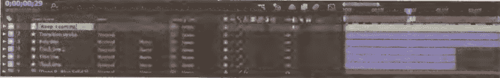

合成标记

这将在你的合成上创建一个带有标记的标记。你可以通过双击数字来进一步编辑该标记。这将显示一个面板，让你重命名该数字。在这里，你可以为图层输入注释。双击该数字以添加歌词的名称：

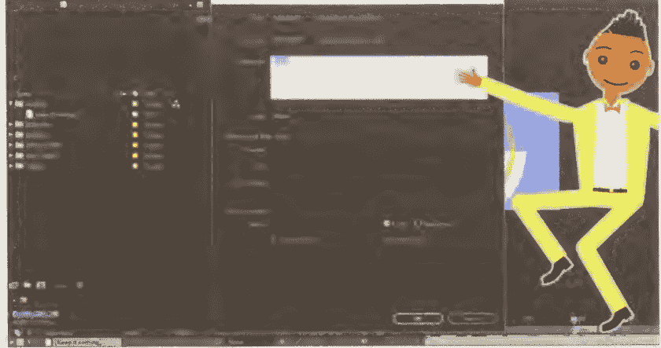

重命名标记

不断重复此操作，直到你有大约 10 秒的音乐，并且歌词已在标记中注明。

## 文字动画器

动态排版是运动图形中需要理解的重要工具。幸运的是，我们可以访问大量提供即时动画的文字预设。转到“效果和预设”并展开“动画预设 | 文字 | 有机 | 下降弹跳”：

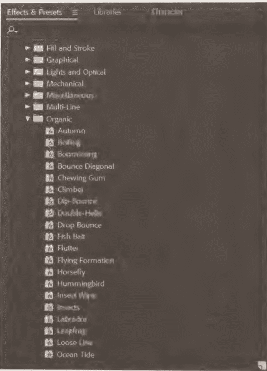

文字预设

在选择其中一条文字行时，双击“下降弹跳”预设。它将自动把此预设添加到你的文字中。

确保你的第一行文字有足够的空间进行动画。如有必要，调整你的图层：

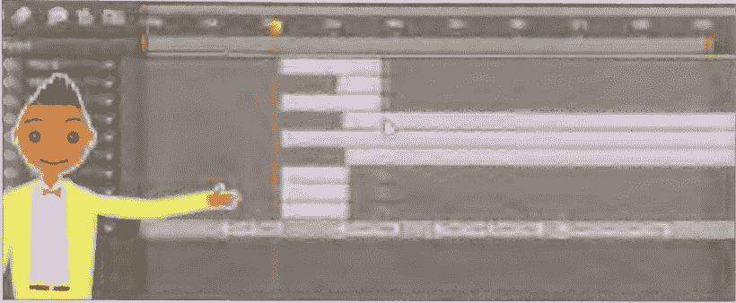

调整图层

我们将使用文字工具输入第一段文字。转到时间线上带有第一个歌词标记的位置。输入歌词的第一个单词。在单独一行输入歌词中的第二个单词。你的歌词中的每个单词应有一个文字图层。居中你的文字在屏幕中并将其缩小，如以下屏幕截图所示：

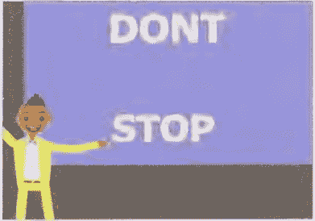

居中文字

选择第二个文字图层。确保文字与音频匹配。选择另一个动画预设。查看动画文件夹。接下来，转到时间线上下一行歌词需要动画的位置。对你的文字进行淡出动画。查看淡出动画预设并点击其中一个预设来对你的文字进行淡出动画。

## 编辑你的文字预设关键帧

添加到文字后，文字预设并不总是看起来完全符合你的预期。因此，你可能需要编辑预设关键帧：

- 1. 按 U 显示创建预设的关键帧。
- 2. 选择所有关键帧并按 Windows 上的 Alt 键，或 macOS 上的 option 键。
- 3. 拖动你的关键帧。这将相对彼此调整所有关键帧。或者，你可以选择关键帧并单独移动它们。

将关键帧拉近会使动画更快，而将它们拉开会使动画变慢：

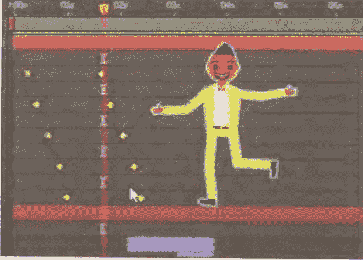

调整关键帧

为文字添加图层样式的操作如下：

- 1. 转到图层 | 图层样式 | 描边。
- 2. 接下来，你可以调整描边颜色：

- 蒙版
- 蒙版和形状路径
- 质量
- 开关
- 变换
- 时间
- 帧混合
- 3D 图层
- 引导图层
- 混合模式
- 图层样式
  - 转换为...
  - 显示全部
  - 全部移除
  - 投影
  - 内阴影
  - 外发光
  - 内发光
  - 斜面和浮雕
  - 绸缎
  - 颜色叠加
  - 渐变叠加
  - 描边
- 效果
- 关键帧助手
- 打开效果控件
- 在项目流程图中显示图层
- 显示表达式错误
- 从文字创建形状
- 从文字创建蒙版
- 相机
- 预合成...
- 反向选择
- 选择子对象
- 重命名

调整描边

确保你的文字图层位于堆叠顺序的顶部。事情应按以下顺序发生：

- 1. 形状图层与文字一起淡入淡出。
- 2. 过渡发生，显示一个字符。
- 3. 根据歌词需要重复步骤 1 尽可能多次：

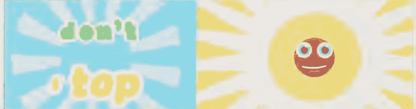

过渡

为了确保图层顺序正确，请按照以下步骤操作：

- 1. 选择所有文字图层。
- 2. 将所有文字移至其他图层下方。

## 创建动画背景形状

我们将为动画制作一个重复的背景元素。我们将复制径向虚线图层：

- 1. 调整此图层的关键帧，使其与文字一起淡入淡出。
- 2. 它需要在文字下方，如以下屏幕截图所示：

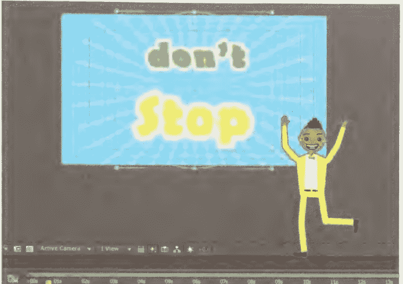

我们将把此项目制作成方形格式，以便在社交媒体上更好地观看。转到合成 | 合成设置并将合成大小设为 1,080 x 1,080。

## 摘要

在本章中，我们了解了形状图层强大而复杂的世界。我们学习了如何创建自定义形状、编辑它们以及使用这些形状创建动画。我们学习了如何在项目中使用形状图层作为过渡元素。我们还了解了令人兴奋的文字动画预设世界。我们学习了如何对文字动画进行淡入淡出。记住——文字预设是动态排版的起点。尝试这些参数以获得独特的动画。你不希望你的动画过于可预测，看起来像是直接来自预设。修改文字预设以创建独特的东西。

## 问题

- 1. 什么是图层样式？
- 2. 如何访问图层样式？
- 3. 什么是形状图层？
- 4. 什么是过渡？
- 5. 如何创建合成标记？
- 6. 什么是波形？
- 7. 什么是文字预设？
- 8. 如何访问文字预设？

## 延伸阅读

请查阅以下页面以获取本章主题的更多信息：

- 保存预设：https://helpx.adobe.com/after-effects/using/effects-animation-presets-overview.html
- 社交媒体文件格式：https://sproutsocial.com/insights/social-media-image-sizes-guide/

## 4
