## 4 使用 Character Animator 创建信息图表

在本章中，我们将把迄今为止学到的所有内容结合起来。我们将通过创建一个基于信息项目的项目，继续在我们迄今为止涵盖的主题上构建，进入令人兴奋的角色动画世界！我们将大量依赖 Illustrator 的素材。Illustrator 的 artwork 基于矢量，可以缩放。要跟上本课的学习，你的机器上必须安装 Adobe Character Animator 和 Illustrator。

本章将涵盖以下主题：

- 动态排版
- 创意过渡
- 角色动画
- 图标动画

## 技术要求

你需要安装 Photoshop、Illustrator 以及一个网络摄像头。

## 信息图表

信息图表是可用于以令人兴奋且难忘的方式传达信息的视频项目。动态图形动画工具非常适合这种类型的叙事。能够创建动态排版和令人眼花缭乱的转场使 After Effects 非常适合制作信息图表。对于本项目，我希望你思考一个有事实数据可以解释的问题。或者，你可以选择跟随教程并使用我使用的数据和角色，也可以将你的项目基于你读过的一篇有趣文章。另一个想法是创建一个关于简单事实或食谱的信息图表。重要的是项目中需要传达一些信息。你应该限制项目中的文字量，否则观众阅读起来会过于庞杂。你也可以加入一些微妙的背景音乐来推动你的叙事。

## 文字

在动态图形中，了解如何设置良好的字体类型非常重要，这样它在视觉上 pleasing、有清晰的信息，并且构图扎实。了解如何编辑你的文字也很重要。精心设计的文字的力量用于电影标题、视频、广告和动画 GIF 的制作中。精心设计的文字本身就可以是一种艺术形式。花时间为你的项目选择最合适的字体。考虑在同一时间可以放在屏幕上的最少文字量来传达你想要传达的信息。了解如何调整文字使其间距正确并在环境中脱颖而出也很重要。仔细考虑使用哪些字体。颜色对文字的情感冲击和可读性也有很大影响。开始观察你周围的文字，无论是在印刷品还是媒体中。什么使文字看起来好看？什么使它脱颖而出并令人难忘？尝试重现文字处理效果以了解创建美丽文字的过程。

我们在前几章中讨论过文字，但在这一章，让我们讨论间距功能。在面板的最右侧，靠近效果面板的位置，我们有字符面板。这里是你控制文字参数的地方。创建一些文字，让我们一起查看这些控件。在字符面板的左上角，你可以选择不同的字体。点击下拉菜单以显示计算机上安装的不同字体：

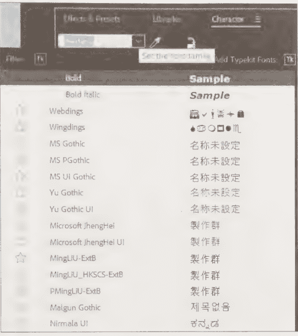

## 字体

在字体下方，你有字体的不同粗细。点击它以查看该字体可用的粗细。通常，你可以访问字体的粗体和斜体粗细。

在粗细右侧，有一个下拉菜单提供所有颜色选择选项。这里你可以为字体添加描边并更改其颜色。你可以在字体选项卡下更改字体大小：

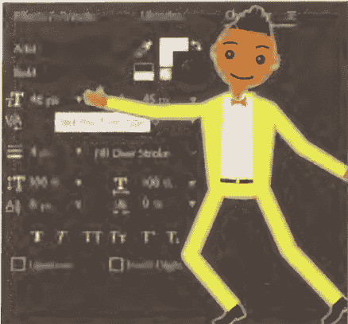

字体大小

此选项卡用于调整跟踪或字母之间的间距。我经常使用它，因为打字后文字并不总是完美。大多数文字都需要调整跟踪：

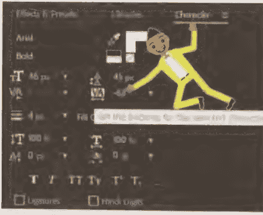

跟踪

这用于调整描边宽度：

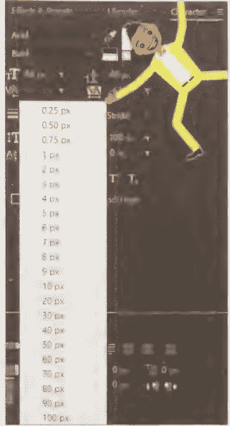

描边宽度

这用于确定描边在文字上的确切位置。你有不同的选项，例如填充覆盖描边和描边覆盖填充。尝试这些以查看它们的区别：

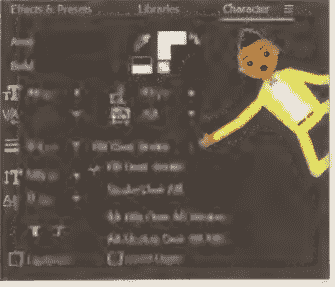

填充覆盖描边

在此面板下方，有段落面板。这可以帮助你进行文字对齐：

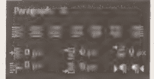

段落

接下来，让我们看看投影功能。投影位于效果和预设面板中。将它添加到一些文字上，看看这种效果能做什么。我喜欢这种效果；它非常有用且多功能：

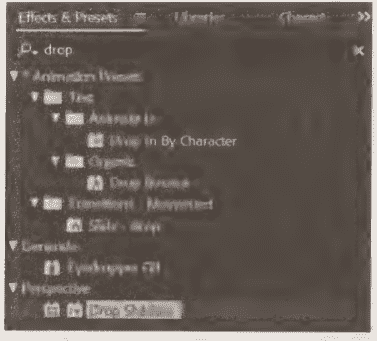

投影

尝试调整不透明度、距离、方向和柔和度，以便熟悉此工具：

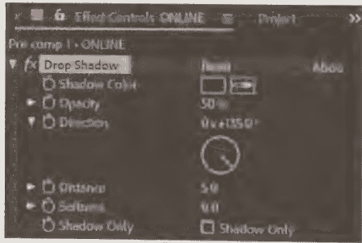

投影调整

## 在路径上创建文字

你是否看过文字沿着路径移动的视频？自定义路径是使用 After Effects 中的钢笔工具徒手绘制的矢量路径。在 After Effects 中，你可以使文字与路径对齐并沿着该路径移动！

我们可以通过以下步骤将文字与路径对齐：

- 1. 创建你的文字。
- 2. 选择文字图层。
- 3. 在文字图层上使用钢笔工具创建一个路径。
- 4. 展开文字。
- 5. 展开路径选项。
- 6. 在右侧，选择你刚刚创建的路径（遮罩 1）：

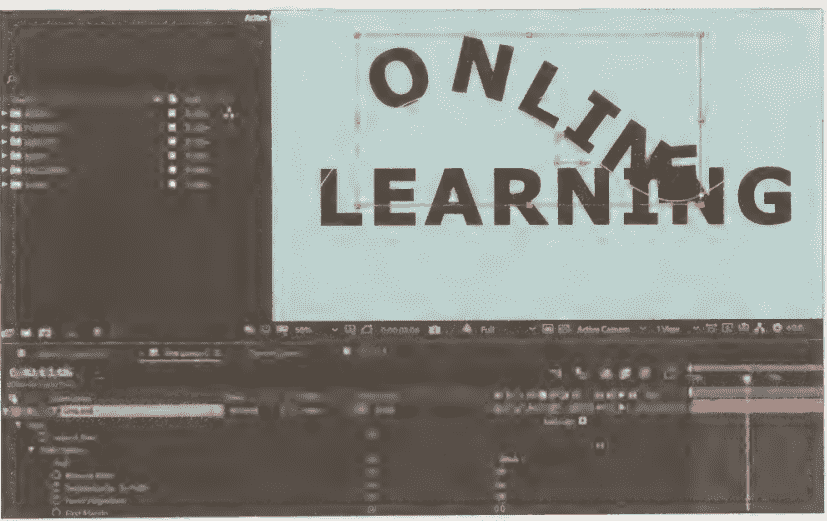

沿路径插入文字

## 动画文字

对于本项目，我们正在制作信息图表视频。花点时间寻找你想在本项目中分享的信息。你也可以选择下载并使用我使用的相同文件，以便跟随操作。按如下方式在两个不同的图层上创建文字行：

- 1. 创建一些文字。
- 2. 打开标题安全框。
- 3. 确保文字居中。
- 4. 创建背景。
- 5. 创建文字—`ONLINE LEARNING`。
- 6. 在所有图层上打开连续光栅化。
- 7. 使用以下文字预设：
  - 带扭转的飞入
  - 按词直入

有时，当你选择一个文字预设时，你需要调整其设置。文字可能不会在正确的位置动画。你可以通过以下方式调整预设的起始位置：

- 展开文字。
- 展开动画器 1。
- 展开范围选择器 1。
- 找到位置并转到时间线的开头。如有必要，调整位置。

请参阅以下屏幕截图以了解需要调整的正确位置参数：

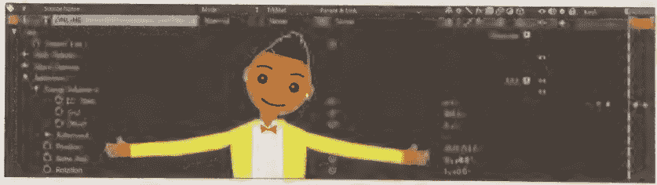

调整预设位置

## 编辑和导入 Illustrator 文件

了解如何将 Illustrator 艺术作品放在单独的图层上至关重要，因为你可以在 After Effects 中为这些图层中的每一个设置动画。这些图层是矢量图，因此可以放大而不失质量，并且可以轻松编辑。在 Photoshop 中从背景中分离图像可能是一个漫长的过程。你可以将 eps 文件导入 Illustrator 并将其保存为 ai 文件。确保你的计算机上已下载 Illustrator。在 Illustrator 中打开一个文件，让我们来看看图层！

在 Illustrator 中，图层堆叠顺序与 Photoshop 和 After Effects 相同；层次很重要。顶部图层上的内容将出现在所有其他内容的前面。要排列这些图层，只需选择一个图层并在堆叠顺序中移动它。

非常经常，图像的每个元素都位于一个图层上。你可以在 Illustrator 中将它们分开并放在自己的图层上。要查看图像的所有元素，请展开图层：

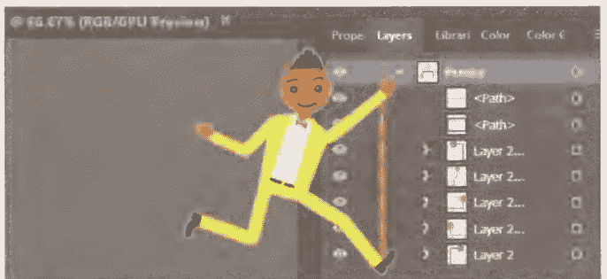

Illustrator 展开

## 在 Illustrator 中创建新图层

正如你在本屏幕截图中看到的，还有其他元素组成了这幅图像。如果你将其导入 After Effects，一切都将在一个图层上。你将无法单独为这些元素设置动画。让我们看看 Illustrator 图层面板界面的一个部分。查看 Illustrator 窗口的右下角。有一个名为创建新图层的按钮：

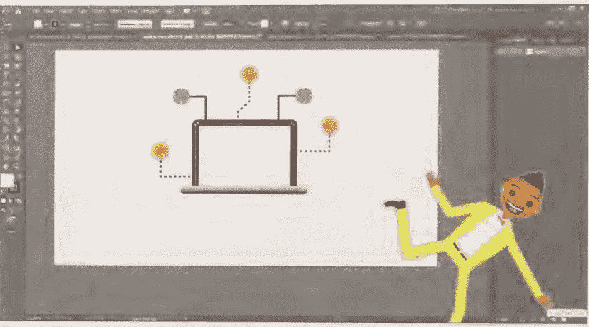

Illustrator 新图层

点击创建新图层按钮。这就是在 Illustrator 中创建新图层的方式。

一旦你在 Illustrator 中创建了图层，你需要将想要的元素拖到该图层中。如果你双击该图层，你可以重命名它：

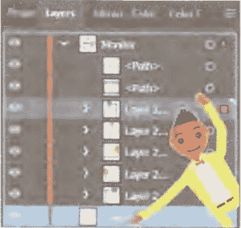

拖动到新图层

现在你知道如何为你的插图创建单独的图层。花几分钟时间将每个元素拖到自己的图层。我们稍后将在 After Effects 中为这些元素设置动画：

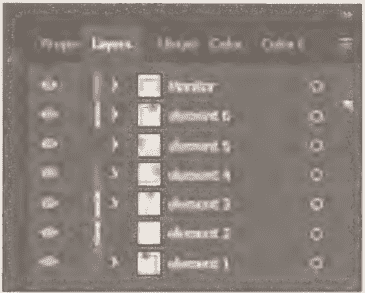

单独图层

你可以广泛编辑 Illustrator 文件。这对于动画目的来说非常棒。

## 吸管工具

我用来更改元素颜色的首选编辑工具之一是吸管工具，可按如下方式使用：

- 1. 你通过选择想要更改的元素来使用此工具。
- 2. 转到 Illustrator 面板的左侧。

3. 选择吸管工具 (I) 或填充图标：

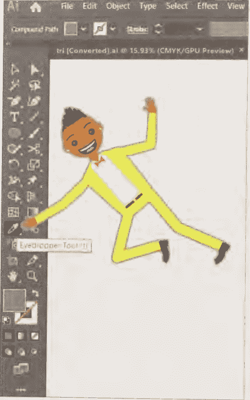

吸管

4. 选择其中之一后，你可以更改元素的颜色：

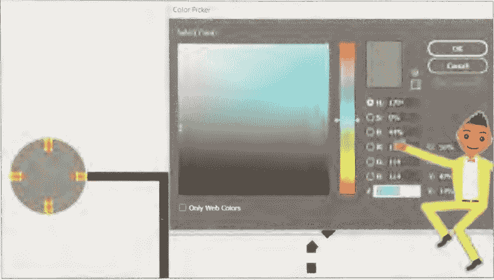

更改元素的颜色

更改文本颜色的方式与在 After Effects 中相同。你可以使用吸管工具从屏幕上选取颜色来更改你的元素。

5. 要保存文件，请前往屏幕左上角，在 File 选项卡下选择“另存为：...”

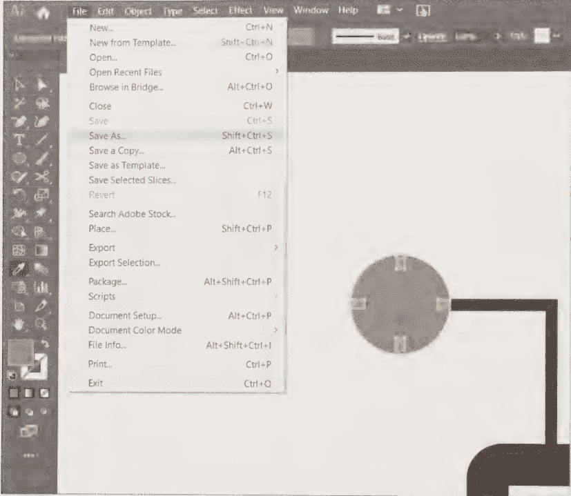

保存

这里你可以将文件保存为多种不同的格式。就我们的目的而言，我们希望插图保存为 Illustrator 文件。选择 Adobe Illustrator *AI 文件格式。

现在回到 After Effects。一旦你将 Illustrator 文件导入 After Effects，你可以再次返回 Illustrator，修改现有的图层，保存它们，它们将在 After Effects 中自动更新。但是，在 Illustrator 文件中创建的任何新图层都不会导入到 After Effects 中。如果你需要在 Illustrator 文件中添加新图层，我建议你保存一个新的 Illustrator 文件。导入新的 Illustrator 文件并将该新图层合并到 After Effects 项目中。现在我们准备好将 Illustrator 文件导入 After Effects 并开始为其制作动画了！我喜欢这个过程，因为 Illustrator 文件非常漂亮且易于使用。因此，我们正确导入 Illustrator 文件的方式是选择以下选项：

- 1. 导入方式：合成 - 保留图层大小
- 2. 导入

单击“创建合成”。

现在你已导入 Illustrator 文件，你应该会在项目面板中看到一个合成自动出现。将其移入你的预合成文件夹：

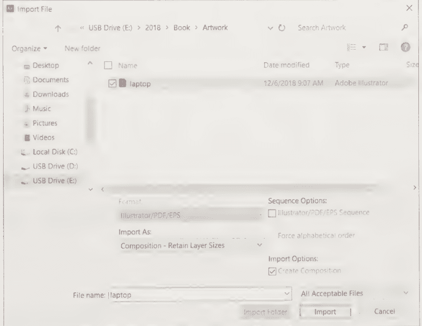

导入 Illustrator 文件

这也会导入一个包含各个图层的文件夹。将此文件夹移入 `IMAGES` 文件夹。我喜欢这个——如果你在 Illustrator 中正确设置，它会非常有条理！查看文件夹中这些 `IMAGES` 的大小。这很重要，因为更大的图层会增加渲染时间。尺寸较小的图层更容易动画。由于这些是 Illustrator 文件，它们可以放大而不会损失质量：

- 1. 导航到 Illustrator 预合成。
- 2. 复制它，以便你在 After Effects 中拥有一个备份副本。
- 3. 双击其中一个 **PRECOMPS**。你将看到笔记本电脑的各个元素设置与我们在 Illustrator 中创建的完全相同。
- 4. 当你导入 Illustrator 文件时，务必打开连续栅格化：

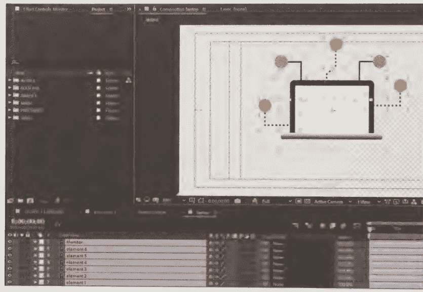

连续栅格化

连续栅格化是一种让图层以全分辨率渲染的方式。由于这些是 Illustrator 文件，无论放大多少，它们看起来都会很清晰。现在我们将把所有元素都设为父级到我们的显示器：

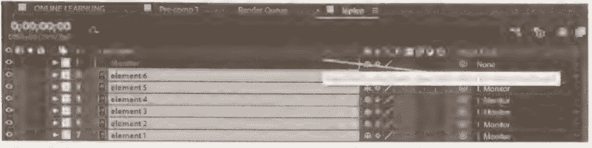

父级元素

复制所有这些元素并将其粘贴到包含你的文字合成的合成中，然后执行以下操作：

- 1. 将此合成命名为 `ONLINE LEARNING`
- 2. 选择你将所有内容设为父级的显示器图层
- 3. 缩小此图层以适应场景

当你移动此图层时，你的所有元素都会随之移动，因为你已将其设为父级：

显示器缩放

让我们看看我们到目前为止创建的内容并为自己感到自豪！我们现在已将第一个标志元素设置好并准备好进行动画制作。干得好！

## 动画原理

到目前为止，我将放慢速度并谈谈动画原理。我们即将为我们的标志制作动画，我希望你对如何以令人信服的动态方式移动元素有更深入的理解。沃尔特·迪士尼——动画的伟大先驱之一——创造了我们至今仍在使用的 12 项动画原理：

- 时机
- 缓入缓出（或慢入慢出）
- 弧线
- 预备动作
- 夸张
- 挤压和拉伸
- 次要动作
- 跟随动作和重叠动作
- 直接逐格动作和姿势到姿势动作
- 场景设计
- 吸引力
- 个性

我想要特别注意的是时机、缓入缓出、次要动作和个性。时机在动画中至关重要。我将在本书中多次重复这一点。我几乎总是使用 10 个关键帧的规则。人眼大约需要 10 个关键帧才能视觉上识别任何事物。确保每个动作之间至少有 10 帧。如果你屏幕上有大量信息，你可能需要更多帧，但这是一个不错的起点。在决定某物应在屏幕上停留多久时要特别注意。你不想让观众感到无聊，所以不要让你的动画拖沓。随着你动画制作的增多，你会逐渐掌握这一点。

接下来需要注意的是缓入缓出。这是制作令人信服、优雅动作中最重要的事情之一。在现实世界中，物体需要时间加速和减速，就像人体一样；大多数物体都是这样移动的。每个动作的开始和结束总是有逐渐的缓和。要在 After Effects 中实现这一点，我们使用 Easy Ease 关键帧助手。添加它会立即让你的动画看起来更好。

次要动作也会为你的动画增添一些个性和真实感。次要动作是指你的物体移动到其位置后，在那里产生次要移动。并非总是需要使用次要动作，但它可以为你的动作增添重量感和可信度。它还使你的动画不完美，这会产生兴趣并创造个性。我们将在本书中更多地讨论这些原理。

## 动画制作显示器

现在让我们开始为我们的电脑显示器制作动画：

- 在文字出现在屏幕上后，将时间线向下移动 10-20 个关键帧
- 将显示器的锚点移动到显示器底部边缘

要移动锚点，请选择平移后工具 (Y) 并移动锚点。现在这个物体将在锚点周围动画。在动画制作物体之前设置好这一点很重要：

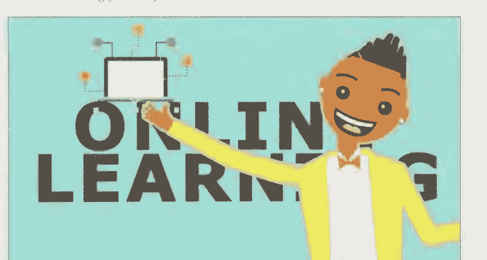

显示器锚点

在这一点上，我们需要锁定参数在当前位置。我们通过创建空白关键帧来实现：

- 在此点设置缩放和旋转关键帧
- 在时间线中向后移动（向左）10 个关键帧

- 将显示器缩放到 0
- 为所有内容打开运动模糊

现在我们要创建一个假摄像机移动。这将用作我们的信息图表视频的过渡元素。我们通过将 null 对象以外的所有内容设为父级来创建摄像机 null：

- 前往时间线中显示器已完成动画的时间点。
- 创建一个 null 对象。选择除背景外的所有内容。
- 将所选内容全部设为 null 对象的父级。
- 对所有这些关键帧应用易于缓和。
- 为除背景外的所有内容打开运动模糊。记住，运动模糊必须在两个位置打开：

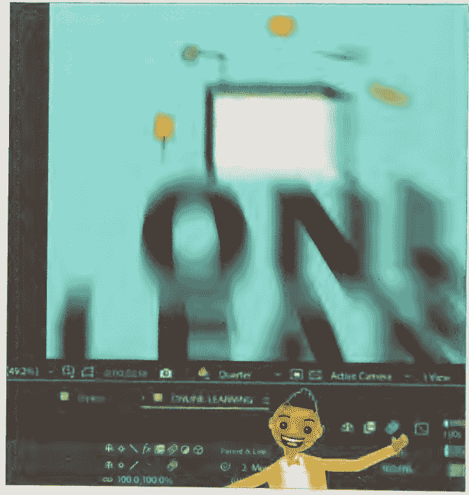

图标的运动模糊

Easy Ease 会使你的动作更柔和，看起来更自然。
选择显示器和 null 的关键帧。前往 **Animation** | **Keyframe Assistance** | **Easy Ease**：

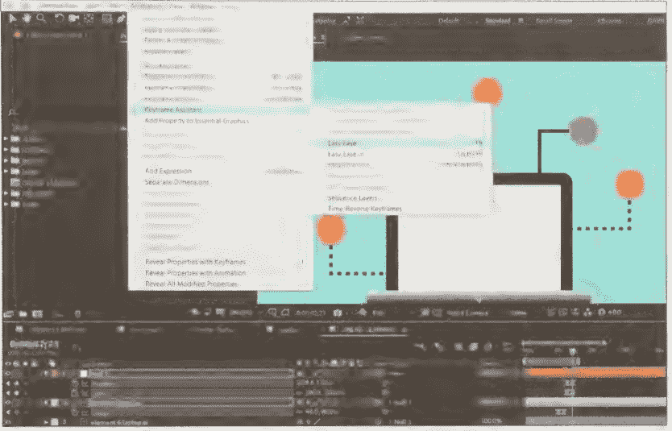

易于缓和

现在让我们为显示器制作假摄像机推进动画。以下是步骤：

- 1. 停留在显示器已完成动画的时间点。
- 2. 为 null 对象的缩放和位置创建关键帧。
- 3. 向下跳（向右）10 个关键帧。

4. 调整位置参数和缩放，使显示器填满屏幕：

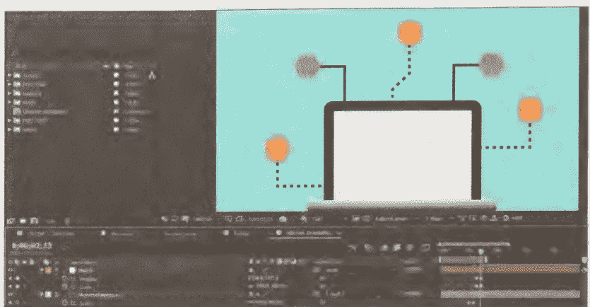

显示器全屏

现在我们将为所有元素部件制作动画。以下是操作步骤：

- 1. 前往时间线上显示器填满屏幕的点，并选择要关联到显示器的所有元素。
- 2. 将它们设为显示器的父级。
- 3. 对于这些元素中的每一个，将锚点定位在线条末端。

这将确保我们的元素从正确的位置开始动画：

锚点元素

现在你的锚点和元素已正确设为显示器的父级，我们可以开始为它们制作动画。方法如下：

- 1. 选择第一个元素并为缩放制作关键帧
- 2. 在时间线上向前跳转 10 个关键帧（向右），并设置缩放关键帧
- 3. 回到上一个缩放关键帧，并将该元素缩放至 0

太好了！让我们预览一下目前的效果！你应该能在屏幕上看到动画文字。接下来你应该看到显示器。然后，你应该看到假摄像机推入，以及其中一个元素从背景中缩放出来。（所有元素都应位于背景中。）

下一步是创建次级缩放运动。前往最后一个关键帧位置，向右移动 10 个关键帧，然后创建空白关键帧。

这就是创建空白关键帧的方法。这有助于保持关键帧不变。此外，你可以使用这些三角形在关键帧之间跳转：

- 向后跳转到关键帧（向左）。
- 将该关键帧缩放至 120：

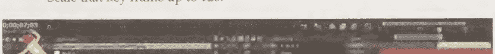

添加空白关键帧

接下来，你需要对这些缩放关键帧进行易于缓入缓出处理：

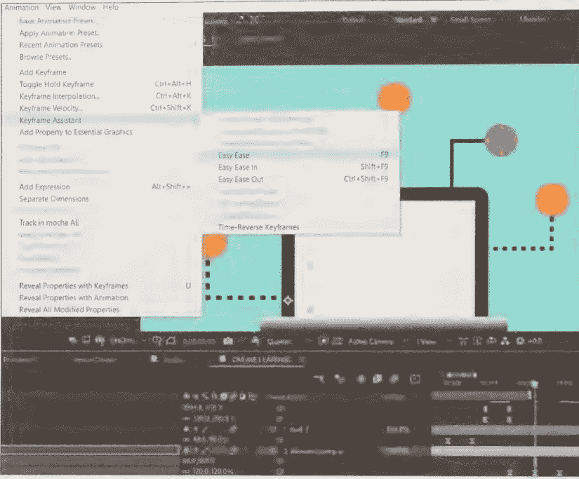

易于缓入缓出元素

太棒了！让我们看看我们已经完成了什么。预览你的作品时，你应该能看到显示器元素带有次级运动并开启运动模糊进行动画。如果开启运动模糊使电脑运行过慢，你可以暂时关闭运动模糊。在渲染项目前，你需要记得重新打开它。重复这些步骤为显示器的其余元素制作动画。

到目前为止，你已经掌握了使用文字预设制作文字动画的所有强大工具。你也知道如何使用摄像机空对象。你正稳步前进！接下来我们将使用与在线学习介绍中相同的工具来制作更多文字动画。务必确保有足够时间让显示器连同所有部件完全动画化并完成摄像机推入。时机至关重要。如果你过早开始文字动画，效果不会好看。让它稍作停顿，然后再开始为下一条信息制作动画。花点时间制作文字动画（当今学校承受着用更少资源做更多事的压力）。务必在文字行之间暂停——这会给观众阅读时间。我们将在文字和显示器元素之间添加一个调整图层：

- 1. 前往 **Layer** 选项卡。
- 2. 然后前往 **Adjustment Layer**。
- 3. 这将在你的时间线上添加一个调整图层：

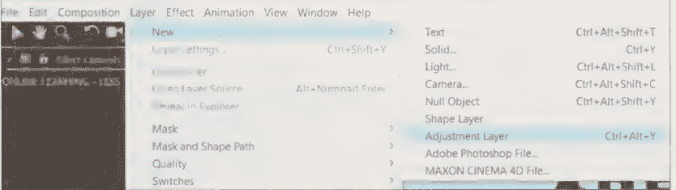

调整图层

调整图层类似于空对象。它们就像一个空白图层，你可以向其添加效果，并且会影响其下方的所有内容。我在这里传授一些重要知识；务必吸收并记住！调整图层上的效果会影响堆叠顺序中其下方的所有内容。我们不希望它影响新的动画文字，所以将调整图层放在新文字下方。

现在我们已添加调整图层，可以向其添加效果。方法如下：

前往时间线上显示器及其所有元素完全动画化的点

- 1. 前往你的效果并添加 **Fast Box Blur**
- 2. 当方框半径为 0 时，点击效果面板中的秒表
- 3. 在时间线上向下移动 10 个关键帧
- 4. 将方框半径增加到 60
- 5. 打开 **Repeat Edge Pixels**

启用这些设置后，你的屏幕应看起来类似这样：

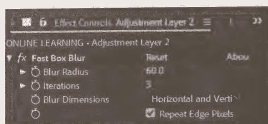

快速盒状模糊

太好了！让我们看看我们正在处理的内容。随着假摄像机在显示器上进出，所有在屏幕上动画的元素在下一条信息动画化时变得模糊。我刚刚教你另一种转场效果。这就是景深转场。到目前为止，你已经掌握了许多工具。稍作休息，为自己迄今为止取得的成就感到自豪。接下来，我们将进入角色动画——我最喜欢的主题。

## Character animation types

角色动画是一个深不见底的领域，你可以在其中花费数年学习。幸运的是，你可以学习一些简单的技巧，快速上手！这些技巧将改变你的生活，因为角色动画将赋予你使用角色表达自我的能力！

## Puppet Warp animation

Puppet Warp 是最基本的角色动画工具之一。你现在就可以开始使用并立即获得成果：

- 1. 导入男性木偶
- 2. 确保在导入 Illustrator 文件时勾选 **Retain layer sizes** 和 **Create a comp**
- 3. 复制此合成并将两者放入 `PRECOMPS` 文件夹
- 4. 将包含 Illustrator 图像的文件夹移至 `IMAGES` 文件夹
- 5. 打开其中一个男性木偶预合成
- 6. 打开 **Continuous rasterize**
- 7. 选择除躯干外的所有内容并将所有部件设为躯干的父级
- 8. 复制所有部件并粘贴到在线学习合成中
- 9. 在手臂上添加三个图钉，如以下屏幕截图所示

Puppet Warp 位于工具面板上方，最右侧：

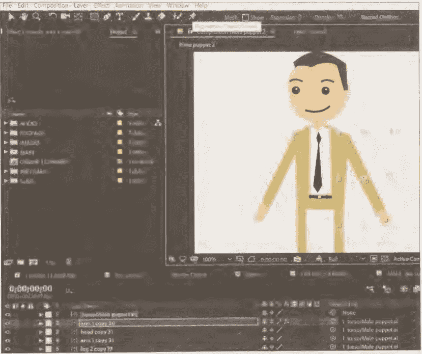

Puppet Warp

为了制作动画，展开你添加了图钉的手臂的效果选项卡。现在你可以看到图层上已经添加了关键帧。向右移动 30 帧并将手臂移动到此处所示的位置：

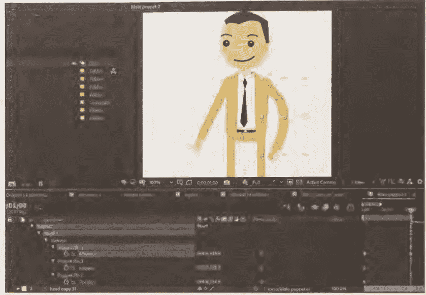

Puppet Warp 关键帧

如你所见，随着你移动图钉，时间线上会创建关键帧。预览一下看看我们正在处理的内容。瞧！你已经有了一些扭曲的角色动画。如果看起来很奇怪，不用担心——你可以随时根据喜好进一步调整。细微是这种效果的关键。这种效果最适合细微的轻微运动。

## Jointed animation

下一种动画风格称为关节动画。它非常多用途，可用于更逼真的运动。关节动画让你有更大的控制权。使用此技术时，你需要正确绑定角色。让我们再次复制男性木偶合成，并像之前一样为所有图层打开连续栅格化进行设置。

现在你已经创建了 Puppet Warp 动画，我们可以创建关节动画。方法如下：

- 1. 将你的手臂、腿部和头部设为躯干的父级。
- 2. 将手臂锚点移动到最靠近躯干的关节处。
- 3. 对腿部和头部也执行此操作：

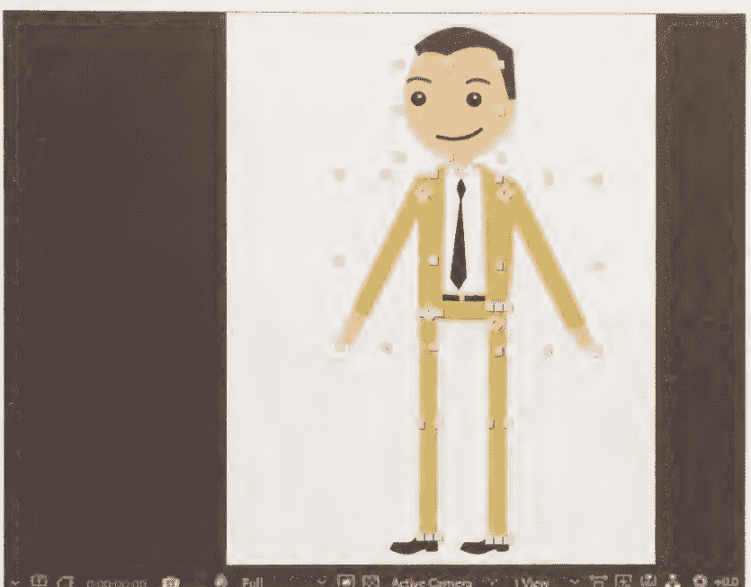

木偶锚点

你注意到所有锚点都接触到躯干了吗？这些肢体围绕该点旋转。

按照以下说明为你的关节角色制作动画：

- 1. 选择一只手臂并选择旋转参数
- 2. 设置一个旋转关键帧并在时间线上向右移动 10 个关键帧
- 3. 旋转角色手臂使其指向左侧
- 4. 对这些关键帧进行缓入缓出处理

这非常基础，但想象一下所有可能性！如果你有一个带有二头肌、三头肌、大腿、小腿、手和脚图层的角色，你可以正确地将其设为父级，从而拥有一个完全绑定的可动画角色！可能性无穷无尽。

## Adobe Character Animator

Character Animator 迄今为止是 After Effects 中最惊人的角色动画程序。立即在你的机器上安装 Photoshop 和 Adobe Character Animator。使用此软件，你可以创建与你的声音同步口型的角色。你必须拥有一台网络摄像头才能在线创建和流式传输实时动作捕捉动画。

首先，你需要安装 Adobe Character Animator。打开 Character Animator 时，会出现开始菜单。这里有免费的木偶，你可以在不编辑的情况下开始使用。你还可以访问交互式教程。如果点击右箭头，你可以看到更多免费角色：

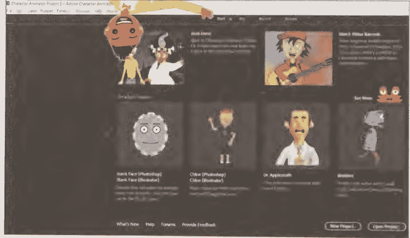

开始菜单

让我们点击 **Chloe** 角色。选择 Illustrator 版本。你也可以使用 Photoshop 版本，但在本课中我们将使用 Illustrator 文件。这将在 Illustrator 中打开 Chloe 角色。你可以在这里选择编辑角色，但不要重命名任何内容。只是为了好玩，让我们把她的衬衫颜色改成黄色。查看 Illustrator 工具面板的最左侧并选择直接选择工具。

## 修改 Illustrator 文件

现在你知道如何打开角色了，我们可以开始修改我们的 Illustrator 文件。方法如下：

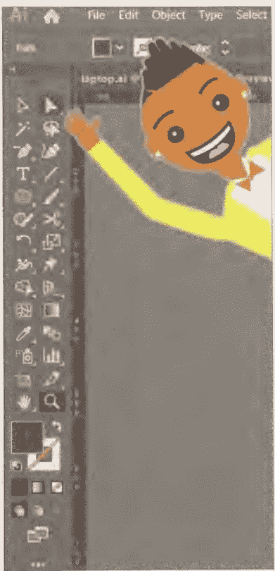

直接选择工具

将直接选择工具悬停在 T 恤的不同部位上。按住 Shift 键的同时点击每个部件：

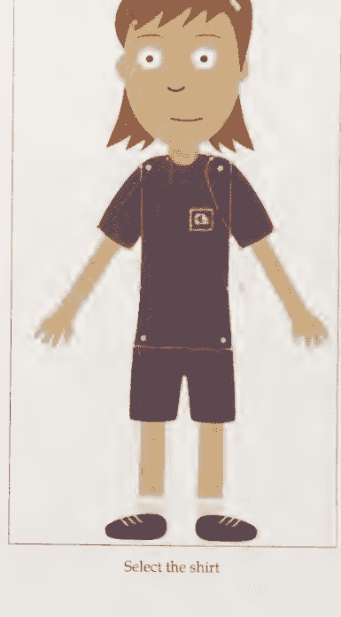

选择衬衫

现在 T 恤已选中，导航到工具面板左侧并选择填充 (X) 将颜色改为黄色：

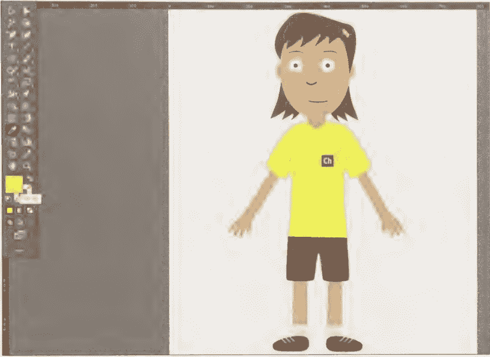

更改颜色

我还将选择 T 恤标志并将其关闭。你需要保存 Illustrator 文件，然后返回 Character Animator。

现在你应该能看到 **Record** 界面。这里是你为角色做动画的地方。让我们保存这个项目：

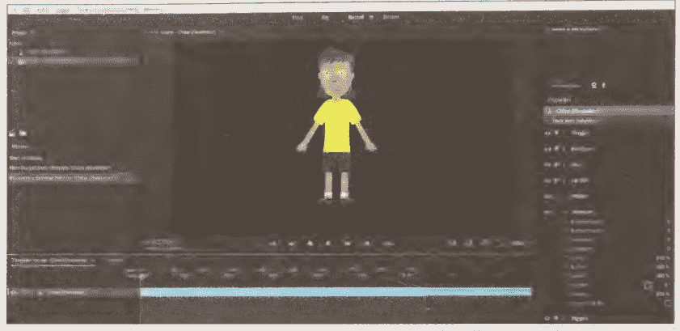

录制界面

转到 **File** 选项卡并选择 **Save Project As**... 为你的项目取一个独特的名字：

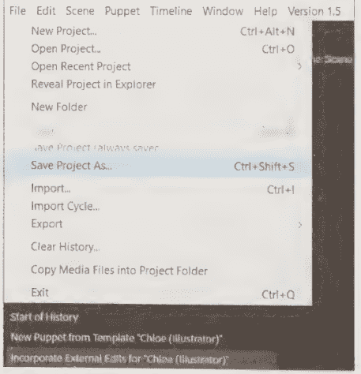

另存为

Character Animator 内置了自动保存功能。我发现随着项目的进展保存不同版本很有用。这样，如果项目损坏，你将有一个备份。

## Character Animator 界面

界面与 After Effects 相似，只是工具和面板没有那么多。在最左侧，你会看到一个项目面板窗口。这里可以创建新场景和新文件夹，并组织你的项目。这里也是导入项目内容的入口：

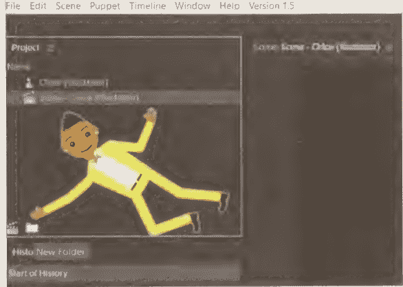

图片文件夹和新场景

在界面顶部左侧，有四个选项卡：**Start** / **Rig** / **Record** / **Stream**。我们已经看过 **Start** 选项卡。让我们看看 **Rig** 选项卡。这里是木偶的绑定位置。这让我们可以幕后查看我们的角色。随着你变得更熟练，你需要在这里编辑角色的绑定：

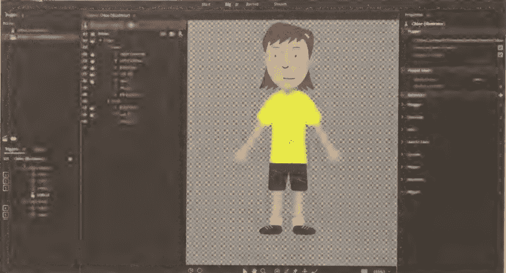

绑定

**Record** 选项卡是动画面板；所有动画和表演都在这里进行。

**Stream** 选项卡用于将你的表演实时流式传输到世界各地：

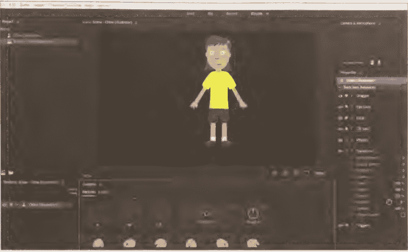

流

接下来，让我们看看场景 **Properties**。

确保你的场景已选中，然后查看最右侧——你会看到各种可以调整的项目设置，例如 **Frame Rate**：

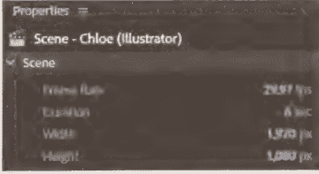

场景设置

Scene 窗口是你的角色所在的位置。这里发生所有的动作。看看角色下方的播放按钮。这可以让你在时间线上前后移动。红色按钮是录制动画的方式。Record 按钮右侧是速度。你可以控制录制的快慢：

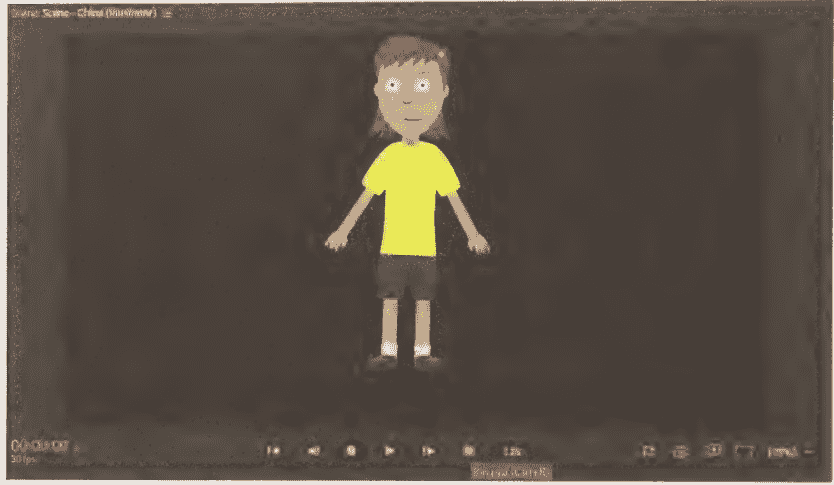

录制按钮和速度

接下来，让我们看看摄像机和麦克风面板。

这里处理你的网络摄像头设置和语音录制。让我们打开网络摄像头。点击界面左上角的此摄像头输入选项卡。如果你的网络摄像头正常工作，你应该会在面板中的框内看到你的影像。这将启用面部追踪。红点是脸上的追踪点：

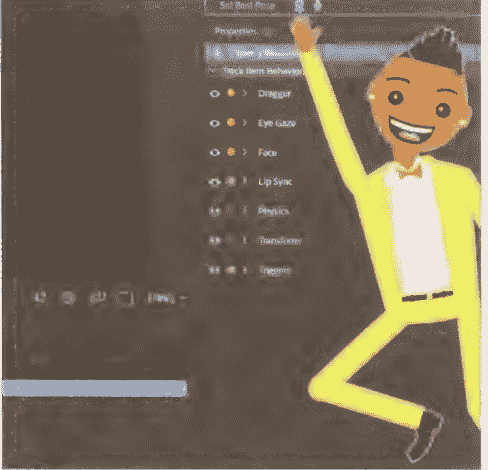

图像网络摄像头

让我们确保我们的脸正确同步。确保你有强光源。另外，戴眼镜可能会干扰将你的脸与网络摄像头同步。接下来，选择网络摄像头按钮。点击 (Set Rest Pose)。这将把你的脸与角色的脸同步。这类似于《阿凡达》中 Sully 与他的化身同步的情况。现在你已与角色同步：

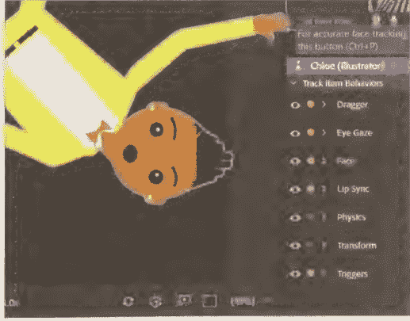

设置静止姿势

现在你可以花点时间玩你的角色——当你说话时，它也会说话。它只同步你的头部；随着它的头部随你的头部移动，它的眼睛也会跟随你的眼睛。它在你说话时也会说话。我稍后会教你如何移动它的四肢。

## 动画时间线

让我们看看动画时间线。这里可以看到你的图层，与 After Effects 相似。你可以在这里编辑你的表演：

时间线

接下来，我们将查看角色属性。在时间线中选择你的 Chloe 角色图层。在最右侧，你有她的眼睛、面部、嘴唇等的属性：

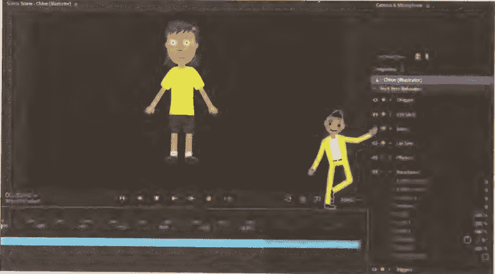

木偶属性

## 录制你的表演

这些都是你可以为角色调整的属性。

现在我们知道所有东西的位置了，让我们开始动画和表演吧：

- 1. 点击红色录制按钮。在录制按钮激活之前你会听到几声蜂鸣：
- 2. 选择 Chloe 的手并拖动它。
- 3. 松开她的手。
- 4. 再次按下录制按钮以停止录制。

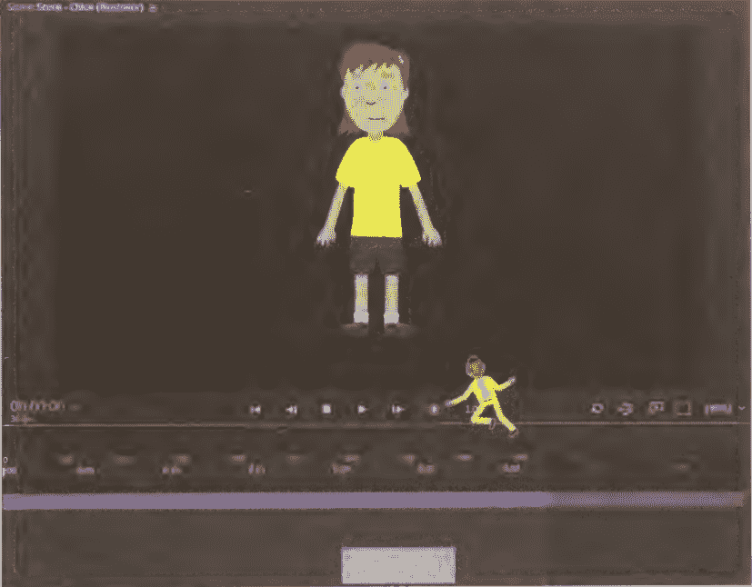

录制按钮

## 调整角色属性

计算机渲染录制可能需要几秒钟。完成后，你将有一个录制图层。在 Character Animator 中这称为 **take**。你可以这样调整你的 **Dragger** 设置：

- 1. 在时间线中选择角色，并在右侧的 **Properties** 中选择。
- 2. 展开 **Dragger** 属性：

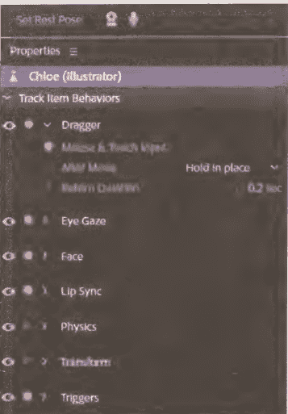

Dragger 属性

在 **After Move** 属性旁边，你可以选择让四肢保持不动或返回静止。让我们选择 **Return to rest**。这将使我们的四肢在移动后返回原始静止姿势：

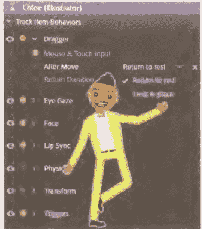

返回静止

你也可以调整 Eye Gaze 来控制眼睛移动的强度或程度：

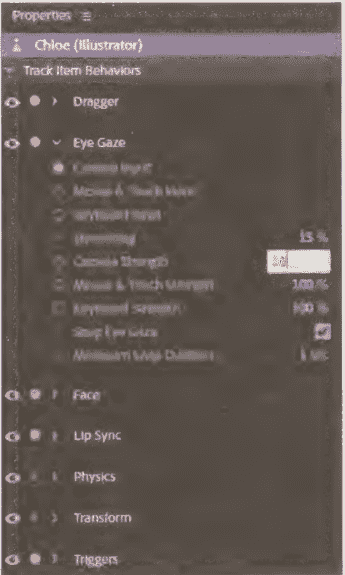

眼睛注视

让我们看看我们的面部控制。这些位于屏幕的最右侧。我们不会在这里介绍所有参数，但你可以将 Eyebrow Strength 改为 40。这将让你控制眉毛的移动。如果需要调整面部上的任何内容，这里就是位置：

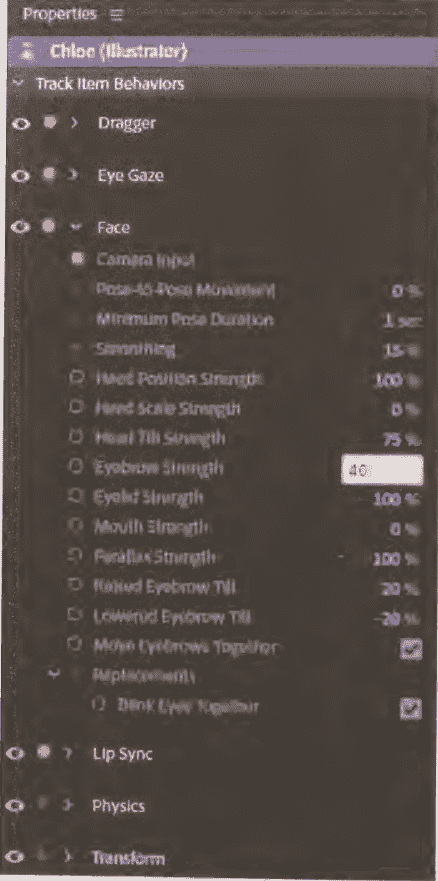

面部控制

我们几乎准备好开始动画了。查看屏幕的右下角——有一个小的摄像机控制图标。点击此图标开始激活你的摄像机。按下录制按钮以激活实时录制：

摄像机控制

如果你左右移动头部，你应该能看到你的木偶在移动。让我们调整她头发的重力：

重力强度

你需要放大时间线，查看面板的底部角落，就在时间线下方。你会看到一个类似于 After Effects 中的图标。点击它以放大时间线：

放大时间线

## 混合 takes

表演完成后，再次按下录制按钮。你将在时间线上看到录制内容。你可以通过滑动来编辑它们，或者你可能想要混合或缓动你的表演。这类似于在 After Effects 中缓动一个动作。这些图层称为 takes，与电影中的表演相似。演员在电影场景中有系列的 takes：

- 1. 选择你的 take 图层的末端。
- 2. 你会看到一个双箭头图标。
- 3. 将此图标向左拖动。你会看到一个斜曲线图标。这意味着你可以混合或平滑你的 take 图层的末端：

混合 take

## 开始录制

接下来，让我们让 Chloe 说话！查看摄像机旁边的图标。这是音频录制按钮：

- 1. 点击音频按钮。
- 2. 点击录制按钮。
- 3. 开始说话。

4. 再次点击录制按钮以停止录制：

打开音频按钮

这将在时间线上添加额外的 **音频** 层。在此处查看时间线中的新图层或镜头：

相机和音频输入图层

现在我们已经创建了一个很酷的动画，让我们播放它来预览我们的作品。按下播放按钮：

播放按钮

## 项目设置

现在你已经知道如何为角色制作动画并录制音频，让我们调整项目设置。以下步骤将向你展示如何操作：

- 1. 选择场景。
- 2. 查看最右侧，你会看到场景信息。
- 3. 调整场景持续时间，使其仅为项目的长度：

调整场景持续时间

接下来，我们将调整帧速率，使其与 After Effects 中的帧速率匹配。将其更改为 29.97 fps：

调整场景持续时间帧速率

## 导出你的动画

现在让我们导出项目。你的项目将以透明背景导出，除非你在背景中放置图像。

以下是在导出项目的步骤：

- 1. 点击 文件。
- 2. 点击 导出。
- 3. 选择 PNG 序列和 WAV...

导出 PNG 序列

## 导入 PNG 序列

我们准备导入 PNG 序列。以下是操作步骤：

- 1. 返回 After Effects。导入 .png 文件。
- 2. 选择以 00 结尾的第一个 .png 文件。
- 3. After Effects 将导入 .png 序列中的所有剩余文件。
- 4. 确保你勾选序列：

### 导入 PNG

你也可以导入在角色动画中录制的任何音频。当你渲染 PNG 序列时，它会随之保存一个 WAV 文件。如果你需要导入音频文件，以下是步骤：

- 1. 进入包含 PNG 序列的文件夹。
- 2. 导航到 PNG 序列的底部。
- 3. 将 WAV 文件导入 After Effects：

导入 WAV

## 将角色添加到信息图表项目

现在我们将把 Chloe 带入主合成，并创建一个向右的摄像机移动。我们将通过动画化我们的空对象来实现这一点。我们需要在时间线的正确部分，并且需要将正确的对象父级链接到空对象。

为了确保我们在时间线的正确位置，请按照以下步骤操作：

- 1. 移动到时间线上最后一段已动画化的文字之后的位置。
- 2. 将 Chloe 图层移动到时间线上，使图层从该点开始。
- 3. 为 Chloe 打开运动模糊。在此处查看所有内容的放置位置：

摄像机平移起始点

我们需要在此时将 Chloe 图层父级链接到空图层。也将文字父级链接到空图层：

将角色父级链接到空对象

要为我们的空对象的定位参数创建保持关键帧，请按照以下步骤操作：

- 1. 导航到时间线的最右侧。
- 2. 找到空对象定位中的菱形图标。
- 3. 点击该菱形：

空白关键帧

让我们动画化向右的移动。选择定位参数并拖动它，使摄像机向右移动：

平移至 Chloe

## 完成你的信息图表

你现在拥有创建动态信息图表视频所需的所有工具。花一些时间添加更多文字来帮助传达你的概念。

## 总结

在本章中，我们学习了如何创建信息图表。这类视频可用于传达信息、解释产品，或作为表达故事的一种方式。你学习了许多技能和工具。你可以创建动态排版并编辑它。你也可以以动态、逼真的方式动画化图标，正如本项目所示。你学到的最大内容是如何为角色制作动画。你学习了三种让角色栩栩如生的不同方法。尝试这些角色动画工具。

我提供了进一步阅读的额外链接。角色动画是你工具箱中一项宝贵的技能。它允许你在项目中添加幽默和情感，并且是吸引观众的一种独特方式！我们还介绍了不同的摄像机移动，例如推入摄像机和从左到右的平移。这些摄像机移动是场景进出过渡的绝佳方式。我们还介绍了使用调整图层来模拟焦点转换。你现在拥有多种角色动画工具。我强烈建议你尝试所有这些角色动画工具。利用这些角色来帮助讲述你的故事！

在下一章中，我们将创建一个电影标题。这将建立在你对文字动画和特效的知识之上。

## 问题

- 1. 跟踪用于什么？
- 2. Illustrator 文件应导入为什么格式？
- 3. 为什么对 Illustrator 图层打开连续栅格化很重要？
- 4. 为什么为关键帧打开缓入缓出很重要？
- 5. 在 Adobe Character Animator 中，如何打开面部跟踪和口型同步录制？
- 6. 如何导出你的 Adobe Character Animator 项目？
- 7. 运动模糊需要在多少个位置打开？

## 进一步阅读

Adobe Character Animator 是一个功能深厚的程序。花一些时间阅读更多关于动画原理以及这个令人惊叹的程序的内容，以及你能用它做什么：

- https://www.adobe.com/products/character-animator.html
- https://www.creativeblog.com/advice/understand-the-12-principles-of-animation

## 5
