## 5 制作电影标题项目

### 使用文字动画

在本章中，我们将学习如何创建电影标题。电影标题显示在电影的开头。这些短序列不仅提供电影的名称，还为影片设定基调。当代电影标题由 Saul Bass 创作。他的电影，如《惊魂记》和《金臂人》，革新了电影标题。他将电影标题提升为一种艺术形式。

在本章中，我们将学习以下内容：

- 如何用令人兴奋的字体营造氛围！
- 为我们的字体提供深度的特殊 3D 特效
- 如何使用跟踪图层添加纹理

## 创建电影标题

想象一下：你坐在电影院里，电影开始；然后你看到屏幕上出现一个戏剧性的标题。这个标题不仅提供电影的名称，还让你进入即将观看的电影的情绪中。任何经验丰富的 After Effects 艺术家都知道如何创建电影标题。在本章中，我们将基于之前课程的工具和技能，如字体设计。但我们也将深入学习新技能，例如使用更多特效和使用 After Effects 灯光。让我们开始吧！

## 设置你的项目

我们要做的第一件事是在 After Effects 中创建一个 1,920 x 1,080 的合成。
让我们通过以下步骤来设置：

- 1. 使此合成长度为五秒。
- 2. 将其命名为 `NIGHT KINGDOM`（或你的电影标题名称）。
- 3. 使其为 `29.97`。
- 4. 创建五个文件夹。将它们命名为 `Precomp`、`Main` 和 `Images`。

现在你已经设置好项目，我们将为合成添加一个纯色背景。通过选择以下截图中显示的选项，使此背景为纯黑色。此背景将位于我们的图层底部：

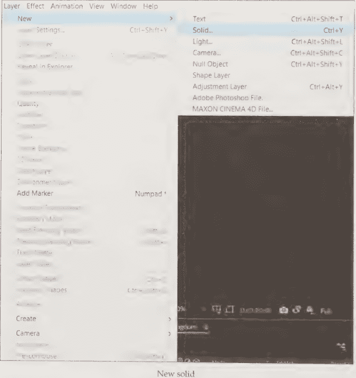

现在我们将通过选择以下截图中显示的选项来创建一个文字图层：

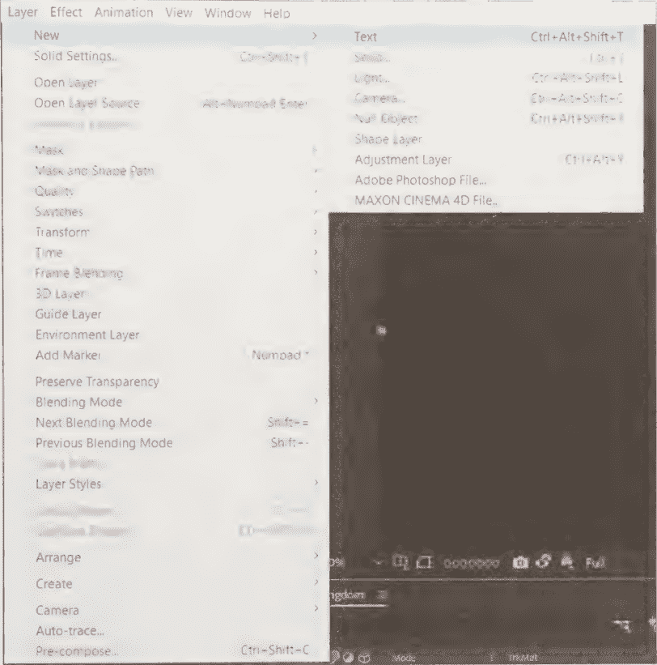

文字图层

当你添加一个文字图层时，它会居中进入你的合成，但完全是空白的。添加文字由你决定。你可以通过以下步骤来完成：

- 1. 在第一行输入 NIGHT
- 2. 在第二行输入 KINGDOM
- 3. 将字体更改为 Constantia 或任何无衬线字体
- 4. 将 KINGDOM 文字行与 NIGHT 文字行建立父级关系

创建标题时，你需要确保文字对齐并符合标题安全指南。查看这些指南的位置。打开标题/动作安全选项，如以下屏幕截图所示。熟悉这些指南，并在 After Effects 中创建任何文字时将它们添加到你的工具库中：

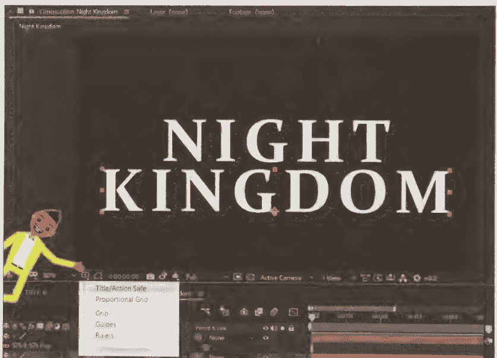

标题安全

调整 NIGHT 文字类型的缩放比例，使整个标题都适合标题安全指南，如以下屏幕截图所示：

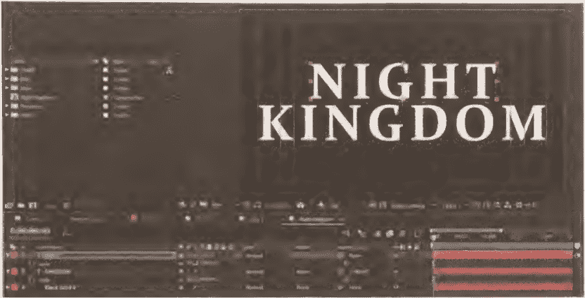

我们为片头序列追求一种风格化的奇幻外观。为了实现这一点，我们将通过以下步骤放大每行第一个字母：

- 1. 选择你的文字工具。
- 2. 选择每行文字的第一个字母。
- 3. 前往字符面板左上角的文字大小参数。
- 4. 将大小参数向上拖动，使你的第一个字母被放大，如以下屏幕截图所示：

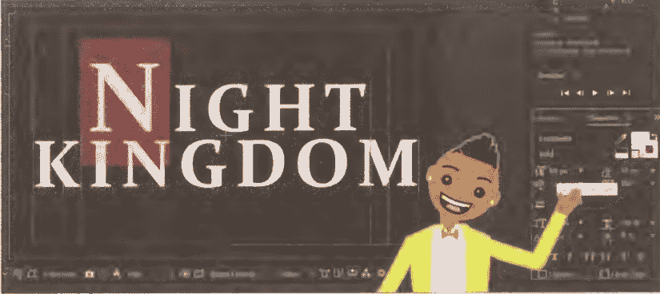

缩放文字

对 KINGDOM 中的 K 重复此过程。

## 使用斜角和浮雕创建 3D 效果文字

我们希望通过为标题创建 3D 效果来进一步美化此文字。让我们使用斜角和浮雕图层样式。图层样式是为图层添加额外功能的好方法。首先，我们需要预合成我们两个文字图层，然后命名此预合成类型。按照以下步骤为文字添加斜角和浮雕样式：

- 1. 进入你的文字预合成。
- 2. 选择 NIGHT 文字图层。
- 3. 转到图层并导航到图层样式。
- 4. 点击斜角和浮雕将其应用到文字上，如以下屏幕截图所示：

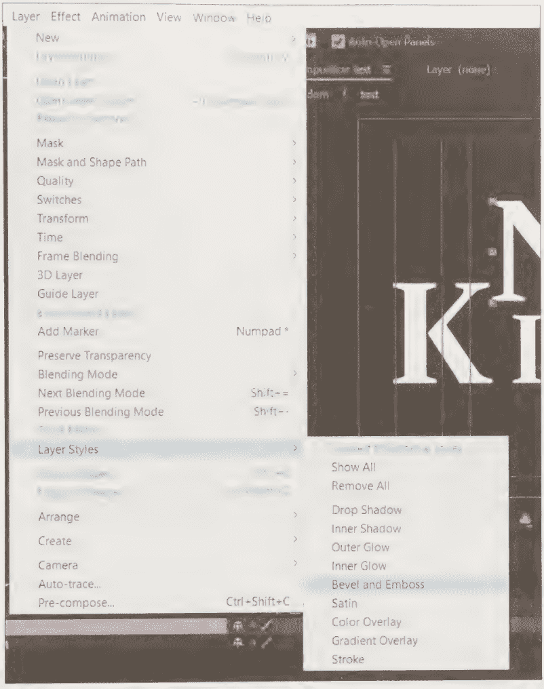

斜角浮雕

接下来，我们将调整斜角设置。要调整设置，只需向下滚动文字设置并显示图层样式。查看以下屏幕截图中的设置并按我所示进行调整。需要做的主要更改是将技术切换为 Chisel Hard，如以下屏幕截图所示：

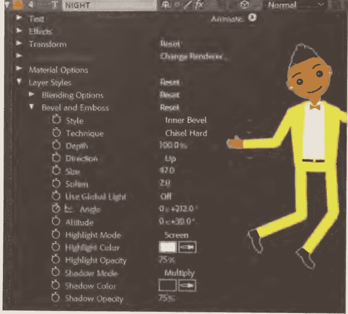

斜角浮雕设置

现在你已配置好浮雕设置，你可以复制图层样式并将其粘贴到你的 KINGDOM 文字上，如以下屏幕截图所示：

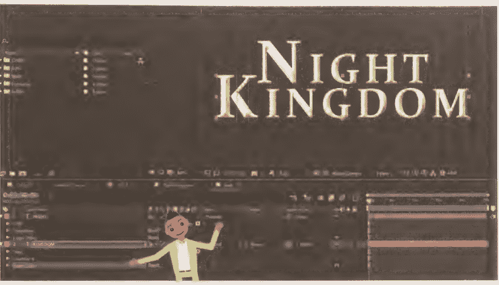

图层样式粘贴

我们希望为文字带来更戏剧化的光照，因此我们将通过以下步骤添加名为 **CC Glass** 的效果：

- 1. 返回你的主标题合成。
- 2. 转到 **效果** 面板。
- 3. 将名为 **CC Glass** 的效果添加到你的文字预合成，如以下屏幕截图所示：

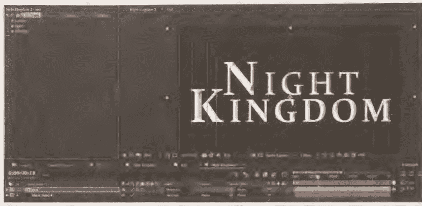

CC Glass

你可能会注意到你的文字类型出现了一些闪亮的光照效果。让我们进行一次小冒险并探索 **CC Glass** 的设置。此效果用于使物体具有闪亮的玻璃般外观。然而，我们将使用它为文字提供光照效果。第一个需要调整的设置是光照设置。我们希望通过以下步骤为场景添加灯光：

- 1. 转到 **图层**。
- 2. 通过 **新建** 选项卡导航。
- 3. 选择 **灯光...**，如以下屏幕截图所示：

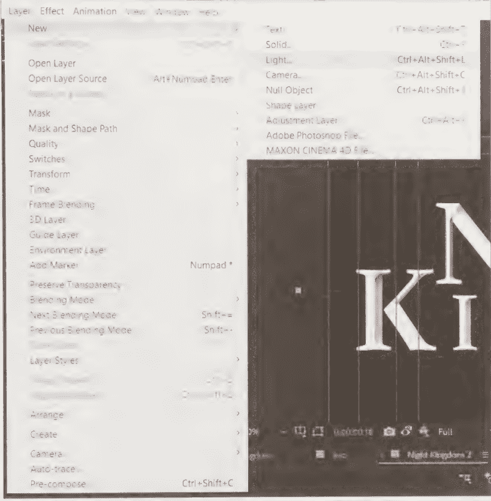

添加灯光

查看这些 **灯光设置**。我们正在创建一种颜色为白色的点光。确保勾选 **投射阴影**，如以下屏幕截图所示：

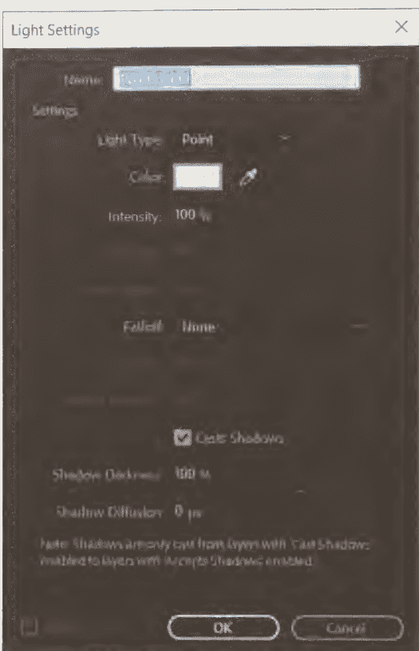

灯光设置

我们将在未来的课程中更详细地介绍灯光。目前，知道这个灯光模拟器是合成中的实际灯光就足够了。物体将像实际灯光一样做出响应。让我们通过以下步骤对灯光进行一些调整：

- 1. 创建一个空对象
- 2. 将你的灯光与其建立父级关系

这将使你能够轻松移动灯光。当你想移动灯光时，只需通过以下步骤移动空对象：

- 1. 选择你的文字预合成。
- 2. 转到 CC Glass 参数。
- 3. 向下滚动灯光设置。
- 4. 选择 使用 | AE 灯光，如以下步骤所示：

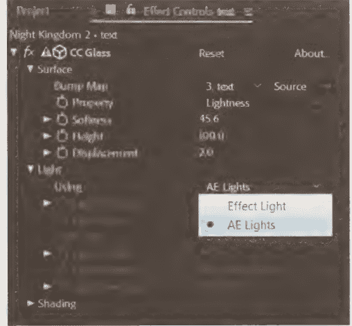

CC Glass 设置

移动你的空对象。你应该会看到灯光随之移动。你做到了——文字上出现了真实的光泽！这有多棒？你已准备好使用 CC Glass 设置来进一步提升你的性感文字！我将把这些设置的微调留给你；我将柔和度设置为 45%——这会使玻璃效果更柔和。如果你愿意，可以复制我的设置；它们都在前面的屏幕截图中。

在这里花几分钟时间调整你的灯光设置。我会提供一张包含我设置的图像，但你可以根据自己的喜好进行更多或更少的调整。你可以通过向下滚动灯光图层并选择灯光选项设置来找到你的灯光设置，如以下屏幕截图所示：

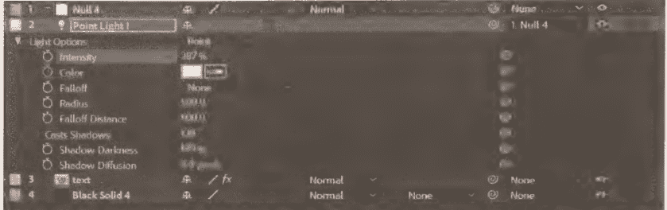

灯光设置

如你所见，我将强度增加到 287。我们稍后可能会更改它，但如你所见，这就是增加光量的方式。

接下来，我们将进一步调整玻璃设置并添加一个色阶效果。色阶在效果中可以找到。双击它将此效果添加到你的文字预合成。我们将调整这些设置以获得文字更清晰的对比度，如以下屏幕截图所示：

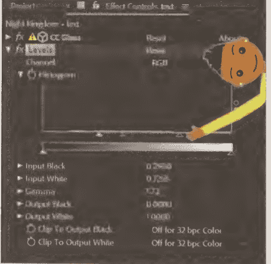

色阶

调整你的 **色阶** 设置（直方图），以便你可以压暗你的黑白部分。这将使你的文字对比度更高。让我们通过以下步骤进行设置：

- 1. 将你的 **CC Glass** 高度设置更改为 40
- 2. 将你的 **CC Glass** 柔和度更改为 25

让我们稍作停顿，回顾一下我们目前所拥有的。我们有一些用灯光很好地照亮的 3D 文字。接下来，我们需要为其增添更多戏剧性和氛围。我们将为灯光设置动画并为场景添加一些氛围烟雾。这是一部奇幻电影，所以我们希望环境看起来和感觉上神秘而超凡。

## 灯光动画

让我们通过为灯光建立父级关系的空对象设置动画来为场景中的灯光设置动画。我们可以通过以下步骤进行设置：

- 1. 选择你的空对象。
- 2. 按 P 显示 **位置**。
- 3. 从时间线的开头开始，并在时间线中动画到 **2** 秒标记，如以下屏幕截图所示。
- 4. 为你的灯光设置动画，使其在文字上方从左向右移动：

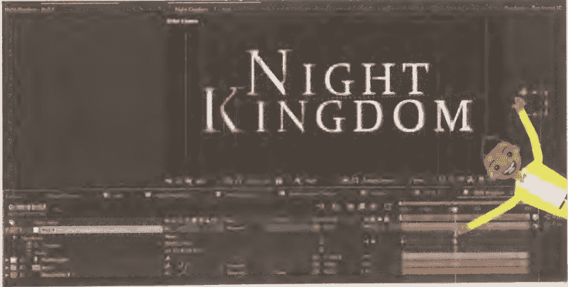

灯光动画

接下来，让我们向下滚动灯光选项以显示灯光的颜色选项。将灯光的颜色更改为浅蓝色，如以下屏幕截图所示：

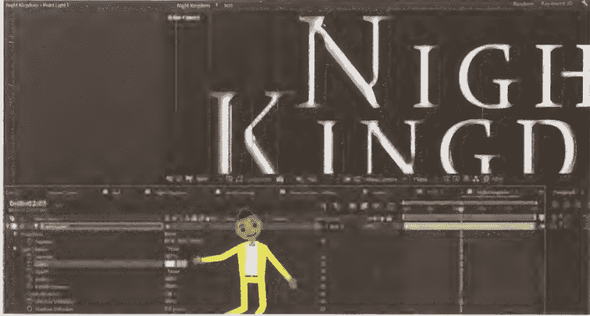

颜色调整

## 使用轨道蒙版

到目前为止看起来不错。让我们通过为其添加一些纹理来改进我们的标题。选择 Grunge 纹理。我们将使用它作为文字的纹理。

进入你的文字预合成并选择两行文字，如以下屏幕截图所示：

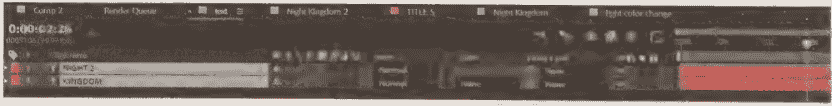

文字选择

接下来，对这些文字图层进行预合成。我们现在可以同时在这两者上添加纹理。找到 **Grunge** 图层，并将 **Grunge** 图像带入包含预合成文字的文字图层中。将 **Grunge** 图层置于文字图层下方，如以下屏幕截图所示：

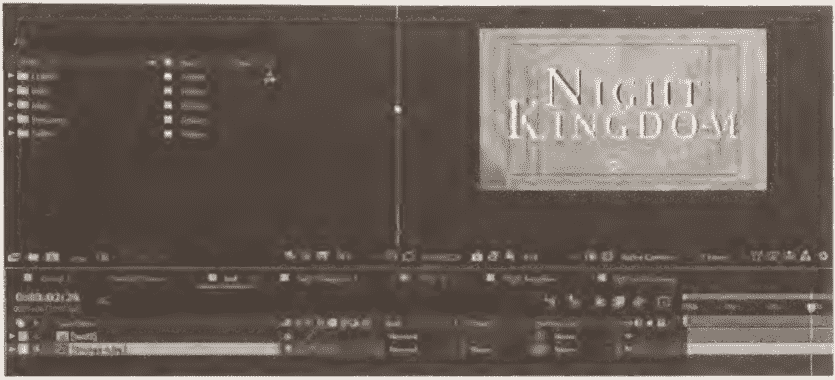

Grunge 图层 1

太好了！现在我们可以为纹理添加跟踪蒙版。跟踪蒙版允许你使用图层或遮罩作为蒙版。程序将使用文字作为纹理的模板。

选择纹理并通过以下步骤选择 **Alpha** 跟踪蒙版：

- 1. 选择你的 Grunge 图层。
- 2. 查看 **Track Matte** 选项卡的右侧。
- 3. 向下滚动 **Track Matte** 选项卡。
- 4. 选择 Alpha Matte "[text2]"，如以下屏幕截图所示：

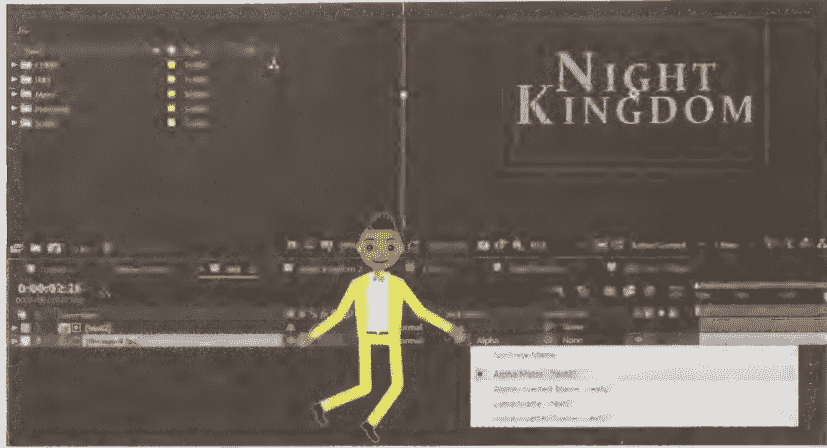

Alpha 跟踪蒙版

跟踪蒙版是一个强大的工具。你可以用你选择的纹理填充任何东西。这使你能够使用各种图像并创建有趣的逼真物体。我鼓励你深入使用跟踪蒙版。尝试并享受所有可能性。

但出现了一个问题：我们失去了 3D 效果。当你向图层添加跟踪蒙版时，它会用该图像填充你的图层，使文字变平。这里有一个简单的解决方案：

- 1. 复制你的文字图层。
- 2. 确保它已打开。
- 3. 在右侧，你会找到混合模式。
- 4. 选择 Overlay，如以下屏幕截图所示：

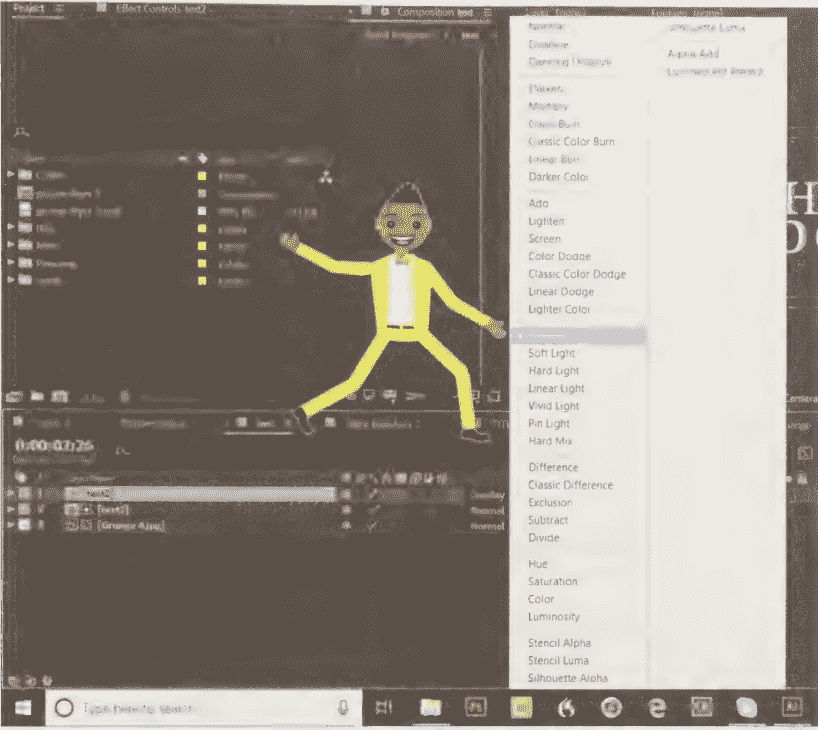

Overlay 混合模式

混合模式是一组很有用的工具。混合模式就像 Photoshop 模式，你可以确定图层如何相互混合。现在你已启用叠加混合模式，你可以看到文字图层正在将其实视属性叠加到 Grunge 图层之上。

如果你和我一样，你喜欢调整设置直到它们完美无缺。让我们调整我们的级别，以确保大部分纹理在文字上显示出来，如以下屏幕截图所示：

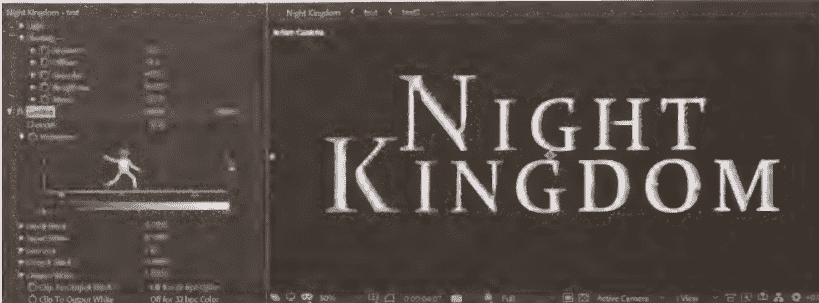

级别调整

看起来不错！让我们通过以下步骤为标题添加一些氛围：

- 1. 添加一个调整图层
- 2. 向调整图层添加 Fog Lights 效果
- 3. 将你的调整图层命名为 Fog light

这是一个很棒的效果，无需进一步调整即可使用。它会给你一个带有动画的雾状背景。如果你查看 fog-light 图层，你会注意到此效果自带关键帧。你可以自由移动这些关键帧以使雾移动得更快或更慢，如以下屏幕截图所示：

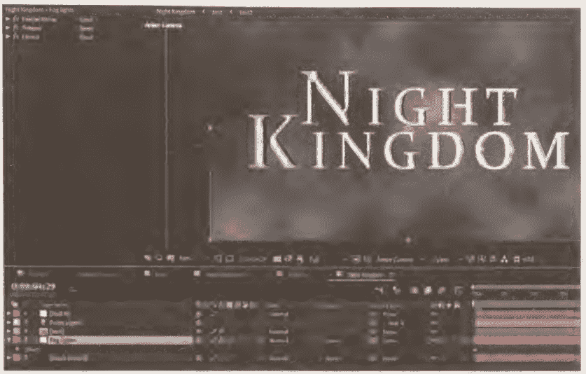

Fog lights 效果

让我们通过以下步骤为背景添加一些额外的颜色：

- 1. 选择 **Fog lights** 图层。
- 2. 添加 **Hue/Saturation** 效果。
- 3. 在 **Hue/Saturation** 效果面板中勾选 **Color** 选项。
- 4. 调整色相直到颜色变为蓝色。
- 5. 调整亮度使背景稍微变暗，如以下屏幕截图所示：

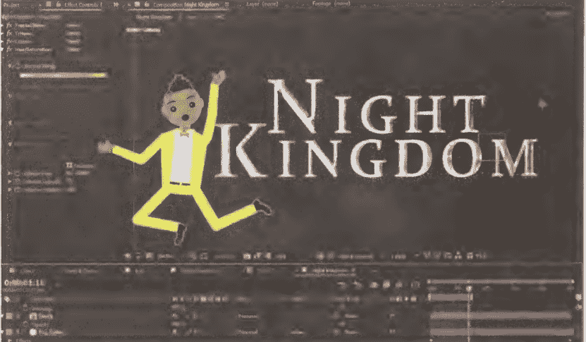

Hue/Saturation

## 镜头光晕

当我们将讨论转向镜头光晕时，必须知道它本身就是一种艺术形式。通过此功能，你可以创建独特的效果，必定能唤起项目所需的戏剧性。让我们通过以下步骤创建一个自定义镜头光晕效果：

- 1. 我们将为镜头光晕创建一个新的合成。
- 2. 创建一个 500 x 500 的新合成。
- 3. 将其命名为 flare，如以下屏幕截图所示：

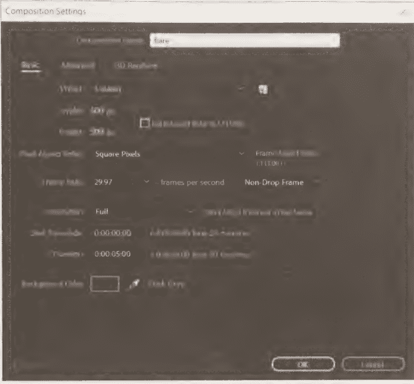

新合成

- 4. 创建一个调整图层。
- 5. 创建一个新的黑色纯色。
- 6. 向调整图层添加镜头光晕效果，如以下屏幕截图所示：

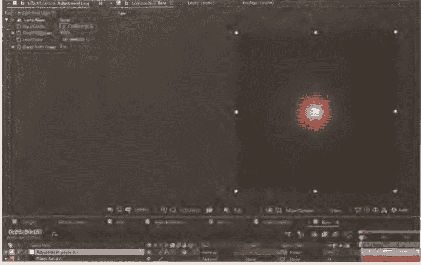

光晕

- 7. 接下来，让我们为光晕添加遮罩。
- 8. 选择椭圆遮罩工具并在光晕周围添加遮罩。
- 9. 为你的光晕添加遮罩。
- 10. 羽化你的遮罩，如以下屏幕截图所示：

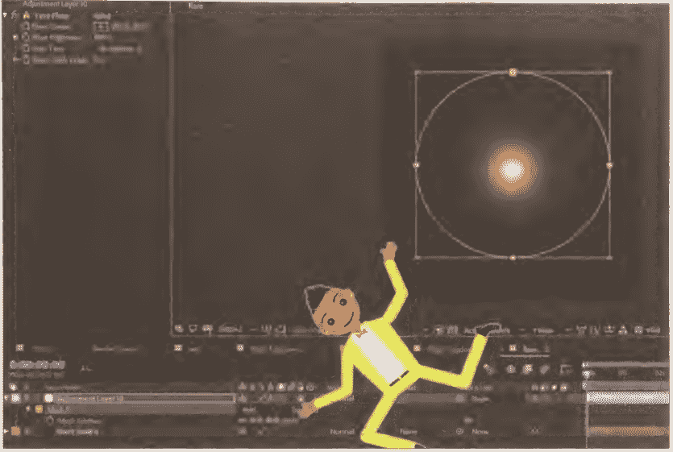

遮罩和羽化

- 11. 现在将此光晕预合成带入我们的标题合成。
- 12. 将混合模式切换为 **Add**。
- 13. 添加 **Hue/Saturation** 效果。
- 14. 勾选颜色框。
- 15. 将颜色调整为黄色。
- 16. 缩小此光晕，如以下屏幕截图所示：

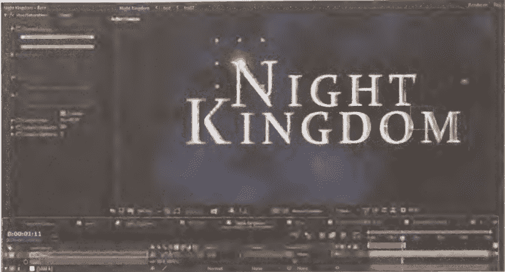

Hue/Saturation

你在这里做得很好。让我们为灯光制作不透明度动画。确保你的光晕没有方形边框；在预合成中羽化你的遮罩以实现这一点。最后一步是渲染标题。这是一个五秒的电影，所以为此项目制作的合成仅渲染五秒长度。

## 摘要

标题设计是你作为运动设计师所必需的核心技能。对于本项目，我们将之前学到的关于字体设计的知识付诸实践，并学习了 3D 浮雕效果。我们还学习了如何使用跟踪蒙版处理纹理。你应该掌握它并继续练习跟踪蒙版。这将在你作为运动图形动画师的成长中给你极大的帮助。我们还学习了如何创建镜头光晕效果并开始使用灯光。

在下一章，我们将处理体育图形。我们将使用更多与文本相关的技能，学习运动跟踪等等。

## 问题

- 1. 什么是跟踪蒙版？
- 2. 如何添加灯光？
- 3. 什么是浮雕效果？
- 4. 什么是色相/饱和度效果？
- 5. 什么是镜头光晕？
- 6. 什么是级别？
- 7. 什么是标题安全区？

## 延伸阅读

查看 Saul Bass 的这些革命性电影标题：

- https://www.imdb.com/title/tt0048347/
- https://www.imdb.com/title/tt0054215/
- http://www.artofthetitle.com/designer/saul-bass/
