## 6 使用合成效果制作运动图形动画

体育运动图形捕捉了竞技体育的力量和兴奋感。它们充满能量，让你的心跳加速。在本章中，我们将创建一个体育图形包，利用动态标志和效果。我们还将通过以令人信服的方式组合视频素材和图像来掌握合成。作为运动图形艺术家，知道如何合成场景并从随机的视频和图像源创建逼真的图形至关重要。我们将在本章中使用强大的相机跟踪效果。相机跟踪是一种跟踪视频图层然后使用该数据在场景中合成文字、标志、视频和图像的方法。

我们将在项目中使用镜头光晕和其他效果作为转场元素。到本章结束时，你将清楚地了解合成、跟踪和效果，以创建动态逼真的项目。

本章将涵盖以下主题：

- 合成
- 相机跟踪
- 创意转场
- 视频色彩校正

## 创建体育运动图形

体育图形是动态的、令人兴奋的，而且经常具有信息性。它们非常适合运动图形。我们将学习如何创建自定义镜头光晕以及如何使用跟踪来创建逼真的合成。

## 设置你的项目

我们的第一个场景将涉及一个动画标志。我们将以戏剧性和有趣的方式引入一个足球队的标志。你可以使用自己的标志，也可以使用本章技术要求部分提供的标志设计。所以，让我们通过完成以下任务开始设置：

- 1. 创建一个分辨率为 1920 x 1080 的合成。将其命名为 Sports Graphic。
- 2. 为我们的背景创建一个纯色形状并命名此背景。
- 3. 选择背景图层并为其添加填充效果。
- 4. 使用填充效果将背景图层更改为深蓝黑色。
- 5. 将分辨率更改为四分之一。

现在一切就绪，让我们为我们的体育动画项目创建一个环境。

## 创建环境

环境可以是场景的室内或室外设置。好的环境可以帮助整个场景焕发生机。让我们为我们的体育标志创建一个。效果将描绘我们环境中的地板。环境中的地板将提供一个表面，我们将在其上添加标志的漂亮反射。使用以下屏幕截图作为参考，并按照以下步骤操作：

- 1. 创建一个黑色纯色图层。
- 2. 将图层命名为 floor blur。
- 3. 将此图层移动到时间线的顶部。
- 4. 为地板的下部区域遮罩一个窄矩形形状。
- 5. 将遮罩羽化为 160 使得边缘模糊：

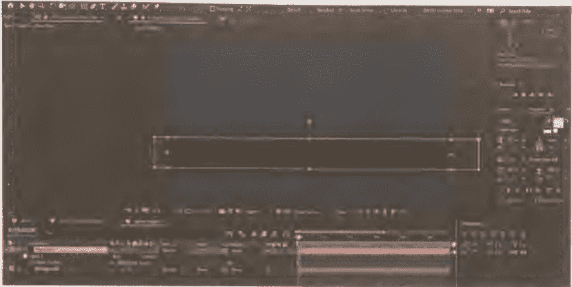

一个环境

这是创建环境地板的第一个步骤。接下来，我们将为闪光效果添加一些光线。

## 使用自定义光效

虽然 After Effects 自带镜头光晕效果，但我们将为项目创建一些自定义光效。能够创建自己的光效将成为你在创建动态[content]

一个环境

这是创建环境地板的第一个步骤。接下来，我们将为闪光效果添加一些光线。

## 使用自定义光效

虽然 After Effects 自带镜头光晕效果，但我们将为项目创建一些自定义光效。能够创建自己的光效将成为你在创建动态运动图形工具箱中的一大优势。

让我们为项目创建一个自定义光效：

- 1. 创建一个尺寸为 400 x 400 的合成。
- 2. 将其命名为 Light 1。
- 3. 向此合成添加一个 **Solid** 图层。
- 4. 添加一个 **Lens Flare** 效果并使其变小。
- 5. 将此光晕居中。
- 6. 添加 **Hue/Saturation** 效果。
- 7. 选择 **Colorize**。将颜色设为淡蓝色。
- 8. 向此图层添加 Fast Blur（旧版）效果。
- 9. 在光晕周围绘制一个圆形蒙版，然后羽化此蒙版：

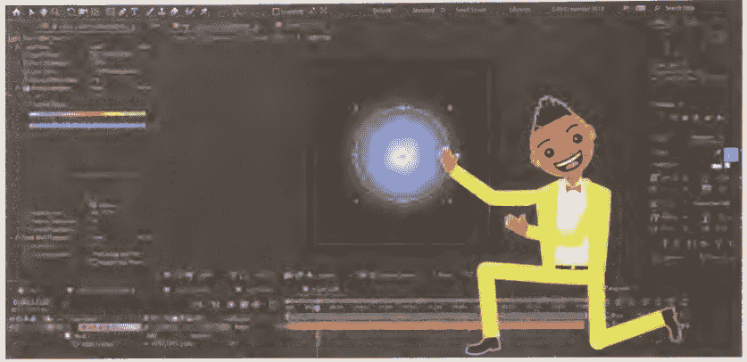

一个自定义光效

完成上述步骤后，你的光效应看起来像上一张截图。接下来，我们将在主项目中合成并为我们的灯光做动画。

## 动画闪烁灯光

现在，我们将把灯光带入体育图形主合成，并为这些灯光做动画，使其亮起。这些灯光应快速地亮起和熄灭，就像物理灯光闪烁一样。以下步骤将演示如何操作。

这些灯光需要被合成到我们的场景中。为灯光做动画的步骤与我们之前的项目类似：

- 1. 将灯光合成导入 Sports Graphic 合成。
- 2. 打开灯光合成的 Add 模式。
- 3. 为五个关键帧动画化 Rotation、Opacity 和 Scale 属性。
- 4. 对所有关键帧进行 Easy Ease：

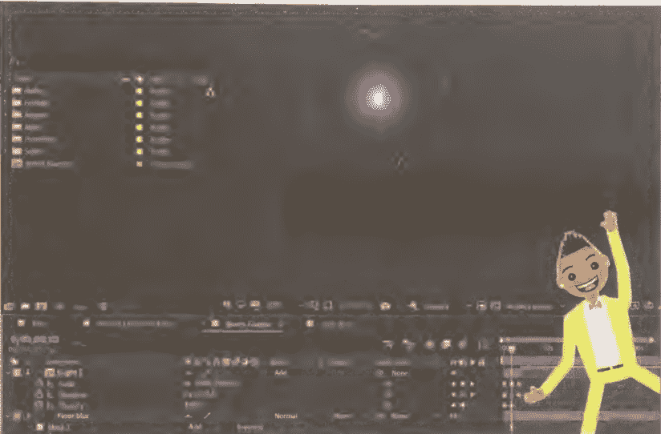

动画灯光

- 5. 裁剪你的 Light 预合成。
- 6. 复制预合成，并保留你创建的所有动画关键帧。
- 7. 在整个五秒介绍序列中，让灯光在不同时间闪烁亮起和熄灭：

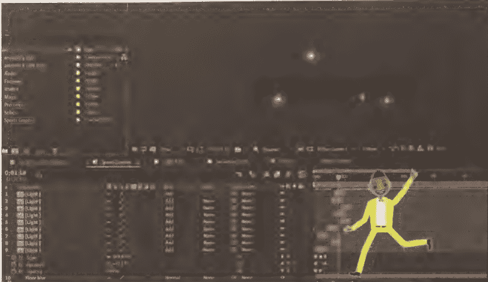

复制灯光

现在，你可以根据上一张截图所示在时间线上分布灯光。在下一节中，我们将为体育标志做动画。

## 动画你的体育标志

体育标志需要大幅移动并散发出大量能量。想象你在观看比赛。你焦急地等待你的队伍出场。当你终于看到队伍的标志时，你会感到兴奋。你希望你的标志动画能将这种能量传达给观众。

以下步骤的总体目标是以动态的方式在屏幕上为标志做动画。标志将在开始时快速在屏幕上动画，并在末尾减速：

- 1. 导入你的标志。
- 2. 将标志带入体育图形合成。
- 3. 在图层的右侧，你会找到一个连续栅格化按钮。打开它。
- 4. 放大你的标志，使其占据整个屏幕。点击 Scale 秒表以创建关键帧。
- 5. 添加 Fast Box Blur 效果。
- 6. 点击模糊半径的秒表。
- 7. 将半径调高到 80。
- 8. 勾选重复边缘。
- 9. 在介绍的第一帧使标志模糊：

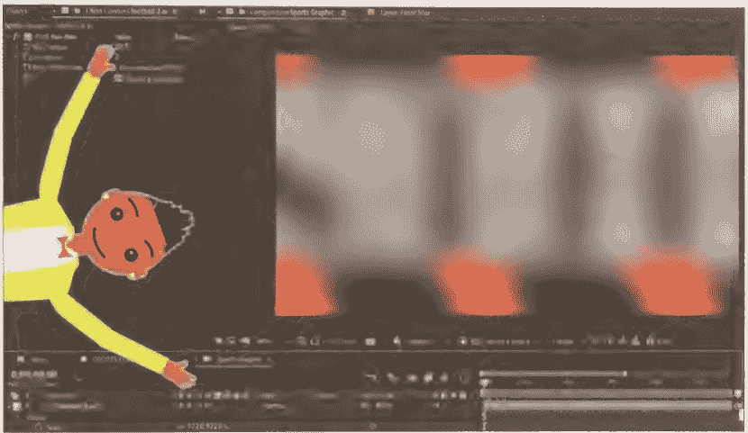

Fast box blur 和连续栅格化

下一步是将标志动画化回正常大小。我们还需要将模糊效果动画化回零。我们希望标志具有猛烈冲入场景的效果。

按照以下步骤进一步合成并为你的标志效果做动画：

- 1. 添加发光效果。将半径秒表设为 0 的关键帧。
- 2. 向下移动五个关键帧。
- 3. 将关键帧半径秒表设为 140。
- 4. 再向下移动五个关键帧并将半径减小到 0。
- 5. 返回合成的开头。
- 6. 将时间线向下移动到第 30 个关键帧。
- 7. 减小标志的缩放参数。
- 8. 将标志定位在黑色背景线上。
- 9. 将模糊减小到 0。
- 10. 为标志打开运动模糊。

干得好！这些步骤将通过使用发光和模糊效果使我们的标志看起来像在真实环境中。令人兴奋的是，这些都是完全可编辑的，你可以调整效果直到感觉真实。让我们继续推进项目，通过创建标志反射效果来继续。

## 添加反射

我们需要为我们想要合成的内容添加可信的元素。在这种情况下，是我们的标志。我们希望标志看起来属于场景。我们将通过为场景创建反射来实现这一点。

让我们通过以下步骤创建反射：

- 1. 复制并重命名标志为 Reflect logo。
- 2. 要反射你的标志图层，请转到 Transform 并选择垂直翻转。
- 3. 删除 Logo 图层上的所有关键帧。
- 4. 转到 Logo 缩放的最后一个关键帧。
- 5. 将 Reflect logo 定位使其触及标志底部。
- 6. 将 Reflect logo 设为 Logo 的父级。
- 7. 向反射标志图层添加 Fast Box Blur 效果，半径为 5。
- 8. 将 Reflect logo 不透明度调低到 10。
- 9. 对 Logo 缩放关键帧进行 Easy Ease：

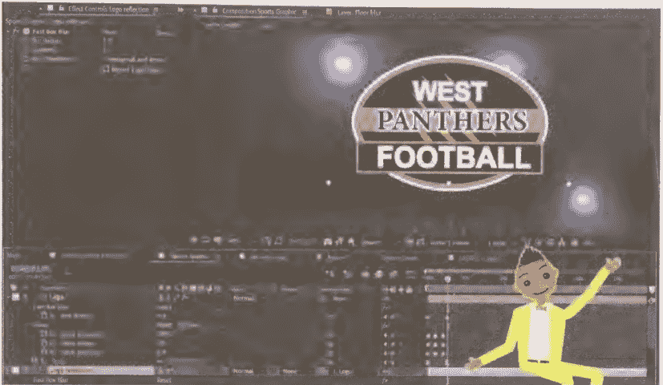

缓动的关键帧

正如你所见，缩放关键帧已进行缓动。这将使关键帧移动更加平滑。

## 创建摄像机运动

摄像机运动对于吸引观众眼球至关重要。你希望场景始终有一些运动。这在运动图形中非常重要，因为我们需要让观众保持娱乐。

我们将创建连续的、细微的摄像机运动。请按照以下步骤操作：

- 1. 将标志设为 **Null** 对象的父级。
- 2. 在合成中转到 4 秒处。
- 3. 选择 **Null** 对象。
- 4. 为缩放参数添加一个关键帧。
- 5. 返回合成的开头。
- 6. 将 **Null** 对象的缩放增加到 `150`。
- 7. 对 **Null** 对象关键帧添加 Easy Ease
- 8. 在四秒内复制并重新定位灯光合成，使灯光全程闪烁。

我希望你喜欢创建这个空摄像机移动。任何经验丰富的 After Effects 艺术家都知道如何使用这种技术进行快速摄像机移动。在下一节中，我们将为项目创建灯光闪烁效果。到本项目结束时，你将成为创建和动画灯光形状的专家。

## 创建另一种灯光形状

让我们通过创建一个新的灯光形状来为标志动画添加其他视觉趣味。我们将这个合成称为 `Light Glint`。我们将通过重用第一个灯光来创建它，但会添加更多细节。

多种照明效果将有助于为镜头增添视觉趣味。步骤与我们之前的自定义灯光类似：

- 1. 复制 `Light` 合成。
- 2. 将其重命名为 `Light Glint`。
- 3. 将 Hue/Saturation 调整为近乎白色的着色色调。添加 **Solid**。
- 4. 以尖锐的破折号形状遮罩 **Solid**。
- 5. 羽化此蒙版。
- 6. 打开添加混合模式。
- 7. 复制蒙版形状。
- 8. 如以下截图所示调整这些蒙版。
- 9. 将此 **Light Glint** 动画带入 **Sports Graphic** 合成。
- 10. 打开添加混合模式：

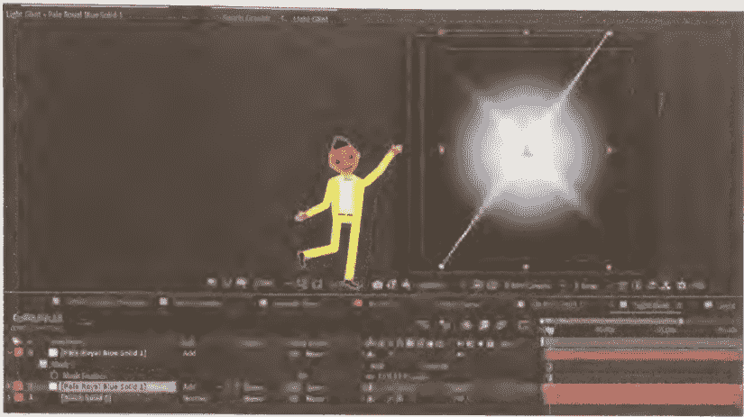

一个灯光闪烁

请确保使用添加混合模式合成你的灯光效果。我们将在下一节中为此灯光做动画。

## 动画灯光闪烁

现在我们有了新的灯光，让我们沿着标志边缘为其做动画。我们将在标志稳定到其位置时进行动画。

慢慢进行以下步骤，以创建逼真的灯光效果：

- 1. 将 Light Glint 动画定位在标志边缘。
- 2. 缩小灯光，使其看起来像一个小点缀。
- 3. 将此 Light Glint 动画设为标志图层的父级。
- 4. 在标志边缘对该闪烁的 Opacity 和 Position 进行动画。
- 5. 使用顶点工具（位于钢笔工具旁边）调整运动路径。

- 6. 灯光应淡出并沿着标志移动：

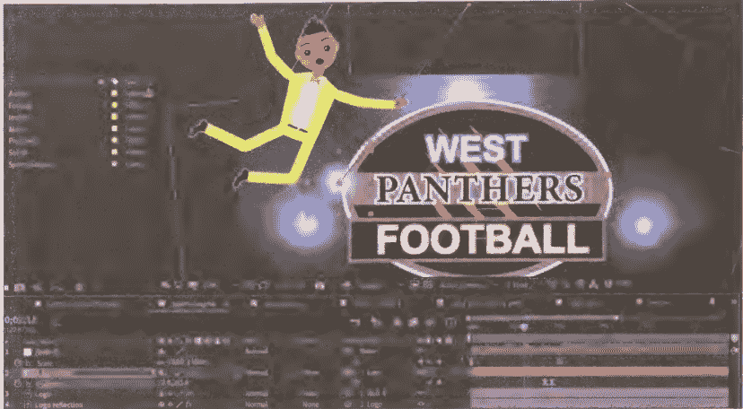

运动路径

## 为合成添加渐晕

现在我们的动画已经完成，我们需要在合成中添加一个微妙的渐晕。这将有助于合成我们的场景并为视频营造戏剧性的灯光效果。

渐晕有助于让一切看起来都属于同一个场景。你基本上是在遮罩一个形状并对其进行羽化：

- 1. 添加一个黑色纯色。
- 2. 将其命名为渐晕。
- 3. 在遮罩中心添加一个大圆形遮罩。
- 4. 在遮罩选项下，选择减去。
- 5. 为遮罩添加 200 像素的羽化。
- 6. 将渐晕不透明度降低到 50%：

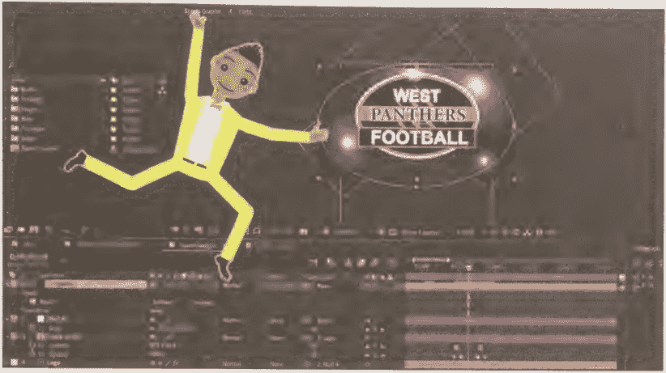

渐晕

现在，你的场景应该看起来很精致且协调！

## 相机跟踪视频

相机跟踪是一个过程，涉及拍摄视频并跟踪其运动，以便可以向其添加 3D 元素。该过程用于电影和电视节目中添加特效和 3D 元素。了解如何在 After Effects 中跟踪素材非常重要。掌握此工具可以让你创建逼真的视觉效果。

使用以下步骤，我们将把体育标志附加到一面栅栏的视频上。此镜头的目标是让标志看起来像是属于场景的一部分：

- 1. 将视频导入 After Effects。
- 2. 在项目窗口中选择一个视频。
- 3. 右键单击视频并选择“从选择新建合成”。
- 4. 将合成重命名为 Camera Track。
- 5. 进入此合成。
- 6. 将视频修剪到大约 40 帧。

修剪视频很重要，这样你就不会跟踪不必要的帧。添加此效果后，如果看不到跟踪点，请按照以下步骤操作：

- 1. 展开效果图层。
- 2. 选择 3D 相机跟踪器以查看跟踪点。
- 3. 要查看目标，你需要将鼠标悬停在相机跟踪器创建的点上。
- 4. 为了看到目标，你可能需要在相机跟踪器中增加目标大小：

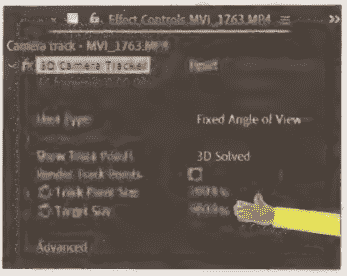

目标大小

- 5. 转到合成的开头。
- 6. 在效果下，输入 `3d camera tracker`。
- 7. 在视频图层被选中的情况下，双击效果以添加它。
- 8. 等待素材分析完成。
- 9. 查看相机效果下方。你可能需要调高目标大小。我将其调高到 500。
- 10. 找到一个朝前的良好目标，右键单击。

- 11. 选择创建纯色和摄像机：

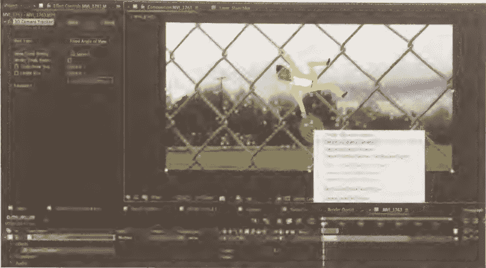

创建纯色和摄像机

这将在你的合成中创建一个 3D 相机。它还将为该 3D 空间创建一个纯色。我们将在未来的课程中介绍更多 3D 工具。对于本项目，我们想用我们的体育标志替换我们的纯色。我们必须将标志带入此合成并将其父级设为跟踪纯色。为了使此标志成为 3D，我们必须打开 3D 立方体按钮。3D 按钮在以下屏幕截图中标示：

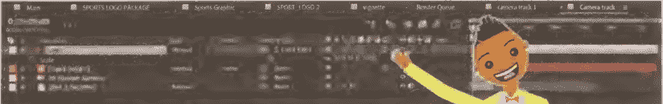

3D 按钮

当你将图层设为 3D 图层时，图层本身保持平坦，但它获得了允许图层在 3D 空间中移动的额外属性。注意彩色箭头。

## 在跟踪素材中合成标志

你的标志看起来可能消失了。不要害怕！只需将标志的缩放比例调大到荒谬的程度以便可以看到它。现在此图层是 3D 的，你可以在第三维度中移动它。你可能需要调整标志的旋转，使其与栅栏的透视相同：

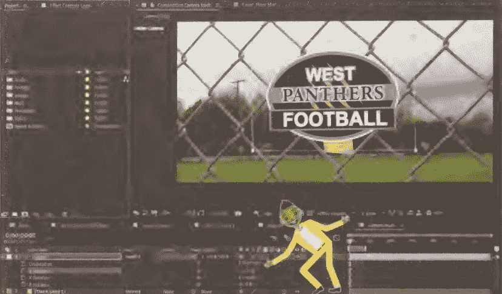

调整标志旋转

现在你的标志已正确调整，你可以关闭纯色图层。让我们创建一个预览，以便我们可以看到我们辛苦付出的成果！

## 将一切整合起来

我们花费了大量时间创建两个场景，现在我们需要在一个动态剪辑中将它们组合起来！After Effects 可用于将镜头编辑在一起，并为场景之间创建创意转场。让我们将所有场景合成在一起并添加一些最后的润色。这些元素将使我们的场景合成看起来令人信服。请按照以下步骤操作：

- 1. 从 Sports Graphic 合成中复制渐晕。
- 2. 将其粘贴到 Camera track 合成中。
- 3. 添加一个调整图层。

- 4. 向调整图层添加自动色阶效果。按需调整。
- 5. 添加一个纯色图层。
- 6. 向黑色纯色添加镜头光晕效果。
- 7. 打开添加混合模式。

添加镜头光晕后，你需要调整光晕中心点。找到光源所在的位置并调整中心，如以下屏幕截图所示：

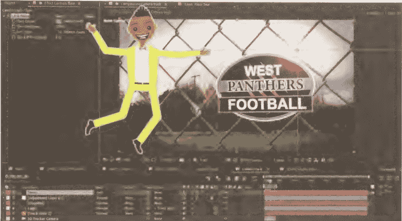

调整镜头光晕

现在，我们将把两个合成带入一个新的合成，并将其命名为 Sports Graphic main。我们需要创建一个转场元素在两个场景之间移动。让我们重用第一个合成中的一个闪光灯。只需将该预合成复制并粘贴到 Sports Graphic main 合成中。

让我们使用镜头光晕通过以下步骤在我们的合成之间创建动态转场：

- 1. 在你结束该合成的位置恰好修剪你的 Sports Graphic 合成。
- 2. 将 Camera track 合成放在 Sports Graphic 合成下方。
- 3. 将 Camera track 镜头向左移动一帧。你的合成应略有重叠。

- 4. 删除灯光合成中的所有关键帧。
- 5. 将灯光合成置于两个合成之上。
- 6. 将灯光合成在时间线上移动到两个图层之间，如以下屏幕截图所示。
- 7. 仅将灯光的缩放从 0 动画到 5000，然后再回到 0。
- 8. 你的最后一个关键帧需要在第二个合成开始之后，如以下屏幕截图所示。

以这种方式动画灯光将作为两个场景之间的闪光。这应该隐藏一个合成结束和下一个合成开始的位置。以下屏幕截图演示了最终图形的外观：

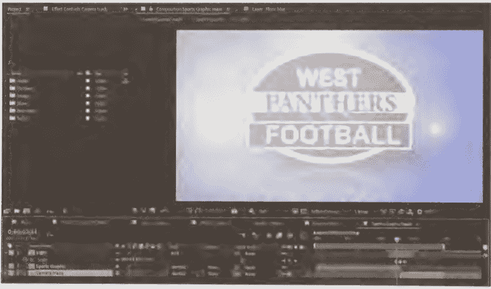

转场

独特的转场效果在创建项目时很重要。这些效果可以很简单但视觉上令人印象深刻，并且可以在不同的视频项目中以有趣的方式使用。

## 总结

恭喜！你已经创建了一个很棒的体育图形项目！我们学习了如何创建动态合成视频项目。了解如何跟踪视频素材、应用色彩校正和应用灯光效果将帮助你创建令人信服、专业质量的项目。这些工具用于电影、电视和音乐视频。只要你在电影中看到 3D 元素，它就使用 3D 跟踪软件。传统上，此过程使用昂贵的相机跟踪器完成。但现在，After Effects 拥有自己的相机跟踪器，而你已经知道如何使用它！现在，你可以在 After Effects 中跟踪镜头并向其添加 3D 元素。多酷啊！电影级效果触手可及！本章为我们下一课关于结合视觉效果、实拍素材和 3D 相机跟踪奠定了基调。在下一章加入我们，我们将继续使用效果，并学习相机跟踪。

## 问题

- 1. 我们用于灯光效果的效果名称是什么？
- 2. 本项目中使用的色彩校正效果名称是什么？
- 3. 当视频场景在创意上从一个场景移动到下一个场景时，它叫什么？
- 4. 我们用于将灯光合成到场景中的混合模式是什么？
- 5. 用于跟踪素材的效果是什么？
- 6. 跟踪素材后，素材上的彩色 x 标记是什么？
- 7. 跟踪后我们寻找的红色圆盘是什么？
- 8. 如何使图层变为 3D？
