## 8

## 8 创建 2.5D 环境相机飞越

在本章中，我们将学习如何在 After Effects 中使用 3D 工具。我们将通过在 3D 环境中创建相机飞越，继续在前几章中仅涉及的概念上进行构建！After Effects 中的 3D 工具并非真正的 3D 工具——它们实际上是 2.5D。使用这些工具可以让我们访问其他维度，从而可以沿 Z 轴移动物体。这听起来可能很简单，但实际上解锁了使用真实相机和与合成中图层交互的光线的能力。这意味着除非使用 3D 程序，否则我们无法获得完整的 3D 功能，我们将在下一章中介绍这一点。对于本项目，我们将使用 Illustrator 中的所有素材。Illustrator 中的 artwork 基于矢量，可以在不损失质量的情况下缩放。当我们放大并飞越场景时，这一点很重要。

本章将涵盖以下主题：

- 3D 相机
- 3D 灯光
- 使用不同视图
- 动画化 3D 相机
- 使用图表编辑器

### 2.5D 相机飞越

3D 相机和 3D 图层可用于创建动态逼真的图形。理解这些工具将帮助你创建可在电视纪录片或任何需要将照片或插图栩栩如生的媒体中使用的图形。对于本项目，我们将在三个不同环境中创建相机飞越。重要的是你知道如何控制相机并在 3D 空间中设置图层。After Effects 没有真正的 3D 空间；相反，我们使用一种称为 2.5D 的技术。这样，你可以在场景中获得真正的 Z 轴深度，但没有旋转深度。对于本项目，我们将把相机移动限制在 Z 轴。

### 3D 图层

在动态图形中，了解如何使用 2D 图层和 3D 图层，以及如何动画化 3D 相机和 3D 灯光非常重要。3D 动画图层和视差相机运动的多功能性用于电影标题、视频、广告和动画 GIF 的制作，以及纪录片和电视节目。了解如何在 3D 空间中控制图层，使其在 3D 环境中正确间隔也很重要。花点时间观看具有有趣相机运动和灯光的电影。相机运动和灯光如何向观众传达信息？这些灯光和相机运动有趣的原因是什么？作为动态图形设计师，你如何将这些技术融入你的工作中？

任何 After Effects 图层都可以放置在 3D 空间中。一旦启用 3D 图层开关，图层就变为 3D。让我们创建一个蓝色和绿色图层并启用 3D 开关。3D 开关是以下屏幕截图中显示的立方体图标：

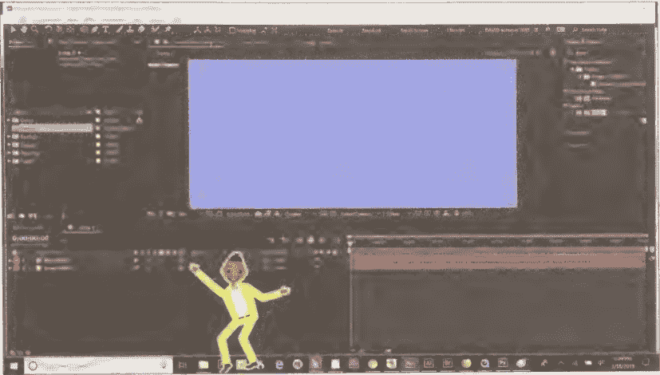

3D 纯色图层

现在我们已经创建了 3D 图层，可以准备向场景中添加相机了。为了真正看到我们的 3D 图层，我们需要从不同视角查看场景。我们需要激活选择视图布局来查看这些视图：正面、左侧、顶部、背面、右侧或底部。这些视图对于在 3D 场景中放置和预览元素非常有用。3D 图层会出现在工作 3D 视图中；2D 图层不会出现在工作 3D 视图中。接下来我们将通过以下步骤打开双视图选项：

- 1. 查看合成面板的右下角。
- 2. 查看活动相机标签旁；点击 1 View 旁边的箭头。查看以下屏幕截图。这就是你的视图所在位置：

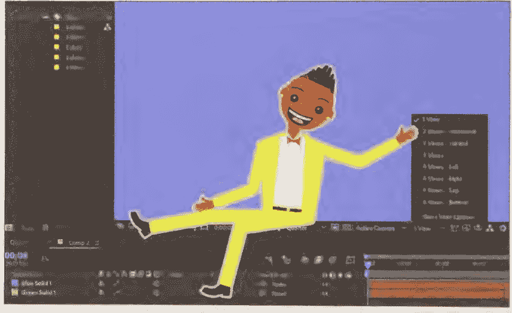

如你所见，你有不同的 3D 视图选项。我们使用的是 2 Views - Horizontal。让我们看看图层在这些不同视图中的外观。选择你的图层，你会看到它们具有 3D 控件，如以下屏幕截图所示：

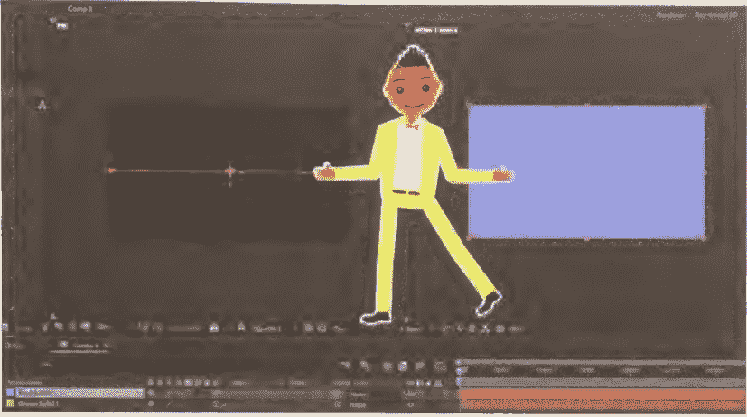

## 3D 层

我们在这里查看的两个视图是顶视图和活动相机。你点击的任何面板都会显示“查看器”标签。你还会看到面板角落里的蓝色三角形。这表示该视图处于活动状态。当你将图层设为 3D 时，图层本身仍然是平面的，但它会获得额外的属性，例如 Position (z)、Anchor Point (z)、Scale (z)、Orientation、X Rotation、Y Rotation、Z Rotation 和 Material Options。这些位置属性由箭头表示。抓住其中一个箭头并在 3D 空间中移动你的图层。

## 3D 相机

我希望你喜欢在 3D 空间中移动图层并在多个视图中查看场景。然而，真正的乐趣始于你在场景中添加 3D 相机时。3D 相机允许我们在场景中移动并通过相机的视角动画化我们的视图。要向你的项目添加相机，请按照以下步骤操作：

- 1. 选择图层
- 2. 点击 新建 | 相机...

## 创建 2.5D 环境相机穿梭

在菜单中创建一个新相机，如以下屏幕截图所示。添加新相机后，你会看到它出现在合成中：

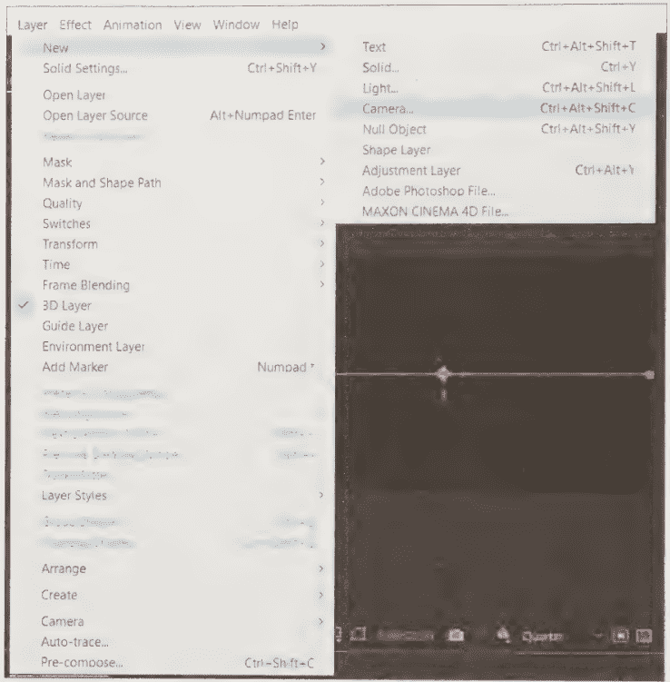

3D 相机 1

查看以下屏幕截图。这些是相机参数。你的设置应如下所示：

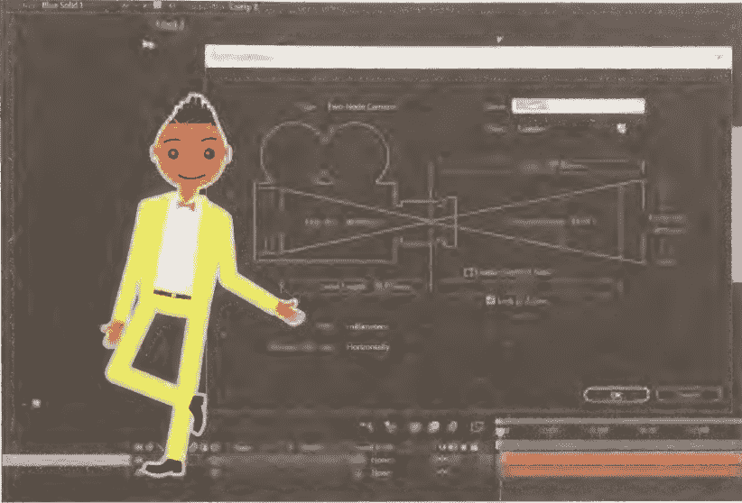

相机设置

现在我们场景中已有相机，你可以看到相机具有 3D 控件，就像 3D 图层一样。

## 创建 2.5D 环境相机穿梭

还请确保你的合成设置为经典 3D，可在合成窗口的右上角找到。这以下屏幕截图对此进行了说明：

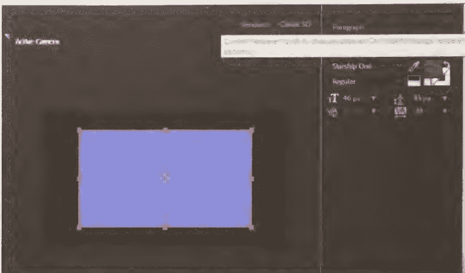

经典 3D

现在，我们将在 3D 空间中移动图层。选择最底层的图层并将其向后移动到 3D 空间中。你可以通过选择蓝色箭头并将箭头向后推入 3D 空间来实现，如以下屏幕截图所示：

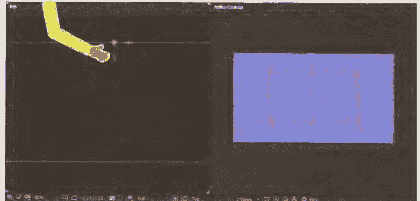

在 3D 空间中移动图层

这将使你的图层向后移动。你会在右侧的活动相机中看到图层移动。

移动图层在 3D 空间的另一种方法是拖动最右侧的位置参数（最右侧的第三行数字）。以下屏幕截图显示了这一点：

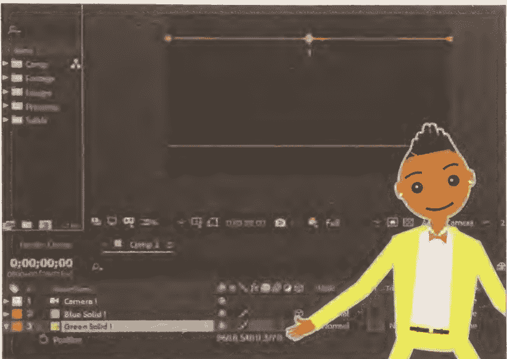

3D 位置参数

你做得很好！你现在知道如何在 3D 空间中移动图层了。让我们重复前面的步骤并向场景中添加多个图层。

我们将动画化一个相机穿过三个不同的环境。让我们通过多个视图查看我们的场景。在“视图”标签中，将视图更改为 4 个视图。

这将向我们展示所有不同的视图。让我们先为环境添加三个纯色图层。按照以下步骤添加更多图层并在场景中正确放置它们：

- 1. 复制我们当前的一个 3D 纯色图层。
- 2. 在 3D 空间中均匀分布图层。查看以下屏幕截图作为在 3D 空间中放置三个纯色图层的参考：

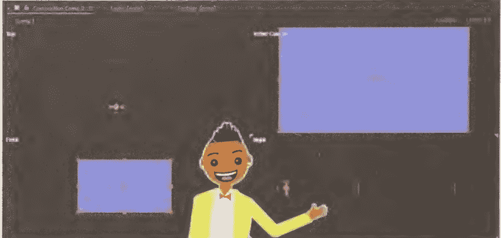

定位 3D 纯色图层

请注意，右下角的合成面板显示的是右视图；正方形代表相机，红线代表 3D 空间中的图层。它们之间相距相当远。请记住，你可以使用 3D 箭头或位置参数移动图层。在开始学习 3D 时，使用位置参数更容易。这确保了你的移动会更准确。

现在图层之间已有显著距离，让我们添加更多 2D 纯色图层来填充我们的环境。为此，我们将在不同的图层之间添加更多图层。查看以下屏幕截图并注意右下角的视图。我在项目中添加了 14 个纯色图层。它们都均匀分布。相应地分布你的图层。请记住选择正确的视图。如果不这样做，你将看不到图层处于活动状态，如以下屏幕截图所示：

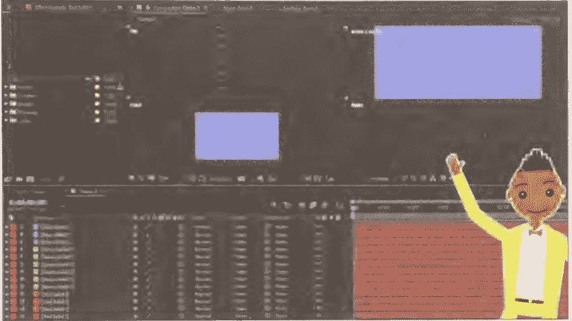

添加 2D 纯色图层

现在我们要在场景中开始移动相机。让我们先将相机的“自动定向...”关闭。为此，只需按照以下步骤操作：

- 1. 转到 图层
- 2. 点击 变换 | 自动定向... 并将“自动定向...”切换为关闭

默认情况下，After Effects 会尝试自动定向你的相机。关闭“自动定向...”将控制相机的权力交到你的手中。以下屏幕截图显示了如何找到并禁用“自动定向...”功能：

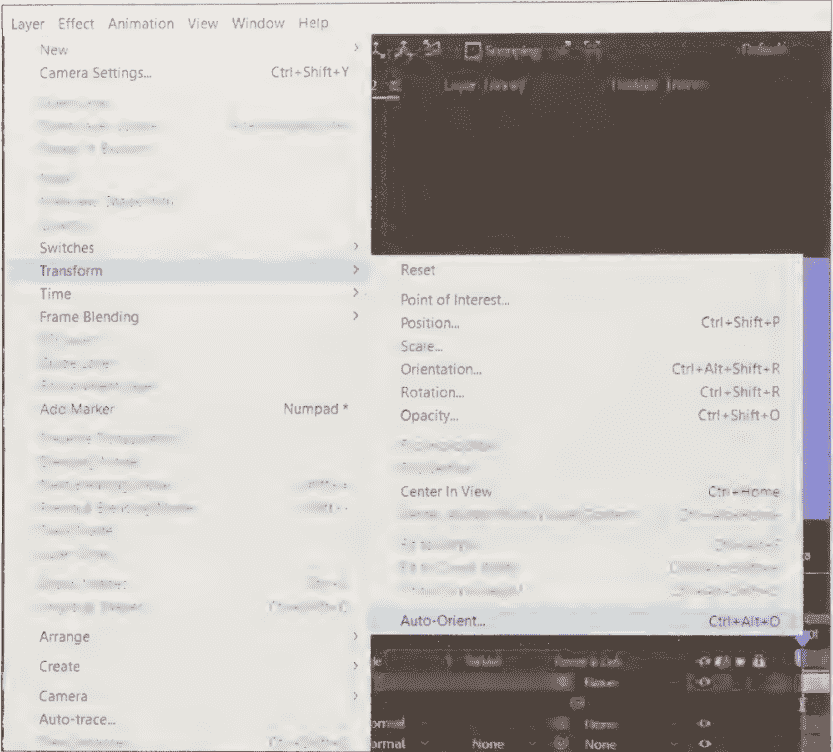

自动定向...

现在我们准备在场景中开始移动相机。我们首先需要在场景中为背景添加一个 2D 图层。按照以下步骤开始操作：

- 1. 将当前图层移动到图层列表的底部。
- 2. 现在，让我们在场景中开始移动相机，将视图更改为 1 个视图活动相机。
- 3. 要控制相机，请使用位于 **工具** 面板左上角的 **相机** 工具，并选择“跟踪 Z 相机工具”，如以下屏幕截图所示。你可以通过按 C 键在这些工具之间循环：
- 4. 将相机向后拉入场景，使第一个图层与相机之间有更大的距离。
- 5. 按住 C 键单击并拖动，直到出现 **轨道** 工具。
- 6. 调整相机方向，使你俯视图层，如以下屏幕截图所示：

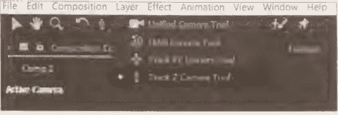

相机工具

使用鼠标在场景中单击并拖动会使场景放大和缩小。

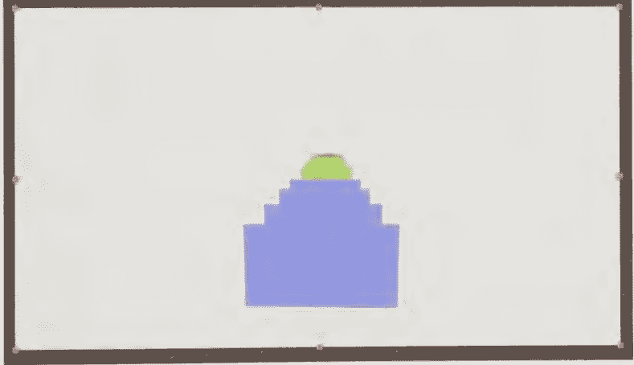

相机方向

恭喜！你已将图层定位在 3D 空间中。接下来，我们将在场景中添加灯光！

## 灯光

灯光确实可以为你的项目增添动感。只是要明白，打开阴影也会增加渲染时间。在项目中使用阴影时要有所选择。现在你知道如何移动相机了，让我们将一些灯光带入场景。按照以下步骤开始操作：

- 1. 进入界面的顶部并选择一个新灯光图层。你可以选择任何你想要的灯光，无论颜色和强度如何。尝试这些设置。我选择了一个白色聚光灯。
- 2. 调整灯光位置。向后、向左和向右移动它们。
- 3. 为了使图层投射阴影，我们必须打开“投射阴影”。选择合成中的第一个图层。在“变换”属性下，你有一个名为“材质”的选项。点击图层的“材质选项”。将其更改为“投射阴影”，如以下屏幕截图所示：

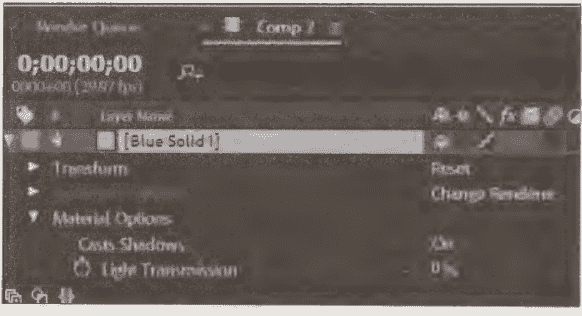

投射阴影开启

现在你已打开“投射阴影”，你的第一张图像应投射阴影，如以下屏幕截图所示：

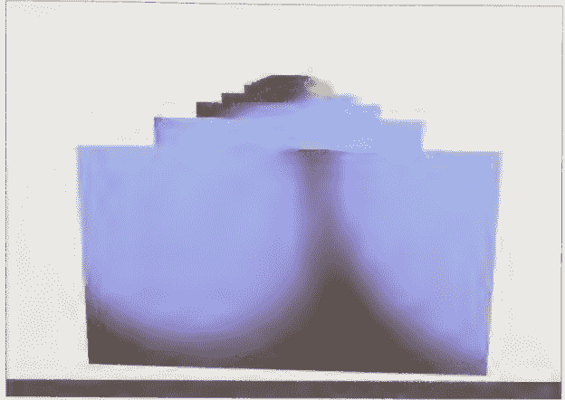

阴影

现在，让我们将 **关闭投射阴影**。

你已成功向合成中添加了 3D 图层和灯光，并在场景中移动了相机。让我们通过以下步骤将城市场景导入我们的环境：

- 1. 从本章的资源文件夹导入 `city` 文件
- 2. 选择将其作为合成导入
- 3. 选择保留图层大小

太好了！现在你的项目中已有城市艺术作品。它应该连同艺术作品文件夹一起进入项目。我们将先使用城市建筑；稍后项目中会用到桥梁。

## 创建 3D 环境

我们将使用城市建筑艺术作品在 3D 空间中构建一个艺术场景。我们将用城市艺术作品替换合成中的纯色图层。要替换合成中的纯色图层，请按照以下步骤操作：

- 1. 选择合成中的第一个图层
- 2. 转到项目窗口
- 3. 按住 *Alt* 键（Mac 上为 *option*）

-   4. 将城市图层拖入合成并松开 Alt 键以替换纯色图层
-   5. 为所有图层打开 **Continuously Rasterize** 以保持其清晰

这就是你在该合成中替换所有纯色图层并将它们堆叠在 3D 空间中的方法。你可能想练习几次。纯色图层应被一排城市建筑替换。使用色相饱和度效果将图层更改为所需颜色。之后点击 Colorize 选项以调整色相和亮度。查看以下屏幕截图中我用来更改建筑物颜色的设置。调整建筑物的颜色，使其看起来合适：

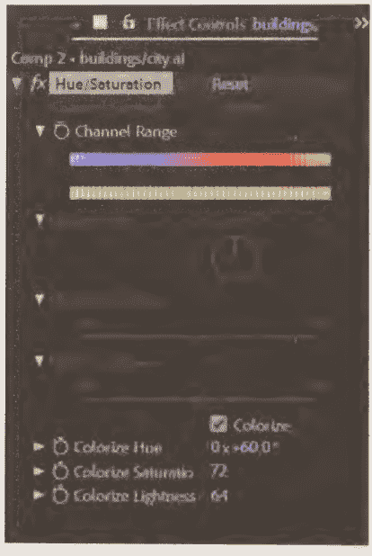

如有必要放大建筑，然后复制并向右移动位置。你现在应该有一整排城市建筑。请按照以下步骤操作：

-   1. 选择你第一排建筑中的一排并复制它。
-   2. 保持选中状态并从项目面板中选择桥梁图层。
-   3. 用桥梁图层替换建筑图层。
-   4. 调整颜色，放大此图层，并在场景中定位。确保已为桥梁打开 Continuously Rasterized 选项。
-   5. 复制桥梁并在 3D 空间中将其推后几排。
-   6. 对后面延伸的另外三排重复这些步骤。

我已将场景的背景更改为蓝色，并在 3D 空间中调整了建筑物的颜色、比例和位置。查看以下屏幕截图，了解如何设置你的城市环境：

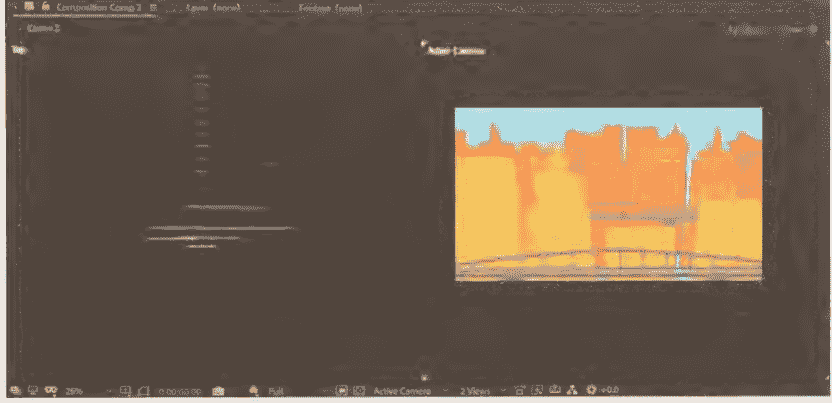

建筑设置

注意城市环境有多么密集？通过并排的两个视图查看，你可以看到在 3D 空间中已填充了环境的三分之一。目标不是看到建筑物或桥梁的底部，因此调整你的美术作品的比例和位置。慢慢创建这个第一个环境，因为我们将使用相同的步骤创建其他环境。我们希望动画化摄像机穿过城市场景，因此我们将创建另外几个环境，让观众感觉像是在进行一次旅程。

完成此环境后，按照前面的步骤创建树木的环境。使用树木填充环境，如前面步骤所示。之后，你应该拥有城市、树木和一群鹿的环境，它们都位于 3D 空间中，如以下屏幕截图所示。确保图层之间有足够的距离，以便摄像机可以在场景中动态移动。你注意到我在建筑物之间留出了一条路径供摄像机飞过吗？调整图层，使摄像机不会撞到任何东西：

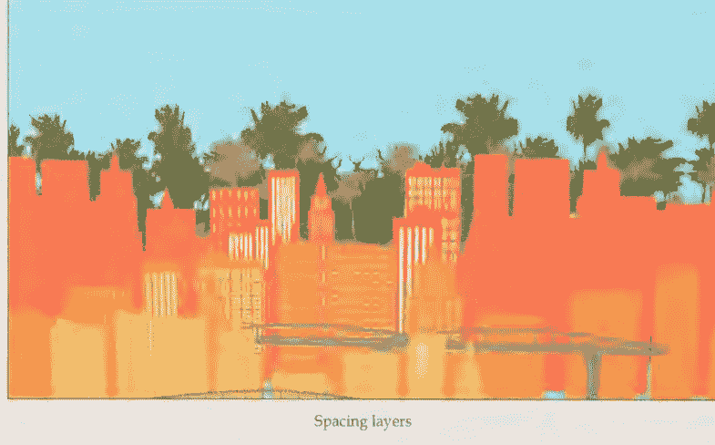

图层间距

你注意到图层在环境中是均匀分布的吗？它们之间相隔相当远，并且有一条开放的路径供摄像机飞行。

## 动画化摄像机

你做得非常棒！到目前为止，我们已经学习了 3D 图层以及如何调整和创建摄像机和灯光。我们还学习了如何用美术作品替换图层。现在，我们将通过以下步骤在场景中动画化摄像机：

-   1. 选择你的摄像机并设置关键帧
-   2. 移动到时间线的最末端
-   3. 移动摄像机的位置，使其最终位于鹿群的最后一个环境中

你的摄像机应该穿过三个不同的环境。如果摄像机与图层发生碰撞，你可能需要调整图层。我们的目标只有两个关键帧。如果需要调整任何关键帧，请在合成的开头或结尾进行调整，那里已有关键帧。查看以下屏幕截图。注意摄像机在时间线中有两个关键帧：

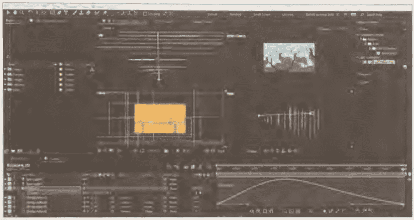

摄像机动画

如你所见，你的摄像机有一条直接通往最后一个环境的路径。接下来，我们需要缓和摄像机的移动。在下一节中，我们将使用图表编辑器创建自定义缓动效果。

## 使用图表编辑器

让我们使用关键帧助手来缓和关键帧。我们可以通过选择图表编辑器进一步编辑关键帧的移动。要使用图表编辑器，请按照以下步骤操作：

-   1. 缓和你的关键帧。
-   2. 选择你的关键帧。
-   3. 在时间线中间锁图标上方查看。点击图表编辑器图标。
-   4. 点击图表类型。
-   5. 选择编辑速度图表。

现在你已打开图表编辑器（以下屏幕截图中高亮的蓝色图表图标表示），你需要打开编辑速度图表。以下屏幕截图演示了其位置：

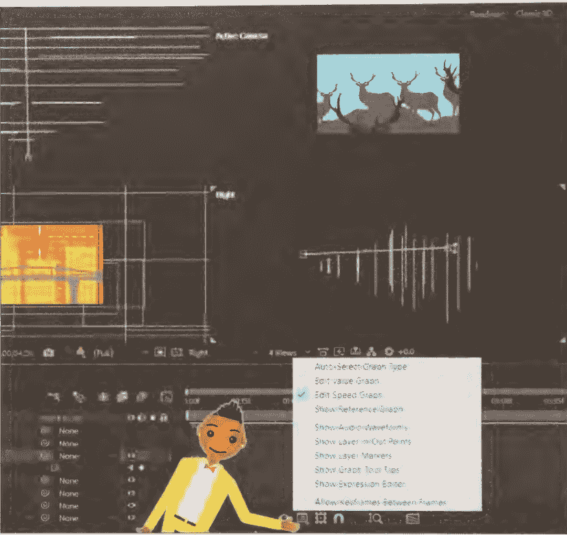

图表编辑器选项

这将允许我们编辑摄像机的速度。拖动图表编辑器的手柄并创建更多曲线可以缓和并减慢关键帧的移动。拖动以下屏幕截图中所示的右手柄，使摄像机缓入最后一个关键帧。进入图表编辑器选项之前，请确保已选择关键帧，否则你将看不到图表。完成此编辑器后，只需点击图表编辑器图标即可退出此模式：

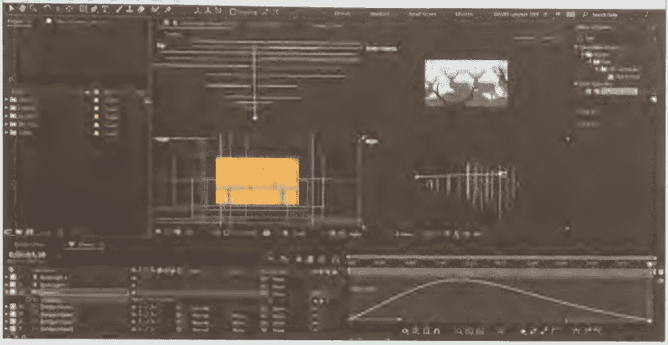

图表编辑器模式

我们通过此项目想要实现的整体效果是创建一个动态且流畅的动画摄像机，在 3D 环境中移动。如果需要，调整摄像机移动并使用图表编辑器创建令人满意的摄像机移动。你还可以调整图层并将其定位，使其在 3D 空间中均匀分布。

## 总结

我为你的辛勤工作感到非常自豪！你创建了一个很棒的 3D 摄像机飞越！我们学习了如何在项目中创建 3D 图层和灯光并动画化摄像机。了解如何使用摄像机和灯光创建 3D 项目将帮助你创建动态且令人兴奋的专业项目。你可以在许多不同类型的动态图形工作中使用这些工具。这些工具用于电影、电视和音乐视频。每当你在视频中看到摄像机移动时，请考虑摄像机的移动方式。记住，After Effects 具有 3D 灯光和摄像机，现在你知道如何使用它们了！

这为我们下一章定下了基调，下一章将介绍 C4D lite。我们将在 C4D lite 中构建和动画化一个标志。该程序随 After Effects 一起捆绑；这是一个很好的方式，在 After Effects 中建立我们在 3D 方面的学习，并在真正的 3D 程序中利用这些知识创建动态项目。下次见！

## 问题

-   1. 如何创建 3D 摄像机？
-   2. 如何添加 3D 灯光？
-   3. 使用不同视图的优势是什么？
-   4. 如何调整灯光？
-   5. 为什么应该谨慎使用阴影？
-   6. 替换图层为美术作品时需要按哪个键？
-   7. 为什么应该打开连续栅格化？
-   8. 关闭 Auto-Orient... 的优势是什么？
-   9. 移动 3D 摄像机应该使用什么工具？
-   10. 3D 参数手柄是什么？
