## 9

## 9 构建 3D C4D Lite 标志项目

给自己一个赞，因为你已经进入了 Cinema 4D（C4D）Lite 章节；你会喜欢它的！After Effects 和 C4D Lite 为你提供了专业级工具，让你可以在合成中添加 3D 元素。C4D Lite 和 After Effects 结合起来是一个强大的组合！就像 Adobe 的任何软件一样，这两个程序配合得很好。工作流程无缝；你可以轻松地在两个程序之间切换。

本章将涵盖以下主题：

-   在 After Effects 中创建 C4D 图层
-   C4D 界面
-   使用 sweep nurbs 建模丝带
-   将 Illustrator 文件导入 C4D
-   在 C4D 中创建文本
-   使用 sweep nurbs 创建眼睛
-   建模标志星形
-   在 C4D 中创建摄像机
-   从 After Effects 渲染 C4D 项目

## C4D Lite 3D 标志项目

使用 C4D Lite 开始 3D 世界非常有趣！3D 元素几乎在娱乐世界的每个地方都被使用，包括体育图形、电视新闻图形和 VFX 密集的电影。3D 项目动态且令人兴奋；它们为场景增添了另一层真实感。

虽然 C4D Lite 与 After Effects 一同提供，但它并不是 C4D 的完整版本。这只是一个基础的精简版。尽管如此，它是开始学习 C4D 的绝佳方式。我们将学习如何建模、灯光和动画化一个标志。我们将创建一个令人印象深刻的 3D 标志并将其添加到 After Effects 项目中。我们将使用合成工具为项目增添最后的润色，然后从 After Effects 中将其渲染输出。让我们开始吧！

## 在 After Effects 中创建 C4D 图层

C4D 在几个方面依赖于 After Effects。你需要通过 After Effects 打开该程序。你必须通过 After Effects 渲染项目，并且一旦创建了 C4D 图层，它只能通过 C4D 进行移动或编辑。切勿在 After Effects 中移动或缩放 C4D 图层。要创建 C4D 图层，请按照以下步骤操作：

- 1. 转到 **Layer** 选项卡
- 2. 选择 **MAXON CINEMA 4D File...**

参考以下屏幕截图在 After Effects 中创建你的 C4D 文件：

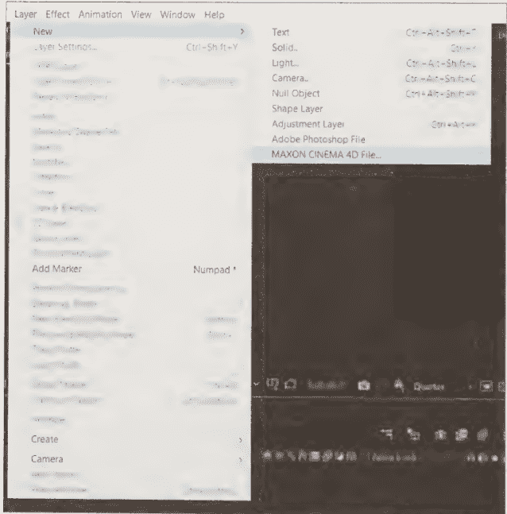

新的 C4D 图层

太棒了！你已经创建了第一个 C4D 图层。为了编辑它，你需要在 After Effects 中保存项目。这将自动保存你的项目并为你创建一个 C4D 项目。按照以下步骤在 C4D 中打开 3D 文件：

- 1. 保存你的项目。
- 2. 转到 Edit 选项卡。
- 3. 选择 Edit original。这将打开文件在 C4D 中。
- 4. 关闭 C4D 信息面板。

## C4D 界面

让我们在 C4D 中浏览工具面板；它位于与 After Effects 工具面板相同的位置。C4D 的工具直观易懂，从而使初学者能够快速上手并掌控。查看以下屏幕截图中的工具面板。你可以悬停在选项卡上以查看工具的完整描述并熟悉其功能。如果工具在左下角有一个三角形，则表示点击它会显示更多选项：

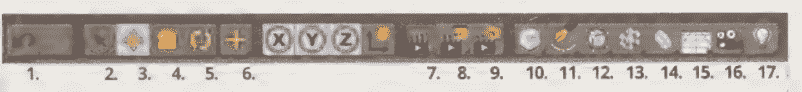

工具栏

编号部分代表以下内容：

- 1. 撤销
- 2. 实时选择工具
- 3. 移动工具
- 4. 缩放工具
- 5. 旋转工具
- 6. 上次使用的工具
- 7. 渲染视图
- 8. 渲染子菜单
- 9. 编辑渲染
- 10. 对象
- 11. 样条线

- 12. 生成器
- 13. 建模子菜单
- 14. 弯曲变形器
- 15. 添加地面对象
- 16. 相机
- 17. 灯光

我想让你注意的是面板最左侧的移动工具。这些是很重要的工具，因为你会经常使用它们。我们将在本章后面介绍这些工具以及更多内容。你不需要记住所有这些工具；只需熟悉它们的位置即可。

让我们立即开始创建 3D 对象！随 C4D 提供的[content]
虽然 C4D Lite 与 After Effects 一同提供，但它并不是 C4D 的完整版本。这只是一个基础的精简版。尽管如此，它是开始学习 C4D 的绝佳方式。我们将学习如何建模、灯光和动画化一个标志。我们将创建一个令人印象深刻的 3D 标志并将其添加到 After Effects 项目中。我们将使用合成工具为项目增添最后的润色，然后从 After Effects 中将其渲染输出。让我们开始吧！

## 在 After Effects 中创建 C4D 图层

C4D 在几个方面依赖于 After Effects。你需要通过 After Effects 打开该程序。你必须通过 After Effects 渲染项目，并且一旦创建了 C4D 图层，它只能通过 C4D 进行移动或编辑。切勿在 After Effects 中移动或缩放 C4D 图层。要创建 C4D 图层，请按照以下步骤操作：

- 1. 转到 **Layer** 选项卡
- 2. 选择 **MAXON CINEMA 4D File...**

参考以下屏幕截图在 After Effects 中创建你的 C4D 文件：

新的 C4D 图层

太棒了！你已经创建了第一个 C4D 图层。为了编辑它，你需要在 After Effects 中保存项目。这将自动保存你的项目并为你创建一个 C4D 项目。按照以下步骤在 C4D 中打开 3D 文件：

- 1. 保存你的项目。
- 2. 转到 Edit 选项卡。
- 3. 选择 Edit original。这将打开文件在 C4D 中。
- 4. 关闭 C4D 信息面板。

## C4D 界面

让我们在 C4D 中浏览工具面板；它位于与 After Effects 工具面板相同的位置。C4D 的工具直观易懂，从而使初学者能够快速上手并掌控。查看以下屏幕截图中的工具面板。你可以悬停在选项卡上以查看工具的完整描述并熟悉其功能。如果工具在左下角有一个三角形，则表示点击它会显示更多选项：

工具栏

编号部分代表以下内容：

- 1. 撤销
- 2. 实时选择工具
- 3. 移动工具
- 4. 缩放工具
- 5. 旋转工具
- 6. 上次使用的工具
- 7. 渲染视图
- 8. 渲染子菜单
- 9. 编辑渲染
- 10. 对象
- 11. 样条线

- 12. 生成器
- 13. 建模子菜单
- 14. 弯曲变形器
- 15. 添加地面对象
- 16. 相机
- 17. 灯光

我想让你注意的是面板最左侧的移动工具。这些是很重要的工具，因为你会经常使用它们。我们将在本章后面介绍这些工具以及更多内容。你不需要记住所有这些工具；只需熟悉它们的位置即可。

让我们立即开始创建 3D 对象！随 C4D 提供的[content]
虽然 C4D Lite 与 After Effects 一同提供，但它并不是 C4D 的完整版本。这只是一个基础的精简版。尽管如此，它是开始学习 C4D 的绝佳方式。我们将学习如何建模、灯光和动画化一个标志。我们将创建一个令人印象深刻的 3D 标志并将其添加到 After Effects 项目中。我们将使用合成工具为项目增添最后的润色，然后从 After Effects 中将其渲染输出。让我们开始吧！

## 在 After Effects 中创建 C4D 图层

C4D 在几个方面依赖于 After Effects。你需要通过 After Effects 打开该程序。你必须通过 After Effects 渲染项目，并且一旦创建了 C4D 图层，它只能通过 C4D 进行移动或编辑。切勿在 After Effects 中移动或缩放 C4D 图层。要创建 C4D 图层，请按照以下步骤操作：

- 1. 转到 **Layer** 选项卡
- 2. 选择 **MAXON CINEMA 4D File...**

参考以下屏幕截图在 After Effects 中创建你的 C4D 文件：

新的 C4D 图层

太棒了！你已经创建了第一个 C4D 图层。为了编辑它，你需要在 After Effects 中保存项目。这将自动保存你的项目并为你创建一个 C4D 项目。按照以下步骤在 C4D 中打开 3D 文件：

- 1. 保存你的项目。
- 2. 转到 Edit 选项卡。
- 3. 选择 Edit original。这将打开文件在 C4D 中。
- 4. 关闭 C4D 信息面板。

## C4D 界面

让我们在 C4D 中浏览工具面板；它位于与 After Effects 工具面板相同的位置。C4D 的工具直观易懂，从而使初学者能够快速上手并掌控。查看以下屏幕截图中的工具面板。你可以悬停在选项卡上以查看工具的完整描述并熟悉其功能。如果工具在左下角有一个三角形，则表示点击它会显示更多选项：

工具栏

编号部分代表以下内容：

- 1. 撤销
- 2. 实时选择工具
- 3. 移动工具
- 4. 缩放工具
- 5. 旋转工具
- 6. 上次使用的工具
- 7. 渲染视图
- 8. 渲染子菜单
- 9. 编辑渲染
- 10. 对象
- 11. 样条线

- 12. 生成器
- 13. 建模子菜单
- 14. 弯曲变形器
- 15. 添加地面对象
- 16. 相机
- 17. 灯光

我想让你注意的是面板最左侧的移动工具。这些是很重要的工具，因为你会经常使用它们。我们将在本章后面介绍这些工具以及更多内容。你不需要记住所有这些工具；只需熟悉它们的位置即可。

让我们立即开始创建 3D 对象！随 C4D 提供的[content]
虽然 C4D Lite 与 After Effects 一同提供，但它并不是 C4D 的完整版本。这只是一个基础的精简版。尽管如此，它是开始学习 C4D 的绝佳方式。我们将学习如何建模、灯光和动画化一个标志。我们将创建一个令人印象深刻的 3D 标志并将其添加到 After Effects 项目中。我们将使用合成工具为项目增添最后的润色，然后从 After Effects 中将其渲染输出。让我们开始吧！

## 在 After Effects 中创建 C4D 图层

C4D 在几个方面依赖于 After Effects。你需要通过 After Effects 打开该程序。你必须通过 After Effects 渲染项目，并且一旦创建了 C4D 图层，它只能通过 C4D 进行移动或编辑。切勿在 After Effects 中移动或缩放 C4D 图层。要创建 C4D 图层，请按照以下步骤操作：

- 1. 转到 **Layer** 选项卡
- 2. 选择 **MAXON CINEMA 4D File...**

参考以下屏幕截图在 After Effects 中创建你的 C4D 文件：

新的 C4D 图层

太棒了！你已经创建了第一个 C4D 图层。为了编辑它，你需要在 After Effects 中保存项目。这将自动保存你的项目并为你创建一个 C4D 项目。按照以下步骤在 C4D 中打开 3D 文件：

- 1. 保存你的项目。
- 2. 转到 Edit 选项卡。
- 3. 选择 Edit original。这将打开文件在 C4D 中。
- 4. 关闭 C4D 信息面板。

## C4D 界面

让我们在 C4D 中浏览工具面板；它位于与 After Effects 工具面板相同的位置。C4D 的工具直观易懂，从而使初学者能够快速上手并掌控。查看以下屏幕截图中的工具面板。你可以悬停在选项卡上以查看工具的完整描述并熟悉其功能。如果工具在左下角有一个三角形，则表示点击它会显示更多选项：

工具栏

编号部分代表以下内容：

- 1. 撤销
- 2. 实时选择工具
- 3. 移动工具
- 4. 缩放工具
- 5. 旋转工具
- 6. 上次使用的工具
- 7. 渲染视图
- 8. 渲染子菜单
- 9. 编辑渲染
- 10. 对象
- 11. 样条线

- 12. 生成器
- 13. 建模子菜单
- 14. 弯曲变形器
- 15. 添加地面对象
- 16. 相机
- 17. 灯光

我想让你注意的是面板最左侧的移动工具。这些是很重要的工具，因为你会经常使用它们。我们将在本章后面介绍这些工具以及更多内容。你不需要记住所有这些工具；只需熟悉它们的位置即可。

让我们立即开始创建 3D 对象！随 C4D 提供的[content]
虽然 C4D Lite 与 After Effects 一同提供，但它并不是 C4D 的完整版本。这只是一个基础的精简版。尽管如此，它是开始学习 C4D 的绝佳方式。我们将学习如何建模、灯光和动画化一个标志。我们将创建一个令人印象深刻的 3D 标志并将其添加到 After Effects 项目中。我们将使用合成工具为项目增添最后的润色，然后从 After Effects 中将其渲染输出。让我们开始吧！

## 在 After Effects 中创建 C4D 图层

C4D 在几个方面依赖于 After Effects。你需要通过 After Effects 打开该程序。你必须通过 After Effects 渲染项目，并且一旦创建了 C4D 图层，它只能通过 C4D 进行移动或编辑。切勿在 After Effects 中移动或缩放 C4D 图层。要创建 C4D 图层，请按照以下步骤操作：

- 1. 转到 **Layer** 选项卡
- 2. 选择 **MAXON CINEMA 4D File...**

参考以下屏幕截图在 After Effects 中创建你的 C4D 文件：

新的 C4D 图层

太棒了！你已经创建了第一个 C4D 图层。为了编辑它，你需要在 After Effects 中保存项目。这将自动保存你的项目并为你创建一个 C4D 项目。按照以下步骤在 C4D 中打开 3D 文件：

- 1. 保存你的项目。
- 2. 转到 Edit 选项卡。
- 3. 选择 Edit original。这将打开文件在 C4D 中。
- 4. 关闭 C4D 信息面板。

## C4D 界面

让我们在 C4D 中浏览工具面板；它位于与 After Effects 工具面板相同的位置。C4D 的工具直观易懂，从而使初学者能够快速上手并掌控。查看以下屏幕截图中的工具面板。你可以悬停在选项卡上以查看工具的完整描述并熟悉其功能。如果工具在左下角有一个三角形，则表示点击它会显示更多选项：

工具栏

编号部分代表以下内容：

- 1. 撤销
- 2. 实时选择工具
- 3. 移动工具
- 4. 缩放工具
- 5. 旋转工具
- 6. 上次使用的工具
- 7. 渲染视图
- 8. 渲染子菜单
- 9. 编辑渲染
- 10. 对象
- 11. 样条线

- 12. 生成器
- 13. 建模子菜单
- 14. 弯曲变形器
- 15. 添加地面对象
- 16. 相机
- 17. 灯光

我想让你注意的是面板最左侧的移动工具。这些是很重要的工具，因为你会经常使用它们。我们将在本章后面介绍这些工具以及更多内容。你不需要记住所有这些工具；只需熟悉它们的位置即可。

让我们立即开始创建 3D 对象！随 C4D 提供的[content]
虽然 C4D Lite 与 After Effects 一同提供，但它并不是 C4D 的完整版本。这只是一个基础的精简版。尽管如此，它是开始学习 C4D 的绝佳方式。我们将学习如何建模、灯光和动画化一个标志。我们将创建一个令人印象深刻的 3D 标志并将其添加到 After Effects 项目中。我们将使用合成工具为项目增添最后的润色，然后从 After Effects 中将其渲染输出。让我们开始吧！

## 在 After Effects 中创建 C4D 图层

C4D 在几个方面依赖于 After Effects。你需要通过 After Effects 打开该程序。你必须通过 After Effects 渲染项目，并且一旦创建了 C4D 图层，它只能通过 C4D 进行移动或编辑。切勿在 After Effects 中移动或缩放 C4D 图层。要创建 C4D 图层，请按照以下步骤操作：

- 1. 转到 **Layer** 选项卡
- 2. 选择 **MAXON CINEMA 4D File...**

参考以下屏幕截图在 After Effects 中创建你的 C4D 文件：

新的 C4D 图层

太棒了！你已经创建了第一个 C4D 图层。为了编辑它，你需要在 After Effects 中保存项目。这将自动保存你的项目并为你创建一个 C4D 项目。按照以下步骤在 C4D 中打开 3D 文件：

- 1. 保存你的项目。
- 2. 转到 Edit 选项卡。
- 3. 选择 Edit original。这将打开文件在 C4D 中。
- 4. 关闭 C4D 信息面板。

## C4D 界面

让我们在 C4D 中浏览工具面板；它位于与 After Effects 工具面板相同的位置。C4D 的工具直观易懂，从而使初学者能够快速上手并掌控。查看以下屏幕截图中的工具面板。你可以悬停在选项卡上以查看工具的完整描述并熟悉其功能。如果工具在左下角有一个三角形，则表示点击它会显示更多选项：

工具栏

编号部分代表以下内容：

- 1. 撤销
- 2. 实时选择工具
- 3. 移动工具
- 4. 缩放工具
- 5. 旋转工具
- 6. 上次使用的工具
- 7. 渲染视图
- 8. 渲染子菜单
- 9. 编辑渲染
- 10. 对象
- 11. 样条线

- 12. 生成器
- 13. 建模子菜单
- 14. 弯曲变形器
- 15. 添加地面对象
- 16. 相机
- 17. 灯光

我想让你注意的是面板最左侧的移动工具。这些是很重要的工具，因为你会经常使用它们。我们将在本章后面介绍这些工具以及更多内容。你不需要记住所有这些工具；只需熟悉它们的位置即可。

让我们立即开始创建 3D 对象！随 C4D 提供的[content]
虽然 C4D Lite 与 After Effects 一同提供，但它并不是 C4D 的完整版本。这只是一个基础的精简版。尽管如此，它是开始学习 C4D 的绝佳方式。我们将学习如何建模、灯光和动画化一个标志。我们将创建一个令人印象深刻的 3D 标志并将其添加到 After Effects 项目中。我们将使用合成工具为项目增添最后的润色，然后从 After Effects 中将其渲染输出。让我们开始吧！

## 在 After Effects 中创建 C4D 图层

C4D 在几个方面依赖于 After Effects。你需要通过 After Effects 打开该程序。你必须通过 After Effects 渲染项目，并且一旦创建了 C4D 图层，它只能通过 C4D 进行移动或编辑。切勿在 After Effects 中移动或缩放 C4D 图层。要创建 C4D 图层，请按照以下步骤操作：

- 1. 转到 **Layer** 选项卡
- 2. 选择 **MAXON CINEMA 4D File...**

参考以下屏幕截图在 After Effects 中创建你的 C4D 文件：

新的 C4D 图层

太棒了！你已经创建了第一个 C4D 图层。为了编辑它，你需要在 After Effects 中保存项目。这将自动保存你的项目并为你创建一个 C4D 项目。按照以下步骤在 C4D 中打开 3D 文件：

- 1. 保存你的项目。
- 2. 转到 Edit 选项卡。
- 3. 选择 Edit original。这将打开文件在 C4D 中。
- 4. 关闭 C4D 信息面板。

## C4D 界面

让我们在 C4D 中浏览工具面板；它位于与 After Effects 工具面板相同的位置。C4D 的工具直观易懂，从而使初学者能够快速上手并掌控。查看以下屏幕截图中的工具面板。你可以悬停在选项卡上以查看工具的完整描述并熟悉其功能。如果工具在左下角有一个三角形，则表示点击它会显示更多选项：

工具栏

编号部分代表以下内容：

- 1. 撤销
- 2. 实时选择工具
- 3. 移动工具
- 4. 缩放工具
- 5. 旋转工具
- 6. 上次使用的工具
- 7. 渲染视图
- 8. 渲染子菜单
- 9. 编辑渲染
- 10. 对象
- 11. 样条线

- 12. 生成器
- 13. 建模子菜单
- 14. 弯曲变形器
- 15. 添加地面对象
- 16. 相机
- 17. 灯光

我想让你注意的是面板最左侧的移动工具。这些是很重要的工具，因为你会经常使用它们。我们将在本章后面介绍这些工具以及更多内容。你不需要记住所有这些工具；只需熟悉它们的位置即可。

让我们立即开始创建 3D 对象！C4D 随附的基础形状称为 **primitives**。这些是建模任何东西的基础构建块。以下屏幕截图显示了可用的不同基元。点击 **Cube** 图标即可在场景中添加一个立方体：

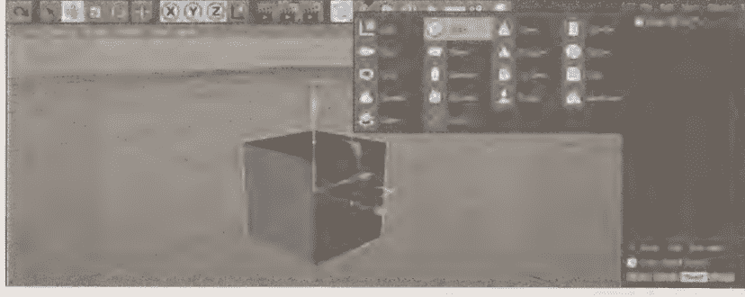

对象

当你点击 Cube 图标时，立方体会自动出现在你的项目中。要移动或缩放场景中的任何对象，请使用右上角的移动工具。你可以使用移动工具在 xyz 轴上移动对象。缩放工具可让你增大对象的大小，而旋转工具可让你旋转对象。就像在 After Effects 中一样，这些对象围绕轴点旋转。让我们通过点击旋转工具来旋转立方体。按照以下屏幕截图所示旋转你的对象：

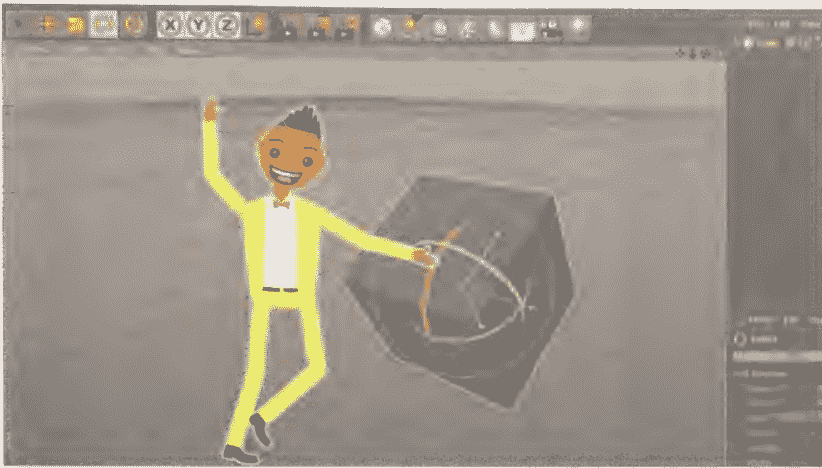

旋转工具

注意彩色条；它们代表你可以围绕其旋转对象的不同参数。让我们来看一下导航工具。跳转到项目屏幕的右上角。这些四个小按钮使你能够在场景中导航并以不同视图查看项目。你可以执行以下操作：

- 移动
- 缩放
- 在项目中旋转
- 查看不同视图

点击移动工具以激活它们。查看以下屏幕截图，了解在面板右上角找到这些工具的位置：

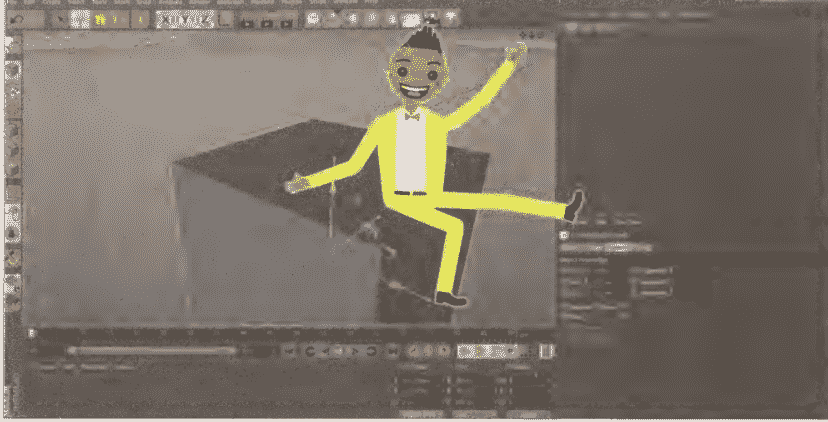

导航工具

你可以使用屏幕最右侧的工具进一步编辑立方体。这些建模工具可让你编辑基元形状。查看以下屏幕截图以找到这些工具：

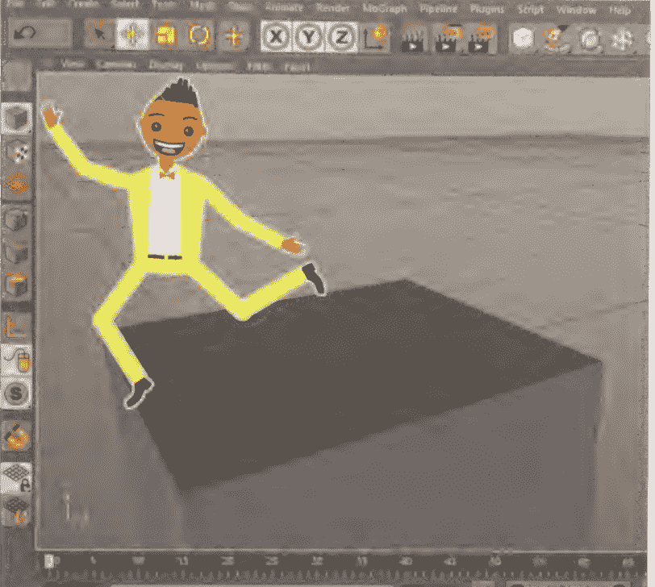

编辑基元

我们将使立方体可编辑，以便我们可以调整点。要使对象可编辑，请执行以下操作：

- 1. 选择对象
- 2. 点击 Make Editable 图标

查看以下屏幕截图以帮助你找到 Make Editable 按钮。
需要注意的重要一点是，一旦你使对象可编辑，就无法撤销此操作：

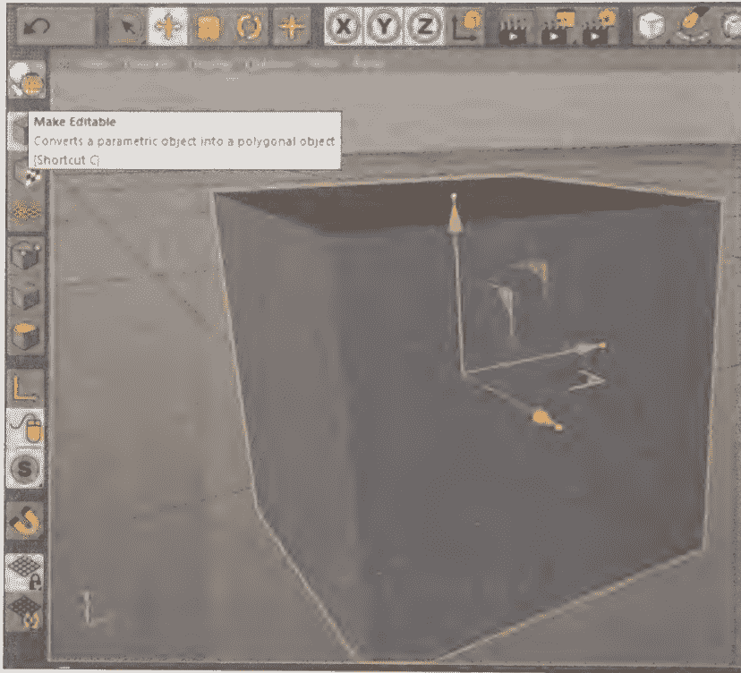

设为可编辑

现在你的对象已可编辑，你可以进一步编辑它。让我们调整轴点。轴点类似于 After Effects 中的锚点。你的对象围绕此点移动。要调整轴点，请按照以下步骤操作：

- 1. 选择对象
- 2. 选择移动工具
- 3. 点击启用轴选项卡
- 4. 移动轴

选择移动工具并如以下屏幕截图所示拖动轴点。注意当你拉动手柄时轴如何移动。这类似于在 After Effects 中使用 Pan Behind 工具移动图层的锚点：

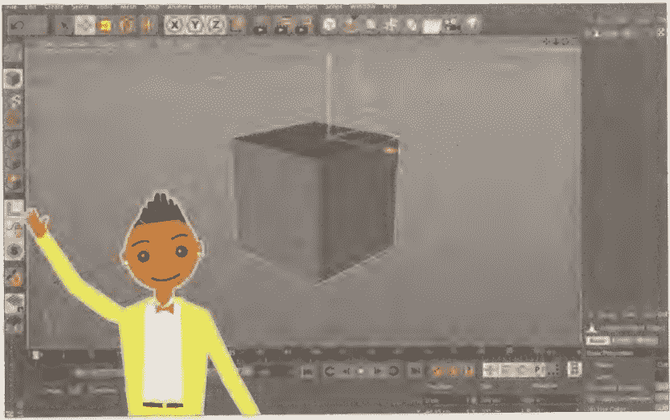

移动轴点

在图层可编辑的情况下，让我们进入点模式来查看一些建模功能。点击以下屏幕截图中所示的点图标：

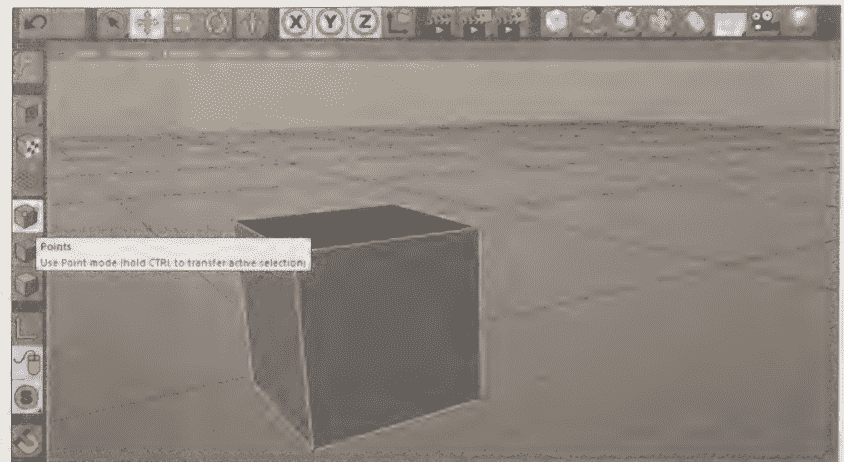

这些点可以被编辑以开始建模新形状！要做到这一点，请点击点并拖动它，如以下屏幕截图所示：

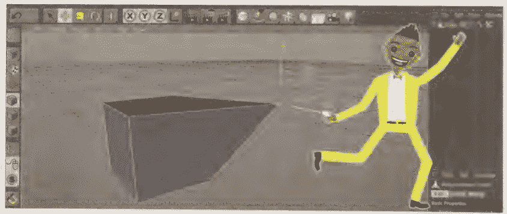

拖动点

C4D 中的时间线与 After Effects 中的时间线类似。在此区域，你有时间指示器播放按钮和动画按钮。我们将在本章后面详细介绍这些内容。查看以下屏幕截图以了解时间线：

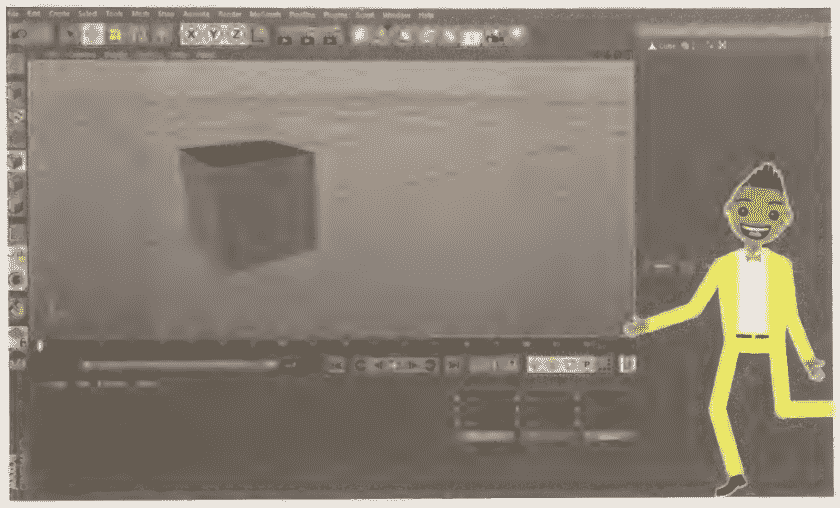

时间线

你可以通过转到 **Edit** 选项卡并选择 **Project Settings....** 来编辑项目设置。**Project Settings...** 在以下屏幕截图中标出。在 Project Settings... 中，你可以自定义项目的组件，例如打开自动保存：

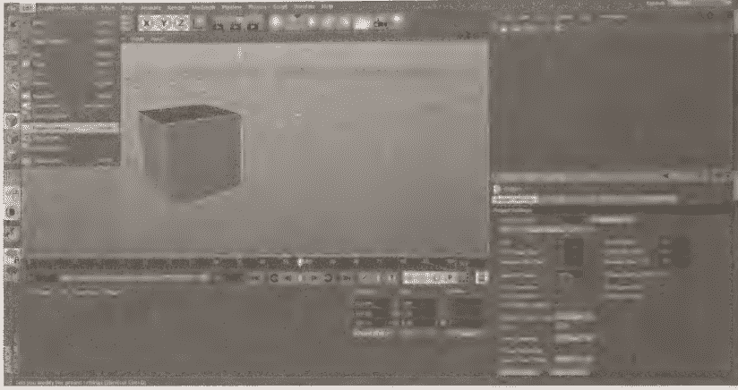

项目设置

现在你对界面有了基本了解，我们将开始创建本章的项目。随着进展，我们将介绍更多工具和面板。让我们从为标志建模第一个元素开始。

## 使用 Sweep Nurbs 建模丝带

我们正在创建一个有趣的 3D 标志，它将在 After Effects 中合成并放置在视频素材之上。在本节中，我们将开始为标志建模一条丝带。我们将使用样条工具，它就像 After Effects 中的钢笔工具一样。通过点击最右侧的视口图标进入顶视图。在右上角选择顶视图。查看以下屏幕截图以了解视口图标的位置：

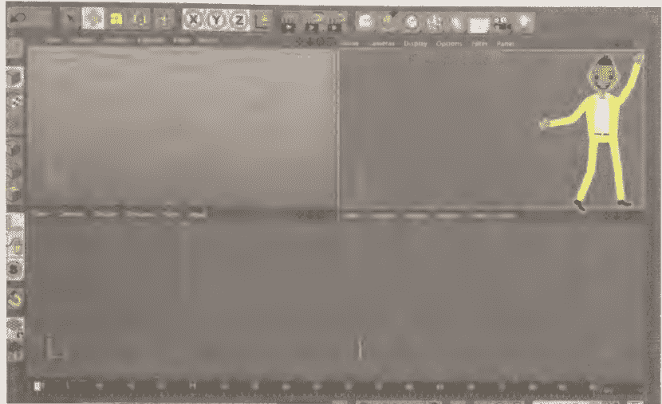

顶视口非常适合创建样条线来为标志建模对象。查看以下屏幕截图以了解顶视图的外观：

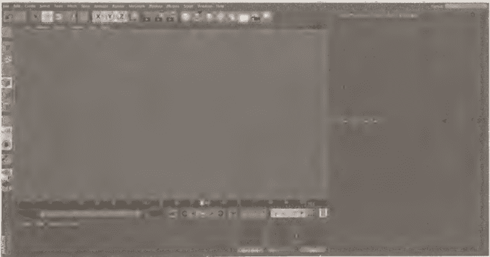

顶视图

要使用样条工具，请执行以下操作：

- 1. 点击带有钢笔的图标。这将显示你可用的所有样条工具。
- 2. 选择钢笔工具。

查看以下屏幕截图以帮助你找到样条工具：

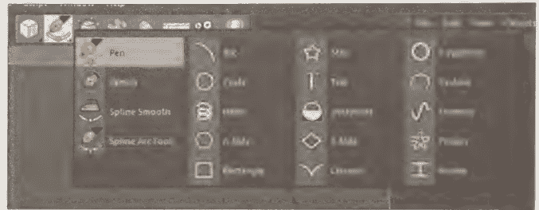

钢笔工具

现在我们将通过点击并拖动贝塞尔手柄来创建一个横幅丝带形状。以下屏幕截图显示了使用钢笔工具创建路径的过程：

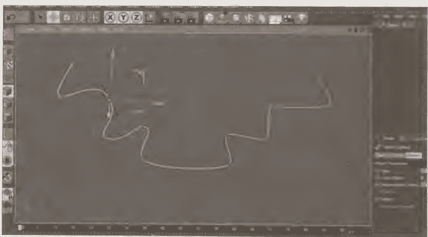

调整点

通过点击视口图标退出此视图模式。返回到前视图。如你所见，我们有一个与地面平面平行的样条线。让路径与地面平行可确保丝带的几何形状正确；这就是为什么必须在顶视图中建模路径的原因。让我们为样条线创建一些几何体，使其看起来更像丝带：

- 1. 点击 NURBS 图标
- 2. 选择一个 Sweep 曲面

下面的截图是查找 Sweep 曲面的参考：

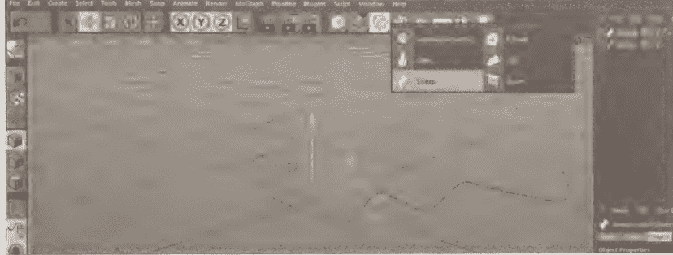

Sweep 曲面

接下来我们需要在对象上添加另一个样条线。让我们添加一个矩形来帮助建模对象：

- 1. 点击样条线图标
- 2. 选择矩形形状
- 3. 选择缩放工具并缩小矩形
- 4. 将矩形和样条线对象放置在 sweep 对象中
- 5. 选择矩形对象
- 6. 增加矩形的高度以增加丝带的高度

看下面的截图，了解对象的层级结构必须是什么样的。在 **Sweep** 曲面对象中放置对象时，请确保看到向下箭头。图层必须与下面的截图完全一致，顺序完全相同：**Sweep**、矩形和样条线。这些图层必须按图层面板中所示进行缩进。我们将用这种方式为徽标创建许多元素，因此请确保熟悉图层的这种堆叠顺序：

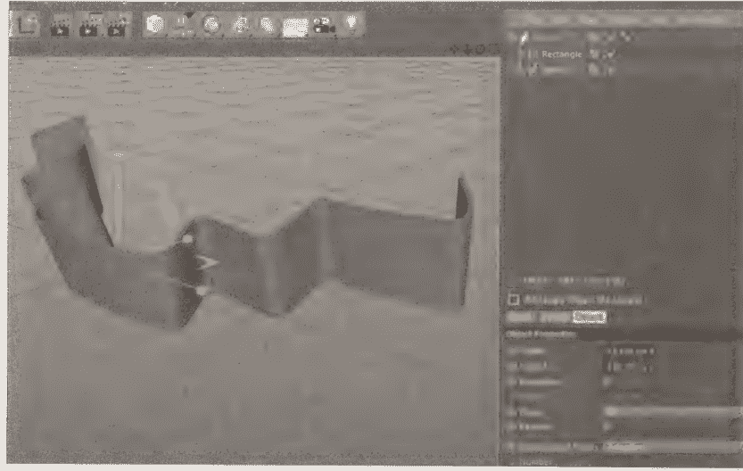

丝带

到目前为止，我们已经学习了如何用 C4D 建模对象；现在让我们通过导入 Illustrator 文件进一步探索它。

## 将 Illustrator 文件导入 C4D

保存 Illustrator 文件时，选择 Illustrator 选项。在这里，你可以选择要保存文件的版本。选择旧版 Illustrator 8；此版本与 C4D 兼容。参见下面的截图，了解 Illustrator 版本选项标签：

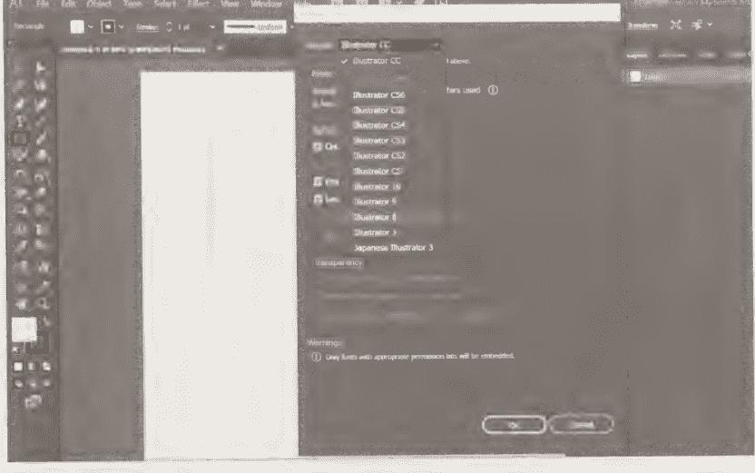

Illustrator 版本选项

要导入 Illustrator 文件，请选择文件标签并点击合并....这与在 After Effects 中导入文件相同。选择你的 Illustrator 文件并将其合并到 C4D 中。参见下面的截图以在界面中找到合并功能：

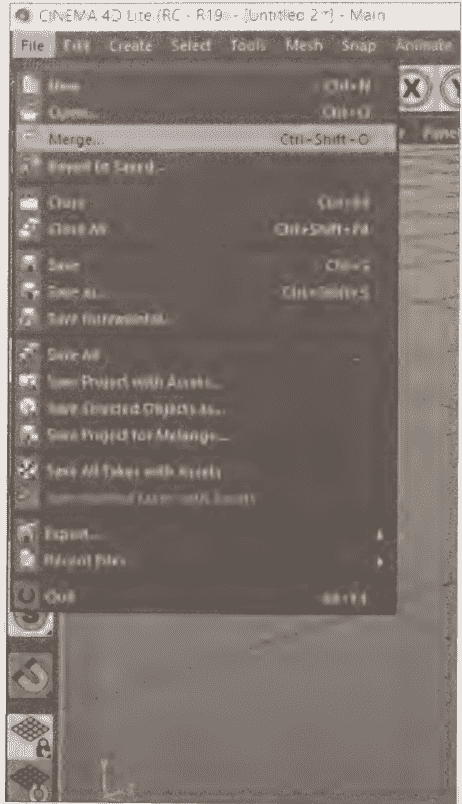

合并

现在 Illustrator 文件已在 C4D 中，让我们从中创建一些几何体来玩玩。点击曲面图标并向项目添加一个挤出曲面。这为我们的路径创建几何体。如丝带对象的演示所示，对象的层级结构非常重要。请按照以下步骤挤出 Illustrator 形状：

- 1. 将路径放入挤出曲面对象中。
- 2. 选择对象图标。
- 3. 选择一个 Null 对象。
- 4. 将挤出对象放入 Null 对象中。
- 5. Null 对象类似于文件夹；它允许你将事物分组以便于组织。查看下面的截图以帮助你创建 Null 对象：

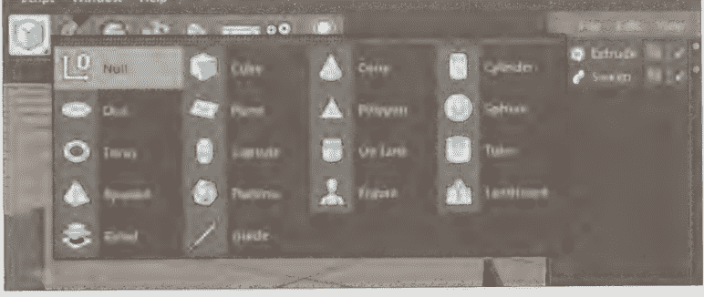

空对象

查看下面的截图，了解对象应如何组织。**Extrude** 对象位于 **Null** 内。这也称为使对象成为子对象：

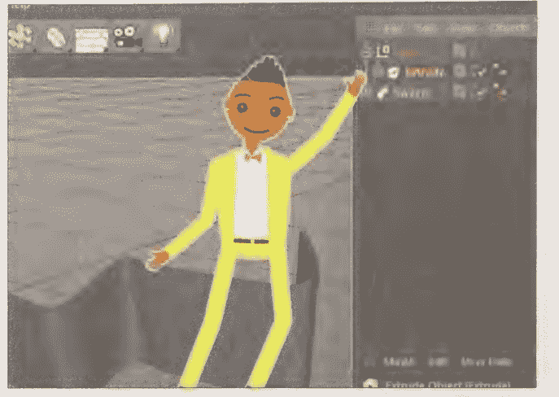

空对象 2

接下来，我们需要编辑对象的参数。选择 **Extrude** 曲面并调整对象的移动。调整最右侧的移动参数以获得所需的外观。

让我们为徽标创建翅膀。我们将遵循导入纹章形状时所做的相同步骤。按照以下步骤操作：

- 1. **Merge...** Illustrator 翅膀文件到项目中
- 2. 向项目添加 **Extrude** 对象
- 3. 选择 **Extrude** 曲面对象
- 4. 勾选分层
- 5. 如同对纹章对象所做的那样调整最右侧的移动参数
- 6. 创建一个 Null 对象
- 7. 将元素放置在 Null 内
- 8. 调整翅膀的缩放/位置

勾选分层框可确保所有路径都被挤出。当文件具有多个路径时请勾选此项。查看下面的截图以查看需要勾选的分层框。此外，注意对象属性面板中的最右侧移动参数；它已调整为 20 以创建翅膀对象的厚度：

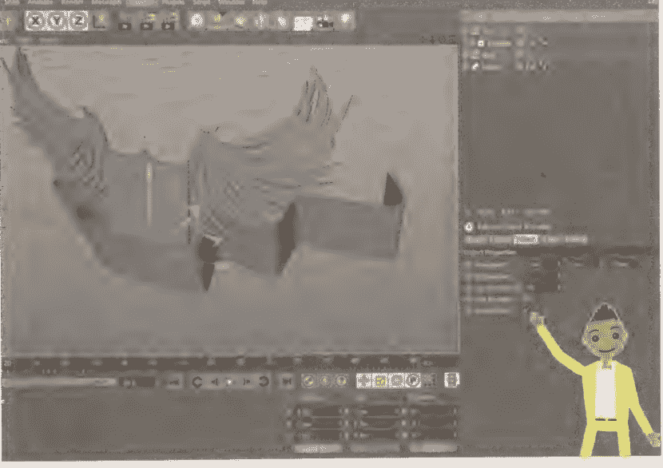

分层

现在我们已经为徽标创建了元素，让我们进入令人兴奋的 3D 文本世界。

## 在 C4D 中创建文本

你的 C4D 项目做得很好！让我们用文本工具创建一些 3D 文本。文本工具位于样条线标签中。按以下截图所示导航到文本工具：

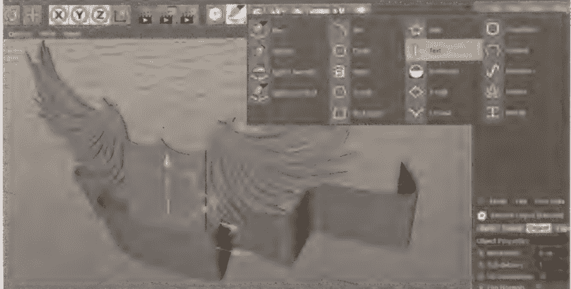

文本工具

要添加文本对象，请按照以下步骤操作：

- 1. 点击样条线标签
- 2. 点击文本工具

选择文本工具后，你的项目中会出现一个文本图层：

现在让我们在文本工具对象面板中输入单词 imagine。这将在你的项目中创建文本。你可以进一步编辑文本的大小、水平间距和字距。在此面板中，你也可以选择字体。让我们按照以下步骤为文本创建几何体：

- 1. 为文本使用 Arial Black 字体
- 2. 添加一个 Extrude 曲面
- 3. 使文本成为 Extrude 曲面的子对象
- 4. 为文本对象创建 **Null**
- 5. 命名文本
- 6. 调整 **Extrude** 对象的移动（调整最右侧的移动参数）

参考以下截图了解文本调整功能：

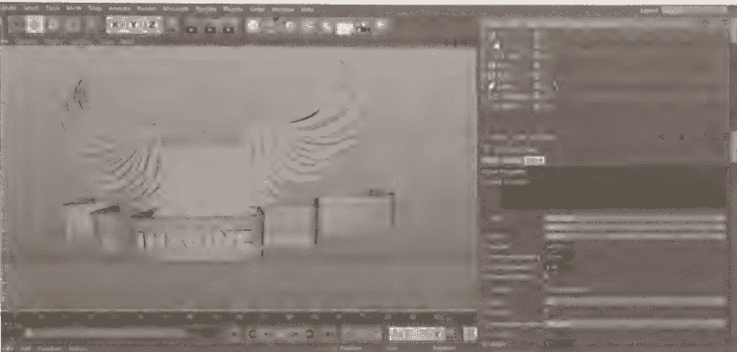

文本工具

让我们通过调整大写字母为文本添加更多细节：

- 1. 选择文本
- 2. 选择 **Caps** 标签
- 3. 对于 **Start**，选择 **Fillet Cap**
- 4. 对于 **End**，选择 **Fillet**
- 5. 对于 **Fillet** 类型，选择 **Engraved**
- 6. 要挤出大写字母，请调整开始和结束参数的 **Radius** 数值

参考以下截图。仔细注意 Caps 参数：

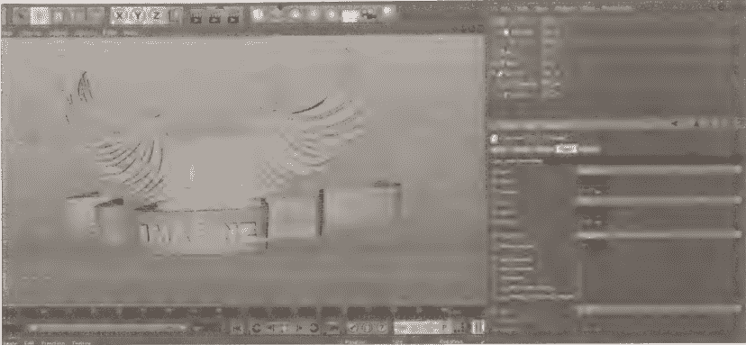

大写字母

你的文本应如前一张截图所示，文本上带有轻微的大写字母。接下来，我们将为徽标创建一个眼睛元素。

## 使用 Sweep 曲面创建眼睛

我们将为徽标创建一个眼睛形状。此过程与创建丝带的方式类似，不过我们将从椭圆样条线对象创建基本样条线。你可以在样条线菜单中找到椭圆样条线。按照以下步骤为徽标创建眼睛形状：

- 1. 向项目添加一个圆形样条线形状
- 2. 调整眼睛的缩放比例，使其适合纹章的中心
- 3. 使对象可编辑
- 4. 选择移动工具
- 5. 调整侧点以创建眼睛形状

完成后，你应该有一个椭圆形的眼睛路径。接下来，我们将为路径创建几何体。我们将遵循之前为丝带使用的相同步骤。按照以下步骤为眼睛路径添加几何体：

- 1. 添加一个矩形。
- 2. 缩小矩形。
- 3. 添加一个 **Sweep** 曲面。
- 4. 在图层面板中，将矩形和圆形放入 sweep 对象中。堆叠顺序为 sweep-矩形-圆形路径。

你的眼睛形状做得很好！让我们创建一个简单的瞳孔形状放在眼睛内部。我们将使用为纹章形状使用的相同过程。我们将创建一条路径然后使用 **Extrude** 曲面创建 3D 几何体。按照以下步骤操作：

- 1. 创建另一个圆形路径
- 2. 添加一个 **Extrude** 曲面对象
- 3. 使圆形路径成为 **Extrude** 曲面的子对象
- 4. 将所有眼睛元素放入 **Null**
- 5. 命名 **Null** 眼睛

查看下面的截图以了解眼睛形状的放置位置：

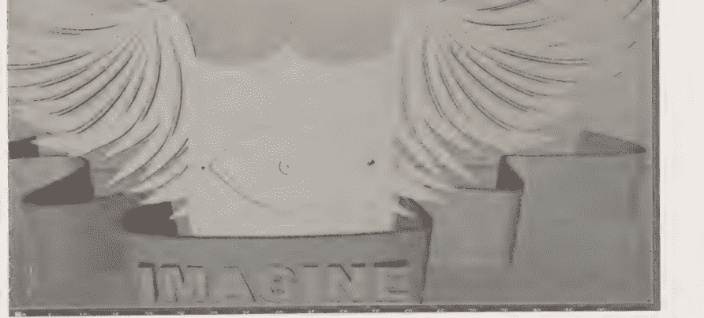

眼睛形状

现在我们已经建模了眼睛，让我们为徽标创建一个星形！

## 建模标志星形

在本项目中，我们正在创建一个能吸引观众眼球的详细标志。为了构建这个标志形状，我们将遵循创建眼形椭圆时使用的相同步骤，只是我们将使用星形样条。按照以下步骤操作：

- 1. 从星形样条创建射线元素。
- 2. 使星形可编辑。
- 3. 添加一个矩形。
- 4. 调整矩形大小。
- 5. 添加一个 Sweep NURBS。
- 6. 使矩形和星形变为 Sweep NURBS 的子级。
- 7. 在堆叠顺序中将矩形置于星形之上。
- 8. 将所有元素放入空对象中 - 为空对象命名：

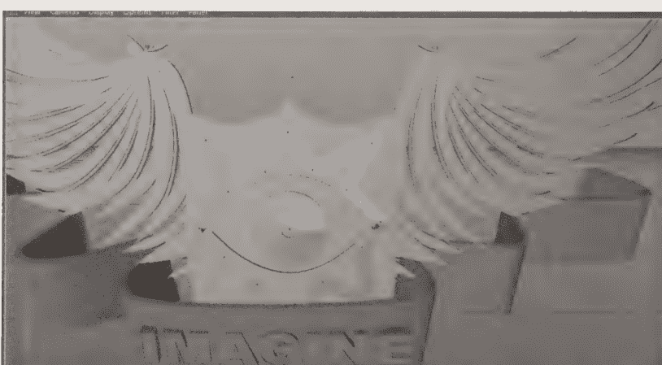

星形

你的星形应该看起来像前面的截图。接下来，我们将开始使用材质内容浏览器为对象添加材质。

## C4D 材质

让我们通过进入材质内容浏览器进入材质的世界……这可以在窗口选项卡中找到，如以下截图所示：

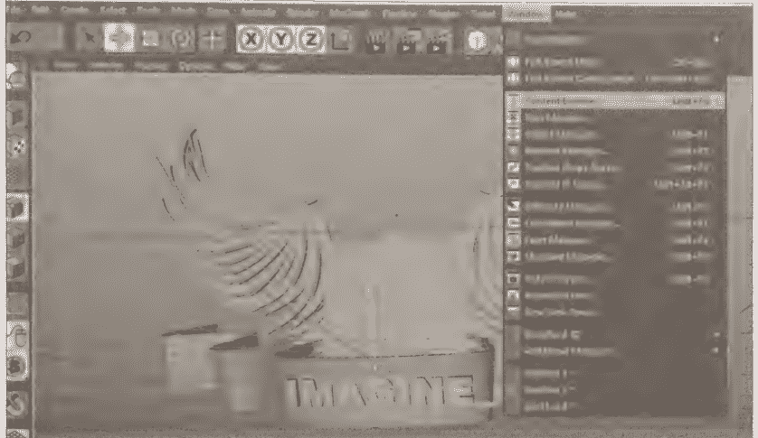

材质浏览器

打开内容浏览器后，你可能会被所有的文件夹淹没。C4D 附带了大量的预设、灯光套件和材质。花点时间探索这些免费的资源！（点击箭头在浏览器中向前和向后浏览。）让我们探索材质预设。按照以下步骤将 Toony 材质添加到标志中：

- 1. 进入预设文件夹。
- 2. 点击 Lite 文件夹。
- 3. 点击材质文件夹。
- 4. 选择 Toony 材质添加到我们的项目中。
- 5. 双击柔和绿色、白色和粉色材质。这将把它们添加到场景中。

请参阅以下截图以在材质文件夹中找到柔和的卡通颜色：

卡通材质

当你将颜色添加到项目中时，你会在时间线下方的材质 bin 中看到它们。你可以进一步编辑这些材质。双击材质以编辑颜色。让我们将颜色更改为橙色、浅蓝色和深蓝色。如果你想从现有的材质样式中添加额外的材质，请按照以下步骤操作：

- 1. 选择材质
- 2. 选择编辑选项卡（材质正上方）
- 3. 选择复制 | 粘贴

这将在材质 bin 中添加你的材质的副本。

要将材质添加到对象，只需从材质 bin 中选择材质并将其拖到主合成中的对象上。你将在图层面板中看到该颜色的图标。此外，你还可以为文本的帽子添加颜色。按照以下步骤为文本帽子添加颜色：

- 1. 将你想要使用的颜色拖到文本挤出对象上。
- 2. 在图层面板中选择材质图标。
- 3. 选择标签。
- 4. 在标签面板中选择选择。
- 5. 为正面颜色输入 C1。
- 6. 为侧面颜色输入 R1。以下截图显示了如何向对象添加多个材质。请查看对象面板最右侧的多个材质：

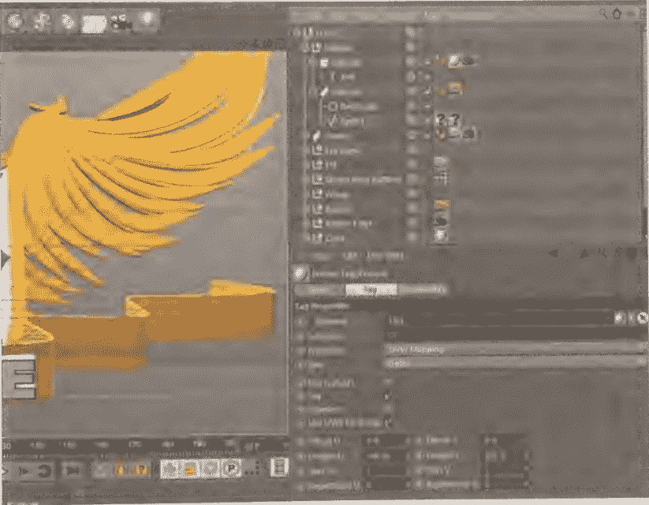

C1 材质

以这种方式添加材质，你可以为文本挤出对象添加多种颜色。

现在我们有了标志的材质，花点时间按照以下截图所示为标志的所有部分添加颜色。选择渲染视图图标，查看图像渲染后的效果。要激活它，只需点击渲染视图图标即可。

你可能想在项目中隐藏某些内容。要在项目中隐藏内容，请按照以下步骤操作：

- 1. 选择图层
- 2. 点击图层面板中的红色按钮

注意我已通过红色按钮关闭了边框。这将确保该对象被隐藏。要隐藏它并使其不被渲染，请按照上述步骤操作，但为图层选择“两者”按钮。请参阅以下截图以找到隐藏视图按钮的位置：

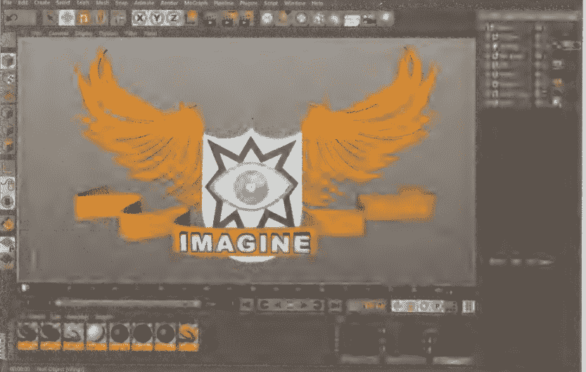

材质和标签

现在我们有了标志的材质，让我们进入 C4D 中的灯光。

## C4D 灯光

C4D 附带了许多专业的灯光套件。灯光在 3D 项目中极其重要。当场景被正确照明时，它会栩栩如生。选择适合你正在创建的场景类型的灯光套件。让我们导航到内容浏览器并进入预设文件夹。你可以使用右上角的返回箭头导航文件夹。在预设文件夹中，有一个灯光设置文件夹。选择 Studio Ring Softbox 工作室。以下截图中已选中它：

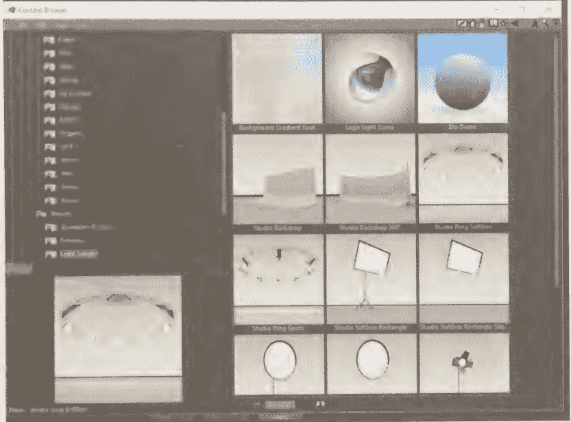

摄影棚环形灯

点击灯光套件会自动将其添加到你的场景中。我们需要将其定位到正确的位置，如以下截图所示。将灯光移至标志上方：

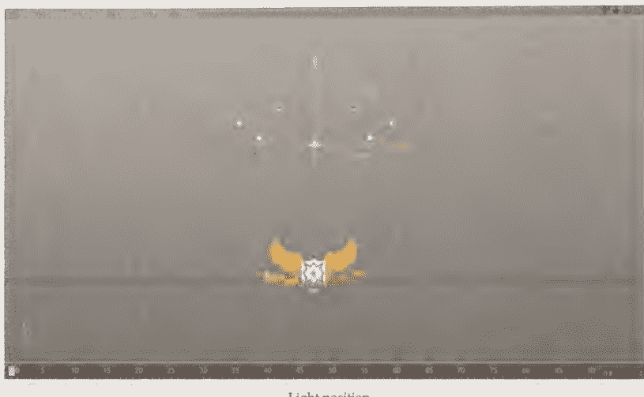

灯光位置

场景中的灯光应该是柔光，因此请相应地调整它们。接下来，我们将创建一个摄像机。我们不会在项目中使用它，但是了解摄像机的位置是很有用的。

### 在 C4D 中创建摄像机

添加摄像机的方式与在 After Effects 中相同。只需点击摄像机图标即可。它会将其添加到你的场景中。但是，你需要告诉 C4D 通过新的摄像机查看。为此，请按照以下步骤操作：

- 1. 向场景添加摄像机
- 2. 选择摄像机 | 使用摄像机

现在，C4D 将通过你创建的摄像机查看场景。以下截图显示了如何导航摄像机视图选项：

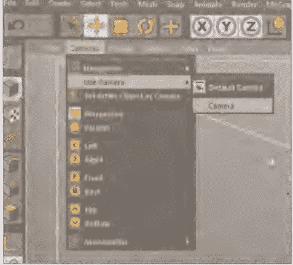

摄像机

让我们删除摄像机并开始为标志设置动画。要在 C4D 中为任何内容设置动画，请按照以下步骤操作：

- 1. 在时间线中选择记录活动对象按钮。你将在时间线中看到一个绿色标签。
- 2. 在时间线中向下移动。
- 3. 更改对象的位置。
- 4. 点击记录活动对象按钮。
- 5. 你将在时间线中看到一个新的关键帧。

请查看以下截图，了解如何激活记录活动对象按钮（红色钥匙图标）：

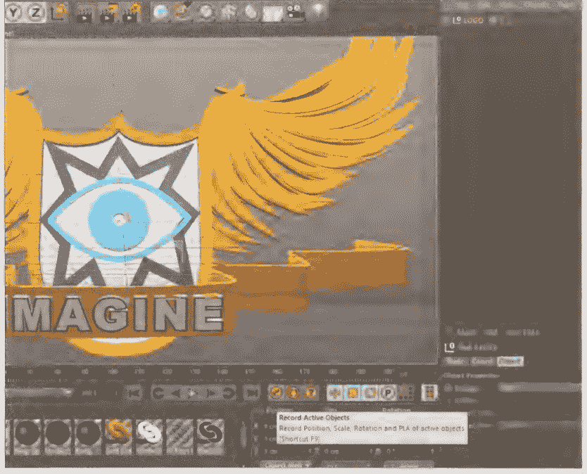

记录图标

让我们为标志设置动画。将所有标志图层放入名为 logo 的空对象中。现在我们可以作为一个组来为标志设置动画。我们希望标志旋转并最终正面朝向观众。按照以下步骤为标志设置动画：

- 1. 选择 logo 空对象。
- 2. 选择旋转工具。
- 3. 在时间线中点击记录活动对象按钮。你会看到一个绿色关键帧时间线。
- 4. 在时间线中向下移动。
- 5. 旋转标志，使其旋转数次。
- 6. 点击记录活动对象按钮。
- 7. 你将在时间线中看到一个新的关键帧。

按照这些步骤在 C4D 中设置动画。默认情况下，C4D 会为你的关键帧添加缓动，使动画更流畅：

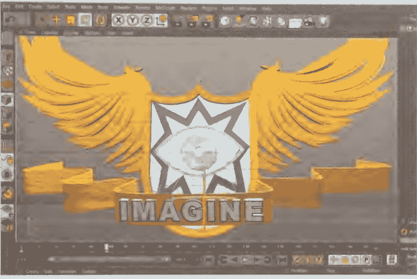

动画关键帧

现在我们已经为标志设置了动画，我们准备在 After Effects 中渲染它。在进入 After Effects 之前，让我们调整渲染设置。

## 从 After Effects 渲染 C4D 项目

为了设置我们的 C4D 项目以便在 After Effects 中渲染，我们首先需要调整项目设置。按照以下步骤操作：

- 1. 进入工具面板
- 2. 进入编辑渲染设置
- 3. 点击编辑渲染设置图标

这将为你提供调整项目宽度、高度和帧速率的选项。按照以下截图所示调整设置：

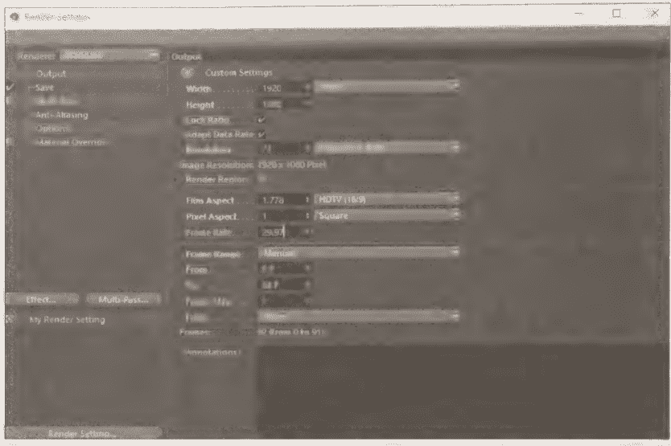

项目设置

现在我们已经调整了设置，我们可以返回 After Effects 并继续编辑项目。当你返回 After Effects 时，你会注意到你的 C4D 图层将被更新为完全建模的场景。它看起来可能不同，因为默认视图是草稿视图。你将在此视图中看到 C4D 地板。要关闭此视图，你必须将渲染视图更改为最终。请参阅以下截图以获得更清晰的说明：

最终视图

让我们在 After Effects 中为背景添加一个视频。花点时间对视频进行色彩校正，使其看起来像前面的截图。最好充分利用色相/饱和度效果。需要注意的一点是，你不能更改 C4D 图层的缩放或位置。确保你在 C4D 中进行更改并保存，然后返回 After Effects。按照以下步骤在 After Effects 中添加额外的更改：

- 1. 对 logo 进行色彩校正
- 2. 对背景进行色彩校正
- 3. 向调整图层添加运动模糊效果
- 4. 向调整图层添加 cc 暗角
- 5. 返回 C4D 进行更改
- 6. 在渲染前打开 Standard Final

## 摘要

恭喜！从第一章的介绍到现在在 C4D Lite 中创建和动画化 logo，你已经走了很远。你可以使用 C4D Lite 为个人项目或客户创建 3D logo。你已经学习了许多技能和工具来创建和导入 Illustrator 文件，将它们导入 C4D 并使其成为 3D。你还可以像本项目中演示的那样为场景添加材质和灯光。我们学到的最大要点是如何将 3D 项目带入 After Effects，用特效编辑它并渲染以生成高质量的 3D 视频。这将帮助你为视频项目增添价值。它也丰富了你的多样化技能。我们学习了在 C4D Lite 中建模对象的许多不同方法。尝试这些建模工具，以便你能掌握这门手艺。这是一段相当有趣的旅程，我希望你能继续练习我们所学的一切，并成为 After Effects 的终身粉丝。

## 问题

- 1. 如何在 After Effects 中创建 C4D 图层？
- 2. 如何保存 Illustrator 文件以导入 C4D？
- 3. 要在 C4D 中创建 3D 文本，我们使用什么 nurb 来创建几何体？
- 4. 我们点击什么在时间线上创建初始关键帧？
- 5. 在渲染 C4D 项目之前，你需要在 After Effects 中打开什么？
- 6. 我们可以在 After Effects 中调整 C4D 图层吗？
- 7. 我们点击什么来编辑 C4D 项目中的渲染设置？

## 评估

### 第 1 章：开始使用 After Effects

- 1. 选择要动画化的参数，单击该参数的秒表，然后在时间中移动以调整该参数。
- 2. 将鼠标悬停在图层的末端，识别修剪图标，然后拖动图层。使用快捷键 Alt + [ 或 ]。
- 3. 前往时间线中的所需位置并按 N 或 B。
- 4. 在主窗口的左下侧，选择网格和参考线选项。
- 5. 进入预览面板并按下一帧键。使用 Page Down 键盘快捷键。
- 6. 在预览面板中，按播放。按空格键。
- 7. 图层 | 新建 固态层。
- 8. 顶部工具栏。
- 9. 选择蒙版并单击一个蒙版点一次。
- 10. 选择蒙版并双击一个蒙版点。
- 11. 选择蒙版，展开蒙版功能，然后选择减去。
- 12. 它标记了时间线中动画的开始。
- 13. 时间线中的蓝色菱形。
- 14. 时间线上的字母 s。

### 第 2 章：为电视节目创建下三分之一

- 1. 钢笔工具用于用蒙版抠出物体。单击并添加点可创建自定义蒙版。
- 2. 选择关键帧并在时间线中拖动它们。
- 3. 一种辅助工具，用于控制关键帧的开始和结束方式。
- 4. 一种用于平滑关键帧移动的工具。
- 5. 单击文本图标。
- 6. 添加一个空对象图层并将所需对象设为该空对象的父级。
- 7. 选择所需图层并选择合成 预合成。

### 第 3 章：使用形状图层创建动画歌词视频

- 1. 添加到图层的样式
- 2. 图层 | 图层样式
- 3. 具有形状参数和动画参数的矢量图层
- 4. 一种将你带到下一场景的创意方式
- 5. Shift + 数字 + 单击数字以添加注释
- 6. 音频图层的视觉表示
- 7. 添加到文本图层以创建即时文本动画的效果
- 8. 效果预设 | 动画预设 | 文本

### 第 4 章：创建带角色动画的信息图表

- 1. 字距用于文本之间的间距。
- 2. 导入为合成，保留图层大小，并创建合成。
- 3. 这样无论放大多少，它们看起来都很清晰。
- 4. 这将使你的动画具有逼真的平滑运动。
- 5. 打开摄像机控制和麦克风输入图标。点击录制按钮以激活实时录制。
- 6. 进入文件并选择导出 PNG 和 WAV 文件。
- 7. 两个。

### 第 5 章：使用文本动画师制作电影标题项目

- 1. 使用一张图像作为隐藏或显示另一张图像部分的方式
- 2. 图层 | 新建 | 灯光...
- 3. 为你的文字图层添加立体高光和阴影
- 4. 控制图像色相、饱和度和亮度的一种方式
- 5. 模拟镜头光晕的灯光效果
- 6. 改变其所应用图层的黑白值效果
- 7. 一个指南，用于放置文本和其他图层而不被电视屏幕边缘裁切

### 第 6 章：使用合成效果制作体育图形动画

- 1. 镜头光晕
- 2. 自动色阶
- 3. 转场
- 4. 添加模式
- 5. 摄像机跟踪
- 6. 跟踪点
- 7. 目标
- 8. 单击 3D 立方体图标

### 第 7 章：使用 3D 摄像机跟踪器开发 VFX 项目

- 1. 3D 摄像机跟踪器
- 2. 平滑摄像机移动
- 3. 曲线
- 4. 快速选择
- 5. 矢量蒙版

### 第 8 章：创建 2.5D 环境摄像机飞越

- 1. 图层 | 新建 | 摄像机
- 2. 图层 | 新建 | 灯光
- 3. 你可以在不同视图中准确放置和动画化 3D 图层
- 4. 移动位置参数或 3D 参数手柄
- 5. 它们会显著增加你的渲染时间
- 6. Alt 键（macOS 为 option）
- 7. 以便你的图层以高质量渲染
- 8. 你可以完全控制你的摄像机和图层
- 9. 摄像机工具
- 10. 控制 3D 图层的方式，由 3D 图层上的箭头表示

### 第 9 章：构建 3D C4D Lite Logo 项目

- 1. 图层 | 新建 | MAXON CINEMA 4D 文件
- 2. 另存为 Illustrator 8
- 3. 挤出 NURBS
- 4. 红色记录活动对象按钮
- 5. 最终渲染
- 6. 否
- 7. 渲染编辑器

## 你可能喜欢的其他书籍

如果你喜欢这本书，你可能对 Packt 出版的其他这些书籍感兴趣：

Mastering Adobe Captivate 2019 - 第五版
Dr. Pooja Jaisingh, Damien Bruyndonckx
ISBN: 978-1-78980-305-1

- 学习如何使用 Adobe Captivate 中的对象来构建专业的电子学习内容
- 通过添加交互性、动画、拖放交互等来增强你的项目
- 添加多媒体元素，如音频和视频，以创建引人入胜、最先进的学习体验
- 使用主题打造独特的视觉体验，强化学习过程
- 使用问题幻灯片创建符合 SCORM 标准的测验，可与你喜爱的 LMS 无缝集成
- 借助 Adobe Captivate 的响应式功能，使你的内容适应任何设备
- 使用 Adobe Captivate 2019 全新的虚拟现实项目创建令人惊叹的沉浸式 360° 体验
- 将 Captivate 与其他应用程序（如 PowerPoint 和 Photoshop）集成，以建立专业的电子学习制作工作流程
- 以包括 HTML5 和 Flash 在内的多种格式发布你的项目

## 留下评论 - 让其他读者知道你的想法

请通过在购买网站上留下评论与他人分享你对这本书的想法。如果你是在 Amazon 购买的书，请在该书的 Amazon 页面上留下诚实的评论。这至关重要，这样其他潜在读者可以看到并使用你的公正意见来做出购买决定，我们可以了解客户对我们产品的看法，作者也可以看到你对他们与 Packt 合作创作的书名的反馈。这只需要你几分钟的时间，但对其他潜在客户、我们的作者和 Packt 来说都很有价值。谢谢！

