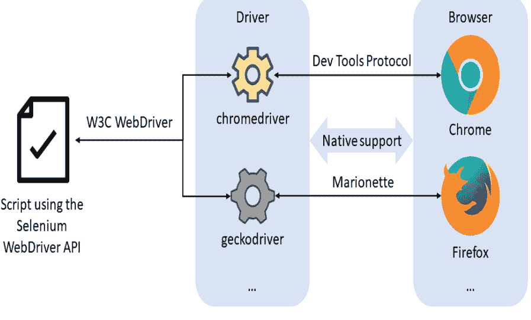
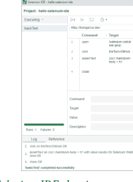
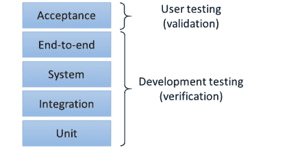
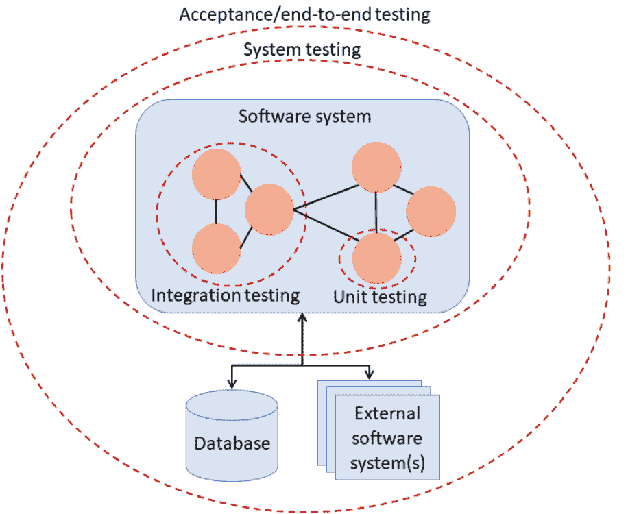
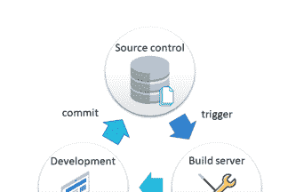
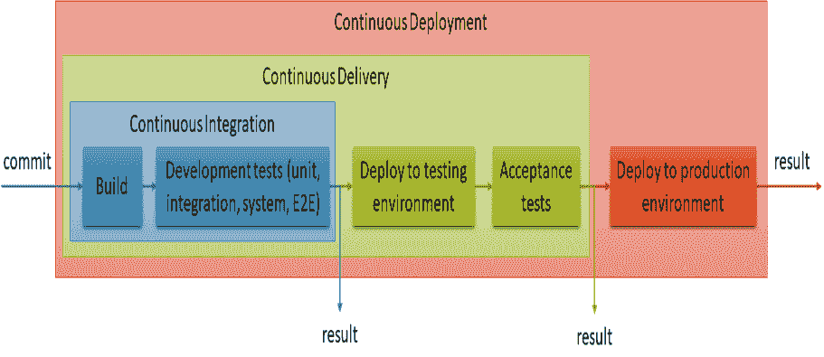
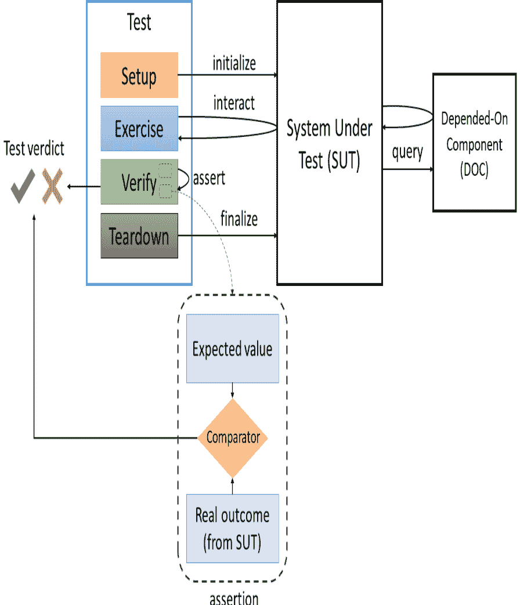

## 第 1 章. Selenium 入门

### 早期发布读者的说明

使用 Early Release 电子书，您可以在官方发布这些标题之前很久就利用这些技术——在作者撰写时获得书籍的原始未编辑内容。

这将是最终书籍的第 1 章。请注意，GitHub 仓库将在稍后激活。

如果您对如何改进本书的内容和/或示例有任何意见，或者如果您注意到本章中缺少材料，请联系开发编辑 rfernando@oreilly.com。

*Selenium* 是一个开源套件，由一组库和工具组成，可实现 Web 浏览器的自动化。我们可以将 Selenium 看作是由三个核心组件组成的伞形项目：WebDriver、Grid 和 IDE（集成开发环境）。Selenium WebDriver 是一个库，允许以编程方式驱动浏览器。因此，我们可以使用 Selenium WebDriver 以自动化的方式导航网站并与网页交互（例如，点击链接、填写表单等），就像真正的用户一样。Selenium WebDriver 的主要用途是 Web 应用程序的自动化测试。Selenium 的其他用途包括 Web 管理任务的自动化或 Web 抓取（自动 Web 数据提取）。

本章全面概述了 Selenium 的核心组件：WebDriver、Grid 和 IDE。然后，它回顾了 Selenium 生态系统，即围绕它的其他工具和技术。最后，它分析了与 Selenium 相关的软件测试基础。

### Selenium 核心组件

Jason Huggins 和 Paul Hammant 在 2004 年在 ThoughtWorks 工作时创建了 Selenium。他们选择名称“Selenium”作为与 Mercury 的对应物，Mercury 是 HP 开发的一个现有测试框架。名称具有重要意义，因为化学元素硒以降低汞的毒性而闻名。

Selenium 的初始版本（现在称为 *Selenium Core*）是一个 JavaScript 库，可在 Web 应用程序中模拟用户操作。Selenium Core 解释所谓的 *Selenese* 命令以实现此任务。这些命令被编码为由三部分组成的 HTML 表格：*command*（在 Web 浏览器中执行的操作，例如打开 URL 或点击链接）、*target*（标识 Web 元素的定位器，例如给定组件的属性）和 *value*（可选数据，例如在 Web 表单字段中输入的文本）。

Huggins 和 Hammant 在名为 *Selenium Remote Control*（RC）的新项目中为 Selenium Core 添加了脚本层。Selenium RC 遵循客户端-服务器架构。客户端使用绑定语言（例如 Java 或 JavaScript）通过 HTTP 向称为 *Selenium RC Server* 的中间代理发送 Selenese 命令。该服务器按需启动 Web 浏览器，在网站上注入 Selenium Core 库，并将客户端请求代理到 Selenium Core。此外，Selenium RC Server 将目标网站屏蔽为注入的 Selenium Core 库的相同本地 URL，以避免同源策略问题。这种方法在当时是浏览器自动化的一个变革，但它存在重大限制。首先，由于 JavaScript 是支持自动化的底层技术，因此不允许执行某些操作，因为 JavaScript 不允许它们，例如上传和下载文件或处理弹出窗口和对话框，仅举几例。此外，Selenium RC 引入了相关的开销，影响了其性能。

与此同时，Simon Stewart 于 2007 年创建了 *WebDriver* 项目。从功能角度来看，WebDriver 和 Selenium RC 相当，即两个项目都允许使用编程语言模拟 Web 用户。然而，WebDriver 使用每个浏览器的原生支持来执行自动化，因此其功能和性能远优于 RC。2009 年，在 Jason Huggins 和 Simon Stewart 在 Google 测试自动化大会上的会面后，他们决定将 Selenium 和 WebDriver 合并为一个项目。新项目称为 *Selenium WebDriver* 或 Selenium 2。该新项目使用基于 HTTP 的通信协议与浏览器上的原生自动化支持相结合。这种方法仍然是即将推出的 Selenium 3（2016 年发布）和 Selenium 4（2021 年发布）项目的基石。如今，我们将 Selenium RC 和 Core 称为“Selenium 1”，其使用已不被推荐，建议使用 Selenium WebDriver。本书重点介绍迄今为止 Selenium WebDriver 的最新版本，即版本 4。

> **TIP**
> 
> *附录 1* 总结了随 Selenium 4 发布的新功能。该附录还包含从 Selenium 3 升级到 4 的迁移指南。

今天，Selenium 是一个众所周知的自动化套件，由三个子项目组成：WebDriver、Grid 和 IDE。以下小节介绍每个项目的[content]

WARNING
此元素表示警告或注意。

## 使用代码示例

代码示例可在 https://github.com/bonigarcia/selenium-webdriver-java 上下载。如果您对使用代码示例有技术问题或遇到问题，请发送电子邮件至 bookquestions@oreilly.com。

本书旨在帮助您完成工作。一般而言，如果本书提供了示例代码，您可以在自己的程序和文档中使用它。除非您复制了代码的很大一部分，否则无需联系我们征求许可。例如，使用本书中的几段代码编写程序不需要许可。出售或分发 O’Reilly 书籍中的示例需要许可。引用本书并引用示例代码来回答问题不需要许可。将大量示例代码纳入您产品的文档中需要许可。

我们感谢但通常不需要署名。署名通常包括标题、作者、出版商和 ISBN。例如：“Book Title by Some Author (O’Reilly). Copyright 2012 Some Copyright Holder, 978-0-596-xxxx-x。”

如果您认为使用代码示例超出了合理使用范围或上述许可范围，请随时联系我们 permissions@oreilly.com。

## O’Reilly Online Learning

> **NOTE**
> 
> 40 多年来，*O’Reilly Media* 一直为公司提供技术和商业培训、知识和见解，帮助公司取得成功。

我们独特的专家和创新者网络通过书籍、文章和我们的在线学习平台分享他们的知识和专业知识。O’Reilly 的在线学习平台为您提供按需访问实时培训课程、深入学习路径、交互式编码环境，以及来自 O’Reilly 和 200 多家其他出版商的庞大文本和视频集合。有关更多信息，请访问 *http://oreilly.com*。

## 如何联系我们

请将有关本书的评论和问题发送给出版商：

O’Reilly Media, Inc.  
1005 Gravenstein Highway North  
Sebastopol, CA 95472  
800-998-9938（美国或加拿大境内）  
707-829-0515（国际或本地）  
707-829-0104（传真）

我们为本书设有网页，在该网页上列出勘误表、示例和任何其他信息。您可以通过以下地址访问此页面

*https://learning.oreilly.com/library/view/hands-on-selenium-webdriver/9781098109998*。

发送电子邮件至 *bookquestions@oreilly.com* 对本书发表评论或提出技术问题。

有关我们书籍和课程的新闻和信息，请访问 *http://oreilly.com*。

在 Facebook 上找到我们：*http://facebook.com/oreilly*。

在 Twitter 上关注我们：*http://twitter.com/oreillymedia*。

在 YouTube 上观看我们：*http://www.youtube.com/oreillymedia*。

## 致谢

## 第一部分. 引言

Selenium 是一个由三个核心组件组成的开源伞形项目：WebDriver、Grid 和 IDE。Selenium 为浏览器自动化提供了高级功能，实践者通常将其用于实现 Web 应用程序的端到端测试。本书的第一部分对 Selenium 项目及其生态系统进行了全面概述。此外，它还提供了软件测试理论的入门介绍，重点关注其在 Selenium WebDriver 上的实际应用。最后，您将了解如何设置一个项目（使用 Maven 或 Gradle）来开发 WebDriver 测试。为了完整起见，我介绍了有关用于嵌入对 Selenium WebDriver API 调用的单元测试框架的不同替代方案，即 JUnit 4、JUnit 5（单独使用或由 Selenium-Jupiter 扩展）以及 TestNG。

## 第 1 章. Selenium 入门

### 早期发布读者的说明

使用 Early Release 电子书，您可以在官方发布这些标题之前很久就利用这些技术——在作者撰写时获得书籍的原始未编辑内容。

这将是最终书籍的第 1 章。请注意，GitHub 仓库将在稍后激活。

如果您对如何改进本书的内容和/或示例有任何意见，或者如果您注意到本章中缺少材料，请联系开发编辑 rfernando@oreilly.com。

*Selenium* 是一个开源套件，由一组库和工具组成，可实现 Web 浏览器的自动化。我们可以将 Selenium 看作是由三个核心组件组成的伞形项目：WebDriver、Grid 和 IDE（集成开发环境）。Selenium WebDriver 是一个库，允许以编程方式驱动浏览器。因此，我们可以使用 Selenium WebDriver 以自动化的方式导航网站并与网页交互（例如，点击链接、填写表单等），就像真正的用户一样。Selenium WebDriver 的主要用途是 Web 应用程序的自动化测试。Selenium 的其他用途包括 Web 管理任务的自动化或 Web 抓取（自动 Web 数据提取）。

本章全面概述了 Selenium 的核心组件：WebDriver、Grid 和 IDE。然后，它回顾了 Selenium 生态系统，即围绕它的其他工具和技术。最后，它分析了与 Selenium 相关的软件测试基础。

### Selenium 核心组件

Jason Huggins 和 Paul Hammant 在 2004 年在 ThoughtWorks 工作时创建了 Selenium。他们选择名称“Selenium”作为与 Mercury 的对应物，Mercury 是 HP 开发的一个现有测试框架。名称具有重要意义，因为化学元素硒以降低汞的毒性而闻名。

Selenium 的初始版本（现在称为 *Selenium Core*）是一个 JavaScript 库，可在 Web 应用程序中模拟用户操作。Selenium Core 解释所谓的 *Selenese* 命令以实现此任务。这些命令被编码为由三部分组成的 HTML 表格：*command*（在 Web 浏览器中执行的操作，例如打开 URL 或点击链接）、*target*（标识 Web 元素的定位器，例如给定组件的属性）和 *value*（可选数据，例如在 Web 表单字段中输入的文本）。

Huggins 和 Hammant 在名为 *Selenium Remote Control*（RC）的新项目中为 Selenium Core 添加了脚本层。Selenium RC 遵循客户端-服务器架构。客户端使用绑定语言（例如 Java 或 JavaScript）通过 HTTP 向称为 *Selenium RC Server* 的中间代理发送 Selenese 命令。该服务器按需启动 Web 浏览器，在网站上注入 Selenium Core 库，并将客户端请求代理到 Selenium Core。此外，Selenium RC Server 将目标网站屏蔽为注入的 Selenium Core 库的相同本地 URL，以避免同源策略问题。这种方法在当时是浏览器自动化的一个变革，但它存在重大限制。首先，由于 JavaScript 是支持自动化的底层技术，因此不允许执行某些操作，因为 JavaScript 不允许它们，例如上传和下载文件或处理弹出窗口和对话框，仅举几例。此外，Selenium RC 引入了相关的开销，影响了其性能。

与此同时，Simon Stewart 于 2007 年创建了 *WebDriver* 项目。从功能角度来看，WebDriver 和 Selenium RC 相当，即两个项目都允许使用编程语言模拟 Web 用户。然而，WebDriver 使用每个浏览器的原生支持来执行自动化，因此其功能和性能远优于 RC。2009 年，在 Jason Huggins 和 Simon Stewart 在 Google 测试自动化大会上的会面后，他们决定将 Selenium 和 WebDriver 合并为一个项目。新项目称为 *Selenium WebDriver* 或 Selenium 2。该新项目使用基于 HTTP 的通信协议与浏览器上的原生自动化支持相结合。这种方法仍然是即将推出的 Selenium 3（2016 年发布）和 Selenium 4（2021 年发布）项目的基石。如今，我们将 Selenium RC 和 Core 称为“Selenium 1”，其使用已不被推荐，建议使用 Selenium WebDriver。本书重点介绍迄今为止 Selenium WebDriver 的最新版本，即版本 4。

> **TIP**
> 
> *附录 1* 总结了随 Selenium 4 发布的新功能。该附录还包含从 Selenium 3 升级到 4 的迁移指南。

今天，Selenium 是一个众所周知的自动化套件，由三个子项目组成：WebDriver、Grid 和 IDE。以下小节介绍每个项目的

### Selenium WebDriver

Selenium WebDriver 是一个库，允许自动控制 Web 浏览器。为此，它提供跨平台 API 和不同语言绑定。Selenium WebDriver 官方支持的编程语言为 Java、JavaScript、Python、Ruby 和 C#。内部，Selenium WebDriver 使用每个浏览器实现的原生支持来执行自动化过程。因此，我们需要放置一个名为 *driver* 的组件

between the script using the Selenium WebDriver API and the browser. Table 1-1 shows a summary of the browsers and drivers officially supported by Selenium WebDriver.

> **NOTE**
>
> It is widespread to use the name *Selenium* for referring to the library for browser automation. Since this term is also the name of the umbrella project, I use *Selenium* in this book for identifying the browser automation suite, which is composed of three components: Selenium WebDriver (library), Selenium Grid (infrastructure), and Selenium IDE (tool).

*Table 1-1. Browser and driver support by Selenium*

| Browser | Driver | Operating System | Maintainer | Download |
|---|---|---|---|---|
| Chrome/Chromium | chromedriver | Windows/Mac/Linux | Google | https://chromedriver.chromium.org/ |
| Edge | msedgedriver | Windows/Mac/Linux | Microsoft | https://developer.microsoft.com/en-us/microsoft-edge/tools/webdriver/ |
| Firefox | geckodriver | Windows/Mac/Linux | Mozilla | https://github.com/mozilla/geckodriver/ |
| Opera | operadriver | Windows/Mac/Linux | Opera Software AS | https://github.com/operasoftware/operachromiumdriver |
| Internet Explorer | IEDriverServer | Windows | Selenium project | https://www.selenium.dev/downloads/ |
| Safari | safaridriver | Mac | Apple | Built-in |

Drivers (e.g., chromedriver, geckodriver, etc.) are platform-dependent binary files that receive commands from a WebDriver script and translate them into some browser-specific language. In the first releases of Selenium WebDriver (i.e., in Selenium 2), these commands (also known as the *Selenium protocol*) were JSON messages over HTTP (the so-called *JSON Wire Protocol*). Nowadays, this communication (still JSON over HTTP) follows a standard specification named *W3C WebDriver*. This recommendation is the only Selenium protocol as of Selenium 4.

Figure 1-1 summarizes the basic architecture of Selenium WebDriver we have seen so far. As you can see, this architecture has three tiers. First, we find a script using the Selenium WebDriver API (Java, JavaScript, Python, Ruby, or C#). This script sends W3C WebDriver commands to the second layer, in which we find the drivers. This figure shows the specific case of using chromedriver (to control Chrome) and geckodriver (to control Firefox). Finally, the third layer contains the web browsers. In the case of Chrome, the native browser follows the *DevTools Protocol*. DevTools is a set of developer tools for browsers based on the Blink rendering engine, such as Chrome, Chromium, Edge, or Opera. The DevTools Protocol is based on JSON-RPC messages and allows inspecting, debugging, and profiling these browsers. In Firefox, the native automation support uses the *Marionette* protocol. Marionette is a remote protocol based on JSON, allowing instrumenting and controlling web browsers based on the Gecko engine (such as Firefox).

*Figure 1-1. Selenium WebDriver architecture*

Overall, Selenium WebDriver allows controlling web browsers as a user would do, but programmatically. To that aim, the WebDriver API provides a wide variety of features to navigate web pages, interact with web elements, or impersonate user actions, among many other capabilities. The target application is web-based, such as static websites, dynamic web applications, Single Page Applications (SPA), complex enterprise systems with a web interface, etc.

## Selenium Grid

The second project of the Selenium family is *Selenium Grid*. Philippe Hanrigou started the development of this project in 2008. Selenium Grid is a group of networked hosts that provides browser infrastructure for Selenium WebDriver. This infrastructure enables the (parallel) execution of Selenium WebDriver scripts with remote browsers of different nature (types and versions) in multiple operating systems.

*Figure 1-2* shows the basic architecture of Selenium Grid. As you can see, a group of nodes provides browsers to be used by Selenium scripts. These nodes can use different operating systems (as we saw in *Table 1-1*) with various installed browsers. The central entry point to this Grid is the *Hub* (also known as *Selenium Server*). This server-side component keeps track of

## Selenium IDE

This early version of Selenium IDE was a Firefox plugin that embedded Selenium Core to record, edit, and playback Selenium scripts. These early versions were XPI modules (i.e., a technology used to create Mozilla extensions). As of version 55 (released in 2017), Firefox migrated the add-ons support to the W3C Browser Extensions specification. As a result, Selenium IDE was discontinued, and for some time, it has not been possible to use it. To solve this problem, the Selenium team rewrote Selenium IDE following the Browser Extensions recommendation. Thanks to this, we can now use Selenium IDE in multiple browsers, such as Chrome, Edge, and Firefox.

Figure 1-3 shows the new Selenium IDE GUI (Graphical User Interface). Using this GUI, users can record interactions with a browser and edit and execute the generated script. Selenium IDE encodes each interaction in different parts: a command (i.e., the action executed in the browser), a target (i.e., the locator of the web element), and a value (i.e., the data handled). Optionally, we can include a description of the command. In particular, Figure 1-3 shows a recording example that:

1. Open website (https://bonigarcia.dev/selenium-webdriver-java/). We will use this website as the practice site in the rest of the book.
2. Click on the link with the text “GitHub.” As a result, the navigation moves to the examples repository source code.
3. Assert that the book title (“Hands-On Selenium WebDriver with Java”) is present on the web page.
4. Close the browser.

*Figure 1-3. Selenium IDE showing an example of a recorded script*

Once we have created a script in Selenium IDE, we can export this script as a Selenium WebDriver test. For instance, Figure 1-4 shows how to convert the presented example as a JUnit test case. Finally, we can save the project on our local machine. The resulting project for this sample is available in the examples GitHub repository.

> **NOTE**
>
> The Selenium project is porting Selenium IDE to Electron at the time of this writing. Electron is an open-source framework based on Chromium and Node.js that allows the development of desktop applications.

*Figure 1-4. Exporting a Selenium IDE script to a JUnit test case*

## Selenium Ecosystem

Software ecosystems are collections of elements interacting with a shared market underpinned by a common technological background. In the case of Selenium, its ecosystem involves the official core projects and other related projects, libraries, and other actors. This section reviews the Selenium ecosystem divided into the following categories: language bindings, driver managers, frameworks, browser infrastructure, and community.

### Language Bindings

As we already know, the Selenium project maintains various language bindings for Selenium WebDriver: Java, JavaScript, Python, Ruby, and C#. Nevertheless, other languages are also available. Table 1-2 summarizes these language bindings for Selenium WebDriver maintained by the community.

*Table 1-2. Unofficial language bindings for Selenium WebDriver*

| Name | Language | License | Maintainer | Website |
|---|---|---|---|---|
| hs-webdriver | Haskell | BSD-3-Clause | Adam Curtis | https://github.com/kallistidev/hs-webdriver |
| php-webdriver | PHP | MIT | Facebook, community | https://github.com/php-webdriver/php-webdriver |
| RSelenium | R | AGPLv3 | rOpenSci | https://github.com/ropensci/RSelenium |
| Selenium | Go | MIT | Miki Tebeka | https://github.com/tebeka/selenium |
| Selenium-Remote-Driver | Perl | Apache 2.0 | George S. Baugh | https://github.com/teodesian/Selenium-Remote-Driver |
| webdriver.dart | Dart | Apache 2.0 | Google | https://github.com/google/webdriver.dart |
| wd | JavaScript | Apache 2.0 | Adam Christian | https://github.com/admc/wd |

### Driver Managers

Drivers are mandatory components to control web browsers natively with Selenium WebDriver (see Figure 1-1). For this reason, before using the Selenium WebDriver API, we need to manage these drivers. We call driver management the process of downloading, setting up, and maintaining the proper driver for a given browser. The usual steps in the driver management procedure are the following:

1. 下载：每个浏览器都有自己的驱动程序。例如，我们使用 chromedriver 来控制 Chrome，或使用 geckodriver 来控制 Firefox（参见表 1-1）。驱动程序是特定于平台的二进制文件。因此，我们需要为给定的操作系统（通常是 Windows、Mac 或 Linux）下载合适的驱动程序。此外，我们还需要考虑驱动程序版本，因为某个驱动程序版本与特定浏览器版本（或版本范围）兼容。例如，要使用 Chrome 91.x，我们需要下载 chromedriver 91.0.4472.19。我们通常可以在驱动程序文档或发布说明中找到浏览器与驱动程序的兼容性信息。
2. 设置：一旦我们有了合适的驱动程序，就需要使其在 Selenium WebDriver 脚本中可用。
3. 维护：现代 Web 浏览器（例如 Chrome、Firefox 或 Edge）会自动且静默地升级，不会提示用户。因此，就 Selenium WebDriver 而言，我们需要及时维护这些所谓的*常青浏览器*的浏览器与驱动程序版本兼容性。

如你所见，驱动程序维护过程可能非常耗时。此外，它还可能给 Selenium WebDriver 用户带来相关问题（例如，浏览器自动升级后，由于浏览器与驱动程序不兼容而导致测试失败）。因此，所谓的*驱动程序管理器*旨在以某种程度的自动化方式执行驱动程序管理过程。表 1-3 总结了可用于不同语言绑定的驱动程序管理器。

表 1-3. Selenium WebDriver 的驱动程序管理器

| 名称 | 语言 | 许可证 | 维护者 | 网站 |
|---|---|---|---|---|
| WebDriverManager | Java | Apache 2.0 | Boni García | https://github.com/bonigarcia/webdrivermanager |
| webdriver-manager | JavaScript | MIT | Google | https://www.npmjs.com/package/webdriver-manager |
| webdriver-manager | Python | Apache 2.0 | Serhii Pirohov | https://pypi.org/project/webdriver-manager/ |
| WebDriverManager.Net | C# | Apache 2.0 | Aliaksandr Rasolka | https://github.com/rosolko/WebDriverManager.Net |
| webdrivers | Ruby | MIT | Titus Fortner | https://github.com/titusfortner/webdrivers |

> 提示
> 
> 在本书中，我推荐使用 WebDriverManager，因为它能自动化整个驱动程序维护过程（即下载、设置和维护）。有关自动和手动驱动程序管理的更多信息，请参见附录 2。

## 定位器工具

Selenium WebDriver API 提供了多种定位 Web 元素的方式（参见第 3 章）：按属性（id、name 或 class）、按链接文本（完整或部分）、按标签名、按 CSS（层叠样式表）选择器或按 XPath。特定工具可以帮助识别和生成这些定位器。表 1-4 展示了其中一些工具。

表 1-4. 定位器工具摘要

| 名称 | 类型 | 许可证 | 维护者 | 网站 |
|---|---|---|---|---|
| Chrome DevTools | 内置浏览器工具 | 专有免费软件，基于开源 | Google | https://developer.chrome.com/docs/devtools/ |
| Firefox Developer Tools | 内置浏览器工具 | MPL 2.0 | Mozilla | https://developer.mozilla.org/en-US/docs/Tools |
| Cropath | 浏览器扩展 | 免费软件 | AutonomIQ | https://autonomiq.io/deviq-chropath.html |

| Ruby 中的应用测试) | 在 WebDriver 上实现浏览器自动化 |  |  |  |  |
| WebDriverIO | JavaScript | 基于 WebDriver 和 Appium 的测试自动化框架 | MIT | Christian Bromann | https://webdriver.io/ |
| Nightwatch.js | JavaScript | 基于 W3C WebDriver 的集成端到端测试框架 | MIT | Andrei Rusu | https://nightwatchjs.org/ |
| Applitools | Java, JavaScript, C#, Ruby, PHP, Python | 用于视觉用户界面回归和 A/B 测试的测试自动化框架。它为 Selenium、Appium 等提供 SDK | 商业 | Applitools | https://applitools.com/ |
| Katalon Studio | Java, Groovy | 利用 Selenium WebDriver、Appium、Jenkins 和云提供商的测试自动化平台 | 商业 | Katalon | https://www.katalon.com/ |
| TestProject | Java, C#, Python | 基于 Selenium 和 Appium 等技术之上构建的用于 Web 和移动应用的测试自动化平台 | 商业 | TestProject | https://testproject.io/ |

## 浏览器基础设施

我们可以使用 Selenium WebDriver 控制运行 WebDriver 脚本的机器上安装的本地浏览器。此外，Selenium WebDriver 还可以驱动远程 Web 浏览器（即，在其他主机上执行的浏览器）。在这种情况下，我们可以使用 Selenium Grid 来支持远程浏览器基础设施。然而，这种基础设施的创建和维护可能具有挑战性。

或者，我们可以使用云提供商将支持浏览器基础设施的责任外包出去。在 Selenium 生态系统中，云提供商是为自动化测试提供托管服务的公司或产品。这些公司通常提供用于 Web 和移动测试的商业解决方案。云提供商的用户按需请求不同类型、版本和操作系统的浏览器。此外，这些提供商通常还提供附加服务以简化测试和监控活动，例如访问会话录制或分析能力等。目前，Selenium 最相关的一些云提供商包括 Sauce Labs、BrowserStack、LambdaTest、CrossBrowserTesting、Perfecto 或 Testinium。

另一个可用于支持 Selenium 浏览器基础设施的解决方案是 Docker。Docker 是一种开源软件技术，允许将应用程序打包并作为轻量级、可移植的容器运行。Docker 平台有两个主要组件：Docker Engine，一种用于创建和运行容器的工具；以及 Docker Hub，一种用于分发 Docker 镜像的云服务。在 Selenium 领域中，我们可以使用 Docker 来打包和执行容器化浏览器。表 1-6 总结了 Selenium 生态系统中使用 Docker 的相关项目。

表 1-6. Selenium 的 Docker 资源

| 名称 | 描述 | 许可证 | 维护者 | 网站 |
|---|---|---|---|---|

| docker-selenium | Selenium Grid 的官方 Docker 镜像 | Apache 2.0 | Selenium 项目 | https://github.com/seleniumhq/docker-selenium |
| Selenoid | Selenium Hub 的轻量级 Golang 实现，可在 Docker 容器中启动浏览器（镜像可在 Docker Hub 上获取） | Apache 2.0 | Aerokube | https://aerokube.com/selenoid/ |
| Moon | 使用 Kubernetes 启动浏览器的企业级 Selenium 集群 | 商业 | Aerokube | https://aerokube.com/moon/ |

## 社区

软件开发由于其协作性质，需要许多参与者的组织和互动。在开源领域，我们可以通过其社区的相关性来衡量一个项目的成功。在这方面，Selenium 得到了全球众多不同参与者的社区支持。表 1-7 总结了多个 Selenium 资源，分为以下几类：官方文档、开发、支持和活动。

表 1-7. Selenium 社区资源

| 类别 | 描述 | 网站 |
|---|---|---|
| 官方文档 | 用户指南 | https://www.selenium.dev/documentation/ |
|  | 博客 | https://www.selenium.dev/blog/ |
|  | Wiki | https://github.com/seleniumhq/selenium/wiki |
|  | 生态系统 | https://www.selenium.dev/ecosystem/ |
| 开发 | 源代码 | https://github.com/seleniumhq/selenium |
|  | 问题 | https://github.com/seleniumhq/selenium/issues |
|  | 治理 | https://www.selenium.dev/project/ |
| 支持 | 用户组 | http://groups.google.com/group/selenium-users |
|  | Slack | https://seleniumhq.slack.com/ |
|  | IRC | https://webchat.freenode.net/#selenium |
|  | StackOverflow | https://stackoverflow.com/questions/tagged/selenium |
|  | Reddit | https://www.reddit.com/r/selenium/ |
| 活动 | 会议 | https://www.seleniumconf.com/ |
|  | 聚会 | https://www.meetup.com/topics/selenium/ |

## 软件测试基础

软件测试（或简称*测试*）是指通过一组有限的测试用例（或简称*测试*）对待测软件（称为*被测系统*（SUT））进行动态评估，并给出关于它的判定。测试意味着使用特定输入值来执行 SUT，以评估结果或预期行为。

乍一看，我们区分两种独立的软件测试类别：手动测试和自动化测试。一方面，在*手动测试*中，由一个人（通常是软件工程师或最终用户）评估 SUT。另一方面，在*自动化测试*中，我们使用特定的软件工具来开发测试并控制它们针对 SUT 的执行。自动化测试有助于尽早发现 SUT 中的缺陷（通常称为 *bug*），同时还提供了大量额外好处（例如，节省成本、快速反馈、测试覆盖率或可重用性等）。在某些情况下，手动测试也是一种有价值的方法，例如，在*探索性测试*中（即，人工测试人员自由地调查和评估 SUT）。

> 注意
> 
> 本节介绍的众多测试形式并没有统一的分类。这些概念就像软件工程本身一样，处于不断的演变和争议之中。请将其视为一种可以适用于大量项目的提案。

## 测试层级

根据被测系统（SUT）的规模，我们可以定义不同的测试层级。这些层级定义了软件团队将其测试工作划分的若干类别。在本书中，我提出一种堆叠布局来表示不同的层级（见图 1-5）。该结构的较低层级代表旨在验证软件的微小片段（称为单元）的测试。只要我们在堆栈中向上攀升，我们就会找到其他层级（例如集成、系统等），在这些层级中，SUT 集成越来越多的组件。

图 1-5. 不同测试层级的堆栈表示

该堆栈的最低层级是单元测试。在此层级，我们评估软件的单个单元。单元是行为的一个特定可观察元素。例如，在面向对象编程中，单元通常是方法或类，在函数式编程中则是函数。单元测试的目标是验证每个单元的行为是否符合预期。自动化的单元测试通常运行非常快，因为每个测试都在隔离环境中执行少量代码。为了实现这种隔离，我们可以使用测试替身，即替换给定单元的依赖组件的软件片段。例如，在面向对象编程中，一种流行的测试替身类型是模拟对象。模拟对象使用一些编程行为来模仿实际对象。

图 1-5 中的下一个层级是集成测试。在此层级，不同的单元被组合以创建复合组件。集成测试旨在评估所涉及单元之间的交互并暴露其接口中的缺陷。

然后，在系统测试和端到端（E2E）层级，我们将软件系统作为整体进行测试。为了执行这些层级，我们需要部署 SUT 并验证其高级功能。系统/端到端与集成测试之间的区别在于，前者涉及所有系统组件和最终用户（通常由人扮演）。换句话说，系统和端到端测试通过用户界面（UI）评估 SUT。此 UI 可以是图形化的（GUI）或非图形化的（例如基于文本或其他类型）。

## 测试金字塔

*测试金字塔*是测试层级的一种经典表示。Mike Cohn 于 2009 年首次提出这一概念。在他最初的构想中，Cohn 建议以大量单元测试作为测试工作的基础。以下层级（例如集成测试）在每个阶段数量较少，但通常更昂贵（在开发和维护工作量方面）和更慢（在执行时间方面）。对于许多项目而言，这一建议可能不切实际，因为单元测试并不总是数量最多的套件。出于这个原因，其他作者为测试层级定义了不同的形状，例如*测试奖杯*（其中中间层，即集成测试，是最大的）。由于不同测试类别的相关性可能因项目而异，我使用基本的堆栈结构来表示不同的测试层级。

图 1-6 说明了系统测试和端到端测试之间的区别。如您在此图片中看到的那样，一方面，端到端测试涉及软件系统及其依赖子系统（例如数据库或外部服务）。另一方面，系统测试仅包括软件系统本身，而这些外部依赖通常会被模拟。

*图 1-6. 不同测试层级的基于组件的表示*

*验收测试*是所展示堆栈的顶层。在此层级，最终用户参与测试过程。验收测试的目标是决定软件系统是否满足最终用户的期望。如图 1-6 所示，与端到端测试一样，验收测试也验证整个系统及其依赖项。因此，验收测试也使用 UI 来执行 SUT 验证。

> **TIP**
> 
> Selenium WebDriver 的主要目的是实现端到端测试。尽管如此，当模拟被测网站发出的后端调用时，我们也可以使用 WebDriver 执行系统测试。此外，我们可以将 Selenium WebDriver 与 BDD 工具结合使用以实现验收测试（见第 9 章）。

## 验证与确认（V&V）

我们看到的测试堆栈的下层（单元、集成、系统和端到端测试）属于*开发测试*。开发测试是由生产软件系统的团队（即开发人员、测试人员等）在软件开发生命周期的构建阶段执行的过程。开发测试是一种*验证*方式，因为我们评估软件是否满足其声明的功能和非功能需求（即其规范）。根据 Barry Boehm 于 1984 年提出的经典定义，验证允许回答以下问题：“*我们是否正确地构建了产品？*”

图 1-5 中表示的测试堆栈的顶层（即验收测试）属于*用户测试*，因为它涉及最终用户参与测试过程。验收测试是一种*确认*类型，因为其目标是证明软件系统是否满足最终用户的期望。确认比验证更通用，因为系统规范并不总是反映用户的真实愿望或需求。因此，根据 Bohem，确认允许回答问题“*我们是否在构建正确的产品？*”

## 测试类型

根据设计测试用例的策略，我们可以实现不同类型的测试。两种主要测试类型是：

- *功能测试*（也称为行为测试或*闭箱测试*）是一种测试方式，其中测试评估软件片段是否符合预期行为（即其功能需求）。
- *结构测试*（也称为*开箱测试*）确定程序代码结构是否存在缺陷。为此，测试人员应了解软件片段的内部逻辑。

这两种测试类型的区别在于，功能测试基于责任，而结构测试基于实现。两种类型都可以在任何测试层级执行（单元、集成、系统、端到端或验收）。尽管如此，结构测试通常在单元或集成层级进行，因为这些层级能够更直接地控制代码执行流程。

> **WARNING**
> 
> *黑箱*和*白箱*测试是分别指代功能测试和结构测试的其他名称。尽管如此，这些称谓并不推荐，因为科技行业正试图采用更具包容性的术语并使用中性术语，而不是可能有害的语言。

功能测试有不同的变体。例如：

- *UI 测试*（当 UI 为图形化时称为*GUI 测试*）。评估应用程序的视觉元素是否满足预期功能。请注意，UI 测试与系统和端到端测试层级不同，因为前者测试界面本身，而后者通过 UI 评估整个系统。
- *负面测试*。这是一种在意外条件下评估 SUT 的测试类型（例如预期异常）。该术语是常规功能测试（有时称为*正面测试*）的对应物，在常规功能测试中，我们评估 SUT 行为符合预期（即其*快乐路径*）。
- *跨浏览器测试*。这是一种特定于 Web 应用程序的测试类型。其旨在验证网站和应用程序在不同 Web 浏览器（类型、版本或操作系统）中的兼容性。

还有一种第三种杂项测试类型称为*非功能测试*。该类别包括用于评估软件系统质量属性（即其非功能需求）的测试策略。非功能测试的常见方式包括但不限于以下内容：

- *性能测试*是一种评估类型，其中我们评估软件系统的不同指标，例如响应时间、稳定性、可靠性或可扩展性。性能测试的目标不是查找错误，而是查找系统瓶颈。性能测试有两种常见子类型：
  - *负载测试*通过模拟多个并发用户来增加系统使用量，以验证其是否能在定义边界内运行。
  - *压力测试*将系统推向超出其运行能力的程度，以识别系统崩溃的实际极限。
- *安全测试*试图评估安全问题，例如保密性（信息披露保护）、身份验证（确保用户身份）或授权

（确定用户权限和特权）等。

- *可用性测试*评估软件应用程序的友好程度。这种评估也被称为用户体验（UX）测试。可用性测试的一个子类型是：
  - *A/B测试*包括比较同一应用程序的不同变体，以确定哪一种对最终用户更有效。
- *可访问性测试*评估系统是否可供残障人士使用。

> **提示**
>
> 我们主要使用Selenium WebDriver来实现功能测试（即与Web应用程序UI交互以评估应用程序行为）。不过，我们不太可能使用WebDriver来实现结构测试。此外，虽然这不是其主要用途，但我们可以使用WebDriver来实现非功能测试，例如负载、安全、可访问性或本地化（评估特定的区域设置）测试（参见第9章）。

## 测试方法论

*软件开发生命周期*是在软件工程中创建软件系统所需的一组活动、行动和任务。软件工程师在整个开发生命周期中设计和实现测试用例的时机取决于具体的开发过程（例如迭代式、瀑布式或敏捷式等）。两种最相关的测试方法论是：

- *测试驱动开发（TDD）*。TDD是一种我们在实际软件设计和实现之前设计和实现测试的方法论。在21世纪初，随着*敏捷*软件开发方法（如极限编程（XP））的兴起，它变得流行起来。在TDD中，开发人员首先为给定功能编写一个（最初失败的）自动化测试。然后，开发人员创建一段代码来通过该测试。最后，开发人员重构代码以提高或改善可读性和可维护性。
- *测试后置开发（TLD）*。TLD是一种我们在被测系统（SUT）实现之后设计和实现测试的方法论。这种做法在传统的软件开发过程中很典型，例如瀑布式（顺序）、增量式（多瀑布）、螺旋式（面向风险的多瀑布）或Rational统一过程（RUP）。

另一种相关的测试方法论是*行为驱动开发（BDD）*。BDD是一种源自TDD的测试实践，因此，在BDD中，我们在软件开发生命周期的早期阶段设计测试。为此，最终用户与开发团队（通常与项目负责人、经理或分析师）之间会进行对话。这些对话形式化了对预期行为和软件系统的共同理解。因此，我们按照*Given-When-Then*结构，以一个或多个*场景*来创建验收测试：

- Given：场景开始时的初始上下文。
- When：触发场景的事件。
- Then：预期结果。

> **提示**
> TLD是用于实现Selenium WebDriver的常见实践。换句话说，开发人员/测试人员直到被测系统（SUT）可用时才实现WebDriver测试。尽管如此，不同的方法论也是可能的。例如，BDD是在将WebDriver与Cucumber结合使用时的一种常见方法（参见第9章）。

与测试方法论领域密切相关的是*持续集成*（CI）的概念。CI是一种软件开发实践，软件项目的成员持续构建、测试和集成他们的工作。Grady Booch在1991年首次创造了CI这个术语。如今，它是一种流行的软件创建策略。如图1-7所示，CI中有三个不同的阶段。首先，我们使用*源代码仓库*，一个存储和共享软件项目源代码的托管设施。我们通常使用*版本控制系统*（VCS）来管理这个仓库。VCS是一种跟踪源代码以及每次更改是由谁、何时进行的工具（有时称为*补丁*）。*Git*最初由Linus Torvalds开发，是当今首选的VCS。其他替代方案包括*并发版本系统*（CVS）或Subversion（SVN）。在Git之上，几个*代码托管平台*（如GitHub、GitLab或Bitbucket）提供协作式云仓库托管服务，用于开发、共享和维护软件。

*图1-7. CI通用流程*

开发人员将本地仓库（或简称*repo*）的副本同步到本地环境中。然后，他们使用该本地副本进行编码工作，将新更改提交到远程仓库（通常每天）。CI的基本思想是，每次提交都会触发对新更改的软件构建和测试。用于评估补丁是否破坏构建而执行的测试套件被称为*回归测试*。回归测试套件可以包含不同类型的测试，包括单元测试、集成测试、端到端测试等。

当回归测试的测试数量过多时，我们通常只从整个测试套件中选择一部分相关测试。有不同策略来选择这些测试，例如*冒烟测试*（即确保关键功能的测试）或*健全性测试*（即评估基本功能的测试）。最后，我们可以将完整套件作为计划任务（通常在夜间）执行。

我们需要使用称为*构建服务器*的服务器端基础设施来实现CI流水线。当回归测试失败时，构建服务器通常会将问题报告给相应的开发人员。表1-8提供了几种构建服务器的摘要。

**表1-8. 构建服务器**

| 名称 | 描述 | 许可证 | 维护者 | 网站 |
|---|---|---|---|---|
| Bamboo | 易于与Jira（问题跟踪器）和Bitbucket配合使用 | 商业 | Atlassian | https://www.atlassian.com/software/bamboo |
| GitHub Actions | GitHub中的集成构建服务器 | 对公共仓库免费 | Microsoft | https://github.com/features/actions |
| GitLab CI/CD | GitLab中的集成构建服务器 | 对公共仓库免费 | GitLab | https://docs.gitlab.com/ee/ci/ |
| Jenkins | 开源自动化服务器 | MIT | Eclipse Foundation | https://www.jenkins.io/ |

> **提示**
>
> 我使用一个GitHub仓库（[https://github.com/bonigarcia/selenium-webdriver-java](https://github.com/bonigarcia/selenium-webdriver-java)）来发布和维护本书中介绍的测试示例。GitHub Actions是此仓库的构建服务器（参见[第2章](#)）。

我们可以通过两种方式扩展典型的CI流水线（参见**图1-8**）：

- *持续交付（CD）。* CI之后，构建服务器将发布部署到测试环境，并执行自动化验收测试（如果有）。
- *持续部署：* 构建服务器将软件发布部署到生产环境作为最后一步。

*图1-8. 持续集成、交付和部署流水线*

与CI密切相关的是DevOps（开发与运维）这一术语已获得发展势头。DevOps是一种软件方法论，促进软件项目中不同团队之间的沟通与协作，以高效开发和交付软件。这些团队包括开发人员、测试人员、QA（质量保证）、运维（基础设施）等。

## 测试自动化工具

我们需要使用一些工具来有效地实现、执行和控制自动化测试。测试工具中最重要的类别之一是*单元测试框架*。单元测试系列中的原始框架（也称为*xUnit*）是SmalltalkUnit（或SUnit）。SUnit是由Kent Beck在1999年为Smalltalk语言创建的单元测试框架。Erich Gamma将SUnit移植到Java，创建了JUnit。从那时起，JUnit变得非常流行，并启发了其他单元测试框架。**表1-9**总结了不同语言中一些最相关的单元测试框架。

# 表1-9 单元测试框架

| 名称 | 语言 | 描述 | 许可证 | 维护者 | 网站 |
|---|---|---|---|---|---|
| JUnit | Java | xUnit家族的参考实现 | EPL | JUnit团队 | https://junit.org/ |
| TestNG | Java | 受JUnit和NUnit启发，包含额外功能 | Apache 2.0 | Cedric Beust | https://testng.org/ |
| Mocha | JavaScript | 用于Node.js和浏览器的测试框架 | MIT | OpenJS基金会 | https://mochajs.org/ |
| Jest | JavaScript | 专注于简洁性，重点面向Web应用程序 | MIT | Facebook | https://jestjs.io/ |
| Karma | JavaScript | 允许你在Web浏览器中执行JavaScript测试 | MIT | Karma团队 | http://karma-runner.github.io/ |
| NUnit | .Net | 用于所有.Net语言（C#、Visual Basic 和 F#）的单元测试框架 | MIT | .NET基金会 | https://nunit.org/ |
| unittest | Python | 从Python 2.1开始作为标准库包含的单元测试框架 | PSF许可证 | Python软件基金会 | https://docs.python.org/library/unittest.html |
| minitest | Ruby | 用于Ruby的完整测试工具套件 | MIT | Seattle Ruby Brigade | https://github.com/seattlers/minitest |

xUnit家族的一个重要共同特征是测试结构，由四个阶段组成（参见图1-9）：

- *设置。* 测试用例初始化被测系统（SUT）以展示预期行为。
- *执行。* 测试用例与被测系统（SUT）进行交互。因此，测试从被测系统（SUT）获得结果。
- *验证。* 测试用例判断从被测系统（SUT）获得的结果是否符合预期。为此，测试包含一个或多个断言。*断言*（或谓词）是一个布尔值函数，用于比较预期条件是否为真。断言的执行会产生测试判定（通常为通过或失败）。
- *清理。* 测试用例将被测系统（SUT）恢复到初始状态。

*图1-9 单元测试通用结构*

**提示**

我们可以将单元测试框架与其他库或工具结合使用，来实现任何测试类型。例如，正如第2章所解释的，我们使用JUnit和TestNG来嵌入对Selenium WebDriver API的调用，从而以这种方式实现Web应用的端到端测试。

在单元测试用例中，设置和清理阶段是可选的。验证步骤虽然不是严格必须的，但强烈推荐。尽管单元测试框架包含实现断言的能力，但通常会引入第三方*断言库*。这些库旨在通过提供丰富的流畅断言集来提高测试代码的可读性。此外，这些库还提供增强的错误消息，帮助测试人员理解失败的原因。表1-10包含了一些最有用的Java断言库的总结。

| Hamcrest | Java匹配器库，旨在创建灵活的断言 | BSD | Hamcrest团队 | http://hamcrest.org/ |
| Truth | 适用于Java和Android的流畅断言库 | Apache 2.0 | Google | https://truth.dev/ |

如图1-9所示，被测系统（SUT）通常可以查询另一个组件，称为*被依赖组件*（DOC）。在某些情况下（例如，在单元测试或系统测试级别），我们可能希望将SUT与DOC隔离。我们可以找到各种各样的模拟（mock）库来实现这种隔离。表1-11展示了其中一些用于Java的模拟库的全面总结。

# 表1-11 Java的模拟库

| 名称 | 级别 | 描述 | 许可证 | 维护者 | 网站 |
|---|---|---|---|---|---|
| EasyMock | 单元测试 | 允许使用Java注解为单元测试模拟对象 | Apache | EasyMock团队 | https://easymock.org/ |
| Mockito | 单元测试 | 用于模拟创建和验证的Java模拟库 | MIT | Mockito团队 | https://site.mockito.org/ |
| JMockit | 集成测试 | 允许对Java EE和基于Spring的应用进行容器外集成测试 | Open | JMockit团队 | https://jmockit.github.io/ |
| MockServer | 系统测试 | 用于通过HTTP或HTTPS与Java客户端集成的任何系统的模拟库 | Apache 2.0 | James D. Bloom | https://www.mock-server.com/ |
| WireMock | 系统测试 | 用于模拟基于HTTP的服务的工具 | Apache 2.0 | Tom Akehurst | http://wiremock.org/ |

本节中我们分析的最后一种测试工具类别与BDD相关。如你所知，BDD是一种旨在创建验收测试的开发过程。实现这种方法有很多替代方案。例如，表1-12展示了不同相关BDD框架的精简总结。

# 表12 BDD框架

| 名称 | 语言 | 描述 | 许可证 | 维护者 | 网站 |
|---|---|---|---|---|---|
| Cucumber | Ruby、Java、JavaScript、Python | 遵循BDD方法创建自动化验收测试的测试框架。 | MIT | SmartBear Software | https://cucumber.io/ |
| FitNesse | Java | 独立的协作式wiki和验收测试框架 | CPL | FitNesse团队 | http://fitnesse.org/ |
| JBehave | Java | 适用于所有JVM语言（Java、Groovy、Kotlin、Ruby、Scala）的BDD框架 | BSD-3-Clause | JBehave团队 | https://jbehave.org/ |
| Jasmine | JavaScript | 用于JavaScript代码的BDD框架 | MIT | Jasmine团队 | https://jasmine.github.io/ |
| Capybara | Ruby | 基于Web的验收测试框架，用于模拟用户故事的场景 | MIT | Thomas Walpole | https://teamcapybara.github.io/capybara |

# 总结与展望

自从2004年诞生以来，Selenium已经走过了很长的路。如今，许多从业者认为它是为Web应用开发端到端测试的事实标准解决方案，并被全球成千上万的项目使用。在本章中，你已经了解了Selenium项目的基础（由WebDriver、Grid和IDE组成）。此外，你可以注意到Selenium拥有丰富的生态系统和活跃的社区。WebDriver是Selenium项目的核心，它是一个提供API以编程方式控制不同Web浏览器（如Chrome、Firefox、Edge等）的库。表1-13全面概述了Selenium WebDriver的主要和次要用途。

表1-13 Selenium WebDriver的主要和次要用途

| | 主要用途 | 次要用途（其他用途） |
|---|---|---|
| **目的** | 自动化测试 | 网页抓取、基于Web的维护任务 |
| **测试级别** | 端到端测试 | 系统测试（模拟后端调用） 验收测试（例如与Cucumber一起使用） |
| **测试类型** | 功能测试（确保预期行为）  跨浏览器测试（在不同Web浏览器中的兼容性）  回归测试（确保每次提交后在CI中的构建） | 非功能测试（例如负载、安全、可访问性或本地化） |
| **测试方法论** | TLD（当SUT可用时实现测试） | BDD（在早期开发阶段定义用户场景） |

在下一章中，你将了解如何使用Maven或Gradle作为构建工具来设置一个Java项目。该项目将包含使用JUnit和TestNG作为单元测试框架并调用WebDriver API的Web应用端到端测试。此外，你将学习如何通过一个基本的测试用例（Selenium WebDriver版本的经典*Hello World*）来控制不同的Web浏览器（如Chrome、Firefox或Edge）。
