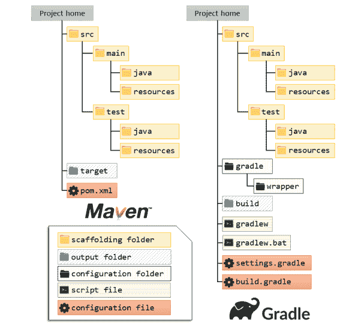
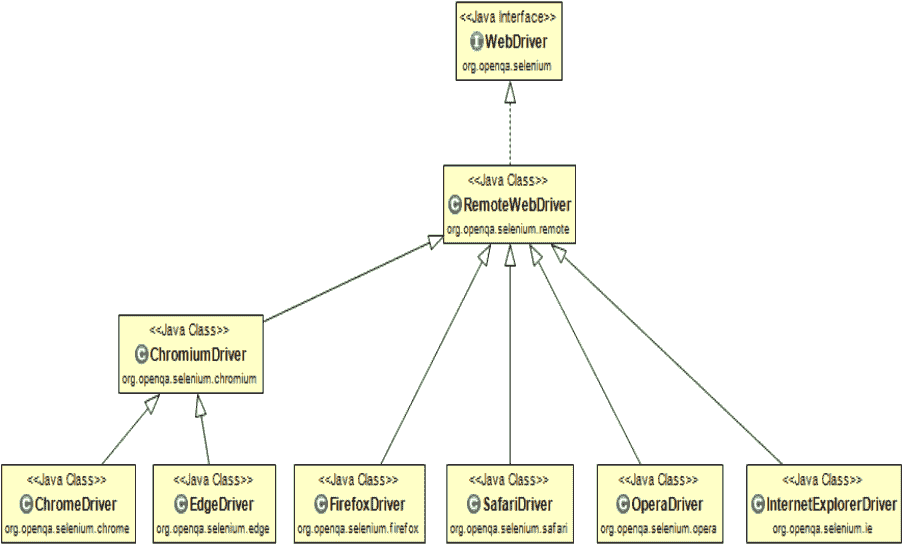
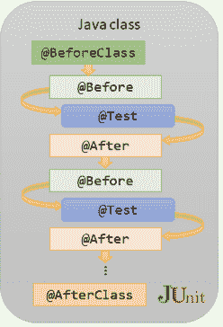
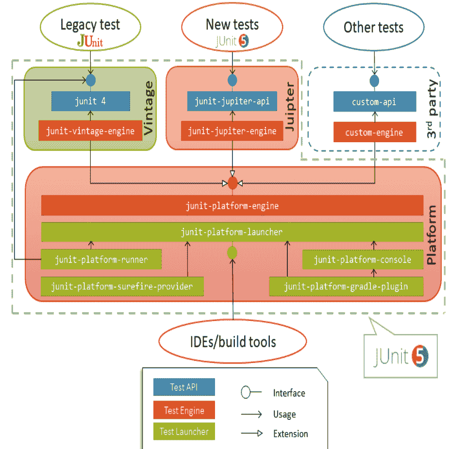
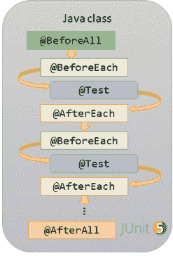
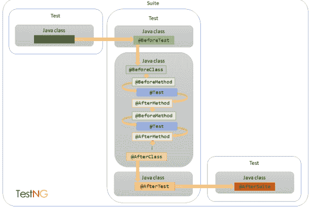
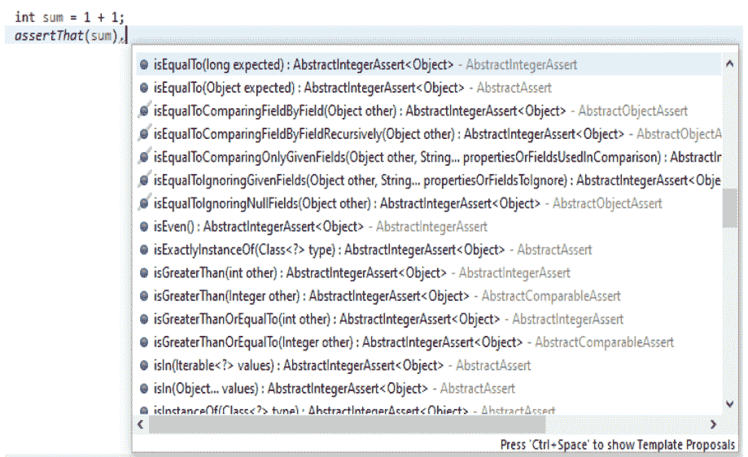
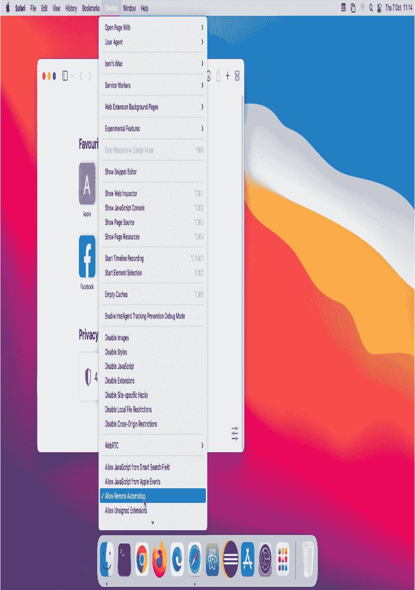

# 第2章 准备测试

# 给早期发布读者的说明

> 通过早期发布电子书，你可以获得书籍最早期的形式——作者写作时的原始未编辑内容——从而在这些技术正式发布之前就加以利用。
> 
> 这将是最终图书的第2章。请注意，GitHub仓库将在稍后激活。
> 
> 如果你对如何改进本书内容和/或示例有任何评论，或者你发现本章中缺少某些材料，请联系策划编辑：rfernando@oreilly.com。

本章旨在使用Selenium WebDriver和Java语言实现你的第一个端到端测试。为此，我们首先回顾先前知识、硬件和软件方面的技术要求。其次，本章概述了如何设置一个包含Selenium WebDriver测试的Java项目。为了简化项目设置，你可以使用Maven或Gradle等构建工具。最后，你将学习使用Selenium WebDriver实现一个基本的端到端测试，即*Hello World*测试。我们将使用不同的Web浏览器（如Chrome、Edge或Firefox）和单元测试框架（JUnit和TestNG）以多种方式实现该测试。请记住，我在本书中展示的每个代码示例都可在开源的GitHub仓库中获得。因此，你可以将该仓库的内容和配置作为自己测试的基础。

## 要求

开始使用Selenium WebDriver与Java的第一个要求是理解Java语言和面向对象编程。不一定要成为专家，但需要具备基础知识。然后，你


你可以在任何主流操作系统中使用 Selenium WebDriver：Windows、Linux 或 macOS。因此，你可以选择自己偏好的计算机类型。原则上，对于内存、CPU、硬盘等硬件没有特定要求，任何中端电脑即可。

## Java 虚拟机

接下来，你需要在电脑上安装 Java 虚拟机（JVM）。JVM 有两种发行类型。第一个选项是 Java 运行时环境（JRE），它包含 JVM 和 Java 标准 API。第二个选项是 Java 开发工具包（JDK），它是 JRE 加上用于 Java 的软件开发工具包（SDK）（例如 `javac` 编译器和其他工具）。由于我们使用 Java 进行开发，我建议使用 JDK（尽管某些 IDE 也内置了 Java SDK）。关于 Java 版本，我建议至少使用 JDK 8，因为在撰写本文时它是 Selenium 4 支持的长期支持（LTS）版本。

## 文本编辑器或 IDE

为了编写我们的 Java 测试，我们需要一个文本编辑器或 IDE。IDE 为开发提供了出色的体验，因为它们拥有完整的环境（用于编码、运行、调试、自动补全等）。尽管如此，你也可以使用任何喜欢的文本编辑器，结合命令行工具（用于运行、调试等）获得类似的实践。总的来说，选择取决于你的个人偏好。一些流行的文本编辑器替代方案有 Sublime Text、Atom、Notepad++ 或 Vim 等。关于 IDE，我们可以使用 Eclipse、IntelliJ IDEA、NetBeans 或 Visual Studio Code。

## 浏览器和驱动

使用 Selenium WebDriver 进行自动化的初始方式是使用本地浏览器。对于本书，我考虑以下浏览器：Chrome、Edge 和 Firefox。我将它们称为 *主要浏览器*，原因有几个。首先，它们在全球非常流行，而且我们使用 Selenium WebDriver 测试 Web 应用程序，很可能希望使用与潜在用户相同的浏览器。其次，这些浏览器是 *常青* 的（即它们会自动升级）。第三，这些浏览器可用于主要操作系统：Windows、Linux 和 macOS（不像 Safari，它也是一个流行的浏览器，但仅在 macOS 上可用）。最后，这些浏览器可在 GitHub 仓库中使用的 CI 环境中使用（即 GitHub Actions）。

控制 Web 浏览器使用 Selenium WebDriver 的最后一个要求是驱动程序二进制文件：chromedriver（用于 Chrome）、msedgedriver（用于 Edge）和 geckodriver（用于 Firefox）。如第 1 章所述，驱动管理涉及三个步骤：下载、设置和维护。为了避免该章节中解释的潜在问题，我强烈建议使用 WebDriverManager 来自动化此过程。

> **TIP**
>
> *附录 2 提供了 WebDriverManager 执行的自动化驱动管理过程的精细细节。此外，以防你出于某种原因需要，本附录还解释了如何手动进行驱动管理。*

## 构建工具

另一个重要组件是 *构建工具*。构建工具是用于从源代码自动化创建可执行应用程序的软件实用程序。这些工具在依赖管理、编译、打包、测试执行和部署方面简化了项目管理。总的来说，构建工具是自动化软件项目开发的便捷方式，无论是在构建服务器（例如 GitHub Actions）还是开发人员机器上。因此，我强烈建议使用构建工具来设置你的项目。本书中涵盖的替代方案有：

- Maven 是一个由 Apache 软件基金会维护的开源构建自动化工具。它主要用于 Java 项目，尽管它也支持其他语言，如 C#、Ruby 或 Scala。
- Gradle 是另一个用于软件开发的开源构建自动化工具。它支持 Java 和其他语言，如 Kotlin、Groovy、Scala、C/C++ 或 JavaScript。

推荐的版本是 Maven 3+ 和 Gradle 6+。为完整起见，我在示例仓库中使用了两种构建工具。再次，选择使用哪一个取决于你的偏好。

> **NOTE**
>
> 如果你计划使用 IDE 进行开发和运行测试，构建工具并非严格必要。尽管如此，我建议在你的电脑上至少安装其中一种工具，以复制在构建服务器（例如 Jenkins、GitHub Actions 等）中通常使用的相同环境。

## 可选软件

除了已解释的软件外，还有一些额外的程序可以让你更好地利用本书。首先，你可以使用 Git 进行源代码管理。由于本书中介绍的测试示例可在 GitHub 上获取，你可以使用 Git 来 fork（或克隆）并更新此仓库。

第二个可选工具是 Docker。在本书中，我向你展示了如何使用 Docker 执行容器化浏览器（参见第 6 章）。因此，我强烈建议你在电脑上安装 Docker Engine（它适用于 Linux、macOS 和 Windows 10）。

最后，如果需要，你可以使用不同的 Web 浏览器。除了主要浏览器（Chrome、Edge 和 Firefox）之外，还可以使用其他浏览器与 Selenium WebDriver，例如 macOS 上的 Safari，或任何操作系统上的 Opera、Chromium 和 HtmlUnit（一种无头浏览器，即无 GUI 浏览器）。

## 旧版浏览器

除了已介绍的浏览器之外，你还可以使用更多浏览器与 Selenium WebDriver。然而，我不推荐这些浏览器，因为它们已弃用且不再维护。这些浏览器是：

- Internet Explorer：微软为 Windows 系统推出的网络浏览器，首次发布于 1995 年，于 2022 年停止维护。
- PhantomJS：无头浏览器，首次发布于 2011 年，于 2018 年停止维护。

## 项目设置

你可以在以下 GitHub 仓库中找到本书的所有代码示例：https://github.com/bonigarcia/selenium-webdriver-java。该仓库是开源的，采用 Apache 2.0 许可证发布。该仓库的目标是多方面的。首先，它是集中所有示例的便捷方式。此外，你可以使用其设置（Maven 或 Gradle）作为你项目的骨架。

> **TIP**
>
> 以下小节描述了创建包含 Selenium WebDriver 测试的 Java 项目的一般要求。附录 3 提供了示例仓库配置的低级细节。

### 项目布局

项目布局是用于存储软件项目不同资产（例如源代码、二进制文件、静态资源等）的目录结构。Maven 和 Gradle 都使用等效的 Java 项目布局。得益于此，我们可以使用两种构建工具执行示例仓库。

如图 2-1 所示，以下文件夹集（标记为脚手架文件夹）在两种构建工具中是相同的：

- `src/main/java`：应用程序源代码（即 Java 文件）。
- `src/main/resources`：应用程序资源文件（例如属性、配置文件等）。
- `src/test/java`：测试源代码（即用于测试的 Java 文件）。
- `src/test/resources`：测试资源文件（即用于测试的额外资产）。



图 2-1. Maven 和 Gradle 中的项目布局

其余项目布局在两种构建工具中不同。第一个区别是配置文件。一方面，该文件在 Maven 中是唯一的，称为 `pom.xml`（项目对象模型）。另一方面，Gradle 用于配置有两个文件，称为 `settings.gradle` 和 `build.gradle`。Maven 和 Gradle 之间的第二个区别是输出文件夹。在这两种情况下，构建工具都会创建此文件夹以保存构建结果（即编译后的类、生成的打包文件等）。该文件夹的名称在 Maven 中为 `target`，在 Gradle 中为 `build`。最后，Gradle


包含一组文件夹和文件，用于所谓的 Gradle *包装器*。该包装器是一个脚本文件（在类 Unix 系统上称为 `gradlew`，在 Windows 上称为 `gradlew.bat`），具有以下优点：

- 无需在本地机器上安装 Gradle 即可构建项目。
- 强制使用指定版本，该版本可以不同于本地安装的 Gradle 实例。
- 通过更改 `gradle/wrapper` 文件夹中的包装器构件，轻松升级到新版本。

> **注意**
>
> 本书不打算解释 Maven 和 Gradle 提供的所有功能。尽管如此，你可以找到有关它们构建生命周期和典型命令的更多信息。如需进一步了解，请参阅 Maven 和 Gradle 官方文档。

## 依赖

软件项目的依赖是所需的库或插件。除其他功能外，构建工具还支持对项目依赖进行自动化管理。为此，我们需要在项目配置文件中指定这些依赖的*坐标*（有关 Maven 和 Gradle 的详细信息，请参见后续小节）。Java 项目的坐标由三个标签组成，它们唯一标识该项目（例如，库、插件等），分别是：

- `groupId`：创建项目的组织、公司、个人等。
- `artifactId`：用于标识项目的唯一名称。
- `version`：项目的特定发布版本。默认情况下，我建议你使用每个发布版本的最新版本。因此，我使用 Dependabot 来自动维护这些版本。

## 语义化版本

如今，一种流行的项目版本选择方式是**语义化版本**，也称为 *SemVer*。根据 SemVer 宣言，一个发布版本由三个用点分隔的部分组成，即 `MAJOR.MINOR.PATCH`。简而言之，`MAJOR` 标识不兼容的变更，`MINOR` 标识向后兼容的变更，`PATCH` 标识缺陷修复。

本节其余部分将解释我在示例代码库中使用的 Java 依赖。首先，当然，我们需要 Selenium WebDriver 来执行浏览器自动化。这个依赖是唯一严格必需的。然后，我建议使用其他依赖来实现自动驱动管理工具、单元测试框架、流畅断言和日志记录。本节的其余部分将解释这些工具中每一个的动机和基本用法。

## Selenium WebDriver

Selenium WebDriver 最相关的概念之一是 `WebDriver` 层次结构，它是一组旨在控制不同 Web 浏览器的类。如**图 2-2** 所示，该层次结构遵循面向对象编程范式。在最顶层，我们找到 `WebDriver` 接口，它是整个结构的父级。层次结构的下部对应于允许驱动各个浏览器的 Java 类。例如，我们需要使用 `ChromeDriver` 类的实例来控制本地 Chrome 浏览器。**表 2-1** 全面总结了 WebDriver 层次结构的主要类及其对应的目标浏览器。



*图 2-2. WebDriver 对象的层次结构*

**表 2-1. WebDriver 层次结构说明**

| 包 | 类 | 浏览器 |
|---|---|---|
| `org.openqa.selenium.chrome` | `ChromeDriver` | Chrome |
| `org.openqa.selenium.edge` | `EdgeDriver` | Edge |
| `org.openqa.selenium.firefox` | `FirefoxDriver` | Firefox |
| `org.openqa.selenium.safari` | `SafariDriver` | Safari |
| `org.openqa.selenium.opera` | `OperaDriver` | Opera |
| `org.openqa.selenium.ie` | `InternetExplorerDriver` | Internet Explorer |
| `org.openqa.selenium.remote` | `RemoteWebDriver` | 远程浏览器（参见*第 6 章*） |

## 自动驱动管理

在实例化 WebDriver 层次结构的对象之前，必须解析其对应的驱动程序。例如，要使用 ChromeDriver 控制 Chrome，首先需要管理 chromedriver。为了避免与手动驱动程序管理相关的潜在问题（参见第 1 章），我建议以自动化方式完成整个驱动程序管理过程（下载、设置和维护）。对于 Java，参考实现是 **WebDriverManager**，这是一个 Selenium WebDriver 辅助库，允许以自动化方式进行驱动管理。本节介绍如何将 WebDriverManager 用作 Java 依赖。

一旦在我们的项目中解析了 WebDriverManager 依赖（配置详情请参见*附录 3*），我们就可以使用 WebDriverManager API 来管理驱动程序。该 API 提供了一组单例对象，称为*管理器*，用于下载、设置和维护驱动程序。这些单例对象可以通过 WebDriverManager 类访问。例如，我们需要调用 *chromedriver()* 方法来管理 Chrome 所需的驱动程序，即 chromedriver，如下所示：

```java
WebDriverManager.chromedriver().setup();
WebDriver driver = new ChromeDriver();
```

**表 2-2** 总结了所有受支持浏览器的基本 WebDriverManager 调用。除这些基本调用（即 `setup()` 方法）外，WebDriverManager 还提供了用于高级配置的流畅 API。有关 WebDriverManager 方法、配置功能以及其他用法（例如命令行界面（CLI）工具（来自 shell）、作为服务器（使用类 REST（表述性状态转移）API）、作为代理（使用 Java 插桩）或作为 Docker 容器）的更多详细信息，请参见*附录 2*。

**表 2-2. WebDriverManager 基本调用**

| WebDriverManager 基本调用 | 浏览器 | 驱动 |
|---|---|---|
| `WebDriverManager.chromedriver().setup();` | Chrome | chromedriver |
| `WebDriverManager.edgedriver().setup();` | Edge | msedgedriver |
| `WebDriverManager.firefoxdriver().setup();` | Firefox | geckodriver |
| `WebDriverManager.operadriver().setup();` | Opera | operadriver |
| `WebDriverManager.chromiumdriver().setup();` | Chromium | chromedriver |
| `WebDriverManager.iedriver().setup();` | Internet Explorer | IEDriverServer |

## 单元测试框架

如第 1 章所述，单元测试框架是创建不同类型的测试的基础。在本书中，你将学习如何使用 Selenium WebDriver 为 Web 应用程序实现端到端测试。因此，我建议将 Selenium WebDriver 调用嵌入到使用特定单元测试框架创建的测试中。我推荐你使用的备选方案是以下选项之一：JUnit 4、JUnit 5（单独使用或与 Selenium-Jupiter 结合使用，Selenium-Jupiter 是 Selenium WebDriver 的一个扩展），或 TestNG。以下小节将提供有关这些备选方案的更多详细信息。我的建议是专注于你偏好的单元测试框架和构建工具，以继续练习本书其余部分中的示例。

## JUnit 4

JUnit 是由 Erich Gamma 和 Kent Beck 于 1999 年创建的 Java 单元测试框架。许多人认为它是用 Java 开发测试的事实上的标准框架。在 JUnit 中，测试是 Java 类中用于测试的方法。从 JUnit 4 开始，开发 JUnit 测试的构建块是 Java 注解。JUnit 4 的基本注解是 `@Test`，因为它允许识别包含测试逻辑（即用于执行和验证软件某部分的代码）的一个或多个方法。此外，还有其他注解用于标识用于设置（即测试之前发生的事情）和拆卸（即测试之后发生的事情）的方法。

- `@BeforeClass` 在所有测试之前执行一次。
- `@Before` 在每个测试之前执行。
- `@After` 在每个测试之后执行。
- `@AfterClass` 在所有测试之后执行一次。

图 2-3 展示了 JUnit 4 中基本测试生命周期的图形表示。



*图 2-3. JUnit 4 测试生命周期*

## JUnit 5

由于 JUnit 4 存在一些限制（例如单体架构或无法组合 JUnit 运行器），JUnit 团队于 2017 年发布了一个新的主版本（即 JUnit 5）。JUnit 在 5 版中完全重新设计，遵循由三个组件组成的模块化架构（参见图 2-4）。第一个组件是 JUnit *平台*，它是整个框架的基础。JUnit 平台的目标有两个：

- 它允许通过 *测试启动器* API 在 JVM 中发现和执行（顺序或并行）测试。该 API 通常由构建工具和 IDE 等编程客户端使用。


2. 它定义了用于开发在 JUnit Platform 上运行的测试的测试引擎 API。该 API 通常由提供测试编程模型的框架使用。



图 2-4. JUnit 5 架构

得益于测试引擎 API，第三方测试框架可以在 JUnit Platform 之上执行测试。现有的一些已为 JUnit 5 实现测试引擎的测试框架示例包括 Cucumber 和 Spock。此外，JUnit 5 还提供了测试引擎 API 的两个开箱即用的实现。

这些引擎是 JUnit 5 架构的其余组件，即：

- *Vintage*：提供与旧版 JUnit 测试（即版本 3 和 4）向后兼容性的测试引擎。
- *Jupiter*：提供新的编程和扩展模型的测试引擎。

Jupiter 是 JUnit 5 的一个重要组件，因为它提供了一个全新的 API，可以使用健壮的编程模型来开发测试。该编程模型的一些特性包括参数化测试、并行执行、标记与过滤、有序测试、重复测试与嵌套测试，以及丰富的禁用（忽略）测试功能。

与 JUnit 4 一样，Jupiter 也使用 Java 注解来声明测试用例。例如，用于标识具有测试逻辑的方法的注解同样是 `@Test`。Jupiter 中基本测试生命周期的其余注解名称略有不同：`@BeforeAll`、`@BeforeEach`、`@AfterEach` 和 `@AfterAll`。如图 2-5 所示，这些注解中的每一个都遵循与 JUnit 4 相同的工作流程。



*图 2-5. JUnit 5 测试生命周期*

因此，使用 Selenium WebDriver 和 WebDriverManager 编写 Jupiter 测试时，其结构在 JUnit 4 和 JUnit 5 中非常相似。除了设置和拆卸注解名称的变化外，在 Jupiter 编程模型中，测试方法（及其生命周期）不要求必须是 `public`。

> **提示**
>
> 在本书中，你将学习 Jupiter 的基础知识，并将其应用于使用 Selenium WebDriver 的端到端测试。请参阅下一节中的 *你好，世界* 示例，以了解一个基于 JUnit 5 的完整测试。有关更多详细信息，请查阅 [JUnit 5 文档](#)。

## JUnit 5 与 Selenium-Jupiter

Jupiter 的扩展模型允许向默认编程模型添加自定义功能。为此，Jupiter 提供了一个 API，开发者可以扩展该 API（使用称为 *扩展点* 的接口）来提供自定义功能。这些扩展点的类别如下：

- 测试生命周期回调：在测试生命周期的不同时刻包含自定义逻辑。
- 参数解析：实现依赖注入（即注入到测试方法或构造函数中的参数）。
- 测试模板：根据给定上下文重复执行测试。
- 条件测试执行：根据自定义条件启用或禁用测试。
- 异常处理：管理测试及其生命周期中的 Java 异常。
- 测试实例：创建和处理测试类实例。
- 拦截调用：拦截对测试代码的调用（并决定这些调用是否继续）。

作为 Jupiter 开发者，你可以实现自己的自定义扩展，也可以使用现有的扩展。[表 2-3](#) 展示了 Jupiter 扩展的一些示例。

## 表 2-3. Jupiter 扩展

| 名称 | 描述 | 许可证 | 维护者 | 网站 |
|---|---|---|---|---|
| JUnit Pioneer | Jupiter 扩展包 | EPL 2.0 | JUnit Pioneer 团队 | https://junit-pioneer.org/ |
| rerunner-jupiter | 用于重新运行失败测试的扩展 | Apache 2.0 | Artem Sokovets | https://github.com/artsok/rerunner- |

| 项目 | 描述 | 许可证 | 维护者 | 仓库 |
|---|---|---|---|---|
| MockitoExtension | 用于初始化 mock 和处理 stub 的 Jupiter 扩展 | MIT | Mockito 团队 | `https://github.com/mockito/mockito/` |
| QuickPerf | 用于评估某些性能相关属性的库 | Apache 2.0 | QuickPerf 团队 | `https://github.com/quick-perf/quickperf/` |
| Selenium-Jupiter | 用于 Selenium WebDriver 的 Jupiter 扩展 | Apache 2.0 | Boni García | `https://bonigarcia.dev/selenium-jupiter/` |
| SpringExtension | 用于 Spring Framework 的 Jupiter 扩展 | Apache 2.0 | Pivotal Software | `https://spring.io/projects/spring-framework` |

Selenium-Jupiter 在本书的背景下是一个极具吸引力的选择，因为它可以在 Jupiter 测试中无缝使用 Selenium WebDriver。Selenium-Jupiter 的基础如下（参见下一节中基于 Selenium-Jupiter 的 *你好，世界* 测试）：

- 减少测试用例中的样板代码。得益于 Jupiter 编程模型提供的参数解析特性，Selenium-Jupiter 允许将 `WebDriver` 层次结构的对象（例如 `ChromeDriver`、`FirefoxDriver` 等）声明为构造函数参数或测试参数，以便从测试中控制 Web 浏览器。
- 通过 WebDriverManager 实现自动化驱动程序管理。得益于扩展模型提供的测试生命周期回调，WebDriverManager 的使用对 Selenium-Jupiter 用户来说完全透明。
- 用于端到端测试的高级功能。例如，与 Docker 的无缝集成、测试模板（用于跨浏览器测试），或故障排除和监控功能（例如会话录制或可配置的截图）。

## TestNG

我在本书中使用的最后一个单元测试框架是 TestNG。TestNG 提供的一些更重要的特性包括并行测试执行、测试优先级、使用自定义注解的数据驱动测试，以及生成详细的 HTML 报告。

与 JUnit 4 和 Jupiter 一样，TestNG 也使用 Java 注解来声明测试及其生命周期（即每个测试之前和之后发生什么）。同样，注解 `@Test` 用于指定测试方法。然后，它提供注解 `@BeforeClass` 和 `@BeforeMethod` 来指定测试设置，以及 `@AfterMethod` 和 `@AfterClass` 用于拆卸（参见图 2-6）。此外，TestNG 允许使用以下术语对 Java 类中包含的测试进行分组：

- Suite（套件），由一个或多个测试组成。
- Test（测试），由一个或多个类组成。
- Class（类），是一个包含测试方法的 Java 类，例如使用 `@Test` 注解。

按照这种表示法，如图 2-6 所示，TestNG 提供了额外的注解来在套件和测试之前及之后执行自定义逻辑。



图 2-6. TestNG 测试生命周期

## 流式断言

如第 1 章所述，存在不同的断言库。这些库通常提供丰富的流式断言和全面的错误消息（在失败时）。在这些备选方案中，我在示例仓库中使用的是 AssertJ 库。原因有两方面。首先，我们可以使用 IDE 中典型的自动补全功能来选择可用的方法，以快速断言数据（通常在静态方法 `assertThat` 之后按 Ctrl + Space 即可）。图 2-7 展示了使用 IDE（本例中为 Eclipse）检查此方法的示例。



图 2-7. 使用 Eclipse 手动检查 AssertJ 中可用的断言方法

与其他选项相比，AssertJ 的第二个优势是它允许使用点表示法进行断言链式调用。借助这一点，我们可以连接多个条件以创建更可读的断言，例如：

```java
assertThat(1 + 1).isGreaterThan(1).isLessThan(3);
```

## 日志记录

最后，我建议使用一个日志库来从你的 Java 代码中写入跟踪信息。如你所知，日志记录是程序员在软件执行时跟踪事件的一种简单方式。日志记录通常通过将文本消息写入文件或标准输出来进行，它允许你跟踪程序并诊断问题。如今，使用特定的库来有效地记录日志是一种常见做法。这些库提供了不同的好处，例如消息的粒度级别（如调试、警告或错误）、时间戳，或配置能力。

## 你好，世界

我们准备将本章介绍的所有内容整合在一起，实现我们的第一个端到端测试。如你所知，*你好，世界* 程序是一段简单的代码，许多编程语言用它来说明其基本语法。按照这种方法，示例 2-1 展示了这个经典 *你好，世界* 的 Selenium WebDriver 版本。

> **提示**
>
> 以下示例使用 JUnit 5 作为单元测试框架来嵌入对 Selenium WebDriver 的调用。请记住，你可以在示例仓库中找到其他版本（即 JUnit 4、带有 Selenium-Jupiter 的 JUnit 5 以及 TestNG）。

## 示例 2-1. 使用 Chrome 和 JUnit 5 的你好，世界

```java
class HelloWorldChromeJupiterTest {

    static final Logger log = getLogger(lookup().lookupClass());

    private WebDriver driver; ①

    @BeforeAll
    static void setupClass() {
        WebDriverManager.chromedriver().setup(); ②
    }

    @BeforeEach
    void setup() {
        driver = new ChromeDriver(); ③
    }

    @Test
    void test() {
```

// Exercise
String sutUrl = "https://bonigarcia.dev/selenium-webdriver-java/";
    driver.get(sutUrl); ④
    String title = driver.getTitle(); ⑤
    log.debug("The title of {} is {}", sutUrl, title); ⑥

    // Verify
    assertThat(title).isEqualTo("Hands-On Selenium WebDriver with Java"); ⑦
}

@AfterEach
void teardown() {
    driver.quit(); ⑧
}
}

① 我们使用 WebDriver 接口声明一个 Java 属性。我们在测试中使用此变量通过 Selenium WebDriver 控制 Web 浏览器。

② 在此类中所有测试的设置中（即执行一次），我们调用 WebDriverManager 来管理所需的驱动程序。在此示例中，由于我们使用 Chrome 作为浏览器，因此需要解析 chromedriver。

③ 在测试设置中（每个测试方法执行一次），我们实例化 WebDriver 对象以控制 Chrome。换句话说，我们创建了一个 ChromeDriver 类型的对象。

④ 测试逻辑通过 driver 变量使用 Selenium WebDriver API。首先，测试对 SUT 进行操作。为此，首先，我们使用 webdriver 变量的 get() 方法打开练习站点（在本例中代表 Chrome 浏览器）。

⑤ 我们使用 getTitle() 方法获取网页标题。

⑥ 出于调试目的，我们使用 DEBUG 级别记录该标题。

⑦ 测试的最后一部分包含一个 AssertJ 断言。在此情况下，我们验证网页标题符合预期。

## 周报

本周工作富有成效。团队完成了项目的初始阶段，现在正进入第二阶段。

## 主要成果

- 完成了数据库迁移
- 实现了新的 API 端点
- 进行了第一轮测试

## 销售汇总

| Region | Q1 | Q2 | Q3 |
|--------|----|----|----|
| North  | 12% | 15% | 18% |
| South  | 8% | 10% | 13% |
| East   | 10% | 12% | 14% |

## 收入图表


> > "Great things are done by a team working together"

图 2-8. Eclipse 中 Selenium WebDriver hello world 的执行截图

使用 JUnit 4 和 TestNG 的 hello world 版本几乎与 JUnit 5 相同，但使用不同的注解来表示测试生命周期（例如，JUnit 4 的 @Before 而不是 JUnit 5 的 @BeforeEach 等）。关于 JUnit 5 加 Selenium-Jupiter，代码更加紧凑。示例 2-2 显示了此 hello world 版本。如你所见，无需声明设置和拆除。我们只需将我们想要的 WebDriver 对象声明为测试参数（本例中为 FirefoxDriver），Selenium-Jupiter 就会处理驱动程序管理（也使用 WebdriverManager）、对象实例化和浏览器释放。

## 示例 2-2. 使用 Firefox 和 Selenium-Jupiter 的 Hello World

```
@ExtendWith(SeleniumJupiter.class)
class HelloWorldFirefoxSelJupTest {

    @Test
    void test(FirefoxDriver driver) {
        // Same test logic than other "hello world" tests
    }
}
```

## 使用额外浏览器

除了我在本书中称为主要浏览器（即 Chrome、Edge 和 Firefox）之外，示例仓库还包含使用其他浏览器的 hello world 测试：Opera、Chromium 和 Safari。这些测试包含在此仓库的 helloworld_otherbrowsers 包中，与原始 hello world 版本略有不同。例如，示例 2-3 显示了使用 Opera 的 hello world 测试的 JUnit 5 类设置。由于该浏览器可能在运行测试的机器上不可用（例如，Opera 在 GitHub Actions 中不可用），我使用假设来有条件地在运行时禁用测试。

## 示例 2-3. 使用 Opera 和 JUnit 5 的类设置

```
@BeforeAll
static void setupClass() {
    Optional<Path> browserPath = WebDriverManager.operadriver()
        .getBrowserPath(); ①
    assumeThat(browserPath).isPresent(); ②
```

```
WebDriverManager.operadriver().setup();
}
```

- 1. 我们使用 WebDriverManager 来定位浏览器路径。
- 2. 如果此路径不存在，我们假设浏览器未安装在系统中，因此测试将被跳过（使用 AssertJ 假设）。

如常，你可以在示例仓库中找到使用其他单元测试框架的此测试。JUnit 5 和 TestNG 版本使用与前一段代码片段等效的测试设置。然而，使用 JUnit 5 加 Selenium-Jupiter 时存在差异。如示例 2-4 所见，Selenium-Jupiter 通过使用自定义注解（称为 EnabledIfBrowserAvailable）简化了假设逻辑，以根据浏览器可用性禁用测试（本例中为 Safari）。

## 示例 2-4. 使用 Safari 和 JUnit 5 加 Selenium-Jupiter 的 Hello World

```
@EnabledIfBrowserAvailable(SAFARI)
@ExtendWith(SeleniumJupiter.class)
class HelloWorldSafariSelJupTest {

    @Test
    void test(SafariDriver driver) {
        // Same test logic than other "hello world" tests
    }

}
```

要使用 Selenium WebDriver 控制 Safari，我们需要手动配置 Safari 以授权远程自动化。为此，首先，我们通过点击菜单选项 Safari → Preferences → Advanced 选项卡显示开发菜单。然后，我们启用“Show Develop Menu”复选框。之后，“Develop”菜单应该出现。最后，我们点击“Allow Remote Automation”选项（见图 2-9）。



图 2.9. 在 macOS 上启用 Safari 远程自动化

## 总结与展望

本章为使用 Selenium WebDriver 和 Java 作为语言开发 Web 应用的端到端测试提供了基础。你需要做出的第一个重要决定是选择将 Selenium WebDriver 调用嵌入其中以实现这些测试的单元测试框架。为了多样性和完整性，我在本书中提出了四个选项：JUnit 4、JUnit 5、JUnit 5 加 Selenium-Jupiter 和 TestNG。它们对于基本的 Selenium WebDriver 测试是等效的。对于更高级的使用，*第 8 章* 将涵盖每个测试框架的特定功能，这些功能可能与 WebDriver 测试相关（例如，用于跨浏览器测试的参数化测试）。另一个你应该做出的决定是选择构建工具。在本书中，我提出了两个选项：Maven 和 Gradle。再次强调，这两种替代方案对于标准开发实践是相似的。

本书的第二部分专注于 Selenium WebDriver API，并从下一章开始。要开始，**第 3 章** 涵盖了 WebDriver API 的基本概念，包括 WebDriver 对象、Web 元素定位、用户模拟（键盘和鼠标操作）以及等待策略。如常，本章以托管在 GitHub 上的仓库中的代码示例为指导。
