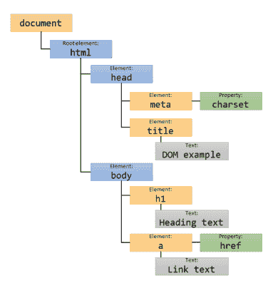
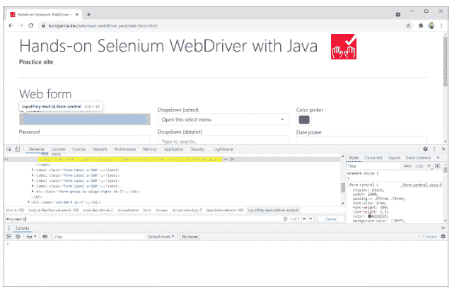
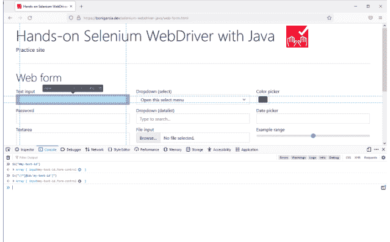
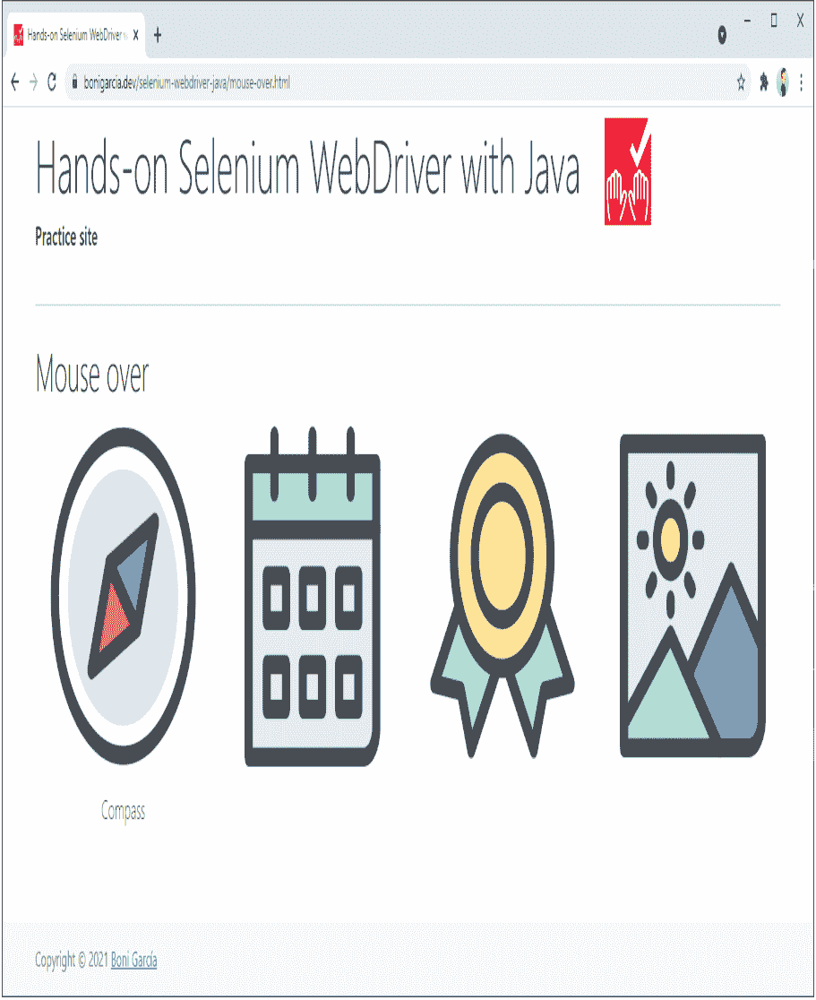
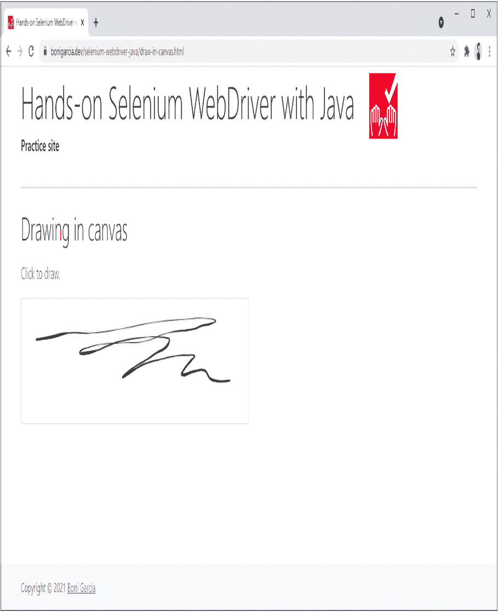
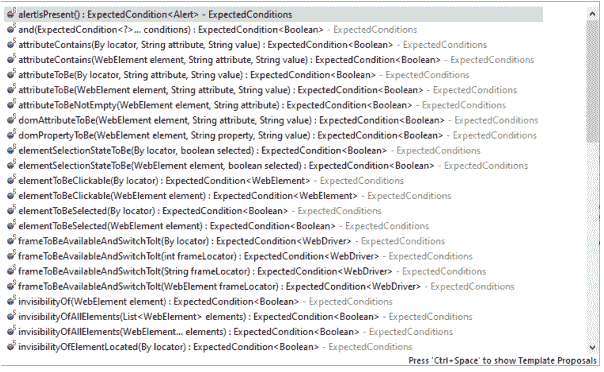
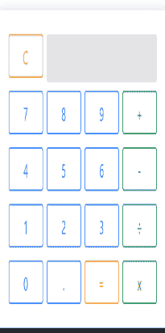

## 第二部分. Selenium WebDriver API

Selenium WebDriver 是一个开源库，允许以真实用户的方式以编程方式控制 Web 浏览器（例如 Chrome、Edge 或 Firefox 等）。它提供了一个跨浏览器的 API，可用于实现 Web 应用的端到端测试。本书的这一部分对 Selenium WebDriver API 进行了深入总结。以下章节旨在非常实用。因此，我使用托管在 GitHub 上示例仓库中的即用型测试来解释 WebDriver API 的每个功能。

本节涵盖与 WebDriver 对象相关的三个基本方面。首先，我们回顾创建它们的不同方式。其次，我们研究它们的基本操作。最后，我们分析在这些对象（通常在测试结束时关闭浏览器）的不同释放方式。

## WebDriver 创建

如第 2 章介绍的那样，要在 Java 中使用 Selenium WebDriver 控制浏览器，第一步是创建 WebDriver 实例。这样，我们在使用 Chrome 时需要创建 ChromeDriver 对象，使用 Edge 时创建 EdgeDriver，使用 Firefox 时创建 FirefoxDriver，等等。创建这些类型实例的基本方式是使用 Java 中的 new 运算符。例如，我们创建 ChromeDriver 对象如下：

```
```java
WebDriver driver = new ChromeDriver();
```
```

使用 new 运算符创建 WebDriver 实例是完全正确的，你可以在测试中使用它。然而，值得回顾其他可能性，这些可能性可以根据创建这些对象的特定用例提供额外好处。这些替代方案是 WebDriver 和 WebDriverManager 构建器。

## WebDriver Builder

WebDriver API 提供了一个内置方法，遵循 *builder pattern* 来创建 WebDriver 实例。此功能可通过 RemoteWebDriver 类的静态方法 `builder()` 访问，并提供用于创建 WebDriver 对象的流畅 API。表 3-1 介绍了此构建器的可用方法。示例 3-1 显示了使用 WebDriver 构建器的测试骨架。


表 3-1. WebDriver 构建器方法

| 方法 | 描述 |
|---|---|
| `oneOf(Capabilities options)` | 浏览器特定的功能 |
| `addAlternative(Capabilities options)` | 备用的浏览器特定功能（参见第 5 章） |
| `addMetadata(String key, Object value)` | 添加自定义元数据。这通常用于在云提供商中请求额外功能（参见第 6 章） |
| `setCapability(String capabilityName, Object value)` | 单个浏览器特定的功能（参见第 5 章） |
| `address(String uri)` | 设置远程服务器的地址（参见第 6 章） |
| `address(URL url)` |  |
| `address(URI uri)` |  |
| `config(ClientConfig config)` | 使用远程服务器时的特定配置，例如连接超时或代理设置 |
| `withDriverService(DriverService service)` | 本地驱动程序的特定配置（例如 chromedriver），例如其文件位置、使用的端口、超时或参数 |
| `build()` | 构建器模式中的最后方法，用于实际创建 WebDriver 实例 |

## TIP

第 5 章解释了 *浏览器特定功能* 的详细信息（例如 `ChromeOptions`）。此时，我们仅使用这些类来选择浏览器类型（例如 `ChromeOptions` 用于 Chrome，`EdgeOptions` 用于 Edge，或 `FirefoxOptions` 用于 Firefox）。

## 示例 3-1. 使用 WebDriver 构建器的测试骨架

```
class WebDriverBuilderJupiterTest {
```

```
WebDriver driver;

@BeforeAll
static void setupClass() {
    WebDriverManager.chromedriver().setup(); ①
}

@BeforeEach
void setup() {
    driver = RemoteWebDriver.builder().oneOf(new ChromeOptions()).build(); ②
}

@AfterEach
void teardown() {
    driver.quit();
}

@Test
void test() {
    // TODO: use variable "driver" to call the Selenium WebDriver API
}
}
```

① 如常，在实际 WebDriver 实例化之前，我们使用 WebDriverManager 解析所需的驱动程序（本例中为 chromedriver）

② 我们使用 WebDriver 构建器创建 WebDriver 实例。由于我们希望在此测试中使用 Chrome，因此我们使用 ChromeOptions 对象作为功能参数（使用方法 oneOf()）。

从功能角度来看，此示例的工作方式与第 2 章中介绍的常规 hello world 测试相同。然而，WebDriver 构建器 API 允许轻松指定不同的行为。以下代码段为例。此代码更改设置方法并创建 SafariDriver 的实例。假设无法实例化此对象（通常在测试未在 Mac 上执行时发生，因此 Safari 在系统中不可用）。在这种情况下，我们将 Chrome 用作备用的浏览器。

```
```java
@BeforeEach
void setup() {
    driver = RemoteWebDriver.builder().oneOf(new SafariOptions())
            .addAlternative(new ChromeOptions()).build();
}
```
```

## WebDriverManager 构建器

创建 WebDriver 对象的另一种可能性是使用 WebDriverManager。自版本 5 起，除了解析驱动程序外，WebDriverManager 还提供了一个 WebDriver 构建器实用程序。示例 3-2 显示了使用此构建器的测试骨架。

```
*示例 3-2. 使用 WebDriverManager 构建器的测试骨架*

```java
class WdmBuilderJupiterTest {

    WebDriver driver;

    @BeforeEach
    void setup() {
        driver = WebDriverManager.chromedriver().create();
    }

    @AfterEach
    void teardown() {
        driver.quit();
    }

    @Test
    void test() {
        // TODO: use variable "driver" to call the Selenium WebDriver API
    }
}
```
```

> WebDriverManager 解析所需的驱动程序（本例中为 chromedriver）并在一行中创建适当的 WebDriver 类型（本例中为 ChromeDriver）的实例。

这种方法有不同的好处。首先，它使测试更简洁，因为驱动程序解析和 WebDriver 实例化是同时进行的。其次，它允许通过选择特定的管理器（即 chromedriver()、firefoxdriver()、

# 表 3-2. WebDriver 方法

| 方法 | 返回 | 描述 |
|---|---|---|
| get(String url) | void | 在当前浏览器中加载网页 |
| getCurrentUrl() | String | 获取浏览器当前加载的 URL |

| getTitle() | String | 获取当前网页的标题（`<title>` HTML 标签） |
| findElement(By by) | WebElement | 使用给定的定位器在当前网页中查找第一个 WebElement。换句话说，如果有多个元素匹配定位器，则返回第一个（在 DOM 中）元素（参见“定位 WebElements”以获取更多详细信息） |
| findElements(By by) | List<WebElement> | 使用给定的定位器在当前网页中找到所有 WebElement（参见“定位 WebElements”） |
| getPageSource() | String | 获取当前网页的 HTML 源代码 |
| navigate() | Navigation | 访问浏览器历史记录并导航到给定 URL（参见第 4 章） |
| getWindowHandle() | String | 获取窗口句柄，即当前浏览器中打开窗口的唯一标识符（参见第 4 章以获取更多详细信息） |
| getWindowHandles() | Set<String> | 获取当前浏览器中当前打开的窗口句柄集合（参见第 4 章） |
| switchTo() | TargetLocator | 在当前浏览器中选择框架或窗口（参见第 4 章） |
| manage() | Options | 管理浏览器不同方面的通用实用程序（例如浏览器大小和位置、cookie、超时、日志和输入法引擎（IME）API） |
| close() | void | 关闭当前窗口，如果没有更多窗口打开则退出浏览器 |
| quit() | void | 关闭所有窗口并退出浏览器 |

## TIP

从现在开始，我在示例中仅展示测试逻辑。这些测试使用在测试前创建的 WebDriver 对象（在 setup 方法中）并在测试后关闭（在 teardown 方法中）。作为惯例，我在书中展示 JUnit 5 测试（尽管您也可以在示例存储库中找到 JUnit 4、Selenium-Jupiter 和 TestNG 的版本）。

## 示例 3-3. 使用 WebDriver API 的若干基本方法的测试

```
@Test
void testBasicMethods() {
    String sutUrl = "https://bonigarcia.dev/selenium-webdriver-java/";
    driver.get(sutUrl); ①

    assertThat(driver.getTitle())
        .isEqualTo("Hands-On Selenium WebDriver with Java"); ②
    assertThat(driver.getCurrentUrl()).isEqualTo(sutUrl); ③
    assertThat(driver.getPageSource()).containsIgnoringCase("</html>"); ④
}
```

- ① 我们打开练习网站。
- ② 我们验证页面标题是否符合预期。
- ③ 我们确认当前 URL 仍然相同。
- ④ 我们检查页面源 HTML 是否包含给定的标签。

## 示例存储库中测试名称和类的约定

为了便于在示例存储库中定位测试，我遵循一种命名约定。每个展示的测试的名称始终以单词 test 开头，后跟一些描述性标签。然后，我使用此标签作为包含测试的 Java 类的前缀。例如，您可以在类 BasicMethodsJUnit4Test（使用 JUnit 4）、BasicMethodsJupiterTest（使用 JUnit 5）、BasicMethodsSelJupTest（使用 JUnit 5 加 Selenium-Jupiter）以及 BasicMethodsNGTest（使用 TestNG）中找到之前的测试（称为 testBasicMethods）。

## 会话标识符

每次我们实例化 WebDriver 对象时，底层驱动程序（例如 chromedriver、geckodriver 等）都会创建一个称为 sessionId 的唯一标识符来跟踪浏览器会话。我们可以在测试中使用此值来唯一标识浏览器会话。为此，我们需要在驱动程序对象上调用方法 getSessionId()。请注意，此方法在表 3-2 中不可用，因为它属于 RemoteWebDriver 类。实际上，我们用于控制浏览器的类型（例如 ChromeDriver、FirefoxDriver 等）继承自该类。因此，我们只需将 WebDriver 对象强制转换为 RemoteWebDriver 即可调用 getSessionId() 方法。示例 3-4 显示了使用它的基本测试。

## 示例 3-4. 读取 sessionId 的测试

```
@Test
void testSessionId() {
    driver.get("https://bonigarcia.dev/selenium-webdriver-java/");

    SessionId sessionId = ((RemoteWebDriver) driver).getSessionId(); ①
    assertThat(sessionId).isNotNull(); ②
    log.debug("The sessionId is {}", sessionId.toString()); ③
}
```

- ① 我们将驱动程序对象强制转换为 RemoteWebDriver 并读取其 sessionId。
- ② 我们验证 sessionId 有值。
- ③ 我们在标准输出上记录 sessionId。

## WebDriver 释放

如表 3-2 所示，有两种方法可以释放 WebDriver 对象，称为 close() 和 quit()。作为一般规则，我在示例中使用 quit()，因为此方法会关闭浏览器和所有相关窗口。另一方面，方法 close() 仅终止当前窗口。因此，我仅在处理同一浏览器中的不同窗口（或标签页）时使用 close()，并且希望结束其中的一些窗口（或标签页）而仍继续使用其余部分。

## 定位 WebElements

WebDriver API 最相关的方面之一是与网页的不同元素进行交互的能力。这些元素由


Selenium WebDriver 使用 WebElement 接口，它是 HTML 元素的抽象。如表 3-2 所介绍，在给定网页中定位 WebElement 有两种方法。第一种是 findElement() 方法，它返回文档对象模型（DOM）中给定节点的第一个匹配项（如果有）。第二种是 findElements() 方法，它返回 DOM 节点列表。这两种方法都接受一个 By 参数，用来指定定位策略。

# 文档对象模型（DOM）

DOM 是一个跨平台接口，允许将类似 XML 的文档（例如基于 HTML 的网页）表示为树状结构。示例 3-5 显示了一个小型网页，而它在内存中对应的 DOM 树结构如图 3-1 所示。如你所见，每个 HTML 标签（例如 `<html>`、`<head>`、`<body>`、`<a>` 等）都会在树中生成一个节点（或元素）。然后，每个标准 HTML 属性（例如 charset、href 等）都会生成一个对应的 DOM 属性。此外，HTML 标签的文本内容也包含在生成的树中。JavaScript 等语言使用 DOM 方法来访问和修改树结构。正因如此，网页是动态的，可以根据用户事件改变其布局和内容。

示例 3-5. 基本网页

```
<!DOCTYPE html>
<html>
<head>
    <meta charset="utf-8">
    <title>DOM example</title>
</head>
<body>
    <h1>Heading text</h1>
    <a href="#">Link text</a>
</body>
</html>
```



图 3-1. 由示例 3-5 生成的 DOM 结构

# WebElement 方法

表 3-3 汇总了 WebElement 类中可用的方法。在本节后续部分，你将看到每种方法的示例。

# 表 3-3. WebElement 方法

| 方法 | 返回 | 描述 |
|---|---|---|
| `click()` | `void` | 在当前元素上执行鼠标单击（即左键单击） |
| `submit()` | `void` | 提交 Web 表单（当元素是表单时） |
| `sendKeys(CharSequence...)` | `void` | 模拟键盘输入（例如在输入字段中） |
| `clear()` | `void` | 重置输入文本元素的值 |
| `getTagName()` | `String` | 获取元素的标签名 |
| `getDomProperty(String name)` | `String` | 获取 DOM 属性的值 |
| `getDomAttribute(String name)` | `String` | 获取元素在其 HTML 标记中声明的属性值 |
| `getAttribute(String name)` | `String` | 如果 DOM 属性存在，则获取其值；否则返回 HTML 属性的值 |
| `getAriaRole()` | `String` | 获取 W3C WAI-ARIA 规范中定义的元素角色 |
| `getAccessibleName()` | `String` | 获取 W3C WAI-ARIA 规范中定义的元素可访问名称 |
| `isSelected()` | `boolean` | 确定复选框、下拉列表中的选项或单选按钮是否被选中 |
| `isEnabled()` | `boolean` | 确定元素是否启用（例如表单字段） |
| `isDisplayed()` | `boolean` | 确定元素是否可见 |
| `getText()` | `String` | 获取元素的可见文本，包括其子元素（如果有） |
| `getLocation()` | `Point` | 获取元素渲染后相对于左上角的位置（x 和 y 坐标） |
| `getSize()` | `Dimension` | 获取渲染元素的宽度和高度 |
| `getRect()` | `Rectangle` | 获取渲染元素的位置和大小 |
| `getCssValue(String propertyName)` | `String` | 获取元素某个 CSS 属性的值 |
| `getShadowRoot()` | `SearchContext` | 获取 shadow root，以便在 shadow tree 中搜索（参见第 5 章的“Shadow DOM”） |
| `findElements(By by)` | `List<WebElement>` | 查找当前元素中与定位器匹配的所有子元素 |
| `findElement(By by)` | `WebElement` | 查找当前元素中与定位器匹配的第一个子元素 |

# 定位策略

WebDriver 提供了八种定位策略，汇总于表 3-4。我们通过 WebDriver API 中的 By 类来指定这些定位器。以下小节将展示所有这些策略的示例。为此，我们使用练习用 Web 表单。图 3-2 展示了该表单的截图。

# 表 3-4. Selenium WebDriver 定位策略总结

| 定位器 | 查找元素的依据 |
|---|---|
| 标签名 | HTML 标签的名称（例如 a、p、div、img 等） |
| 链接文本 | 链接（即 `<a>` 标签）显示的确切文本值 |
| 部分链接文本 | 链接（即 `<a>` 标签）中包含的文本 |
| 名称 | 属性 `name` 的值 |
| ID | 属性 `id` 的值 |
| 类名 | 属性 `class` 的值 |
| CSS 选择器 | 遵循 [W3C 选择器](https://www.w3.org/TR/selectors-3/) 推荐标准的模式。CSS 模式的初始目的是选择网页中的元素以应用 CSS 样式。Selenium WebDriver 允许复用这些 CSS 选择器来查找 Web 元素并与之交互 |
| XPath | 遵循 [XPath](https://www.w3.org/TR/xpath/)（XML 路径语言）语言的查询。XPath 是 W3C 标准查询语言，用于从类似 XML 的文档（例如网页）中选择节点 |

# 按 HTML 标签名定位

查找 Web 元素最基本的策略之一是按标签名定位。示例 3-6 展示了使用此策略的测试。该测试定位了练习用 Web 表单中的文本区域，其 HTML 标记如下：

```
<textarea class="form-control" id="my-textarea" rows="3"></textarea>
```

# 示例 3-6. 使用按标签名定位策略的测试

```java
@Test
void testByTagName() {
    driver.get(
        "https://bonigarcia.dev/selenium-webdriver-java/web-form.html");

    WebElement textarea = driver.findElement(By.tagName("textarea"));

    assertThat(textarea.getDomAttribute("rows")).isEqualTo("3");
}
```

1. 我们使用定位器 By.tagName("textarea") 来查找该元素。在这种情况下，由于这是网页上声明的唯一文本区域，我们可以确定 findElement() 方法会定位到该元素。

2. 我们确保 rows 属性的值与 HTML 标记中定义的相同。

# 按 HTML 属性（name、id、class）定位

另一种直接的定位策略是按某些 HTML 属性（即 name、id 或 class）查找 Web 元素。考虑练习用 Web 表单中可用的以下输入文本。注意，它包含标准属性 class、name、id，以及非标准属性 myprop（包含它是为了说明几种 WebDriver 方法之间的差异）。示例 3-7 展示了使用此策略的测试。

```
<input type="text" class="form-control" name="my-text" id="my-text-id" myprop="myvalue">
```

# 示例 3-7. 使用按 HTML 属性（name、id 和 class）定位器的测试

```java
@Test
void testByHtmlAttributes() {
    driver.get(
        "https://bonigarcia.dev/selenium-webdriver-java/web-form.html");

    // By name
    WebElement textByName = driver.findElement(By.name("my-text"));
    assertThat(textByName.isEnabled()).isTrue();

    // By id
    WebElement textById = driver.findElement(By.id("my-text-id"));
    assertThat(textById.getAttribute("type")).isEqualTo("text");
    assertThat(textById.getDomAttribute("type")).isEqualTo("text");
    assertThat(textById.getDomProperty("type")).isEqualTo("text");

    assertThat(textById.getAttribute("myprop")).isEqualTo("myvalue");

    assertThat(textById.getDomAttribute("myprop")).isEqualTo("myvalue");
    assertThat(textById.getDomProperty("myprop")).isNull();

    // By class name
    List<WebElement> byClassName = driver
        .findElements(By.className("form-control"));
    assertThat(byClassName.size()).isPositive();
    assertThat(byClassName.get(0).getAttribute("name")).isEqualTo("my-text");
}
```

1. 我们按名称定位文本输入。
2. 我们断言该元素已启用（即用户可以输入）。
3. 我们按 id 定位相同的文本输入元素。
4. 此断言（以及接下来的两个断言）返回相同的值，因为属性 `type` 是标准属性，并且如前所述，它在 DOM 中成为 *属性*。
5. 此断言（以及接下来的两个断言）返回不同的值，因为属性 `myprop` 不是标准属性，因此它不能作为 DOM 属性使用。


+   ⑥ 我们通过 class 定位一组元素。
+   ⑦ 我们验证该列表包含多于一个元素。
+   ⑧ 我们检查通过 class 找到的第一个元素与之前定位的输入文本相同。

## 通过链接文本定位

最后一个基本定位器是通过链接文本。此策略分为两部分：通过完全匹配文本定位和通过部分文本匹配定位。我们在实践网页表单中使用一个链接来说明该定位器，下面的 HTML 标记中展示了它。然后，**示例 3-8** 展示了使用这些定位器的测试。

```
```html
<a href="./index.html">Return to index</a>
```
```

### *示例 3-8. 使用文本链接定位器的测试*

```
```java
@Test
void testByLinkText() {
    driver.get(
        "https://bonigarcia.dev/selenium-webdriver-java/web-form.html");

    WebElement linkByText = driver
        .findElement(By.linkText("Return to index"));
    assertThat(linkByText.getTagName()).isEqualTo("a");
    assertThat(linkByText.getCssValue("cursor")).isEqualTo("pointer");

    WebElement linkByPartialText = driver
        .findElement(By.partialLinkText("index"));
    assertThat(linkByPartialText.getLocation())
        .isEqualTo(linkByText.getLocation());

    assertThat(linkByPartialText.getRect()).isEqualTo(linkByText.getRect());
}
```
```

+   ❶ 我们通过其完整链接文本定位一个元素。
+   ❷ 我们检查其标签名为 `a`。

+   ③ 我们检查其 CSS 属性 `cursor` 为 `pointer`（即通常用于可点击元素的样式）。
+   
+   ④ 我们通过部分链接文本查找一个元素。此链接与步骤 1 中的相同。
+   
+   ⑤ 我们验证两个元素具有相同的位置和大小。

## 通过 CSS 选择器定位

我们迄今为止看到的策略易于应用，但也存在一些局限性。首先，通过标签名定位可能很棘手，因为同一个标签很可能在网页上出现多次。然后，通过 HTML 属性（name、id 或 class）查找元素是一种有限的方法，因为这些属性并不总是可用。此外，id 可能是自动生成的，因此在不同会话之间是不稳定的。最后，通过链接文本定位仅限于链接。为了克服这些局限性，Selenium WebDriver 提供了两种强大的定位策略：通过 CSS 选择器和 XPath。

创建 CSS 选择器的方法有很多。表 3-5 显示了基本 CSS 选择器的全面总结。

### 表 3-5. 基本 CSS 选择器

| Category | Syntax | Description | Example | Example explanation |
|---|---|---|---|---|
| Universal | * | Select all elements | * | Match all elements |
| Type | `elementName` | Select all elements with given tag name | `input` | Match all `<input>` elements |

| Type | Selector | Description | Example selector | Example description |
|---|---|---|---|---|
| Class | `.classname` | Select elements with a given class attribute | `.form-control` | Match all elements with class of form-control |
| Id | `#id` | Select elements with a given id attribute | `#my-text-id` | Match all elements with id my-text-id |
| Attribute | `[attr]` | Select elements with a given attribute | `[target]` | Match all elements with a target attribute |
|  | `[attr=value]` | Select elements with a given attribute and value | `[target=_blank]` | Match all elements with `target="_blank"` attribute |
|  | `[attr~=value]` | Select elements with a given attribute containing some text value | `[title~=hands]` | Match all elements with a title attribute containing the word hands |
|  | `[attr|=value]` | Select elements with a given attribute equals or starting by some value | `[lang|=en]` | Match all elements equal or starting with en |
|  | `[attr^=value]` | Select elements with a given attribute starting by some value | `a[href^="https"]` | Match all links whose href attribute starts with https |
|  | `[attr$=value]` | Select elements with a given attribute ending by some value | `a[href$=".pdf"]` | Match all links whose href attribute ends with .pdf |
|  | `[attr*=value]` | Select elements with a given attribute value containing some string | `a[href*="github"]` | Match all links whose href attribute contains github |

下面的 HTML 摘录显示了实践网页表单中可用的隐藏输入文本。然后，示例 3-9 说明了使用 CSS 选择器定位此元素的一种可能方法。此定位器的一个优点是，即使更改 HTML 标记中的属性名称，选择器仍然有效。

```
<input type="hidden" name="my-hidden">
```

### 示例 3-9. 使用基本 CSS 选择器定位器的测试

```
@Test
void testByCssSelectorBasic() {
    driver.get(
        "https://bonigarcia.dev/selenium-webdriver-java/web-form.html");

    WebElement hidden = driver
        .findElement(By.cssSelector("input[type=hidden]")); ①
    assertThat(hidden.isDisplayed()).isFalse(); ②
}
```

+   ① 我们使用 CSS 选择器定位隐藏的输入。
+   ② 我们检查隐藏字段不可见。

创建高级 CSS 选择器的可能性很多。表 3-6 显示了这些复杂选择器的总结。CSS 选择器的完整参考可在官方 W3C 建议中找到。

### 表 3-6. 高级 CSS 选择器

| Category | Syntax | Description | Example | Example explanation |
|---|---|---|---|---|
| Grouping | , | Group to (or more) selectors | `div, span` | Match both `<span>` and `<div>` |

|  |  |  | elements |
|---|---|---|---|
| Combinators | (space) | Select elements that `div span` are descendants | Match all `<span>` that are inside a `<div>` |
|  | A > B | Select elements that `ul > li` are direct children of another element | Match all `<li>` elements nested directly inside to `<ul>` |
|  | A ~ B | Select elements sharing the same parent (i.e., *siblings*) and the second element follows the first one (not necessarily immediately) `p ~ span` | Match all `<span>` that follow a `<p>` (immediately or not) |
|  | A + B | Siblings elements, and the second element immediately follows the first one `h2 + p` | Match all `<p>` that immediately follows `<h2>` |
| Pseudo | : | Select a CSS *pseudo-class* (i.e., a special state of the selected element) `a:visited` | Match all already visited links |
|  | :nth-child(n) | Select elements based on their position in a group (starting from the beginning) `p:nth-child(2)` | Match every second `<p>` child |
|  | :not(selector) | Select elements not matching a given selector `:not(p)` | Match every element different to `<p>` |
|  | :nth-last-child(n) | Select elements based on their position in a group (starting from the end) `p:nth-last-child(2)` | Match every second `<p>` child (counting from the last child) |

| :: | Select a CSS pseudo-element (i.e., a specific part of the selected element) | p::first-line | Match the first line of all <p> elements |

考虑以下 HTML 片段（通常包含在实践网页表单中）。如你所见，有几个复选框：其中一个被选中，另一个未被选中。使用 WebDriver API 和 CSS 选择器，我们可以找出哪个元素被选中。为此目的，示例 3-10 使用 CSS 伪类。

```
<input class="form-check-input" type="checkbox" name="my-check" id="my-check-1"
    checked>
<input class="form-check-input" type="checkbox" name="my-check" id="my-check-2">
```

### 示例 3-10. 使用高级 CSS 选择器定位器的测试

```
@Test
void testByCssSelectorAdvanced() {
    driver.get(
        "https://bonigarcia.dev/selenium-webdriver-java/web-form.html");

    WebElement checkbox1 = driver
        .findElement(By.cssSelector("[type=checkbox]:checked")); ①
    assertThat(checkbox1.getAttribute("id")).isEqualTo("my-checkbox-1"); ②
    assertThat(checkbox1.isSelected()).isTrue(); ③

    WebElement checkbox2 = driver
        .findElement(By.cssSelector("[type=checkbox]:not(:checked)")); ④
    assertThat(checkbox2.getAttribute("id")).isEqualTo("my-checkbox-2"); ⑤
    assertThat(checkbox2.isSelected()).isFalse(); ⑥
}
```

+   ① 我们使用伪类 checked 来定位已点击的复选框。

+   ② 我们检查元素 id 是否符合预期。


- 3. 我们确认所选项目已选中。
- 4. 我们使用伪类 `:checked` 和运算符 `:not` 来定位默认复选框。
- 5. 我们检查元素 id 是否符合预期。
- 6. 我们确认所选项目未选中。

## 通过 XPath 定位

XPath（XML Path Language）是遍历 XML 类文档（如 HTML 页面）DOM 的一种强大方式。它包含 200 多个内置函数，可用于创建高级查询以选择节点。XPath 查询有两种类型。首先，*绝对* 查询使用符号斜杠（`/`）从根节点遍历 DOM。例如，考虑到 **示例 3-5** 中的基本 HTML 页面，要使用此方法选择此页面中存在的链接元素，我们需要以下 XPath 查询：

```text
/html/body/a
```

绝对 XPath 查询易于创建，但它们有一个相关的不便之处：页面布局的任何微小更改都会使使用此策略构建的定位器失效。因此，作为一般规则，不建议使用绝对 XPath。相反，*相对* 查询更方便。相对 XPath 查询的一般语法如下：

```text
//tagname[@attribute='value']
```

**示例 3-11** 显示了一个使用 XPath 定位器选择练习网页中隐藏字段的测试。

### 示例 3-11. 使用基本 XPath 定位器的测试

```java
@Test
void testByXPathBasic() {
    driver.get(
        "https://bonigarcia.dev/selenium-webdriver-java/web-form.html");

    WebElement hidden = driver
        .findElement(By.xpath("//input[@type='hidden']")); ①
    assertThat(hidden.isDisplayed()).isFalse(); ②
}
```

- ① 我们定位练习网页中的隐藏字段。
- ② 我们验证该元素对用户不可见。

XPath 的真正强大之处在于其内置函数。表 3-7 包含一些最相关的 XPath 函数。你可以在 W3C XPath 建议中找到 XPath 的完整参考。

### 表 3-7. 相关 XPath 内置函数摘要

| 类别 | 语法 | 描述 | 示例 | 示例说明 |
|---|---|---|---|---|
| 属性 | contains(@attr, 'string') | 检查属性是否包含字符串 | //a[contains(@href, 'github')] | 匹配 href 包含 github 的链接 |
| 属性 | starts-with(@attr, 'string') | 检查属性是否以字符串开头 | //a[starts-with(@href, 'https')] | 匹配所有使用 HTTPS 的链接 |
| 属性 | ends-with(@attr, 'string') | 检查属性是否以字符串结尾 | //a[ends-with(@href, 'https')] | 匹配所有链接到 PDF 文档的链接 |
| 文本 | text()='string' | 基于文本内容定位元素 | //*[text()='click'] | 匹配所有文本为 click 的元素 |
| 子节点 | [index] | 定位子元素 | //div/*[0] | &lt;div&gt; 的第一个子元素 |
| 布尔值 | or | 逻辑运算符或 | //*[@type='submit' or @type='reset'] | 匹配用于提交和清除表单的按钮 |
| 布尔值 | and | 逻辑运算符与 | //*[@type='submit' and @id='my-button'] | 匹配具有给定 id 的提交按钮 |
| 布尔值 | not() | 逻辑运算符非 | //*[@type='submit' and not(@id='my-button')] | 匹配与给定 id 不同的提交按钮 |
| 轴（用于定位相对节点） | following::item | 当前节点之后出现的节点 | //*[@type='text']//following::input | 匹配第一个文本输入后的所有输入字段 |
| 轴（用于定位相对节点） | descendant::item | 选择当前节点的后代元素（子元素等） | //*[@id='my-id']//descendant::a | 匹配给定节点的后代链接 |
| 轴（用于定位相对节点） | ancestor::item | 选择当前节点的前辈元素（父元素等） | //input[@id='my-id']//ancestor::label | 匹配输入文本的所有父标签 |
| 轴（用于定位相对节点） | child::item | 选择当前节点的子元素 | //*[@id='my-id']//child::li | 匹配给定节点下的所有列表元素 |
| 轴（用于定位相对节点） | preceding::item | 选择当前节点之前出现的所有节点 | //*[@id='my-id']//preceding::input | 匹配给定节点前的所有输入字段 |
| 轴（用于定位相对节点） | following-sibling::item | 选择当前节点之后出现的后续节点 | //*[@id='my-id']//following-sibling::input | 匹配给定节点后的下一个输入 |
| 轴（用于定位相对节点） | parent::item | 选择当前节点的父节点 | //*[@id='my-id']//parent::div | 匹配给定节点的父 div 元素 |

示例 3-12 显示了如何使用 XPath 定位器为练习网页表单中可用的单选按钮。 这些单选按钮的 HTML 标记如下：

```html
<input class="form-check-input" type="radio" name="my-radio" id="my-radio-1"
       checked>
<input class="form-check-input" type="radio" name="my-radio" id="my-radio-2">
```

### 示例 3-12. 使用高级 XPath 定位器的测试

```java
@Test
void testByXPathAdvanced() {
    driver.get(
        "https://bonigarcia.dev/selenium-webdriver-java/web-form.html");

    WebElement radio1 = driver
        .findElement(By.xpath("//*[@type='radio' and @checked]"));
    assertThat(radio1.getAttribute("id")).isEqualTo("my-radio-1");
    assertThat(radio1.isSelected()).isTrue();

    WebElement radio2 = driver
        .findElement(By.xpath("//*[@type='radio' and not(@checked)]"));
    assertThat(radio2.getAttribute("id")).isEqualTo("my-radio-2");
    assertThat(radio2.isSelected()).isFalse();
}
```

- 1. 我们使用 XPath 定位已选中的单选按钮。
- 2. 我们检查元素 id 是否符合预期。
- 3. 我们确认所选项目已选中。
- 4. 我们使用 XPath 定位未选中的单选按钮。
- 5. 我们检查元素 id 是否符合预期。
- 6. 我们确认所选项目未选中。

### TIP

“你应该使用什么策略？” 对 CSS 选择器和 XPath 进行了比较，并提供了一些提示以选择一个或另一个定位器策略。

## 在网页上查找定位器

如第 1 章表 1-4 中介绍的那样，我们可以使用不同的工具来帮助为 WebDriver 测试生成定位器。本节展示了如何使用主要浏览器内置开发工具的主要功能，即 Chromium 为基础浏览器的 Chrome DevTools（例如 Chrome 和 Edge）和 Firefox 的 Firefox Developer Tools（适用于 Firefox）。

你可以通过右键单击要测试的网页 UI 部分，然后选择菜单选项 Inspect 来打开这两个开发工具。图 3-3 显示了 Chrome DevTools 的屏幕截图，放置在浏览器底部（你可以移动它）。

开发工具提供了在网页中定位元素的不同方式。首先，我们通过单击开发工具窗格左上角的图标（一个箭头覆盖在方框上）使用元素选择器。然后，我们可以将鼠标移至页面上以突出显示每个网页元素并检查元素面板以查看其标记、属性等。在同一视图中，我们可以通过右键单击元素然后选择菜单选项“复制”来使用该工具复制其 CSS 或 XPath 选择器。此机制允许获取完整的 CSS 或 XPath 选择器。它可以是快速生成定位器的第一种方法，尽管我不建议直接使用这些定位器，因为它们往往很脆弱（即与当前页面布局相关）且难以阅读。

要创建健壮的 CSS 或 XPath 定位器，我们需要考虑我们正在处理的网页的特定特征，并基于该知识创建自定义选择器。同样，开发工具可以帮助我们完成此任务。我们可以按键盘组合键 Ctrl+f 在 Chrome DevTools 中按字符串、CSS 选择器或 XPath 进行搜索。图 3-4 显示了此功能的使用示例。请注意，我们正在使用练习网页表单，并输入字符串 #my-text-id，这对应于使用 CSS 选择器具有给定 id 的元素。DevTools 在页面上找到了网页元素并突出显示了它。



图 3-4. 在 Chrome DevTools 中搜索 CSS 选择器

我们可以在 Firefox 中使用类似的方法。我们需要使用控制台面板并输入 $$("css-selector") 用于按 CSS 选择器搜索，或 $x("xpath-query") 用于 XPath 查询。图 3-5 显示了如何定位


通过 id，使用 CSS 选择器和 XPath 查询定位练习 Web 表单中的第一个输入文本元素。



图 3-5. 在 Firefox 开发者工具中搜索 CSS 选择器和 XPath

## 复合定位器

Selenium WebDriver API 提供了几个支持类，使我们能够组合前面看到的各种定位器类型。这些类如下：

- ByIdOrName (String idOrName)：按 id 查找，如果不可用，则按 name 查找。
- ByChained (By... bys)：按顺序查找元素（即第二个元素应出现在第一个元素内部，依此类推）。
- ByAll (By... bys)：查找匹配多个定位策略的元素（对这些定位器采用 and 逻辑条件）。

示例 3-13 展示了一个使用 ByIdOrName 的测试。该测试查找练习 Web 表单中可用的以下文件选择字段。请注意，该字段指定了 name 属性（但没有指定 id）。

```
<input class="form-control" type="file" name="my-file">
```

### 示例 3-13：使用 by id 或 name 复合定位器的测试

```
@Test
void testByIdOrName() {
    driver.get(
        "https://bonigarcia.dev/selenium-webdriver-java/web-form.html");

    WebElement fileElement = driver.findElement(new ByIdOrName("my-file")); ①
    assertThat(fileElement.getAttribute("id")).isBlank(); ②
    assertThat(fileElement.getAttribute("name")).isNotBlank(); ③
}
```

- ① 我们使用按 id 或 name 定位的定位器。
- ② 我们检查该元素具有 name 属性。
- ③ 我们验证同一元素中不存在 name 属性。

示例 3-14 展示了两个测试，说明 ByChained 和 ByAll 之间的区别。这两个定位器再次使用了练习 Web 表单。如果检查其源代码，您会注意到 `<form>` 内部有四个单独的 `<div class="row">`。

### 示例 3-14：使用 by chained 和 by all 复合定位器的测试

```
@Test
void testByChained() {
    driver.get(
        "https://bonigarcia.dev/selenium-webdriver-java/web-form.html");

    List<WebElement> rowsInForm = driver.findElements(
        new ByChained(By.tagName("form"), By.className("row"))); ①
    assertThat(rowsInForm.size()).isEqualTo(1); ②
}

@Test
void testByAll() {
    driver.get(
        "https://bonigarcia.dev/selenium-webdriver-java/web-form.html");

    List<WebElement> rowsInForm = driver.findElements(
        new ByAll(By.tagName("form"), By.className("row"))); ③

    assertThat(rowsInForm.size()).isEqualTo(5); ④
}
```

- 1. 我们使用 ByChained 定位器。
- 2. 因为表单内只有一个 row 元素，所以我们找到一个元素。
- 3. 我们使用 ByAll 定位器。
- 4. 我们找到五个元素，因为该定位器匹配页面上的一个 `<form>` 元素加上四个 `<div class="row">`。

## 相对定位器

Selenium WebDriver 4 版引入了一种在网页中查找元素的新方法：相对定位器。这些新定位器旨在利用相对于另一个已知元素的位置来查找 Web 元素。该功能基于 CSS 盒模型。该模型规定 Web 文档中的每个元素都使用矩形框进行渲染。图 3-6 展示了练习表单中某个 Web 元素的盒模型示例。

利用此盒模型，Selenium WebDriver API 中可用的相对定位器允许根据另一个 Web 元素的位置来查找元素。为此，首先我们需要使用标准定位策略（例如按 id、name、attribute 等）定位该 Web 元素。然后，我们需要使用 RelativeLocator 类的静态方法 with() 指定通过邻近原始 Web 元素获得的定位器类型。这样，我们得到一个 RelativeBy 对象，它扩展了标准定位策略中使用的抽象类 By。RelativeBy 对象提供以下方法来实现相对定位：

- above()：查找位于原始元素上方的元素。
- below()：查找位于原始元素下方的元素。
- near()：查找靠近原始元素的元素。默认认为一个元素靠近另一个元素的距离为 100 像素。该定位器被重载，可指定其他距离。
- toLeftOf()：查找位于原始元素左侧的元素。
- toRightOf()：查找位于原始元素右侧的元素。

示例 3-15 展示了一个使用相对定位器的基本测试。我们再次使用练习 Web 表单来演示此功能。

### 示例 3-15：使用相对定位器的测试

```
@Test
void testRelativeLocators() {
    driver.get(
        "https://bonigarcia.dev/selenium-webdriver-java/web-form.html");

    WebElement link = driver.findElement(By.linkText("Return to index")); ①
    RelativeBy relativeBy = RelativeLocator.with(By.tagName("input")); ②
    WebElement readOnly = driver.findElement(relativeBy.above(link)); ③
    assertThat(readOnly.getAttribute("name")).isEqualTo("my-readonly"); ④
}
```

- ① 我们定位文本为 `Return to index` 的链接。
- ② 我们指定相对定位器类型，即按标签名 `input` 定位。
- ③ 我们使用相对定位器在原始 Web 元素（即链接）上方查找一个 Web 元素（应为 `input` 字段）。
- ④ 我们验证参考链接上方的元素是只读字段（参见图 3-2 进行核对）。

**警告**

相对定位器有助于根据其他元素的相对位置查找元素。另一方面，这种策略对页面布局非常敏感。例如，在响应式页面中使用相对定位器时需要小心，因为布局会随视口而变化。

## 一个具有挑战性的示例

到目前为止，我们看到的示例都相当简单。现在让我们看一个更复杂的用例。在练习网站中，有一个非默认元素：*日期选择器*。顾名思义，该元素提供了一种使用 Web 图形界面选择日期的便捷方式。由于练习网站使用的 CSS 框架是 Bootstrap，我使用 bootstrap-datepicker 来实现日期选择器。这个日期选择器附加到一个输入字段上。当用户单击此字段时，网页上会出现一个日历（参见图 3-7）。用户可以通过导航到不同的天、月和年，点击首选日期来选择给定日期。

我们希望使用 Selenium WebDriver 实现一个自动化测试，通过与日期选择器图形界面交互来选择当前日期和月份，但年份为前一年。**示例 3-16** 展示了最终的实现。

> **提示**
> 
> 要跟随此示例，我建议您在浏览器中打开练习 Web 表单（参见代码示例中的 URL），并使用开发者工具检查日期选择器的内部元素，注意所使用的不同选择器策略。

### 示例 3-16：与日期选择器交互的测试

```
@Test
void testDatePicker() {
    driver.get(
        "https://bonigarcia.dev/selenium-webdriver-java/web-form.html");

    // Get the current date from the system clock
    Calendar today = Calendar.getInstance();
    int currentYear = today.get(Calendar.YEAR);

    int currentDay = today.get(Calendar.DAY_OF_MONTH);

    // Click on the date picker to open the calendar
    WebElement datePicker = driver.findElement(By.name("my-date"));
    datePicker.click();

    // Click on the current month by searching by text
    WebElement monthElement = driver.findElement(By.xpath(
        String.format("//th[contains(text(),'%d')]", currentYear)));
    monthElement.click();

    // Click on the left arrow using relative locators
    WebElement arrowLeft = driver.findElement(
        RelativeLocator.with(By.tagName("th")).toRightOf(monthElement));
    arrowLeft.click();

    // Click on the current month of that year
    WebElement monthPastYear = driver.findElement(RelativeLocator
        .with(By.cssSelector("span[class$='focused']")).below(arrowLeft));
    monthPastYear.click();
}
```


```java
// Click on the present day in that month
WebElement dayElement = driver.findElement(By.xpath(String.format(
    "//td[@class='day' and contains(text(),'%d')]",
    currentDay)));
dayElement.click();

// Get the final date on the input text
String oneYearBack = datePicker.getAttribute("value");
log.debug("Final date in date picker: {}", oneYearBack);

// Assert that the expected date is equal to the one selected in
// the date picker
today.add(Calendar.YEAR, -1);
Date previousYear = today.getTime();
SimpleDateFormat dateFormat = new SimpleDateFormat("MM/dd/yyyy");
String expectedDate = dateFormat.format(previousYear);
log.debug("Expected date: {}", expectedDate);
assertThat(oneYearBack).isEqualTo(expectedDate);
}
```

1. 从系统时钟获取当前日期。我们使用 Java 标准方法 (`Calendar.getInstance()`) 来实现。

2. 点击日期选择器以打开日历。我们使用按名称定位 (`By.name("my-date")`)。

3. 通过按文本搜索点击当前月份。我们使用 XPath 查询作为此定位器。执行此步骤后，日历选择器 GUI 中会出现该年的剩余月份。

4. 使用相对定位器点击左箭头（即位于月份元素右侧）。执行此步骤后，日历将移动到前一年。

5. 点击该年的当前月份。我们在此使用 CSS 选择器。

6. 点击该月份中的当前日期。我们在此步骤中使用 XPath 查询。点击后，日期被选中，并且值出现在输入文本中。

7. 获取输入文本上的最终日期。我们在此使用按属性的基本定位器。

8. 断言预期日期等于日期选择器中选中的日期。我们使用标准 Java 计算预期日期，并且像往常一样使用 AssertJ 进行断言。

## 应使用何种策略？

在本节中，我们回顾了 WebDriver API 允许在网页中定位元素的不同替代方案。此主题是使用 Selenium WebDriver 进行浏览器自动化的最基础例行操作之一。也许你会问自己：*我应该使用哪种最佳策略？* 正如小说和电影《我，机器人》中的阿尔弗雷德·兰宁博士（角色）所说：“侦探，这才是正确的问题。”在我看来，这是一个困难的问题，并且没有简单的答案。换句话说，这个问题的答案可能是“视情况而定”。在本节中，我提供了一些提示，以识别常见用例的合适定位器策略。首先，表 3-8 对不同的定位策略进行了比较。

表 3-8. 优点、缺点和典型用例

| 定位器策略 | 易用性 | 可用性或限制 | 用例 |
|---|---|---|---|
| 按属性（id、name、class） | 易于使用 | 这些属性并不总是可用 | 元素以不可变方式定义这些属性的元素（即它们不会动态变化） |
| 按链接文本（完整或部分） | 易于使用 | 仅适用于链接 | 用于文本链接 |
| 按标签名 | 易于使用 | 当页面上标签重复出现时，很难选择特定元素 | 当标签唯一时，或 resulting DOM 节点具有固定位置时 |
| 按 CSS 选择器或按 XPath | 功能非常强大 | 编写健壮的选择器可能很困难 | 用于复杂定位器 |
| 复合定位器 | 组合现有定位器的简便方法 | 仅限于特定情况 | 当查找 id 或 name (`ByIdOrName`) 时，当查找嵌套元素 (`ByChained`) 时，以及同时使用多种策略时 (`ByAll`) |
| 相对定位器 | 人类语言方法 | 它们需要与其他定位器结合使用 | 基于已知元素的相对位置（上方、下方、附近等）查找元素 |

正如你在这张表中看到的，CSS 选择器和 XPath 共享相同的优点、缺点和用例。这是否意味着这些策略相同？答案是否定的。两者都非常强大，允许创建复杂的定位器。尽管如此，它们之间存在相关区别。表 3-9 总结了这些差异。

## 表 3-9. XPath 与 CSS 选择器的一些差异

| XPath | CSS 选择器 |
|---|---|
| XPath 允许双向定位，即遍历可以从父级到子级，反之亦然 | CSS 允许单向定位，即遍历仅从父级到子级 |
| XPath 在性能方面较慢 | CSS 的性能优于 XPath |
| XPath 允许使用 `text()` 函数识别屏幕上可见的文本 | CSS 不允许按文本内容定位元素 |

为了更好地说明 XPath 与 CSS 选择器之间的差异，表 3-10 比较了使用两种策略的具体定位器。

表 3-10. 比较 XPath 和 CSS 路径和 CSS

友好语法（例如按 id 或 class 定位）和更好的整体性能。

## 键盘操作

如表 3-3 中介绍的那样，WebDriver 对象中有两个主要方法可用于模拟键盘用户操作：`sendKeys()` 和 `clear()`。示例 3-17 显示了一个使用这些方法的测试。

## 示例 3-17. 模拟键盘事件的测试

```java
@Test
void testSendKeys() {
    driver.get(
        "https://bonigarcia.dev/selenium-webdriver-java/web-form.html");

    WebElement inputText = driver.findElement(By.name("my-text")); ①
    String textValue = "Hello World!";
    inputText.sendKeys(textValue); ②
    assertThat(inputText.getAttribute("value")).isEqualTo(textValue); ③

    inputText.clear(); ④
    assertThat(inputText.getAttribute("value")).isEmpty(); ⑤
}
```

- ① 我们使用练习网页表单来定位名为 `my-text` 的输入文本。
- ② 我们使用 `sendKeys()` 方法模拟在其中键盘输入。
- ③ 我们验证输入值符合预期。
- ④ 我们使用 `clear()` 重置其内容。
- ⑤ 我们验证输入值为空。

## 测试拆卸中的手动等待

如果你检查存储库示例中某些测试的完整代码，你会发现拆卸方法中使用了 `Thread.sleep()` 的暂停。如“等待策略”中所述，此类等待通常被认为是不好的味道（即可能导致不良影响的源代码特征）。尽管如此，我出于教学目的在一些示例中特意使用了它，即为了在本地执行测试时便于手动检查浏览器。我建议如果你计划在实际测试套件中重用这些示例，则删除这些行。

## 文件上传

在使用 Selenium WebDriver 通过网页交互时，我们需要模拟键盘操作的情况有几种。第一个是文件上传。Web 应用程序上传文件的标准机制是使用 `type="file"` 的 `<input>` 元素。例如，练习网页表单包含其中一个元素：

```html
<input class="form-control" type="file" name="my-file">
```

Selenium WebDriver API 未提供处理文件输入的特定机制。相反，我们应将文件上传的输入元素视为常规文本输入，因此我们需要模拟用户在其中输入。特别是，我们需要输入要上传的绝对文件路径。示例 3-18 说明了如何操作。

## 示例 3-18. 上传文件的测试

```java
@Test
void testUploadFile() throws IOException {
    String initUrl = "https://bonigarcia.dev/selenium-webdriver-java/web-form.html";
    driver.get(initUrl);

    WebElement inputFile = driver.findElement(By.name("my-file")); ①

    Path tempFile = Files.createTempFile("tempfiles", ".tmp"); ②
    String filename = tempFile.toAbsolutePath().toString();
}
```

```java
@Test
void testSlider() {
    driver.get(
        "https://bonigarcia.dev/selenium-webdriver-java/web-form.html");

    WebElement slider = driver.findElement(By.name("my-range"));
    String initValue = slider.getAttribute("value");
    log.debug("The initial value of the slider is {}", initValue);

    for (int i = 0; i < 5; i++) {
        slider.sendKeys(Keys.ARROW_RIGHT);
    }

    String endValue = slider.getAttribute("value");
    log.debug("The final value of the slider is {}", endValue);
    assertThat(initValue).isNotEqualTo(endValue);
}
```

> ❶ 我们向练习网页表单中可用的范围字段发送键盘按键。我们使用 WebDriver API 中可用的 `Keys` 类来处理特殊键盘字符。特别是，我们向滑块发送右箭头键，其结果是它向右移动（即在范围内增加所选数字）。
>
> ❷ 我们断言 resulting 所选值与原始位置的值不同。

## 鼠标操作

除了键盘之外，与 Web 应用程序交互的另一个主要输入设备是计算机鼠标。首先，单击（也称为左键单击或简单 *click*）由 Selenium WebDriver API 使用 `click()` 方法模拟，该方法是 Selenium WebDriver 中 `WebElement` 可用的方法之一。本节展示了使用此功能的两类典型用例的示例：网页导航以及与网页表单中的复选框和单选按钮的交互。

其他常见的鼠标操作包括右键单击（也称为 *context-click*）、双击、光标移动、拖放或鼠标悬停。Selenium WebDriver 允许使用一个名为


```java
assertThat(checkbox2.isSelected()).isTrue();

WebElement radio2 = driver.findElement(By.id("my-radio-2"));
radio2.click();
assertThat(radio2.isSelected()).isTrue();
}
```

## 用户手势

Selenium WebDriver 提供了 `Actions` 类，这是一个强大的工具，可用于自动化不同的用户操作，包括键盘和鼠标操作。该类遵循*构建者*模式。这样，你可以链式调用多个方法（即不同的操作），并最终通过调用 `build()` 一次性执行所有操作。表 3-11 总结了该类中可用的公共方法。我们将在接下来的小节中通过示例来回顾这些方法。

### 表 3-11. Actions 方法

| 方法 | 描述 |
|---|---|
| keyDown(CharSequence key) | 在当前位置（或指定元素）发送单个按键（可以是使用 Keys 类的特殊字符）。该键保持按下状态，直到调用 keyUp() |
| keyDown(WebElement target, CharSequence key) |  |
| `keyUp(CharSequence key)` | 释放之前用 `keyDown()` 按下的键 |
| `keyUp(WebElement target, CharSequence key)` |  |
| `sendKeys(CharSequence... keys)` | 在当前位置（或指定元素）发送按键序列。此方法与 `WebElement#sendKeys(CharSequence...)` 有两个不同点：1) 修饰键（例如 `Keys.CONTROL`、`Keys.SHIFT`）不会被显式释放。2) 不会重新聚焦元素，因此 `Keys.TAB` 应该可以正常工作 |
| `sendKeys(WebElement target, CharSequence... keys)` |  |
| `clickAndHold()` | 在当前位置（或指定元素中部）单击但不释放 |
| `clickAndHold(WebElement target)` |  |
| `release()` | 释放之前用 `clickAndHold()` 按下的鼠标左键 |
| `release(WebElement target)` |  |
| `click()` | 在当前位置（或指定元素）点击 |
| `click(WebElement target)` |  |
| `doubleClick()` | 在当前位置（或元素）双击 |
| `doubleClick(WebElement target)` |  |
| `contextClick()` | 在当前位置（或元素）右键单击 |
| `contextClick(WebElement target)` |  |
| `moveToElement(WebElement target)` | 将鼠标光标移动到指定元素的中部（或按给定的偏移量移动） |
| `moveToElement(WebElement target)` |  |
| `moveByOffset(int xOffset, int yOffset)` | 从当前位置（默认为 (0, 0)）按给定偏移量移动鼠标。 |
| `dragAndDrop(WebElement source, WebElement target)` | 该操作包含三个步骤：1) 在源元素位置的中部（或按给定偏移量移动后）按住鼠标并保持点击。2) 将鼠标移动到目标元素位置。3) 释放鼠标点击。 |
| `dragAndDropBy(WebElement source, int xOffset, int yOffset)` |  |
| `pause(long pause)` | 在操作链中执行暂停（单位毫秒，或使用 Java 的 `Duration`）。 |
| `pause(Duration duration)` |  |
| `build()` | 生成一个包含之前所有操作的复合操作。 |
| `perform()` | 执行复合操作。 |

## 右键单击和双击

你可以在练习网站上找到一个使用三个下拉菜单的演示页面（见图 3-8）。在此页面上，第一个下拉菜单在点击时出现

```
@Test
void testContextAndDoubleClick() {
    driver.get(
        "https://bonigarcia.dev/selenium-webdriver-java/dropdown-menu.html");
    Actions actions = new Actions(driver);

    WebElement dropdown2 = driver.findElement(By.id("my-dropdown-2"));
    actions.contextClick(dropdown2).build().perform();
    WebElement contextMenu2 = driver.findElement(By.id("context-menu-2"));
    assertThat(contextMenu2.isDisplayed()).isTrue();

    WebElement dropdown3 = driver.findElement(By.id("my-dropdown-3"));
    actions.doubleClick(dropdown3).build().perform();
    WebElement contextMenu3 = driver.findElement(By.id("context-menu-3"));
    assertThat(contextMenu3.isDisplayed()).isTrue();
}
```

- 1 我们在中间的下拉菜单上使用 contextClick()。
- 2 我们验证中间菜单正确显示。
- 3 我们在右侧下拉菜单上使用 doubleClick()。
- 4 我们验证右侧菜单正确显示。

## 鼠标悬停

第二个处理 Actions 的示例使用了一个实现鼠标悬停的示例网页。该页面显示四张图片。当鼠标指针悬停时，每张图片下方都会显示一个文本标签（图 3-9 显示的是鼠标位于第一张图片上时的页面）。示例 3-23 包含一个使用此页面的测试。



### 示例 3-23. 使用鼠标悬停的测试

```java
@Test
void testMouseOver() {
    driver.get(
        "https://bonigarcia.dev/selenium-webdriver-java/mouse-over.html");
    Actions actions = new Actions(driver);

    List<String> imageList = Arrays.asList("compass", "calendar",
    "award",
        "landscape");
    for (String imageName : imageList) { ①
        String xpath = String.format("//img[@src='img/%s.png']",
        imageName);
        WebElement image = driver.findElement(By.xpath(xpath)); ②
        actions.moveToElement(image).build().perform(); ③

        WebElement caption = driver.findElement(
            RelativeLocator.with(By.tagName("div")).near(image));
        ④
        assertThat(caption.getText()).containsIgnoringCase(imageName);
        ⑤
    }
}
```

① 我们遍历一个字符串列表来定位页面上的四张图片。

② 我们使用 XPath 查找每个  Web 元素。

③ 我们使用 moveToElement() 将鼠标指针移动到每张图片的中部。

④ 我们使用相对定位器查找显示的标签。

⑤ 我们使用断言来验证文本符合预期。

## 拖放

示例 3-24 演示了拖放的使用。该测试使用了图 3-10 中所示的练习网页。

### 示例 3-24. 使用拖放的测试

```java
@Test
void testDragAndDrop() {
    driver.get(
        "https://bonigarcia.dev/selenium-webdriver-java/drag-and-drop.html");
    Actions actions = new Actions(driver);

WebElement draggable = driver.findElement(By.id("draggable")); ①
int offset = 100;
Point initLocation = draggable.getLocation();
actions.dragAndDropBy(draggable, offset, 0)
    .dragAndDropBy(draggable, 0, offset)
    .dragAndDropBy(draggable, -offset, 0)
    .dragAndDropBy(draggable, 0, -offset).build().perform(); ②
assertThat(initLocation).isEqualTo(draggable.getLocation()); ③

WebElement target = driver.findElement(By.id("target")); ④
actions.dragAndDrop(draggable, target).build().perform(); ⑤

assertThat(target.getLocation()).isEqualTo(draggable.getLocation()); ⑥
}
```

① 我们定位*可拖拽*元素。

② 我们使用 dragAndDropBy() 将此元素按固定像素数（100）移动四次（向右、向下、向左、向上）。

③ 我们断言元素位置与开始时相同。

④ 我们找到第二个元素（这次不可拖拽）。

⑤ 我们使用 dragAndDrop() 将可拖拽元素移动到第二个元素上。

⑥ 我们断言两个元素的位置相同。

## Hands-on Selenium WebDriver with Java（Java 实战 Selenium WebDriver）

练习网站

### 拖放

可拖拽面板

拖我

图 3-10. 包含可拖拽元素的练习网页

## 单击并按住

以下示例展示了如何使用复杂的用户手势，包括单击并按住。为此，我们在图 **3-11** 所示的网页上进行练习。该页面使用了一个名为 **Signature Pad** 的开源 JavaScript 库，通过鼠标在 HTML 画布上绘制签名。**示例 3-25** 展示了使用它的测试。



*图 3-11. 包含可绘制画布的练习网页*

### 示例 3-25. 在画布上绘制圆周的测试

```java
@Test
void testClickAndHold() {
    driver.get(
        "https://bonigarcia.dev/selenium-webdriver-java/draw-in-canvas.html");
    Actions actions = new Actions(driver);

    WebElement canvas = driver.findElement(By.tagName("canvas"));
    actions.moveToElement(canvas).clickAndHold();

    int numPoints = 10;
    int radius = 30;
    for (int i = 0; i <= numPoints; i++) {
        double angle = Math.toRadians(360 - i / numPoints);
        double x = Math.sin(angle) * radius;
        double y = Math.cos(angle) * radius;
        actions.moveByOffset((int) x, (int) y);
    }

    actions.release(canvas).build().perform();
}
```

- 1. 我们按标签名定位画布。
- 2. 我们使用 `moveToElement()` 将鼠标移动到该元素，然后将 `clickAndHold()` 操作（用于在画布上绘制）添加到操作管道中。
- 3. 我们使用固定数量的点进行迭代，利用方程式计算圆周上的点。
- 4. 我们使用圆周上的点（x 和 y）通过 `moveByOffset()` 移动鼠标。由于上一步中的点击仍处于按住状态，最终的复合操作将在鼠标按钮按下的同时移动鼠标。
- 5. 我们释放点击，构建操作，并执行整个操作链。结果，画布上应出现一个圆周。

## 复制和粘贴


这个最后的示例用于用户手势，自动化了一个普遍的用户操作：使用键盘复制和粘贴。在这里，我们使用练习网站上可用的网页表单。示例 3-26 显示了一个模拟复制和粘贴的测试。

## 示例 3-26. 模拟复制和粘贴的测试

```
@Test
void testCopyAndPaste() {
    driver.get(
        "https://bonigarcia.dev/selenium-webdriver-java/web-form.html");
    Actions actions = new Actions(driver);

    WebElement inputText = driver.findElement(By.name("my-text")); ①
    WebElement textarea = driver.findElement(By.name("my-textarea"));

    Keys modifier = SystemUtils.IS_OS_MAC ? Keys.COMMAND :
    Keys.CONTROL; ②
    actions.sendKeys(inputText, "hello world").keyDown(modifier)
        .sendKeys(inputText, "a").sendKeys(inputText, "c")
        .sendKeys(textarea, "v").build().perform(); ③

    assertThat(inputText.getAttribute("value"))
        .isEqualTo(textarea.getAttribute("value")); ④
}
```

① 我们定位网页元素：一个输入文本和一个文本区域。

② 我们使用一个修饰键来发送组合键 ctrl+c 用于复制（在 Windows 和 Linux 中）或 cmd+c 用于粘贴（在 macOS 中）。为此，我们使用类 SystemUtils，该类可在开源库 Apache Commons IO 中获得（此依赖项在 Maven/Gradle 项目中是传递使用的）。

③ 我们实现由以下步骤组成的 actions 链：

- 向输入文本发送字符序列 hello world。
- 按下修饰键（ctrl 或 cmd，具体取决于操作系统）。请记住，此键保持按下状态，直到我们明确释放它。
- 我们向输入文本发送键 a。由于修饰键处于活动状态，因此产生的组合是 ctrl+a（或 cmd+a），结果是输入文本中的所有文本都被选中。
- 我们向输入文本发送键 c。同样，由于修饰键处于活动状态，组合是 ctrl+c（或 cmd+c），并且输入文本被
- 我们向文本区域发送键 `v`。这意味着发送 `ctrl+v`（或 `cmd+v`），剪贴板内容将被粘贴到文本区域。

④ 我们断言测试结束时两个元素（输入文本和文本区域）的内容相同。

## 等待策略

Web 应用程序是客户端-服务器分布式服务，其中客户端是 Web 浏览器，Web 服务器通常是远程主机。中间的网络延迟可能会影响 WebDriver 测试的可靠性。例如，在高延迟网络或服务器过载的情况下，缓慢的响应可能会对 WebDriver 测试的预期条件产生负面影响。此外，现代 Web 应用程序往往是动态和异步的。如今，JavaScript 允许使用不同的机制执行非阻塞（即异步）操作，例如回调、Promise 或 async/await。此外，我们可以异步地从其他服务器检索数据，例如使用 AJAX（异步 JavaScript 和 XML）或 REST（Representational State Transfer）服务。

总之，在我们的 WebDriver 测试中暂停并等待特定条件至关重要。因此，WebDriver API 提供了不同的等待资源。三种主要的等待策略是 *隐式*、*显式* 和 *流畅* 等待。以下小节对其进行解释并展示示例。

> **警告**
> 
> 当谈到 Java 中的等待时，你可能会做的第一件事是在代码中包含 `Thread.sleep()` 命令。一方面，这是一个简单的解决方案，但另一方面，它被认为是一种 *坏味道*（即一个微弱的迹象），可能导致不可靠的测试（因为延迟条件可能会发生变化）。作为一般规则，我强烈建议你不要使用它。相反，请考虑使用上述等待策略。

## SELENIUM WEBDRIVER 中的相关功能

除了之前介绍的等待策略之外，Selenium WebDriver 中还有其他你应该了解的互补特性：

- 加载策略。Selenium WebDriver 允许指定页面加载的不同方法。此功能可通过浏览器特定的功能访问（例如，使用 ChromeOptions、FirefoxOptions 等）。因此，我在第 5 章的“页面加载策略”中解释此功能。
- 超时。Selenium WebDriver 允许指定页面和脚本加载的最大经过时间。我在第 4 章的“超时”中解释此功能。

## 隐式等待

Selenium WebDriver 提供的第一个等待策略称为隐式。此机制允许在抛出异常之前指定一段时间。默认情况下，此等待的值为 0 秒（即根本不等待）。但当我们定义某个值时，Selenium WebDriver 在该时间内每 500 毫秒轮询一次 DOM，例如在尝试查找元素时。如果元素在经过的时间内出现，脚本将继续。否则，它会抛出异常。

示例 3-27 说明了此策略。此测试使用一个练习页面（见图 3-12 的屏幕截图），该页面会动态地将多个图像加载到 DOM 中。由于这些图像在页面加载之前不可用，因此我们需要等待这些图像可用。

## 示例 3-27. 在“加载图像”页面中使用隐式等待的测试

```
@Test
void testImplicitWait() {
    driver.get(
        "https://bonigarcia.dev/selenium-webdriver-java/loading-images.html");
    driver.manage().timeouts().implicitlyWait(Duration.ofSeconds(10));
```

```
WebElement landscape = driver.findElement(By.id("landscape"));
assertThat(landscape.getAttribute("src"))
        .containsIgnoringCase("landscape");
}
```

在与元素交互之前，我们指定隐式等待策略。在这种情况下，我们设置超时为 10 秒。

在以下调用中，我们照常使用 WebDriver API。

> **提示**
> 
> 你可以通过从测试中删除隐式等待（步骤 1）来尝试此功能。如果你这样做，你会注意到测试在步骤 2 中由于 `NoSuchElementException` 而失败。

## Hands-on Selenium WebDriver with Java

练习网站

## 加载图像

请等待图像加载完毕...


图 3-12. 加载图像的练习网页

## 显式等待

第二个等待策略称为显式，允许在特定条件发生之前最多暂停测试执行一段时间。要使用此策略，我们需要创建 `WebDriverWait` 的实例，使用 `WebDriver` 对象作为第一个构造函数参数，并使用 `Duration` 的实例作为第二个参数（指定超时）。

Selenium WebDriver 使用类 `ExpectedConditions` 提供了全面的预期条件集。这些条件非常易读，并且不需要进一步解释即可理解其目的。我建议你在你喜欢的 IDE 中使用自动完成功能来发现所有可能性。例如，**图 3-13** 显示了 Eclipse 中的此列表。



*图 3-13. Eclipse 中 ExpectedConditions 类的自动完成功能*

**示例 3-28** 显示了一个使用显式等待的测试。在示例中，我们使用 `presenceOfElementLocated` 条件等待练习网页上的其中一个图像可用。

### 示例 3-28. 在“加载图像”页面中使用显式等待的测试

```
@Test
void testExplicitWait() {
    driver.get(
        "https://bonigarcia.dev/selenium-webdriver-java/loading-images.html");
    WebDriverWait wait = new WebDriverWait(driver,
        Duration.ofSeconds(10));

    WebElement landscape = wait.until(ExpectedConditions
        .presenceOfElementLocated(By.id("landscape")));
    assertThat(landscape.getAttribute("src"))
        .containsIgnoringCase("landscape");
}
```

① 我们创建等待实例。在这种情况下，所选超时为 10 秒。

② 我们通过在 WebDriverWait 对象上调用 until() 方法显式等待给定条件。

示例 3-29 显示了另一个使用显式等待的测试。此测试使用另一个名为“慢计算器”的练习网页，其中包含一个基本计算器的 GUI，调整为等待可配置的时间来获取基本算术运算的结果（默认为 5 秒）。图 3-14 显示了此页面的屏幕截图。

## 示例 3-29. 在“慢计算器”页面中使用显式等待的测试

```
@Test
void testSlowCalculator() {
    driver.get(
        "https://bonigarcia.dev/selenium-webdriver-java/slow-calculator.html");

    // 1 + 3
    driver.findElement(By.xpath("//span[text()='1']")).click(); ①
    driver.findElement(By.xpath("//span[text()='+']")).click();
    driver.findElement(By.xpath("//span[text()='3']")).click();
    driver.findElement(By.xpath("//span[text()='=']")).click();

    // ... should be 4, wait for it
    WebDriverWait wait = new WebDriverWait(driver,
    Duration.ofSeconds(10));
    wait.until(ExpectedConditions.textToBe(By.className("screen"),
    "4")); ②
}
```

① 我们使用 XPath 定位器单击对应于运算 1+3 的按钮。

② 由于测试应等待结果准备就绪，因此我们显式等待该结果。在这种情况下，条件是 class 名称为 screen 的元素的文本等于 4。


## Selenium WebDriver 实战（Java 版）

## 练习站点

## 慢速计算器

该计算器需要等待 5 秒才能获得基本算术运算的结果。



图 3-14. 带有“慢速计算器”演示的练习网页

## 流畅等待

最后一种策略称为*流畅等待*。该机制是显式等待的泛化。换句话说，我们使用流畅等待来暂停测试，直到满足某些条件；此外，流畅等待还提供了细粒度的配置能力。[表 3-12](#) 汇总了 `FluentWait` 中可用的方法。顾名思义，该类提供了流畅的 API，因此我们可以在同一行中链式调用多个方法。[示例 3-30](#) 展示了一个使用流畅等待的测试。

### 表 3-12. FluentWait 方法

| 方法 | 描述 |
|---|---|
| `withTimeout(Duration timeout)` | 使用 Java Duration 设置超时时间 |
| `pollingEvery(Duration interval)` | 评估条件的频率（默认 500 毫秒） |
| `withMessage(String message)` | 自定义错误消息 |
| `withMessage(Supplier<String> messageSupplier)` |  |
| `ignoring(Class<? extends Throwable> exceptionType)` | 等待条件时忽略特定异常 |
| `ignoring(Class<? extends Throwable> firstType, Class<? extends Throwable> secondType)` |  |
| `ignoreAll(Collection<Class<? extends Throwable>> types)` |  |
| `until(Function<? super T, V> isTrue)` | 预期条件 |

## 示例 3-30. 使用流畅等待的测试

```java
@Test
void testFluentWait() {
    driver.get(
        "https://bonigarcia.dev/selenium-webdriver-java/loading-images.html");
    Wait<WebDriver> wait = new FluentWait<>(driver)
        .withTimeout(Duration.ofSeconds(10))
        .pollingEvery(Duration.ofSeconds(1))
        .ignoring(NoSuchElementException.class); ①

    WebElement landscape = wait.until(ExpectedConditions
        .presenceOfElementLocated(By.id("landscape")));
    assertThat(landscape.getAttribute("src"))
        .containsIgnoringCase("landscape");
}
```

① 如你所见，该测试与示例 3-28 非常相似，不过使用 `FluentWait` 实例时，我们可以指定额外的特性。在此例中，我们将轮询时间改为 1 秒。

## 总结与展望

本章介绍了 Selenium WebDriver API 的基础知识。首先，你学习了如何创建和关闭 WebDriver 实例。这些对象代表由 Selenium WebDriver 控制的浏览器。这样，我们针对 Chrome 使用 ChromeDriver 实例，针对 Firefox 使用 FirefoxDriver 实例，等等。其次，你了解了 WebElement，这是一个表示不同网页元素（例如链接、图片、表单字段等）的类。Selenium WebDriver 提供了多种定位网页元素的策略：按 HTML 属性（id、name 或 class）、标签名、链接文本（完整或部分）、CSS 选择器以及 XPath。我们还了解了 Selenium WebDriver 4 中一种全新的策略，称为相对定位器。然后，我们讨论了用户操作的模拟，包括键盘和鼠标操作。你可以使用这些操作从简单动作（例如点击链接、填写文本框等）到复杂的手势（例如拖放、点击悬停等）。最后，我们考察了在 Selenium WebDriver 测试中等待的能力。由于当今 Web 应用的分布式、动态和异步特性，这一功能至关重要。Selenium WebDriver 中有三种主要的等待策略：隐式等待（为等待元素指定一个总体超时时间）、显式等待（暂停测试执行直到给定条件满足）和流畅等待（显式等待的扩展，带有一些细粒度设置）。

下一章将继续深入探讨 WebDriver API。具体来说，第 4 章将回顾不同浏览器（Chrome、Edge、Firefox 等）中的互操作特性。在这些特性中，你将了解如何执行 JavaScript、指定事件监听器、配置页面和脚本加载的超时时间、管理浏览器历史记录、截屏、操作 Cookie、操作下拉列表（即 select 和 data list）、处理窗口目标（即标签页、框架和 iframe）以及对话框（即警告框、提示框、确认框和模态弹窗）、使用 Web 存储，并理解 WebDriver 异常。
