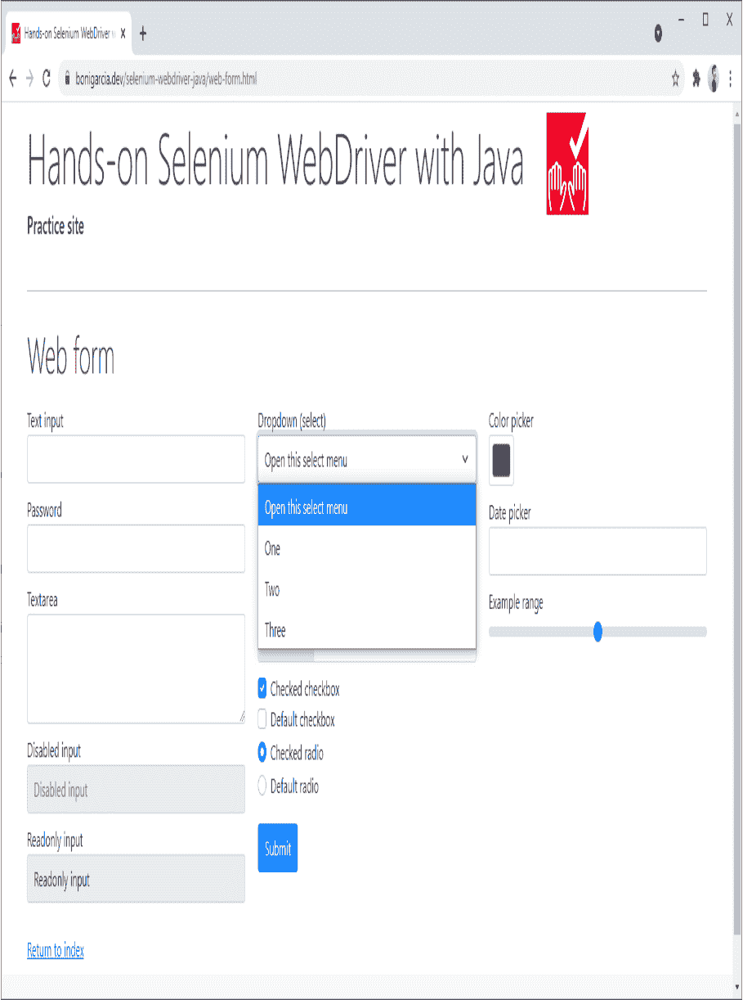
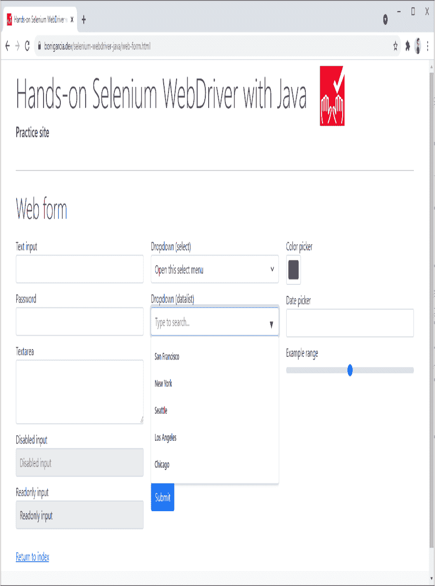
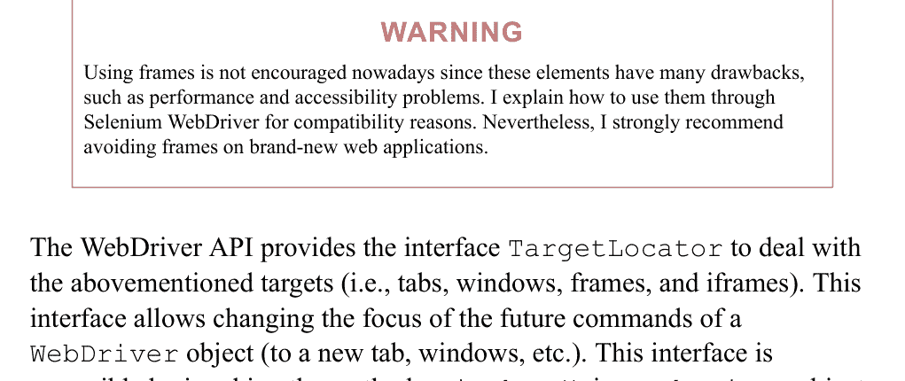
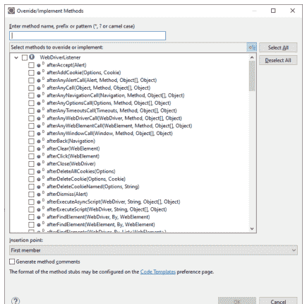
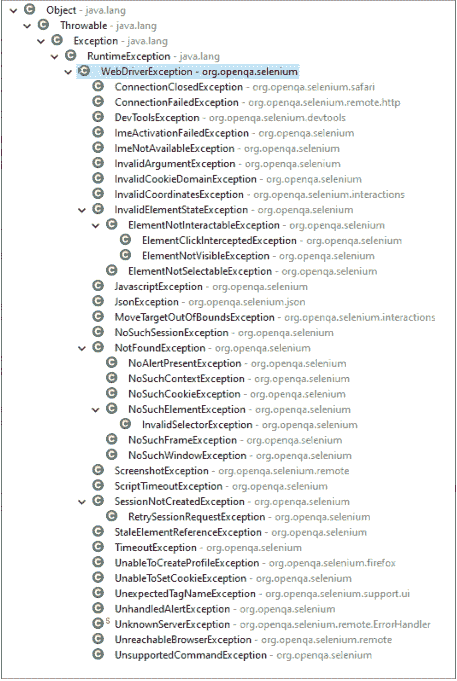

## 第 4 章 跨浏览器特性

> **致早期版本读者**
>
> 通过早期版本电子书，你可以在书籍正式发布之前，以作者写作时的原始未编辑形式获取内容，从而更早地了解这些技术。
>
> 这将是最终书籍的第四章。请注意，GitHub 仓库稍后将启用。
>
> 如果你对本内容和/或本书示例的改进有任何意见，或者发现本章有缺失内容，请联系开发编辑：rfernando@oreilly.com。

本章回顾 Selenium WebDriver 中可在不同 Web 浏览器中互操作的特性。在这组特性中，一个重要的多用途能力是执行 JavaScript。此外，WebDriver API 允许配置页面和脚本加载的超时时间。另一个便捷功能是截取浏览器屏幕或仅截取指定元素对应部分的截图。然后，我们可以使用 WebDriver 管理受控浏览器的不同方面，例如浏览器大小和位置、历史记录或 Cookie。接着，WebDriver 提供了各种工具来控制特定的 Web 元素，例如下拉列表（即 HTML select 字段和数据列表）、导航目标（即窗口、标签页、框架和 iframe）或对话框（即警告框、提示框、确认框和模态对话框）。最后，我们学习如何使用 Web 存储处理本地和会话数据、实现事件监听器，以及了解 WebDriver API 提供的异常。

## 执行 JavaScript

如你所知，JavaScript 是一种所有主流浏览器都支持的高级编程语言。我们可以在 Web 应用的客户端使用 JavaScript 执行各种操作，例如 DOM 操作、用户交互、处理来自远程服务器的请求-响应、使用正则表达式等等众多功能。幸运的是，对于测试自动化，Selenium WebDriver 允许注入并执行任意 JavaScript 片段。为此，Selenium WebDriver API 提供了 `JavascriptExecutor` 接口。表 4-1 介绍了该接口中可用的公共方法，并将其分为三类：同步脚本、固定脚本和异步脚本。以下小节将更详细地介绍它们，并通过不同示例说明其用法。

### 表 4-1. JavascriptExecutor 方法

| 类别 | 方法 | 返回类型 | 描述 |
|---|---|---|---|
| 同步脚本 | `executeScript(String script, Object... args)` | Object | 在当前页面上执行一些 JavaScript 代码 |
| 固定脚本 | `pin(String script)` | ScriptKey | 将某段 JavaScript 附加到 WebDriver 会话。在 WebDriver 会话存续期间，*固定*的脚本可以多次使用 |
|  | `unpin(ScriptKey key)` | void | 从 WebDriver 会话中分离先前固定的脚本 |
|  | `getPinnedScripts()` | Set<ScriptKey> | 收集所有固定的脚本（每个脚本由一个唯一的 ScriptKey 标识） |
| 异步脚本 | `executeAsyncScript(String script, Object... args)` | Object | 在当前页面上执行一些 JavaScript 代码（通常包含异步操作）。与 `executeScript()` 不同，使用 `executeAsyncScript()` 执行的脚本必须通过调用回调函数来显式地发出终止信号。按照惯例，该回调作为最后一个参数注入脚本中 |

任何继承自 `RemoteWebDriver` 类的驱动对象也都实现了 `JavascriptExecutor` 接口。因此，当使用由通用 `WebDriver` 接口声明的主流浏览器（例如 `ChromeDriver`、`FirefoxDriver` 等）时，我们可以将其强制转换为


如下面的代码片段所示，我们使用 JavascriptExecutor。然后，我们可以使用该执行器（示例中使用变量 `js`）来调用前面表格中介绍的方法。

```
WebDriver driver = new ChromeDriver();
JavascriptExecutor js = (JavascriptExecutor) driver;
```

## 同步脚本

JavascriptExecutor 对象的 `executeScript()` 方法允许在 WebDriver 会话中当前网页的上下文内执行一段 JavaScript。在 Java 中调用此方法会阻塞控制流，直到脚本终止。因此，我们通常使用此方法在受测网页中执行同步脚本。`executeScript()` 方法接受两个参数：

- String script：必填，要执行的 JavaScript 片段。该代码在当前页面的主体中作为匿名函数（即没有名称的 JavaScript 函数）执行。
- Object... args：可选参数脚本。这些参数必须是以下类型之一：number、boolean、string、WebElement 或这些类型的 List（否则 WebDriver 会抛出异常）。这些参数可通过内置的 JavaScript 变量 `arguments` 在注入的脚本中使用。

当脚本返回某个值时（即代码包含 `return` 语句），Selenium WebDriver 的 `executeScript()` 方法在 Java 中也会返回一个值（否则 `executeScript()` 返回 null）。可能的返回类型如下：

- WebElement：当返回 HTML 元素时。
- Double：用于小数。
- Long：用于非小数数字。

3. 执行一段 JavaScript 代码。在本例中，我们调用 JavaScript 函数 `scrollBy()` 来将文档滚动指定量（本例为向下滚动 1000px）。请注意，此片段没有使用 `return`，因此我们在 Java 逻辑中不会收到任何返回对象。此外，我们也没有向脚本传递任何参数。

示例 4-2 展示了另一个测试，它使用了滚动，并且使用与之前相同的示例网页。这次，我们不是移动固定数量的像素，而是将文档滚动到指定元素。

### 示例 4-2：执行 JavaScript 滚动到指定元素的测试

```java
@Test
void testScrollIntoView() {
    driver.get(
        "https://bonigarcia.dev/selenium-webdriver-java/long-page.html");
    JavascriptExecutor js = (JavascriptExecutor) driver;

    driver.manage().timeouts().implicitlyWait(Duration.ofSeconds(10));

    WebElement lastElement = driver
        .findElement(By.cssSelector("p:last-child"));
    String script = "arguments[0].scrollIntoView();";
    js.executeScript(script, lastElement);
}
```

1. 为了使该测试更健壮，我们指定了一个隐式超时。否则，如果在执行后续命令时页面尚未完全加载，测试可能会失败。
2. 我们使用 CSS 选择器定位网页中的最后一个段落。
3. 我们定义要注入到页面中的脚本。请注意，该脚本不返回任何值，但新颖的是，它使用第一个函数参数来调用 JavaScript 函数 `scrollIntoView()`。
4. 我们执行之前的脚本，并将定位到的 `WebElement` 作为参数传递。该元素将成为脚本的第一个参数（即 `arguments[0]`）。

关于滚动，我要展示的最后一个示例与*无限滚动*有关。这种技术允许用户在到达网页末尾时动态加载更多内容。自动化此类网页是一个具有教学意义的用例，因为它涉及 WebDriver API 的不同方面。例如，您可以使用类似的方法通过 Selenium WebDriver 爬取网页。示例 4-3 展示了一个使用无限滚动页面的测试。

### 示例 4-3：在无限滚动页面中执行 JavaScript 的测试

```java
@Test
void testInfiniteScroll() {
    driver.get(
            "https://bonigarcia.dev/selenium-webdriver-java/infinite-scroll.html");
    JavascriptExecutor js = (JavascriptExecutor) driver;
    WebDriverWait wait = new WebDriverWait(driver,
            Duration.ofSeconds(10));

    By pLocator = By.tagName("p");
    List<WebElement> paragraphs = wait.until(
            ExpectedConditions.numberOfElementsToBeMoreThan(pLocator, 0));
    int initParagraphsNumber = paragraphs.size();

    WebElement lastParagraph = driver.findElement(
            By.xpath(String.format("//p[%d]",
            initParagraphsNumber)));
    String script = "arguments[0].scrollIntoView();";
    js.executeScript(script, lastParagraph);

    wait.until(ExpectedConditions.numberOfElementsToBeMoreThan(pLocator,
            initParagraphsNumber));
}
```

1. 我们定义了一个显式等待，因为需要暂停测试，直到新内容加载完成。
2. 我们找出页面上段落的初始数量。
3. 我们定位页面上的最后一个段落。
4. 我们向下滚动到此元素。
5. 我们一直等待，直到页面上出现更多段落。

## 颜色选择器

HTML 中的*颜色选择器*是一种输入类型，允许用户通过图形区域单击并拖动光标来选择颜色。练习用 Web 表单包含其中一个元素（见图 4-2）。以下代码展示了该颜色选择器的 HTML 标记。请注意，它设置了一个初始颜色值（否则默认颜色为黑色）。

```
<input type="color" class="form-control form-control-color"
name="my-colors"
value="#563d7c">
```

- Selenium WebDriver 实战（Java 版）
- 练习站点
- Web 表单
- 文本输入
- 密码
- 文本区域
- 禁用的输入
- 只读输入
- 下拉列表（select）
- 下拉列表（datalist）
- 文件输入
- 颜色选择器
- 已勾选的复选框
- 默认复选框
- 已勾选的单选按钮
- 默认单选按钮
- 提交
- 返回索引

图 4-2：练习用 Web 表单中的颜色选择器

示例 4-4 演示了如何与该颜色选择器交互。由于 WebDriver API 未提供任何用于控制颜色选择器的工具，我们使用 JavaScript。此外，该测试还演示了 Color 的使用，这是 WebDriver API 中提供的一个用于处理颜色的支持类。

### 示例 4-4：执行 JavaScript 与颜色选择器交互的测试

```java
@Test
void testColorPicker() {
    driver.get(
        "https://bonigarcia.dev/selenium-webdriver-java/web-form.html");
    JavascriptExecutor js = (JavascriptExecutor) driver;

    WebElement colorPicker = driver.findElement(By.name("my-colors")); ①
    String initColor = colorPicker.getAttribute("value"); ②
    log.debug("The initial color is {}", initColor);

    Color red = new Color(255, 0, 0, 1); ③
    String script = String.format(
        "arguments[0].setAttribute('value', '%s');",
        red.asHex());
    js.executeScript(script, colorPicker); ④

    String finalColor = colorPicker.getAttribute("value"); ⑤
    log.debug("The final color is {}", finalColor);
    assertThat(finalColor).isNotEqualTo(initColor); ⑥
    assertThat(Color.fromString(finalColor)).isEqualTo(red);
}
```

1. 我们按名称定位颜色选择器。
2. 我们读取颜色选择器的初始值（应为 #563d7c）。
3. 我们使用以下 RGBA 分量定义一个要处理的颜色：red=255（最大值）、green=0（最小值）、blue=0（最小值）、alpha=1（最大值，即完全不透明）。
4. 我们使用 JavaScript 更改颜色选择器中选中的值。
5. 我们读取颜色选择器的结果值（应为 #ff0000）。
6. 我们断言该颜色与初始值不同，结果符合预期。

## 固定脚本

从 Selenium WebDriver 4 开始，WebDriver API 允许您固定脚本。此功能支持将 JavaScript 片段附加到 WebDriver 会话，为每个片段分配唯一键，并按需执行这些片段（甚至可以在不同的网页上执行）。示例 4-5 展示了一个使用这些固定脚本的测试。

### 示例 4-5：以固定脚本形式执行 JavaScript 的测试

```java
@Test
void testPinnedScripts() {
    String initPage = "https://bonigarcia.dev/selenium-webdriver-java/";
    driver.get(initPage);
    JavascriptExecutor js = (JavascriptExecutor) driver;

    ScriptKey linkKey = js
        .pin("return document.getElementsByTagName('a')[2];");

    ScriptKey firstArgKey = js.pin("return arguments[0];");

    Set<ScriptKey> pinnedScripts = js.getPinnedScripts();
    assertThat(pinnedScripts).hasSize(2);

    WebElement formLink = (WebElement) js.executeScript(linkKey);
    formLink.click();
    assertThat(driver.getCurrentUrl()).isNotEqualTo(initPage);

    String message = "Hello world!";
    String executeScript = (String) js.executeScript(firstArgKey, message);
    assertThat(executeScript).isEqualTo(message);

    js.unpin(linkKey);
    assertThat(js.getPinnedScripts()).hasSize(1);
}
```


1. 我们附加了一段 JavaScript 代码片段，用于定位网页中的元素。请注意，使用标准 WebDriver API 也可以完成相同的操作。不过，为了演示，我们采用了这种方式。
2. 我们附加了另一段 JavaScript 代码，该代码会返回传递给它的第一个参数。
3. 我们读取已固定脚本的集合。
4. 我们断言已固定脚本的数量符合预期（即 2 个）。
5. 我们执行第一个已固定脚本。结果是，我们获得了网页中的第三个链接，并将其作为 Java 中的 WebElement。
6. 我们单击该链接，它应该对应实践网页的链接。结果是，浏览器应导航到该页面。
7. 我们断言当前 URL 与初始 URL 不同。
8. 我们执行第二个已固定脚本。请注意，即使浏览器中的页面已发生变化，仍然可以运行已固定脚本（因为脚本附加到会话，而不是单个页面）。
9. 我们断言返回的消息符合预期。
10. 我们取消固定其中一个脚本。
11. 我们验证已固定脚本的数量符合预期（此时为 1 个）。

## 异步脚本

`JavascriptExecutor` 接口的 `executeAsyncScript()` 方法允许使用 Selenium WebDriver 在网页上下文中执行异步脚本。与 `executeScript()` 相同，`executeAsyncScript()` 也会阻塞 Java 控制流，直到传入的脚本执行完毕。两者的区别在于，使用 `executeAsyncScript()` 时，我们必须通过调用一个由系统提供的回调函数来显式地表示脚本终止。该回调函数会作为最后一个参数注入到被执行的函数中。换句话说，我们需要调用下面的 JavaScript 代码片段来调用终止回调。**示例 4-6** 展示了使用该方法的测试。

```js
arguments[arguments.length - 1]
```

### 示例 4-6. *执行异步 JavaScript 的测试*

```java
@Test
void testAsyncScript() {
    driver.get("https://bonigarcia.dev/selenium-webdriver-java/");
    JavascriptExecutor js = (JavascriptExecutor) driver;

    Duration pause = Duration.ofSeconds(2);
    String script = "const callback = arguments[arguments.length - 1];"
        + "window.setTimeout(callback, " + pause.toMillis() + ");";

    long initMillis = System.currentTimeMillis();
    js.executeAsyncScript(script);
    Duration elapsed = Duration
        .ofMillis(System.currentTimeMillis() - initMillis);
    log.debug("The script took {} ms to be executed",
        elapsed.toMillis());
    assertThat(elapsed).isGreaterThanOrEqualTo(pause);
}
```

1. 我们定义一个 2 秒的暂停时间。
2. 我们定义要执行的脚本。在第一行中，我们为回调函数定义一个常量（即最后一个脚本参数）。之后，我们使用 JavaScript 函数 `window.setTimeout()`，让脚本暂停执行指定的时间。
3. 我们获取当前系统时间（以毫秒为单位）。
4. 我们执行脚本。如果一切如预期运行，测试执行将在此行阻塞 2 秒（如第 1 步所定义）。
5. 我们计算执行上一行代码所需的时间。
6. 我们断言经过的时间符合预期（通常会比定义的暂停时间多出几毫秒）。

> 提示
> 你可以在第 5 章的“通知”部分找到另一个执行异步脚本的示例。

## 超时

Selenium WebDriver 允许指定三种类型的超时。我们可以通过调用 WebDriver API 中的 `manage().timeouts()` 方法来使用它们。第一种超时是隐式等待，已在第 4 章的“隐式等待”部分（作为等待策略的一部分）中介绍。其他选项是页面加载超时和脚本加载超时，下面将分别介绍。

### 页面加载超时

页面加载超时提供了一个时间限制，用于中断导航尝试。换句话说，此超时限制了加载网页所允许的时间。当超过该超时时间（默认值为 30 秒）时，将抛出异常。示例 4-7 展示了这种超时的用法。如你所见，这段代码是负向测试的一个简单实现。换句话说，它用于检查被测系统中的非预期条件。

### 示例 4-7. 使用页面加载超时的测试

```java
@Test
void testPageLoadTimeout() {
    driver.manage().timeouts().pageLoadTimeout(Duration.ofMillis(1)); ①

    assertThatThrownBy(() -> driver
        .get("https://bonigarcia.dev/selenium-webdriver-java/"))
        .isInstanceOf(TimeoutException.class); ②
}
```

① 我们指定了最短的页面加载超时时间，即 1 毫秒。

② 我们加载一个网页。由于不可能在不到 1 毫秒的时间内加载该网页，因此此调用（以 Java lambda 的形式实现）将失败。出于这个原因，我们预期 lambda 中会抛出 `TimeoutException`，并使用 AssertJ 方法 `assertThatThrownBy` 进行验证。

> 注意
> 你可以通过移除超时声明（即第 1 步）来尝试此测试。如果这样做，测试将失败，因为预期会抛出异常，但实际上没有抛出异常。

### 脚本加载超时

*脚本加载超时*为正在执行的脚本提供了一个时间限制，用于中断脚本执行。该超时的默认值为 300 秒。示例 4-8 展示了使用脚本加载超时的测试。

### 示例 4-8. 使用脚本加载超时的测试

```java
@Test
void testScriptTimeout() {
    driver.get("https://bonigarcia.dev/selenium-webdriver-java/");
    JavascriptExecutor js = (JavascriptExecutor) driver;

    driver.manage().timeouts().scriptTimeout(Duration.ofSeconds(3)); ①

    assertThatThrownBy(() -> {
        long waitMillis = Duration.ofSeconds(5).toMillis();
        String script = "const callback = arguments[arguments.length - 1];" +
            "window.setTimeout(callback, " + waitMillis +
            " ); ";
        js.executeAsyncScript(script);
    }).isInstanceOf(ScriptTimeoutException.class);
}
```

① 我们定义了 3 秒的脚本超时时间。这意味着，执行时间超过该时长的脚本将抛出异常。

② 我们执行一个会暂停 5 秒的异步脚本。

③ 脚本执行时间超过了配置的脚本超时时间，因此产生了 `ScriptTimeoutException`。同样，这是一个负向测试，即用于预期该异常的测试。

## 屏幕截图

如你所知，Selenium WebDriver 主要用于对 Web 应用程序执行端到端功能测试。换句话说，我们通过与 Web 应用程序的用户界面交互（即使用 Web 浏览器）来验证其行为是否符合预期。这种方式非常适合自动化高级用户场景，但也会带来各种困难。端到端测试面临的主要挑战之一，是诊断测试失败的根本原因。假设此次失败是合理的（即并非由实现不当的测试引起），其根本原因可能多种多样：客户端问题（例如，JavaScript 逻辑错误）、服务器端问题（例如，内部异常），或与其他组件的集成问题（例如，无法适当访问数据库），除此之外还可能有其他原因。Selenium WebDriver 中用于失败分析的最普遍机制之一，就是截取浏览器屏幕截图。本节将介绍 WebDriver API 为此提供的机制。

> 提示
> 第 8 章的“失败分析”部分介绍了特定于框架的技术，用于确定测试何时失败，并随后执行各种失败分析操作，例如截取屏幕截图、录制视频和收集日志。

Selenium WebDriver 提供了 `TakesScreenshot` 接口，用于截取浏览器屏幕截图。任何继承自 `RemoteWebDriver` 的驱动程序对象（参见第 2 章中的图 2-2）也实现了该接口。因此，我们可以将实例化主要浏览器之一（例如 `ChromeDriver`、`FirefoxDriver` 等）的 `WebDriver` 对象转换如下：

```java
WebDriver driver = new ChromeDriver();
TakesScreenshot ts = (TakesScreenshot) driver;
```

`TakesScreenshot` 接口只提供了一个名为 `getScreenshotAs(OutputType<X> target)` 的方法，用于截取屏幕截图。参数 `OutputType<X> target` 决定了屏幕截图的类型以及返回值。表 4-2 展示了该参数可用的选项。


# 表 4-2. 输出类型参数

| 参数 | 描述 | 返回 | 示例 |
|---|---|---|---|
| OutputType.FILE | 将截图保存为 PNG 文件（位于系统临时目录中） | File | File screenshot = ts.getScreenshotAs(OutputType.FILE); |
| OutputType.BASE64 | 以 Base64 格式（即编码为 ASCII 字符串）截图 | String | String screenshot = ts.getScreenshotAs(OutputType.BASE64); |
| OutputType.BYTES | 将截图保存为原始字节数组 | byte[] | byte[] screenshot = ts.getScreenshotAs(OutputType.BYTES); |

> 提示
> 
> `getScreenshotAs()` 方法允许截取浏览器视口的屏幕截图。此外，Selenium WebDriver 4 允许使用不同机制创建整页截图（参见第 5 章的“整页截图”）。

示例 4-9 展示了一个以 PNG 格式截取浏览器屏幕的测试。接着，示例 4-10 展示了另一个以 Base64 字符串创建截图的测试。两种情况下的截图结果如图 4-3 所示。

## 示例 4-9. 以 PNG 文件形式截图的测试

```
@Test
void testScreenshotPng() throws IOException {
    driver.get("https://bonigarcia.dev/selenium-webdriver-java/");
    TakesScreenshot ts = (TakesScreenshot) driver;

    File screenshot = ts.getScreenshotAs(OutputType.FILE); ①
    log.debug("Screenshot created on {}", screenshot);

    Path destination = Paths.get("screenshot.png"); ②
    Files.move(screenshot.toPath(), destination, REPLACE_EXISTING); ③

    log.debug("Screenshot moved to {}", destination);
}
```

2 我们将前缀 `data:image/png;base64,` 附加到 Base64 字符串，并将其记录到标准输出。你可以复制并将结果字符串粘贴到浏览器导航栏中以显示图片。

3 我们断言截图的字符串包含内容。

> 注意
> 如前面的示例所示，在 CI 服务器（例如 GitHub Actions）上运行测试时，我们无法访问其文件系统，此时以 Base64 记录截图对于诊断故障非常有用。

## WebElement 截图

WebElement 接口扩展了 TakesScreenshot 接口。这样，就可以对给定 Web 元素的可见内容进行部分截图。示例 4-11 展示了相关测试。请注意，该测试与之前使用 PNG 文件的测试非常相似，但在本例中，我们直接使用 Web 元素调用 getScreenshotAs() 方法。图 4-4 显示了截图结果。

## 示例 4-11. 以 PNG 文件形式进行部分截图的测试

```
@Test
void testWebElementScreenshot() throws IOException {
    driver.get(
        "https://bonigarcia.dev/selenium-webdriver-java/web-form.html");

    WebElement form = driver.findElement(By.tagName("form"));
    File screenshot = form.getScreenshotAs(OutputType.FILE);
    Path destination = Paths.get("webelement-screenshot.png");
    Files.move(screenshot.toPath(), destination, REPLACE_EXISTING);

    assertThat(destination).exists();
}
```

## 表 4-3. 窗口方法

| 方法 | 返回 | 描述 |
|---|---|---|
| `getSize()` | `Dimension` | 获取当前窗口大小。它返回外部窗口尺寸，而不仅仅是*视口*（即终端用户看到的网页可见区域） |
| `setSize(Dimension targetSize)` | `void` | 更改当前窗口大小（同样是外部尺寸，而不是视口） |
| `getPosition()` | `Point` | 获取当前窗口位置（相对于左上角） |
|  |  | 屏幕的角落） |
| setPosition(Point targetPosition) void | 更改当前窗口位置（同样是相对于屏幕左上角） |
| maximize() void | 最大化当前窗口 |
| minimize() void | 最小化当前窗口 |
| fullscreen() void | 使当前窗口全屏 |

## 示例 4-12. 读取和更改浏览器大小与位置的测试

```
@Test
void testWindow() {
    driver.get("https://bonigarcia.dev/selenium-webdriver-java/");
    Window window = driver.manage().window();

    Point initialPosition = window.getPosition(); ①
    Dimension initialSize = window.getSize(); ②
    log.debug("Initial window: position {} -- size {}",
    initialPosition,
        initialSize);

    window.maximize(); ③

    Point maximizedPosition = window.getPosition();
    Dimension maximizedSize = window.getSize();
    log.debug("Maximized window: position {} -- size {}",
    maximizedPosition,
        maximizedSize);

    assertThat(initialPosition).isNotEqualTo(maximizedPosition); ④
    assertThat(initialSize).isNotEqualTo(maximizedSize);
}
```

+   ① 我们读取窗口位置。
+   ② 我们读取窗口大小。
+   ③ 我们最大化浏览器窗口。

④ 我们验证最大化后的位置（以及下一行中的大小）与原始窗口不同。

## 浏览器历史记录

Selenium WebDriver 允许通过 `Navigation` 接口操纵浏览器历史记录。下面的语句说明了如何从 WebDriver 对象访问该接口。该接口的使用非常简单。**表 4-44** 显示了其公共方法，**示例 4-13** 展示了一个基本示例。请注意，该测试使用这些方法导航到不同的网页，并在测试结束时验证网页 URL 是否符合预期。

```
```java
Navigation navigation = driver.navigate();
```
```

## 表 4-4. 导航方法

| 方法 | 返回 | 描述 |
|---|---|---|
| back() | void | 在浏览器历史记录中后退 |
|  |  | 在浏览器历史记录中前进 |

| 方法 | 返回类型 | 描述 |
|---|---|---|
| `forward()` | `void` | |
| `to(String url)` | `void` | 在当前窗口中加载新的网页 |
| `to(URL url)` |  | |
| `refresh()` | `void` | 刷新当前页面 |

## 示例 4-13. 使用导航方法的测试

```
```java
@Test
void testHistory() {
    String baseUrl = "https://bonigarcia.dev/selenium-webdriver-java/";
    String firstPage = baseUrl + "navigation1.html";
    String secondPage = baseUrl + "navigation2.html";
    String thirdPage = baseUrl + "navigation3.html";

    driver.get(firstPage);

    driver.navigate().to(secondPage);
    driver.navigate().to(thirdPage);
    driver.navigate().back();
    driver.navigate().forward();
    driver.navigate().refresh();

    assertThat(driver.getCurrentUrl()).isEqualTo(thirdPage);
}
```
```

## Cookie

HTTP 1.x 是一种无状态协议，意味着服务器不会跟踪用户状态。换句话说，Web 服务器不会在多个请求之间记住用户。Cookie 机制是 HTTP 的一种扩展，它通过从服务器向客户端发送称为 *cookie* 的小段文本来跟踪用户。这些 cookie 必须由客户端发送回去，这样服务器才能*记住*其客户端。Cookie 允许您维持 Web 会话或个性化网站上的用户体验，以及实现其他功能。

Web 浏览器允许手动管理浏览器 Cookie。Selenium WebDriver 提供了等效的编程式操作。为此，WebDriver API 提供了**表 4-5** 中的可用方法。它们可以通过 `WebDriver` 对象的 `manage()` 方法访问。

## 表 4-5. Cookie 管理方法

d
s

| 方法 | 返回 | 描述 |
|---|---|---|
| addCookie(Cookie cookie) | void | 添加一个新的 Cookie |
| deleteCookieNamed(String name) | void | 按名称删除现有 Cookie |
| deleteCookie(Cookie cookie) | void | 按实例删除现有 Cookie |
| deleteAllCookies() | void | 删除所有 Cookie |
| getCookies() | Set<Cookie> | 获取所有 Cookie |
| getCookieNamed(String name) | Cookie | 按名称获取 Cookie |

如上表所示，Cookie 类在 Java 中提供了对单个 Cookie 的抽象。表 4-6 总结了该类中可用的方法。此外，该类有多个构造函数，它们按位置接受以下参数：

+   - String name：Cookie 名称（必填）。
+   - String value：Cookie 值（必填）。
+   - String domain：Cookie 可见的域（可选）。
+   - String path：Cookie 可见的路径（可选）。
+   - Date expiry：Cookie 的过期日期（可选）。
+   - boolean isSecure：Cookie 是否需要安全连接（可选）。


- `boolean isHttpOnly`：此 cookie 是否为仅 HTTP 的 cookie，即该 cookie 无法通过客户端脚本访问（可选）。
- `String sameSite`：此 cookie 是否为同站 cookie，即该 cookie 仅限于第一方或同站上下文（可选）。

## 表 4-6. Cookie 方法

| 方法 | 返回 | 描述 |
|---|---|---|
| `getName()` | `String` | 读取 cookie 名称 |
| `getValue()` | `String` | 读取 cookie 值 |
| `getDomain()` | `String` | 读取 cookie 域 |
| `getPath()` | `String` | 读取 cookie 路径 |
| `isSecure()` | `boolean` | 读取 cookie 是否需要安全连接 |
| `isHttpOnly()` | `boolean` | 读取 cookie 是否仅 HTTP |
| `getExpiry()` | `Date` | 读取 cookie 过期日期 |
| `getSameSite()` | `String` | 读取 cookie 同站上下文 |
| `validate()` | `void` | 检查 cookie 的不同字段，如果遇到任何问题则抛出 `IllegalArgumentException` |
| `toJson()` | `Map<String, Object>` | 将 cookie 值映射为键值映射 |

以下示例展示了使用 WebDriver API 管理 Web cookie 的不同测试。这些示例使用一个练习网页，该网页在 GUI 上显示站点 cookie（参见图 4-5）：

- 示例 4-14 演示了如何读取网站的现有 cookie。
- 示例 4-15 展示了如何添加新 cookie。
- 示例 4-16 说明了如何编辑现有 cookie。
- 示例 4-17 演示了如何删除 cookie。

```text
Practice site

Cookies

Display cookies

username=John Doe

date=10/07/2018

Figure 4-5. Practice web page for web cookies
```

### 示例 4-14. 测试读取现有 cookie

```java
@Test
void testReadCookies() {
    driver.get("https://bonigarcia.dev/selenium-webdriver-java/cookies.html");

    Set<Cookie> cookies = driver.manage().getCookies();
    assertThat(cookies).hasSize(2);

    Cookie username = driver.manage().getCookieNamed("username");
    assertThat(username.getValue()).isEqualTo("John Doe");
    assertThat(username.getPath()).isEqualTo("/");

    driver.findElement(By.id("refresh-cookies")).click();
}
```

1. 我们读取此页面上所有可用的 cookie。其中应包含两个 cookie。
2. 我们读取名称为 `username` 的 cookie。
3. 上一个 cookie 的值应为 `John Doe`。
4. 最后一个语句对测试没有任何影响。我们调用此命令是为了让你在浏览器 GUI 中检查 cookie。

### 示例 4-15. 测试添加新 cookie

```java
@Test
void testAddCookies() {
    driver.get("https://bonigarcia.dev/selenium-webdriver-java/cookies.html");

    Cookie newCookie = new Cookie("new-cookie-key", "new-cookie-value");
    driver.manage().addCookie(newCookie);
    String readValue =
        driver.manage().getCookieNamed(newCookie.getName())
            .getValue();
    assertThat(newCookie.getValue()).isEqualTo(readValue);

    driver.findElement(By.id("refresh-cookies")).click();
}
```

- ① 我们创建一个新 cookie。
- ② 我们将该 cookie 添加到当前页面。
- ③ 我们读取刚添加的 cookie 的值。
- ④ 我们验证该值是否符合预期。

### 示例 4-16. 测试编辑现有 cookie

```java
@Test
void testEditCookie() {
    driver.get("https://bonigarcia.dev/selenium-webdriver-java/cookies.html");

    Cookie username = driver.manage().getCookieNamed("username");
    Cookie editedCookie = new Cookie(username.getName(), "new-value");
    driver.manage().addCookie(editedCookie);

    Cookie readCookie = driver.manage().getCookieNamed(username.getName());
    assertThat(editedCookie).isEqualTo(readCookie);

    driver.findElement(By.id("refresh-cookies")).click();
}
```

- ① 我们读取一个现有 cookie。
- ② 我们创建一个新 cookie，并复用之前的 cookie 名称。
- ③ 我们将新 cookie 添加到网页中。
- ④ 我们读取刚添加的 cookie。
- ⑤ 我们验证 cookie 是否已正确编辑。

### 示例 4-17. 测试删除现有 cookie

```java
@Test
void testDeleteCookies() {
    driver.get("https://bonigarcia.dev/selenium-webdriver-java/cookies.html");

    Set<Cookie> cookies = driver.manage().getCookies(); // ①
    Cookie username = driver.manage().getCookieNamed("username"); // ②
    driver.manage().deleteCookie(username); // ③

    assertThat(driver.manage().getCookies()).hasSize(cookies.size() - 1); // ④

    driver.findElement(By.id("refresh-cookies")).click();
}
```

- ① 我们读取所有 cookie。
- ② 我们读取名称为 username 的 cookie。
- ③ 我们删除之前的 cookie。
- ④ 我们验证 cookie 的数量是否符合预期。

## 下拉列表

Web 表单中的一个典型元素是下拉列表。这些字段允许用户在选项列表中选择一个或多个元素。用于渲染这些字段的经典 HTML 标签是 `<select>` 和 `<option>`。与往常一样，练习 Web 表单包含其中一个元素（参见图 4-6），其 HTML 定义如下：

```html
<select class="form-select" name="my-select">
    <option selected>Open this select menu</option>
    <option value="1">One</option>
    <option value="2">Two</option>
    <option value="3">Three</option>
</select>
```

```text
Practice site

Web form

Text input

Password

Textarea

Disabled input

Disabled input

Readonly input

Readonly input

Dropdown (select)

- Open this select menu
- One
- Two
- Three

- Checked checkbox
- Default checkbox
- Checked radio
- Default radio

Submit

Color picker

Date picker

Example range

Return to index
```



*图 4-6. 练习 Web 表单中的选择字段*

这些元素在 Web 表单中非常普遍。因此，Selenium WebDriver 提供了一个名为 `Select` 的辅助类来简化对它们的操作。该类包装了一个 select `WebElement`，并提供了多种功能。表 4-7 总结了 `Select` 类中可用的公开方法。之后，示例 4-18 展示了一个使用该类的基本测试。

## 表 4-7. Select 方法

| 方法 | 返回 | 描述 |
|---|---|---|
| `Select(WebElement element)` | `Select` | 构造函数，使用 WebElement 作为参数（它必须是一个 `<select>` 元素），否则抛出 `UnexpectedTagNameException` |
| `getWrappedElement()` | `WebElement` | 获取包装的 WebElement（即构造函数中使用的那个） |
| `isMultiple()` | `boolean` | select 元素是否支持选择多个选项 |
| `getOptions()` | `List<WebElement>` | 读取属于 select 的所有选项 |
| `getAllSelectedOptions()` | `List<WebElement>` | 读取所有选中的选项 |
| `getFirstSelectedOption()` | `WebElement` | 读取第一个选中的选项 |
| `selectByVisibleText(String text)` | `void` | 选择匹配给定显示文本的所有选项 |
| `selectByIndex(int index)` | `void` | 按索引号选择一个选项 |
| `selectByValue(String value)` | `void` | 按 value 属性选择选项 |
| `deselectAll()` | `void` | 取消选择所有选项 |
| `deselectByValue(String value)` | `void` | 按 value 属性取消选择选项 |
| `deselectByIndex(int index)` | `void` | 按索引号取消选择 |
| `deselectByVisibleText(String text)` | `void` | 取消选择匹配给定显示文本的选项 |

### 示例 4-18. 测试与 select 字段交互

```java
@Test
void test() {
    driver.get("https://bonigarcia.dev/selenium-webdriver-java/web-form.html");

    Select select = new Select(driver.findElement(By.name("my-select"))); // ①

    String optionLabel = "Three";
    select.selectByVisibleText(optionLabel); // ②

    assertThat(select.getFirstSelectedOption().getText()).isEqualTo(optionLabel); // ③
}
```

- ① 我们按名称找到 select 元素，并使用得到的 WebElement 实例化一个 Select 对象。
- ② 我们使用按文本匹配的策略，选择此 select 中可用的一个选项。
- ③ 我们验证所选选项的文本是否符合预期。

## 数据列表元素

在 HTML 中实现下拉列表的另一种方式是使用数据列表。虽然从图形角度来看，数据列表与 select 元素非常相似，但它们之间存在明显区别。一方面，select 字段显示一个选项列表，用户从可用选项中选择一个（或几个）。另一方面，数据列表显示与输入表单（文本）字段相关联的建议选项列表，用户可以自由选择其中一个建议值或输入自定义值。练习 Web 表单包含其中一个数据列表。你可以在下面的代码片段中找到其标记，截图见图 4-7。

```html
<input class="form-control" list="my-options" name="my-datalist" placeholder="Type to search...">
<datalist id="my-options">
    <option value="San Francisco">
    <option value="New York">
    <option value="Seattle">
    <option value="Los Angeles">
    <option value="Chicago">
</datalist>
```


# Java 版 Selenium WebDriver 实战

练习站点

# Web 表单

文本输入框

下拉框（select）

颜色选择器

密码

下拉框（datalist）

日期选择器

多行文本框

示例范围

禁用的输入框

只读的输入框

- 旧金山
- 纽约
- 西雅图
- 洛杉矶
- 芝加哥

打开此选择菜单

输入以搜索...

提交

返回索引



*图 4-7. 练习 Web 表单中的数据列表字段*

Selenium WebDriver 没有提供用于操作数据列表的自定义辅助类。相反，我们需要像处理标准输入文本一样与它们交互，区别在于，当点击输入字段时，会显示其选项。示例 4-19 展示了一个说明这一点的测试。

## 示例 4-19. 与数据列表字段交互的测试

```
@Test
void testDatalist() {
    driver.get(
        "https://bonigarcia.dev/selenium-webdriver-java/web-form.html");

    WebElement datalist = driver.findElement(By.name("my-datalist")); ①
    datalist.click(); ②

    WebElement option = driver
        .findElement(By.xpath("//datalist/option[2]")); ③
    String optionValue = option.getAttribute("value"); ④
    datalist.sendKeys(optionValue); ⑤

    assertThat(optionValue).isEqualTo("New York"); ⑥
}
```

- ① 我们定位用于数据列表的输入字段。
- ② 我们点击它以显示其选项。
- ③ 我们找到第二个选项。
- ④ 我们读取所定位选项的值。
- ⑤ 我们在输入字段中输入该值。
- ⑥ 我们断言选项值符合预期。

## 导航目标

使用浏览器导航网页时，默认情况下，我们使用与导航栏中 URL 对应的单个页面。然后，我们可以打开

## 通过语义分块提升大语言模型的长上下文推理能力

Zihan Wang, Yunxuan Li, Mintong Kang, Jun Li, Zhangyang Wang, Rahul G. Krishnan, Terrence J. Sejnowski, Yixuan Li

加州大学圣迭戈分校 | 德克萨斯大学奥斯汀分校 | 索尔克研究所

### 摘要

大语言模型（LLMs）在一系列广泛的自然语言处理任务中展现了卓越的性能。然而，它们在长上下文推理方面仍然存在困难。在本文中，我们提出了语义分块（semantic chunking），一种将文档划分为语义连贯的块以改进长上下文推理的方法。实验表明，我们的方法在多个基准测试上优于固定长度分块。

### 1 引言

大语言模型（LLMs）的最新进展使其能够处理长文档。然而，由于信息往往分布在许多段落中，长上下文推理仍然具有挑战性。我们研究了分块策略如何影响 LLM 的性能，并表明语义分块可以显著改善检索与推理。



图 1：语义分块与固定长度分块对比的总体示意图。

表 4-8. Target Locator 方法

| 方法 | 返回类型 | 描述 |
|---|---|---|

| frame(int index) | WebDriver | 按索引号将焦点切换到某个框架（或 iframe） |
| frame(String nameOrId) | WebDriver | 按名称或 id 将焦点切换到某个框架（或 iframe） |
| frame(WebElement frameElement) | WebDriver | 将焦点切换到先前定位为 WebElement 的框架（或 iframe） |
| parentFrame() | WebDriver | 将焦点切换到父上下文 |
| window(String nameOrHandle) | WebDriver | 按名称或句柄将焦点切换到另一个窗口。窗口句柄是一个十六进制字符串，用于唯一标识某个窗口或标签页 |
| newWindow(WindowType typeHint) | WebDriver | 创建一个新的浏览器窗口（使用 WindowType.WINDOW）或标签页（使用 WindowType.TAB），并将焦点切换到它 |
| defaultContent() | WebDriver | 选择主文档（使用 iframe 时）或页面上的第一个框架（使用 frameset 时） |
| activeElement() | WebElement | 获取当前选中的元素 |
| alert() | Alert | 将焦点切换到窗口警告框（详见“对话框”） |

## 标签页与窗口

示例 4-20 展示了一个测试，其中我们打开一个新的标签页来导航第二个网页。示例 4-21 是等价场景，但为第二个网页打开了一个新窗口。请注意，两个示例之间的区别仅在于参数 WindowType.TAB 和 WindowType.WINDOW。

## 示例 4-20. 打开新标签页的测试

```
@Test
void testNewTab() {
```

```java
driver.get("https://bonigarcia.dev/selenium-webdriver-java/");

String initHandle = driver.getWindowHandle();

driver.switchTo().newWindow(WindowType.TAB);
driver.get(
    "https://bonigarcia.dev/selenium-webdriver-java/web-form.html");
assertThat(driver.getWindowHandles().size()).isEqualTo(2);

driver.switchTo().window(initHandle);
driver.close();
assertThat(driver.getWindowHandles().size()).isEqualTo(1);
```
```

- 1. 我们导航到一个网页。
- 2. 我们获取当前窗口句柄。
- 3. 我们打开一个新标签页，并将焦点切换到它。
- 4. 我们打开另一个网页（由于焦点在第二个标签页中，因此该网页会在第二个标签页中打开）。
- 5. 我们验证此时的窗口句柄数量为 2。
- 6. 我们使用初始窗口的句柄将焦点切换到初始窗口。
- 7. 我们（仅）关闭当前窗口。第二个标签页保持打开。
- 8. 我们验证现在的窗口句柄数量为 1。

## 示例 4-21. 打开新窗口的测试

```
```java
@Test
void testNewWindow() {
    driver.get("https://bonigarcia.dev/selenium-webdriver-java/");
    String initHandle = driver.getWindowHandle();

    driver.switchTo().newWindow(WindowType.WINDOW);
    driver.get(
        "https://bonigarcia.dev/selenium-webdriver-java/web-form.html");
```

```
assertThat(driver.getWindowHandles().size()).isEqualTo(2);

driver.switchTo().window(initHandle);
driver.close();
assertThat(driver.getWindowHandles().size()).isEqualTo(1);
}
```

① 这一行在两个示例中有所不同。在本例中，我们打开一个新窗口（而不是标签页）并将焦点切换到它。

## 框架与内联框架

示例 4-22 展示了一个测试，其中被测网页包含一个 iframe。示例 4-23 展示的是等价场景，但使用了 frameset。

## 示例 4-22. 处理 iframe 的测试

```
@Test
void testIFrames() {
    driver.get(
        "https://bonigarcia.dev/selenium-webdriver-java/iframes.html"); ①

    WebDriverWait wait = new WebDriverWait(driver,
    Duration.ofSeconds(10));
    wait.until(ExpectedConditions
        .frameToBeAvailableAndSwitchToIt("my-iframe")); ②

    By pName = By.tagName("p");

wait.until(ExpectedConditions.numberOfElementsToBeMoreThan(pName,
0)); ③
    List<WebElement> paragraphs = driver.findElements(pName);
    assertThat(paragraphs).hasSize(20); ④
}
```

① 我们打开一个包含 iframe 的网页（见图 4-8）。
② 我们使用显式等待来等待框架可用并切换到它。
③ 我们使用另一个显式等待，暂停直到 iframe 中包含的段落可用。
④ 我们断言段落数量符合预期。

# Java 版 Selenium WebDriver 实战

练习站点

# 内联框架

Lorem ipsum dolor sit amet consectetur adipiscing elit habitant metus, tincidunt maecenas posuere sollicitudin augue duis bibendum mauris eu, et dignissim magna ad nascetur suspendisse quis nunc. Fames est ligula molestie aliquam pretium bibendum nullam, sociosqu maecenas mus etiam consequat ornare leo, sem mattis varius luctus itora senectus. Parturient quis tristique erat natoque tortor nascetur, primis augue vivamus habitasse senectus porta leo, aenean potenti ante a nam.

Nioh netus aliquet nam mattis vestibulum interdum euismod suspendisse rutrum ullamcorper venenatis, vehicula curabitur viverra habitasse leo vulputate eget malesuada ad tincidunt, donec posuere bibendum varius sollicitudin aenean accumsan lacinia consequat mi. Litora vel turpis luctus nec quisque hendrerit morbi maecenas, netus conubia feugiat orci fringilla suspendisse iaculis erat, semper posuere integer et senectus justo curabitur. Fringilla ut taciti mollis morbi blandit dictumst odio ultrices, parturient feugiat vel porttitor convallis eros pellentesque pretium risus, varius accumsan litora habitasse cursus pharetra commodo.

Varius bibendum volutpat porttitor habitant quis quam vehicula cras, facilisi natoque ornare viverra vestibulum aliquet aliquam. Libero class porttitor hac iaculis mauris ligula mattis turpis, tincidunt leo vivamus velit massa praesent ante, torquent eleifend ullamcorper scelerisque nec dictum imperdiet. Tincidunt purus nostra felis fusce varius at pellentesque, sociosqu accumsan phasellus interdum

版权所有 © 2021 Boni Garcia

图 4-8. 使用 iframe 的练习网页

## 示例 4-23. 处理框架的测试


```java
@Test
void testFrames() {
    driver.get(
        "https://bonigarcia.dev/selenium-webdriver-java/frames.html"); ①

    WebDriverWait wait = new WebDriverWait(driver,
    Duration.ofSeconds(10));
    String frameName = "frame-body";
    wait.until(ExpectedConditions
        .presenceOfElementLocated(By.name(frameName))); ②
    driver.switchTo().frame(frameName); ③

    By pName = By.tagName("p");

    wait.until(ExpectedConditions.numberOfElementsToBeMoreThan(pName,
        0));
    List<WebElement> paragraphs = driver.findElements(pName);
    assertThat(paragraphs).hasSize(20);
}
```

① 我们打开一个包含 frameset 的网页（见图 4-9）。

② 我们等待 frame 可用。注意示例 4-22 中的步骤 2 和步骤 3 等价于此步骤。

③ 我们将焦点切换到该 frame。

## Hands-on Selenium WebDriver with Java

练习网站


## Frames

Lorem ipsum dolor sit amet consectetur adipiscing elit habitant metus, tincidunt maecenas posuere sollicitudin augue duis bibendum mauris eu, et dignissim magna ad nascetur suspendisse quis nunc. Fames est ligula molestie aliquam pretium bibendum nullam, sociosqu maecenas mus etiam consequat ornare leo, sem mattis varius luctus litora senectus. Parturient quis tristique erat natoque tortor nascetur, primis augue vivamus habitasse senectus porta leo, aenean potenti ante a nam.

Nibh netus aliquet nam mattis vestibulum interdum euismod suspendisse rutrum ullamcorper venenatis, vehicula curabitur viverra habitasse leo vulputate eget malesuada ad tincidunt, donec posuere bibendum varius sollicitudin aenean accumsan lacinia consequat mi. Litora vel turpis luctus nec quisque hendrerit morbi maecenas, netus conubia feugiat orci fringilla suspendisse iaculis erat, semper posuere integer et senectus justo curabitur. Fringilla ut taciti mollis morbi blandit dictumst odio ultrices, parturient feugiat vel porttitor convallis eros pellentesque pretium risus, varius accumsan litora habitasse cursus pharetra commodo.

Varius bibendum volutpat porttitor habitant quis quam vehicula cras, facilisi natoque ornare viverra vestibulum aliquet aliquam. Libero class porttitor hac iaculis mauris ligula mattis turpis, tincidunt leo vivamus velit massa praesent ante, torquent eleifend ullamcorper scelerisque nec dictum imperdiet. Tincidunt purus nostra felis fusce varius at pellentesque, sociosqu accumsan phasellus interdum posuere eros, pharetra velit diam quisque porttitor scelerisque.

## Dialog Boxes

JavaScript 提供了不同的对话框（有时称为 *popups*）与用户交互，即：

- **Alert.** 用于显示一条消息并等待用户按下按钮 *ok*（对话框中唯一的选项）。例如，以下代码将打开一个显示“Hello world!”的对话框并等待用户按下 ok 按钮。

```javascript
alert("Hello world!");
```

- **Confirm.** 用于显示一个带有问题和两个按钮的对话框：*ok* 和 *cancel*。例如，以下代码将打开一个显示消息“Is this correct?”的对话框，并提示用户点击 *ok* 或 *cancel*。

```javascript
let correct = confirm("Is this correct?");
```

- **Prompt.** 用于显示一个带有文本消息、文本输入字段以及 *ok* 和 *cancel* 按钮的对话框。例如，以下代码显示一个弹出窗口，显示“Please enter your name”，一个用户可以输入的对话框，以及两个按钮（*ok* 和 *cancel*）。

```javascript
let username = prompt("Please enter your name");
```

此外，CSS 允许实现另一种称为 *modal window* 的对话框类型。此对话框禁用主窗口（但保持可见），同时覆盖一个子弹出窗口，通常显示一条消息和一些按钮。你可以在练习网站上找到一个包含所有这些对话框（alert、confirm、prompt 和 modal）的示例页面。图 4-10 显示了当模态对话框处于活动状态时该页面的截图。

## Hands-on Selenium WebDriver with Java

练习网站

## Dialog boxes

Launch alert

Launch confirm

Launch prompt

Launch modal

### Modal title

This is the modal body

Close

Save changes

Figure 4-10. Practice web page with dialog boxes (alert, confirm, prompt, and modal)

## Alerts, Confirms, and Prompts

WebDriver API 提供了接口 `Alert` 来操作 JavaScript 对话框（即 alerts、confirms 和 prompts）。**表 4-9** 描述了该接口提供的方法。然后，**示例 4-24** 显示了一个与 alert 交互的基本测试。

## Example 4-24. Test handling an alert dialog

```java
@Test
void testAlert() {
    driver.get(
        "https://bonigarcia.dev/selenium-webdriver-java/dialog-boxes.html"); ①
    WebDriverWait wait = new WebDriverWait(driver,
    Duration.ofSeconds(5));

    driver.findElement(By.id("my-alert")).click(); ②
    wait.until(ExpectedConditions.alertIsPresent()); ③
    Alert alert = driver.switchTo().alert(); ④
    assertThat(alert.getText()).isEqualTo("Hello world!"); ⑤
    alert.accept(); ⑥
}
```

- ① 我们打开启动对话框的练习网页。
- ② 我们点击左侧按钮以启动 JavaScript alert。
- ③ 我们等待 alert 对话框显示在屏幕上。
- ④ 我们将焦点切换到 alert 弹出窗口。
- ⑤ 我们验证 alert 文本是否符合预期。
- ⑥ 我们点击 alert 对话框的 *ok* 按钮。

我们可以将步骤 3 和步骤 4 替换为单个显式等待语句，如下所示（你可以在示例仓库中同一类的第二个测试中找到它）：

```java
Alert alert = wait.until(ExpectedConditions.alertIsPresent());
```

下一个测试（示例 4-25）说明了如何处理 confirm 对话框。请注意，此示例与前一个示例非常相似，但在这种情况下，我们可以调用方法 `dismiss()` 来点击 confirm 对话框中可用的 *cancel* 按钮。最后，示例 4-26 显示了如何管理 prompt 对话框。在这种情况下，我们可以向输入文本中输入一些字符串。

```java
LocalStorage localStorage = webStorage.getLocalStorage();
log.debug("Local storage elements: {}", localStorage.size());

SessionStorage sessionStorage = webStorage.getSessionStorage();
sessionStorage.keySet()
    .forEach(key -> log.debug("Session storage: {}={}",
        key,
        sessionStorage.getItem(key)));
assertThat(sessionStorage.size()).isEqualTo(2);

sessionStorage.setItem("new element", "new value");
assertThat(sessionStorage.size()).isEqualTo(3);

driver.findElement(By.id("display-session")).click();
}
```

① 我们将 driver 对象强制转换为 `WebStorage`。

② 我们记录本地存储的元素数量。

③ 我们记录会话存储（它应包含两个元素）。

④ 在添加新元素后，会话存储中应有三个元素。

## Event Listeners

WebDriver API 允许创建监听器以通知 WebDriver 及其派生对象中发生的事件。在 Selenium WebDriver 的早期版本中，此功能可通过类 `EventFiringWebDriver` 访问。该类已在 Selenium WebDriver 4 中弃用，取而代之的是以下内容：

- **EventFiringDecorator:** WebDriver 及其派生对象（如 WebElement、TargetLocator 等）的包装类。它允许注册一个或多个监听器（即 `WebDriverListener` 实例）。
- **`WebDriverListener`:** 应由在装饰器中注册的监听器实现的接口。它支持三种类型的事件：
  - *Before* 事件：在某个事件开始前插入的逻辑。
  - *After* 事件：在某个事件终止后插入的逻辑。
  - *Error* 事件：在抛出异常前插入的逻辑。

要实现事件监听器，首先我们应该创建一个监听器类。换句话说，我们需要创建一个实现 `WebDriverListener` 的类。该接口使用 `default` 关键字定义了所有其方法，因此覆盖它们是可选的。得益于此功能（自 Java 8 起可用），我们的类只需实现我们需要的那些方法。可用监听器方法很多，例如 `afterGet()`（在 `WebDriver` 实例中调用方法 `get()` *之后* 执行），或 `beforeQuit()`（在 `WebDriver` 实例中调用 `quit()` 方法 *之前* 执行），仅举几例。我推荐使用你喜欢的 IDE 来发现可以覆盖或实现的所有这些监听器。图 4-11 显示了在 Eclipse 中执行此操作的向导。



*Figure 4-11. WebDriverListener methods in Eclipse*


一旦我们实现了监听器，我们就需要创建装饰器类。有两种方法可以做到这一点。如果我们想装饰一个 WebDriver 对象，可以创建一个 EventFiringDecorator 的实例（将监听器作为构造函数的参数传递），然后调用 decorate() 方法来传递 WebDriver 对象。例如：

```
WebDriver decoratedDriver = new EventFiringDecorator(myListener)
    .decorate(originalDriver);
```

第二种方法是装饰 WebDriver API 的其他对象，即：WebElement、TargetLocator、Navigation、Options、Timeouts、Window、Alert 或 VirtualAuthenticator。在这种情况下，我们需要在 EventFiringDecorator 对象中调用 createDecorated() 方法来获取一个 Decorated<T> 泛型类。以下代码片段展示了使用 WebElement 作为参数的示例：

```
Decorated<WebElement> decoratedWebElement = new
EventFiringDecorator(
    listener).createDecorated(myWebElement);
```

让我们看一个完整的示例。首先，示例 4-29 显示了实现 WebDriverListener 接口的类。请注意，该类实现了两个方法：afterGet() 和 beforeQuit()。这两个方法都调用 takeScreenshot() 来截取浏览器屏幕截图。总的来说，我们在加载网页后（通常在测试开始时）和退出前（通常在测试结束时）收集浏览器屏幕截图。然后，示例 4-30 显示了使用此监听器的测试。

## 示例 4-29. 实现方法 afterGet() 和 beforeQuit() 的事件监听器

```
public class MyEventListener implements WebDriverListener {
    static final Logger log = getLogger(lookup().lookupClass());
    @Override
    public void afterGet(WebDriver driver, String url) { ①
```

```
class EventListenerJupiterTest {

    WebDriver driver;

    @BeforeEach
    void setup() {
        MyEventListener listener = new MyEventListener();
        WebDriver originalDriver =
        WebDriverManager.chromedriver().create();
        driver = new
        EventFiringDecorator(listener).decorate(originalDriver); ①
    }

    @AfterEach
    void teardown() {
        driver.quit();
    }

    @Test
    void testEventListener() {
        driver.get("https://bonigarcia.dev/selenium-webdriver-java/");
        assertThat(driver.getTitle())
            .isEqualTo("Hands-On Selenium WebDriver with Java");
        driver.findElement(By.linkText("Web form")).click(); ②
    }
}
```

① 我们使用 MyEventListener 的一个实例创建一个装饰后的 WebDriver 对象。我们在 @Test 逻辑中使用 resulting driver 来控制浏览器。

② 我们点击一个网页链接以更改页面。因此，监听器中拍摄的两个屏幕截图应该不同。

## WebDriver 异常

WebDriver API 提供的所有异常都继承自 WebDriverException 类，并且是未检查的（如果您不熟悉此术语，请参阅以下侧边栏）。图 4-12 显示了 Selenium WebDriver 4 中的这些异常。正如您在这张图片中看到的那样，有许多不同的异常类型。表 4-10 总结了一些最常见的异常及其常见原因。



*图 4-12. Selenium WebDriver 异常*

## JAVA 中的异常

在 Java 中，异常是中断程序执行的事件。标准 Java API 中使用类层次结构来建模不同类型的异常。此层次结构的根是 `Throwable` 类。它有两个子类型：

- `Error`：不可恢复的问题。一般来说，应用程序崩溃而不是尝试处理这些严重错误。一些例子是 `OutOfMemoryError` 或 `StackOverflowError`。
- `Exception`：可恢复的问题。应用程序可以通过使用 `try-catch` 块来处理这些异常。有两种类型的 `Exception` 类：
  - *Checked* 异常：直接继承 `Throwable` 类的类（除 *RuntimeException* 和 *Error* 外）。这些异常在编译时得到验证，因此我们必须使用 `try-catch` 块处理它们或使用 `throws` 重新抛出。检查异常的例子是 `IOException` 或 `MalformedURLException`。
  - *Unchecked* 异常：继承自 `RuntimeException` 类的类，而 `RuntimeException` 是 `Exception` 的子类型。这些异常不需要使用 `try-catch` 处理，也不需要使用 `throws` 重新抛出。未检查异常的一些例子是 `NullPointerException` 或 `ArrayIndexOutOfBoundException`。

## 表 4-10. 常见的 Web Driver 异常

| Exception | Description | Common causes |
|---|---|---|
| `NoSuchElementException` | Web 元素不可用 | - 无效的定位策略<br>- 元素尚未渲染（也许您需要等待它） |
| `NoAlertPresentException` | 对话框（alert、prompt 或 confirm）不可用 | 尝试对不可用的对话框执行操作（例如 `accept()` 或 `dismiss()`） |
| `NoSuchWindowException` | 窗口或标签页不可用 | 尝试切换到不可用的窗口或标签页 |
| `NoSuchFrameException` | Frame 或 iframe 不可用 | 尝试切换到不可用的 frame 或 iframe |
| `InvalidArgumentException` | 调用 WebDriver API 的某些方法时参数不正确 | - 导航方法中的错误 URL<br>- 上传文件时不存在的路径<br>- JavaScript 脚本中的错误参数类型 |
| `StaleElementReferenceException` | 元素已失效，即它不再出现在页面上 | 在尝试与之前定位的元素交互时 DOM 被更新 |
| `UnreachableBrowserException` | 与浏览器通信出现问题 | - 无法建立与远程浏览器的连接<br>- WebDriver 会话中途浏览器崩溃 |
| `TimeoutException` | 页面加载超时 | 某些网页加载时间比预期更长 |
| `ScriptTimeoutException` | 脚本加载超时 | 某些脚本执行时间比预期更长 |
| `ElementNotVisibleException` | 元素在 DOM 上但不可见/不可选/不可点击 | - 在元素显示/可选/可点击之前等待不足（或不存在）<br>- 页面布局（可能是视口变化导致）使得某些元素覆盖了我们尝试交互的元素 |
| `ElementNotSelectableException` |  |  |
| `ElementClickInterceptedException` |  |  |

## 总结与展望

本章全面回顾了在不同 Web 浏览器中可互操作的 WebDriver API 功能。其中，您了解了如何使用 Selenium WebDriver 执行 JavaScript，包括同步、固定（即附加到 WebDriver 会话）的和异步脚本。然后，您学习了超时，用于指定页面加载和脚本执行的时限间隔。此外，您还看到了如何管理浏览器的多个方面，例如其大小和位置、导航历史或 cookie。接下来，您了解了如何与特定 Web 元素交互，例如下拉列表（select 和数据列表）、导航目标（窗口、标签页、框架和 iframe）以及对话框（alerts、prompts、confirms 和 modals）。最后，我们回顾了在 Selenium WebDriver 4 中实现 Web 存储和事件监听器的机制以及最相关的 WebDriver 异常（及其常见原因）。

下一章将继续介绍 WebDriver API 的功能。本章解释了特定于给定浏览器（例如 Chrome、Firefox 等）的方面，包括浏览器功能（例如 `ChromeOptions`、`FirefoxOptions` 等）、Chrome DevTools 协议（CDP）、网络拦截、模拟地理位置坐标、WebDriver 双向（BiDi）协议、身份验证机制、Web 代理、日志收集技术或将网页打印为 PDF 等功能。
