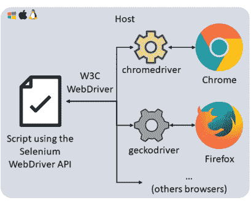
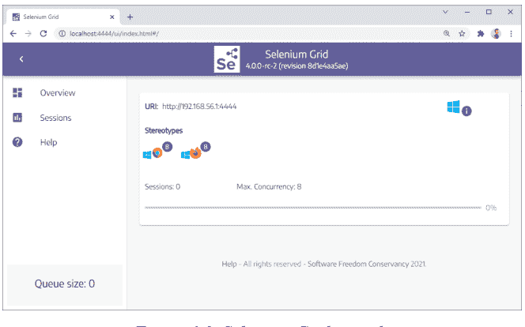
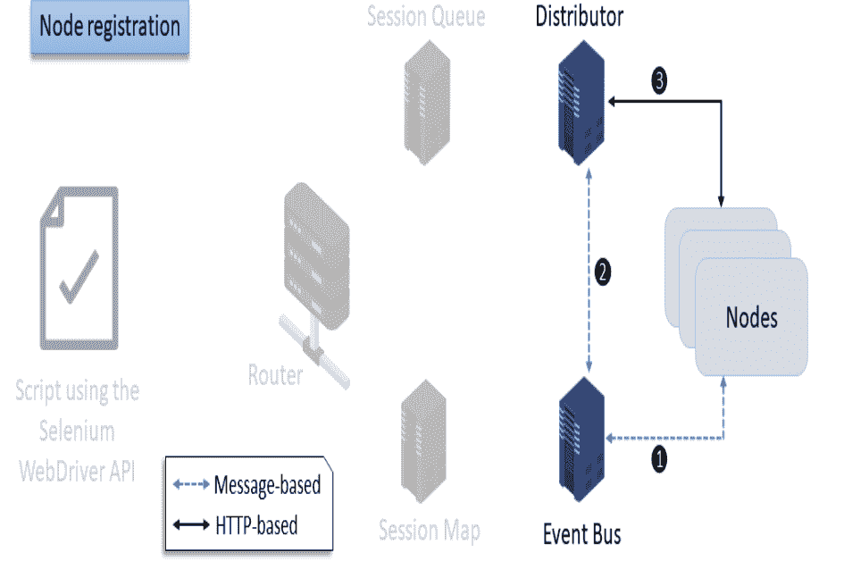
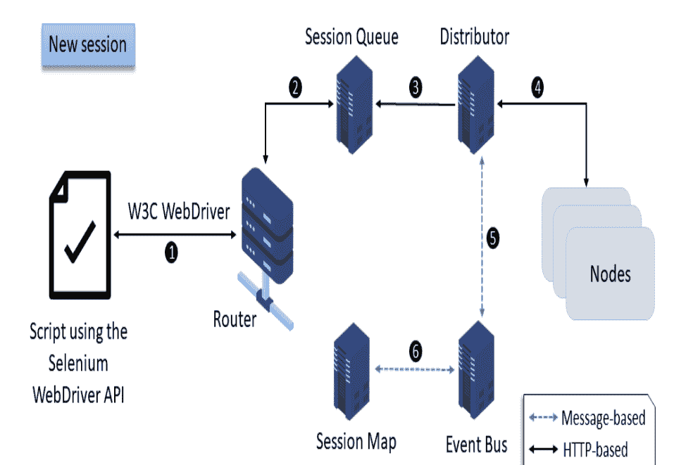
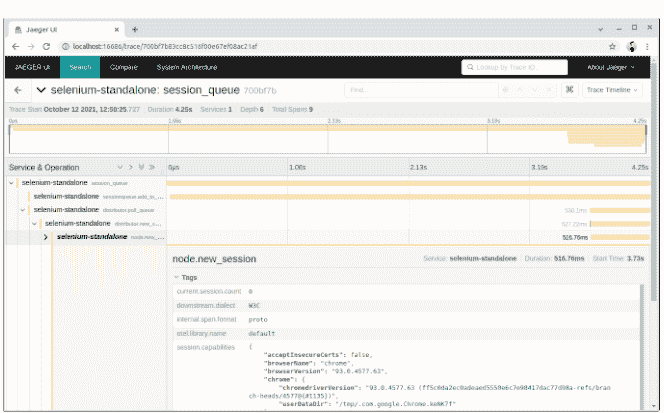
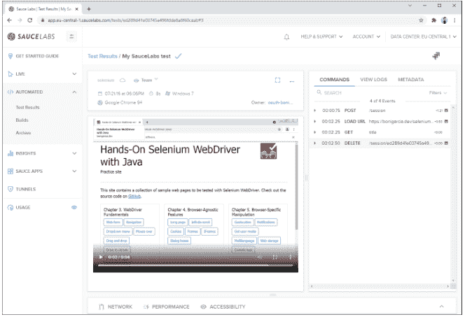
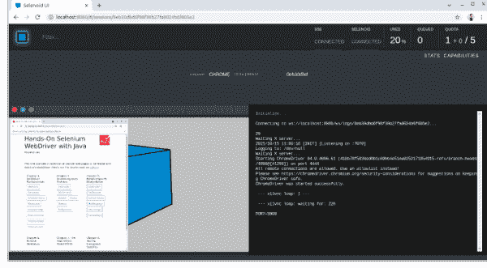

## 第 6 章. 远程 WebDriver

### 早期发布读者须知

使用 Early Release 电子书，您可以在官方发布这些标题之前很久就利用这些技术——在作者撰写时获取书籍的最原始和未编辑内容。

这将是最终书籍的第 6 章。请注意，GitHub 仓库将在稍后激活。

如果您对如何改进本书的内容和/或示例有任何评论，或者如果您注意到本章中缺少材料，请联系编辑 [rfernando@oreilly.com](mailto:rfernando@oreilly.com)。

到目前为止，本书中解释的示例使用在执行测试的机器上本地安装的网页浏览器。本章涵盖了 Selenium WebDriver API 的另一个相关功能，即使用远程浏览器（即安装在其他主机上）的能力。为此，首先，我们回顾了 Selenium WebDriver 中使用远程浏览器的架构。其次，我们研究 Selenium Grid，一种为 Selenium WebDriver 测试提供远程浏览器的网络化基础设施。第三，我们分析一些最相关的云提供商，即提供自动化测试托管服务的公司。最后，我们探讨如何使用 Docker 来支持 Selenium 的浏览器基础设施。

### Selenium WebDriver 架构

如第 1 章所述，Selenium WebDriver 是一个允许以编程方式控制网页浏览器的库。自动化基于每个浏览器的原生功能。因此，我们需要在使用 WebDriver API 的脚本（通常是测试）与浏览器之间放置一个名为 *driver* 的二进制文件。到目前为止，本书中看到的示例使用本地浏览器，即安装在执行使用 Selenium WebDriver API 的测试的同一台机器上的浏览器。图 6-1 说明了这种方法。在这种情况下，并且在使用 Selenium WebDriver API 的 Java 语言绑定时，我们需要创建 `ChromeDriver` 的实例来控制 Chrome，`FirefoxDriver` 用于 Firefox 等。



图 6-1. 使用本地浏览器的 Selenium WebDriver 架构

支持此过程的通信协议称为 W3C WebDriver。该标准协议基于 JSON 消息通过 HTTP。得益于此，Selenium WebDriver 架构可以分布到不同的互联计算机（*hosts*）。图 6-2 显示了远程架构的示意表示。在这种情况下，Selenium WebDriver API 将 W3C WebDriver 消息发送到通常称为 *Selenium Server* 的服务器端组件。该服务器充当客户端请求的代理，将其转发到提供网页浏览器以进行自动化的其他主机。这种远程架构简化了跨浏览器测试（即在多种浏览器类型、版本或操作系统中验证网页应用程序）和并行测试执行。

有不同的方式实例化 RemoteWebDriver 对象。最常见的方式是通过传递两个参数调用其构造函数：Selenium Server 的 URL 和所需的 capabilities。如第 5 章图 5-1 所示，这些 capabilities 是继承自 Capabilities 接口的对象（例如，ChromeOptions、FirefoxOptions、DesiredCapabilities 等）。示例 6-1 显示了一个测试设置。像往常一样，您可以在随本书附带的 code repository 中找到完整的测试。

NOTE
存在第二个 RemoteWebDriver 构造函数，它只接受一个参数，即所需的 capabilities。在这种情况下，Selenium Server URL 从 Java 系统属性 webdriver.remote.server 读取。您可以在 examples repository 中找到此功能的示例。

### 示例 6-1. 使用构造函数实例化 RemoteWebDriver 对象

```
@BeforeEach
void setup() throws MalformedURLException {
    URL seleniumServerUrl = new URL("http://localhost:4444/"); ①
    assumeThat(isOnline(seleniumServerUrl)).isTrue(); ②

    ChromeOptions options = new ChromeOptions(); ③
    driver = new RemoteWebDriver(seleniumServerUrl, options); ④
}
```

- ① 我们使用 Selenium Server 地址创建一个 Java URL 对象。
- ② 我们假设此 URL 在线。为此，我们通过调用 WebDriverManager 上可用的静态方法 isOnline 创建一个 AssertJ 假设。其结果是，当 Selenium Server 离线时，测试将被跳过。
- ③ 我们实例化一个 ChromeOptions 对象以指定所需的 capabilities。

| 属性 | Capability 名称 | 描述 |
|---|---|---|
| `BROWSER_NAME` | `browserName` | 浏览器名称（例如，`chrome`、`firefox` 或 `msedge`） |
| `PLATFORM_NAME` | `platformName` | 平台名称（例如，`WINDOWS`、`LINUX`、`MAC`、`ANDROID`、`IOS`，等等） |
| `BROWSER_VERSION` | `browserVersion` | 浏览器版本 |
| `SUPPORTS_JAVASCRIPT` | `javascriptEnabled` | 启用或禁用 JavaScript 执行 |
| `PAGE_LOAD_STRATEGY` | `pageLoadStrategy` | 页面加载策略（`normal`、`eager` 或 `none`） |

指定 `RemoteWebDriver` 对象中所需 capabilities 的另一种方法是使用 `DesiredCapabilities` 的实例。表 6-2 总结了这些对象提供的方法。

表 6-2. Desired Capabilities 方法

| 方法 | 返回 | 描述 |
|---|---|---|
|  |  | 指定浏览器名称 |
| `setBrowserName(String browserName)` | `void` |  |
|  |  | 指定浏览器版本 |
| `setVersion(String version)` | `void` |  |
|  |  | 指定平台名称 |
| `setPlatform(Platform platform)` | `void` |  |
|  |  | 启用或禁用 JavaScript 执行 |
| `setJavascriptEnabled(boolean javascriptEnabled)` | `void` |  |
|  |  | 启用或禁用加载不安全页面 |
| `setAcceptInsecureCerts(boolean acceptInsecureCerts)` | `void` |  |
|  |  | 启用加载不安全页面 |
| `acceptInsecureCerts()` | `void` |  |
|  |  | 与另一个 capabilities 对象合并 |

### RemoteWebDriver Builder

创建 RemoteWebDriver 对象的第二种方式是使用 Selenium WebDriver API 中内置的 builder。示例 6-2 演示了如何使用 Edge 作为远程浏览器。

### 示例 6-2. 使用 builder 实例化 RemoteWebDriver 对象

```
@BeforeEach
void setup() throws MalformedURLException {
    URL seleniumServerUrl = new URL("http://localhost:4444/");
    assumeThat(isOnline(seleniumServerUrl)).isTrue();

    driver = RemoteWebDriver.builder().oneOf(new EdgeOptions())
        .address(seleniumServerUrl).build();
}
```

### WebDriverManager Builder

或者，我们也可以使用 WebDriverManager 创建 RemoteWebDriver 的实例。为此，我们需要调用给定 manager 的 `remoteAddress()` 方法以传递 Selenium Server URL。示例 6-3 显示了使用此功能并以 Firefox 作为远程浏览器的测试设置。

### 示例 6-3. 使用 WebDriverManager 实例化 RemoteWebDriver 对象

```
@BeforeEach
void setup() throws MalformedURLException {
    URL seleniumServerUrl = new URL("http://localhost:4444/");
    assumeThat(isOnline(seleniumServerUrl)).isTrue();

    driver = WebDriverManager.firefoxdriver()
        .remoteAddress(seleniumServerUrl).create();
}
```


# Selenium-Jupiter

与往常一样，Selenium-Jupiter 使用 Jupiter 提供的参数解析功能。这样一来，针对远程浏览器，你需要使用类型 `RemoteWebDriver` 声明一个测试（或构造函数）参数。然后，以下 Selenium-Jupiter 注解允许配置远程浏览器：

- `@DriverUrl`：用于标识 Selenium Server URL 的注解。或者，注解 `@EnabledIfDriverUrlOnline` 允许指定此 URL，同时在该 URL 无响应时禁用测试。
- `@DriverCapabilities`：用于配置所需 capabilities 的注解。

示例 6-4 显示了一个使用本地 Selenium Server 提供的远程 Chrome 的 Selenium-Jupiter 测试。当 URL http://localhost:4444/ 离线时，此测试将被跳过。

*示例 6-4. 在 Selenium-Jupiter 测试中使用 RemoteWebDriver 对象*

```
@EnabledIfDriverUrlOnline("http://localhost:4444/")
@ExtendWith(SeleniumJupiter.class)
class RemoteChromeSelJupTest {

    @DriverCapabilities
    ChromeOptions options = new ChromeOptions();

    @Test
    void testRemote(RemoteWebDriver driver) {
        driver.get("https://bonigarcia.dev/selenium-webdriver-java/");
        assertThat(driver.getTitle()).contains("Selenium WebDriver");
    }
}
```

## NOTE

本节中描述的 RemoteWebDriver 实例化模式在功能上是等价的。换句话说，这些对象的工作方式相同。它们之间的区别在于提供的语法糖（即风格和表达力）。

## Selenium Grid

如第 1 章所述，Selenium Grid 是 Selenium 套件的一个子项目，它允许创建可通过 W3C WebDriver 协议访问的远程浏览器网络化基础设施。Selenium Grid 允许在不同机器和不同浏览器上并行运行测试。为此，Selenium Grid 提供了一个 Selenium Server，你可以使用 `RemoteWebDriver` 的实例来控制它。有三种方法可以运行 Selenium Grid：

- *Standalone.* 单个主机充当 Selenium Server 并在该模式下提供浏览器。它提供了一种简单的方法在远程浏览器中运行 Selenium WebDriver 测试。
- *Hub-nodes.* 独立模式的一个潜在问题是可扩展性（因为 Selenium Server 和浏览器在同一主机中执行）。因此，hub-nodes 架构定义了两种类型的组件来解决此问题。首先，一个主机充当 *hub*（或 Selenium Server）。然后，一个或多个主机在 hub 中注册为 *nodes*，提供可通过 Selenium WebDriver 控制的浏览器。该架构已在第 1 章中介绍（参见图 1-2）。
- *Fully distributed.* 独立和 hub-nodes 方法都是集中式架构，当传入请求数量增加时，其性能会下降。作为 Selenium 4 的新功能，Selenium Grid 提供了完全分布式模式，该模式实现了负载均衡机制来解决此瓶颈。

以下小节提供了有关这些模式的更多详细信息，并解释了如何设置每种方法。

## Standalone

Standalone 是 Selenium Grid 基础设施最简化的方式。我们可以用不同的方式执行此模式：使用 shell 和 Java 代码。

### From the Shell

首先，我们可以使用 shell 和 Selenium Grid 二进制分发来启动它。Selenium Grid 用 Java 开发，每个版本都作为一个包含所有依赖项的自包含 JAR 文件分发（也称为 *uber-JAR* 或 *fat-JAR*）。你可以从 [Selenium 下载页面](https://www.selenium.dev/downloads/) 下载此 fat-JAR。

在独立模式下，Selenium Server 会自动检测系统中可用的驱动程序（例如，chromedriver、geckodriver 等）。为此，它会在 `PATH` 环境变量中查找这些驱动程序。像往常一样，我们可以手动管理这些驱动管理器。然而，建议使用 WebDriverManager 自动解析驱动程序。为此，如附录 B 所述，WebDriverManager 可用作命令行界面（CLI）工具。WebDriverManager CLI 分发为 fat-JAR，可在 [GitHub](https://github.com/bonigarcia/webdrivermanager) 上下载。

为了说明这一点，示例 6-5 显示了使用 WebDriverManager CLI 在 Linux 机器上解析 chromedriver 和 geckodriver 所需的 shell 命令。然后，我们使用 Selenium Grid fat-JAR 启动独立网格。请注意，这些命令在同一文件夹中执行。这样，使用 WebDriverManager 下载的驱动程序对 Selenium Grid 可用。

*示例 6-5. 使用 WebDriverManager CLI 解析驱动程序并使用 shell 以独立模式启动 Selenium Grid 的命令*

```
boni@linux:~/grid$ java -jar webdrivermanager-5.0.3-fat.jar resolveDriverFor chrome ①
[INFO] Using WebDriverManager to resolve chrome
[DEBUG] Detecting chrome version using online commands.properties
[DEBUG] Running command on the shell: [google-chrome, --version]
[DEBUG] Result: Version=94.0.4606.71
[DEBUG] Latest version of chromedriver according to
    https://chromedriver.storage.googleapis.com/LATEST_RELEASE_94
is 94.0.4606.61
[INFO] Using chromedriver 94.0.4606.61 (resolved driver for Chrome 94)
[INFO] Reading https://chromedriver.storage.googleapis.com/ to seek
    chromedriver
[DEBUG] Driver to be downloaded chromedriver 94.0.4606.61
[INFO] Downloading
https://chromedriver.storage.googleapis.com/94.0.4606.61/
    chromedriver_linux64.zip
[INFO] Extracting driver from compressed file
chromedriver_linux64.zip
[INFO] Driver location: /home/boni/grid/chromedriver

boni@linux:~/grid$ java -jar webdrivermanager-5.0.3-fat.jar resolveDriverFor firefox ②
[INFO] Using WebDriverManager to resolve firefox
[DEBUG] Detecting firefox version using online commands.properties
[DEBUG] Running command on the shell: [firefox, -v]
[DEBUG] Result: Version=92.0.0.7916
[DEBUG] Getting driver version for firefox92 from online
versions.properties
[INFO] Using geckodriver 0.30.0 (resolved driver for Firefox 92)
[INFO] Reading
https://api.github.com/repos/mozilla/geckodriver/releases to
    seek geckodriver
[DEBUG] Driver to be downloaded geckodriver 0.30.0
[INFO] Downloading
https://github.com/mozilla/geckodriver/releases/download/
    v0.30.0/geckodriver-v0.30.0-linux64.tar.gz
[INFO] Extracting driver from compressed file geckodriver-v0.30.0-
linux64.tar.gz
[INFO] Driver location: /home/boni/grid/geckodriver

boni@linux:~/grid$ java -jar selenium-server-4.0.0.jar standalone ③
INFO [LogManager$RootLogger.log] - Using the system default
encoding
INFO [OpenTelemetryTracer.createTracer] - Using OpenTelemetry for
tracing
INFO [NodeOptions.getSessionFactories] - Detected 8 available
processors
```

```
INFO [NodeOptions.discoveryDrivers] - Discovered 2 driver(s)
INFO [NodeOptions.report] - Adding Chrome for {"browserName": "chrome"} 8 times
INFO [NodeOptions.report] - Adding Firefox for {"browserName": "firefox"} 8 times
INFO [LocalDistributor.add] - Added node 41045bd8-ec7e-43c9-84bd-f63f7aca59ed
    at http://192.168.56.1:4444. Health check every 120s
INFO [GridModel.setAvailability] - Switching node 41045bd8-ec7e-43c9-84bd-f63f7aca59ed (uri: http://192.168.56.1:4444) from DOWN to UP
INFO [Standalone.execute] - Started Selenium Standalone 4.0.0 (revision 3a21814679): http://192.168.56.1:4444
```

- 1. 我们使用 WebDriverManager CLI 解析 chromedriver。
- 2. 我们使用 WebDriverManager CLI 解析 geckodriver（Firefox 所需的驱动程序）。
- 3. 我们在同一文件夹（包含 chromedriver 和 geckodriver）中以独立模式启动 Selenium Grid。

执行这些命令后，独立 Selenium Server 会在 localhost 的 4444 端口监听传入的 HTTP 请求。因此，我们可以使用该 URL（例如，如果测试在同一主机执行，则为 `http://localhost:4444/`）和所需的 capabilities（在本例中为 Chrome 或 Firefox）创建 `RemoteWebDriver` 的实例。例如，如下所示：

```
WebDriver driver = new RemoteWebDriver("http://localhost:4444/",
        new ChromeOptions());
```


> NOTE
> 在 Selenium Grid 3 中，默认的 Selenium Server URL 为 http://localhost:4444/wd/hub。
> 在 Selenium Grid 4 中，虽然该 URL 仍应可用，但路径 `/wd/hub` 已不再必需。

Selenium Grid 提供的另一个有用的功能是其 *web console*。该控制台是一个可通过 Selenium Server URL 访问的 Web UI，可用于监控网格中已注册的可用浏览器以及正在执行的会话。图 6-3 显示了之前独立网格控制台的截图。请注意，在此情况下，独立的 Selenium Server 最多可提供 8 个并发会话（与运行网格的机器上可用处理器数量相同），分别用于 Chrome 和 Firefox。



## From Java Code

使用 Java 启动 Selenium Grid 的另一种替代方式。除了 fat-JAR 外，Selenium Grid 还发布到 Maven Central，使用 `org.seleniumhq.selenium` 作为 `groupId` 和 `selenium-grid` 作为 `artifactId`。这样，我们需要在项目设置（Maven 或 Gradle）中解析其坐标，以便在 Java 项目中使用它（有关配置详情请参见附录 B）。示例 6-6 演示了如何从 Java 测试用例以独立模式启动 Selenium Grid。

## Example 6-6. Test starting Selenium Grid in standalone mode

```
```java
static URL seleniumServerUrl;

@BeforeAll
static void setupAll() throws MalformedURLException {
    int port = PortProber.findFreePort();
    WebDriverManager.chromedriver().setup();
    Main.main(
        new String[] { "standalone", "--port",
        String.valueOf(port) });

    seleniumServerUrl = new URL(
        String.format("http://localhost:%d/", port));
}

@BeforeEach
void setup() {
    driver = new RemoteWebDriver(seleniumServerUrl, new
    ChromeOptions());
}
```
```

- 1. 我们在本地主机上查找一个空闲端口。为此，我们使用 Selenium WebDriver API 中提供的类 `PortProber`。
- 2. 我们使用 WebDriverManager 来解析 chromedriver，因为即将启动的独立网格将提供 Chrome 浏览器。
- 3. 我们通过调用其 `main` 方法以独立模式启动 Selenium Grid。
- 4. 我们使用之前选择的端口创建一个 Java URL。
- 5. 我们创建 `RemoteWebDriver` 的实例。通常，我们在测试逻辑中使用此对象来调用 WebDriver API 并控制浏览器（请参阅示例仓库中的完整类）。

## Hub-nodes

Selenium Grid 的经典架构涉及两种类型的宿主机：*Hub*（即 Selenium Server）和一组节点。与独立模式一样，我们可以使用 Selenium Grid fat-JAR 在 shell 中启动此模式。

首先，我们在一个宿主机上启动 Hub。然后，我们在同一或不同的宿主机上注册一个或多个节点。示例 6-7 显示了在 Windows 控制台中执行这些命令的情况。

## Example 6-7. Command to start Selenium Grid in hub-nodes mode using the shell

```
C:\grid>java -jar selenium-server-4.0.0.jar hub ①
INFO [LogManager$RootLogger.log] - Using the system default encoding
INFO [OpenTelemetryTracer.createTracer] - Using OpenTelemetry for tracing
INFO [BoundZmqEventBus.<init>] - XPUB binding to [binding to tcp://*:4442,
    advertising as tcp://192.168.56.1:4442], XSUB binding to [binding to
    tcp://*:4443, advertising as tcp://192.168.56.1:4443]
INFO [UnboundZmqEventBus.<init>] - Connecting to tcp://192.168.56.1:4442 and
    tcp://192.168.56.1:4443
INFO [UnboundZmqEventBus.<init>] - Sockets created
INFO [UnboundZmqEventBus.<init>] - Event bus ready
INFO [Hub.execute] - Started Selenium Hub 4.0.0 (revision 3a21814679):
    http://192.168.56.1:4444
INFO [Node.<init>] - Binding additional locator mechanisms: relative, name, id
INFO [LocalDistributor.add] - Added node 98c35075-e5f0-4168-be97-c277e4f40d8d
    at http://192.168.56.1:5555. Health check every 120s
INFO [GridModel.setAvailability] - Switching node 98c35075-e5f0-4168-be97-c277e4f40d8d (uri: http://192.168.56.1:5555) from DOWN to UP
```

```
C:\grid>java -jar selenium-server-4.0.0.jar node ②
INFO [LogManager$RootLogger.log] - Using the system default encoding
INFO [OpenTelemetryTracer.createTracer] - Using OpenTelemetry for tracing
INFO [UnboundZmqEventBus.<init>] - Connecting to tcp://*:4442 and tcp://*:4443
INFO [UnboundZmqEventBus.<init>] - Sockets created
INFO [UnboundZmqEventBus.<init>] - Event bus ready
INFO [NodeServer.createHandlers] - Reporting self as: http://192.168.56.1:5555
INFO [NodeOptions.getSessionFactories] - Detected 8 available
```

```
processors
INFO [NodeOptions.discoverDrivers] - Discovered 2 driver(s)
INFO [NodeOptions.report] - Adding Chrome for {"browserName": "chrome"} 8 times
INFO [NodeOptions.report] - Adding Firefox for {"browserName": "firefox"} 8 times
INFO [Node.<init>] - Binding additional locator mechanisms: relative, name, id
INFO [NodeServer$1.start] - Starting registration process for node id
98c35075-e5f0-4168-be97-c277e4f40d8d
INFO [NodeServer.execute] - Started Selenium node 4.0.0 (revision 3a21814679): http://192.168.56.1:5555
INFO [NodeServer$1.lambda$start$1] - Sending registration event...
INFO [NodeServer.lambda$createHandlers$2] - Node has been added
```

① 我们启动 hub。默认情况下，该服务器在 4444 端口监听 W3C WebDriver HTTP 请求，并在 4442 和 4443 TCP 端口用于注册节点。

② 在第二个控制台中，我们注册节点。在此示例中，此命令在与 hub 相同的宿主机上执行。此外，它假定所需的驱动程序（例如 chromedriver 和 geckodriver）已解析（与示例 6-5 相同）。要从另一台宿主机启动节点，我们需要调用以下命令：

```
java -jar selenium-server-4.0.0.jar node --publish-events tcp://<hub>:4442
  --subscribe-events tcp://<hub>:4443
```

> NOTE
> 与独立模式相同，您也可以使用 Java 代码启动 hub-nodes 网格。为此，您需要更改调用 Selenium Grid 主类的参数，使其遵循 Hub 和节点的 CLI 命令的相同语法。

## Fully Distributed

从版本 4 开始，我们可以按照完全分布式架构执行 Selenium Grid 基础设施。这种方法的关键方面是可扩展性。在此模式下，专门的节点负责不同的自动化和基础设施管理方面。这些节点如下：

- *Router*: 作为网格的单一入口点的节点。此组件监听来自 Selenium 脚本的 W3C WebDriver 命令。
- *Session Queue*: 存储新会话请求的节点。这些传入的会话等待被 *Distributor* 读取。
- *Distributor*: 了解所有节点及其功能。节点以固定间隔向 *Session Queue* 请求新的会话请求。
- *Event Bus*: 组件为网格架构的多个成员提供面向消息的通信通道。这种通信在图 6-4 和图 6-5 中用虚线表示。
- *Session Map*: 它保存 WebDriver 会话与会话正在执行的节点之间的关系。
- *Node(s)*: 提供用于 Selenium WebDriver 自动化的 Web 浏览器（及其相应驱动程序）的宿主机。

> **NOTE**
> 在 hub-nodes 架构中，Hub 汇总了完全分布式模式中 Router、Session Queue、Distributor、Event Bus 和 Session Map 的职责。

以下小节提供了完全分布式 Selenium Grid 中最相关流程的详细信息：节点注册、新会话和其他 WebDriver 命令。

## Node Registration

操作分布式 Selenium Grid 所需的第一个流程是注册一个或多个节点。为此，节点需要在 Distributor 中注册其功能。图 6-4 说明了此流程，由三个步骤组成：

- 1. 节点通过 Event Bus 发送消息以宣布其功能。
- 2. 该消息到达 Distributor，其中存储了节点与功能之间的关系。
- 3. Distributor 通过与源节点交换 HTTP 消息（实线）来双重检查节点是否存在。



Figure 6-4. Node registration in a Selenium Grid distributed architecture

## New Session


在某个时刻，脚本（通常是测试用例）将尝试启动一个新的会话来自动驱动浏览器。图 6-5 描述了在完全分布式 Selenium Grid 中执行此过程所需的通信，即：

- 1. 使用 Selenium WebDriver API 的脚本/测试向 Router 发送请求，以创建新会话（即以编程方式驱动浏览器）。
- 2. Router 在 Session Queue 中创建一条新条目来存储此新会话请求。
- 3. Distributor 定时向 Session Queue 查询是否有新的会话请求。
- 4. 一旦 Distributor 发现新的会话请求，它会检查是否有节点可以支持该会话。如果会话可行（即某个先前已在 Distributor 中注册的节点提供了所需的能力），Distributor 就会与该节点创建新会话。
- 5. Distributor 使用 Event Bus 向 Session Map 发送消息以存储新会话。
- 6. Session Map 存储一个唯一的会话标识符（*session id*），该标识符明确地将执行浏览器会话的节点关联起来。



图 6-5. 在 Selenium Grid 分布式架构中创建新会话

## WebDriver 命令

会话建立后，Selenium WebDriver API 脚本将继续发送 W3C WebDriver 命令来控制远程节点中的 Web 浏览器。图 6-6 展示了在分布式 Selenium Grid 基础设施中此通信的过程，步骤如下：

- 1. 脚本/测试在当前会话中交换 W3C WebDriver 命令来驱动浏览器（例如，打开网页、与 Web 元素交互等）。
- 2. 对同一浏览器会话的后续请求使用相同的会话 ID。Router 通过读取 Session Map 来识别浏览器会话是否处于活动状态。
- 3. Router 将同一会话的后续命令直接转发给指定的节点。

```
...
INFO [SessionMapServer.execute] - Started Selenium SessionMap 4.0.0
(revision
    5felaf712f): http://192.168.56.1:5556

C:\grid>java -jar selenium-server-4.0.0.jar sessionqueue ③
...
INFO [NewSessionQueueServer.execute] - Started Selenium
SessionQueue 4.0.0
    (revision 5felaf712f): http://192.168.56.1:5559

C:\grid>java -jar selenium-server-4.0.0.jar distributor --sessions
    http://<session_map>:5556 --sessionqueue
http://<session_queue>:5559 --bind-bus
    false ④
...
INFO [DistributorServer.execute] - Started Selenium Distributor
4.0.0 (revision
    5felaf712f): http://192.168.56.1:5553

C:\grid>java -jar selenium-server-4.0.0.jar router --sessions
    http://<session_map>:5556 --distributor
http://<distributor_address>:5553
    --sessionqueue http://><session_queue>:5559 ⑤
...
INFO [RouterServer.execute] - Started Selenium Router 4.0.0
(revision
    5felaf712f): http://192.168.56.1:4444

C:\grid>java -jar selenium-server-4.0.0.jar node --publish-events
    tcp://<event_bus>:4442 --subscribe-events
tcp://<event_bus>:4443 ⑥
...
INFO [NodeOptions.discoverDrivers] - Discovered 2 driver(s)
...
INFO [NodeServer$1.lambda$start$1] - Sending registration event...
INFO [NodeServer.lambda$createHandlers$2] - Node has been added
```

① 我们启动 Event Bus。默认情况下，Event Bus 监听 TCP 端口 4442 和 4443。

② 我们启动 Sessions Map。默认情况下，该组件在端口 5556 监听传入的 HTTP 消息。

③ 我们启动 Sessions Queue。默认情况下，该队列在端口 5559 监听 HTTP。

④ 我们启动 Distributor。为此，我们需要指定 Session Map 和 Session Queue 的地址。另外，由于我们已经独立启动了 Event Bus，我们将 `--bind-bus` 标志设置为 false。默认情况下，Distributor 使用端口 5553 进行 HTTP 通信。

⑤ 我们启动 Router。我们需要指定 Session Map、Session Queue 和 Distributor 的 URL。

⑥ 我们启动 Nodes。我们需要指定 Event Bus 监听发布-订阅消息的端口。此外，在此示例中，执行此命令的同一文件夹中有多个驱动程序（chromedriver 和 geckodriver）可用。

## 可观测性

在软件工程中，*可观测性*是一种基于软件系统的外部输出或信号来确定其当前状态的度量。这样，可观测性可以通过利用外部指标来理解系统的内部状态。可观测性对于维护复杂的软件系统和确定任何问题的根本原因至关重要。为此，可观测性的三大支柱是：

- 指标：系统随时间变化的性能度量，例如响应时间、每秒事务数或内存使用量等。
- 日志：系统在运行某些代码时产生的文本行（通常带有时间戳）。
- 追踪：将具有因果关系的分布式事件（如选定的日志）进行表示，用以刻画软件系统中某个操作的请求流。

Selenium Grid 4 提供了不同的特性来测量可观测性。
首先，Selenium Grid 支持使用 OpenTelemetry API 进行追踪。其次，Selenium Grid 提供了一个 GraphQL 端点来对网格运行查询。

### 使用 OpenTelemetry 进行追踪

*追踪*是基于软件系统的日志和指标衡量可观测性的重要方法。Selenium Grid 以两种方式暴露追踪。首先，从 shell 执行网格时，我们可以查看日志追踪。默认情况下，显示 INFO 级别的日志。我们可以通过在 shell 命令中使用参数 `--log-level` 来更改级别，例如：

```
java -jar selenium-server-4.0.0.jar standalone --log-level FINE
```

此外，Selenium Grid 通过 OpenTelemetry API 支持*分布式追踪*。此功能允许追踪命令在 Selenium Grid 基础设施中的流转。分布式追踪需要两项活动：

- 1. 代码插桩。Selenium Grid 允许使用 OpenTelemetry API 导出追踪信息。
- 2. 数据收集。例如，我们可以使用 Jaeger，这是一个开源分布式追踪平台，可与 OpenTelemetry 无缝集成。它允许查询、可视化和收集追踪数据。

以下命令展示了如何设置 Selenium Grid 以将数据导出到 Jaeger。首先，我们需要一个已启动并运行的 Jaeger 后端。为此，我们可以从 Jaeger 下载页面下载可执行二进制文件。或者，我们可以使用 Docker 启动服务器，如下所示：

```
docker run --rm -it --name jaeger \
  -p 16686:16686 \ ①
  -p 14250:14250 \ ②
  jaegertracing/all-in-one:1.27
```

- 1. 我们将使用 URL *http://localhost:16686* 访问 Jaeger UI。
- 2. 我们将使用 URL *http://localhost:14250* 收集数据（由 Selenium Grid 导出）。

然后，我们按如下方式启动 Selenium Grid：

```
```bash
java -Dotel.traces.exporter=jaeger \\
  -Dotel.exporter.jaeger.endpoint=http://localhost:14250 \\
  -Dotel.resource.attributes=service.name=selenium-standalone \\
  -jar selenium-server-4.0.0.jar \\
  --ext $(cs fetch -p \\
      io.opentelemetry:opentelemetry-exporter-jaeger:1.6.0 \\
      io.grpc:grpc-netty:1.41.0) \\
  standalone
```
```

- 1. 我们使用 Jaeger 端点来导出追踪数据。
- 2. 我们指定服务名 `selenium-standalone`。我们将在 Jaeger UI 中查找此名称以可视化收集的数据（参见 *图 6-7*）。
- 3. 我们使用 *Coursier* 来下载并生成两个必需依赖（`opentelemetry-exporter-jaeger` 和 `grpc-netty`）的类路径。



### GraphQL 查询

GraphQL 是一种用于 API 的开源数据查询和操作语言。GraphQL 定义了一种请求数据的语法，通常用于从在线服务请求数据。Selenium Grid 4 提供了 GraphQL 端点（http://localhost:4444/graphql）。一种向此端点发起 GraphQL 查询的简单方法是使用 shell 中的 curl。例如，假设我们在 localhost 上运行了一个 Selenium Grid，我们可以向 GraphQL 端点发送以下命令来获取网格中的最大会话数和当前会话数：

```
curl -X POST -H "Content-Type: application/json" --data \
  '{"query": "{ grid {maxSession, sessionCount } }"}' -s \
  http://localhost:4444/graphql
```

## 配置

你可以在官方文档中找到关于 Selenium Grid 的更多详细信息。关于高级配置，有两种方式可以为 Selenium Grid 指定自定义设置：

- 使用 CLI 选项来配置 Selenium Grid 的各个不同方面。这些选项的一些示例包括 `--port` 用于更改 Selenium Server 监听的默认端口（默认为 4444），或 --


会话超时（session-timeout），即节点在无活动时被终止的超时时间（默认 300 秒）。

- 使用 TOML 文件。TOML（Tom's Obvious Minimal Language）是一种设计为人类可读的配置格式。与命令行选项一样，这些文件允许配置 Selenium Grid 参数，但使用 TOML 语法表示。

## 云服务提供商

如第 1 章所述，Selenium 生态中的云服务提供商是提供自动化 Web 和移动测试托管服务（通常为商业服务）的公司。云服务提供商提供的常见服务包括：

- 浏览器即服务：按需请求由提供商托管的 Web 浏览器。这些浏览器通常具有不同的类型、版本和操作系统。该功能通常用于跨浏览器自动化测试或实时测试。
- 分析能力：监控和调试自动化测试。为此，云服务提供商通常支持会话录制或丰富的错误报告功能。
- 移动测试：在不同平台（如 Android 和 iOS）上请求模拟（和真实）移动设备。
- 视觉测试：自动检查 UI，确保最终用户获得正确的视觉体验。

目前面向 Selenium 的云服务提供商示例有 Sauce Labs、BrowserStack、LambdaTest、CrossBrowserTesting、Moon Cloud、TestingBot、Perfecto 或 Testinium。这些公司都提供不同定价方案的具体服务。它们之间的共同点是，每个云服务提供商都维护一个 Selenium Server 端点，我们可以在 RemoteWebDriver 测试中使用。示例 6-9 演示了如何使用其中之一（具体来说是 Sauce Labs）创建 WebDriver 对象。你可以在示例仓库中找到其他云服务提供商（BrowserStack、LambdaTest、CrossBrowserTesting、Perfecto 和 Testinium）的等效测试。这些测试允许使用由云服务提供商管理的远程浏览器。

## 示例 6-9. 使用 Sauce Labs 的测试设置

```java
@BeforeEach
void setup() throws MalformedURLException {
    String username = System.getProperty("sauceLabsUsername"); ①
    String accessKey = System.getProperty("sauceLabsAccessKey");
    assumeThat(username).isNotEmpty(); ②
    assumeThat(accessKey).isNotEmpty();

    MutableCapabilities capabilities = new MutableCapabilities();
    capabilities.setCapability("username", username); ③
    capabilities.setCapability("access_key", accessKey);
    capabilities.setCapability("name", "My SauceLabs test"); ④
    capabilities.setCapability("browserVersion", "latest"); ⑤

    ChromeOptions options = new ChromeOptions();
    options.setCapability("sauce:options", capabilities); ⑥
    URL remoteUrl = new URL(
        "https://ondemand.eu-central-1.saucelabs.com:443/wd/hub"); ⑦

    driver = new RemoteWebDriver(remoteUrl, options); ⑧
}
```

① 要使用 Sauce Labs，我们需要一个有效账户。换言之，我们需要以用户名和访问密钥形式提供的凭据。为了避免在测试逻辑中硬编码这些凭据，我在此测试中使用 Java 系统属性。这些属性可以在执行命令中提供（例如 `mvn test -DsauceLabsUsername=myname -DsauceLabsAccessKey=mykey`）。另一种指定这些数据的方法是使用环境变量（例如 `String username = System.getenv("SAUCELABS_USERNAME");`）。

② 当用户名或密钥不可用时，我们使用假设（assumptions）跳过此测试。

③ 我们需要将用户名和密钥作为 Selenium 能力包含进来。

④ 我们可以指定自定义标签，以便在 Sauce Labs 仪表板中标识此测试（见图 6-8）。

⑤ 我们使用给定浏览器的最新版本（Chrome，如下一行所指定）。

⑥ 我们使用名为 `sauce:options` 的自定义标签来选择 Sauce Labs 云中所需的能力。

⑦ 我们使用 Sauce Labs 的公共端点作为远程 URL。Sauce Labs 在不同区域提供端点。在此示例中，我使用欧盟中部数据中心。其他可能为美国西部、美国东部或亚太东南部。

⑧ 我们同时使用 URL 和能力来创建 RemoteWebDriver 实例。



图 6-8. Sauce Labs 仪表板显示自动化测试结果

## Docker 容器中的浏览器

Docker 是一个开源平台，允许将应用程序创建、部署和运行为轻量级、可移植的容器。Docker 平台由两个主要组件组成：

- Docker Engine，这是一个允许在主机上创建和运行容器的应用程序。Docker Engine 是一个客户端-服务器应用程序，由三个元素组成：
  - 一个以守护进程（dockerd）形式实现的服务器。
  - 一个 REST API，供应用程序客户端用来指示守护进程。
  - 一个 CLI 工具（docker 命令）。
- Docker Hub，这是一种用于分发容器的云服务。

在 Selenium 中，Docker 可以成为支持基于 Selenium WebDriver 的自动化测试所需浏览器基础架构的相关技术。如下面各小节所述，在 Docker 容器中执行浏览器有不同的替代方案。

## 用于 Selenium Grid 的 Docker 镜像

Selenium 套件的一个官方子项目是 docker-selenium。该项目为不同的 Selenium Grid 组件（即 standalone、hub、nodes、router、distributor、session queue 等）和 Web 浏览器（Chrome、Firefox 和 Edge）维护 Docker 镜像。这些 Docker 镜像是开源的，并发布在 Docker Hub 上。使用这些镜像的一个简单方式是使用 shell（通过 docker 命令）启动它们，并使用 RemoteWebDriver 实例来驱动容器化的浏览器。以下小节将解释如何操作。

> 注意  
> 本节中提供的命令和测试假定你的系统中已安装 Docker。换句话说，你需要在机器上安装 Docker Engine 才能正确执行这些示例。

## Standalone

我们可以在 Docker Hub 中找到用于独立浏览器（Chrome、Firefox 和 Edge）的 Selenium 镜像。以下命令演示了如何使用 shell 在 Docker 中启动 Chrome。

```bash
docker run -d -p 4444:4444 --shm-size="2g" selenium/standalone-chrome:latest
```

此命令启动 Docker 镜像 `selenium/standalone-chrome:latest`，即 Docker Hub 上可用的最新版 Chrome。或者，我们可以使用固定的 Chrome 版本（例如 `selenium/standalone-chrome:94.0`）。Docker 容器以分离模式（使用 `-d` 标志）启动，并使用 2 GB 的共享内存（`--shm-size="2g"`）。这个数值是已知的良好工作值，不过你可以根据资源或特定需求进行更改。最后，容器内部端口 4444 映射到执行命令的主机的同一端口（`-p 4444:4444`）。总而言之，我们可以使用以下 Java 命令来实例化一个使用此容器化 Chrome 的 WebDriver 对象：

```java
WebDriver driver = new RemoteWebDriver("http://localhost:4444/", new ChromeOptions());
```

## Hub 和节点

我们可以使用官方 Selenium Docker 镜像轻松地以 hub-节点模式启动 Selenium Grid。以下命令演示了如何在 shell 中执行此操作。

```bash
docker network create grid ①
```

```bash
docker run -d -p 4442-4444:4442-4444 --net grid \
    --name selenium-hub selenium/hub:4.0.0 ②
```

```bash
docker run -d --net grid -e SE_EVENT_BUS_HOST=selenium-hub --shm-size="2g" \
    -e SE_EVENT_BUS_PUBLISH_PORT=4442 -e \
SE_EVENT_BUS_SUBSCRIBE_PORT=4443 \
    selenium/node-chrome:4.0.0 ③
```

```bash
docker network rm grid ④
```

① 首先，我们创建一个名为 grid 的 Docker 网络。该网络允许 hub 和节点之间使用其主机名（例如 selenium-hub）进行通信。

② 我们启动 Selenium Hub。我们需要映射端口 4444（用于 Selenium Server URL）和 4442–4443（用于注册节点）。

③ 我们注册节点。在此命令中，我们使用 Chrome（`selenium/node-chrome`）。可以使用其他 Docker 镜像（例如 `selenium/node-firefox` 或 `selenium/node-edge`）在 hub 中注册其他浏览器。

④ 如果不再需要，我们可以在最后删除 grid 网络。

## 更多功能

docker-selenium 项目提供了各种各样的功能。我建议你查看其 README 以了解更多详细信息。这些功能的摘要如下：

- Docker Compose 脚本。这些脚本允许轻松启动 Selenium Grid hub-节点模式和完全分布式模式。
- 视频录制。我们可以使用另一个 Docker 容器来录制节点中浏览器的桌面会话。


- 动态网格。按需启动 Docker 容器。
- 部署到 Kubernetes。Kubernetes 是一个开源的容器编排系统，可自动化容器化应用的部署和管理。我们可以使用 Kubernetes 来部署 Selenium Docker 容器。
- 高级容器配置。例如，指定 Selenium 或 Java 自定义配置。
- 通过远程桌面协议（VNC）（一种图形桌面共享系统）和 noVNC（一个开源的基于 Web 的 VNC 客户端）访问远程会话。

## Selenoid

Selenoid 是一个用 Golang 实现的开源 Selenium Hub。它可以被视为一个轻量级的 Selenium Server，提供基于 Docker 的浏览器基础设施。Selenoid 团队还维护着 Selenoid 使用的 Docker 镜像。这些镜像包含多个网页浏览器和 Android 设备，例如 Chrome、Firefox、Edge、Opera、Safari（WebKit 引擎）或 Chrome Mobile。

使用 Selenoid 及其 Docker 镜像的方式有很多种。一种直接的方式是使用项目提供的配置管理器（一个名为 cm 的二进制文件）。以下片段展示了如何启动 Selenoid 及其 UI（一个用于监控 Selenoid 的基于 Web 的仪表盘）：

```
```bash
./cm selenoid start ❶
./cm selenoid-ui start ❷
```
```

❶ 我们启动 Selenoid。配置管理器会下载 Selenoid 的 Docker 镜像以及多个浏览器（Chrome、Firefox 和 Opera）的两个最新版本。启动后，Selenoid 会在 URL `http://localhost:4444/wd/hub` 监听 Selenium WebDriver 请求。

❷

可选地，我们可以启动 Selenoid UI。此 UI 是一个 Web 应用，可在 URL *http://localhost:8080/* 访问。图 6-9 显示了在执行 Selenium WebDriver 测试期间此 UI 的截图。示例 6-10 显示了使用 Selenoid 提供的 Chrome 浏览器进行测试的设置。



图 6-9. 使用 VNC 进行测试执行期间的 Selenoid UI

### 示例 6-10. 使用构造函数实例化 RemoteWebDriver 对象

```
@BeforeEach
void setup() throws MalformedURLException {
    URL seleniumServerUrl = new URL("http://localhost:4444/wd/hub");
    assumeThat(isOnline(seleniumServerUrl)).isTrue();

    ChromeOptions options = new ChromeOptions();
    Map<String, Object> selenoidOptions = new HashMap<>();
    selenoidOptions.put("enableVNC", true); ①
    options.setCapability("selenoid:options", selenoidOptions); ②
    driver = new RemoteWebDriver(seleniumServerUrl, options);
}
```

① `enableVNC` 能力是 Selenoid 特有的，允许以 VNC 支持启动容器化的浏览器（这样我们就可以在 Selenoid UI 中可视化浏览器会话，如图 6-9 所示）。

② 由于此能力是厂商特定的，兼容 W3C WebDriver 的设置方式是使用自定义命名空间

（本例中为 selenoid:options）。

## 进一步功能

Selenoid 提供不同的功能和配置能力。你可以查阅其文档了解更多细节。这些功能包括视频录制、自定义配置、日志管理或访问浏览器开发者工具等。

## WebDriverManager

从版本 5 开始，WebDriverManager 允许以无缝的方式在 Docker 容器中使用网页浏览器。为此，每个管理器（例如，chromedriver()、firefoxdriver() 等）都提供方法 browserInDocker()。WebDriverManager 内部会拉取 Docker 镜像并运行容器，在调用方法 create() 时创建 RemoteWebDriver 实例。WebDriverManager 使用 Selenoid 团队维护的 Docker 镜像。这样，你就可以通过 WebDriverManager 即开即用地将 Chrome（桌面和移动）、Firefox、Edge、Opera 和 Safari 作为 Docker 容器使用。示例 6-11 说明了使用此功能的基本测试。

### 示例 6-11. 使用 WebDriverManager 和 Docker 中的 Chrome 的完整测试

```
class DockerChromeJupiterTest {

    WebDriver driver;

    WebDriverManager wdm =
    WebDriverManager.chromedriver().browserInDocker(); ①

    @BeforeEach
    void setupTest() {
        assumeThat(isDockerAvailable()).isTrue(); ②
        driver = wdm.create(); ③
    }

    @AfterEach
    void teardown() {
        wdm.quit(); ④
    }
```

```
```java
@Test
void testDockerChrome() {
    driver.get("https://bonigarcia.dev/selenium-webdriver-java/");
    assertThat(driver.getTitle()).contains("Selenium WebDriver");
}
```
```

- 1. 我们获取 Chrome 管理器的实例（`chromedriver()`）。然后，使用 WebDriverManager 流式 API，我们指定使用此实例（称为 `wmd`）创建的未来 `WebDriver` 对象将使用 Docker 来执行相应的浏览器（本例中为 Chrome）。
- 2. 我们假设运行此测试的机器上可用 Docker 引擎。为此，我们通过调用 WebDriverManager 上可用的静态方法 `isDockerAvailable` 创建一个 AssertJ 假设。这样，当 Docker 不可用时，测试将被跳过。
- 3. 在测试设置中，我们创建 `WebDriver` 实例。内部，WebDriverManager 将连接到 Docker Hub 以发现作为 Docker 镜像可用的最新 Chrome 版本。此镜像被拉取到本地机器，Docker 容器被执行，并将相应的 `RemoteWebDriver` 实例返回给测试逻辑。
- 4. WebDriverManager 允许通过方法 `quit()` 退出之前创建的 `WebDriver` 实例。此方法与直接退出实例（本例中为 `driver.quit()`）具有相同的效果，并且使用的 Docker 容器也会优雅地终止。

WebDriverManager 提供流式 API 来配置 Docker 化网页浏览器的不同方面。以下片段显示了多种可能性。如往常一样，你可以在本书的示例仓库中找到使用这些功能的完整测试。

```
WebDriverManager wdm =
WebDriverManager.firefoxdriver().browserInDocker(); ①
```

```
WebDriverManager wdm =
WebDriverManager.chromedriver().browserInDocker()
    .browserVersion("beta"); ②
```

```
WebDriverManager wdm =
WebDriverManager.chromedriver().browserInDocker()
    .enableVnc(); ③
```

```
WebDriverManager wdm =
WebDriverManager.chromedriver().browserInDocker()
    .enableRecording(); ④
```

① 我们选择一个给定的管理器来使用相应的 Docker 化浏览器（本例中为 Firefox）。除了 Chrome 和 Firefox，其他备选方案还有 Edge、Opera、Safari 和 Chrome Mobile。

② 默认情况下，WebDriverManager 使用 Docker Hub 中 Docker 化浏览器可用的最新版本。然而，我们可以强制使用给定版本（例如 94.0）。此外，可以使用不同的通配符来指定以下版本，即：

- latest：使用最新版本（默认选项）。
- latest-N：使用稳定版之前的版本。例如，如果我们指定 latest-1（即最新版本减一），则使用稳定版之前的版本。
- beta：使用 beta 版本。此版本仅适用于 Chrome 和 Firefox，使用 Twilio 维护的 Aerokube Docker 镜像的分支。
- dev：使用开发版本（同样适用于 Chrome 和 Firefox）。

③ 使用 VNC 或 noVNC 连接到远程桌面会话。默认情况下，WebDriverManager 会在日志跟踪中打印 noVNC URL。此外，此 URL 可通过调用方法

如其文档所述，你可以以多种方式配置 WebDriverManager。例如，你可以指定 Docker 化浏览器的细粒度方面，如时区、网络、共享内存、卷、环境变量、屏幕分辨率或录制输出等。此外，WebDriverManager 可用作 Selenium Server。此服务器使用从 Docker Hub 拉取的容器镜像来支持浏览器基础设施。

## Selenium-Jupiter

Selenium-Jupiter 内部使用 WebDriverManager 来管理和处理 Docker 容器中的网页浏览器。关于 Docker 化浏览器，Selenium-Jupiter 提供了注解 @DockerBrowser。你可以在测试方法中使用此注解与 WebDriver 或 RemoteWebDriver 参数。示例 6-12 演示了此功能。在此示例中，我们使用 Docker 中的 Chrome。

### 示例 6-12. 使用 Selenium-Jupiter 和 Docker 中的 Chrome 的完整测试

```
@EnabledIfDockerAvailable ①
@ExtendWith(SeleniumJupiter.class)
class DockerChromeSelJupTest {

    @Test
    void testDockerChrome(@DockerBrowser(type = CHROME) WebDriver driver) {
        driver.get("https://bonigarcia.dev/selenium-webdriver-java/");
        assertThat(driver.getTitle()).contains("Selenium WebDriver");
    }

}
```

① 我们用 Selenium-Jupiter 注解 @EnabledIfDockerAvailable 装饰测试类。此注解在运行测试的机器上未安装 Docker 时禁用测试。


注解 `@DockerBrowser` 允许设置不同的方面和功能。以下片段说明了其中的一些。

```java
@DockerBrowser(type = FIREFOX) ①
```

```java
@DockerBrowser(type = CHROME, version = "beta") ②
```

```java
@DockerBrowser(type = CHROME, vnc = true) ③
```

```java
@DockerBrowser(type = CHROME, recording = true) ④
```

① 我们可以使用 `type` 属性更改浏览器。接受的值为 CHROME、FIREFOX、OPERA、EDGE、SAFARI 和 CHROME_MOBILE。

② 我们可以使用 `version` 属性更改浏览器版本。与 WebDriverManager 类似，Selenium-Jupiter 允许指定固定的版本值（例如 94.0）并使用通配符 `latest`、`latest-N`、`beta` 和 `dev`（适用于 Chrome 和 Firefox）。

③ 我们使用 `vnc` 属性启用通过 VNC 和 noVNC 访问远程桌面会话。

④ 我们使用 `recording` 属性启用会话录制。

您可以在其文档中找到 Selenium-Jupiter 的更多详细信息、示例和配置功能。

## Summary and Outlook

Selenium WebDriver 允许控制远程 Web 浏览器。此功能可行是因为底层通信协议（W3C WebDriver）基于通过 HTTP 的 JSON 消息。这样，Selenium WebDriver 架构的组件（Selenium Server、节点或客户端脚本）可以分布，即在不同的主机上执行。

要在 Java 中使用此功能，我们需要创建 `RemoteWebDriver` 的实例，通常传递两个参数：Selenium Server URL 和所需的功能。我们可以使用 Selenium Grid 以独立模式、hub-nodes 模式或完全分布式模式启动 Selenium Server 基础设施。或者，我们可以使用云提供商提供的托管服务，例如 Sauce Labs、BrowserStack、LambdaTest 或 CrossBrowserTesting 等。最后，我们可以使用 Docker 来支持 Web 浏览器的容器化基础设施。

本章结束了本书的第二部分，在此部分中，您已经发现了 Selenium WebDriver API 的主要功能。本书的下一部分涵盖使用 Selenium WebDriver API 开发端到端测试的不同方面。此部分从 Page Object Model（POM）开始，POM 是一种广泛使用的设计模式，用于增强 Selenium WebDriver 中的测试维护并减少代码重复。
