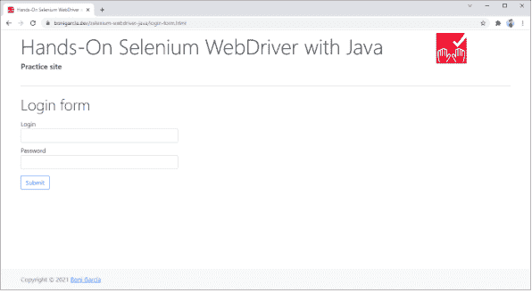

## Chapter 7. The Page Object Model (POM)

## A NOTE FOR EARLY RELEASE READERS

使用 Early Release 电子书，您可以在官方发布这些标题之前很久就利用这些技术——在作者撰写时获取书籍的最原始和未编辑内容。

这将是最终书籍的第七章。请注意，GitHub 仓库将在稍后激活。

如果您对如何改进本书的内容和/或示例有任何意见，或者如果您注意到本章中缺少材料，请联系编辑 rfernando@oreilly.com。

*设计模式* 是软件工程中对反复出现的问题的可重用解决方案。本章介绍 Page Object Model（POM），这是一种流行的设计模式，用于开发 Selenium WebDriver 测试。使用 POM 有不同的好处，例如提高可重用性和避免代码重复。POM 基于为建模 SUT UI 创建 *页面类*，作为单个存储库，后续由测试逻辑使用。

## Motivation

使用 Selenium WebDriver 开发端到端测试的最大挑战之一是 *可维护性* 和 *不稳定*。关于前者，问题可能发生在 SUT 的开发或演进期间。UI 中所做的更改可能导致现有的端到端测试中断。当拥有一个大型测试套件并且在多个测试用例中存在代码重复时，例如在不同测试中重复使用相同的定位器时，修复这些测试的维护成本可能非常高。

关于不稳定，即缺乏可靠性，测试在 *不稳定* 时行为不一致；换句话说，在相同的条件下，它会周期性地通过和失败，包括测试逻辑、输入数据、设置等。Selenium WebDriver 测试中测试不稳定的两个主要原因。

首先，问题的根源可能是 SUT。例如，服务器端逻辑中的错误，例如竞争条件，可能在端到端测试中暴露出不规律的行为。在这种情况下，开发人员和测试人员应共同努力检测和解决问题，通常通过修复服务器端错误。

其次，原因可能在测试本身。这是测试人员应避免的不理想情况。防止 Selenium WebDriver 测试不稳定的策略有不同，例如实施稳健的定位器策略，以避免由于响应性或视口更改导致测试脆弱，或使用等待策略来处理 Web 应用程序的分布式和异步特性，如第 3 章“等待策略”中所述。

利用 POM 等设计模式可以帮助减少代码重复并增强可维护性。此外，我们可以使用 POM 来包含可重用的、稳健的定位和等待策略。下一节描述了如何执行 POM 设计模式。

> **NOTE**
>
> POM 设计模式本身并不是严格的测试不稳定解决方案。然而，如以下各节所述，它能够封装防止测试不可靠的可重用代码。

## The POM Design Pattern

POM 设计模式的原则是将处理 UI 元素的逻辑分离到单独的类中，称为 *页面类*，与测试逻辑分离。换句话说，我们按照面向对象的范式对 SUT 的外观和行为进行建模，即作为 *页面对象*。然后，这些页面对象被 Selenium WebDriver 测试使用。

让我们看一个简单的例子来说明 POM。考虑图 7-1，其中包含一个登录表单。像往常一样，此页面包含在练习站点中。示例 7-1 显示了一个使用 *vanilla* Selenium WebDriver 的测试用例。在编程中，我们使用术语“vanilla”来指代以其原始形式使用且未定制的某些技术。在本例中，我们使用第 II 部分中所述的标准 Selenium WebDriver API。



Figure 7-1. Practice web page with a login form

## Example 7-1. Test Using Vanilla Selenium WebDriver to Implement a Successful Login

```java
@Test
void testVanillaBasicLogin() {
    driver.get(
        "https://bonigarcia.dev/selenium-webdriver-java/login-form.html");

    driver.findElement(By.id("username")).sendKeys("user"); ①
    driver.findElement(By.id("password")).sendKeys("user"); ②
    driver.findElement(By.cssSelector("button")).click(); ③

    assertThat(driver.findElement(By.id("success")).isDisplayed()).isTrue(); ④
}
```

① 我们在 Web 表单中输入单词 `user` 作为用户名。

② 我们在 Web 表单中输入相同的单词作为密码。

③ 我们点击提交按钮。

④ 我们验证成功框是否显示。

此测试完全正确，但如果我们使用同一网页实现其他测试，可能会出现潜在问题。例如，示例 7-2 显示了另一个使用 vanilla Selenium WebDriver 的测试用例，用于使用同一 Web 表单实现负面测试，即登录失败。此测试再次是合理的，但与示例 7-1 结合，我们重复了大部分用于定位 Web 元素的逻辑，仅使用不同的输入数据和预期结果。这种做法违背了软件设计中最相关的原则之一：不要重复自己（DRY）。这有问题，因为在不同位置使用相同的代码会使可维护性更困难。

## Example 7-2. Test Using Vanilla Selenium WebDriver to Implement a Failed Login

```java
@Test
void testVanillaBasicLoginFailure() {
    driver.get(
        "https://bonigarcia.dev/selenium-webdriver-java/login-form.html");

    driver.findElement(By.id("username")).sendKeys("bad-user");
    driver.findElement(By.id("password")).sendKeys("bad-password");
    driver.findElement(By.cssSelector("button")).click();

    assertThat(driver.findElement(By.id("invalid")).isDisplayed()).isTrue();
}
```

## Page Objects

页面对象类使 UI 专用代码的分离成为可能，例如定位器和页面布局，与测试逻辑分离。我们可以将页面类视为封装操作或服务的单个存储库


由被测应用程序提供。这些类在不同的测试用例中实例化为页面对象。我们可以使用这些对象中公开的方法来实现端到端测试，同时避免代码重复。

让我们看一个使用页面对象的简单示例。在下面的示例中，我们使用页面对象而不是原生的 Selenium WebDriver，对上一节中解释的测试（即使用登录表单）进行重构。为此，第一步是创建一个建模登录页面的 Java 类。示例 7-3 显示了此页面类的非常基础的实现。

## 示例 7-3. 基础页面类，用于建模练习登录表单

```
public class BasicLoginPage {

    WebDriver driver; ①

    By usernameInput = By.id("username"); ②
    By passwordInput = By.id("password");
    By submitButton = By.cssSelector("button");
    By successBox = By.id("success");

    public BasicLoginPage(WebDriver driver) { ③
        this.driver = driver;

        driver.get(
            "https://bonigarcia.dev/selenium-webdriver-java/login-form.html");
    }

    public void with(String username, String password) { ④
        driver.findElement(usernameInput).sendKeys(username);
        driver.findElement(passwordInput).sendKeys(password);
        driver.findElement(submitButton).click();
    }

    public boolean successBoxPresent() { ⑤
        return driver.findElement(successBox).isDisplayed();
    }
}
```

① 我们声明一个 WebDriver 类属性。此变量用于在页面对象中实现与网页的交互。

2 我们将所有必需的定位器声明为附加属性。在此情况下，我们定位用户名和密码的文本输入框、提交按钮以及成功提示框。

3 此页面类定义的构造函数接受 WebDriver 对象。我们使用构造函数加载被测页面。

4 我们声明一个方法来建模登录所需的交互，即输入用户名和密码，然后点击提交按钮。

5 我们声明另一个方法来检查成功提示框是否可见。

现在，我们可以在测试用例中使用此页面类。示例 7-4 展示了如何使用。请注意，我们在每个测试之前像往常一样创建 WebDriver 实例，并在每个测试之后退出。我们将此 driver 作为参数传递给页面类构造函数。

## 示例 7-4. 使用基础页面类实现成功登录的测试

```
class BasicLoginJupiterTest {

    WebDriver driver;
    BasicLoginPage login; ①

    @BeforeEach
    void setup() {
        driver = WebDriverManager.chromedriver().create();
        login = new BasicLoginPage(driver); ②
    }

    @AfterEach
    void teardown() {
        driver.quit();
    }

    @Test
    void testBasicLoginSuccess() {
        login.with("user", "user"); ③
        assertThat(login.successBoxPresent()).isTrue(); ④
    }

}
```

- 1. 我们在测试类中将页面类声明为属性。
- 2. 我们创建页面对象并传入 WebDriver 实例。
- 3. 我们调用页面类定义的 with 方法来执行登录操作。
- 4. 我们使用页面对象提供的方法验证成功提示框是否出现在结果网页上。

这种方法对于提高测试的可维护性是一个很好的起点，因为现在所有与登录网页相关的逻辑都集中在一个可重用的类中。然而，页面类中的代码仍然很脆弱。例如，想象我们需要为登录页面实现一个负面测试，即使用错误凭据尝试登录。示例 7-5 在当前页面类的实现下似乎是一种合理的做法。然而，如果你运行此测试，你会发现测试由于 NoSuchElementException 异常而失败。下一节将解释如何通过创建更健壮的页面对象来解决此潜在问题。

## 示例 7-5. 使用基础页面类实现失败登录的测试

```
@Test
void testBasicLoginFailure() {
    login.with("bad-user", "bad-password");
    assertThat(login.successBoxPresent()).isFalse();
}
```

## 健壮的页面对象

上一节中介绍的示例改进了代码可维护性，因为页面操作被封装在单个类中，而不是散布在整个测试套件中。然而，有不同的方法可以增强之前的页面类实现。首先，我们的 SUT 很可能有多个网页，而不仅仅是一个。因此，常见的做法是遵循面向对象的思路并创建一个基础页面类，该类封装所有页面类的通用逻辑。示例 7-6 显示了一个实现页面类典型基类的 Java 类。

## 示例 7-6. 页面类的基类示例

```
public class BasePage {

    static final Logger log = getLogger(lookup().lookupClass());

    WebDriver driver;
    WebDriverWait wait;
    int timeoutSec = 5; // wait timeout (5 seconds by default)

    public BasePage(WebDriver driver) {
        this.driver = driver;
        wait = new WebDriverWait(driver,
        Duration.ofSeconds(timeoutSec)); ①
    }

    public void setTimeoutSec(int timeoutSec) { ②
        this.timeoutSec = timeoutSec;
    }

    public void visit(String url) { ③
        driver.get(url);
    }

    public WebElement find(By element) {
        return driver.findElement(element);
    }

    public void click(By element) {
        find(element).click();
    }

    public void type(By element, String text) {
        find(element).sendKeys(text);
    }

    public boolean isDisplayed(By locator) { ④
        try {
        wait.until(ExpectedConditions.visibilityOfElementLocated(locator));
        } catch (TimeoutException e) {
            log.warn("Timeout of {} wait for {}", timeoutSec,
        locator);

return false;
}
return true;
}
}
```

① 我们在基类中定义一个显式等待（WebDriverWait）属性。我们在构造函数中使用默认超时值（本示例中为 5 秒）实例化此属性。

② 我们创建一个 setter 方法来更改等待超时的默认值。例如，我们可能需要根据系统响应时间调整此超时。

③ 我们创建页面类可以重用的多个通用方法，例如 visit()（打开网页）、find()（定位网页元素）或 type()（向可写元素（如输入字段）发送数据）。

④ 我们实现一个方法来检查网页元素是否显示或不显示。请注意，此方法隐藏了等待该元素的复杂性，返回一个简单的布尔值供测试使用。

我们将之前的基类用作特定页面类的父类。例如，示例 7-7 显示了一个 Java 类，它扩展了此基类以实现练习站点中登录示例页面的页面类。

## 示例 7-7. 使用之前基类的登录页面类

```
public class LoginPage extends BasePage {

    By usernameInput = By.id("username"); ①
    By passwordInput = By.id("password");
    By submitButton = By.cssSelector("button");
    By successBox = By.id("success");

    public LoginPage(WebDriver driver, int timeoutSec) { ②
        this(driver);
        setTimeoutSec(timeoutSec);
    }

```java
public LoginPage(WebDriver driver) {
    super(driver);
    visit("https://bonigarcia.dev/selenium-webdriver-java/login-form.html");
}

public void with(String username, String password) {
    type(usernameInput, username);
    type(passwordInput, password);
    click(submitButton);
}

public boolean successBoxPresent() {
    return isDisplayed(successBox);
}

}
```
```

- 1. 我们将页面定位器定义为类属性。
- 2. 我们定义一个具有两个参数的构造函数：WebDriver 对象和超时值（以秒为单位）。
- 3. 我们定义另一个打开被测网页的构造函数。
- 4. 我们包含一个使用用户名和密码作为凭据登录的方法。此方法使用父类中定义的方法（`type()` 和 `click()`）。
- 5. 我们包含另一个方法来检查成功提示框是否可见或不可见（使用基类中定义的 `isDisplayed()` 方法）。

最后，我们可以使用页面类来实现 Selenium WebDriver 测试。**示例 7-8** 显示了一个使用 JUnit 5 的测试（通常，你可以在示例仓库中找到 JUnit 4、TestNG 和 Selenium-Jupiter 版本）。

## 示例 7-8. 使用页面类实现成功和失败登录的测试

```
```java
class LoginJupiterTest {

    WebDriver driver;
```


```
LoginPage login;

@BeforeEach
void setup() {
    driver = WebDriverManager.chromedriver().create();
    login = new LoginPage(driver); ①
}

@AfterEach
void teardown() {
    driver.quit();
}

@Test
void testLoginSuccess() {
    login.with("user", "user");
    assertThat(login.successBoxPresent()).isTrue();
}

@Test
void testLoginFailure() {
    login.with("bad-user", "bad-password");
    assertThat(login.successBoxPresent()).isFalse(); ②
}
```

① 我们在每次测试前实例化页面对象。

② 由于页面类逻辑足够健壮，我们可以调用 successBoxPresent() 来实现负面测试。该方法内部实现了对网页元素的显式等待，当成功框未显示时最终会返回 false。

## 创建领域特定语言（DSL）

在对系统进行建模的旅程中，我们可以更进一步，利用页面类创建一个完整的领域特定语言（DSL）。在计算中，DSL 是为特定领域定制的专用语言。使用 POM 和 Selenium WebDriver 时，我们可以将 DSL 看作是对所有 SUT 操作和服务的封装，这些操作和服务以页面类提供的方法呈现。这样，测试用例就可以使用页面类提供的简单且可读的 API。这些类封装了所有对 Selenium WebDriver API 的调用以与 SUT 交互。

继续前几节中展示的示例，示例 7-9 显示了遵循 DSL 方法的登录页面的基页面类。此基类与示例 7-6 非常相似，但在这种情况下，该类还封装了创建 WebDriver 实例所需的逻辑。

### *示例 7-9. 遵循 DSL 方法的基类示例*

```
public class ExtendedBasePage {

    static final Logger log = getLogger(lookup().lookupClass());

    WebDriver driver;
    WebDriverWait wait;
    int timeoutSec = 5; // wait timeout (5 seconds by default)

    public ExtendedBasePage(String browser) { ❶
        driver = WebDriverManager.getInstance(browser).create(); ❷
        wait = new WebDriverWait(driver,
            Duration.ofSeconds(timeoutSec));
    }

    public void setTimeoutSec(int timeoutSec) {
        this.timeoutSec = timeoutSec;
    }

    public void quit() { ❸
        if (driver != null) {
            driver.quit();
        }
    }

    // Rest of common methods: quit(), visit(URL url), find(By
    element), etc.

}
```

- ❶ 我们在基构造函数中声明一个 `String` 参数。此字符串将是浏览器名称（在测试中指定）。
- ❷ 我们使用 WebDriverManager 解析所需的驱动程序并创建 WebDriver 实例。如附录 B 所述，WebDriverManager 允许通过调用 getInstance() 方法使用参数化管理器。在这种情况下，我们使用浏览器名称（例如 chrome、firefox 等）来选择管理器。
- ❸ 我们还封装了终止会话并关闭浏览器的 方法。

示例 7-10 显示了扩展此基类的页面类。正如你所见，与示例 7-7 的唯一区别是此页面类在构造函数中使用了一个字符串参数（浏览器名称）。

### 示例 7-10. 遵循 DSL 方法的登录页面类

```
public class ExtendedLoginPage extends ExtendedBasePage {

    By usernameInput = By.id("username");
    By passwordInput = By.id("password");
    By submitButton = By.cssSelector("button");
    By successBox = By.id("success");

    public ExtendedLoginPage(String browser, int timeoutSec) {
        this(browser);
        setTimeoutSec(timeoutSec);
    }

    public ExtendedLoginPage(String browser) {
        super(browser);
        visit("https://bonigarcia.dev/selenium-webdriver-java/login-form.html");
    }

    public void with(String username, String password) {
        type(usernameInput, username);
        type(passwordInput, password);
        click(submitButton);
    }

    public boolean successBoxPresent() {
        return isDisplayed(successBox);
    }
}
```

最后，示例 7-11 显示了 resulting 测试。请注意，此测试不包含对 Selenium WebDriver 或 WebDriverManager 的任何调用。页面类封装了与浏览器交互的所有底层细节，并在测试中公开了一个高级可读 API。

### 示例 7-11. 使用 POM 并遵循 DSL 方法的测试用例

```
class ExtendedLoginJupiterTest {

    ExtendedLoginPage login;

    @BeforeEach
    void setup() {
        login = new ExtendedLoginPage("chrome"); ①
    }

    @AfterEach
    void teardown() {
        login.quit(); ②
    }

    @Test
    void testLoginSuccess() {
        login.with("user", "user");
        assertThat(login.successBoxPresent()).isTrue();
    }

    @Test
    void testLoginFailure() {
        login.with("bad-user", "bad-password");
        assertThat(login.successBoxPresent()).isFalse();
    }
}
```

① 我们只需指定要使用的浏览器类型（本例中为 chrome）即可实例化页面对象。

② 像往常一样，我们在每次测试后终止浏览器会话，但这次使用页面对象提供的方法。

## Page Factory

Page Factory 是 Selenium WebDriver API 提供的多个支持类的名称，用于简化页面对象类的实现。其中最相关的支持类如下：

- FindBy：用于在属性级别标识页面中的网页元素的注解。
- FindAll：允许组合不同的 @FindBy 定位器的注解。
- PageFactory：用于初始化所有之前用 @FindBy（和 @FindAll）声明的网页元素的类。
- CacheLookup：使用 @FindBy 注解定位网页元素的缺点是，每次使用定位器时，驱动程序都会尝试在当前页面上查找它。此功能在动态 Web 应用程序中很有帮助。然而，在静态 Web 应用程序中，希望缓存网页元素。因此，注解 @CacheLookup 允许在定位后缓存网页元素，从而提高 resulting 测试的性能。

示例 7-12 显示了一个使用这些 Selenium WebDriver 支持类的页面类。你可以在仓库对象中找到使用此页面类的 resulting 测试。此测试等同于示例 7-11，但使用 FactoryLoginPage 而不是 ExtendedLoginPage 与登录页面交互。

### 示例 7-12. 使用 Selenium WebDriver 提供的页面工厂的类

```
public class FactoryLoginPage extends ExtendedBasePage {
    @FindBy(id = "username")
    @CacheLookup
    WebElement usernameInput;

    @FindBy(id = "password")
    @CacheLookup
```

```
WebElement passwordInput;

@FindBy(css = "button")
@CacheLookup
WebElement submitButton;

@FindBy(id = "success")
@CacheLookup
WebElement successBox;

public FactoryLoginPage(String browser, int timeoutSec) {
    this(browser);
    setTimeoutSec(timeoutSec);
}

public FactoryLoginPage(String browser) {
    super(browser);
    PageFactory.initElements(driver, this);
    visit("https://bonigarcia.dev/selenium-webdriver-java/login-form.html");
}

// Same logic to the page class without using the page factory
}
```

1 我们使用用两个注解装饰的 WebElement 类型声明页面中的网页元素：

- @FindBy：指定定位器（本示例中为 by id 和 css）。
- @CacheLookup：缓存网页元素定位结果（因为网页是静态的，其内容在不同调用中不会改变）。

2 我们调用 initElements 方法使用 WebDriver 实例定位网页元素。

> WARNING
> 仅当使用 Selenium WebDriver 测试的网页是静态时，才建议使用 Page Factory 方法。使用动态网页时，此方法可能导致不期望的效果，例如陈旧的网页元素（即旧的或不再可用的元素）。

## 总结与展望

本章对 Selenium WebDriver 测试中的页面对象模型（POM）进行了全面概述。POM 是一种设计模式，我们将与网页交互的逻辑与测试代码分离。这样，*页面类* 包含与网页定位器和页面布局相关的逻辑，而测试类决定如何执行和验证 SUT。POM 模式提高了基于 Selenium WebDriver 的测试套件的可维护性，因为页面类存储在对 SUT 进行建模的单个仓库中。此仓库稍后在不同的测试用例中使用。我们可以使用适当的定位和等待策略创建健壮的网页。

下一章将介绍所使用的单元测试框架（JUnit、TestNG 和 Selenium-Jupiter）的特定方面，以改进使用 Selenium WebDriver 的整体测试过程。这些功能允许创建参数化测试（用于跨浏览器测试）、对测试进行分类（用于测试过滤）、排序和重试测试，或并行执行测试。


