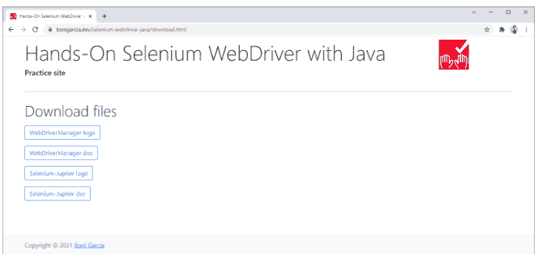
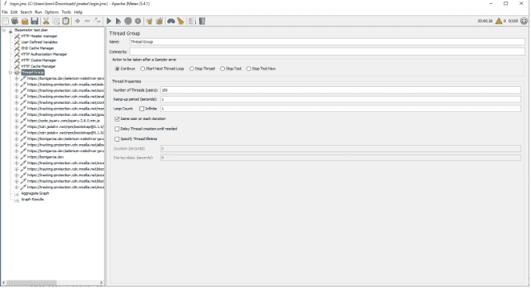
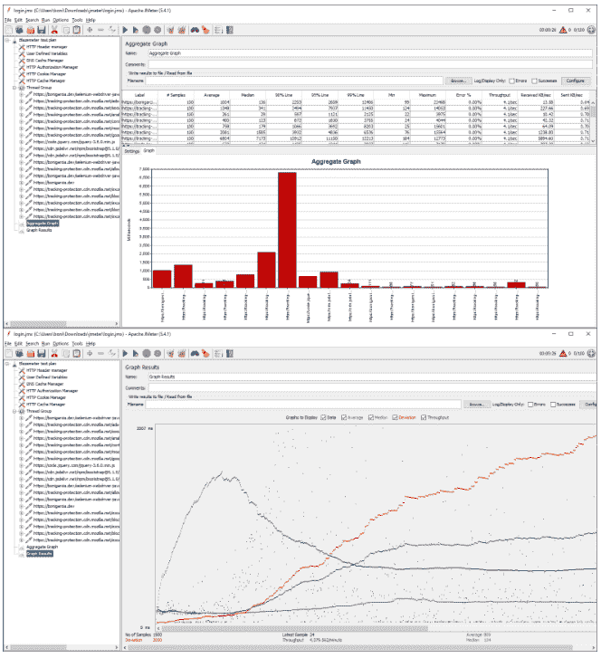
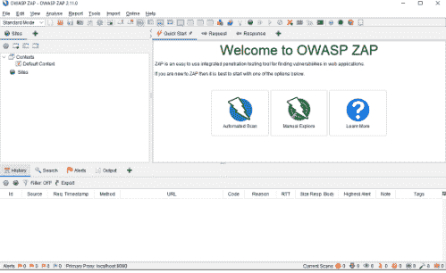
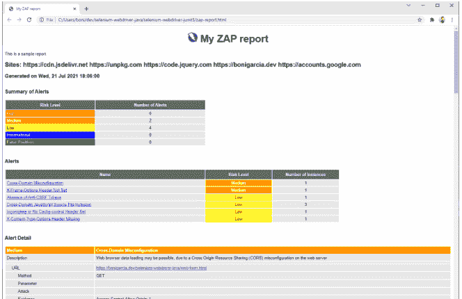
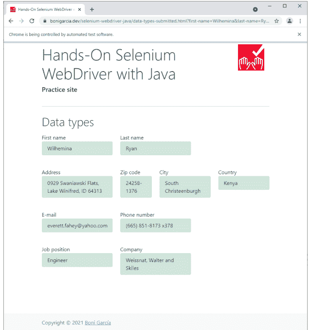
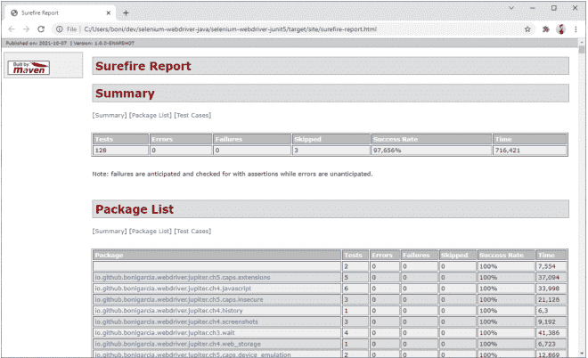
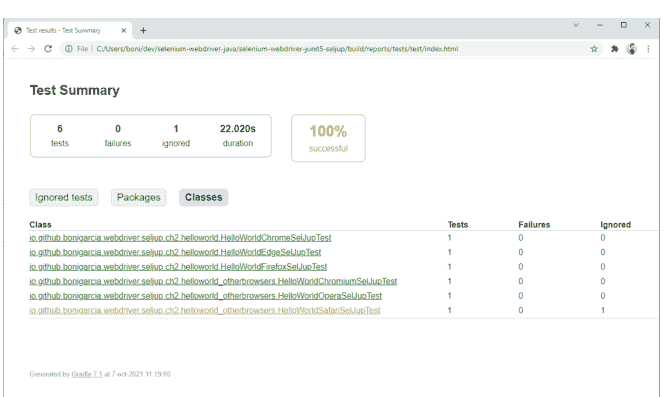
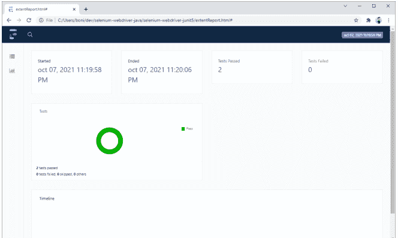
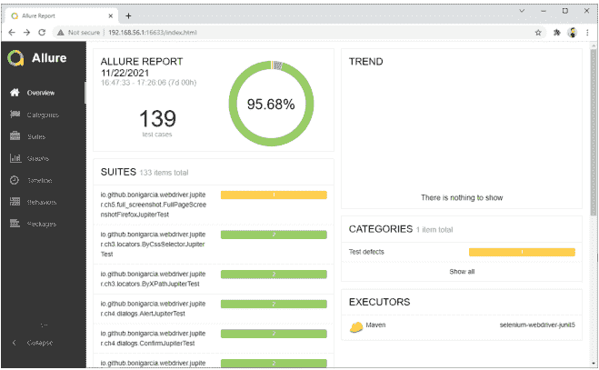

## Chapter 9. Third-Party Integrations

> **A NOTE FOR EARLY RELEASE READERS**
> 
> With Early Release ebooks, you get books in their earliest form—the author’s raw and unedited content as they write—so you can take advantage of these technologies long before the official release of these titles.
> 
> This will be the 9th chapter of the final book. Please note that the GitHub repo will be made active later on.
> 
> If you have comments about how we might improve the content and/or examples in this book, or if you notice missing material within this chapter, please reach out to the editor at rfernando@oreilly.com.

本章介绍可与 Selenium WebDriver 一起使用的不同第三方技术（例如库或框架）。当 Selenium WebDriver API 不足以执行特定任务时，我们需要使用其中一些技术。这就是文件下载的情况，我们需要使用第三方实用程序等待文件正确下载，或者 alternatively 使用 HTTP 客户端来控制下载。我们还使用第三方代理捕获 HTTP 流量。另一个需要使用外部实用程序来 Selenium WebDriver 的场景是在实现非功能性测试时，例如性能、安全、可访问性或 A/B 测试。我们也可以使用第三方库以流畅 API 开发 Selenium WebDriver 测试、生成假测试数据或改进测试报告。最后，我们可以集成相关框架，例如用于行为驱动开发（BDD）的 Cucumber 或 Spring Framework（用于开发 Web 应用程序）。我们将在本章中介绍我提到的所有用途。

> **TIP**
> 
> 要使用本章介绍的第三方实用程序，您必须首先在项目中包含所需的依赖项。您可以在附录 C 中找到使用 Maven 和 Gradle 解析每个依赖项的详细信息。

## File Download

Selenium WebDriver 对文件下载的支持有限，因为其 API 未公开下载进度。换句话说，我们可以使用 Selenium WebDriver 从 Web 应用程序下载文件，但我们无法控制将这些文件复制到本地文件系统的所需时间。因此，我们可以使用第三方库来增强使用 Selenium WebDriver 的 Web 下载体验。有不同的替代方案来实现这一目标。以下小节说明了如何操作。

### Using Browser-Specific Capabilities

我们可以使用浏览器特定功能（正如我们在第 5 章中所做的那样）来配置文件下载的多个参数，例如目标文件夹。由于这些功能在 Selenium WebDriver API 中开箱即用，因此这种方法很方便，但也存在几个缺点。首先，它与不同浏览器类型（Chrome、Firefox 等）不兼容。换句话说，所需的功能因各个浏览器而异。其次，更重要的是，我们无法控制以跟踪下载进度。为了解决这个问题，我们需要使用第三方库。在本书中，我建议使用开源库 Awaitility。

Awaitility 是一个流行的库，提供处理异步操作的功能。这样，它提供了一个流畅的 API 来管理线程、超时和并发问题。在使用 Selenium WebDriver 下载文件的情况下，我们使用 Awaitility API 等待下载的文件存储在文件系统中。示例 9-1 显示了使用 Chrome 和 Awaitility 的示例。然后，示例 9-2 显示了使用 Firefox 时等效的测试设置。

### Example 9-1. Test download files using Chrome and Awaitility

```
class DownloadChromeJupiterTest {

    WebDriver driver;

    File targetFolder;

    @BeforeEach
    void setup() {
        targetFolder = new File(System.getProperty("user.home"), "Downloads"); ①
        Map<String, Object> prefs = new HashMap<>();
        prefs.put("download.default_directory", targetFolder.toString()); ②
        ChromeOptions options = new ChromeOptions();
        options.setExperimentalOption("prefs", prefs);

        driver =
        WebDriverManager.chromedriver().capabilities(options).create();
    }

    @AfterEach
    void teardown() {
        driver.quit();
    }

    @Test
    void testDownloadChrome() {
        driver.get(
            "https://bonigarcia.dev/selenium-webdriver-java/download.html"); ③

        driver.findElement(By.xpath("//a[2]")).click(); ④
        driver.findElement(By.xpath("//a[3]")).click();

        ConditionFactory await = Awaitility.await()
            .atMost(Duration.ofSeconds(5)); ⑤
        File wdmLogo = new File(targetFolder, "webdrivermanager.png");
        await.until(() -> wdmLogo.exists()); ⑥

        File wdmDoc = new File(targetFolder, "webdrivermanager.pdf");
        await.until(() -> wdmDoc.exists()); ⑦
    }
}
```

① 我们指定一个文件夹来保存下载的文件。然而，你应该注意 Chrome 仅允许某些目录用于下载。例如，它允许下载目录（和子文件夹），但禁止使用其他路径，例如桌面文件夹或主目录。

② 我们使用 Chrome 首选项指定目标文件夹。

③ 我们使用练习站点上可用的网页通过单击按钮下载不同的文件（参见图 9-1）。

④ 我们单击页面上可用的两个按钮。结果，浏览器开始下载两个文件：PNG 图片和 PDF 文档。

⑤ 我们使用 Awaitility 配置 5 秒的等待超时。

⑥ 我们等待第一个文件进入文件系统。

⑦ 我们也等待第二个文件下载完成。

### Example 9-2. Test setup for downloading files using Firefox

```
@BeforeEach
void setup() {
    FirefoxOptions options = new FirefoxOptions();
    targetFolder = new File("."); ①
    options.addPreference("browser.download.dir",
        targetFolder.getAbsolutePath()); ②
    options.addPreference("browser.download.folderList", 2); ③
    options.addPreference("browser.helperApps.neverAsk.saveToDisk",
        "image/png, application/pdf"); ④
    options.addPreference("pdfjs.disabled", true); ⑤

    driver = WebDriverManager.firefoxdriver().capabilities(options)
        .create();
}
```


- **1.** Firefox 允许指定任意文件夹用于下载文件。在此情况下，我们使用本地项目文件夹。
- **2.** 我们使用一个 Firefox 首选项来指定自定义下载目录。
- **3.** 我们需要将首选项 `browser.download.folderList` 设置为 `2` 以选择自定义下载文件夹。其他可能的值为 `0` 将文件下载到用户桌面，以及 `1` 使用下载文件夹（默认值）。
- **4.** 我们指定 Firefox 将不会询问是否保存这些文件类型到本地文件系统的内容类型。
- **5.** 我们禁用 PDF 文件的预览。



## 使用 HTTP 客户端

使用 Selenium WebDriver 下载文件的另一种机制是使用 HTTP 客户端库。在本书中，我建议使用 Apache HttpClient，因为 WebDriverManager 内部使用该库，因此你可以在项目中将其作为传递依赖使用。示例 9-3 显示了一个完整的测试用例，使用 Apache HttpClient 从练习站点下载多个文件。请注意，在这种情况下，无需显式等待文件下载完成，因为 Apache HttpClient 允许你同步处理 HTTP 响应。

## 示例 9-3. 使用 HTTP 客户端测试下载文件

```java
class DownloadHttpClientJupiterTest {

    WebDriver driver;

    @BeforeEach
    void setup() {
        driver = WebDriverManager.chromedriver().create();
    }

    @AfterEach
    void teardown() {
        driver.quit();
    }

    @Test
    void testDownloadHttpClient() throws IOException {
        driver.get(
                "https://bonigarcia.dev/selenium-webdriver-java/download.html");

        WebElement pngLink = driver.findElement(By.xpath("(//a)[2]"));
        File pngFile = new File(".", "webdrivermanager.png");
        download(pngLink.getAttribute("href"), pngFile);
        assertThat(pngFile).exists();

        WebElement pdfLink = driver.findElement(By.xpath("(//a)[3]"));
        File pdfFile = new File(".", "webdrivermanager.pdf");
        download(pdfLink.getAttribute("href"), pdfFile);
        assertThat(pdfFile).exists();
    }

    void download(String link, File destination) throws IOException {
        try (CloseableHttpClient client =
                HttpClientBuilder.create().build()) {
            HttpUriRequestBase request = new HttpGet(link);
            try (CloseableHttpResponse response =
                    client.execute(request)) {
                FileUtils.copyInputStreamToFile(
                        response.getEntity().getContent(),
                        destination);
            }
        }
    }
}
```

- **❶** 我们再次使用练习网页来下载文件。
- **❷** 我们点击一个按钮来下载文件。
- **❸** 我们将下载文件的通用逻辑重构到 `download` 类方法中。
- **❹** 我们对第二个要下载的文件重复该操作。
- **❺** 我们在 try-with-resources 语句中创建 Apache HTTP 客户端实例。该客户端会在语句作用域结束时自动关闭。
- **❻** 我们使用另一个 try-with-resources 语句向提供的 URL 发送 HTTP 请求，并据此获得 HTTP 响应。
- **❼** 我们将结果文件复制到本地文件系统。

## 捕获网络流量

第 5 章中的“网络监控”和“网络拦截器”解释了如何使用浏览器特定的功能来捕获 Selenium WebDriver 与被测 Web 应用程序之间的 HTTP 流量。这种机制的缺点是它仅在支持 CDP 的浏览器中可用，即基于 Chromium 的浏览器（通常是 Chrome 和 Edge）。尽管如此，我们仍可为其他浏览器（例如 Firefox）使用第三方代理。在本书中，我建议你为此目的使用 BrowserMob Proxy。

BrowserMob 是一个开源代理，允许使用 Java 库操作 HTTP 流量。示例 9-4 显示了一个使用该代理的 Selenium WebDriver 测试的完整测试。在此示例中，我们使用 BrowserMob 代理拦截测试与目标网站之间的 HTTP 流量，并将此流量（请求-响应）作为日志跟踪进行追踪。

## 示例 9-4. 通过 BrowserMob Proxy 测试捕获网络流量

```java
class CaptureNetworkTrafficFirefoxJupiterTest {

    static final Logger log = getLogger(lookup().lookupClass());

    WebDriver driver;

    BrowserMobProxy proxy;

    @BeforeEach
    void setup() {
        proxy = new BrowserMobProxyServer();
        proxy.start();
        proxy.newHar();
        proxy.enableHarCaptureTypes(CaptureType.REQUEST_CONTENT,
                CaptureType.RESPONSE_CONTENT);

        Proxy seleniumProxy =
                ClientUtil.createSeleniumProxy(proxy);
        FirefoxOptions options = new FirefoxOptions();
        options.setProxy(seleniumProxy);
        options.setAcceptInsecureCerts(true);

        driver =
                WebDriverManager.firefoxdriver().capabilities(options)
                        .create();
    }

    @AfterEach
    void teardown() {
        proxy.stop();
        driver.quit();
    }

    @Test
    void testCaptureNetworkTrafficFirefox() {
        driver.get("https://bonigarcia.dev/selenium-webdriver-java/");
        assertThat(driver.getTitle()).contains("Selenium WebDriver");

        List<HarEntry> logEntries =
                proxy.getHar().getLog().getEntries();
        logEntries.forEach(logEntry -> {
            log.debug("Request: {} - Response: {}",
                    logEntry.getRequest().getUrl(),
                    logEntry.getResponse().getStatus());
        });
    }
}
```

- **1.** 我们创建 BrowserMob 的一个实例。
- **2.** 我们启动该代理。
- **3.** 我们使用 HAR（HTTP Archive）捕获 HTTP 流量，HAR 是一种基于 JSON 的文件格式，用于捕获和导出此流量。
- **4.** 我们启用捕获交换的 HTTP 请求和响应。
- **5.** 我们将 BrowserMob 服务器转换为 Selenium WebDriver 代理。
- **6.** 我们将该代理设置为浏览器选项（在此情况下为 Firefox）。
- **7.** 我们需要允许不安全证书，因为与代理的通信使用 HTTP（而不是 HTTPS）进行。
- **8.** 我们在测试后停止代理。
- **9.** 我们使用代理实例收集 HTTP 流量（请求和响应）。在此基本示例中，我们使用记录器将此信息写入标准输出。

## 非功能测试

如第 1 章所述，Selenium WebDriver 主要用于评估 Web 应用程序的功能需求。换句话说，测试人员使用 Selenium WebDriver API 来验证被测 Web 应用程序的行为是否符合预期。尽管如此，我们仍可利用此 API 来测试非功能需求，即质量属性，如性能、安全、可用性等。实现此目标的常见策略是与特定的第三方工具集成。以下小节解释了 Selenium WebDriver 用于非功能测试的不同集成方式。

## 性能

性能测试评估 SUT 在特定负载下的响应性和稳定性。测试人员通常采用 Apache JMeter 等特定工具进行性能测试，而不是 Selenium WebDriver。Apache JMeter 是一个开源工具，允许向给定 URL 端点发送多个 HTTP 请求，同时测量响应时间和其他指标。虽然 Selenium WebDriver 与 Apache JMeter 之间的直接集成并不简单，但我们可以利用现有的 Selenium WebDriver 测试作为 JMeter 测试计划（即 JMeter 执行的一系列步骤）。为此，我建议采用以下流程：

- **1.** 使用 BrowserMob 代理（在上一节中介绍）在 Selenium WebDriver 测试中捕获交换的网络流量，并将其保存为 HAR 文件。
- **2.** 将生成的 HAR 文件转换为 JMeter 测试计划。JMeter 中的测试计划以 JMX 为扩展名的基于 XML 的文件存储。
- **3.** 在 JMeter 中加载 JMX 测试计划，并对其进行调整以模拟并发用户并包含结果监听器。
- **4.** 运行测试计划并评估结果。

示例 9-5 显示了一个完整的测试用例，实现了第一步。如你所见，启动并创建 HAR 文件所需的登录操作在每个测试之前执行。你可以使用这种方法利用现有的功能测试（即 `@Test` 方法中的逻辑）作为性能测试（在 JMeter 中执行）。

## 示例 9-5. 测试创建 HAR 文件


- ❶ 我们在测试开始前启动 BrowserMob，并在 `WebDriver` 会话中进行配置。
- ❷ 测试结束后我们获取 HAR 文件并将其写入本地文件。

运行完之前的测试后，我们得到一个名为 `login.har` 的 HAR 文件。现在，我们需要将其转换为 JMeter 测试计划。实现此目的的方法有多种。你可以在网上找到多个程序（例如用 Ruby 或 Java 编写的）可免费使用。也可以使用在线转换服务，例如 BlazeMeter JMX Converter。在本示例中，我使用该在线服务并在 JMeter 中打开生成的 JMX 测试计划。此时，你可以根据需要调整 JMeter 配置（有关 JMeter 的更多信息可参考其官方用户手册）。例如，图 9-2 显示了加载生成的 JMX 测试计划后并进行以下更改的 JMeter GUI：

- 将并发用户数增加到 100（在“Thread Group”选项卡中）。
- 添加一些结果监听器，例如“Aggregate Graph”和“Graph Results”。



*Figure 9-2. JMeter GUI loading the resulting test plan*

现在，我们可以使用 JMeter 运行测试计划（例如在 JMeter GUI 中点击带有绿色三角形的按钮）。结果将生成 100 个并发用户的负载，其交互最初是作为 Selenium WebDriver 测试开发的（示例 9-5）。图 9-3 显示了之前添加的监听器的结果。



Figure 9-3. JMeter results

## Using Browsers to Generate the Load

对于许多 Web 应用的性能测试场景，使用 JMeter 之类的工具很方便。然而，当你需要使用真实浏览器来重现完整用户工作流时（例如在视频会议 Web 应用中），这种方法就不适用了。在这种情况下，一个可行的解决方案是结合使用 WebDriverManager 和 Docker。示例 9-6 演示了此用法。正如你在此测试中所见，WebDriverManager 只需在 `create()` 方法中指定大小作为参数，即可创建 WebDriver 实例列表。然后，例如，我们可以使用标准的 Java 通过线程池并行地对被测 Web 应用进行操作。

### Example 9-6. Load test using WebDriverManager and Docker

```java
class LoadJupiterTest {

    static final int NUM_BROWSERS = 5;

    final Logger log = getLogger(lookup().lookupClass());

    List<WebDriver> driverList;

    WebDriverManager wdm =
            WebDriverManager.chromedriver().browserInDocker(); // ①

    @BeforeEach
    void setupTest() {
        assumeThat(isDockerAvailable()).isTrue(); // ②
        driverList = wdm.create(NUM_BROWSERS); // ③
    }

    @AfterEach
    void teardown() {
        wdm.quit();
    }

    @Test
    void testLoad() throws InterruptedException {
        ExecutorService executorService =
                newFixedThreadPool(NUM_BROWSERS); // ④
        CountDownLatch latch = new CountDownLatch(NUM_BROWSERS);

        driverList.forEach((driver) -> { // ⑤
            executorService.submit(() -> {
                try {
                    checkHomePage(driver);
                } finally {
                    latch.countDown();
                }
            });
        });

        latch.await(60, SECONDS); // ⑥
        executorService.shutdown();
    }

    void checkHomePage(WebDriver driver) {
        log.debug("Session id {}", ((RemoteWebDriver)
                driver).getSessionId());
        driver.get("https://bonigarcia.dev/selenium-webdriver-java/");
        assertThat(driver.getTitle()).contains("Selenium WebDriver");
    }
}
```

1. 我们使用 Docker 创建 Chrome 管理器的实例，以容器形式执行浏览器。
2. 我们假设运行此测试的机器上已安装 Docker。否则，测试将被跳过。
3. 我们创建一个 WebDriver 列表（本示例中包含五个实例）。
4. 我们使用与 WebDriver 列表相同大小的线程池。
5. 我们使用线程池并行执行 SUT 评估。
6. 我们等待每个并行评估完成。我们为此目的使用基于计数器闩锁的同步方法。

## Security

软件安全领域的一个重要组织是 **OWASP**（Open Web Application Security Project，开放 Web 应用安全项目），这是一个促进开放解决方案以提高软件安全的非营利基金会。OWASP 最受欢迎的项目之一是 Zed Attack Proxy（ZAP）。**OWASP ZAP** 是一款开源 Web 应用安全扫描器，用于实施 *vulnerability assessment*（即寻找安全问题）或 *penetration testing*（即模拟网络攻击）以发现可利用的 Web 应用漏洞。

我们可以使用 OWASP ZAP 作为独立的桌面应用程序。图 9-4 显示了其 GUI 的屏幕截图。该 GUI 提供了用于自动扫描以检测 Web 应用可能面临的安全威胁的不同功能，例如 SQL 注入、跨站脚本（XSS）或跨站请求伪造（CSRF），仅举几例。



Figure 9-4. OWASP ZAP GUI

除了作为独立应用程序使用外，我们还可以将 Selenium WebDriver 测试与 ZAP 集成。示例 9-7 提供了一个说明此集成的测试用例。正确执行此测试所需的步骤如下：

1. 在 localhost 上启动 OWASP ZAP。默认情况下，OWASP ZAP 启动一个监听 8080 端口的代理。你可以使用 OWASP GUI 菜单选项 Tools → Options → Local Proxies 更改此端口。
2. 禁用 API 密钥（或将其值复制到 Selenium WebDriver 测试中）。你可以在菜单选项 Tools → Options → API 中更改此值。
3. 实现一个使用 OWASP ZAP 作为代理的 Selenium WebDriver 测试（如示例 9-7）。
4. 执行 Selenium WebDriver 测试。如果一切顺利，你将在 ZAP GUI 中看到生成的漏洞报告。

### Example 9-7. Test using OWASP ZAP as security scanner

```java
class SecurityJupiterTest {

    static final Logger log = getLogger(lookup().lookupClass());

    static final String ZAP_PROXY_ADDRESS = "localhost"; // ①
    static final int ZAP_PROXY_PORT = 8080;
    static final String ZAP_API_KEY = "<put-api-key-here-or-disable-it>"; // ②

    WebDriver driver;

    ClientApi api;

    @BeforeEach
    void setup() {
        String proxyStr = ZAP_PROXY_ADDRESS + ":" + ZAP_PROXY_PORT;
        assumeThat(isOnline("http://" + proxyStr)).isTrue();

        Proxy proxy = new Proxy(); // ③
        proxy.setHttpProxy(proxyStr);
        proxy.setSslProxy(proxyStr);

        ChromeOptions options = new ChromeOptions();
        options.setAcceptInsecureCerts(true);
        options.setProxy(proxy);

        driver =
                WebDriverManager.chromedriver().capabilities(options).create();

        api = new ClientApi(ZAP_PROXY_ADDRESS, ZAP_PROXY_PORT,
                ZAP_API_KEY); // ④
    }

    @AfterEach
    void teardown() throws ClientApiException {
        if (api != null) {
            String title = "My ZAP report";
            String template = "traditional-html";
            String description = "This is a sample report";
            String reportfilename = "zap-report.html";
            String targetFolder = new File("").getAbsolutePath();
            ApiResponse response = api.reports.generate(title,
                    template, null,
                    description, null, null, null, null, null,
                    reportfilename,
                    null, targetFolder, null); // ⑤
            log.debug("ZAP report generated at {}",
                    response.toString());
        }
        if (driver != null) {
            driver.quit();
        }
    }

    @Test
    void testSecurity() {
        driver.get(
                "https://bonigarcia.dev/selenium-webdriver-java/web-form.html");
        assertThat(driver.getTitle()).contains("Selenium WebDriver");
    }
}
```

1. 我们配置 ZAP 本地代理正在监听的地址和端口。
2. 如果 ZAP API 密钥未被禁用，我们需要在此处设置其值。
3. 我们将 ZAP 配置为 Selenium WebDriver 代理。
4. 我们使用其 API 与 ZAP 交互。
5. 测试结束后，我们使用在 Selenium WebDriver 测试执行期间发现的漏洞创建一个 HTML 报告。图 9-5 显示了该报告的屏幕截图。




图 9-5. 执行 Selenium WebDriver 测试后由 ZAP 生成的报告

## 无障碍性

数字无障碍性是指残障用户能够有效使用软件系统（如网站、移动应用等）的能力。该领域的一个重要参考是《网页内容无障碍指南》（WCAG），这是由 W3C 网页无障碍倡议（WAI）制定的一系列标准建议，解释了如何让网页内容对残障人士更加无障碍。

测试 Web 应用无障碍性的方法有很多种。最常见的方法是检查 WCAG 建议。为此，我们可以使用自动化无障碍扫描器，例如 Axe，它是一个开源引擎，用于按照 WCAG 规则对 Web 应用进行自动化无障碍测试。Axe 通过一个辅助库与 Selenium WebDriver 的 Java 绑定无缝集成。示例 9-8 展示了一个使用该库的测试。

## 示例 9-8. 使用 Axe 生成无障碍报告的测试

```java
@Test
void testAccessibility() {
    driver.get("https://bonigarcia.dev/selenium-webdriver-java/");
    assertThat(driver.getTitle()).contains("Selenium WebDriver");

    Results result = new AxeBuilder().analyze(driver);
    List<Rule> violations = result.getViolations();
    violations.forEach(rule -> {
        log.debug("{}", rule.toString());
    });
    AxeReporter.writeResultsToJsonFile("testAccessibility", result);
}
```

1. 我们使用 Axe 分析当前的 WebDriver 会话。
2. 我们获取发现的无障碍违规报告。
3. 我们将每个违规记录到标准输出中。在此示例中，发现的问题如下：
   - *color-contrast*：元素必须具有足够的颜色对比度。
   - *heading-order*：标题级别应每次只增加一级。
   - *image-alt*：图片必须包含替代文本。
   - *link-name*：链接必须具有可识别的文本。
4. 我们将结果写入本地 JSON 文件。

## A/B 测试

A/B 测试是一种可用性评估形式，它比较同一应用的不同变体，以发现哪种变体对最终用户更有效。不同的商业产品为 Selenium WebDriver 测试中的 A/B 测试提供了高级功能。例如，Applitools Eyes 提供了对多个网页变体的自动视觉比较。另一种选择是 Optimizely，这是一家提供 A/B 测试定制和实验工具的公司。

进行 A/B 测试的另一种方式是使用原生的 Selenium WebDriver API，并为网页的不同变体自定义条件。示例 9-9 展示了一个针对多变体网页采用手动方式的基本测试。

## 示例 9-9. 使用 Selenium WebDriver 进行基本 A/B 测试

```java
@Test
void testABTesting() {
    driver.get(
        "https://bonigarcia.dev/selenium-webdriver-java/ab-
        testing.html");
    WebDriverWait wait = new WebDriverWait(driver,
        Duration.ofSeconds(10));
    WebElement header = wait.until(
        ExpectedConditions.presenceOfElementLocated(By.tagName("h6")));

    if (header.getText().contains("variation A")) {
        assertBodyContains(driver, "Lorem ipsum");
    } else if (header.getText().contains("variation B")) {
        assertBodyContains(driver, "Nibh netus");
    } else {
        fail("Unknown variation");
    }
}

void assertBodyContains(WebDriver driver, String text) {
    String bodyText =
        driver.findElement(By.tagName("body")).getText();
    assertThat(bodyText).contains(text);
}
```

1. 我们打开一个多变体的练习网页。该页面的内容有 50% 的时间是随机加载的。
2. 我们检查页面变体是否符合预期。

## 流式 API

如第 1 章所述，Selenium 是其他框架和库的基础技术。例如，我们可以找到几个封装 Selenium WebDriver 的库，以提供用于创建 Web 应用端到端测试的流式 API。这类库的一个例子是 Selenide，它是一个开源（MIT 许可证）库，在 Selenium WebDriver 之上定义了一个简洁的流式 API。Selenide 提供了若干好处，例如对 Web 元素的自动等待或对 AJAX 应用的支持。

与 Selenium WebDriver 相比，Selenide 测试的一个相关区别是，Selenide 在内部处理 WebDriver 对象。为此，它使用 WebDriverManager 来解析所需的驱动程序（例如 chromedriver、geckodriver 等），并将 WebDriver 实例保存在一个单独的线程中，该线程在测试结束时关闭。因此，与创建和终止 WebDriver 对象相关的测试样板代码就不再需要了。示例 9-10 通过展示一个基本的 Selenide 测试来演示这一特性。

## 示例 9-10. 使用 Selenide 的测试

```java
class SelenideJupiterTest {
    @Test
    void testSelenide() {
        open("https://bonigarcia.dev/selenium-webdriver-java/login-form.html"); ①

        $(By.id("username")).val("user"); ②
        $(By.id("password")).val("user");
        $("button").pressEnter(); ③
        $(By.id("success")).shouldBe(visible)
            .shouldHave(text("Login successful")); ④
    }
}
```

① 我们使用 Selenide 提供的静态方法 `open` 来导航到给定的 URL。默认情况下，Selenide 使用本地 Chrome，但也可以通过配置类（例如 `Configuration.browser = "firefox";`）或 Java 系统属性（例如 `-Dselenide.browser=firefox`）来更改浏览器。

② Selenide 的 `$` 方法允许我们通过 CSS 选择器或使用 Selenium WebDriver 的 `By` 定位器来定位 Web 元素。这行代码使用后者向输入字段键入一些文本。

③ 我们定位另一个 Web 元素，这次使用 CSS 选择器，并点击它。

④ 我们验证成功 Web 元素存在于页面上，并包含预期的文本。

## 测试数据

任何测试用例的一个相关部分是测试数据，即用于运行被测系统（SUT）的输入数据。选择合适的测试数据对于实现有效的测试至关重要。经典测试理论中有多种测试数据选择技术，例如：

- *边界测试*，即在输入值的极端端点之间或分区之间进行测试的过程。这种方法的基本思想是选择输入域中的代表性极限值（例如，低于最小值、最小值、略高于最小值、正常值、略低于最大值、最大值和高于最大值）。
- *等价类划分*，即将所有可能的输入测试数据划分为若干值集进行测试的过程，我们假设这些值集会以相同方式被处理。

在端到端测试中，这些方法可能不切实际，因为执行这些策略所需的测试数量（以及由此产生的执行时间）可能非常巨大。相反，我们通常会手动选择一些有代表性的测试数据来验证*快乐路径*（即*正向测试*），并可选择地，为意外情况选取一些测试数据（*负向测试*）。

选择测试数据的另一种替代方案是使用*伪造*数据，即不同领域的随机数据，例如个人姓名、姓氏、地址、国家/地区、电子邮件、电话号码等。实现这一目标的一个简单替代方案是使用 [Java Faker]，它是流行的 [faker] Ruby gem 的移植版本。[示例 9-11] 展示了一个使用该库的测试。该测试使用伪造数据提交练习网站上可用的一个 Web 表单。[图 9-6] 展示了在提交带有该伪造数据的表单后的网页。

## 示例 9-11. 使用 JavaFaker 生成不同类型伪造数据的测试

```java
@Test
void testFakeData() {
    driver.get(
        "https://bonigarcia.dev/selenium-webdriver-java/data-
        types.html");

    Faker faker = new Faker();

    driver.findElement(By.name("first-name"))
          .sendKeys(faker.name().firstName());
    driver.findElement(By.name("last-name"))
          .sendKeys(faker.name().lastName());
    driver.findElement(By.name("address"))
          .sendKeys(faker.address().fullAddress());
    driver.findElement(By.name("zip-code"))
          .sendKeys(faker.address().zipCode());

    driver.findElement(By.name("city")).sendKeys(faker.address().city());
    driver.findElement(By.name("country"))
          .sendKeys(faker.address().country());
    driver.findElement(By.name("e-mail"))
          .sendKeys(faker.internet().emailAddress());
    driver.findElement(By.name("phone"))
          .sendKeys(faker.phoneNumber().phoneNumber());
    driver.findElement(By.name("job-position"))
          .sendKeys(faker.job().position());

    driver.findElement(By.name("company")).sendKeys(faker.company().name());

    driver.findElement(By.tagName("form")).submit();

    List<WebElement> successElement = driver
          .findElements(By.className("alert-success"));
    assertThat(successElement).hasSize(10);

    List<WebElement> errorElement = driver
          .findElements(By.className("alert-danger"));
    assertThat(errorElement).isEmpty();
}
```

1. 我们创建一个 Java Faker 实例。
2. 我们发送不同类型（姓名、地址、国家/地区等）的随机数据。
3. 我们验证数据是否正确提交。
4. 我们检查页面上没有错误。




Figure 9-6. Practice page using fake data

## Reporting

A test report is a document that summarizes the results after executing a test suite. This document typically contains the number of tests executed plus their verdicts (pass, fail, skip) and execution time. There are different ways to obtain a test report in our Java project. For example, when using Maven, we can create a basic test report using the following commands:

```
mvn test ①
mvn surefire-report:report-only ②
mvn site -DgenerateReports=false ③
```

1. We execute the test with Maven. As a result, the Maven Surefire plugin generated a set of XML files in the target folder. These files contain the results of the test execution.
2. We convert the XML reports into an HTML report. You can find this HTML report in your project folder `target/site`.
3. We force to copy the CSS and images required in the HTML report. Figure 9-7 shows a screenshot example of this report.



*Figure 9-7. Test report generated with Maven*

We can generate an equivalent report also when using Gradle. After executing a test suite with this build tool, Gradle automatically generates an HTML report in the folder `build/reports`. Figure 9-8 shows an example of the test report generated for executing a group of tests (using the shell command `gradle test --tests Hello*`).



Figure 9-8. Test report generated with Gradle

In addition to Maven and Gradle, we can use existing reporting libraries to create richer reports. A possible alternative is Extent Reports, a library to create interactive test reports. Extent Reports provides professional (commercial) and community (open-source) editions. Example 9-12 shows a test using the latter.

### Example 9-12. Test using Extent Reports to generate an HTML report

```
class ReportingJupiterTest {

    WebDriver driver;

    static ExtentReports reports;

    @BeforeAll
    static void setupClass() {
        reports = new ExtentReports(); ①
        ExtentSparkReporter htmlReporter = new ExtentSparkReporter(
                "extentReport.html");
        reports.attachReporter(htmlReporter); ②
    }

    @BeforeEach
    void setup(TestInfo testInfo) {
        reports.createTest(testInfo.getDisplayName()); ③
        driver = WebDriverManager.chromedriver().create();
    }

    @AfterEach
    void teardown() {
        driver.quit();
    }

    @AfterAll
    static void teardownClass() {
        reports.flush();
    }

    // Test methods ④
}
```

1. We create an instance of the test reporter.
2. We configure it to generate an HTML report.
3. After each test, we create an entry in the test report using the test name as an identifier. In JUnit 5, we use TestInfo, a built-in parameter resolver that allows retrieving information about the current test.
4. As usual, you can find the complete source code in the examples repository. In particular, this class has two test methods. Figure 9-9 shows the resulting test report generated when this test class is executed.



An inconvenience of Extent Report is that we need to add each test explicitly to the reporter. A possible solution to this problem is using custom test listeners (as explained in “Test Listeners” in Chapter 8) to group the common logic for reporting.

Another possible library for generating rich test reports is Allure, an open-source reporting framework for generating test reports for different programming languages, including Java, Python, and JavaScript, among others. A notable difference between Allure and Extent Report is that Allure uses a test listener configured in the build tool Maven or Gradle (see Appendix C for further details about this configuration). This way, we did not require to change our test suite for generating Allure reports. Table 9-1 summarized the necessary commands to create Allure reports with Maven and Gradle.

### Table 9-1. Maven and Gradle commands to generate Allure reports

| Maven | Gradle |
|-------|--------|
| `mvn allure:serve` | `allureServe` |

Open the HTML report using a local webserver (as shown in Figure 9-10)



Figure 9-10. Test report generated with Allure and served locally

## Behavior Driven Development (BDD)

As introduced in Chapter 1, Behavior-Driven Development (BDD) is a software methodology that promotes the development and testing of software systems using high-level user scenarios. Different tools implement the BDD methodology. One of the most popular is Cucumber. Cucumber executes tests based on user stories written in Gherkin, a human-readable notation based on natural languages (e.g., English and others). Gherkin was designed to be used by non-programmers roles (e.g., end-users), and its main keywords are the following (see the Gherkin user manual for further information):

- *Feature*: High-level description of the software feature tested.
- *Scenario*: Concrete test that illustrates a business rule. Scenarios describe different pieces of information (called *steps* in the Gherkin jargon), such as:
  - *Given*: Preconditions and initial state.
  - *When*: User actions.
  - *And*: Additional user actions.
  - *Then*: Expected outcome.

Example 9-13 shows a Gherkin feature containing two scenarios for a test login (successful and failed).

### Example 9-13. Gherkin scenarios for login into the practice site

```
Feature: Login in practice site ①

    Scenario: Successful login ②
        Given I use "Chrome" ③
        When I navigate to
            "https://bonigarcia.dev/selenium-webdriver-java/login-form.html" ④
        And I log in with the username "user" and password "user" ⑤
        And I click Submit
        Then I should see the message "Login successful" ⑥

    Scenario: Failure login ⑦
        When I navigate to
            "https://bonigarcia.dev/selenium-webdriver-java/login-form.html"
        And I log in with the username "bad-user" and password "bad-password"
        And I click Submit
        Then I should see the message "Invalid credentials"
```

1. Feature description.
2. First scenario (login successful).
3. Browser to be used.
4. Webpage URL.
5. Set of actions (type credentials and click submit button).
6. Expected message.
7. Second scenario (login failed).

To run Gherkin scenarios as test cases, we must first create the corresponding *step definitions*. A step definition is a *glue code* that exercises the SUT using the information specified in the scenario. In Java, we use annotations (such as `@Given`, `@Then`, `@When`, or `@And`) to decorate methods implementing each step. These annotations contain a string value to map each step definition and the parameters. **Example 9-14** shows a step definition for the Gherkin scenario defined on **Example 9-13**. We use the Selenium WebDriver API to implement the required actions for navigation, web element interaction, etc.

```
public class LoginSteps {

    private WebDriver driver;

    @Given("I use {string}")
    public void iUse(String browser) {
        driver = WebDriverManager.getInstance(browser).create();
    }

    @When("I navigate to {string}")
    public void iNavigateTo(String url) {
        driver.get(url);
    }

    @And("I log in with the username {string} and password {string}")
    public void iLogin(String username, String password) {
        driver.findElement(By.id("username")).sendKeys(username);
        driver.findElement(By.id("password")).sendKeys(password);
    }

    @And("I click Submit")
    public void iPressEnter() {
        driver.findElement(By.cssSelector("button")).click();
    }

    @Then("I should see the message {string}") ⑤
    public void iShouldSee(String result) {
        try {
            String bodyText =
                    driver.findElement(By.tagName("body")).getText();
            assertThat(bodyText).contains(result);
        } finally {
            driver.quit();
        }
    }
}
```

1. We use the first step to create a WebDriver instance.
2. We open the URL.
3. We type the credentials.
4. We click on the submit button.
5. We verify that the expected message is on the page.

Finally, we need to run our step definition as a test case. This final action is unit testing framework-dependent. In other words, the required development is different in JUnit 4 (see Example 9-15), JUnit 5 (see Example 9-16), and TestNG (see Example 9-17).

> NOTE
> Selenium-Jupiter does not provide any additional feature for integrating with Cucumber, so the default JUnit 5 procedure is the same in the Selenium-Jupiter project in the examples repository.

### Example 9-15. Cucumber test using JUnit 4

```
@RunWith(Cucumber.class) ①
@CucumberOptions(features = "classpath:io/github/bonigarcia", glue = {
    "io.github.bonigarcia" }) ②
```

public class CucumberTest {
}

① 我们需要使用 Cucumber 运行器来将步骤定义作为测试用例执行。

② 我们指定 Gherkin 场景的位置。在本例中，feature 文件夹是项目类路径中的 `io/github/bonigarcia`（具体来说，在 `src/test/resources` 文件夹中）。此注解还指定了搜索胶水代码（即步骤定义）的初始包。

## 示例 9-16：使用 JUnit 5 的 Cucumber 测试

```
@Suite ①
@IncludeEngines("cucumber") ②
@SelectClasspathResource("io/github/bonigarcia") ③
@ConfigurationParameter(key = GLUE_PROPERTY_NAME, value = "io.github.bonigarcia") ④
public class CucumberTest {
}
```

① 我们需要使用 JUnit 5 的套件模块来运行 Cucumber 测试。

② 我们将 Cucumber 引擎纳入 JUnit Platform。

③ 我们指定项目类路径中 feature 的路径。

④ 我们设置搜索胶水代码的初始包。

## 示例 9-17：使用 TestNG 的 Cucumber 测试

```
@CucumberOptions(features = "classpath:io/github/bonigarcia", glue = {
    "io.github.bonigarcia" }) ①
public class CucumberTest extends AbstractTestNGCucumberTests { ②
}
```

- ① 我们指定 Gherkin 场景的位置以及搜索胶水代码的包。
- ② 对于 Cucumber 测试，我们需要继承 TestNG 的父测试类。

## Web 框架

Web 框架是为支持 Web 应用和服务开发而设计的软件框架。Java 语言最流行的框架之一是 Spring 框架。Spring 是一个用于构建 Java 应用（包括企业级 Web 应用和服务）的开源框架。Spring 的核心技术被称为控制反转（IoC），这是一种在类外部创建实例的过程，而这些实例在该类中被使用。这些对象在 Spring 术语中被称为 bean 或组件，随后由 Spring IoC 容器按需作为依赖注入。

以下示例展示了验证使用 Spring-Boot 创建的本地 Web 应用的基础测试。Spring-Boot 是 Spring 产品组合中的一个子项目，旨在通过约定优于配置和自动发现特性简化基于 Spring 的应用开发。此外，Spring-Boot 还提供了嵌入式 Web 服务器，以简化 Web 应用的开发。将 Spring-Boot 与本书中使用的单元测试框架集成所需的代码是不同的。因此，示例 9-18 展示了集成 Spring-Boot 和 JUnit 4 的测试。然后，示例 9-19 展示了使用 TestNG 时的差异，示例 9-20 演示了如何使用 JUnit 5，最后，示例 9-21 展示了基于 JUnit 5 和 Selenium-Jupiter 的 Spring 测试。

## 示例 9-18：使用 Spring-Boot 和 JUnit 4 的测试

```
@RunWith(SpringRunner.class) ①
@SpringBootTest(classes = SpringBootDemoApp.class,
    webEnvironment = SpringBootTest.WebEnvironment.RANDOM_PORT)
②
public class SpringBootJUnit4Test {
    private WebDriver driver;
```

```
@LocalServerPort ③
protected int serverPort;

@Before
public void setup() {
    driver = WebDriverManager.chromedriver().create();
}

@After
public void teardown() {
    driver.quit();
}

@Test
public void testSpringBoot() {
    driver.get("http://localhost:" + serverPort);
    String bodyText =
    driver.findElement(By.tagName("body")).getText();
    assertThat(bodyText)
        .contains("This is a local site served by Spring-Boot");
}
}
```

① 在 JUnit 4 中，我们需要使用 Spring 运行器。

② 我们使用 Spring-Boot 注解来定义测试的 Spring-Boot 类名。同时，我们指定 Web 应用使用随机可用端口部署。

③ 我们将 Web 应用端口注入为类属性。

## 示例 9-19：使用 Spring-Boot 和 TestNG 的测试

```
@SpringBootTest(classes = SpringBootDemoApp.class,
    webEnvironment = SpringBootTest.WebEnvironment.RANDOM_PORT)
①
public class SpringBootNGTest extends
AbstractTestNGSpringContextTests { ②

    // 逻辑与之前的测试相同
}
```

- ① 在 Selenium-Jupiter 的情况下，我们需要使用两个 JUnit 5 扩展（用于 Spring 和 Selenium WebDriver）。
- ② 与往常在 Selenium-Jupiter 中一样，我们使用 JUnit 5 的参数解析机制来声明本测试中使用的 `WebDriver` 实例的类型。

## 总结与展望

本章提供了将不同技术（如工具、库和框架）集成到使用 Selenium WebDriver 的 Web 应用端到端测试开发中的实践概述。首先，我们使用 Awaitility（一个处理异步操作的库）等待文件通过 Selenium WebDriver 下载完成。同一用例（即下载文件）的另一个替代库是使用 Apache HttpClient。然后，我们使用 BrowserMob 代理拦截 Selenium WebDriver 测试交换的 HTTP 流量。下一组技术侧重于启用 Selenium WebDriver 的非功能性测试：BrowserMob（用于创建性能测试的 JMeter 测试计划）、OWASP ZAP（用于安全测试）和 Axe（用于可访问性测试）。然后，我们使用了 Selenide 提供的流式 API、Java Faker 为 Selenium WebDriver 测试创建假测试数据，以及 Extent Reports 和 Allure 生成丰富的测试报告。最后，我们了解了如何将 Cucumber（一个 BDD 框架）和 Spring（一个 Java 和 Web 框架）与 Selenium WebDriver 集成。

下一章通过介绍 Selenium WebDriver 的补充框架来总结本书，即 REST Assured（用于测试 REST 服务）和 Appium（用于测试移动应用）。最后，本章介绍了浏览器自动化领域 Selenium WebDriver 的几个替代方案：Cypress、TestCafe、Puppeteer 和 Playwright。

## 关于作者

Boni García（https://bonigarcia.dev）是西班牙马德里卡洛斯三世大学（UC3M）的客座教授。他对软件工程充满热情，尤其注重自动化测试。他是超过 35 篇出版物的作者，包括国际会议论文、期刊、书籍章节，以及《Mastering Software Testing with JUnit 5》一书。他是多个与 Selenium 相关的开源项目的创建者和维护者，包括 WebDriverManager（Java 中一个著名的 Selenium WebDriver 辅助库）和 Selenium-Jupiter（一个用于 Selenium WebDriver 的 JUnit 5 扩展）。

他于 2011 年完成了博士论文答辩，论文聚焦于自动化 Web 导航和测试。该工作的参考实现使用 Selenium IDE 和 Remote Control（RC）作为基础工具。他在 2013 年至 2020 年间继续研究自动化测试，参与了开源项目 Kurento、OpenVidu 和 ElasTest。在此期间，他采用 Selenium WebDriver 作为评估 WebRTC 应用和体验质量（QoE）的基础框架。目前，他继续积极参与 Selenium 的工作。他的最新出版物聚焦于 Selenium 生态系统和 Selenium WebDriver 中的自动化驱动程序管理。

