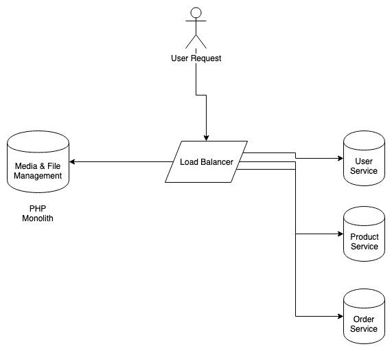
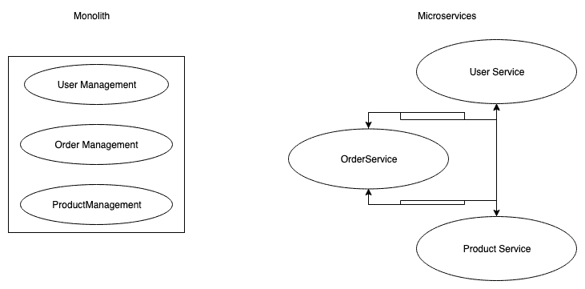

# 微服务简介

在第一章中，您将了解微服务的基础知识。过去几年来，微服务一直是一个新兴趋势，并特别受到初创公司和为增长而构建的项目的青睐。其吸引力在于它们被设计为可扩展的，同时也为程序员提供了极大的灵活性。读完本书后，您将能够使用 Swift 框架 Vapor 为应用程序和前端编写自己的微服务。本章将概述什么是微服务以及它们在 Web 开发中有何用处。

微服务是协同工作形成应用程序的小型、独立服务。与此相反，单体应用是指从一个不依赖其他服务的中央服务运行的应用程序。大多数传统的现成系统，如 WordPress 和 Drupal，都是单体应用。

微服务及其对应物单体应用都是现代 Web 开发的核心要素，在开始开发自己的微服务之前，您应该了解其使用的基本理论。您将在本章中专门探讨以下主题：

*   什么是微服务？
*   理解为何选择微服务
*   理解为何不选择微服务
*   谁在使用微服务？
*   单体应用与微服务的对比
*   从单体应用升级到微服务

读完本章后，您将做好准备开始着手微服务工作。

## 什么是微服务？

让我们快速定义一下使用术语*微服务*时的含义。

正如单词本身所透露的，*微服务*由*微*和*服务*组成。微比*小*更小。根据定义，微服务应尽可能小。另一个词*服务*，指的是微服务的功能：它应该为我们做些事情。在本书中——以及通常情况下——我们称它们为**微服务**，即 microservice 的复数形式。我们这样称呼是因为微服务通常与其他微服务协同工作。微服务应用程序由多个微服务协同工作并并行运行组成。

几乎所有主要参与者，如 Google、Amazon 和 Facebook，最初都是所谓的*单体*应用程序。这是什么意思？从本质上讲，单体应用是指作为一个大型代码库运行的应用程序。流行的例子包括 WordPress、Joomla!、Magento 和 Drupal；它们通常在一台前端服务器上运行，常使用 PHP。如果您需要扩展此类应用程序，您会添加更多执行相同操作的前端服务器；它们彼此是副本。

虽然这能解决需求问题，但还存在另一个问题：每当通过更改源代码更新网页时，单个错误就可能导致整个网页瘫痪。所谓*单体* Web 应用程序的主导 Web 技术主要是 PHP，有些使用 Java 和 Perl。直到今天，Wikipedia、Yahoo!、Facebook 和许多其他网站仍依赖 PHP。随着时间的推移，Python 和 Ruby 等额外的脚本语言也加入了竞争。然而，以下问题始终存在：更改源文件可能会引入 Bug 并导致整个网站瘫痪，因为每个 PHP 文件通常以某种方式与其他文件相连。随着公司的发展，它们采用了另一种方法，该方法已被证明对于持续增长和可维护性更加可靠。这种方法，*微服务*，包含的理念是 Web 应用程序不再由一个大型单体组成，而是被划分为*许多*协同工作的*独立*服务。

这种方法本身并不新鲜；物流公司也已为其结构实施了此类策略。但不断增长的互联网科技公司利用这种方法解决了其两个主要问题：

*   **可扩展性：** 扩展单个服务比扩展整个系统容易得多。
*   **可维护性：** 更改或调整某个服务时，不会影响其他服务，从而创建了一个整体更稳固、更稳定的系统。


现在，不仅总体方法发生了变化，编程语言领域也发生了变化。在 2000 年初，开发 Web 应用程序只使用几种语言，而现在我们有更多选择，例如 Swift、Go、Python 和 JavaScript。

就本书的所有意图和目的而言，让我们使用以下微服务定义：`microservice`（微服务）是一种小型服务，它与其他服务一起运行，并与其他服务共同构建应用程序。

# 使用微服务的规则

实际上并没有关于什么是微服务、什么不是微服务的官方定义；然而，以下规则通常适用于常用的微服务：

*   后端基础设施的一个小单元
*   尽可能独立运行（意味着不与其他微服务通信，或仅进行少量通信）
*   执行一项服务（例如处理数据或提供 API）
*   仅提供合理范围内尽可能少的功能
*   使用自己的数据库运行

最后一点至关重要，因为你可能会倾向于将所有数据保留在同一个数据库或同一个数据库服务器中。在开始阶段，对于小项目来说，将所有数据留在同一个数据库服务器上可能是一个可以接受的选择，但你绝不应该在多个微服务之间使用同一个数据库。

同样的原则也适用于通用代码或库；它们应该始终保持分离。你可能会开发一个共享的中心库；然而，这日后可能会成为一个问题。例如，Zalando 实施了一项严格的政策来禁止这样做（[`www.infoq.com/news/2016/02/Monolith-Microservices-Zalando`](https://www.infoq.com/news/2016/02/Monolith-Microservices-Zalando)）。

总之，微服务是业务逻辑中可能的最小、最隔离的单元，且是服务端应用程序所必需的。现在，让我们看看在什么情况下微服务是一个绝佳的选择！

# 理解为何选择微服务

让我们看看一些你可能想为应用程序选择微服务的原因。并非每个应用程序都应该使用微服务，正如你在下一节中将看到的那样。有非常明确的理由才值得使用微服务。让我们举个例子来论证为什么我们要选择微服务。

假设你想开发一个简单的电商应用。如果我们说一个应用中有三个不同的微服务元素：User（用户）、Product（商品）和 Order（订单）。该应用应涵盖以下功能：

*   User：登录
*   User：注册
*   User：修改地址
*   User：修改支付方式
*   Products：显示分类中的商品列表
*   Products：显示单个商品的详情
*   Order：提交商品订单
*   Order：提交订单支付

你当然可以将此类应用的后端开发为单体架构。它毫无疑问会是一个相当大的应用程序，并需要许多模型和控制器。但如果你用微服务开发同一个应用，你最终可能会得到三个更灵活的包，如下所示：

*   User Manager（用户管理）
*   Products Manager（商品管理）
*   Order Manager（订单管理）

现在，你可以享受使用微服务带来的以下好处：

*   高效的团队管理
*   可复用的代码库
*   灵活的功能范围
*   可维护性
*   可扩展性
*   混合技术栈

现在让我们深入了解这些部分中的每一个。

# 高效的团队管理

如果你曾经在一个团队中开发过较大的单体应用程序，你就会非常清楚它会变得多么混乱和无序。各种偏好、风格和思维方式通常混杂在一起，导致出现一个相当大的烂摊子。

使用微服务，你可以将不同的服务分配给不同的团队成员。在前面的例子中，如果你恰好是一个三人团队，你们每个人都可以开发一项服务。这种额外的效率不仅会在初期提高生产力，还会贯穿整个项目。

将工作量分散到多个独立协作的人员身上，对所有团队来说都是一个显著的好处。想象一下，你必须为一个大项目管理 500 多名程序员（想想 Facebook 或 Google）。如果每个人都使用同一个代码库，几乎不可能在较长一段时间内良好运作。如果应用程序被拆分成许多小微服务，你可以拥有许多 10 人团队分别负责各种服务。虽然这带来了它自己的挑战，但肯定会减少代码本身出错的可能性。

但即使你身处一个小团队，少数开发人员在开发微服务时也能体验到生产力的显著提升。

从本质上讲，微服务允许你在团队中有效地分散工作。

# 可复用的代码库

为了讨论方便，让我们假设你以前已经写过一个用户管理服务，现在可以再次使用它。使用微服务，你可以使用并复用你之前开发的任何给定服务。如果某个服务不完全适合你的情况，你可以直接修改它，而不是从头编写。

跨多个项目复用相同的代码可以为你节省宝贵的时间和资源。你甚至可能开始抽象地思考微服务，以便有目的地复用这些服务。你可以尝试定义一组适合多个项目的函数，以便在其他项目中复用。

让我们看看前面提到的用户管理服务。几乎所有与用户交互的应用程序都有登录功能。在大多数情况下，功能几乎完全相同，如下所示：

*   通过邮箱和密码登录
*   带邮箱验证的注册
*   忘记密码；发送恢复邮件
*   登出
*   删除账户

一旦你编写了这项服务，就可以轻松地在其他项目中实现它。

另一个类似的情况是当你选择 SaaS 解决方案进行用户管理时。示例包括 AWS Cognito、Auth0.com、Okta 和 Backendless。在这种情况下，微服务允许你轻松集成此类服务，从而节省编写用户管理解决方案的时间和精力。自然，同样的原则也适用于其他类型的服务。

总之，微服务允许你为新项目复用现有代码，节省时间和精力。接下来，让我们探讨功能范围。

# 灵活的功能范围

我们知道这个应用会增长，用户将需要更多功能。微服务非常适合这种情况，因为你可以简单地为功能添加更多服务，或修改你已有的服务。以之前的例子为例；你从一组非常易于管理且少量的功能开始。如果你知道这些是你永远需要的所有功能，那么不使用简单的单体方法就没有理由了。然而，现实是许多项目都在增长，无论是在用户数量方面，还是主要在于它们提供的内容方面。你可能决定增加产品功能或对其进行重大更改。

想象一下，你需要为你的网店添加一种新的支付方式。在单体架构中，你需要处理并部署整个应用程序，这伴随着风险。然而，在微服务中，如果你有订单管理服务，你可以简单地将支付方式添加到该服务并部署它，一切就绪。用户管理和商品管理服务无需被触动。

微服务允许你根据需要扩展功能，而无需触及软件的其他部分。

# 可维护性


# 为什么选择微服务

不仅当你的规格可能发生变化时，而且在需求高度明确的情况下，使用微服务都非常合理。微服务易于维护；每个服务都可以单独更新、升级和维护，而不会影响其他服务。对于大型应用程序来说，这一点尤为重要，因为它降低了潜在停机的风险和影响。

如果你服务大量用户，你会希望尽可能避免停机。因为微服务是独立的，你可以在不下线的情况下及时替换它们。稍后你将更详细地探索部署，但大多数云服务提供商都有现成的程序，可在切换服务时让你的应用程序 100% 保持在线。

此外，你和你的团队可以将精力集中在最需要的服务上。当一个服务正在进行大量更新时，其他服务可以保持原样。我曾参与过一个项目，其中的遗留微服务运行了两年多，因为它运行可靠，精力被投入到开发新功能而不是更新旧服务上。不过，你不应忽视更新系统的所有部分，但微服务允许你比单体架构更长时间地保留旧基础设施。

总之，微服务允许你在其他服务保持原状的情况下对其进行工作，从而赋予你专注于最重要事项的能力。

# 可扩展性

另一个需要考虑的因素是，你希望能够轻松地扩展和缩放你的应用程序。微服务可以说是服务端应用程序增长最容易的形式。请记住，我们有各个独立的服务在运行。原则上，这意味着同一个服务可以运行在许多实例中而不会有问题；例如，你可以让 100 台服务器运行同一个服务。或者，根据你的需求，它也可以仅作为单个服务运行。

让我们看看微服务在可扩展性方面具有的以下三个独特优势：

* 自动扩缩容
* 灵活的成本
* 面向服务的可用性

## 自动扩缩容

你可以让托管提供商根据你的需求自动扩缩容。预定义且可自定义的规则允许你定义并执行扩缩容。如果你即将进行一项营销活动（例如电视推广），你的后端将根据需求自动扩缩容，而无需你手动调整任何内容。

## 灵活的成本

这与自动扩缩容相辅相成。你可以根据需求为基础设施付费。在理想世界中，没有用户时你不付费，随着用户增加付费越多。现实中，这种情况很少如此完美发生；然而，在大多数情况下，你确实最终省下了钱，因为你不需要购买比你需要的更多的硬件。

## 面向服务的可用性

通常，并非每个服务的使用频率都相同。在前面的示例中，用户服务仅执行身份验证和注册。一旦用户获得授权，该服务对应用程序来说基本上就无关紧要了。你可能决定让邮件处理服务比用户服务具有高得多的可用性。

具体来说，这可能表现为五台服务器运行产品管理应用程序，而只有一台服务器运行用户和订单管理。随着你的应用程序增长和变化，你可以精确地调整此设置以满足你的需求。

因此，我们可以得出结论：微服务让你的应用程序能够轻松增长，并且你有许多选项来决定整个后端应用程序的运行方式。

# 混合技术栈

有时，你可能会发现自己处于这样一种境地：技术栈的一部分正在使用其他技术。你可能想用 Vapor 和 Swift 编写微服务，但拥有大量 PHP 基础设施。你可以利用微服务保留一些旧部分，同时开发新服务。你的设置将如下图所示：



在这种情况下，你的用户请求将被路由*要么*到（旧的）PHP 单体媒体与文件管理服务，*要么*到你的新 Vapor 服务。你的旧单体实际上本身变成了一个微服务，尽管它极有可能涵盖的功能比你希望的要多。但决定采用微服务允许你整合你可能依赖的软件，即使它是用完全不同的语言编写的。

如果你想知道前面的示例在现实生活中是什么样子的，大多数微服务都是在*容器*（例如 `Docker` 容器）中运行的。这些容器作为微型服务器运行，并且完全隔离。因此，即使只有一台实际的硬件服务器，你也可以使用本地负载均衡器（如 `nginx`）来实现前面的场景。

因此，微服务允许你在已使用较新部分的同时整合基础设施的旧部分。

# 理解为何不选择微服务

你已经看到了选择微服务的几个理由。现在，让我们看看不选择微服务的理由。与所有事物一样，微服务的优势也是其劣势。虽然本书是关于编写微服务的，但你不应认为微服务是解决所有问题的答案。有很多例子说明微服务实际上是某些问题的错误选择。以下是一些不选择微服务的理由列表。

## 初期工作量更大

你不想选择微服务的第一个也是最明显的原因是，它通常在初期需要更多的工作。建立整个系统、连接服务并让它们全部按你需要的方式运行，通常比单体应用程序需要更多的工作。

这始于建立一切并构建一个工作环境。单体应用程序只需要你运行该应用程序。所以，一旦你启动主应用程序，就万事大吉了。

然而，微服务应用程序需要一种设置，即多个应用程序同时运行。或者，你可以设计你的应用程序从静态文件接收测试数据；然而，这不能替代与实际服务进行的测试。在部署情况下，你可以轻松实现这种设置；云提供商在这方面帮了我们大忙。然而，当你开始开发时，建立所有东西可能需要大量工作。在下一章中，你将建立自己的工作区。

此外，微服务需要规划。你无法像在单体应用程序中那样快速执行某些更改。如果你只是为你的后端构建一个简单的概念验证，你最好从单体开始。如果你需要实现一些在时机上至关重要的东西，微服务可能不是你的最佳选择。

因此，在使用微服务时，一个值得记住的好经验是：微服务需要一些规划，并且通常启动时间更长。

## 复杂性增加

开发单体应用程序时，你通常将所有内容放在同一个代码库中。只要项目很小，缺乏复杂性就会使你更容易维护它。额外的功能和更改可以用你一直在使用的相同技术栈、语言和框架来实现。

另一方面，微服务可能会更复杂（甚至混乱）。添加新功能并不总是微不足道的，可能需要更改多个服务。服务本身也可能有不同的技术栈。你可能有一个运行 PHP 的遗留服务，结合另一个应用部分的 Swift Vapor 服务。添加功能要求你同时在 PHP 和 Swift 中工作。

如果你确切了解项目的范围且不预期有任何变化，就没有理由不像单体应用程序那样实现它。


与 PHP 等传统技术相比，微服务会增加项目的复杂性，这一点你应当铭记在心。不过，无论编程语言如何，大多数微服务技术也都存在这种情况。现在让我们来看看故障排查与调试。

# 调试与故障排查

调试与故障排查是你需要考虑的另一个问题。调试单个应用程序比调试两个或更多微服务更快、更容易。**调试**与复杂性息息相关；在单体应用中能快速发现的 Bug，在微服务中不会被那么快地找到。事实上，这个话题重要到足以让本书专门用一整章来讲述。

如果你处理的应用程序范围有限，且功能预计不会增长，那么单体方法可能比微服务方法更好。话虽如此，我亲眼见过许多项目以“小而易管理”起步，非常适合单体应用。但随后它们不断发展，优势迅速转变为严重的问题。如果你认为所有应用程序都应适应增长，请采用微服务方法。

查找 Bug 可能需要更多时间。因为服务之间通常以某种方式相互连接，所以很难将一个症状归结为某个具体的 Bug。我见过一个小小的症状竟源于许多不相关的错误。

总之，调试微服务后端比单体应用更复杂、更耗时，但使用微服务也有巨大的好处。这就是为什么我们将看一份使用微服务并已从单体架构迁移出去的公司名单。

# 谁在使用微服务？

在了解了微服务的优缺点后，让我们看看谁在使用它们。以下示例并非详尽无遗，而是着眼于现代 Web 应用程序进行选择的。如果你想开发一个有潜力像 Netflix 那样变得庞大的应用，为什么不看看它们是如何成功运作的呢？

## Amazon

得知 Amazon 是最早利用互联网并实施微服务的大公司之一，这可能不足为奇。Amazon 和许多其他公司一样，最初是一个庞大的单体应用。随着业务增长，公司雇佣了更多程序员来开发该应用。正如你所想象的，上百名开发人员同时在同一个代码库上工作，最终必然会导致混乱和冲突。这发生在 2000 年前后；当时许多现代工具（如 Git）远不如今天先进。那时，Amazon 开始将大型应用拆分为更易管理、更易使用的子单元，称为微服务。

Amazon 现在每 11.7 秒就部署一次（[`blog.newrelic.com/technology/data-culture-survey-results-faster-deployment/`](https://blog.newrelic.com/technology/data-culture-survey-results-faster-deployment/)）。尽管面临让数百名开发人员在平台上协作的挑战，Amazon 还解决了另一个问题：增长。因为 [amazon.com](http://amazon.com) 作为微服务应用运行，所以零停机。Amazon 可以承载任意数量的访问者，因为系统在自我管理。

顺便说一句，Netflix、Uber 和许多其他公司正在使用 **Amazon Web Services** (**AWS**)。Amazon 不仅为自己开发了概念和基础设施，还将其出售给其他人，以便他们获得同样的收益。

另一个值得注意的点是，无论公司规模大小，Jeff Bezos 始终主张小团队。他声称团队规模不应超过两个披萨能喂饱的人数（[`blog.idonethis.com/two-pizza-team/`](http://blog.idonethis.com/two-pizza-team/)）。如前所述，将工作分散给多个人也适用于大公司：保持团队精小能提高效率。

## Netflix

Netflix 与 Amazon 类似，过去也是一个巨大的单体应用。就像 Amazon 一样，Netflix 将其拆分为许多微服务以适应增长。现在，Netflix 每天部署数千次。

其 API 的图形化展示可在以下链接找到：[`www.slideshare.net/adrianco/netflix-velocity-conference-2011/43-API_AWS_EC2_Front_End`](https://www.slideshare.net/adrianco/netflix-velocity-conference-2011/43-API_AWS_EC2_Front_End)

你可以看到各个组件如何协同工作以提供快速的内容分发。与 Amazon 类似，Netflix 也面临着开发和增长方面的挑战。使用微服务使其能够同时解决这两个问题。

现在，Netflix 每天为超过 1.3 亿个账户提供服务，观众可能多达 4 亿（[`www.cheatsheet.com/entertainment/how-many-people-use-netflix.html/`](https://www.cheatsheet.com/entertainment/how-many-people-use-netflix.html/)）。这些数字足以说明精心设计的微服务架构有多强大。

底线是，Netflix 是全球访问量最大的网站之一，它的做法可以教会你如何服务那么多用户。

## Uber

基于 Python 的 Flask 是 Uber 单体应用的基础。随着时间的推移，它用更小的 Python 和 Go 服务重写了整个逻辑。这不仅让 Uber 能够根据需求优化服务，还利用了为服务的特定部分使用另一种技术的能力。通过使用 Go，Uber 能够提高其发现层的性能。

Uber 花费数年时间才很好地利用微服务，Matthew Mengerink 关于完全集成到云端说道：

“我们预测完全集成到云端并让平台配合优秀工具周全运行，将需要两年时间。”（[`eng.uber.com/core-infra-2018/`](https://eng.uber.com/core-infra-2018/)）

请注意，Uber 拥有数万名员工和数千名开发人员在为其基础设施工作。这个例子应该能让你看到，即使有大量工程师，要有意义地引入微服务也可能需要很长时间。

总之，即使像 Uber 这样的大公司也需要足够的时间来妥善完成向微服务的过渡。

## 许多其他公司

微服务不仅限于拥有海量用户的大公司。正如你在微服务理由列表中所读到的，即使你刚开始开发应用程序，也可以选择微服务。与其在长远来看选择更快或更昂贵的方案，不如一开始就以终为始，这通常更容易。

除了前面列出的公司，以下公司也已知在使用微服务：

*   康卡斯特有线: [`qconnewyork.com/ny2015/ny2015/presentation/partial-failures-microservices-jungle-survival-tips-comcast.html`](https://qconnewyork.com/ny2015/ny2015/presentation/partial-failures-microservices-jungle-survival-tips-comcast.html)
*   eBay: [`www.addsimplicity.com/downloads/eBaySDForum2006-11-29.pdf`](http://www.addsimplicity.com/downloads/eBaySDForum2006-11-29.pdf)
*   SoundCloud: [`developers.soundcloud.com/blog/building-products-at-soundcloud-part-2-breaking-the-monolith`](https://developers.soundcloud.com/blog/building-products-at-soundcloud-part-2-breaking-the-monolith)
*   Karma: [`blog.yourkarma.com/building-microservices-at-karma`](https://blog.yourkarma.com/building-microservices-at-karma)
*   Groupon: [`engineering.groupon.com/2013/misc/i-tier-dismantling-the-monoliths/`](https://qconnewyork.com/ny2015/presentation/microservices-and-art-taming-dependency-hell-monster)
*   Hailo: [`sudo.hailoapp.com/services/2015/03/09/journey-into-a-microservice-world-part-1/`](https://sudo.hailoapp.com/services/2015/03/09/journey-into-a-microservice-world-part-1/)


*   Gilt: `https://qconnewyork.com/ny2015/presentation/microservices-and-art-taming-dependency-hell-monster`
*   Zalando: `http://www.infoq.com/news/2016/02/Monolith-Microservices-Zalando`
*   Capital One: `http://www.capitalone.io/blog/why-capital-one-is-at-aws-re-invent-2015/`
*   Lending Club: `http://neo4j.com/blog/managing-microservices-neo4j/`
*   AutoScout24: `http://www.infoq.com/news/2016/02/autoscout-microservices`

关于有多少小公司在使用微服务，并没有明确的统计数据。以下列表包含一些我个人认识其运营人员、且确知他们正在使用微服务的项目：

*   Fuelish (`www.fuelish.de`)
*   ReviewSender (`www.reviewsender.com`)
*   MyParkplatz24 (`www.myparkplatz24.de`)
*   Vapor Cloud (`https://vapor.cloud/`)

此处提到的大多数公司规模很大，服务大量用户。你很可能不处于面临相同问题的境地；不过，你已经可以从这些公司身上学到经验，以避免犯同样的错误。以下是关键要点：

*   微服务被拥有大量用户的公司广泛采用。
*   微服务的构建不仅是为了可扩展性，也是为了内部管理。
*   微服务会使系统变得复杂。
*   许多大公司最初是从单体应用起步，后来才转型为微服务。

在本节中，你了解了一些使用微服务的大型企业及其决策原因。别忘了，它们几乎都是从 1-3 人的小团队和单体系统起步的。如果你希望应用能快速高效地增长，微服务不会让你失望。现在，让我们直接对比单体应用与微服务。

# 对比单体应用与微服务

让我们花点时间对比一下单体应用与微服务应用。下图展示了微服务与单体应用最明显的区别：单体应用是将所有功能集于一身，而微服务则被拆分成不同的部分：



如你所见，最明显的区别在于单体应用是*一个*代码库。所有代码都在同一个项目中并相互关联。相比之下，微服务则是松散且独立的，但通常协同工作。

在以下小节中，我们将对比凸显微服务与单体应用差异的几个概念：

*   可复用的代码库
*   多版本在线
*   零停机
*   更新速度可快可慢，按需而定
*   常见微服务用例

让我们先来看看可复用的代码库。

## 可复用的代码库

这一概念在单体应用和微服务中都存在。对于单体应用，它通常被称为*插件*或*模块*。许多常用平台大量利用这一概念。例如 WordPress、Magento、Drupal、Redmine 和 Wikimedia。许多网站利用插件来扩展底层单体系统的核心功能。

其基本原则是在多个用例和项目中使用同一代码库。然而，对于单体应用，该系统的所有元素都必须使用同一种编程语言。例如，WordPress 插件必须用 PHP 编写，就像 WordPress 本身一样。与此相反，微服务可以使用多种编程语言。你可以用 PHP 编写一个服务，用 Swift 编写另一个服务——它们依然能完美协作。

在单体应用中，所有部分相互依赖。如果一部分失效，所有其他部分都可能受到影响。例如，一个有缺陷的插件可能导致整个网站在某些或所有页面无法加载。微服务可以处于不同阶段且不受其他服务影响。此外，一个非运行状态的服务不会拖垮整个系统。同时，对于精通某种编程语言和框架的人来说，在同一系统中处理另一部分可能会困难得多。单体应用可能更容易维护。

两种方法都允许你复用代码；然而，微服务更加灵活，允许你将多种语言和版本结合使用，而单体应用则不行。接下来，我们将看看微服务的另一个特性：多版本在线。

## 多版本在线

你可以同时运行同一微服务的两个版本。例如，如果你的用户群正在使用旧版 API，你可以为他们保留旧服务。特别是在更新应用时，往往并非所有用户都能在第一时间更新到最新版本。

为了让客户端/用户区分服务的不同版本，通常使用 URL 标识符，例如 `https://api.domain.com/v1/users` 对比 `https://api.domain.com/v2/users`

注意 URL 中包含版本字符串。小小的 `v1` 表示我们想要这个 API 服务的特定版本。我们可以运行该服务的第二个版本，使用 `v2` 作为标识，并返回不同的返回码。

当然，你也可以用单体应用实现相同的结果；但在单体应用中，你不需要部署整个应用的两个版本，只需部署这一特定服务即可。

微服务让你无需维护整套旧基础设施即可保留遗留版本。让我们看看微服务如何实现零停机。

## 零停机

如前所述，大多数托管服务商提供一些 `Continuous Integration` (`CI`) 工具，以将停机时间降至最低。其原则是先启动服务的新版本，然后再部署。一旦新版本启动并运行，负载均衡器就会将流量导向新服务。一旦新服务完全正常运行，旧服务就会关闭。其效果是用户感知不到任何停机时间。

单体应用也可以做到这一点；然而，这需要更多的工作量、精力和服务器资源来运行整个应用的第二个完整实例。如果平均流量需要 100 台服务器，采用这种方法部署时你需要两倍数量的服务器。使用微服务，你只需部署相关服务，同时仅产生极小的服务器开销。别忘了，大多数大型更新通常还需要一些数据库调整。

单体应用几乎总是为整个项目使用同一个数据库。即使你以两个版本同时存在的方式部署单体应用，在数据库层面实现这一点也复杂得多，尤其是在数据持续添加或修改的情况下。另一方面，每个微服务使用自己的数据库，你只需处理正在更新的那个数据库。

当微服务允许你零停机更新时，其效率最高，这引出了下一个话题：更新速度可快可慢，按需而定。

## 更新速度可快可慢，按需而定

你可以仅更新想要/需要的服务，从而分阶段推出更新。特别是对于年轻公司和初创企业，需求不明确且频繁变更是常态。随着变更和新功能的到来，你可以逐步更新后端。在许多情况下，添加功能等同于添加新服务。


# 常见微服务用例

例如，如果你有一个社交媒体应用，并且想要提供评论帖子的功能，你只需添加一个评论服务。该服务只负责记录内容上的评论。

如果随后你被要求为应用添加“回答”功能，它可以是评论服务的一个扩展。该功能也可以是一个全新的独立服务。无论哪种方式，添加这些功能都完全不需要触及后端的其他部分！

总之，微服务允许逐步进行功能扩展。最后，让我们探讨常见的微服务用例。

以下是微服务常见用例的一个简短、非详尽的列表：

- 认证
- 个人资料管理
- 地址验证
- 邮件处理
- 支付处理
- 社交媒体流媒体
- 订单管理
- 内容管理

该列表可以通过添加更多用例来扩展。你可能会好奇这些小功能片段如何能像一个应用一样运作。下一节将介绍如何将单体架构升级为微服务，并解释如何划定服务边界。

微服务是仅执行一两个功能的服务。

# 从单体架构升级到微服务

从单体架构升级到微服务，本质上是不断用新的微服务替换旧应用的各个部分。虽然本节讨论的是升级单体应用，但也可以将其视为全新应用的规划步骤。你将看到如何在概念上将单体架构升级为微服务；此处不涉及代码，因为你将在本书后面更深入地看到这一点。然而，读完本节后，你应该能理解其背后的概念。

它们可能不完全适合你的特定应用，但在单体应用中普遍存在。这种方法被称为**模型-视图-控制器**（**MVC**）。该方法的组件定义如下：

- 模型代表一种数据类型的实例，例如 `User`、`Product` 和 `Order`。
- 控制器代表一个逻辑执行器，通常接收输入并以序列化模型的形式返回输出，例如 `UserController`、`OrderController` 和 `ProductController`。
- 视图代表来自控制器的输出，通常是 HTML、XML 或 JSON。

许多当前的 Web 技术都是建立在 MVC 概念之上的，例如：

- PHP (Laravel, Symfony, and Zend Framework)
- Ruby (Ruby on Rails)
- Java (Spring MVC and Vaadin)
- Go (Revel and Iris)
- Python (Django)
- Swift (Vapor, Kitura, and Perfect)

**注意**：此处提到的大多数框架也允许你放弃 MVC 模式。

现在的目标是将 MVC 应用转换为微服务应用。

让我们浏览以下章节：

- 解耦业务逻辑
- 重组你的单体应用
- 集成微服务

我们从解耦业务逻辑开始。

## 解耦业务逻辑

我们首先分离业务逻辑。你的应用在做什么？从涉及哪些方面的角度来回答这个问题。对于一个在线商店应用，答案如下所示。

### 应用做什么？

应用执行以下操作：

- 接收订单
- 处理订单
- 退货
- 创建商品
- 更新商品
- 删除商品
- 接受订单的信用卡支付
- 接受订单的 PayPal 支付

你可以根据喜好尽可能详细地列出此清单；这不是微服务的最终清单。然后你将使用此清单来识别通用组件。

### 通用组件有哪些？

通过查看前面的清单，我们可以轻松判断我们正在处理以下组件：

- 订单
- 商品
- 支付

该清单现在更接近我们希望微服务为我们定义的内容。你可能仍决定合并该清单中的一两个条目，但现在你可以看到哪些微服务对你最合理。

你希望以一种便于移除其功能部分并用微服务替换的方式来重组你的单体应用。

## 重组你的单体应用

你很可能无法（或不想）一次性更新整个应用。根据项目规模，此过程可能需要数周、数月甚至数年才能完成。如果你计划一次性将整个单体应用替换为微服务，可以跳过此步骤。像 Facebook 这样的公司在保留部分旧技术栈的情况下，花费了许多年完成此过程。然而，即使你打算保留部分旧单体应用，仍需对其进行调整以适配微服务。需要调整的两个主要领域是认证和业务逻辑。

### 使用认证

微服务通常不使用共享会话模型进行认证，而这是单体应用中普遍采用的模型。无论你当前使用哪种模型，你的微服务以及单体应用都需要与之交互。一个非常常用且广泛采用的标准称为 **JSON Web Token**（**JWT**）；它允许微服务对请求进行认证。

你需要修改单体应用以使其能与微服务通信。除了 JWT 还有其他方式，但考虑到其优势和普及度，我建议你使用它们。从本质上讲，JWT 具有以下特征：

- 自包含（无需中心化验证）
- 广泛采用（每个框架都有相关库）
- 易于调试和排查故障
- 一种允许轻松实现安全性的概念

JWT 本身既不安全也不是最佳选择。然而，它们提供了一个良好的起点，且通常足够好。如果你正在为银行等高安全性应用开发，则不应使用 JWT。

你也可以使用“共享会话”令牌代替 JWT；原则保持不变：你的单体应用以及微服务都需要能够验证请求。

### 调整业务逻辑

一旦你的单体应用能与微服务通信，你就可以开始分离业务逻辑。一个组织良好的单体应用可能已经做到了这一点。例如，如果你使用控制器，你希望针对前面的示例得到以下结构：

```
OrdersController
ProductsController
PaymentsController
```

你希望最终形成一种分离业务逻辑的结构，原因在于你可以随后逐个替换每个组件。

因此，调整你的单体应用以与微服务通信，并将其拆分为易于被微服务替换的形式。

## 集成微服务

现在你已处于可以引入微服务的阶段。每个微服务应代表一段业务逻辑，并应尽可能保持独立。鉴于你已按前一步所述组织好控制器，你现在将能够创建以下微服务：

```
Orders Manager
Products Manager
Payment Manager
```

你可以根据实际情况和进度替换服务。以允许用服务替换控制器的方式优化你的单体应用，将使这一过程变得轻松愉快。

在本节中，我们学习了如何通过解耦业务逻辑、重组单体应用，最后集成微服务，来实现将单体应用集成到微服务中的方法。让我们总结本章！

# 总结


# 第 1 章总结：微服务基础

在本章中，你学习了微服务的基础知识。在给出定义后，你探讨了什么是微服务以及它是如何运作的。你了解了使用微服务的理由以及不使用微服务的理由。在了解了当前使用微服务的主要参与者后，你看到了单体应用和微服务应用的详细对比。最后，你学习了如何从概念上将单体应用升级为微服务应用。本章为本书的其余部分奠定了基础。

为了确保你理解迄今为止的概念，请阅读以下问题并尽力回答。你必须能够回答所有这些问题，否则本书的其余部分对你来说将毫无意义。

在下一章中，你将了解更多关于服务端 Swift 的现状，以及为什么它是后端应用的绝佳选择。

## 问题

为了检验你对微服务的理解，请阅读以下问题并作答。你可以在本书的附录中看到示例答案：

1.  什么是微服务，它的定义是什么？
2.  列出微服务有益的三个理由。
3.  列出不选择微服务的三个理由。
4.  列出单体架构和微服务架构的四个区别。
5.  绘制本章示例在线应用的基础设施图。
