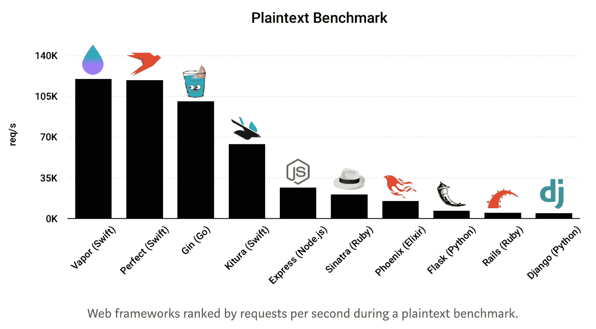

# 第 2 章：理解服务端 Swift

Swift 是一门非常年轻的语言，因为它刚于 2014 年发布。它被设计为一种语法简单但功能强大如 C 语言的语言。在本章中，你将了解为什么 Swift 在开发服务器应用程序时是一个绝佳的选择。Swift 作为一种全新的替代方案，区别于所有现有的成熟解决方案。

本章将向你介绍 Swift 的*服务端*；假设你已经熟悉 Swift 语言本身的基础知识。首先，你将把 Swift 视为一种通用语言，并了解为什么它非常适合服务器领域。随后，我们将对比 Swift 与其他 Web 技术的性能表现。回顾服务端 Swift 的现状并介绍 Swift 5 的新特性将作为本章的总结。

本章将涵盖以下主题：

*   Swift 快速回顾
*   Swift 性能
*   服务端 Swift
*   Swift 5 的特性

读完本章后，你将做好充分准备，开始使用 Swift 进行应用开发。

## 技术要求

你需要安装并运行以下软件组件：

*   `Vapor Toolbox`
*   `Swift 5`
*   `XCode` (11+)
*   `macOS` 或 `Linux`

我们假设你使用的是 `macOS`，但所有内容在 `Linux` 下也应以相同方式工作。

你可以在以下 Git 仓库中找到本章的所有代码：[`https://github.com/PacktPublishing/Hands-On-Swift-5-Microservices-Development/tree/master/Chapter 2`](https://github.com/PacktPublishing/Hands-On-Swift-5-Microservices-Development/tree/master/Chapter%202)

## Swift 快速回顾

要用 Swift 编写服务器应用，我们需要了解 Swift 的来龙去脉，以及它如何融入服务器语言的世界。Swift 由 Apple 工程师发明，旨在作为 C 语言衍生语言（例如 `C++`、`Objective-C`、`Objective-C++`）的替代品。在最初将 Swift 保持为专有语言后，Apple 随后将 Swift 作为开源语言发布，支持 `macOS` 和 `Linux`。你可能会好奇，为什么 Apple 要费心让 Swift 在 `Linux` 上可用，因为 Apple 通常不发布任何 `Linux` 产品（甚至没有 `iTunes`）。

Swift 从一开始就被设计为原生语言。这意味着应用程序被编译成直接在处理器上运行的二进制代码，这是应用程序运行的最快方式。

当 Apple 为 `Linux` 发布 Swift 时，应用场景很少。UI 仍然只能在 Apple 设备上运行，但大部分核心框架，特别是 `Foundation`，已在 `Linux` 上可用。这些框架为早期的 Web 框架打开了大门，它们采用 Swift 并将其连接到 C 库，从而允许 Swift 代码作为 Web 服务器运行。

`Perfect` 框架是第一个实现这一点的框架。2016 年 9 月，Tanner Nelson 编写了 `Vapor` 框架的第一个版本，它松散地基于 `Laravel` 框架（`PHP`）。2017 年 5 月，`Vapor 2` 发布，它是第一个不依赖 C 库来提供 Web 服务器功能的 Swift 框架。与此同时，`IBM` 开始着手 `Kitura`，这是另一个允许将 Swift 用于 Web 应用程序的框架。

2018 年初，Apple 发布了 `SwiftNIO`，这是一个用于 Swift 的网络库。如果你熟悉 `Netty`（`Java`），可以把它理解为“Swift 版的 Netty”。简单来说：`SwiftNIO` 提供了一个非常基础的框架，用于网络和文件操作，例如打开连接、发送数据、接收数据、发送流、读取流等操作。

通过发布 `SwiftNIO`，Apple 现在为开发者提供了一组用于开发服务器应用程序的基本功能。`SwiftNIO` 和 Swift 一样，也发布了 `Linux` 版本。

虽然 Swift 目前仅发布了 `macOS` 和 `Linux` 版本，但针对 `Android`、`Windows` 和其他平台的 Swift 和 `SwiftNIO` 正在开发中。虽然 Apple 未宣布任何支持计划，但作为开源项目，Swift 和 `NIO` 无疑可以在其他平台上变得更加成熟。`Linux` 上的 Swift 可在所有可用的 `Linux` 发行版上运行，尽管只有 `Ubuntu` 受官方支持。

让我们在其他编程语言的背景下简要回顾一下 Swift 的历史。

### 从 Fortran 到 Swift

在本节中，我们要回顾 Swift 的发展历程，从一门非常古老的编程语言 `Fortran` 到 Swift。

下图及其旁边的时间线很好地突出了 Swift 如何融合了众多语言的优点：


（来源：[`http://rigaux.org/language-study/diagram.html`](http://rigaux.org/language-study/diagram.html)）

显而易见，Swift 受到了 `Rust`、`Ruby`、`Python`、`Haskell` 和 `C#` 的影响，这使它成为一门非常现代的语言，借鉴了其他语言中一些最受喜爱的特性。

现在，我们了解了 Swift 的历史及其在编程语言世界中的地位。接下来，让我们看看 Swift 与其他流行 Web 技术相比的性能表现。

## Swift 性能

Swift 面临着大量框架和语言的竞争。有人可能会争辩说，性能只是选择技术时应考虑的众多因素之一。虽然这无疑是真的，但请考虑一下：你希望以一种技术不会太大程度阻碍你的方式来构建项目。`Facebook` 和 `Uber` 都花费了数年时间重建和重构他们的基础设施。无论你选择什么技术，你很可能也会重构你的应用程序。然而，选择一个能让你优雅地完成重构的技术栈至关重要。

本节本可以展示一些原始基准测试，但我认为更深入地分析项目整体性能的真实面貌更有意义。在将 Swift 与竞争对手进行比较时，你希望尽可能保持客观公正；以下比较试图客观地评估情况，并尽可能贴近现实世界。

几乎任何网站都可以用任何可用的语言运行。问题通常不是“可能吗？”，而是“适合我们吗？”。在某些情况下，速度和性能比便利性更重要。在其他情况下，则恰恰相反。

让我们简要深入了解以下类型的语言：

*   脚本语言：`PHP`、`Python`、`Ruby`、`JavaScript` 等
*   虚拟机语言：`Java`、`.NET` 和 `Scala`


原生语言：`Go`、`C`、`Rust` 和 `Swift`

随后，你将看到 `Vapor`（最流行的 `Swift` 框架）的一些指标。

# 脚本语言

脚本语言不会被编译成原生二进制文件，而是即时解释执行。因此，发送到服务器的每个请求都会被单独处理且大多相互隔离。随后，服务器会调用语言解释器来处理请求的文件（例如 `index.php`）。每次调用脚本时，服务器程序都需要重新启动。自然地，这并不是响应请求的最快方式。

多年来，人们发明了许多加速此过程的机制。它们本质上都在尝试做以下几件事：

*   缓存解释后的代码。
*   整体缓存各种输出和输入。
*   减少开销量。

这些语言的许多优化仅仅是缓存已编译的内容，然后在适当的时候从缓存中返回。这种方法原则上没有错，但它使得性能比较变得困难。在评估应用程序的纯速度时，你想要假设最坏的情况，即缓存为空。缓存可以稍后添加——甚至可以添加到一个已经很快的应用程序中。

最流行的脚本语言包括 `Ruby`、`Python`、`PHP`、`JavaScript` 和 `Typescript`。它们都有各种环境和解释器，其中一些比其他的快。它们共有的特点是天然不会被编译成二进制代码，因此在性能上必然会落后于原生语言。另一方面，它们拥有丰富的社区，并因其简洁性而赢得了众多拥趸。

让我们看看一些处理脚本语言的网站的真实案例。

## Facebook

Facebook 最初完全使用纯 `PHP`，十多年来开发出了自己的 `PHP` 风格服务器 `Hack`。`Hack` 最初是尝试将 `PHP` 编译成原生二进制文件。然而，由于 `PHP` 程序不可预见的内部结构（动态变量、不一致性等），这一尝试失败了。`Hack` 最终变成了一个经过修改以适应 Facebook 内部需求的 `PHP` 版本。不过，`Hack` 现在是作为 `虚拟机` (`VM`) 运行的，而不是作为原生应用程序。

Facebook 的理由是：它希望保持其依赖项和现有库的运行，同时提高性能。虽然 Facebook 表明脚本语言确实可以变得非常高性能，但也显示了 Facebook 随着时间推移对 `PHP` 的不满程度。

## Twitter

Twitter 和 Facebook 一样，最初是一个单体应用程序。它是用 `Ruby-on-Rails` 编写的。然而，流量的增加导致 Twitter 使用 `Java 虚拟机` (`JVM`) 完全重写了其后端，这意味着使用了 `Java`、`Scala` 和 `Clojure` 等编程语言。Twitter 还特别将微服务架构归功为其满足流量需求的前进道路的一部分。

阅读 [`www.slideshare.net/caniszczyk/twitter-opensourcestacklinuxcon2013`](https://www.slideshare.net/caniszczyk/twitter-opensourcestacklinuxcon2013) 以获取有关 Twitter 技术栈的更详细信息。

## Uber

Uber 目前已将关键服务从 `Python` 迁移到了 `Go`。在这种情况下，部分原因是为了性能，但方式不同于 Facebook 受影响的方式。Uber 需要*部分*服务非常快，具体来说是实时位置更新。Uber 选择 `Go` 是因为它能获得更好的性能。

有趣的是，大玩家们已经开始将其部分服务从脚本语言迁移到原生语言。

接下来让我们探索 `VM` 语言。

# VM 语言

此类别中最常用的语言是 `Java`。`JVM` 拥有作为企业级 Web 技术的长期记录。另一方面，微软的 `.NET` 允许你用多种语言编写代码；通常 `C#` 是服务器应用程序中最常见的一种。

`Scala` 介于 `JVM` 和 `.NET` 之间——它是一种较新的语言，可以编译成 `.NET` 或 `JVM` 字节码。

`VM` 语言的优势在于它们是预编译的。它们不像脚本语言那样即时解释，而是预编译成特定于 `VM` 的字节码，然后在 `VM` 上运行。这带来了良好的性能提升。

Apple、IBM 和 LinkedIn 是三个在其大量基础设施中使用 `Java` 的例子。

因为 `VM` 代码运行在实际的 `VM` 上，且引擎是操作系统之上的额外层，`VM` 通常需要大量 `RAM` 才能平稳运行。即使对于相对简单的应用程序，`JVM` 运行在数 GB 的 `RAM` 上也非常常见。

阅读 [`people.cs.umass.edu/~emery/pubs/gcvsmalloc.pdf`](https://people.cs.umass.edu/~emery/pubs/gcvsmalloc.pdf) 以获取有关 `JVM` `RAM` 使用的更多信息。

# 原生语言

`Swift` 是一种编译成原生应用的原生语言！`C` 和 `C++` 也是。`C`（和 `C++`）不可避免地是最快的语言，因为它非常接近机器码（汇编语言除外）。许多脚本语言直接挂钩 `C` 正是出于这个原因。`Node.js`、`PHP` 和 `Python` 经常直接利用 `C` 函数，这些函数将永远非常快。自然地，纯 `C` 服务器将是你能开发出的最快的服务器。

那么，为什么不把服务器写成 `C` 呢？原因在于 `C` 在内存泄漏方面既不方便也不安全。在 `C` 中编写良好的内存安全程序很复杂（有人说是不可能的）。对于 Web 项目，这个问题导致了 `Go`（有时称为 `Golang`）、`Rust` 和 `Swift` 的诞生。这三种语言的发明初衷都是在保持 `C/C++` 性能的同时获得更好的内存安全性。

`Go` 和 `Rust` 保留了大部分类 `C` 的函数式风格，而 `Swift` 则从 `Java` 等面向对象语言以及 `Ruby` 和 `Python` 等脚本语言中汲取了灵感。这三种语言都编译成原生代码，这意味着它们默认比其他两类语言运行得更快。没有明确的指标表明这三者中有任何一个比其他的快。一个优秀的程序员可能在任一语言中创建出性能相当的程序。

所有三种语言都已被主要参与者采用于关键性能任务。对于 `Swift`，将其用于 Web 服务的大玩家包括：

*   Apple
*   IBM
*   Mercedes
*   Audi

`Swift` 让大公司感到兴奋的主要原因是，原生应用程序留下的 `RAM` 占用空间小得多。想象一下，如果你能达到相同的结果，但只需要 25% 的硬件，会有什么不同。

# 比较框架

如前所述，比较语言并不容易，更不用说框架了。一个框架在做一项工作时可能极快，而在另一个场景下却完全慢。以下指标是在 `Vapor 3` 和其他一些框架上记录的。请谨慎参考，并且随着技术的不断发展，不要将它们作为硬性数字，因为任何软件更新都可能改变平衡：



（来源：[`medium.com/@codevapor/vapor-3-0-0-released-8356fa619a5d`](https://medium.com/@codevapor/vapor-3-0-0-released-8356fa619a5d)）

图表显示了所有三个 `Swift` 框架与其他知名框架相比表现良好。你可以看到，除 `Go` 外，`Swift` 框架显著超越了其他框架。脚本语言表现不佳，因为它们不是原生编译的。性能的关键在于 `Swift` 原生编译并可直接在处理器上运行。

我们已经了解了框架和 `Swift` 的整体性能，现在让我们看看一些具体的 `Swift` 特性。

# Swift 的特性

以下是使 `Swift` 成为服务器开发极具吸引力选择的所有因素的总结：

*   一种采用现代范式构建的现代语言


*   原生语言，具备原生性能
*   极低的内存占用
*   对 Linux 友好
*   通用性强，也可创建其他操作系统的应用

总体而言，Swift 凭借其原生设计和低内存占用，提供了最显著的性能优势；尽管在某些特定情况和方式下，其他语言比 Swift 更快。现在让我们探索一下 Swift 在服务端的样子。

# 服务端 Swift

在服务器上运行 Swift 应用程序是什么样的？当 Swift 作为开源发布时，它也立即发布了 Linux 版本。具体来说，Swift 倾向于 Linux 发行版 Ubuntu。托管 Swift 应用程序与传统的 Web 托管截然不同。如果你从 GoDaddy 等公司获取 Web 托管套餐，你不会看到它们宣称“运行 Swift 5”。大多数主流 Web 托管商仅提供脚本语言支持。理由很简单：

*   大多数应用程序使用脚本语言。
*   脚本应用程序可以共享同一台服务器。

另一方面，Swift 作为一种原生语言，*就是*实际的 Web 服务器本身。这意味着你的 Swift 应用程序直接响应传入的请求。让我们看看服务端 Swift 的以下几个方面：

*   自包含服务器
*   Linux/Ubuntu
*   `SwiftNIO`
*   Docker

让我们深入了解。

## 自包含服务器

自包含服务器是一个无需其他程序即可运行的程序。例如，PHP 脚本需要通过至少两个其他程序运行：PHP（编译器）和 Nginx、Apache 或其他 HTTP(S) 服务器。然而，像 Swift 应用程序这样的自包含服务器，是唯一需要运行的应用程序；它直接响应 HTTP(S) 请求。

让我们看一个小型的 Swift Web 服务器：

```
import Vapor
let app = try Application()

app.get("hello") { req in
    return "Hello, world."
}
try app.run()
```

不深入细节，关键部分是最后一行：

`try app.run()`

应用程序不会关闭；它会持续运行。框架（`Vapor`）和网络库（`SwiftNIO`）此处隐藏的细节是：应用程序正在指定端口（默认为 `8080`）上通过 `TCP` 主动监听传入连接。因此，传入的请求由应用程序直接响应，进而由 `return` 语句响应。

如果你有处理脚本 Web 应用程序的背景，你可能会发现自包含服务器有很多优势。在脚本语言中，每个请求通常是隔离的。每个请求都单独处理，你无法访问其他传入的请求。`Memcached` 等技术旨在弥补这一缺陷，让你能在请求之间共享信息。

然而，在 Swift 服务器中，进程、正在运行的应用程序对于所有请求都是同一个。你可以跨请求共享内存、对象和实例。这不仅允许你集中管理部分逻辑（如数据库），还能节省大量内存和 CPU 资源。

现在你已经了解了自包含服务器的运作方式，让我们看看托管操作系统：Linux/Ubuntu。

## Linux/Ubuntu

当 Swift 开源时，它就已兼容 Linux。Ubuntu 是 Swift 目前官方支持的 Linux 发行版。目前正在开发许多其他基于 Linux 的平台；对于服务器而言，最佳选择过去是、现在仍然是 Ubuntu。

早在 Swift 出现之前，Ubuntu 一直是服务器应用程序青睐的 Linux 发行版。许多其他技术在 Ubuntu 上运行可靠且良好，因此苹果决定主要支持 Ubuntu 并不令人惊讶。既然 Ubuntu 也是开源的且拥有庞大的用户群，使用 Ubuntu 运行 Swift 应用程序不太会让人失望。最初，Swift on Linux 存在一些兼容性问题；然而，随着每个 Swift 版本的发布，这些问题已被消除。

在遥远的未来，Swift 应用程序可能会在其他平台（包括 Windows）上运行，这可能成为另一种托管选项，但你可能会问，既然 Linux 一直可靠稳定，为什么要那样做。根据 Swift 作者之一 Chris Lattner 的说法，“Swift 的终极目标一直是并仍然是统治全世界。这是一个谦逊的目标。”([`oleb.net/blog/2017/06/chris-lattner-wwdc-swift-panel/#in-which-fields-would-you-like-to-see-swift-in-the-future`](https://oleb.net/blog/2017/06/chris-lattner-wwdc-swift-panel/#in-which-fields-would-you-like-to-see-swift-in-the-future))

因此，在 Linux 服务器上运行 Swift 应用程序需要安装一些库和工具——其中大多数可以通过包管理器完成。由于 `Swift ABI` 仍在成熟中，你几乎总是会随应用交付源代码。服务器随后会将其编译成相应操作系统版本所需的可执行文件。随着时间的推移，这可能会很快转变为一种更面向库的方法，你可以在本地编译并直接移动编译后的文件。

你已经可以编译可执行文件并单独移动它。问题在于目标操作系统可能未安装正确的 Swift 库，或者你可能没有合适的操作系统环境（例如，在 macOS 上编译但想在 Linux 上运行）。

总之，目前 Ubuntu 是在服务器上启动 Swift 应用程序最有前景且最可靠的方式。在下一节中，我们将探讨如何在不一定运行 Ubuntu 的情况下实现这一点。

在了解了将运行 Swift 的实际操作系统后，让我们探索一种允许 Swift 在其他主机上运行的替代方案：Docker。

## Docker

部署应用程序时，你可以在 macOS 或 Ubuntu 上运行它。在服务器领域，使用 Ubuntu 比 macOS 划算得多（因为 macOS 只能运行在苹果硬件上，而 Ubuntu 可以运行在任何硬件上）。所以，你想要一个运行 Swift 的 Ubuntu 服务器。让我们谈谈一种流行且重要的简化方法。过去几年 Docker 一直是一个新兴趋势。它是一个容器系统，允许操作系统级虚拟化。这意味着你可以在你的机器上运行应用程序，就像安装了另一个操作系统一样。

Docker 容器是包含运行特定软件所需一切的包。例如，Swift 容器包含在 Docker 中运行 Swift 应用程序所需的一切。Docker 不像许多虚拟机那样在虚拟化期间使用单独的内核，而是使用同一个内核，并为每个容器隔离资源和内存。

Docker 的影响巨大，尤其是对微服务：现在不必为一个应用程序处理许多不同的服务器，而只需处理 Docker 容器。因此，特别是在开发微服务应用程序时，在单独的 Docker 容器中运行多个服务是有益的，因为它们都运行在同一硬件上。它还提供了有趣的扩展机会，因为应用程序运行时无需担心底层操作系统。例如，如果你需要运行某服务的 100 个实例，你可以在一台大型服务器上运行，也可以在 20 台较小的服务器上运行——你的应用程序不会知道也不会注意到区别。

Docker 的相关要素如下：

*   **镜像**：这些包含运行所需的一切。
*   **容器**：这些是正在运行的镜像实例。
*   **仓库**：类似于 GitHub，这些只是用于 Docker 镜像。

此外，Docker 容器可以指定其所需的 CPU 和内存量。这防止了应用程序互相抢占资源。

现在让我们看看服务端 Swift 的最后一个核心部分：`SwiftNIO`。

## SwiftNIO

什么是 `SwiftNIO`？它是苹果提供的官方库，用于管理和处理网络连接及数据流，包括文件系统。`SwiftNIO` 提供了在网络中操作所需的所有工具、协议和功能。


# 简介

在 SwiftNIO 出现之前，Swift 服务端应用程序主要不得不依赖外部 C 库。虽然原则上这不是问题，但拥有一个纯 Swift 网络库可以实现更好的调试和更整洁的代码。

SwiftNIO 是服务端 Swift 世界向前迈出的一大步，因为它标准化了网络通信，并提供了构建高性能、可靠网络应用程序所需的工具——且这些工具是用 Swift 编写的。Apple 投入了大量时间和精力在 SwiftNIO 上，使其成为涉及网络开发时的首选工具。

目前，SwiftNIO 被用于所有为 Swift 服务端应用程序开发的主要网络库和框架中。方便之处在于，框架开发者——进而也就是你——不再需要担心调试几乎任何网络问题，因为 Apple 已经接管了这部分工作。

就本书的所有意图和目的而言，SwiftNIO 是必须了解的重要内容，但它主要将停留在后台。Vapor——连同其他框架——以对开发者友好的方式围绕 NIO 构建。

SwiftNIO 允许我们异步操作；我们可以发送和接收数据，而无需担心确切的时机或网络连接。这引导我们整体来看一下异步事件。

# 异步事件

如果你过去处理过网络连接，你会熟悉这个概念。处理请求有两种方式：同步和异步。

同步意味着你发送一个请求（例如发往服务器），你的代码会在继续执行前等待响应。示例如下。这是来自 Vapor 2 项目的实际代码：

```
let user = User()    // User 是一个关联到数据库的模型
user.id = 2          // 设置某些属性
try user.save()      // 将此模型保存到数据库
print("saved")       // 此行在保存后被调用
```

最后一行只有在用户保存后才会被调用；整个程序会等待保存过程完成。与同步方法相对的是异步方法。以下是相同的代码，现在为 Vapor 4 编写：

```
let user = User()
user.id = 2
return try user.save(on: request.db) { _ in
    print("saved")
}
```

你可以看到，我们返回了一个 `EventLoopFuture<User>`（第 3 行），但我们也不会在 return 语句后立即打印 `"saved"` 字符串（因为它永远不会被调用）；相反，我们将其放在一个回调函数中。这里的根本区别在于，我们处理的是这样一个事实：我们**不知道**用户何时会被保存。数据库可能繁忙或缓慢；可能需要 1 秒或 10 秒。但当它保存完成时，我们知道回调函数会被调用，然后我们打印 `"saved"` 字符串。

SwiftNIO 完全基于异步事件的概念；它在后台为我们处理所有的“魔法”，我们不必担心它。

我们不再使用同步调用的原因是，它一定会给我们日后带来麻烦。在异步环境中（网络就是异步环境）的同步事件会产生看起来像死锁或线程并发问题的故障。使用同步代码会导致线程“等待”直到完成；使用异步框架允许我们在此期间利用 CPU 资源进行其他活动。

现在，让我们看看 Swift 5 带来的一些新特性。

# Swift 5 的特性

你已经了解 Swift 的工作原理。在本节中，我们将探讨编写本书时 Apple 发布的一些最新特性。每次 Swift 更新都有大量的错误修复和变更，但以下特性在 Swift 5 版本中对我们尤为值得关注：

*   **ABI 稳定性**
*   **原始字符串和 UTF8 字符串**
*   `Result` 类型
*   **未来枚举成员**
*   **扁平化嵌套可选类型**

Swift 5 还有其他一些有趣的新特性。然而，本节仅包含与服务端开发最相关的特性。请看一下。

## ABI 稳定性

一个特别有趣的新特性是 Swift 现在从 5.0 版本开始实现了 ABI 兼容性。这意味着库、框架和应用程序可以拥有不同的 Swift 版本，但彼此保持兼容。随着服务端 Swift 的库和框架数量不断增长，这将是防止版本锁定的重大改进。

例如，你用 Vapor 4.0 和 Swift 5 编写应用程序，但稍后发布了 Swift 6。假设 Swift 6 与 Swift 5 在某种程度上不兼容。你可以依赖这样一个事实：Vapor 4.0 可以用 Swift 5 编译，而你的应用用 Swift 6 编译，它们仍然可以一起运行而没有任何冲突。

这也为在不交付代码的情况下交付应用程序、库和可执行文件打开了大门。虽然这已经可能，但目前每个编译后的 Swift 应用程序都是自包含且特定于平台的。随着 ABI 稳定性被越来越多地采用，未来可能不再需要编译框架和库，只需使用交付的库即可。

ABI 稳定性是迄今为止最重要的改进。紧随其后的是原始字符串和 UTF8 字符串。

## 原始字符串和 UTF8 字符串

Swift 5 重写了其内部处理字符串的方式。大部分是底层实现，没有实际相关性，但这一项有一些实际用途：原始字符串。

它们允许你编写一个不以任何方式被解析的字符串，如下例所示：

```
let rawString = #"This is a raw string with some "quotations marks" that are not being interpreted."#
```

早期版本的 Swift 会将引号理解为字符串的结束，但 Swift 5 现在接受它们。如果你需要在原始字符串中使用变量，仍然可以这样做：

```
let age = 27
let rawString = #"My age is \#(age)." // 字符串插值发生
                                      // 在原始字符串中几乎像以前一样
```

每当字符串中包含大量特殊字符时（例如正则表达式），原始字符串将非常有用。说到字符串，Swift 5 从 UTF16 切换到了 UTF8 字符串，这带来了巨大的性能提升。

字符串在几乎每个应用程序中都很重要，看到这一点得到改进对我们极有帮助。接下来，我们要看看 Swift 5 中的 `Result` 类型。

## Result 类型

Swift 5 为常见函数引入了 `Result` 类型，在这些函数中，结果要么是预期类型，要么是失败。它被实现为一个只有两种情况的枚举：success（成功）和 failure（失败）。

假设我们构建一个用户登录，结果可能是用户本身，也可能是一个错误。为简单起见，假设我们情况下的错误是 `WrongPasswordError`。在真实示例中，可能会有更多错误（超时、连接等）：

```
func userLogin() -> Result<User, Error> {
    if (...) {
        return .success(user) // 假设我们从某处获取了 `user`
    }
    return .failure(WrongPasswordError)
}
```

现在当我们尝试处理登录尝试时，可以很好地筛选结果：

```
switch userLogin() {
    case .failure(let error):
        // ...
        break
    case .success(let user):
        // ...
        break
}
```

该类型一个很好的额外好处是，它可以用于异步和复杂的代码中，并允许以标准方式处理错误。随着框架和库适应此类型，它将允许可预测的错误处理。

## 未来枚举成员

想象你有一个 `enum`：

```
enum ConnectionError: Error {
    case timeout
    case badRequest
}
```

如果你正在检查结果中的错误，你会这样做：


# 扁平化嵌套可选类型

这解决了一个问题：你试图从一个可能为 null 的对象中获取函数的返回值。例如，我们有一个 `Product` 类，它有一个返回 `Int` 实例的 `getPrice()` 函数：

```swift
class Product {
    func getPrice() throws -> Int {
        return 10
    }
}
var product: Product? = nil
var price = try? product?.getPrice()
```

在 Swift 4.2 中，`price` 会是一个“可选的可选 Int”（`Int??`）；然而，在 Swift 5 中，我们可以将最后一行改为这样：

```swift
var price = try? product?.getPrice()
```

现在我们只有一层可选类型，而不是两层。虽然这个示例很基础，但它是一个强大的功能，因为在服务器应用程序中，你可能会将许多可选函数链接在一起。

我们现在已经看到了 Swift 5 带来的新特性；其中许多对后端开发非常有用。在下一章中，我们将介绍 Vapor，这是最流行的服务端 Swift 框架。

# 总结

在本章中，你回顾了 Swift 的历史，以及它为何在其他语言中脱颖而出。然后你了解了为什么 Swift 从一开始就倾向于服务器开发。在将 Swift 的性能与其他语言和框架进行比较后，你了解了服务端 Swift 以及目前支持的内容。Docker 和 SwiftNIO 现在应该是你能够解释的术语了。最后，你探索了 Swift 5 的特性，并看到了这些变化在实践中可能是什么样子的示例。

请阅读*问题*分验证你对服务端 Swift 的理解。

在下一章中，你将探索 Vapor 框架，并准备好使用 Vapor 和 Swift 创建 Web 应用程序。

# 问题

为了检验你是否理解了服务端 Swift 的要点，请尝试回答以下问题：

1.  为什么 Swift 作为原生语言会有帮助？
2.  目前服务端 Swift 应用程序的首选操作系统是什么？
3.  什么是 SwiftNIO？
4.  Docker 如何提供帮助？
5.  说出 Swift 5 新增的三个优势。
