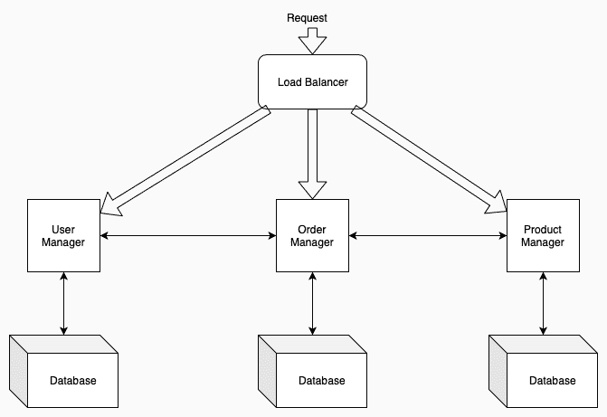

# 规划在线商店应用

到目前为止，你已经了解了微服务的一般概念、服务端 Swift 和 Vapor。现在是时候将这些付诸实践，开始构建我们的示例项目了。你将为一个电子商务应用开发后端。假设你已经制作了一个作为前端的 iOS 应用，但尚未为其构建后端。在本章中，你将为你的商店规划服务端应用。你可能之前做过多个后端；也可能这辈子从未接触过后端。本章将帮你补齐知识，并制定出具体计划。

程序员常说：你应该花 90% 的时间规划，10% 的时间写代码。虽然现实并不总能做到这一点，但良好的规划至关重要。读完本章后，你应该能够搭建好一切并开始编码。

你将探索以下章节：

* 在线商店的应用布局
* 用户管理器
* 产品管理器
* 订单管理器

让我们深入其中并开始规划！

## 技术要求

本节介绍你的机器上需要运行什么，以便编写此微服务。需要安装以下组件：

* Vapor Toolbox
* Swift 5.2+
* Xcode 11+
* Docker
* macOS/Linux

我们还假设你已经学习了前几章。本章所有代码在 macOS 和 Linux 下运行方式相同。


本章的 GitHub 地址是 [`github.com/PacktPublishing/Hands-On-Swift-5-Microservices-Development/tree/master/Chapter 4`](https://github.com/PacktPublishing/Hands-On-Swift-5-Microservices-Development/tree/master/Chapter%204)。

# 在线商店的应用布局

每个后端都不同，且有不同的需求。在本节中，你将学习如何为我们的在线商店示例设计微服务应用。

让我们首先讨论在线商店需要什么。假设你的 iOS 应用具有以下功能：

*   按类别展示产品。
*   根据属性筛选产品。
*   将产品加入购物车。
*   使用支付方式结账。
*   登录。
*   注册新账户。
*   查看用户的所有订单。

我们还可以向此列表添加更多功能。不过，本书旨在教授基础知识，以便你能使用此处采用的方法和途径编写自己的应用程序。

你现在将学习以下主题：

*   前端到 API 通信：应用通信的基础
*   认证：如何保护后端/应用程序
*   数据库管理：关于我们将如何存储数据的一些准则
*   云支持：拥抱云端——它大有可为

## 前端到 API 通信

最常见的 API 架构是 REST。REST 代表**表述性状态传输**，这意味着每次 API 调用都独立于状态——之前的 API 调用不会直接影响当前的调用。在我们无法保证 API 调用*何时*成功或失败的设置中，无状态微服务很有帮助，甚至是必要的。因此，我们将商店后端构建为 **REST API**。

REST API 通常基于 HTTP 运行；它是一个通用标准且易于处理。通过 HTTP，我们有多种可用的方法，我们将使用 `POST`、`GET`、`PUT`、`DELETE`、`OPTIONS` 和 `PATCH`。

HTTP 协议本身也提供了几种向服务器传递信息的方式。它要么是 URL 的一部分（例如 `/orders/42`），要么是请求的主体（通常称为 `POST` 主体）。

JSON 已成为现代 API 通信的默认标准。其格式易于读写，通常足以满足大多数用例。我们的在线商店 API 也将依赖 JSON。针对潜在客户端有各种实现，因此将 JSON 作为主要输入和输出来设计 API 是稳妥的选择。

对于我们的 API，我们将制定以下标准以保持一致性：

*   `GET` 和 `DELETE` 端点以查询参数的形式接收输入（`/getEndpoint?parameter=value`）。
*   `POST`、`PUT` 和 `PATCH` 端点以 JSON 编码字符串的形式接收输入。
*   `OPTIONS` 端点仅返回状态码；它们忽略所有输入。
*   `ALL` 方法均可从 URL 本身读取（`/get/order/:id`），其中最后一部分可被读取。

## 认证

用户需要能够在我们的商店注册和登录。微服务，特别是订单管理服务，需要知道用户身份以正确保存订单信息。

你将首先概括地了解认证，然后了解针对微服务的具体认证。

### 通用认证

对于微服务，以及通常的每个服务器应用程序，要验证用户身份，客户端会向服务器传输一个令牌，该令牌包含一个服务器可关联到特定用户的键。令牌通常通过请求头传输。传统 Web 应用程序的常见做法是将此类信息保存在 Cookie 中；对于移动应用，你只需将令牌保存在本地存储中。理论上，关联到用户的键可能仅仅是数据库中的用户 ID。如果你仅将用户 ID 保存在 Cookie 中，并随每个请求将其传输到服务器，就会出现这种情况。因此，浏览器（和用户）可以更改该值，并操纵我们以哪个用户身份操作。既然你想开发安全的应用程序，请不要仅使用用户 ID 作为令牌。信不信由你，我见过本该知道如何正确操作的公司使用的应用程序中出现这种情况。

过去二十年里，人们大多使用所谓的“会话”。它本质上是一个包含多个随机键并将信息关联到这些键的数据库表；该数据库可以是文件或关系型数据库 (SQL)。因此，在这种情况下，我们会告诉客户端一个随机键，并将该键与用户 ID 一起保存在会话表中。然后我们就能将该键与我们保存该键的用户关联起来。

如果你只使用一台服务器，可以将会话保存在本地内存中，从而获得极佳的性能。但在微服务设置中，我们无法这样做，因为服务可能（且很可能）运行在不同的机器上，无法访问共享内存。

### 微服务认证

微服务设置通常有一个专门用于认证的微服务。该服务注册并保存用户信息（如电子邮件和密码）并验证登录。

其他微服务验证请求的过程如下：

1.  用户通过认证管理器登录。
2.  认证管理器返回一个安全令牌。
3.  另一个微服务可以通过认证管理器验证此令牌，以确认用户身份。

正如你所想象的，每个请求都要与认证管理器进行验证，这会涉及大量的往返通信。一些微服务应用程序确实这样做，尽管经过大量优化。需要这种认证类型的情况包括银行交易等。每当你想确保能够毫无延迟地阻止用户访问时，你就需要如前所述的实时认证系统。

另一种认证方式是使用快速的键值数据库系统（如 Redis），并在所有微服务间共享。这样，令牌、用户 ID 和访问信息就可以被所有微服务同等访问。然而，这需要运行一个 Redis 服务器，这并不总是可行或理想的，因为它增加了复杂性和成本。

### JSON Web 令牌

然而，在许多其他情况下，我们可以使用一种性能更高且不妥协安全性的方法：**JSON Web 令牌** (**JWTs**)。

该方法与前一种仅略有不同：

1.  用户通过认证管理器登录。
2.  认证管理器返回一个包含加密用户信息的安全令牌。
3.  另一个微服务现在可以自行验证令牌，并从令牌中获取相关用户信息。

JWT 由三部分组成：

*   **头部**：这描述了用于签名的算法以及令牌的性质。在许多情况下，它看起来类似于这样：
    ```
    {"alg": "HS256", "typ": "JWT"}
    ```
*   **载荷**：这里包含我们最关心的数据，例如用户信息和时间信息：
    ```
    {"exp": 1555701217, "uid": 1337, "name": "My Name"}
    ```
*   **签名**：这使用前面的算法对 base64 编码的头部和载荷进行签名。签名是生成的哈希字符串。哈希是用与公钥对应的私钥生成的。

重要提示：拥有令牌的任何人都可以读取头部和载荷。切勿在 JWT 中保存敏感信息。

当微服务收到带有 JWT 的请求并需要验证用户时，该微服务可以使用公钥验证签名是否由正确的认证服务器签署。如果是，由于签名已通过验证，该服务便可以安全地使用载荷中的信息。


你注意到什么了吗？在这种方法中，微服务可以在不与数据库或认证服务器交互的情况下验证 JWT。这节省了大量的时间和资源。

你现在可能会想，当用户登出或离开页面时该怎么办——JWT 何时失去有效性？答案是，在几乎所有情况下，你都希望在 JWT 的载荷中放入一个“过期时间”。上面的 `exp` 字段通过定义该 JWT 过期并应被拒绝的时间来为我们完成这项工作。因此，典型的登出过程如下所示：客户端删除现有的 JWT，从而移除访问权限。

# 更新 JWT

随着 JWT 过期（或以其他方式失去有效性），我们需要一种更新它们的方法。一种方法是再次发起“登录”流程。然而，这要求我们准备好登录凭据。出于安全考虑，你不希望以任何方式保存这些凭据。允许 JWT 更新的最常见方法是一次性提供两个 JWT，如下所述。

# 访问令牌

所谓的“访问令牌”指的是生命周期较短的 JWT，通常在 5 到 60 分钟之间。在此期间，令牌有效，用户可以使用它。当它过期时，必须更新令牌。该令牌之所以具有短生命周期，是因为你可以更好地控制它。每次更新令牌时，你都可以再次检查该用户是否仍被授权在你的应用中执行操作。

重要的是要注意，这显然*不是*实时的！但这没关系；在大多数情况下，你不需要实时封锁用户。如果你确实需要，请将生命周期设置为 30 秒——这仍然比 0 秒好，并能给你提供近乎实时的控制。

# 刷新令牌

刷新令牌只是另一个令牌（它可以是 JWT，但不必是），用于刷新访问令牌。刷新令牌必须直接与认证管理器一起使用——而不是与任何其他微服务一起使用。这使我们能够验证用户*是否仍被允许*保持登录状态。如果你必须删除或封锁用户的访问权限，你会标记该用户，以便你的认证管理器不再更新访问令牌。

访问/刷新令牌的设置不绑定于 JWT。我见过采用这种方法但未使用 JWT 的实现，但其本质运作方式相同。

# 封锁访问

有时，你可能需要封锁特定用户的访问权限。根据应用程序的性质，你可能希望这立即生效，或在你封锁用户后不久生效。如果你需要快速生效，你可以做以下两件事之一：

*   为访问令牌设置非常短的生命周期（例如 30-300 秒）
*   维护一个令牌黑名单

第一种方法可能会让人质疑是否根本有必要使用这种方法，但如果你有大量请求，每 30 秒连接一次认证服务与每个请求都连接一次相比，可能会产生巨大差异。

第二种方法可以卸载给负载均衡器。负载均衡器将知道要封锁哪些令牌，并立即拒绝授予访问权限。

# 数据库管理

虽然每个微服务都是独特的，并且可能有自己的数据库设计和约定，但让我们在几点上达成一致，这将统一我们微服务的设计：

*   数据库引擎是 MySQL。如果你想使用 PostgreSQL，原则保持不变。
*   每个实体都有一个数字 `ID`。这是良好数据库设计的核心；表中的每个条目都必须有一个唯一的 `标识符` (`ID`)。为求简单，我们保持其为数字类型并从 ID 1 开始。注意：即使是大型应用程序通常也不会偏离这种方法。此 `ID` 的字段将始终称为 `id`。你也可以对 `id` 使用 `通用唯一识别码` (`UUID`)——这取决于偏好，并与应用程序的目的有关。
*   我们对名称使用 `camelCase`。这纯粹是偏好，但它省去了我们在单词间使用下划线 (`_`) 的麻烦，且在我看来，它同样易读。关联产品与订单的实体因此将是 `OrderProduct`（而不是 `Order_Product`）。实体名称以大写字母开头，而数据库表以小写字母开头。注意：某些数据库系统（如 PostgreSQL）偏好 `snake_case`。
*   数据库表名使用复数形式。因此，我们使用 `orders` 而不是 `order`。

所有这些点主要基于偏好，可根据你的喜好进行调整。

# 云支持

云是我们的朋友，而非敌人！有些人希望尽可能通用地开发应用程序，避免陷入只有一个供应商能提供所需服务的境地，这当然是明智的。话虽如此，拥抱云的元素并无不妥，即使它们在不同供应商之间略有差异。

对于我们在此开发的应用程序，我们将使用云中的以下元素：

*   用于产品图片的存储
*   用于我们数据库的托管数据库服务器
*   用于运行我们应用程序的虚拟服务器
*   支持 Docker 的容器管理以管理我们的容器
*   用于重定向流量的负载均衡

正如你所见，与云提供商的产品相比，此列表相当通用，你可以轻松地从一个提供商切换到另一个，甚至在你想要的情况下自行搭建系统。

下表显示了在最流行的云提供商 AWS、Azure、Google Cloud 和 Digital Ocean 上找到的服务名称：

| 服务 | AWS | Azure | Google Cloud | Digital Ocean |
| --- | --- | --- | --- | --- |
| 存储 | S3 | Blob Storage | Cloud Storage | Block Storage |
| 数据库 | RDS | Azure Database for MySQL | Cloud SQL | Managed Databases |
| 虚拟服务器 | EC2 | Azure Virtual Machines | Compute Engine | Droplets |
| Docker 管理 | ECS / EKS | ACS / AKS | Kubernetes Engine | Kubernetes |
| 负载均衡器 | Elastic Load Balancer | Load Balancer | Cloud Load Balancing | Load Balancer |

正如你所见，这四家云提供商中的每一家都提供符合我们需求的服务。展望未来，我们将以 AWS 为例进行设置；不过，你可以选择此处列出的任意一家来运行后端。

# 用户管理器

让我们开始创建第一个服务：**用户管理器** (**UM**)。

我们的 UM 应允许我们执行以下操作：

*   **注册**
*   **登录（获取访问令牌）**
*   **忘记密码**
*   **验证访问令牌**
*   **更新访问令牌**

仅此而已——它是一个精简且直观的服务，但将成为我们应用程序的核心元素。UM 将验证传入的凭据（电子邮件和密码），然后向客户端返回一个访问令牌以及一个刷新令牌。有了访问令牌和刷新令牌，客户端可以向其他服务发送请求，并在需要时更新访问令牌。

# 模型

该服务仅保存两个模型：

*   `User`
*   `Address`

`User` 实体包含每个用户本身及其基本信息。`Address` 实体包含用户的关联地址。

在生产阶段，你应该为地址管理设置并创建另一个微服务。由于我们的示例规模较小，我们可以将它们包含在此服务器中；但对于地址验证和扩展功能，你应该将其作为一个独立的服务。

# 用户

用户具有以下变量：

*   `Email`
*   `Password Hash`
*   `First Name`
*   `Last Name`
*   `Last Login`
*   `Status`

你可以为用户添加更多属性，但为我们的目的，我们将保持简单。如果你将我们的示例应用程序作为你商店的起点，你可能想为用户添加额外的属性。但我们稍后会更详细地讨论这一点。`status` 属性将决定该用户是否处于活动状态并可以登录。

# 地址

我们保存的地址将仅限于美国，因此以下字段已足够：

*   `Street`


*   其他街道信息（如公寓号和楼层）
*   城市
*   邮政编码
*   州/省

现在让我们看看**产品经理**（**PM**）。

# 产品经理

PM 作为我们与产品相关的所有内容的中央数据库和 API。除了图片，我们可以将所有内容保存在此服务的数据库中。图片将保存在我们的云存储解决方案中。

在同一文件夹中保存大量文件会对服务器的文件系统构成挑战。为了让微服务能够共享同一存储，即使同一微服务的多个实例正在运行，也需要集中管理文件。

## 模型

我们的产品服务需要以下模型：

*   产品
*   类别
*   产品类别

### 产品

产品将包含以下属性：

*   名称
*   描述
*   价格
*   类别
*   图片

### 类别

此外，我们将在该服务中保存类别。类别将只有 `name` 作为属性。

### 产品类别

类别和产品之间将存在 `n:n` 关系，意味着我们可以在任意数量的类别中拥有任意数量的产品。

用于连接产品与类别的枢纽模型将具有以下属性：

*   `Product ID`
*   `Category ID`

产品和类别的这两个 ID 就是我们连接它们所需的一切。

# 订单管理器

**订单管理器**（**OM**）是该项目的第三个服务。它是最复杂的服务，因为它不仅拥有各种内部功能，还连接另外两个服务。PM 和 UM 在技术上可以在其他项目中独立存在。然而，OM 依赖于另外两个。

需要涵盖以下功能：

*   接受订单。
*   支付订单。
*   更新订单状态。
*   返回用户的所有订单。

虽然功能列表不长，但每个功能都有使其有趣且复杂的实现方面。

## 模型

该服务需要以下模型：

*   订单
*   订单产品
*   支付

### 订单

此模型包含订单的必要信息：

*   账单地址（姓名、街道、邮政编码、城市和国家）
*   收货地址（姓名、街道、邮政编码、城市和国家）
*   订单状态
*   已付金额
*   总金额
*   税额
*   运费

注意：我们不在此处保存与此订单关联的产品；那些将在另一个模型中。

### 订单产品

这里，我们将 `Order` 与 `Product` 连接起来。要关联两者，我们只需要 ID：

*   `Product ID`
*   `Order ID`
*   数量
*   单项金额（单个价值）
*   税额（单个价值）
*   总金额

我们保存单个商品的金额以及该商品的税额。总金额计算如下：

```
total amount = quantity * (item amount + tax amount)
```

`Order` 的总金额将是所有 `Order Product IDs` 的总和。

### 支付

这是存储订单任何支付信息的模型。注意，一个订单可能有多笔支付，例如，客户可能使用两张不同的信用卡支付：

*   `Payment type`（信用卡、现金、PayPal 等）
*   `Amount`（总价值）
*   `Reference ID`
*   `Order ID`

`Reference ID` 是我们从第三方（如信用卡处理商）获得的值。我们保存它的原因是可能需要退款——那时我们需要这个值。

## API 结构

下图显示了我们的应用程序在概念上如何工作：



你可以清楚地看到微服务之间的连接，以及每个服务如何拥有自己的数据库。此设置可以托管在云中、专用服务器上，甚至单台服务器上（如果需要）。

## 总结

在本章中，你准备并了解了我们的应用程序从后端需要什么。你看到了如何构建微服务以及它们如何连接。到现在，你应该理解后端背后的整个概念，并能轻松实现每个服务。

此外，你了解了每个服务的功能及其包含的模型。我们比较了四个可作为托管平台的云服务提供商，并分析了我们从云中需要的要素。

## 问题

通过回答和解决以下问题来检验你的知识：

1.  如何验证用户是否有权访问微服务的某个功能？
2.  访问令牌的合理生命周期是多久？
3.  为什么 JSON 是微服务输入和输出的良好选择？
