# 测试微服务

您可能以前测试过软件。如果没有，也不必担心：本章将涵盖您了解测试微服务所需的一切。但无论如何，您很可能运行过自己的软件，这是最基础的测试类型。不同种类的测试工具让我们能够确保软件按预期运行。读完本章后，您将对如何测试服务端 Swift 应用程序，特别是微服务有基本的了解。测试微服务不同于测试单体应用程序，后者在 第 1 章 *微服务简介* 中已定义。您不再只是测试一个应用程序，而是需要测试每个服务，以及——这正是其特殊之处——协同工作的服务。例如，如果三个微服务协同工作，其中一个出错可能会导致其他服务*看起来*也不工作了。在一个资金和时间都充足的完美世界里，您可以针对每种可能的情况测试每个服务，但这在资金充足的项目中也很少见。方法应旨在通过设计来限制错误。首先，使用 Swift 而不是任何动态类型语言，肯定能确保您始终面对正确的变量类型。但让我们通过探讨以下主题来进入本章：

*   理解单元测试
*   通过 Postman 尝试功能测试
*   将隔离作为一种特性使用
*   一起测试多个服务

## 技术要求

本章的代码文件可在此处找到：[`github.com/PacktPublishing/Hands-On-Microservices-with-Swift-5/tree/master/Chapter 7/UserService`](https://github.com/PacktPublishing/Hands-On-Swift-5-Microservices-Development/tree/master/Chapter%207/UserService)。

## 理解单元测试

让我们从讨论最多的软件测试方式开始：单元测试。您很可能熟悉它们：它们基于一次测试一个函数的概念，并确保其对每种可能且合理的输入都能正确响应。当我们开发对微服务影响重大的单个函数时，这种测试方式至关重要。因此，如果我们有一个在应用程序中执行某些主要逻辑实现的函数，这当然是确保其正确工作的最可靠方法。

让我们看看以下主题：

*   定义单元测试
*   设置 Xcode
*   微服务的单元测试

好的，准备好深入了解了吗？让我们开始学习单元测试吧！

### 定义单元测试

在深入之前，让我们快速定义一下什么是单元测试，以及它们应该实现什么目标：

*   **隔离性：** 每个单元测试应仅测试一个函数。
*   **可重复性：** 无论您运行测试一次还是 10 次，结果应保持不变。
*   **通过/失败：** 测试要么通过，要么失败。
*   **自验证性：** 结果应易于理解。

从上述定义可以清楚地看出，我们只能将单元测试用于少数函数。例如，用于路由（控制器）的函数可能不是好的候选者，因为它们通常连接到数据库，这几乎总是涉及更高的复杂性。但我们的控制器函数所使用的许多函数都是完美的候选者，例如，验证输入是否为有效电子邮件的函数？那就是一个完美的候选者。

### 定义功能测试

功能测试测试应用程序的最终用户功能。它们关注用户（或客户端）是否接收到预期的内容。

由于 Vapor 是使用 Swift 构建的，而 Swift 天然与 Xcode 紧密相关，我们可以充分利用 Xcode 测试工具。您可能已经在应用程序开发中使用过它们。那么，现在让我们设置 Xcode。

### 设置 Xcode

首先，您需要在 `Package.swift` 文件中设置一个测试目标。所有 Vapor 项目默认都有这样一个目标，所以您可能不需要做任何事情：

1.  进入 Vapor 项目的文件夹。
2.  在 Xcode 中打开项目。
3.  查看 `Package.swift`。

它看起来像这样：

```
.testTarget(name: "AppTests", dependencies: ["App"])
```

当我们使用 `xed.` 创建 Xcode 项目时，测试目标会被正确创建并在 Xcode 中可用。

在 Xcode 中，您可以找到每个 Vapor 项目的示例测试文件，如下截图所示：

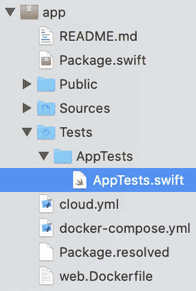

`AppTests.swift` 文件的内容如下：

```
import App
import XCTest

final class AppTests: XCTestCase {
    func testNothing() throws {
        // Add your tests here
        XCTAssert(true)
    }

    static let allTests = [
        ("testNothing", testNothing)
    ]
}
```

`XCTestCase` 类是 Xcode 查找以自动运行测试的内容。此处的基本原则如下：

*   每个测试类包含一组测试，主要按底层功能关联。
*   每个以 `test` 开头的函数都是一个单元测试。
*   `XCTAssert` 函数检查给定变量的结果。该函数断言（因此得名）给定表达式是否为真。

如果 `XCTAssert` 函数检查的条件不满足，都将报错退出。以下断言函数可供您使用：

| 函数 | 描述 |
| --- | --- |
| `XCTAssert(expression)` | 检查表达式的结果是否为 `true` |
| `XCTAssertTrue(expression)` | 检查表达式的结果是否为 `true`：技术上讲，这等同于第一个函数，但 Apple 选择也提供此函数。 |
| `XCTAssertFalse(expression)` | 检查表达式的结果是否为 `false` |
| `XCTAssertNil(expression)` | 检查表达式的结果是否为 `nil` |
| `XCTAssertNotNil(expression)` | 检查表达式的结果是否不为 `nil` |
| `XCTAssertEqual(expression1, expression2)` | 检查 `expression1` 是否等于 `expression2` |
| `XCTAssertNotEqual(expression1, expression2)` | 检查 `expression1` 是否不等于 `expression2` |
| `XCTAssertGreaterThan(expression1, expression2)` | 检查 `expression1` 是否大于 `expression2` |


## XCTest 断言

| 断言 | 说明 |
|------|------|
| `XCTAssertGreaterThanOrEqual(expression1, expression2)` | 检查 `expression1` 是否大于或等于 `expression2` |
| `XCTAssertLessThan(expression1, expression2)` | 检查 `expression1` 是否小于 `expression2` |
| `XCTAssertLessThanOrEqual(expression1, expression2)` | 检查 `expression1` 是否小于或等于 `expression2` |
| `XCTAssertThrowsError(expression)` | 检查 `expression` 是否抛出错误 |
| `XCTAssertNoThrow(expression)` | 检查 `expression` 是否不抛出错误 |
| `XCTFail()` | 立即失败 |

所有这些函数还接受额外参数来描述错误消息、文件和行号，以便进一步调试。

例如，假设你有以下函数：

```swift
func checkPassword(_ password: String) -> Bool
```

密码必须超过 8 个字符，且包含一个数字和一个特殊字符。该函数的单元测试可能如下所示：

```swift
func testPasswordFunction() throws {
    // These passwords should be accepted:
    XCTAssertTrue(checkPassword("abcadefgh1A!"))
    XCTAssertTrue(checkPassword("aFcade+gh1A"))
    // These passwords should be rejected:
    XCTAssertFalse(checkPassword("asdf")) // too short
    XCTAssertFalse(checkPassword("abcadefgh1A")) 
    // no special character
    XCTAssertFalse(checkPassword("abcadefghA!")) 
    // no number character
}
```

如果测试失败，Xcode 会准确告诉我们是哪个测试失败了。

很好，我们已经涵盖了基础知识。现在让我们看看微服务的单元测试。

# 微服务的单元测试

在大多数情况下，无论是单体应用还是微服务应用，单元测试都是相同的。由于其定义的性质，单元测试不适合作为测试软件的唯一工具；然而，我们绝对应该对提供某些隔离功能的单个函数使用单元测试。区别在于单元测试只关注单个函数。这当然很有用，但它并不测试软件的整体。好的单元测试示例包括：

*   输入验证
*   输出验证
*   名称/字符串解析
*   日期/时间相关函数
*   函数链

整个 `Vapor` 框架都是通过单元测试进行测试的。因为框架有大量相互关联的函数，所以单独验证每个函数是有意义的。

然而，在许多其他情况下，测试变得更加困难，这就是为什么功能测试对于 Web 应用程序同样重要。

# 功能测试与单元测试

正如生活中的许多事情一样，不存在"更好的测试方法"。你既需要功能测试，也需要单元测试。单元测试是对单个函数的验证，而功能测试则测试应用程序作为一个整体。话虽如此，这两种方法都有优缺点。

## 单元测试的优缺点

单元测试的优点如下：

*   它可以 100% 验证一个函数。
*   它能相当容易地发现错误。
*   测试执行和重复很快。

单元测试的缺点如下：

*   它不能轻松测试数据库操作。
*   它难以动态测试函数。

值得注意的是，Web 应用程序几乎总是在做一些与数据库相关的事情，这就是为什么依赖单元测试可能是致命的。

## 功能测试的优缺点

功能测试的优点如下：

*   它可以验证半真实的用户请求，即非常接近实际用户请求的请求。
*   它可以验证服务/应用程序的总体功能。
*   它不特定于应用程序的内部函数。
*   它可以验证新版本，并验证特定客户端版本是否仍然兼容。

功能测试的缺点如下：

*   它对查找错误帮助不大。
*   测试数据库插入时可能会干扰现有数据。
*   问题可能与当前测试无关。

功能测试难以定位问题，而不是帮助你复现它。由于功能测试始终从用户的角度出发，因此产生的错误通常不利于调试。在对单个函数使用单元测试之后，功能测试最大的好处是验证软件的新版本。在部署服务更新之前，你可以使用功能测试来验证所有公共功能是否正常运行并按预期工作。

现在，让我们设置 `Postman` 以开始测试！

# 通过 Postman 尝试功能测试

有许多优秀的工具可以执行功能测试。功能测试涉及从用户的角度测试应用程序。软件假装成人类，向其他软件发送类似人类的请求。根据返回的响应，测试被判定为成功或失败。这也意味着功能测试不是专门检查单个函数，而是检查应用程序的功能操作。在本节中，我们将介绍 `Postman` 工具，这是一个免费工具，提供丰富的功能库，允许测试网站，也专门用于测试 API。

让我们来看看：

*   安装 Postman
*   设置 Postman

## 安装 Postman

要安装 `Postman`，请执行以下步骤：

1.  访问 [`www.getpostman.com/`](https://www.getpostman.com/) 并下载最新版本。你会看到 `Postman` 为 API 开发提供了各种有用的功能，但目前我们主要关心它的测试能力。

2.  解压下载的归档文件，并将 `Postman-file` 移动到 `Applications` 文件夹。

3.  点击下载按钮，加载完成后进行安装。

现在，让我们设置它！

## 设置 Postman

要设置 `Postman`，请执行以下步骤：

1.  启动之前安装的 `Postman-file`。

2.  首次启动 `Postman` 时，系统会要求你创建一个免费账户。由于 `Postman` 为服务器开发人员提供了相当多的有用工具，我建议你注册并继续。

# 使用 Postman 进行测试

好的，现在让我们开始实践！在本节中，我们要测试之前创建的用户管理服务（第 7 章）。如果你没有跟随该章节操作，请继续并从本章的 GitHub 存储库获取源文件：

1.  启动你的服务，并通过执行以下命令在服务中创建一个用户：

```bash
curl -X POST -H "Content-Type: application/json" \
--data '{"email": "email@domain.com","password": "test123"}' \
http://localhost:8080/v1/users/register
```

将 `email@domain.com` 替换为你自己的个人电子邮件，以便你可以看到收到的邮件。控制台应显示以下内容：

```json
{"status":"success","user":{"id":10,"email":"email@domain.com",
 "addresses":[]}}
```

现在数据库中有了一个用户。

2.  打开 `Postman` 并创建一个新集合：

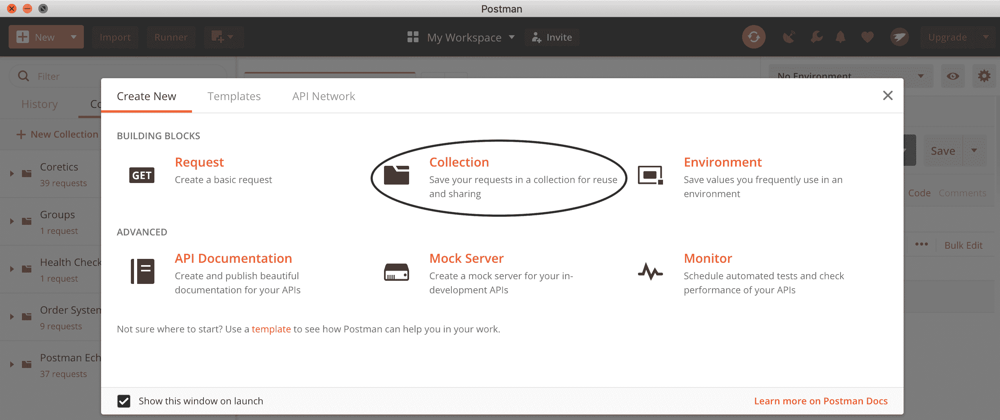

3.  将其命名为 `User Service Testing`，并创建一个空变量 `TOKEN`：

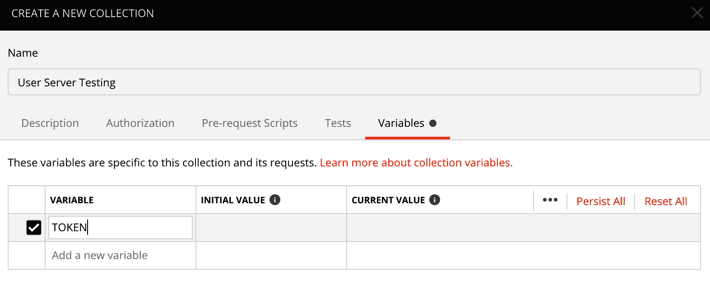

4.  进入 Authorization 选项卡，将授权类型设置为 Bearer Token。然后在 Token 文本字段中输入 `{{TOKEN}}`：

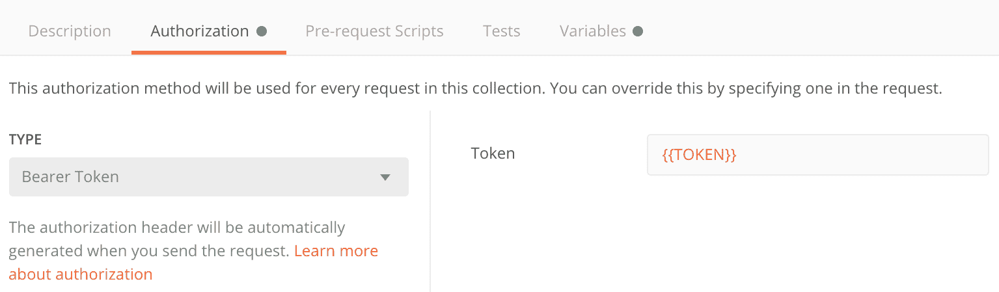

5.  在该集合中创建一个新请求，并将其命名为 `Auth`：

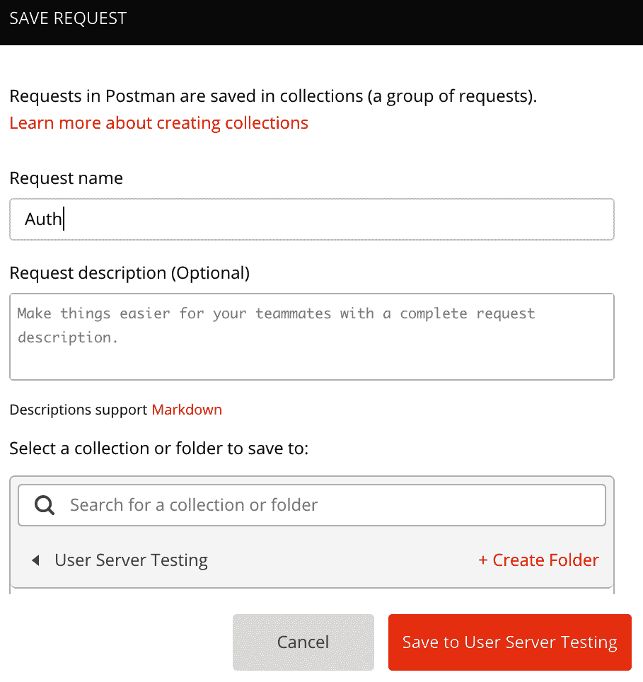

6.  填写 URL 并添加一个标头 `Content-Type`，其值应为 `application/json`：

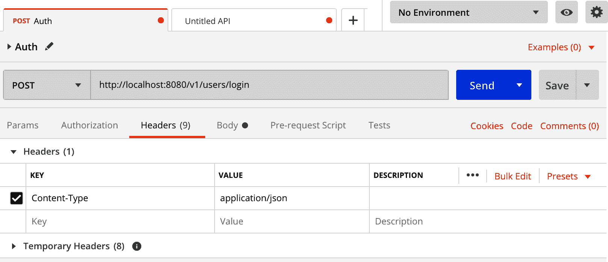

7.  现在，填写我们登录所需的主体；它是我们之前用于注册的相同代码：

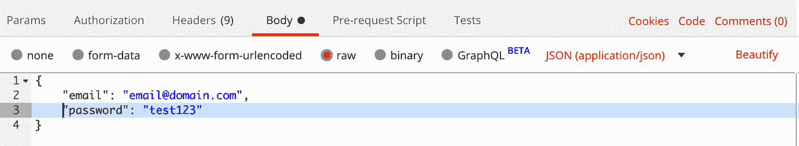

8.  继续按 Save（保存请求），然后按 Send（发送测试）。结果应类似于此：


## 设置 Postman Collection

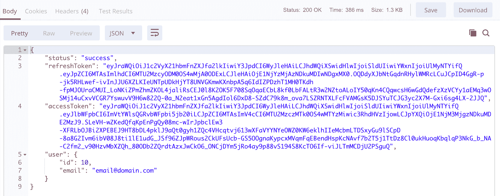

这验证了我们的服务正按预期工作，并且我们可以使用 Postman。注意：我们已经在测试我们的服务。

9. 接下来，创建一个环境，如下面的屏幕截图所示：

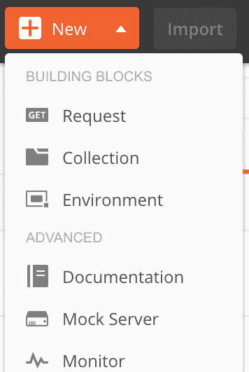

11. 将其命名为 `User Service`，并再次添加一个空变量 `TOKEN`。

12. 在主窗口中选择该环境：


13. 现在将以下代码添加到 Auth 请求的 Tests 标签页中：

```
pm.environment.set("TOKEN", pm.response.json()["accessToken"]);
pm.test("success value existent", function () {
    pm.expect(pm.response.json().status).to.eql('success');
});
```

我们在这里做两件事：

*   第一行在我们的 Postman Collection 中设置环境变量 `TOKEN`。它将使我们能够将生成的访问令牌用于所有其他调用。
*   第二行是实际的测试。这里我们验证返回的 JSON 中是否有 `status == "success"`。

14. 保存请求。

15. 创建一个新请求并将其命名为 `Check Status`。此调用将仅验证我们的 `JSON Web Token` (`JWT`) 设置是否按预期工作。我们将把创建的访问令牌发送回服务器，让服务器进行验证。

URL 是 `http://localhost:8080/v1/users`，这是一个简单的 `GET` 调用。由于我们已经在 Collection 中设置了授权，因此不需要为该调用做任何其他操作即可拥有正确的标头。

16. 在 Tests 标签页中输入以下测试：

```
pm.test("success available", function () {
    pm.expect(pm.response.json().status).to.eql('success');
});
```

现在你的请求应该如下所示：

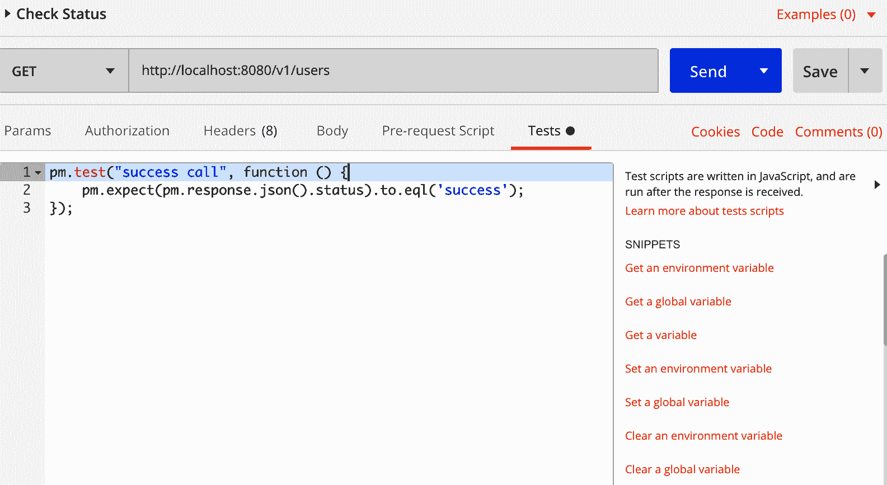

17. 保存请求，然后点击 Send。输出应如下所示：

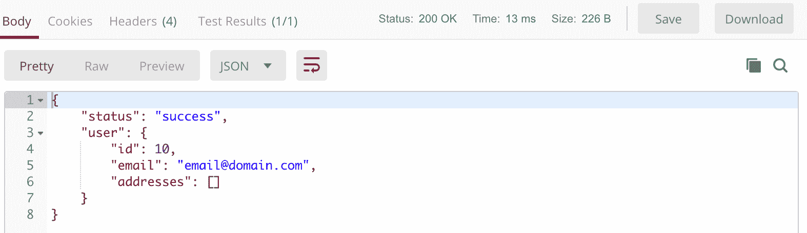

就这样！你已成功创建了一个 Collection 和一个用于该 Collection 的认证请求，然后创建了另一个使用令牌来测试其他调用的请求。

你应该继续前进，为了你自己的训练，为用户服务的所有端点创建测试请求。

你也可以运行整个 Collection，而不必单独测试每个请求。我还鼓励你阅读一些 Postman 的功能——它是测试 API 的强大工具。

现在你已经学会了如何与 Postman 交互，让我们看看隔离如何成为测试的有用功能。

# 将隔离作为一项功能使用

微服务的美妙之处在于，它们由定义上就是尽可能隔离的。因此，测试微服务可以非常简单且全面，而无需太多工作。单元测试之于整个软件，正如功能测试之于微服务设置。测试的好处是每个服务都可以在不查看其他服务的情况下进行测试。这使我们能在错误浮现之前就发现它们。

让我们看几个可以看到这一优势的例子。

## 可复用的服务

在 `第 7 章` `编写用户服务` 中，你开发了一个用户管理服务。你只编写了一次该服务，但可能在不同的项目中使用它。一旦你完成了所有适用的测试，将来在使用该服务的项目中就不必重写它们。

## 受控测试

由于隔离，定义测试变得容易得多（或者正如一些人建议的，在编写代码之前定义测试）。每个微服务都可以单独测试，而不需要其他服务。与单体应用程序相比，这有助于识别一般性问题。例如，测试来自 `第 7 章` 的用户服务不会影响我们即将编写的任何其他服务。同样，测试即将出现的任何服务也不会影响用户服务。

现在让我们探讨如何将多个服务一起测试。

## 将多个服务一起测试

将不同的微服务一起测试可能非常具有挑战性。它们不仅可能需要相互交互，而且每当你运行涉及多个服务的测试时，它们还会导致不同的变化（主要在数据库中）。

为了效率，你应该在将它们一起测试之前彻底测试每个服务。在隔离环境中比在多服务设置中更容易捕获 Bug 和错误。相信我，这能为你节省数小时甚至数天的工作。

让我们通过查看以下主题来深入了解：

*   配置
*   测试什么？
*   本地测试
*   在开发环境中测试
*   在生产环境中测试

### 配置

让多个服务相互依赖是我们尽量避免的情况。然而，每当你需要连接两个服务时，你需要确保正确配置它们。不要为服务静态输入 URL。假设我们有两个服务：

*   订单服务：管理商店系统中的订单
*   产品服务：管理商店系统中的产品

假设你希望订单服务与产品服务确认价格，并将产品服务 URL 保存在变量中。不要这样做：

```
let productServiceUrl = URL(string: "https://api.mybackend.com/v1/products")
```

当你想在不同环境中测试时，这会适得其反。相反，你应该在启动应用时的 `configure()` 函数调用期间使用环境变量：

```
public func configure(_ config: inout Config, _ env: inout Environment, _ services: inout Services) throws {
    let productServiceUrl = URL(string: Environment.get("PRODUCT_SERVICE_URL"))
    // now pass this variable into any controller or service you need
}
```

这样，你可以确保在测试时控制服务尝试调用的内容。在生产设置中（即运行真实用户和客户的设置），你会将此变量定义为指向生产 URL，例如 `https://api.mybackend.com/v1/products`。另一方面，你也可以在本地将其设置为另一个端口，如下所示：

```
export PRODUCT_SERVICE_URL="http://localhost:8081/v1/products"
```

让我们在下一节中看看要测试什么。

### 测试什么？

我们不需要用多个服务测试所有内容。对需要测试的内容执行测试，因为它依赖于另一个服务。你会注意到，你自然会希望避免让服务过多地相互依赖；每当你确实需要这样做时，请记下来并为这些情况编写功能测试。

常见情况包括以下几种：

*   与另一个服务验证信息，例如验证产品价格
*   向另一个服务提交信息，例如日志记录、跟踪或数据分发
*   整合信息以帮助客户端直接输出正确信息，而不是向各个服务发送请求；因此，一个服务会从其他服务收集信息，而不是留给客户端去做

测试可以在本地、开发环境或生产环境中进行。让我们先看看本地测试。

### 本地测试

测试服务最简单、最高效的方法是在本地测试它们。从实际角度来看，这意味着你需要启动每个服务并为每个服务分配不同的端口。然后，你可以运行测试（例如通过 Postman）来验证每个服务是否在做它应该做的事。在 macOS 中，这表现为打开多个 Terminal 实例并在每个实例中运行一个服务。Vapor 允许你在运行服务时使用 `-p` 属性来指定使用的端口，如下例所示：

```
./.build/debug/Run -p 8081
```

在另一个 Terminal 中，你可以运行这个：

```
./.build/debug/Run -p 8082
```


现在，我们只需确保已将服务配置为使用正确的 URL，然后就可以进行测试了。

既然您已经学会了如何一起测试多个服务，让我们总结一下本章。

# 总结

在本章中，您学习了如何测试微服务。我们首先了解了单元测试及其优缺点。随后，我们探讨了功能测试以及它们如何与单元测试相辅相成。然后，我们研究了如何测试微服务，以及如何借助 Postman 进行测试。

到目前为止，您已经学会了如何为 API 编写自己的测试套件，并验证一切是否按预期工作。

您为我们在第 7 章中编写的用户服务创建了一个测试集合，并验证了其功能。在下一章中，我们将为我们的示例案例编写下一个微服务：产品管理服务。

# 问题

回答以下问题或解决以下问题以巩固您的理解。其中一些问题需要您查阅 Postman 的外部文档：

1. 单元测试和功能测试的根本区别是什么？
2. 单元测试和功能测试如何协同工作？
3. 为用户服务的所有端点编写 Postman 测试。
4. 在验证响应时编写更复杂的测试（例如，检查令牌是否包含正确信息）。
5. 编写单元测试，验证用户服务中的 JWT 功能是否正常工作。
