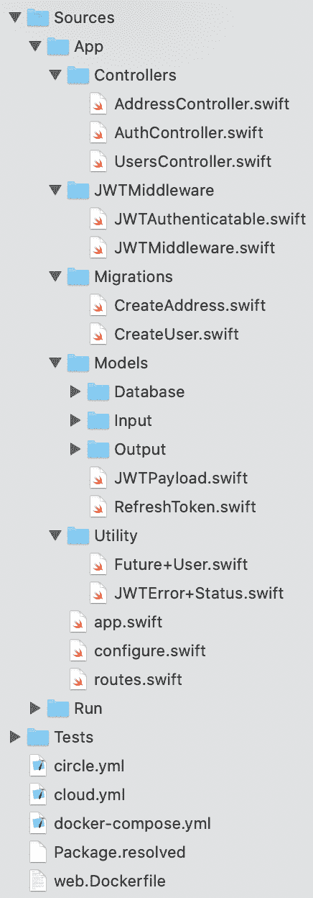
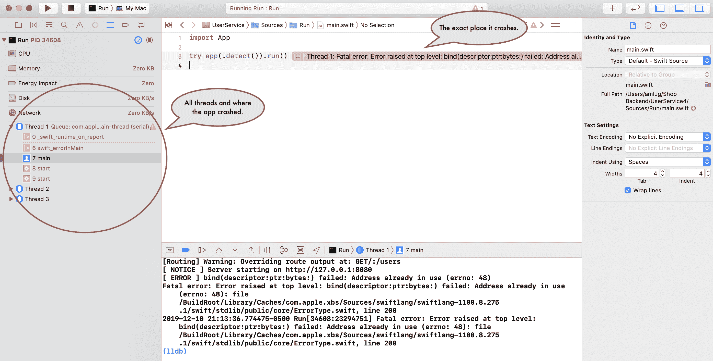
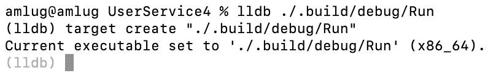
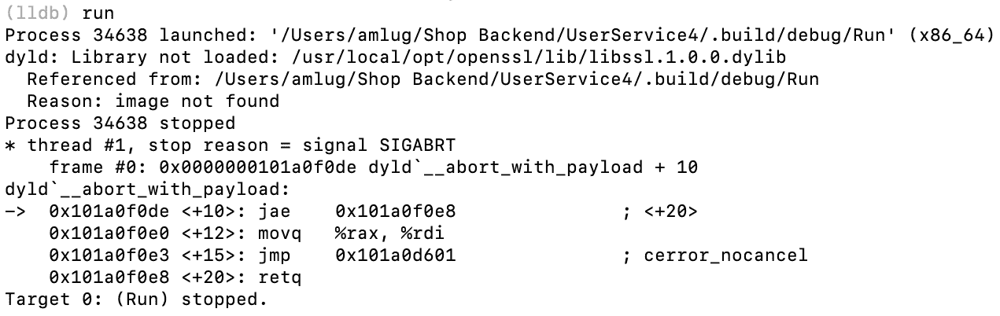

# 最佳实践

本章将概述对微服务有帮助和推荐的实践。到目前为止，你已经看到了并学习了如何用 Swift 和 Vapor 编写微服务。在本章中，我们将查看一些最佳实践，帮助你编写自己的服务。

我们将探讨简洁性如何成为微服务的优势以及如何实现它。然后我们将看看一些 Swift 特有的优势，它们对微服务大有裨益。代码往往要么过度简化，要么过度复杂；本章有一节旨在指导你做出这些决策。随后，我们将分析如何在微服务中最好地平衡这两种方法。最后，我们将研究微服务的故障排除和调试。读完本章，你将具备编写高效服务端 Swift 应用的实践能力。

本章涵盖以下主题：

* 为可维护性和稳定性而简化
* 拥抱 Swift 语言优势
* 使用抽象和具体实现
* 组合微服务
* 微服务故障排除和调试

让我们开始吧！

# 技术要求

本节介绍你的机器上需要运行什么才能编写此微服务。需要安装以下组件：

* Vapor 工具箱
* Swift 5
* Xcode 11+
* macOS/Linux

我们还假设你已经学完前几章，知道如何编写 Vapor 微服务。本章所有代码在 macOS 和 Linux 上运行方式相同。

本章的 GitHub 地址：[`github.com/PacktPublishing/Hands-On-Swift-5-Microservices-Development/tree/master/Chapter 12`](https://github.com/PacktPublishing/Hands-On-Swift-5-Microservices-Development/tree/master/Chapter%2012)。

# 为可维护性和稳定性而简化

简洁性很棒；每个见过复杂代码的开发者都知道这一点。Swift 设计初衷就是简洁，我们需要进一步贯彻这一点，保持微服务简洁。什么是可维护性和稳定性？代码要具备可维护性和稳定性，需要满足以下条件：

* 易读性：代码越容易阅读，日后包括你在内的任何人阅读速度就越快。
* 结构良好：包括文件结构和文件内的代码结构。
* 尽可能简单合理：简单代码优于复杂代码。

让我们看看以下主题：

* 通过库实现简洁：使用第三方库是降低代码复杂性的好方法。
* 使用直白的名称使其直观易懂。
* 关注点分离：保持事物分离以避免混淆。

我们从第一点开始。

# 通过库实现简洁

使用第三方库是降低复杂性的好方法。你可能在其他项目中用过库。使用现成的满足你需求的库，在许多情况下比自己重写更明智。常见的可以找到库的情况包括：

* 网络（例如 `SwiftNIO`）：处理网络、请求和 API 调用的库。
* 图像和媒体（例如 `MediaManager`）：这些助手为你管理常见媒体文件。
* 邮件提供商（例如 `SendGrid`）：使用这些包，你的代码将拥有简洁清晰的 API。


* 文件托管和存储（例如 AWS S3）：诸如 AWS S3 之类的库可以帮助您妥善存储文件。
* 流行软件（Stripe、Google Cloud 等）：大多数流行软件都提供 Swift 包，可以帮助您很好地组织代码。

在您认为需要自己编写代码之前，不妨先快速搜索一下，看看是否已经有人做过了。在某些情况下，您还会发现，如果这意味着您可以节省编写自己的库的时间，那么从之前的解决方案切换过来可能是值得的。例如，您可能正在使用 Google Cloud，但却发现 Vapor 的 S3 集成对您来说效果好得多。在这种情况下，您可能想要从 Google Cloud 切换到 AWS。

如果您要找的库不存在，您可能想自己写一个。如果您这样做了，您可以（而且依我之见，应该）将其开源，供他人使用。

即使对于您自己的项目，您也可能希望将软件的某些部分作为库来编写。模型结构就是一个很好的例子。它可以是一个同时被服务端和客户端使用的库。

既然您已经了解了库如何提供帮助，接下来让我们探讨命名在简洁性中扮演的核心角色。

# 使用直观的名称

名称既可能令人困惑，也可能令人豁然开朗。您应避免冗长且令人困惑的名称。一个例子是 Java 项目中的这个类名：`SimpleBeanFactoryAwareAspectInstanceFactory`。

当然，有些名称天然会比其他名称长，但请尽量避免将太多单词串联在一起。此外，尝试通过上下文或名称本身使其用途变得清晰。`UserController` 是一个直观的名称；然而 `UserManagementServiceController` 可能会让人困惑。

让我们通过演示来体会其重要性。请看这段代码：

```
class ControllerA {
    routeA() -> EventLoopFuture<A> {
        var f = "John"
        var l = "Cooper"
        // ...
        return b
    }
}
```

现在将其与以下代码进行比较：

```
class UserController {
 routeA() -> EventLoopFuture<UserUpdate> {
 var firstname = "John"
 var lastname = "Cooper"
 // ...
 return update
 }
}
```

您是否看到第二段代码比第一段更易读、更易理解？通过给变量、函数和类赋予有意义的名称，读者无需太多上下文就能知道正在发生什么。现在，实话实说——我们有时都会偷懒，省去一些规范，听着，这没关系！我只是建议您遵循以下准则：

* 每当您在修复 Bug 或全神贯注地开发功能时，请在提交到 Git 之前先清理代码。不要让混乱的代码在您的工作区停留超过“实验模式”所需的时间。
* 某些变量*可以*缩写，且不会引起误解。例如，`result` 可以写成 `res`，`index` 可以写成 `i`，等等。只要直观易猜，这样做没有任何问题。

好的，看完命名，现在让我们探讨关注点分离。

# 关注点分离

名称和库可以让您的应用程序井井有条，但另一个非常重要的原则也是“关注点分离”。这意味着尽可能将事物分开。因此，例如，您的 `UserController` 不应该处理地址；应该有一个 `AddressController`。

采用微服务架构本身就是朝着正确方向迈出的一步，因为您会自然地将应用程序拆分为不同的部分（微服务）。每个服务旨在仅处理应用程序的一组特定功能。您只需在每个服务内部也应用这一概念即可。

同样的原则也适用于应用程序的其他部分，例如模型、辅助工具或实用程序。尝试以一种合理的方式将它们分组，但又要足够分离。让我们看一个示例应用程序结构：



您可以看到所有内容是如何整齐地拆分并讲得通的。

有时您会发现将事物归并在同一个文件中很有帮助。例如，与其分别创建 `String-Email.swift`、`String-Hash.swift` 等文件，不如只创建一个 `String-Extensions.swift` 文件可能更合理。这实际上取决于您查找所需代码片段有多难。

既然我们已经研究了关注点分离，您应该已经做好充分准备，以良好组织的方式编写应用程序了。现在让我们看看 Swift 语言特有的优势。

# 拥抱 Swift 语言特性

Swift 本身提供了许多功能，使编写整洁易懂的代码变得更容易。在本节中，我们将通过示例演示其中一些功能。与 Go 或 Rust 等其他语言相比，Swift 拥有显著更多的现代特性。在本节结束时，您应该知道如何很好地使用其中一些特性。使用它们不仅有助于您编写更好的代码，还能提高应用程序的性能，因为您是以 Swift 预期的方式在使用它。

我们将研究以下功能：

* 使用扩展为对象添加新功能
* 探索允许您为代码定义接口的协议
* 理解类和结构体的区别

让我们开始吧！

## 使用扩展

扩展是一种功能强大且简单的方法，可降低代码的复杂性。您无需为自己的逻辑创建新类或子类，只需将想要的功能“插入”到现有类中即可。例如，如果我们想要一个验证字符串是否为有效邮箱的函数，可以通过以下方式实现：

```
func isEmail(email: String) -> Bool {
    // ...
    return true
}
var testString = "test@test.com"
if checkEmail(email: testString) {
    print("yep")
}
```

或者，更整洁的方式如下：

```
extension String {
    func isEmail() -> Bool {
        // ...
        return true
    }
}
var testString = "test@test.com"
if testString.checkEmail() {
    print("yep")
}
```

注意第二个代码块更讲得通？通过将函数作为 `String` 的扩展，该函数与唯一的参数关联起来，这减少了编写的代码量，同时也将事物放在了它们该在的位置。它使我们的逻辑很好地分离开来，这与之前提到的关注点分离方面联系在一起。

## 探索协议

协议是确保应用程序结构一致性的有力方式。它们强制要求类或结构体具有特定的变量和函数。然后，您的应用程序逻辑可以依赖于这一点，拥有已定义的函数和变量。您可以要求协议类型，而不必要求具体的类类型，它将接受任何采用该协议的类。

让我们看一个例子：

```
protocol HasEmail {
    var email: String { get set }
}
struct User: Model, HasEmail {
    var email: String
}
```

我们有一个 `HasEmail` 协议，它定义了一个 `email` 变量。现在实现此协议的每种类型（`class`、`enum` 或 `struct`）都需要定义这样一个变量。您可以看到 `User` 正在这样做。

在控制器中，我们现在可以这样做：

```
func checkEmailFor(model: HasEmail) {
    if model.email == "" {
        return false
    } else { 
        return true 
    }
}
```

我们不再要求 `User`，而是要求 `HasEmail`，它*可以*是一个用户实例，但也可以是采用 `HasEmail` 的其他类型。

协议非常有用，特别是对于数据结构（如模型）。您还可以将其与前一点结合，编写自己的库。拥有一个主要由协议组成的自己的库，将确保您的应用代码整洁并符合您的预期。特别是在拥有许多模型的项目中，这非常划算。


现在让我们看一个相关主题：泛型函数。

# 使用泛型函数

泛型函数是指可以接受多种类型并同等处理它们的函数。特别是在服务端应用中，你需要处理大量数据，这变得非常方便。你不需要为每种信息类型编写一个函数，而是可以编写一次，然后用于所有类型。

让我们看一个例子：

```swift
function saveModel<T:Model>(_ model: T, on app: Application) -> EventLoopFuture<T> {
    return model.save(on: app).transform(to: model)
}
```

你可以看到，该函数使用了一个泛型类型 `T`，我们在函数签名中称之为 `model`。我们还定义了该类型必须实现 `Model`。

现在，每当我们想要保存一个符合 `Model` 的类时，可以按如下方式进行：

```swift
let user = User()
return self.saveModel(user, on: app)
```

看看当对多个都符合同一个超类或协议的类型执行操作时，这样的函数能有多有用？

在这个简单的例子中，我们节省的不多，但在你可能想要在保存模型前执行大量转换的项目中，泛型函数简直是救命稻草。

现在我们已经专门研究了 Swift 语言的优势。扩展、协议和泛型函数现在应该成为你编写服务端 Swift 应用时工具箱的一部分！现在让我们看看在实现中何时应该抽象，何时应该具体。

# 使用抽象和具体实现

编写软件时，我们经常面临关于代码该有多具体的决策。例如，如果你被要求编写一个聊天应用，你需要回答以下问题：

*   聊天是两人之间进行，还是可以超过两人？
*   交换什么类型的内容？文本、图片、视频、音频，还是组合？也许全都有？
*   应存储多长的聊天记录？

你大概很容易就能发现还会出现更多问题。在一个计划周全、深思熟虑的项目中，所有这些问题都会有答案。然而，在我见过的几乎所有项目中，许多问题都被忽视了，初衷良好的项目仍然面临这些问题。其中一些问题对于委托你做这项任务的人来说也过于技术化。不过，让我们暂时假设你从项目经理那里得到了所有答案。但你预感未来会有更新到来。你基本上面临以下两个选择：

*   选项 A：严格按照规格编写应用。
*   选项 B：尽可能编写通用和抽象的应用，以便日后进行更改。

这两个选项有何不同？看看可能意味着什么。

**选项 A：**

*   只有两人可以聊天。
*   仅支持文本和图片。
*   聊天记录不超过 3 天。

**选项 B：**

*   任意数量的人可以相互通信。
*   支持所有可能的媒体格式。
*   聊天记录无限制。

你大概能看出选项 B 需要多得多的工作、测试和总体精力。选项 A 是需求所要求的。在紧张的日程和预算下，显而易见的选择是 A。它能完成工作，但当变更到来时需要大规模重构。依我的经验，你作为开发者设想的样子与需求要求的样子之间，几乎总是存在一些张力。

作为一条通用规则，尽量在不拖垮时间线或预算的合理范围内保持抽象。在前面的例子中，完全照搬选项 B 毫无意义，但为它铺路可能是有意义的。例如，你可以实现为稍后更容易支持不止两人聊天。你也可以允许通用媒体，但暂时只实现图片。特别是使用微服务时，你*可以*相对容易地做到抽象，所以要利用这一点。

# 组合微服务

承接上一节 *使用抽象和具体实现*，有时你可能会发现你过于泛化和抽象了。为项目添加微服务有很多好处，但也增加了复杂性，并且根据数据流的不同，可能会引入大量 Bug。特别是当信息从一个服务传递到另一个服务时，可能会发生以下情况：

*   信息在每个服务中被复制。
*   每个服务都验证和校验输入。
*   每个服务都需要托管资源（运行服务的服务器）。
*   延迟和整体变慢。

让我们看看下面的例子。

我们有五个微服务：

*   用户管理服务
*   地址管理服务
*   支付信息服务
*   支付服务
*   订单服务

当用户提交订单并想用信用卡支付时，需要发生以下情况：

1.  用户管理服务需要验证该用户是否仍处于活跃状态且允许购买。
2.  地址管理服务需要返回正确的地址，并将其发送给支付服务和订单服务。
3.  支付信息服务需要将支付信息发送给支付服务。
4.  支付服务需要向订单服务发送确认。
5.  订单服务需要与每个服务核对并处理传入的数据。
6.  订单服务通过用户管理服务发送邮件。

共有六个步骤，除第一步外，所有步骤都涉及微服务之间的通信。这对于调试和维护来说相当混乱。相反，假设我们将用户和地址管理服务合二为一，将支付信息服务、支付服务和订单服务合并为一个服务。现在我们只有两个服务：

*   用户地址管理服务
*   订单服务

我们的步骤现在变成如下：

1.  用户地址管理服务可以验证用户，并为订单服务提供正确的地址。
2.  订单服务获取信息，内部加载支付信息，并处理订单。
3.  订单服务通过用户管理服务发送邮件。

现在只有三个步骤和两个服务！这简化了数据流。我们还减少了服务间需要交换的数据量，从而降低了延迟，使速度稍快一些。

这每次都行得通吗？当然不是。在某些情况下这很完美，在另一些情况下，你想要相反的做法。一般来说，如果在一个业务逻辑步骤中超过两个服务需要相互通信，你大概率可以减少数据流。不一定总是通过合并微服务，但这是一种相对容易的方式。

# 故障排查和调试微服务

既然我们在 [](#cdfd1f9b-2194-40cc-97dd-9c3d49613bfd.xhtml)第 8 章 *测试微服务* 中已经很好地涵盖了这方面内容，你现在应该对如何调试微服务有一个大致的了解。在本节中，我们将只看几个核心概念，将调试与故障排查联系起来。根本问题通常是：为什么它不做我想让它做的事？在本节中，你将学习如何找到答案。

让我们深入探讨以下主题：

*   使用 `Xcode` 进行调试：`Xcode` 提供了一些方便的调试工具。
*   使用 `lldb` 进行调试：`lldb` 是在命令行中调试自己的绝佳方式。
*   预发布和线上系统：将开发环境与生产环境分离对每个项目都至关重要。

我们从使用 `Xcode` 进行调试开始。


# 使用 Xcode 进行调试

如果你是 macOS 用户并且过去一直在使用 Xcode，你一定很清楚 Xcode 允许调试是多么容易。尽管 Xcode 有缺陷，但它比一些替代方案能高效得多地进行调试。自 Xcode 11 起，SPM 原生集成到了 Xcode 中，这使得我们编写 Web 服务变得容易得多。如果你在 Xcode 中运行服务并发生崩溃，Xcode 会自动尝试告诉你确切的崩溃位置。它会向你显示确切的错误以及发生错误的堆栈跟踪。

请看下面的示例：



你可以看到 Xcode 正在帮助我们找到问题。作为一条通用的经验法则，你应该尝试使用 Xcode 进行调试；替代方案需要多费不少力气。

Xcode 使用 `lldb` 向我们展示所有这些信息。

# 使用 lldb 进行调试

如果你不想使用 Xcode 或者无法使用（因为你可能在 Linux 上），还有另一种方法可以达到同样的目标：使用 `lldb` 追踪问题。事实上，Xcode 正是使用 `lldb` 向我们展示所有我们能看到的调试信息。要直接使用 `lldb` 调试应用，请执行以下操作：

1.  如果你的二进制程序位于 `.build/debug/Run`（这对于 Vapor 应用程序是典型的），请输入以下内容：

```
lldb ./.build/debug/Run
```

2.  你的输出应该如下所示：



3.  现在你只需输入 `run` 来启动你的程序。结果将如下所示：



你可以看到，这里的输出与 Xcode 一样有帮助，尽管它不会直接将你带到正确的代码片段。然而，当你无法使用 Xcode 时，这仍然是一种强大的调试方式。Docker 也是 `lldb` 能大显身手的一个好例子。

# 预发布系统和生产系统

最后，如果条件允许，你应该始终运行一套预发布系统和一套生产系统。预发布系统应尽可能接近生产系统的副本。另一个常用的术语是“沙箱”，你可能知道许多大公司都遵循这一做法（如 PayPal、Stripe 等）。当你设置路由时，可以轻松地执行类似以下的操作：

对于生产系统，你应该使用：

`https://api.domain.com/v1/users`

对于预发布系统，你可以使用不同于 `v1` 的术语，例如 `stage`：

`https://api.domain.com/stage/users`

或者，你也可以使用不同的子域名：

`https://stage.api.domain.com/v1/users`

建立并运行这样的系统可能是救命稻草，因为它允许你将其用于本地测试。如果你想测试一个依赖于其他几个服务的单个服务，你可以利用你的预发布系统来测试这个单个服务。

因此，例如，假设你在本地运行用户管理服务，但它使用来自预发布系统的团队管理服务。在这种情况下，你不必在本地也运行第二个服务。

好了，现在你应该对如何排查故障有了很好的理解。让我们总结一下本章。

# 总结

你探索了如何使用 Swift 最好地开发微服务应用程序。我们研究了通用的最佳实践，然后研究了可以从 Swift 语言本身使用哪些实践。你了解了库、命名和关注点分离如何成为必不可少的工具。具体针对 Swift，我们研究了协议、扩展和泛型函数如何非常适合微服务。然后我们研究了在什么情况下合并微服务是合理的。我们详细研究了如何调试，无论是使用 Xcode 还是不使用它。最后，我们讨论了拥有预发布系统的重要性。你可以利用这里获得的知识来编写结构良好且“地道”的后端应用程序。使用可用的工具对于编写运行良好、长期运行且多年后仍易于阅读的应用程序至关重要。

好了，你现在拥有一套可靠的工具来开发你自己的服务。在下一章中，我们将讨论托管微服务以及它们运行所需的条件。

# 问题

为了确保你的理解牢固，请回答以下问题：

1.  为什么你想为你的应用程序开发一个库？

2.  Swift 中协议的优势是什么？

3.  泛型函数如何帮助你？

4.  Xcode 和 `lldb` 如何帮助你调试？
