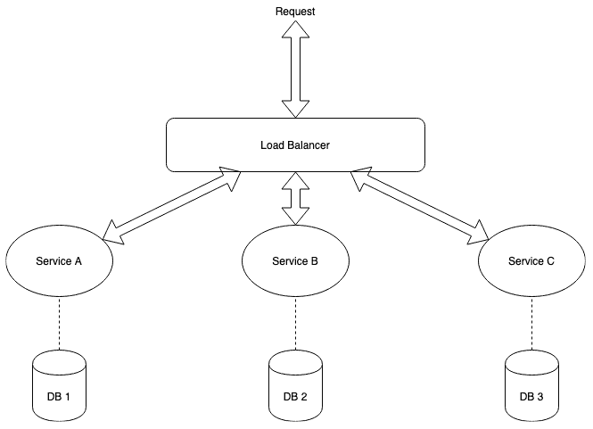

# 托管微服务

托管微服务并非大多数“普通”网站托管商所熟悉的事情。传统网站通常由 HTML 文件、CSS 和 JavaScript 组成，可能还有一种脚本语言，如 PHP、Python 或 Ruby。极少有提供商允许你在服务器上运行原生应用程序，除非你租用整台服务器。不用说，当你想托管一个 Vapor 应用程序，更不用说一组应用程序时，这是一个挑战。

在本章中，你将探索托管 Swift 以及专门托管 Vapor 应用程序所需的条件。我们将概述总体需求，然后应用这些知识，以便你实际托管你的 API。我们将设置 Docker 并学习如何配置环境变量。逐步地，你将学习如何在服务器上托管 Swift 应用程序，以便你知道如何将其应用于其他应用程序。在本章结束时，你将了解在生产环境中运行 Vapor 应用程序所需的一切。

本章将涵盖以下主题：

*   设置微服务环境
*   探索 Linux 上的 Swift
*   通过 Docker 运行 Swift
*   使用配置和环境变量

让我们开始吧！

# 技术要求

本节介绍你需要在机器上运行的内容，以便编写本章的微服务。需要安装以下组件：

*   Vapor 4
*   Swift 5
*   Xcode 11
*   macOS/Linux

如果你计划在同一台服务器上运行多个服务，你还应该熟悉 Nginx。我们还假设你已经学习了前几章，并知道如何编写 Vapor 微服务。本章中的所有代码在 macOS 和 Linux 上运行方式相同。

本章的 GitHub URL 如下：`https://github.com/PacktPublishing/Hands-On-Swift-5-Microservices-Development/tree/master/Chapter%2013`。

# 设置微服务环境

到目前为止，你一直在本地计算机上运行微服务。在本节中，我们将从理想角度讨论微服务环境应是什么样子的。微服务环境由运行微服务的多台服务器组成。由于这些服务器可能物理分离，因此每台服务器都可以独立处理。我们将从单服务器设置开始，逐步过渡到多服务器设置。

我们将探讨以下主题：

*   从简单的服务开始：我们将让一个服务仅用一台服务器就启动并运行。
*   管理数据库和微服务：我们将卸载额外的服务以提高应用程序的性能。
*   利用负载均衡器的力量：我们将把多个服务结合起来。
*   最终设置：大多数生产应用程序都有类似的设置。

让我们从简单的设置开始。

# 从简单的服务开始


如果我们想要托管最简单的微服务设置，它将仅包含一个服务。有人可能会争辩说，这不再算作微服务设置，因为我们只在处理一个服务，但让我们假设这是我们可以开始的最简单的微服务设置。我们需要什么？一台服务器，或可计算实体。你可能会想，为什么要区分“可计算实体”和“服务器”？答案很简单：在云运行服务器的世界里，我们并不总是在处理你会归类为“服务器”的东西，因为实际的服务器可能正在做很多不同的事情，而我们只在使用它的一小部分。为求简单起见，让我们假设我们在处理服务器，尽管你可能会发现它们有不同的称呼，例如计算单元。

所以，我们有一台服务器；一台运行着我们 Vapor 应用的单台服务器。不过，我们该如何访问这台服务器呢？服务器通常通过 IP 地址访问，而 IP 地址通常隐藏在一个更人性化的**域名系统**（**DNS**）名称背后。因此，例如，我们有一个名为 `http://api.myawesomeshop.com` 的域名。

客户端现在会将其解析为 IP 地址并尝试加载数据。重要的是要注意，如果未指定端口，客户端将使用端口 `80`。这为什么重要？因为 Vapor 应用程序实际上代表了整个服务器。因此，我们需要监听正确的端口才能正确响应请求。你可能已经注意到，Vapor 通常监听端口 `8080`。

如果我们现在有一个在服务器上运行、监听端口 `8080` 的应用程序，一个示例请求实际上看起来会像这样：

```
http://api.mywawesomeshop.com:8080/v1/products/categories
```

现在我们指定了端口，每个客户端（包括你的浏览器）都能正确访问 API。

这是我们能拥有的最简单、最基础的设置：一台服务器，运行一个 Vapor 应用和一个特定端口，并响应请求。让我们快速讨论一下我们在这里遇到的一些常见问题：

*   **SSL 默认未激活**：Vapor *可以*响应 SSL 请求。但是，它没有预先配置为此功能，且需要一些密集的设置和相关知识。我们稍后将探讨如何解决这个问题。

*   **一旦 Vapor 崩溃，服务器将变得无响应**：这是一个普遍存在的问题。最好的预防技术是不让你的应用崩溃。然而，如果它确实崩溃了，也有应对的方法——我们稍后会研究一下。

*   **我们想要提供标准端口**（`80`）：在这种情况下，使用 `--port 80` 运行应用即可解决问题。

既然我们已经了解了最基础的设置，接下来让我们谈谈如何通过数据库和额外服务来增强它。

# 管理数据库和微服务

你可能想在你的服务中使用数据库。事实上，你的一个或多个服务很可能需要它。那么，这该如何运作？理论上，在运行我们应用程序的同一台服务器上运行数据库应用程序（如 MySQL 或 PostgreSQL）没有问题。只要它在不同的端口上（默认情况下就是如此），多个应用程序就可以在同一台服务器上运行。同样，我们也可以在同一台服务器上运行第二个微服务，只需使用不同的端口。实际上，这正是你在开发时一直在做的事情：在同一台机器上运行多个服务。

总体来说，这样做没有错。但是，你确实需要考虑以下几点：

*   你的服务器能管理正在运行的应用程序吗？你有足够的硬件资源吗？
*   如果你的某个服务在 CPU 和内存使用上出现峰值，这会如何影响其他服务？
*   服务器是否已为每个运行的应用程序正确配置？

每个应用程序对这些问题都有自己的答案，但随着我们进阶到更复杂的设置，将服务分离到不同的服务器上也变得合理。这也适用于第 12 章 *最佳实践* 中先前介绍的关注点分离原则。通常最好在不同的服务器上运行服务和数据库，主要原因如下：

*   **服务器的个性化调优**：数据库可能需要大量内存，而服务主要需要 CPU。事实上，在硬件层面，一些处理器更适合存储，而另一些更适合计算。对于生产就绪的应用程序，不要低估这一点。

*   **个性化的恢复和备份**：有些数据比其他数据更重要。你可能需要为数据库进行频繁备份和快速恢复，但不太在意 Vapor 应用的备份，因为它不存储任何数据。拥有多台服务器可以实现这一点。

你可能想知道使用 Docker 是否能解决大部分这些问题，同时允许你在同一台机器上运行。简单的回答是：可以。你*可以*在一台机器上运行 Docker，包含所有服务和数据库。唯一的问题是，如果你的整个服务器（包括 Docker）崩溃了。在一个通过云计算获得算力和服务器非常实惠的世界里，使用不同的服务器更合理。

现在，你可能想知道使用不同端口是否是最实用的选择。我们像这样调用服务：

```
http://api.myawesomeshop.com:8080/v1/products/categories
http://api.myawesomeshop.com:8081/v1/orders/history
```

在这种情况下，我们可以缩短 URL 的长度，因为端口反正已经成为唯一标识服务的一部分。那么，我们如何解决这个问题？答案很简单：负载均衡器。

我们将在下一节中查看这一点。

# 利用负载均衡器的力量

负载均衡器是一种服务器（某种意义上），它只负责将流量重定向到正确的接收者，以及平衡流量。我们之前的 URL 现在可以变成这样：

```
http://api.myawesomeshop.com/v1/products/categories
http://api.myawesomeshop.com/v1/orders/history
```

负载均衡器监听端口 `80`，因为这是 Web 的默认端口。例如，从我们之前的例子来看，如果 URL 匹配 "`/products/`"，它会重定向到端口 `8080`；如果匹配 "`/orders/`"，它会重定向到端口 `8081`。我们实际上可以配置任何想要的端口；负载均衡器会为我们处理转换。这样的负载均衡器可以是一台处理重定向过程的简单服务器，例如 Nginx。如果你必须在一台服务器上运行微服务，使用 Nginx 将帮助你保持常规的 URL 结构。现在，你可能会声称（而且是对的）在同一台机器上使用负载均衡器也违反了关注点分离原则。

在这种情况下，你会将负载均衡器卸载到另一台服务器上。所有云提供商都提供完全负责为你重定向流量的托管负载均衡器。只要有可能，我建议使用那些，因为它们既实惠又可靠。

引入负载均衡器让我们进入了最后的设置阶段：生产就绪设置。

# 最终设置

在本节中，我们将描述理想且最终的微服务设置。自然，这会因应用程序而异，但总体原则保持不变。最重要的一点是保持关注点分离。这意味着你的数据库应用程序不应与你的 Vapor 应用程序位于同一台服务器上。

负载均衡器作为所有请求的中心接入点。它根据路由将请求重定向到每个服务。服务将尽可能避免相互之间的通信。每个服务仅对其自身的功能负责，而负载均衡器将它们联系在一起，使它们成为同一个应用程序的一部分。

下图展示了此设置的样子：




正如你所见，数据库服务器也是分离的。理想情况下，你希望每个服务都能完全独立运行，包括其相关服务，例如数据库。

在某些情况下，你可能决定将一些服务放在同一台服务器上。在这种情况下，我建议你将数据库放在一起，将 `Vapor` 应用程序放在一起。大多数云托管提供商都提供托管数据库服务器，这通常是此类分组的安全选择。

既然我们已经了解了总体设置，让我们来看看 `Swift` 如何在 `Linux` 上运行。

# 探索 Linux 上的 Swift

当 `Apple` 发布 `Swift` 并使其开源时，`Swift` 在 `Linux` 上的运行是一个巨大的惊喜。然而，在 `Linux` 上运行 `Swift` 与在 `macOS`、`iOS`、`iPadOS` 或 `tvOS` 上运行并不完全相同。在 `Linux` 上运行 `Swift` 本质上意味着在一个与 `Apple` 平台截然不同的环境中运行它。在本节中，我们将探讨两个具体方面：

*   **`Swift` 在 `Linux` 上的现状**：`Swift` for `Linux` 目前处于什么阶段？
*   **在 `Ubuntu` 上安装 `Linux`**：我们将在 `Ubuntu` 实例上安装 `Swift`。

让我们从 `Swift` 的现状开始。

## Swift 在 Linux 上的现状

起初，`Swift` 很难很好地适配 `Linux`。虽然 `macOS` 基于 `Unix`（`Linux` 也是），但有许多库是 `Apple` 决定不开源的，或者并非完全开源（例如 `Foundation`）。这导致一个为 `macOS` 编译的 `Swift` 应用程序可能无法在 `Linux` 上表现出完全相同的行为。如果你曾经接触过 `C` 或 `C++`，你就会非常了解这个问题。好消息是，`Swift` 在 `Linux` 平台上的演进已将这个问题减少为少数边缘情况。这主要归功于 `Apple` 本身提供了相当数量的专门针对 `Linux` 且非常实用的库（如 `SwiftNIO`、`swift-metrics` 等）。

目前 `Swift` 可以在许多平台上运行，包括 `Android` 和 `Windows`。但重要的是要记住，我们希望服务器可靠运行。因此，我建议仅使用官方支持的平台。对于 `Linux`，目前仅涉及 `Ubuntu`。然而，`Ubuntu` 是最常用的 `Linux` 服务器发行版之一，且得到广泛支持。每个服务器提供商都能提供 `Ubuntu` 服务器。

既然你知道了现状，让我们应用这些知识在 `Ubuntu` 上安装 `Swift`。

## 在 Ubuntu 上安装 Linux

一旦我们拥有一台 `Ubuntu` 服务器，只需安装正确的软件包即可。你可能没有可用的空闲电脑来尝试。如果你已经有云提供商，可能想要启动一台云 `Ubuntu` 服务器来遵循本节的说明。

通常，你不会手动在生产系统的 `Linux` 上安装 `Swift`。然而，对于调试而言，了解如何手动安装 `Swift` 非常有用。

说明非常简单。要在 `Ubuntu` 上安装 `Linux`，请遵循以下步骤：

1.  安装一些工具，即 `clang`、`curl` 和 `python`，以及它们的 `dev` 包，如下所示：

```
sudo apt-get install clang libcurl3 libpython2.7 libpython2.7-dev
```

2.  下载 `Swift` 并解压，如下所示：

```
wget https://swift.org/builds/swift-5.0.1-release/ubuntu1804/swift-5.0.1-RELEASE/swift-5.0.1-RELEASE-ubuntu18.04.tar.gz
tar xzf swift-5.0.1-RELEASE-ubuntu18.04.tar.gz
```

3.  将 `Swift` 移动到更好的位置并链接其路径：

```
sudo mv swift-5.0.1-RELEASE-ubuntu18.04 /usr/share/swift
echo "export PATH=/usr/share/swift/usr/bin:$PATH" >> ~/.bashrc
source ~/.bashrc
```

4.  现在，我们可以验证 `Swift` 是否已安装：

```
swift --version
```

这应该会输出安装的 `Swift` 版本。

5.  `swift` 程序在 `Linux` 上的工作方式与在 `macOS` 上相同。因此，要编译 `Vapor` 应用，我们将执行以下操作：

```
swift build && ./.build/debug/Run
```

这就是在 `Linux` 上运行 `Swift` 所需的一切。现在我们已经学会了如何在 `Linux` 上运行 `Swift`，让我们看看运行 `Swift` 服务器的实用方面。

## 通过 Docker 运行 Swift

如果我们像之前那样手动设置每台服务器，将永远无法完成部署。幸运的是，一个名为 `Docker` 的实用工具不仅能自动化这一步骤，还能为服务器提供智能内存管理。`Docker` 是一个将应用程序容器化并赋予它们隔离环境的工具，同时也会根据需要保存其状态以便运行。这意味着如果我们将前面的步骤放入 `Dockerfile` 中，就可以在需要时随时启动该文件。

幸运的是，`Apple` 已经为我们做好了。我们可以访问官方的 `Swift` `Docker` 镜像，它们提供了我们所需的一切。通过查看 `Dockerfile` 可以最好地解释 `Docker`，所以让我们看看标准的 `Vapor` `Dockerfile`。`Dockerfile` 是一个文本文件，包含 `Docker` 创建镜像所需的所有指令，我们随后可以将这些镜像作为容器运行。

请查看以下 `Dockerfile`：

```
# ================================
# Build image
# ================================
FROM vapor/swift:5.1 as build
WORKDIR /build

# Copy entire repo into container
COPY . .

# Install sqlite3
RUN apt-get update -y \
        && apt-get install -y libsqlite3-dev

# Compile with optimizations
RUN swift build \
        --enable-test-discovery \
        -c release

# ================================
# Run image
# ================================
FROM vapor/ubuntu:18.04
WORKDIR /run

# Copy build artifacts
COPY --from=build /build/.build/release /run
# Copy Swift runtime libraries
COPY --from=build /usr/lib/swift/ /usr/lib/swift/

ENTRYPOINT ["./Run", "serve", "--env", "production", "--hostname", "0.0.0.0", "--port", "80"]
```

在第 4 行，你可以看到我们声明了 `FROM vapor/swift:5.1 as build`。这意味着我们正在启动一个新镜像，使用来自 `Vapor` 仓库的 `Swift` 5.1 版本。我们称这个镜像为 `build`，因为有 `as` 关键字。再往下，你可以看到我们也调用了 `FROM vapor/ubuntu:18.04`。在第二个镜像中，我们不需要给它命名，因为它不被其他镜像引用。构建镜像仅编译我们的应用程序。它使用来自 `Vapor` 的官方 `Swift` 镜像来获取编译 `Swift` 所需的一切。然后，它编译我们的应用程序。运行镜像仅使用常规的 `Ubuntu` 镜像，然后复制应用程序。这样做的原因是我们的实际服务器不需要任何源文件，也不需要 `Swift` 环境。因此，一方面我们没有暴露源代码，另一方面也保持了最小化。

请注意，我们可以直接在 `Dockerfile` 中指定端口。这使我们能够轻松使用不同的端口。

现在我们已经了解了 `Docker` 并学会了如何在 `Linux` 上设置 `Swift`，让我们看看如何为你的应用程序提供凭据。

## 环境变量

你在 第 3 章 *Getting Started with the Vapor Framework* 中学习了如何在 `macOS` 上将配置变量传递给你的 `Vapor` 应用。通过简单地提供环境变量，应用程序就知道你的配置凭据。在 `macOS` 上，这看起来像这样：

```
export DATABASE_USER="user"
```

同样的方法也适用于非 `macOS` 的服务器。请注意，根据特定的 `Linux` 发行版，你的服务器可能期望变量采用不同的格式。一般来说，你要确保知道如何在运行时向应用程序提供环境变量。你不希望将它们作为默认值暴露在代码中，也不希望暴露在 `Docker` 镜像中。


您的凭据可能会通过镜像中的存在而暴露，这不仅构成安全威胁，还会使您更难更改它们。因此，您希望保持它们的灵活性并将其移出代码。所有服务器环境都为您提供了一种在运行时向应用程序暴露变量的方法。

对于 Ubuntu，这与 macOS 相同。因此，如果您通过安装 Ubuntu 直接运行服务器，`export` 函数将完成其所需的工作。然而，Docker 容器从 Docker 获取环境变量。根据您运行 Docker 的方式，这可能需要您查阅特定文档。对于标准 Docker，您可以通过为变量添加 `\-e` 参数来实现，如下所示：

```
docker run -e SENDGRID_API_KEY="SG.IoE" -p 8080:8080 myservice
```

`SENDGRID_API_KEY` 是示例变量。

现在我们已经了解了如何将配置传递给服务器，让我们总结本章。

# 总结

开始吧！在本章中，我们了解了 Swift 在服务端的现状。我们从通用的微服务结构入手，了解了其样貌。在此过程中，我们从单服务器系统过渡到多服务器系统，包括负载均衡器。

随后，我们探讨了如何在 Linux 系统上运行 Vapor 应用。我们完整走过了 Swift 安装过程，接着了解了 Docker 如何简化安装过程。最后，我们研究了配置应如何传递给服务器应用，以及这在 macOS、Linux 和 Docker 上的表现。

在本章中，您了解了 Swift 在服务端的地位。您学会了如何在 Ubuntu 上安装 Swift 以及如何通过 Docker 运行它。掌握这些技能后，您基本上可以在 Linux 服务器上运行任何 Swift 应用。

既然您已掌握使用 Swift 运行服务器应用的基础，下一章我们将把应用部署到云端！

# 问题

为确保您对本章的理解扎实，请回答以下问题：

1.  为什么不建议仅在一台服务器上运行整个后端？

2.  Docker 如何简化您的安装过程？

3.  您应该如何在数据库中存储凭据？

4.  负载均衡器扮演什么角色？
