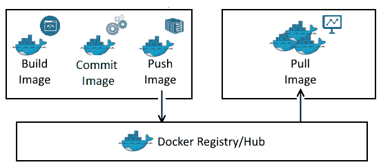
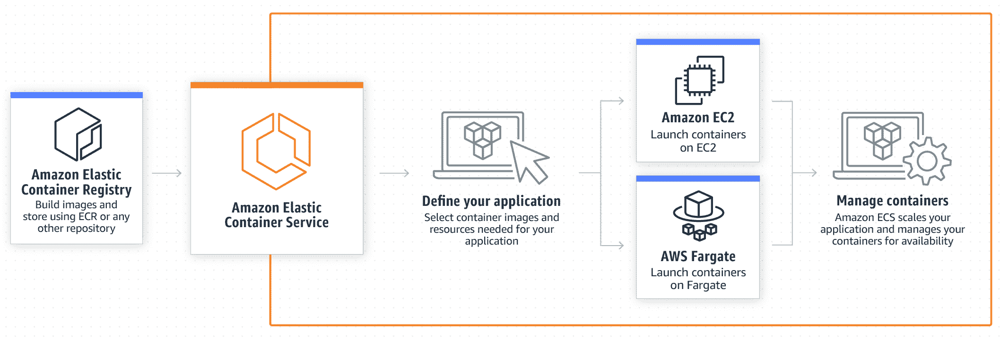
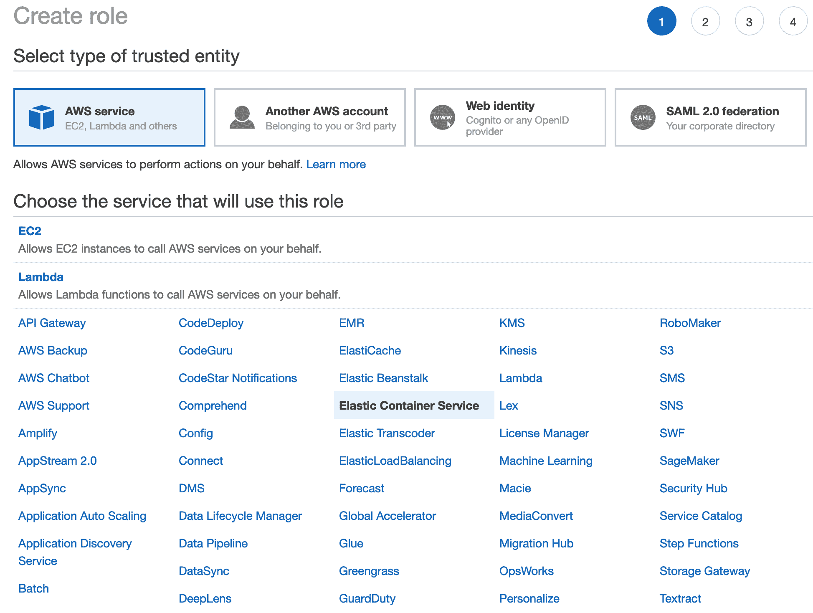
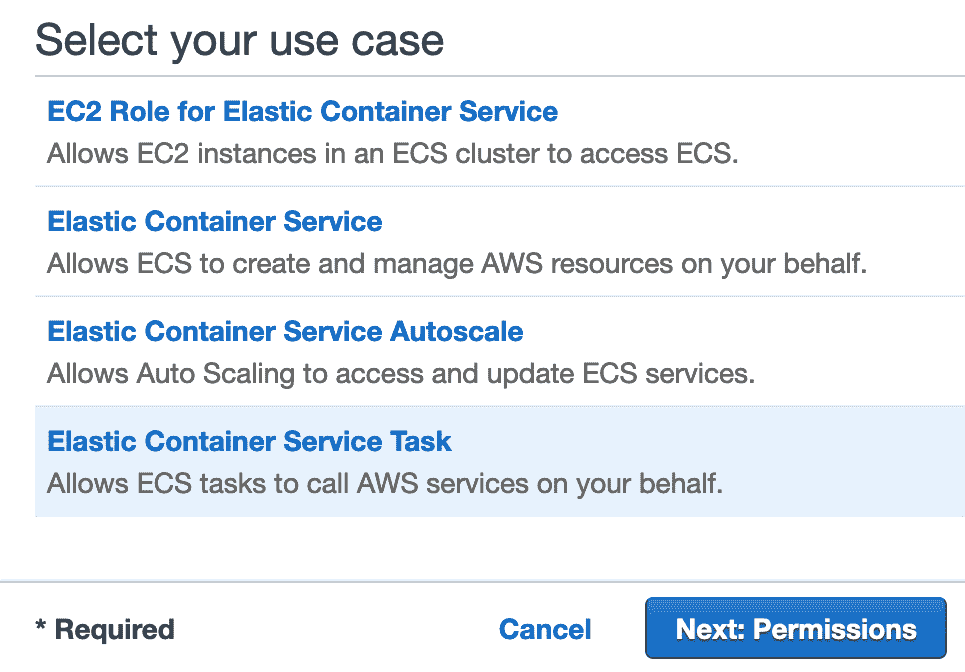
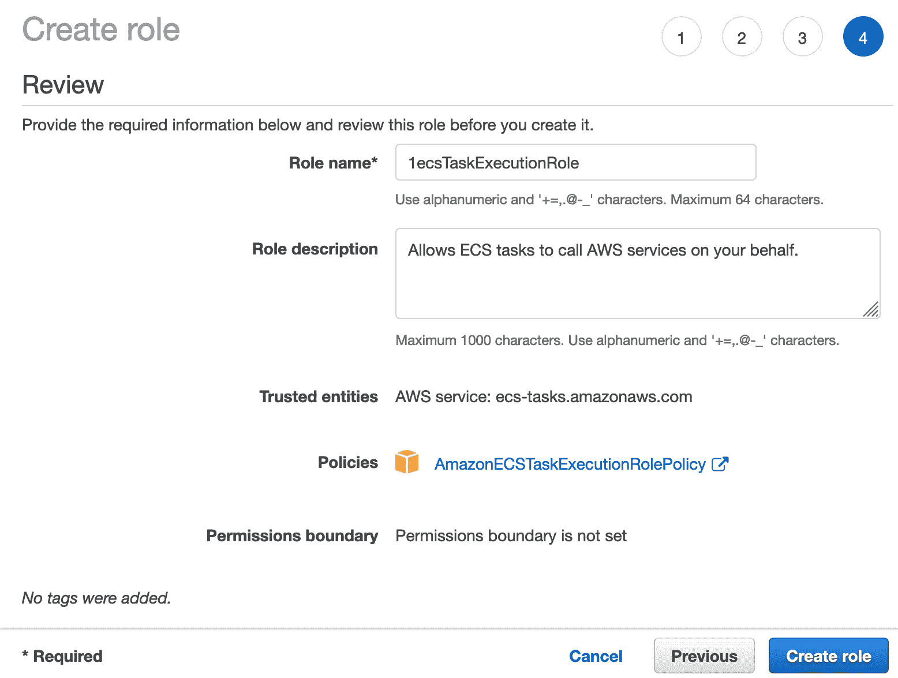

# Docker 与云

在部署微服务时，Docker 无疑是最常用、最流行的技术，帮助我们启动服务。我们在 第 13 章 *托管微服务* 中介绍了 Docker，在本章中，我们将深入探讨。首先，我们将深入理解 Docker 本身及其运行方式。然后，我们将更好地了解在不同云提供商上运行 Docker 的情况。

学完本章后，您将确切了解 Docker 如何与服务端 Swift 结合，以及不同云提供商如何处理 Docker。

本章将涵盖以下主题：

*   探索 Docker 容器与镜像：了解 Docker 的核心
*   在 AWS 上运行 Docker：最流行的云提供商
*   在 Google Cloud 上运行 Docker：运行可扩展后端的另一种选择
*   在 Digital Ocean 上运行 Docker：使用 Digital Ocean 启动您的后端
*   在 Heroku 上运行 Docker：使用 Heroku 运行您的后端
*   使用 Kubernetes：一种良好管理 Docker 的方式

让我们从 Docker 基础开始！

# 技术要求

本节介绍您需要在机器上运行的组件，以便编写本章的微服务。需要安装以下组件：

*   `Vapor 4`
*   `Swift 5`
*   `XCode 11+`
*   `Docker`
*   `macOS/Linux`
*   `AWS CLI`
*   `Google Cloud CLI`
*   `Docker Machine`

我们还假设您已学完前几章，知道如何编写 Vapor 微服务。本章所有代码在 macOS 和 Linux 下运行方式相同。

对于本章，您可能想注册一个您选择的云提供商账号。我们将介绍最流行的几个，但如果您已有账号，将更容易跟随操作。

本章的 GitHub 仓库：[`github.com/PacktPublishing/Hands-On-Swift-5-Microservices-Development/tree/master/Chapter 14`](https://github.com/PacktPublishing/Hands-On-Swift-5-Microservices-Development/tree/master/Chapter%2014)。

# 探索 Docker 容器与镜像

此时，您的机器上应已安装 Docker。如果没有，请访问 [`docs.docker.com/install/`](https://docs.docker.com/install/) 并按照您系统的说明操作。在本节中，我们将探索 Docker 的核心，以更好地理解其运作方式。Docker 拥有镜像（编译后的系统状态）和容器（运行时的系统状态）。两者都是 Docker 交互的核心单元。

本节将涵盖以下主题：

*   设置 Docker：我们将确保 Docker 已正确安装。
*   镜像、仓库与容器：理解它们的区别与用途。
*   启动 Hello World：来自 Docker 的问候。

让我们从设置 Docker 开始。

# 设置 Docker

让我们确保您的系统已正确安装 Docker，并且您可以继续后续步骤。如果您尚未安装 Docker，请访问 [`docs.docker.com/install/`](https://docs.docker.com/install/) 并在您的机器上安装它。

打开终端（或控制台）并运行以下命令：

```
docker version
```

您的输出现在应显示版本，如下所示：

```
Client: Docker Engine - Community
 Version:           19.03.5
 API version:       1.40
 Go version:        go1.12.12
 Git commit:        633a0ea
 Built:             Wed Nov 13 07:22:34 2019
 OS/Arch:           darwin/amd64
 Experimental:      false

Server: Docker Engine - Community
 Engine:
  Version:          19.03.5
  API version:      1.40 (minimum version 1.12)
  Go version:       go1.12.12
  Git commit:       633a0ea
  Built:            Wed Nov 13 07:29:19 2019
  OS/Arch:          linux/amd64
  Experimental:     false
 containerd:
  Version:          v1.2.10
  GitCommit:        b34a5c8af56e510852c35414db4c1f4fa6172339
 runc:
  Version:          1.0.0-rc8+dev
  GitCommit:        3e425f80a8c931f88e6d94a8c831b9d5aa481657
 docker-init:
  Version:          0.18.0
  GitCommit:        fec3683
```

请确保安装了 Docker 19 或更新版本。当您运行 Docker 时，实际上使用的是 Docker 客户端。在 macOS 上，服务器是 Docker Desktop 的一部分，后者实际完成了大部分工作。请确保 Docker Desktop 也已启动并运行。如果已运行，您应该会在顶部栏看到一个小图标，如下所示：


现在，我们已准备好使用 Docker，让我们开始了解镜像和容器。

# 镜像、仓库与容器

我们在 第 2 章 *理解服务端 Swift* 中简要讨论了镜像和容器。在本节中，我们将讨论 Docker 的三个主要元素：

*   仓库
*   镜像
*   容器

让我们从仓库开始。

# 仓库

您可能从使用 Git 或其他版本控制工具中了解什么是仓库。对于 Docker 也是如此。仓库保存 Docker 镜像的不同版本。当您构建 Docker 镜像时，它会本地存储在构建它的计算机上。然后，我们可以将其推送到仓库，在那里它被保存和版本控制。

从该仓库，当我们想将其作为容器运行时，可以再次拉取它。

下图解释了镜像和仓库是如何连接的：



现在，让我们看看镜像。

# 镜像


# 镜像和 Dockerfile

镜像是您保存在仓库中的内容。它们由您的 `Dockerfile` 的“编译”版本组成，包括所有需要运行的文件。`Dockerfile` 是描述镜像应有形态的文件，类似于源代码。一个 `Dockerfile` 通常会生成一个或多个镜像。镜像之间也可以相互依赖和关联。

请注意，例如，Swift 的 `Dockerfile` 长这样：

```
FROM swift:5.1.1
```

这意味着我们正在使用另一个镜像作为新镜像的基础。上述版本为 5.1.1 的 Swift 镜像，实际上使用的是 Ubuntu 镜像。类似于编程中的类可以相互关联和继承，Docker 镜像也可以相互基于。好的一点是，新的 Docker 镜像只包含与继承镜像的差异部分。这意味着我们的最终镜像可以非常小。

# 容器

容器是在主机上运行的镜像。因此，当 Docker 启动我们的镜像时，它们就变成了容器。换句话说，容器就是被启动的镜像。每当 Docker 用于运行服务器应用程序时，它就被归类为运行该应用程序的容器。因此，容器类似于应用程序的操作系统。

需要 Debian Linux 的应用程序将拥有一个类似于 Debian Linux 的容器。需要 CentOS 的应用程序将拥有一个 CentOS 环境。然而，这些可以在完全不同的主机系统（如 macOS）中运行。

# 启动 Hello World

在本节中，我们将启动一个实际的 Docker 镜像。最后，您应该已经运行了一个 Docker 容器，并看到了它的样子。让我们启动并运行 Docker。打开终端并运行以下命令：

```
% docker run hello-world
```

如果您收到以下输出，应确保 Docker Desktop 已启动并正在运行：

```
docker: Cannot connect to the Docker daemon at unix:///var/run/docker.sock. Is the docker daemon running?.
```

如果一切正常，您应该会看到以下内容：

```
Unable to find image 'hello-world:latest' locally
latest: Pulling from library/hello-world
1b930d010525: Pull complete 
Digest: sha256:9572f7cdcee8591948c2963463447a53466950b3fc15a247fcad1917ca215a2f
Status: Downloaded newer image for hello-world:latest

Hello from Docker!
This message shows that your installation appears to be working correctly.
```

注意 Docker 如何在找不到镜像时自动开始拉取它？Docker 总是检查本地缓存，所以要确认镜像是否已经存在。请记住 Docker 镜像可以相互关联。拉取镜像时，我们实际上希望 Docker 加载相关的镜像。在此例中，`hello-world` 镜像依赖项不多，但其他 Docker 镜像（如 `swift`）依赖于其他几个镜像。然而，镜像管理对我们开发者来说相当透明，所以我们不必过多担心。

现在我们了解了 Docker 的运作方式，并成功启动了“Hello World”应用程序，让我们开始在 AWS 上使用 Docker。

# 在 AWS 上运行 Docker

在 AWS 中运行 Docker 可以通过几种方式实现。AWS 代表 Amazon Web Services，是目前最流行、最大的云服务提供商。无数网站运行在 AWS 上，包括 Netflix、Airbnb、Amazon 等。在本节中，我们将学习如何在 AWS 上运行 Docker。

最不方便但可定制性最强的方法是我们自己在云计算机上安装 Docker，然后以那种方式运行我们的后端。在深入探讨如何在 AWS 中运行 Docker 之前，让我们先定义几个概念：

*   **Amazon Elastic Compute Cloud (EC2)：** 这是虚拟服务器（`units/computing units`）运行的地方。我们说“服务器”时，通常指的就是这个。这些机器通常是虚拟的，我们完全可以自行决定如何使用它们。操作系统、设置、权限等全由我们决定。

*   **Fargate：** 这是专门为 Docker 设计的 EC2 托管版本。在此版本中，除 Docker 镜像外的一切都由 AWS 替我们管理。

*   **Amazon Elastic Container Services (ECS)：** ECS 是一项 AWS 服务，允许我们以托管方式运行服务。

*   **任务描述：** Docker 容器的描述和配置。在 ECS 中启动的服务将使用任务描述来运行这些容器。一个任务可以运行多个容器，尽管通常一个就足够了。

*   **Elastic Container Registry (ECR)：** AWS 提供可用于存储 Docker 镜像的仓库。

*   **负载均衡器：** AWS 提供负载均衡器，以便您连接到服务。

在本节中，我们将探索在 AWS 上部署 Docker 最原生的方式。AWS 提供 Elastic Container Services (ECS) 作为部署 Docker 容器最直接的方式。ECS 的工作方式如下图所示：



流程从您推送（上传）Docker 镜像到 ECR 开始。ECS 的任务定义将使用该镜像部署服务。服务可以拥有任意数量的实例。每个实例本质上都是一个运行在您自己的 EC2 实例或 Fargate 上的 Docker 容器。

请确保您已设置并运行 AWS CLI。如果需要帮助，请访问 `https://docs.aws.amazon.com/cli/latest/userguide/cli-chap-install.html`。

那么，让我们通过以下步骤启动并运行我们的服务：

1.  输入以下命令以创建 Docker 仓库：

```
% aws ecr create-repository --repository-name examplevapor
```

您应该会看到以下输出：

```
{
    "repository": {
        "repositoryArn": "arn:aws:ecr:us-east-1:140099160703:repository/examplevapor",
        "registryId": "140099160703",
        "repositoryName": "examplevapor",
        "repositoryUri": "140099160703.dkr.ecr.us-east-1.amazonaws.com/examplevapor",
        "createdAt": 1580499621.0,
        "imageTagMutability": "MUTABLE",
        "imageScanningConfiguration": {
            "scanOnPush": false
        }
    }
}
```

2.  现在，我们必须创建一个集群来运行我们的应用程序：

```
% aws ecs create-cluster --cluster-name example-cluster
```

输出应如下所示：

```
{
    "cluster": {
        "clusterArn": "arn:aws:ecs:us-east-1:140099160703:cluster/example-cluster",
        "clusterName": "example-cluster",
        "status": "ACTIVE",
        "registeredContainerInstancesCount": 0,
        "runningTasksCount": 0,
        "pendingTasksCount": 0,
        "activeServicesCount": 0,
        "statistics": [],
        "tags": [],
        "settings": [
            {
                "name": "containerInsights",
                "value": "disabled"
            }
        ]
    }
}
```

这里我们使用的是 ECS 集群。这是管理项目和服务的好方法。这意味着您可以将所有相关服务放入一个集群中。

接下来，我们需要创建任务描述。您可以在本章的源代码中找到它，但这里简要列出其内容：

```
{
  "family": "vapor-example-app",
  "executionRoleArn": "arn:aws:iam::140099160703:role/ecsTaskExecutionRole",
  "containerDefinitions": [
    {
      "name": "vapor-example-app",
      "portMappings": [
        {
          "hostPort": 8080,
          "protocol": "tcp",
          "containerPort": 8080
        }
      ],
      "essential": true,
      "environment": [
        {
          "name": "EXAMPLE_VAR",
          "value": "configValue"
        }
      ],
      "image": "140099160703.dkr.ecr.us-east-1.amazonaws.com/examplevapor:latest"
    }
  ],
  "memory": "512",
  "requiresCompatibilities": [
    "FARGATE"
  ],
  "networkMode": "awsvpc",
  "cpu": "256"
}
```


### 3. 替换 `image` 值

你需要将 `image` 的值替换为 `repositoryUri` 中的内容。这样做是为了让此任务引用我们刚刚创建的仓库。

### 4. 替换 `executionRoleArn`

你还需要将 `executionRoleArn` 替换为一个需要创建的角色。在浏览器中打开 [`console.aws.amazon.com/iam/home`](https://console.aws.amazon.com/iam/home) 并点击 **Roles**。

### 5. 检查 `ecsTaskExecutionRole`

检查是否已存在名为 `ecsTaskExecutionRole` 的角色。如果存在，复制该角色的 ARN 并粘贴到 `taskdefinition.json` 文件中。

### 6. 创建角色（如果不存在）

如果不存在，点击 **Create Role**。然后选择 **Elastic Container Service**：



### 7. 选择用例

接下来，选择 **Elastic Container Service Task**：



### 8. 附加权限策略

点击 **Next: Permissions**，选择 `AmazonECSTaskExecutionRolePolicy` 作为策略，然后点击 **Next**：



### 9. 命名并创建角色

给角色命名，例如 `ecsTaskExecutionRole`，然后点击 **Create role**。

### 10. 粘贴角色 ARN

复制该新建角色的 ARN 并粘贴到 `taskdefinition.json` 文件中。

### 11. 编译 Docker 镜像：登录认证

现在我们可以编译 Docker 镜像。输入以下命令以登录并认证 Docker：

```bash
$(aws ecr get-login --no-include-email --region us-east-1)
```

### 12. 构建 Docker 镜像

接下来，构建实际的 Docker 镜像：

```bash
docker build -t examplevapor .
```

这应该会产生如下输出（可能需要一分钟）：

```
Successfully built 636a60295c3f
Successfully tagged examplevapor:latest
```

### 13. 标记镜像

现在，我们必须正确标记镜像，以便 AWS 知道将其放在何处：

```bash
docker tag examplevapor:latest 140099160703.dkr.ecr.us-east-1.amazonaws.com/examplevapor:latest
```

### 14. 推送镜像

现在，我们可以推送镜像，即将其上传到仓库：

```bash
docker push 140099160703.dkr.ecr.us-east-1.amazonaws.com/examplevapor:latest
```

最后两行应该如下所示：

```
cc967c529ced: Pushed 
latest: digest: sha256:49c8a5bdf2d31c1d92804b1d31a812e4d394c57bc89d40f615dfd7f776b7427a size: 1788
```

镜像现已存入仓库，我们可以使用该镜像启动服务。

### 15. 注册任务定义

使用我们之前编辑的文件创建新的任务定义：

```bash
aws ecs register-task-definition --cli-input-json file://$HOME/Hands-On-Microservices-with-Swift-5/Chapter\ 14/ExampleVaporApp/taskdefinition.json
```

### 16. 列出任务定义

列出所有可用的任务定义：

```bash
aws ecs list-task-definitions
```

结果应如下所示：

```json
{
    "taskDefinitionArns": [
        "arn:aws:ecs:us-east-1:140099160703:task-definition/vapor-example-app:1"
    ]
}
```

### 17. 获取子网 ID

要启动新服务，我们需要获取子网 ID 和安全组 ID。通过列出所有预配置的子网来获取子网 ID：

```bash
aws ec2 describe-subnets
```

这应该会产生如下列表：

```json
{
    "Subnets": [
        {
            "AvailabilityZone": "us-east-1c",
            "AvailabilityZoneId": "use1-az6",
            "AvailableIpAddressCount": 4091,
            "CidrBlock": "172.31.32.0/20",
            "DefaultForAz": true,
            "MapPublicIpOnLaunch": true,
            "State": "available",
            "SubnetId": "subnet-902638cc",
            "VpcId": "vpc-f497b98e",
            "OwnerId": "426628247310",
            "AssignIpv6AddressOnCreation": false,
            "Ipv6CidrBlockAssociationSet": [],
            "SubnetArn": "arn:aws:ec2:us-east-1:426628247310:subnet/subnet-902638cc"
        }
    ]
}
```

### 18. 获取安全组 ID

现在，获取我们预先存在的安全组：

```bash
aws ec2 describe-security-groups
```

结果应如下所示：

```json
{
    "SecurityGroups": [
        {
            "Description": "default VPC security group",
            "GroupName": "default",
            "IpPermissions": [
                {
                    "IpProtocol": "-1",
                    "IpRanges": [],
                    "Ipv6Ranges": [],
                    "PrefixListIds": [],
                    "UserIdGroupPairs": [
                        {
                            "GroupId": "sg-51339979",
                            "UserId": "426628247310"
                        }
                    ]
                }
            ],
            "OwnerId": "426628247310",
            "GroupId": "sg-51339979",
            "IpPermissionsEgress": [
                {
                    "IpProtocol": "-1",
                    "IpRanges": [
                        {
                            "CidrIp": "0.0.0.0/0"
                        }
                    ],
                    "Ipv6Ranges": [],
                    "PrefixListIds": [],
                    "UserIdGroupPairs": []
                }
            ],
            "VpcId": "vpc-f497b98e"
        }
    ]
}
```

### 19. 添加入站规则（端口 8080）

现在，我们需要添加一条规则以允许流量访问端口 8080：

```bash
aws ec2 authorize-security-group-ingress --group-id sg-51339979 --protocol tcp --port 8080 --cidr 0.0.0.0/0
```

### 20. 创建服务

服务所需的准备工作已完成。现在我们可以使用之前的参数实际创建服务：

```bash
aws ecs create-service --cluster example-cluster --service-name vapor-example-service --task-definition vapor-example-app:1 --desired-count 1 --launch-type "FARGATE" --network-configuration "awsvpcConfiguration={subnets=[subnet-902638cc],securityGroups=[sg-51339979],assignPublicIp=ENABLED}"
```

结果应如下所示：

```json
{
    "service": {
        "serviceArn": "arn:aws:ecs:us-east-1:140099160703:service/vapor-example-service",
        "serviceName": "vapor-example-service",
        "clusterArn": "arn:aws:ecs:us-east-1:140099160703:cluster/example-cluster",
        "loadBalancers": [],
        "serviceRegistries": [],
        "status": "ACTIVE",
        "desiredCount": 1,
        "runningCount": 0,
        "pendingCount": 0,
        "launchType": "FARGATE",
        "platformVersion": "LATEST",
        "taskDefinition": "arn:aws:ecs:us-east-1:140099160703:task-definition/vapor-example-app:3",
        "deploymentConfiguration": {
            "maximumPercent": 200,
            "minimumHealthyPercent": 100
        },
        "deployments": [
            {
                "id": "ecs-svc/8628131754895004324",
                "status": "PRIMARY",
                "taskDefinition": "arn:aws:ecs:us-east-1:140099160703:task-definition/vapor-example-app:3",
                "desiredCount": 1,
                "pendingCount": 0,
                "runningCount": 0,
                "createdAt": 1580503971.319,
                "updatedAt": 1580503971.319,
                "launchType": "FARGATE",
                "platformVersion": "1.3.0",
                "networkConfiguration": {
                    "awsvpcConfiguration": {
                        "subnets": [
                            "subnet-470fc31b"
                        ],
                        "securityGroups": [
                            "sg-034e164b"
                        ],
                        "assignPublicIp": "ENABLED"
                    }
                }
            }
        ],
        "roleArn": "arn:aws:iam::140099160703:role/aws-service-role/ecs.amazonaws.com/AWSServiceRoleForECS",
        "events": [],
        "createdAt": 1580503971.319,
        "placementConstraints": [],
        "placementStrategy": [],
        "networkConfiguration": {
            "awsvpcConfiguration": {
                "subnets": [
                    "subnet-470fc31b"
                ],
                "securityGroups": [
                    "sg-034e164b"
                ],
                "assignPublicIp": "DISABLED"
            }
        },
        "schedulingStrategy": "REPLICA",
        "enableECSManagedTags": false,
        "propagateTags": "NONE"
    }
}
```


## 验证 AWS ECS 部署

现在，AWS ECS 应该正在根据给定的指令启动我们的服务。这将花费片刻时间，完成后我们可以运行下一条命令。

### 21. 列出任务

运行以下命令以查看所有任务：

```bash
% aws ecs list-tasks --cluster example-cluster
```

输出应如下所示：

```json
{
    "taskArns": [
        "arn:aws:ecs:us-east-1:426628247310:task/eba439a7-161d-458d-bfe7-30f9740c55bd"
    ]
}
```

### 22. 描述任务

我们可以使用此 ARN 获取任务的详细信息：

```bash
% aws ecs describe-tasks --tasks arn:aws:ecs:us-east-1:426628247310:task/eba439a7-161d-458d-bfe7-30f9740c55bd --cluster example-cluster
```

这将返回以下输出：

```json
{
    "tasks": [
        {
            "attachments": [
                {
                    "id": "83776154-c499-4523-8208-56b42d25bd50",
                    "type": "ElasticNetworkInterface",
                    "status": "ATTACHED",
                    "details": [
                        {
                            "name": "subnetId",
                            "value": "subnet-902638cc"
                        },
                        {
                            "name": "networkInterfaceId",
                            "value": "eni-0fa67334feeaeb953"
                        },
                        {
                            "name": "macAddress",
                            "value": "0e:be:55:3c:53:37"
                        },
                        {
                            "name": "privateIPv4Address",
                            "value": "172.31.42.196"
                        }
                    ]
                }
            ],
            "availabilityZone": "us-east-1c",
            "clusterArn": "arn:aws:ecs:us-east-1:426628247310:cluster/example-cluster",
            "connectivity": "CONNECTED",
            "connectivityAt": 1580570455.494,
            "containers": [
                {
                    "containerArn": "arn:aws:ecs:us-east-1:426628247310:container/c6bc752f-e8f6-4a0e-8afb-cb05405f8e7c",
                    "taskArn": "arn:aws:ecs:us-east-1:426628247310:task/eba439a7-161d-458d-bfe7-30f9740c55bd",
                    "name": "vapor-example-app",
                    "image": "426628247310.dkr.ecr.us-east-1.amazonaws.com/examplevapor",
                    "imageDigest": "sha256:478fa5fc86c63b30b576974d93df0b0f0baae48c0091e849520820b702a6529e",
                    "runtimeId": "4dcabd86e65e6f8e33bd44d9698fd3b2df6e00cfb34623b9cb23989f69ddc28e",
                    "lastStatus": "RUNNING",
                    "networkBindings": [],
                    "networkInterfaces": [
                        {
                            "attachmentId": "83776154-c499-4523-8208-56b42d25bd50",
                            "privateIpv4Address": "172.31.42.196"
                        }
                    ],
                    "healthStatus": "UNKNOWN",
                    "cpu": "0"
                }
            ],
            "cpu": "256",
            "createdAt": 1580570451.531,
            "desiredStatus": "RUNNING",
            "group": "service:vapor-example-service",
            "healthStatus": "UNKNOWN",
            "lastStatus": "RUNNING",
            "launchType": "FARGATE",
            "memory": "512",
            "overrides": {
                "containerOverrides": [
                    {
                        "name": "vapor-example-app"
                    }
                ],
                "inferenceAcceleratorOverrides": []
            },
            "platformVersion": "1.3.0",
            "pullStartedAt": 1580570465.171,
            "pullStoppedAt": 1580570516.171,
            "startedAt": 1580570521.171,
            "startedBy": "ecs-svc/6023872132268435911",
            "tags": [],
            "taskArn": "arn:aws:ecs:us-east-1:426628247310:task/eba439a7-161d-458d-bfe7-30f9740c55bd",
            "taskDefinitionArn": "arn:aws:ecs:us-east-1:426628247310:task-definition/vapor-example-app:1",
            "version": 3
        }
    ],
    "failures": []
}
```

获取 `networkInterfaceId` 的值。

### 23. 获取公网 IP

使用该值获取该网络接口的公网 IP：

```bash
% aws ec2 describe-network-interfaces --network-interface-ids eni-0fa67334feeaeb953
```

结果如下所示：

```json
{
    "NetworkInterfaces": [
        {
            "Association": {
                "IpOwnerId": "amazon",
                "PublicDnsName": "ec2-52-91-181-84.compute-1.amazonaws.com",
                "PublicIp": "52.91.181.84"
            },
            "Attachment": {
                "AttachTime": "2020-02-01T15:20:57.000Z",
                "AttachmentId": "eni-attach-08b8a63de74ff08eb",
                "DeleteOnTermination": false,
                "DeviceIndex": 1,
                "InstanceOwnerId": "899097435024",
                "Status": "attached"
            },
            "AvailabilityZone": "us-east-1c",
            "Description": "arn:aws:ecs:us-east-1:426628247310:attachment/83776154-c499-4523-8208-56b42d25bd50",
            "Groups": [
                {
                    "GroupName": "default",
                    "GroupId": "sg-51339979"
                }
            ],
            "InterfaceType": "interface",
            "Ipv6Addresses": [],
            "MacAddress": "0e:be:55:3c:53:37",
            "NetworkInterfaceId": "eni-0fa67334feeaeb953",
            "OwnerId": "426628247310",
            "PrivateDnsName": "ip-172-31-42-196.ec2.internal",
            "PrivateIpAddress": "172.31.42.196",
            "PrivateIpAddresses": [
                {
                    "Association": {
                        "IpOwnerId": "amazon",
                        "PublicDnsName": "ec2-52-91-181-84.compute-1.amazonaws.com",
                        "PublicIp": "52.91.181.84"
                    },
                    "Primary": true,
                    "PrivateDnsName": "ip-172-31-42-196.ec2.internal",
                    "PrivateIpAddress": "172.31.42.196"
                }
            ],
            "RequesterId": "578734482556",
            "RequesterManaged": true,
            "SourceDestCheck": true,
            "Status": "in-use",
            "SubnetId": "subnet-902638cc",
            "TagSet": [],
            "VpcId": "vpc-f497b98e"
        }
    ]
}
```

现在，这包含 `PublicIp`。获取它并在浏览器中打开（或使用 `curl`）：

```
http://52.91.181.84:8080/
```

您的浏览器现在应返回以下输出：

```
It works!
```

就这样——我们的 Vapor 应用现在正在 AWS 上运行！

让它启动并运行是一段相当漫长的旅程。现在，您应该明白为什么 DevOps 是一个需求不断增长的领域。不过，后端开发人员了解基础知识很重要，这就是为什么我们在这里经历了这段旅程。

太棒了——我们已成功部署了第一个应用，这是其他一切的基础。在下一节中，我们将了解 Google 以及如何使用 Google Cloud 进行部署。

# 在 Google Cloud 中运行 Docker

要在 Google Cloud 中运行 Docker，我们将使用 App Engine。Google 让部署 Docker 容器变得非常简单。让我们通过以下步骤部署示例应用：

### 1. 安装 Cloud SDK

确保您已安装 Cloud SDK。如果没有，请访问 `https://cloud.google.com/sdk/docs/quickstarts/` 并安装它。

### 2. 部署应用

在本章的 `ExampleVaporApp` 文件夹中输入以下命令：

```bash
% gcloud app deploy
```

您应该会看到以下输出：


## 部署输出

```
要部署的服务：

descriptor:      [/Users/amlug/projects/Hands-On-Microservices-with-Swift-5/Chapter 14/ExampleVaporApp/app.yaml]
source:          [/Users/amlug/projects/Hands-On-Microservices-with-Swift-5/Chapter 14/ExampleVaporApp]
target project:  [microservices-266818]
target service:  [default]
target version:  [20200131t132300]
target url:      [https://microservices-266818.appspot.com]


是否要继续 (Y/n)?  

正在项目 [microservices-266818] 上启用服务 [appengineflex.googleapis.com]...
操作 "operations/acf.85a472ed-f7c4-430d-80f2-2b6de51995ed" 已成功完成。
开始部署服务 [default]...
正在为服务 [default] 构建并推送镜像
```

执行完成后（最多可能需要 15 分钟），你应该会看到以下输出：

```
正在更新服务 [default]（这可能需要几分钟）...完成。 
正在为服务 [default] 设置流量拆分...完成。 
已将服务 [default] 部署到 [https://microservices-266818.appspot.com]

你可以通过运行以下命令从命令行流式传输日志：
 $ gcloud app logs tail -s default

要在网页浏览器中查看你的应用程序，请运行：
 $ gcloud app browse
```

这里可以看到，Google 使用了你所学的所有 Docker 知识。镜像会被编译并推送到 Google 管理的注册表，然后被拉取并实时部署。

3. 要查看结果，请输入以下命令：

```
% gcloud app browse
```

现在，浏览器应该会打开并显示以下内容：

```
It works!
```

你会注意到，Google 为你的服务使用了类似 `https://microservices-266818.appspot.com` 的域名。Google 会自动为我们管理底层服务器。如果我们想部署第二个服务，可以像部署第一个一样进行。为了启用 URL 路由（`/<version>/<servicename>`），我们需要创建一个 `dispatch.yaml` 文件，如下所示：

```
dispatch:
  - url: "*/users/*"
    service: user-service

  - url: "*/products/*"
    service: products-service
```

这将负责将每个请求发送到正确的服务。

虽然 Google 提供了这些便捷的快捷命令，但底层步骤与我们之前在 AWS 上执行的步骤完全相同。注意这比 AWS 简单多了？Google 将我们之前在 AWS 上执行的几乎所有步骤都隐藏在这些简单的命令中。不过，无论我们手动输入还是让工具自动完成，这些步骤本质上都是一样的。

Google 部分到此结束。在本节中，我们学习了如何部署一个简单的应用程序，以及 Google 如何在后台使用 Docker。现在，让我们来看看 Digital Ocean。

# 使用 Digital Ocean 运行 Docker

Digital Ocean 是另一家提供简单且价格实惠托管服务的云服务商。请按照以下步骤设置项目：

1. 访问 [www.digitalocean.com](http://www.digitalocean.com) 注册 Digital Ocean 账号。

2. 从导航菜单中点击 **API**。

3. 点击 **Generate new Token** 创建一个新的个人令牌，用于部署。

4. 复制并粘贴该令牌。

5. 在终端中输入 `docker-machine`。如果报错，请运行以下命令进行安装：

```
% base=https://github.com/docker/machine/releases/download/v0.16.0 && curl -L $base/docker-machine-$(uname -s)-$(uname -m) >/usr/local/bin/docker-machine && chmod +x /usr/local/bin/docker-machine
```

有关安装 `docker-machine` 的更多详情，请参阅 [`docs.docker.com/machine/install-machine/`](https://docs.docker.com/machine/install-machine/)。

6. 输入以下命令：

```
% docker-machine create --driver digitalocean --digitalocean-access-token=<your-token> example-prod-1
```

输出应如下所示：

```
831a341ed6a53a1a3094c7cd6be0d815b9652080c83fecf2cdb example-prod-1
Creating CA: /Users/amlug/.docker/machine/certs/ca.pem
Creating client certificate: /Users/amlug/.docker/machine/certs/cert.pem
Running pre-create checks...
Creating machine...
(facebox-prod-1) Creating SSH key...
(facebox-prod-1) Creating Digital Ocean droplet...
(facebox-prod-1) Waiting for IP address to be assigned to the Droplet...
Waiting for machine to be running, this may take a few minutes...
Detecting operating system of created instance...
Waiting for SSH to be available...
Detecting the provisioner...
Provisioning with ubuntu(systemd)...
Installing Docker...
Copying certs to the local machine directory...
Copying certs to the remote machine...
Setting Docker configuration on the remote daemon...
Checking connection to Docker...
Docker is up and running!
To see how to connect your Docker Client to the Docker Engine running on this virtual machine, run: docker-machine env example-prod-1
```

7. 通过输入以下命令验证一切正常运行：

```
% docker-machine ls
```

输出应如下所示：

```
NAME             ACTIVE   DRIVER         STATE     URL                      SWARM DOCKER  ERRORS
example-prod-1   -        digitalocean   Running   tcp://174.138.49.157:2376   v19.03.5   
```

8. 接下来，我们需要使用 `docker-machine` 连接到我们的机器：

```
% eval $(docker-machine env example-prod-1)
```

这将告诉 Docker 启动时该做什么。

9. 现在，我们可以构建 Docker 镜像：

```
% docker build -t examplevapor .
```

输出与 AWS 时相同。

10. 现在，我们可以在云服务上运行它：

```
% docker run -d -p 80:8080 examplevapor
```

输出应如下所示：

```
d5ad8e30b70b1fade7e6c865ce130c5950b2651d548f610146ff85da858ed408
```

11. 等待一分钟，然后前往 Digital Ocean 获取公网 IP 并在浏览器中打开：

```
http://174.138.49.157/
```

这应该会产生以下输出：

```
It works!
```

Digital Ocean 部分到此结束！与 Google 和 AWS 相比，它的复杂度可能处于中间水平。

现在我们已经学会了如何部署到 Digital Ocean，让我们来讨论 Kubernetes，另一个用于部署 Docker 容器的重要工具。

# 使用 Kubernetes

Kubernetes 是由 Google 开发、现由 **Cloud Native Computing Foundation** 维护的工具。它用于管理 Docker 容器。当我们部署到 Google 时，后端实际上使用的就是 Kubernetes。Kubernetes 是开源且免费的。

Kubernetes 使用以下主要对象类型：

*   **Pod**：运行在同一主机上的一个或多个容器。它是部署 Docker 容器的基本单位。

*   **Service**：一组协同工作的 Pod。你的每个微服务在 Kubernetes 中都是一个 Service。

*   **Volume**：持久化存储，即使 Pod 重启也依然存在。Pod 中的普通文件系统在重启后会丢失所有数据。

*   **ConfigMaps 和 Secrets**：这些允许我们向容器提供配置和凭据。

其核心思想是帮助我们管理微服务，特别是在部署、扩缩容和配置方面。Google Cloud 自然地使用了它。AWS ECS 在概念上是同一回事，只是原生集成在 AWS 中。Digital Ocean 提供托管版 Kubernetes，AWS 也提供 **Elastic Kubernetes Service**（**EKS**）。

简要介绍了 Kubernetes 及其功能后，我们可以总结本章了。

# 总结

在本章中，我们了解了部署 Vapor 应用程序所需的条件。我们了解到这几乎总是通过 Docker 进行的。首先，我们研究了 Docker 及其工作原理，以及如何使用它。我们探讨了三家云服务商为部署 Docker 容器提供的各种方式。

然后，我们学习了如何部署到 AWS 及其所需步骤。相比之下，我们对 Google Cloud 做了同样的事情。最后，我们也部署到了 Digital Ocean。你可能会想知道该为项目选择哪一个。事实是，它们都很有竞争力，提供的功能大致相同。显然，AWS 和 Google Cloud 由也运行大型项目的公司提供，但 Digital Ocean 也有一些值得注意的参考案例。


