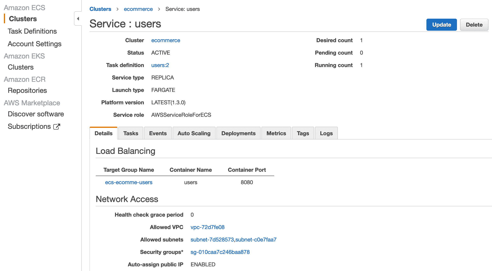
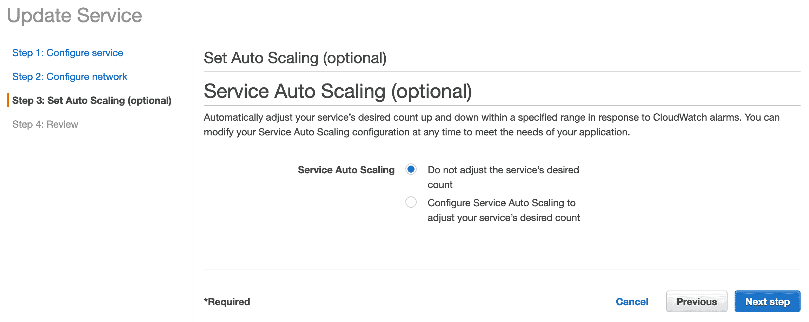
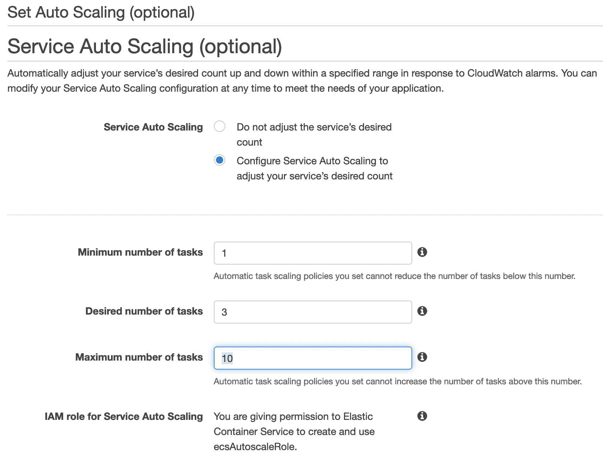
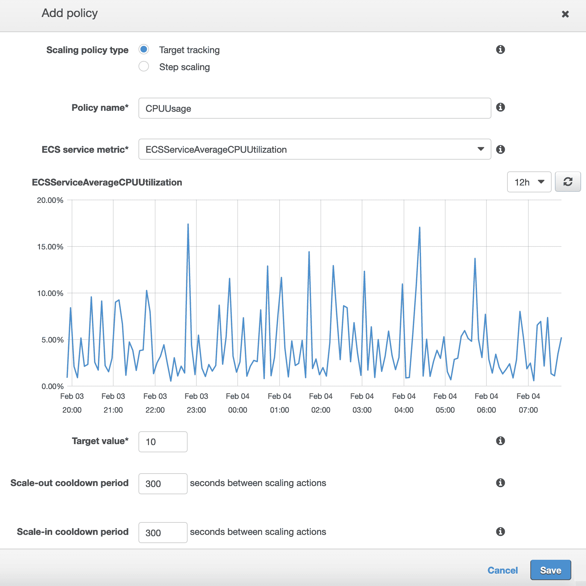
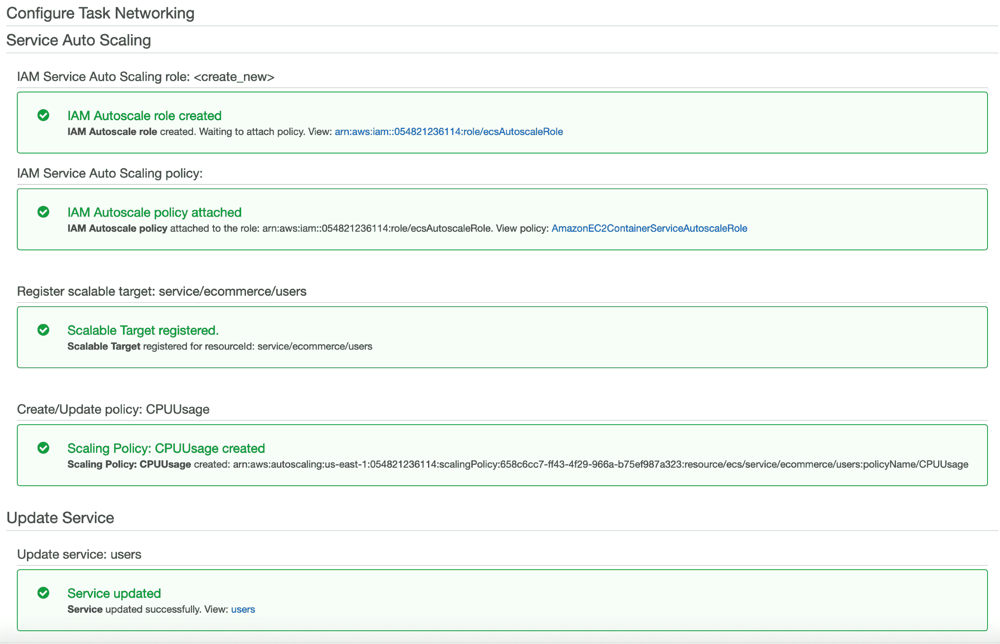
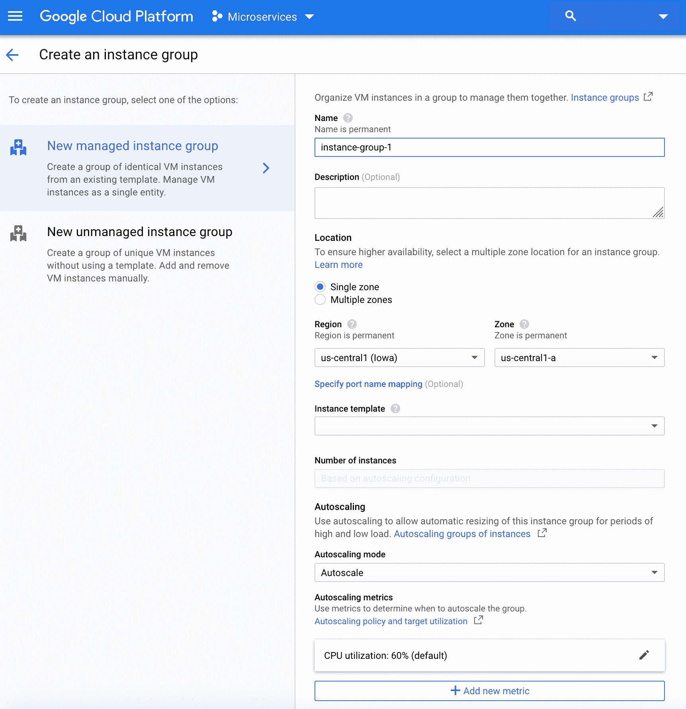
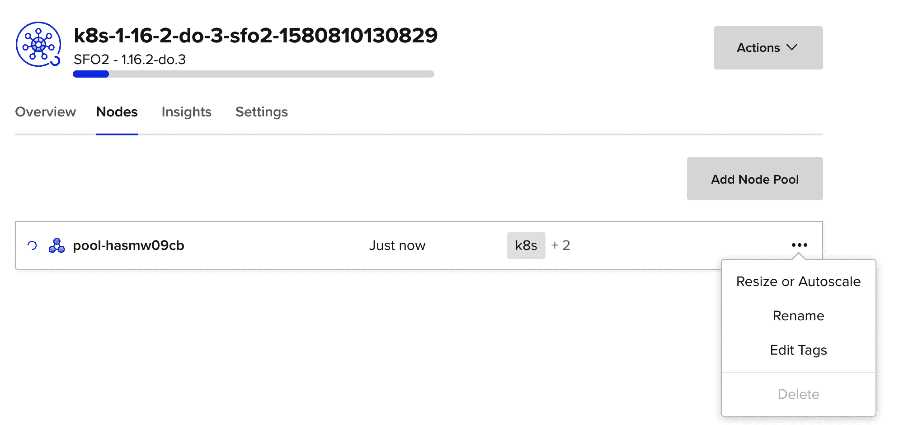
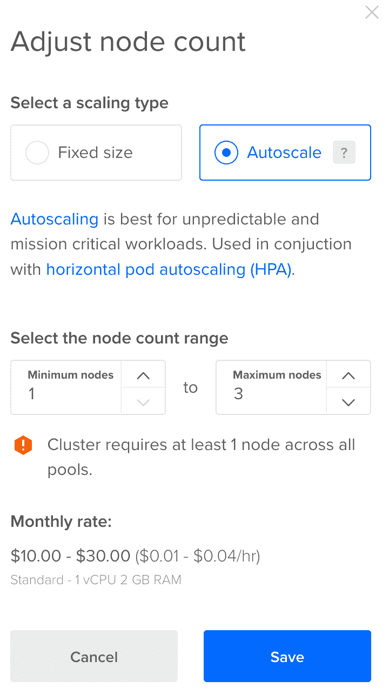

# 微服务的扩展与监控

## 问题

1. 我们用 `CodePipeline` 做什么？
2. `CodePipeline` 和 `CodeBuild` 有什么区别？
3. 这里 `Fargate` 的优势是什么？

## 简介

我们的应用现已启动并运行。然而，微服务架构的真正优势在于服务可以单独处理。这在根据需求快速扩展时特别有用。在我们的示例应用中，假设有大量用户查看产品，但只有少数用户下单。因此，在这种情况下，我们希望产品服务扩展，而订单和用户服务保持不变。读完本章后，你应该对扩展和监控的工作原理以及不同云提供商如何处理该问题有很好的理解。

在本章中，我们将涵盖以下要点：

- **微服务扩展与监控的重要性**：让我们探索扩展的通用工作原理。
- **使用 Amazon Web Services (AWS) 进行扩展与监控**：让我们看看 `AWS` 为扩展提供了什么。
- **使用 Google Cloud 进行扩展与监控**：Google Cloud 提供集成扩展。
- **使用 DigitalOcean 进行扩展与监控**：使用 `DigitalOcean` 进行扩展。
- **其他云提供商**：这里探讨了一些其他相关的云提供商。

让我们开始吧！

## 技术要求

本节介绍你的机器上需要运行什么，以便你能编写此微服务。需要安装以下组件：

- `Vapor 4`
- `Swift 5`
- `Xcode 11+`
- `Docker`
- `macOS`/`Linux`

我们还假设你已经学习了前面的章节，并知道如何编写 `Vapor` 微服务。本章中的所有代码均可在 `macOS` 和 `Linux` 下运行。

本章的 GitHub 仓库：[`github.com/PacktPublishing/Hands-On-Swift-5-Microservices-Development/tree/master/Chapter%2016`](https://github.com/PacktPublishing/Hands-On-Swift-5-Microservices-Development/tree/master/Chapter%2016)

## 微服务扩展与监控的重要性

**扩展** 是增加或减少可用于微服务的资源。微服务的一个主要吸引力在于我们可以根据需要单独对服务进行上下扩展。当微服务的流量或工作负载增加时，该服务应获得更多资源，无论是 `CPU` 和 `RAM` 升级还是额外的服务器。

我们当然希望这能自动发生，而无需我们做任何事情。在本节中，我们想看看扩展和监控在微服务中通常是如何工作的。

让我们看看以下主题：

- **监控**：这告诉我们何时需要扩展。
- **扩展**：向我们的设置添加资源。

扩展始于监控，所以让我们仔细看看。

### 监控

**监控** 始终意味着我们在检查服务的当前状态。为了知道我们是需要向上还是向下扩展，取决于服务的状态。如果服务承受着增加的负载或流量，可用资源的使用率会越来越高。我们想知道在什么时候需要获取更多资源，或者因为资源过多而释放一些。有几个方面我们可以调查以确定是否需要向上或向下扩展。

与监控相关的事项列表包括以下内容：

- `CPU` 使用率
- `RAM` 使用率
- 每分钟当前请求数
- 活跃数据库连接数

你可能能想到监控服务时还可以关注的其他一些指标。实际上，`CPU` 使用率一直是最强、最可靠的检查因素之一，因为其他一切都依赖于它。如果请求增加，`CPU` 必须比请求较少时做更多工作，意味着 `CPU` 使用率上升。

另一方面，`CPU` 并不总能给我们完整的图景。例如，每分钟当前请求数能提供有多少实际用户正在使用微服务的宝贵见解。根据用例，这可能是你想用来增加资源的指标。在扩展数据库时，活跃数据库连接也很重要。活跃连接不等同于每分钟当前请求数或使用我们应用的活跃用户，但你可以用它们来增加数据库资源。

监控还关注随时间推移的发展趋势。这意味着 `CPU` 使用率暂时升高对我们不那么重要；持续升高对我们更重要。

### 扩展

**扩展** 是向服务添加更多资源或从服务中移除资源的过程。一旦监控到位，我们知道需要采取什么行动。但扩展是什么样子的？

如果我们谈论 `Docker` 之外的扩展，这几乎总意味着我们需要物理或虚拟地向服务添加服务器，以便获得更多可用资源。这些服务器需要包含在负载均衡器的设置中，正如上一章 第 15 章 *在云中部署微服务* 所示，并且它们需要正确配置。如果这意味着向设置添加物理服务器，那些服务器也需要安装、启动和设置——除非有空闲硬件可用。如果我们有可用设备但只是闲置，毫无疑问我们可以立即使用。不过它仍然需要设置。在 `Docker` 之前，扩展是一个相对缓慢且非常手动的过程。我参与的几个项目不得不扩展，花了好几天。

主要有两种向上和向下扩展资源的方式：

- **水平扩展**：我们添加更多服务器到组合中。
- **垂直扩展**：我们增加单台服务器的资源。

两者都有优缺点。但总体来说，水平扩展更容易实施。向组合中添加更多服务器可以在不使中央服务器离线的情况下进行，而垂直扩展至少涉及重启服务器。在云计算时代，差异日益缩小，因为虚拟服务器可以更快地升级和降级。然而，本章讨论的扩展是水平的，因为这在微服务中很常见。

有时，如果你发现服务器使用了大量 `RAM` 和 `CPU`，你可能也需要垂直扩展。添加更多服务器可能比增加每台服务器的资源更昂贵。

如今，随着按需可用的云和服务器农场，事情变得舒适得多。即使我们想在云中扩展单个服务器，也只需几分钟而不是几天。如果我们能以正确的配置扩展并完全自动化，那就更好了，这正是 `Docker` 发挥核心作用的地方。得益于 `Docker` 镜像，我们可以轻松启动新实例，甚至在同一硬件上，并在几秒钟内提供更多资源。

在本节中，我们了解了扩展和监控如何关联，以及各自包含的内容。我们看了 `Docker` 如何让这变得容易得多。现在，看看这在现实中是什么样子的。

## 使用 AWS 进行扩展与监控

在本节中，我们要在 `AWS` 中设置自动扩展和监控。你应该已经设置并运行了一个 **弹性容器服务 (ECS)** 集群，正如 [第 15 章](https://cdp.packtpub.com/hands_on_microservices_with_swift_5/wp-admin/post.php?post=37&action=edit) *在云中部署微服务* 所述。

按以下步骤开始：

1. 进入你的 `ECS` 集群，该集群是在 第 15 章 *在云中部署微服务* 中创建的，然后选择你想为其启用自动扩展的服务。你应该会看到以下屏幕：

2. 单击“Update”（更新），然后单击“Next step”（下一步），直到进入“Set Auto Scaling (optional)”（设置自动扩缩容（可选））屏幕，如下截图所示：

3. 现在，单击第二个选项“Configure Service Auto Scaling”（配置服务自动扩缩容）以调整服务的期望任务数，并填写详细信息。您可以选择想要运行的任务的**最小数量**，该值必须大于或等于 0。您需要指定**期望任务数**和**最大任务数**。期望任务数是默认运行的数量。所有这些均可在下面的截图中看到：

最小任务数始终要设置为大于 0 的值。

4. 现在，我们需要添加扩缩容策略。单击“Add scaling policy”（添加扩缩容策略）并填写详细信息，类似于下图所示：

看，我们之前在“Monitoring”（监控）和“Scaling”（扩缩容）章节学到的内容，现在是如何被 AWS 采用的？AWS 使用平均 CPU 利用率来进行扩容或缩容。此外，AWS 还提供了一些值，可以使该过程更平滑或更快。您可以设置扩容或缩容的冷却期。当您知道需要快速扩容，但希望在需要时较慢地缩容时，这非常有用。您可以根据需要发挥创意，设置尽可能复杂的扩缩容策略。

5. 单击“Save”（保存），然后单击“Update Service”（更新服务）。几秒钟后，您应该会看到以下结果：

6. 自动扩缩容现已设置完成。如果您愿意，现在可以使用 [`loader.io/`](https://loader.io/) 等工具对服务进行压力测试。对于重要的项目和服务，测试扩缩容以了解其运行方式是很有必要的。可能需要针对 CPU 和内存进行一些微调，但您的应用程序可以妥善及时地响应不断增长的流量。

测试服务器时，别忘了检查并处理数据库服务器。根据我的经验，数据库服务器往往比前端/API 服务器更容易成为瓶颈。

# 使用 Google Cloud 进行扩缩容和监控

Google Cloud 中的扩缩容在概念上与 AWS 相似。您拥有负载均衡器、实例以及可以对实例进行扩容或缩容的策略。就像 AWS 一样，Google Cloud 也提供了不止一种管理服务和自动扩缩容的方式：Kubernetes 可以直接在 Google Cloud 中进行管理（就像在 AWS `Elastic Kubernetes Service` (`EKS`) 中一样；详见第 14 章“Docker 和云”）。

不过，假设我们像在[第 15 章](https://cdp.packtpub.com/hands_on_microservices_with_swift_5/wp-admin/post.php?post=37&action=edit)“在云中部署微服务”中那样，通过 App Engine 设置了我们的应用。在这种情况下，自动扩缩容默认已启用！我们无需做任何额外操作。Google 会自动检查 CPU、RAM 和其他指标，并根据您的需求进行扩容或缩容。

然而，如果您拥有更复杂的设置，即您自己设置了一些实例，则可以在设置托管实例组时配置自动扩缩容。

下面的截图显示了设置新托管实例组时的配置。请注意，您可以在此处添加自动扩缩容策略——这与 AWS 非常相似，如前所示：

就这样；App Engine 现在会为您完成其余工作。请注意，Google Cloud 和 AWS 之间的设置在原则上是如何相同的？原因在于，扩缩容在不同的提供商和解决方案中已经变得普遍相似。大家寻找的扩容或缩容指标都是相同的。

既然我们已经简要了解了 Google Cloud，接下来让我们看看 DigitalOcean 是如何做到这一点的。

# 使用 DigitalOcean 进行扩缩容和监控

当您使用 DigitalOcean 时，目前只有一种自动扩缩容选项：使用其托管 Kubernetes 服务。您需要先使用 Kubernetes 设置应用程序。Kubernetes 的使用和配置超出了本书的范围，但如果您确实在 DigitalOcean 上运行着 Kubernetes 设置，则可以轻松通过“Nodes”（节点）选项卡设置自动扩缩容，如下截图所示：

当您单击上一个截图中看到的“Resize”（调整大小）或“Autoscale”（自动扩缩容）时，可以选择以下选项：

您可以指定想要作为最大值和最小值的 pod 数量（如果需要回顾什么是 pod，请再次查看第 14 章“Docker 和云”）（最少一个）。

DigitalOcean 在成本和价格方面最为透明。对于预算敏感型项目，DigitalOcean 提供了清晰的成本预期。

Pod 本身的扩缩容是通过 Kubernetes `Horizontal Pod Autoscaler` (`HPA`) 完成的。您可以在官方文档 ([`kubernetes.io/docs/tasks/run-application/horizontal-pod-autoscale/`](https://kubernetes.io/docs/tasks/run-application/horizontal-pod-autoscale/)) 中找到其工作原理的所有详细信息。其原则与我们之前讨论的相同。

DigitalOcean 方便地隐藏了通常伴随 Kubernetes 使用的大部分配置，如果您只是想开始使用 Kubernetes，这是一个简单的选择。

DigitalOcean 直到最近才开始实施任何自动扩缩容功能。直到 2019 年 9 月，Kubernetes 才成为一个选项。

我们现在已经了解了 DigitalOcean 及其自动扩缩容的实现方式。接下来，让我们在下一节中简要了解一下其他几个云提供商。

# 其他云提供商

除了 AWS、Google Cloud 和 DigitalOcean，在云提供商方面还有其他一些选择。让我们在这里看看它们：

- Heroku
- IBM Cloud
- Microsoft Azure
- Oracle Cloud

让我们从 Heroku 开始。

## Heroku

Heroku 与其他提到的提供商不同，因为它不提供自己的解决方案。其所有服务都使用 AWS `Elastic Compute Cloud` (`EC2`) 平台。

它最初作为一项专门面向开发人员的服务而推出，旨在减轻部署和运行应用程序的负担。Heroku 尚未正式支持服务端 Swift；但是，有几种方法可以在 Heroku 上运行 Vapor（参见 [`grapeup.com/blog/read/server-side-swift-with-vapor-end-to-end-application-with-heroku-cloud-46`](https://grapeup.com/blog/read/server-side-swift-with-vapor-end-to-end-application-with-heroku-cloud-46)）。

在扩缩容方面，Heroku 试图做到针对特定应用。它不像 AWS ECS 那样提供通用的自动扩缩容。因为它最初只支持 Ruby 项目，其工具和方法仍深受其影响。其关于自动扩缩容的建议之一是使用 Rails Autoscale，这仅适用于 Ruby on Rails。

总之，Heroku 是开发用途的一个不错选择。然而，任何生产应用都可能遇到问题，因为其自动扩缩容远不如其他提供商那样可定制。

## IBM Cloud

IBM Cloud 与 AWS 和 Google Cloud 高度可比。它提供大致相同的功能，且价格具有竞争力。对于中小企业和个人而言，IBM 进入云业务相对较新。它为企业公司运行基础设施已有数十年，但只是最近才开始向更广泛的受众提供这项服务。其自动扩缩容服务像其他提供商一样包含 Kubernetes，还有一种主要面向企业客户的更定制化的服务（参见 [`www.ibm.com/cloud/auto-scaling`](https://www.ibm.com/cloud/auto-scaling)）。

# 云服务商对比

## IBM Cloud

总体而言，IBM Cloud 当然可以托管您的应用程序并对其进行扩缩容。然而，与 AWS 或 Google 相比，它的文档和可用性较差，主要是因为其专注于企业市场。

## Microsoft Azure

Microsoft Azure 是云计算领域备受欢迎的新晋者。自然地，Azure 专注于 Microsoft 产品，例如 `.NET`。不过，它也提供通用的计算资源。由于它提供 Docker 托管，我们也可以在那里托管我们的 Vapor 应用程序。Azure 还提供自动扩缩容服务，以及监控功能。

就像 AWS、Google 和 DigitalOcean 一样，它还提供托管 Kubernetes 服务，该服务也可用于自动扩缩容。

## Oracle Cloud

与 IBM 类似，Oracle 将企业客户作为其关注重点。就像其他服务商一样，它提供 Kubernetes 和 Docker 托管，因此自动扩缩容和监控主要取决于配置。

总而言之，几乎所有有竞争力的云服务商都将提供自动扩缩容功能，以及相关的监控服务。选择哪家主要取决于偏好和预算。价格各不相同，您应考虑长期影响。但总体而言，所有服务商都足够稳定可靠，可以托管和扩缩您的应用程序。

# 总结

在本章中，我们仔细研究了微服务的扩缩容和监控。我们首先从概念上了解了什么是监控和自动扩缩容，以及它们通常是如何实现的。

然后，我们研究了如何在 AWS、Google Cloud 和 DigitalOcean 中进行自动扩缩容。接着，我们探索了其他云服务商。到现在为止，您应该对不同云服务商的运作方式及其提供的优势有了扎实的理解。

当您下次使用 Vapor 启动 API 时，您应该已经做好充分准备，让您的服务根据流量自动扩缩容。特别是在需求不可预见的项目中，这变得极其宝贵。

# 问题

为了确保您很好地理解本章内容，请回答以下问题：

1.  有哪些类型的扩缩容？

2.  AWS ECS 中如何进行自动扩缩容？

3.  为什么 Google Cloud 的 App Engine 在扩缩容方面很方便？

# 评估答案

在这里，您可以看到所有章节的问题和答案：

## 第 1 章：微服务简介

### 问题

1.  什么是微服务的定义？

2.  列出微服务有益的三个原因。

3.  列出不选择微服务的三个原因。

4.  列出单体架构和微服务之间的四个区别。

### 答案

1.  微服务是一个尽可能独立运行的小型业务单元。

2.  三个原因：
    1.  可独立扩缩容
    2.  可独立维护
    3.  降低复杂性

3.  三个原因：
    1.  项目太小（只有一个微服务）。
    2.  没有足够的时间或资源来转换所有遗留代码。
    3.  初期工作量增加。

4.  四个区别：
    1.  单体架构只有一个代码库；每个微服务都有自己的代码库。
    2.  单体架构通常只使用一个数据库；每个微服务都有自己的数据库。
    3.  单体架构难以扩缩容，因为必须扩缩容整个服务，而微服务可以单独扩缩容。
    4.  单体架构强制您对新增功能使用相同的编程语言。微服务的新增功能可以使用不同的编程语言。

## 第 2 章：理解服务端 Swift

### 问题

1.  为什么 Swift 作为原生语言很有帮助？

2.  目前服务端 Swift 应用程序的首选操作系统是什么？

3.  什么是 `SwiftNIO`？

4.  Docker 如何提供帮助？

5.  说出 Swift 5 新增优势中的三个。

### 答案

1.  因为它更快、更安全且易于部署。

2.  Ubuntu。

3.  一个用 Swift 编写、为 Swift 设计的网络和流式传输库。

4.  Docker 在托管 Swift 应用程序时提供了灵活性。

5.  三个优势：
    1.  扩展
    2.  泛型函数
    3.  协议

## 第 3 章：Vapor 框架入门

### 问题

1.  向您的 FirstApp 应用程序添加一个与新控制器交互的新路由。

2.  向您的应用程序添加一个新模型并将其集成到您的控制器中。

3.  构建一个简单的分页应用程序，其中请求可以包含 `sortBy` 和 `offset` 等参数。

### 答案

1.  请参阅 GitHub，`Chapter2/FirstAppExtended`。

2.  请参阅 GitHub，`Chapter2/FirstAppExtended`。

3.  请参阅 GitHub，`Chapter2/FirstAppExtended`。

## 第 4 章：规划在线商店应用程序

### 问题

1.  如何验证用户是否有权访问微服务的某个功能？

2.  访问令牌的合适生命周期是多久？

3.  为什么 JSON 是微服务输入和输出的好选择？

### 答案

1.  `JSON Web Token` (`JWT`) 中间件 (`SimpleJWTMiddleware`) 验证只有授权用户才能访问微服务的功能。

2.  这取决于具体情况。某些情况只需 60 秒，而其他情况的生命周期可达数小时甚至数天。

3.  因为它具有普遍的可读性，并且许多编程语言和环境中的大量库都能很好地支持它。

## 第 5 章：创建您的第一个微服务

### 问题

1.  为什么我们要包含 `SimpleJWTMiddleware`？

2.  您最有可能如何运行您的微服务，以及会使用什么服务器环境？

3.  您应该为所有服务一起定义模型，还是为每个服务单独定义？

### 答案

1.  因为它为我们提供了一个处理身份验证的基本中间件。

2.  在 Docker 中运行，使用 Ubuntu 环境。

3.  为了使服务尽可能独立，应单独定义模型。您可能决定共享一个通用库，但这通常不是常态。

## 第 6 章：应用程序结构与数据库设计

### 问题

1.  为什么为每个服务使用不同的 Git 和 Docker 仓库至关重要？

2.  您的服务如何接收数据库和 JWT 的凭据？

3.  如何同时运行多个 Vapor 应用程序？

4.  进阶：将您的 Docker 镜像推送到您的 Docker 仓库。

### 答案

1.  我们需要确保服务的完整性。合并仓库可能很危险，因为它会导致代码混合。

2.  通过环境变量。

3.  通过为每个服务定义不同的端口。

4.  请参阅 第 15 章 *在云端部署微服务* 中的示例。

## 第 7 章：编写用户服务

### 问题

1.  扩展用户服务，使新用户需要先确认其邮箱。

2.  将最后登录时间保存到用户模型中。

3.  通过添加 `Country`、`LAT`、`LNG`、`State` 等属性来完善地址模型。

4.  进阶：编写管理员功能，允许管理员用户（您需要定义什么是管理员）编辑其他用户的地址和个人资料。

### 答案

请参阅 GitHub 获取完整示例。

## 第 8 章：测试微服务

### 问题

1.  单元测试和功能测试的根本区别是什么？

2.  单元测试和功能测试如何协同工作？

3.  为用户服务的所有端点编写 Postman 测试。

4.  在验证响应时编写更复杂的测试（例如，检查令牌是否包含正确信息）。

5.  编写单元测试，验证用户服务中的 JWT 功能是否正常工作。

### 答案

1.  单元测试针对单个函数。功能测试旨在测试服务的整体功能。

2.  虽然单元测试确保基础函数正常运行，但功能测试将确保函数按预期协同工作。

3.  请参阅 GitHub。

4.  请参阅 GitHub。

5.  请参阅 GitHub。

## 第 9 章：产品管理服务

### 问题

1.  为什么我们不需要在此服务中对 JWT 进行签名？

2.  添加一个新过滤器，仅返回给定价格范围内的产品。

## 问题（来自上一章）
### 3. 进阶：添加一种方式让产品能够关联到多个分类（这将极大地改进但也会使服务变得复杂）。

## 答案
1. 因为该服务将完全作为公开服务运行。
2. 请参阅 `GitHub`。
3. 请参阅 `GitHub`。

# 第 10 章：理解微服务通信

## 问题
1. 微服务何时应该相互通信？
2. 微服务相互通信的两种主要协议是什么？
3. `Swift` 如何有助于促进微服务之间的通信？
4. 描述您的商店应用程序必须实现服务间通信的三种场景。

## 答案
1. 只有在绝对必要时才通信，除此之外不再多通信。
2. `WebSockets` 和 `REST`。
3. 它速度快且提供了良好的异步工具。
4. 三种场景：
* 订单确认（价格检查）
* 发货（第三方供应商 `API`）
* 支付（第三方支付 `API`）

# 第 11 章：订单管理服务

## 问题
1. 编写该微服务所需的所有测试。
2. 完成本章的税务设置并使用 10% 的固定税率进行测试。
3. 实现一个例程，取消 30 天内未付款的订单。
4. 编写一个函数，在订单发货时通知用户。

## 答案
请参阅 `GitHub`。

# 第 12 章：最佳实践

## 问题
1. 为什么要为应用程序开发一个库？
2. `Swift` 中协议的优势是什么？
3. 泛型函数如何帮助你？
4. `Xcode` 和 `lldb` 如何帮助你调试？

## 答案
1. 因为你可能拥有想要在微服务之间共享的类。
2. 你可以定义类型应具备的内容及其外观，而无需规定类型本身。
3. 它们可以涵盖多种类型，从而减少工作量。
4. 它们帮助你找到发生错误的确切行。

# 第 13 章：托管微服务

## 问题
1. 为什么不建议在仅一台服务器上运行整个后端？
2. `Docker` 如何简化你的安装过程？
3. 你应该如何存储数据库凭据？
4. 负载均衡器扮演什么角色？

## 答案
1. 因为如果一台服务器崩溃或关闭，整个后端将离线。
2. 它拥有预编译的镜像，启动迅速且已预先配置好。
3. 存储在运行时传递给实例的环境变量中。
4. 负载均衡器平衡流量并将流量路由到适当的服务。这很有帮助，因为我们可以依赖负载均衡器仅发送我们能处理的流量。

# 第 14 章：Docker 与云

## 问题
1. 为什么 `Docker` 常用于部署 `Vapor` 应用？
2. `Docker` 镜像和 `Docker` 容器有什么区别？
3. `Kubernetes` 如何参与部署？

## 答案
1. 因为它为 `Vapor` 提供了一种设置操作系统的直接方法。
2. `Docker` 镜像包含编译好的镜像。`Docker` 容器运行正在使用的镜像。
3. `Kubernetes` 提供工具和基础设施来部署 `Docker` 容器并对其进行管理。

# 第 15 章：在云中部署微服务

## 问题
1. 我们使用 `CodePipeline` 做什么？
2. `CodePipeline` 和 `CodeBuild` 有什么区别？
3. `Fargate` 在这里有什么优势？

## 答案
1. `CodePipeline` 用于实现 `持续部署` (`CD`)，以便我们可以自动在线更新服务。
2. `CodePipeline` 使用 `CodeBuild` 来编译/构建镜像。`CodePipeline` 作为 `CodeBuild` 和其他服务的管理器。
3. `Fargate` 提供 `Docker` 容器的无服务器托管。使用 `Fargate` 时，我们无需担心服务器。

# 第 16 章：微服务的扩展与监控

## 问题
1. 有哪些类型的扩展？
2. `Amazon Web Services` (`AWS`) `Elastic Container Service` (`ECS`) 中如何进行自动扩展？
3. 为什么 `Google Cloud` 的 `App Engine` 很方便？

## 答案
1. 我们有：
* 水平扩展：增加更多服务器。
* 垂直扩展：向服务器添加更多资源（内存和 CPU）。
2. `AWS ECS` 使用水平扩展。
3. 它一次性负责托管、扩展和监控。

# 您可能喜欢的其他书籍

如果您喜欢这本书，可能会对 Packt 的以下其他书籍感兴趣：

**精通 Swift 5 - 第五版**  

Jon Hoffman

ISBN: 978-1-78913-986-0

* 理解核心 `Swift` 组件，包括运算符、集合、控制流和函数
* 学习如何以及何时使用类、结构体和枚举
* 理解如何将面向协议的设计与扩展结合使用，以编写更易于管理的代码
* 将设计模式与 `Swift` 结合使用，以解决常见的设计问题
* 为自定义值类型实现写时复制以提高性能
* 使用 `Grand Central Dispatch` 和 `Operation Queues` 为应用程序添加并发功能
* 实现泛型以编写灵活且可重用的代码

**iOS 13 编程入门 - 第四版**  

Ahmad Sahar, Craig Clayton

ISBN: 978-1-83882-190-6

* 掌握 `Xcode` 11 和 `Swift` 5 的基础知识，这是 `iOS` 开发的基石
* 理解如何使用故事板制作应用程序原型
* 发现 `Model-View-Controller` 设计模式，以及如何在应用程序中实现所需功能
* 实现最新的 `iOS` 功能，如深色模式和使用 Apple 登录
* 了解如何将现有的 iPad 应用程序转换为 Mac 应用程序
* 使用行业模式和实践设计、部署和测试您的 `iOS` 应用程序

# 留下评论 - 让其他读者知道您的想法

请通过在您购买本书的网站上留下评论，与其他人分享您对本书的看法。如果您从 `Amazon` 购买了本书，请在本书的 `Amazon` 页面给我们留下诚实的评论。这至关重要，这样其他潜在读者可以看到并利用您的无偏见观点做出购买决定，我们可以了解客户对我们产品的看法，我们的作者也能看到您对他们与 `Packt` 合作创作的书目的反馈。这只会花费您几分钟时间，但对其他潜在客户、我们的作者和 `Packt` 都很有价值。谢谢！

