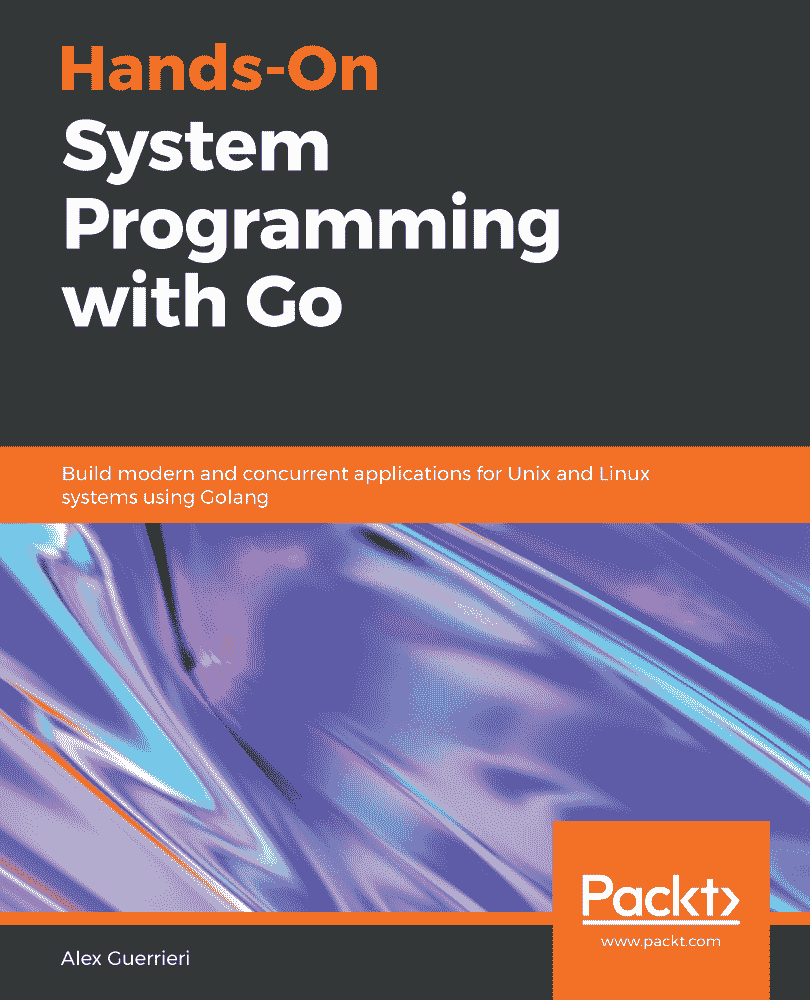
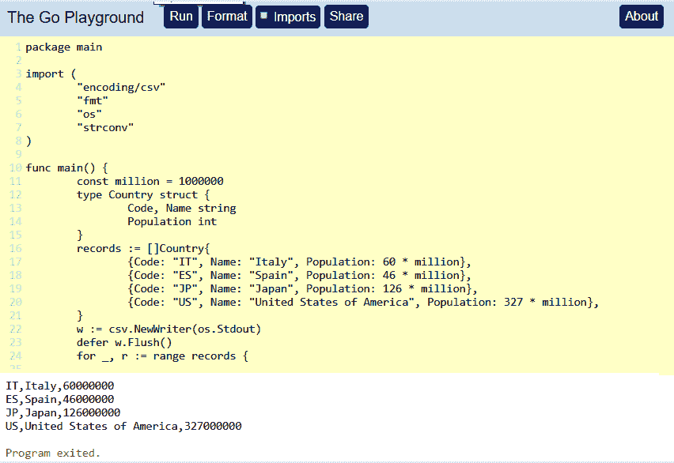

# Go 系统编程实用指南：Unix 和 Linux 系统现代并发应用构建指南




[`Packt.com`](https://subscribe.packtpub.com/)

订阅我们的在线数字图书馆，即可完全访问超过 7,000 本书籍和视频，以及行业领先的工具，帮助您规划个人发展并提升职业生涯。如需更多信息，请访问我们的网站。

# 关于 Packt

## 为什么要订阅？

*   花更少时间学习，更多时间编码，配合来自 4,000 多位行业专业人士的实用电子书和视频
*   通过专为您定制的技能计划改善学习
*   每月免费获取一本电子书或一个视频
*   全文搜索，轻松访问关键信息
*   复制粘贴、打印和书签内容

您知道吗？Packt 为每本出版的书籍提供电子书版本，包含 PDF 和 ePub 文件。您可以在 [`www.packt.com`](http://www.packt.com) 升级到电子书版本，作为纸质书客户，您有权享受电子书副本的折扣。请通过 `customercare@packtpub.com` 联系我们以获取更多详情。

在 [`www.packt.com`](http://www.packt.com)，您还可以阅读免费技术文章合集，注册各类免费通讯，并获得 Packt 书籍和电子书的独家折扣和优惠。

# 贡献者

## 关于作者

**Alex Guerrieri** 是一名软件开发人员，专注于后端和分布式系统。自 2013 年首次使用 Go 以来，它一直是他工作中最喜爱的工具。他拥有计算机科学工程学位，在该领域工作了 6 年多。他原籍意大利，在那里完成学业并开始全栈开发职业生涯，现居住在西班牙，此前曾在两家初创公司——source{d} 和 Cabify 工作。他现在为三家公司工作——作为 BBVA（西班牙最大的银行之一）的软件工匠；作为 Security First（伦敦）的软件架构师，该公司专注于数字和物理安全；以及 DauMau 的联合创始人，该公司开发了 Vidsey，一种以程序化方式生成视频的软件。

感谢我生命中所有支持并包容我在写作这本书过程中的人们，谢谢你们。

## 关于审阅者

**Corey Scott** 是一位首席软件工程师，现居澳大利亚墨尔本。他自 2000 年起从事专业编程，最近 5 年致力于使用 Go 构建大规模分布式服务。

作为一名涉猎各类软件相关主题的博主，他热衷于设计和构建高质量软件。他认为软件工程是一门应当磨练、辩论并持续改进的手艺。他采取务实、非狂热的编码态度，随时准备就软件工程、持续交付、测试或整洁代码进行深入探讨。

**Janani Selvaraj** 目前在 Gaddiel Technologies（Trichy）担任数据分析顾问，专注于为初创公司提供数据分析解决方案。她此前的经验包括数据分析和机器学习相关的培训与研发。

她拥有环境管理博士学位，拥有 5 年多统计建模研究经验。她还精通多种编程语言，包括 R、Python 和 Go。

她审阅过 *Go 机器学习项目* 一书，并合著了 *使用 Go 进行机器学习*，由 *Packt Publishing* 出版。

**Arun Muralidharan** 是一名软件开发人员，拥有 9 年多系统开发经验。分布式系统设计、架构、事件系统、可扩展性、性能和编程语言是他最感兴趣的产品方面。职业上，他大部分时间用 C++、Python 和 C 编码（未来或许会用 Go）。工作之余，他也使用 Go 和 Rust 开发软件。

我借此机会感谢我的家人，多年来他们给予了我无条件的支持。

## Packt 正在寻找像您这样的作者

如果您有兴趣成为 Packt 的作者，请访问 [`authors.packtpub.com`](http://authors.packtpub.com) 并立即申请。我们已与数千名像您一样的开发人员和技术专业人士合作，帮助他们与全球技术社区分享见解。您可以提交一般申请，申请我们正在招募作者的特定热门主题，或提交您自己的想法。

# 3. 代码实战

## 1. 演示示例

# 4. 约定用法

# 5. 联系我们

## 1. 评论

# 第 1 部分：系统编程与 Go 简介

## 系统编程简介

### 1. 技术要求

### 2. 系统编程入门

#### 1. 面向软件的软件

#### 2. 语言与系统演进

#### 3. 系统编程与软件工程

### 3. 应用程序编程接口

#### 1. API 的类型

##### 1. 操作系统

##### 2. 库与框架

##### 3. 远程 API

##### 4. Web API

### 4. 理解保护环

#### 1. 架构差异

#### 2. 内核空间与用户空间

### 5. 深入系统调用

#### 1. 提供的服务

##### 1. 进程控制

##### 2. 文件管理

##### 3. 设备管理

##### 4. 信息维护

##### 5. 通信

#### 2. 操作系统之间的差异

### 6. 理解 POSIX 标准

#### 1. POSIX 标准与特性

##### 1. POSIX.1 – 核心服务

##### 2. POSIX.1b 和 POSIX.1c – 实时与线程扩展

##### 3. POSIX.2 – Shell 与工具

#### 2. 操作系统的标准遵循情况

##### 1. Linux 和 macOS

##### 2. Windows

### 7. 总结

### 8. 问题

## Unix 操作系统组件

### 1. 技术要求

### 2. 内存管理

#### 1. 管理技术

#### 2. 虚拟内存

### 3. 理解文件与文件系统

#### 1. 操作系统与文件系统

##### 1. Linux

##### 2. macOS

##### 3. Windows

#### 2. 文件与硬链接和软链接

### 4. Unix 文件系统

#### 1. 根目录与索引节点

#### 2. 目录结构

#### 3. 导航与交互

#### 4. 挂载与卸载

### 5. 进程

#### 1. 进程属性

#### 2. 进程生命周期

##### 1. 前台与后台

##### 2. 终止作业

### 6. 用户、组与权限

#### 1. 用户与组

#### 2. 所有者、组与其他用户

##### 1. 读、写与执行

##### 2. 修改权限

### 7. 进程通信

#### 1. 退出码

#### 2. 信号

#### 3. 管道

#### 4. 套接字

### 8. 总结

### 9. 问题

## Go 概览

### 1. 技术要求

### 2. 语言特性

#### 1. Go 的历史

#### 2. 优势与劣势

### 3. 命名空间

#### 1. 导入与导出符号

### 4. 类型系统

#### 1. 基本类型

#### 2. 复合类型

#### 3. 自定义类型

### 5. 变量与函数

#### 1. 处理变量

##### 1. 声明

##### 2. 操作

##### 3. 类型转换

##### 4. 作用域

#### 2. 常量

#### 3. 函数与方法

##### 1. 值与指针

### 6. 理解流程控制

#### 1. 条件

#### 2. 循环

### 7. 探索内置函数

#### 1. Defer、Panic 与 Recover

### 8. 并发模型


### 并发模型

#### 理解通道和 Goroutine

#### 理解内存管理

##### 栈和堆

##### `Go` 中 `GC` 的历史

#### 构建和编译程序

##### 安装

##### 构建

##### 运行

#### 总结

#### 问题

# 第 2 部分：高级文件 I/O 操作

## 使用文件系统

### 技术要求

### 处理路径

#### 工作目录

##### 获取和设置工作目录

#### 路径操作

### 从文件读取

#### `Reader` 接口

##### 文件结构

#### 使用缓冲区

##### 预览内容

#### `Closer` 和 `Seeker`

### 写入文件

#### `Writer` 接口

#### 缓冲区和格式

#### 高效写入

#### 文件模式

### 其他操作

#### `Create`

#### `Truncate`

#### `Delete`

#### `Move`

#### `Copy`

#### `Stats`

#### 更改属性

### 第三方包

#### 虚拟文件系统

#### 文件系统事件

### 总结

### 问题

## 处理流

### 技术要求

### 流

#### 输入和读取器

##### `bytes.Reader`

##### `strings.Reader`

#### 定义读取器

#### 输出和写入器

##### `bytes.Writer`

##### `strings.Writer`

#### 定义写入器

### 内置工具

#### 从一个流复制到另一个流

#### 连接的读取器和写入器

#### 扩展读取器

#### 写入器和装饰器

### 总结

### 问题

## 构建伪终端

### 技术要求

### 理解伪终端

#### 从电传打字机开始

#### 伪电传打字机

### 创建基本的 `PTY`

#### 输入管理

#### `Selector`

#### 命令执行

#### 部分重构

### 改进 `PTY`

#### 多行输入

#### 为伪终端提供颜色支持

#### 建议命令

#### 可扩展命令

### 带状态的命令

#### 易失性状态

#### 持久状态

##### 升级 `Stack` 命令

### 总结

### 问题

# 第 3 部分：理解进程通信

## 处理进程和守护进程

### 技术要求

### 理解进程

#### 当前进程

##### 标准输入

##### 用户和组 ID

##### 工作目录

#### 子进程

##### 访问子进程属性

##### 标准输入

### 守护进程入门

#### 操作系统支持

#### 守护进程实战

#### 服务

### 创建服务

#### 第三方包

### 总结

### 问题

## 退出码、信号和管道

### 技术要求


# 18. 网络编程

## 1. 技术要求

## 2. 通过网络通信

### 2.1 OSI 模型

#### 2.1.1 第 1 层 – 物理层

#### 2.1.2 第 2 层 – 数据链路层

#### 2.1.3 第 3 层 – 网络层

#### 2.1.4 第 4 层 – 传输层

#### 2.1.5 第 5 层 – 会话层

#### 2.1.6 第 6 层 – 表示层

#### 2.1.7 第 7 层 – 应用层

### 2.2 TCP/IP – 互联网协议族

#### 2.2.1 第 1 层 – 链路层

#### 2.2.2 第 2 层 – 网际层

#### 2.2.3 第 3 层 – 传输层

#### 2.2.4 第 4 层 – 应用层

## 3. 理解套接字编程

### 3.1 网络包

### 3.2 TCP 连接

### 3.3 UDP 连接

#### 3.3.1 编码与校验和

## 4. Go 语言中的 Web 服务器

### 4.1 Web 服务器

#### 4.1.1 HTTP 协议

#### 4.1.2 HTTP/2 与 Go

### 4.2 使用标准包

#### 4.2.1 发起 HTTP 请求

#### 4.2.2 创建简单服务器

#### 4.2.3 服务文件系统

#### 4.2.4 路由与方法导航

#### 4.2.5 多部分请求与文件

#### 4.2.6 HTTPS

### 4.3 第三方包

#### 4.3.1 `gorilla/mux`

#### 4.3.2 `gin-gonic/gin`

### 4.4 其他功能

#### 4.4.1 HTTP/2 推送

#### 4.4.2 WebSocket 协议

## 5. 模板引擎入门

### 5.1 语法与基本用法

### 5.2 创建、解析与执行模板

### 5.3 条件与循环

### 5.4 模板函数

## 6. RPC 服务器

### 6.1 定义服务

### 6.2 创建服务器

### 6.3 创建客户端

## 7. 总结

## 8. 问题

# 19. 使用 Go 进行数据编码

## 1. 技术要求

## 2. 理解基于文本的编码

### 2.1 CSV

#### 2.1.1 解码值

#### 2.1.2 编码值

#### 2.1.3 自定义选项

### 2.2 JSON

#### 2.2.1 字段标签

#### 2.2.2 解码器

#### 2.2.3 编码器

#### 2.2.4 编组器与解组器

#### 2.2.5 接口

#### 2.2.6 生成结构体

#### 2.2.7 JSON Schema

### 2.3 XML

#### 2.3.1 结构

#### 2.3.2 文档类型定义

#### 2.3.3 解码与编码

#### 2.3.4 字段标签

#### 2.3.5 编组器与解组器

#### 2.3.6 生成结构体

### 2.4 YAML

#### 2.4.1 结构

#### 2.4.2 解码与编码


## 3. 了解二进制编码

### 1. BSON

#### 1. 编码

#### 2. 解码

### 2. gob

#### 1. 接口

#### 2. 编码

#### 3. 解码

#### 4. 接口

### 3. Proto

#### 1. 结构

#### 2. 代码生成

#### 3. 编码

#### 4. 解码

#### 5. gRPC 协议

## 4. 总结

## 5. 问题

## 20. 第 4 部分：深入并发

## 21. 处理 Channel 和 Goroutine

### 1. 技术要求

### 2. 理解 goroutine

#### 1. 对比线程和 goroutine

##### 1. 线程

##### 2. Goroutine

#### 2. 新建 goroutine

#### 3. 多个 goroutine

#### 4. 参数求值

#### 5. 同步

### 3. 探索 channel

#### 1. 属性和操作

##### 1. 容量和大小

##### 2. 阻塞操作

##### 3. 关闭 channel

##### 4. 单向 channel

#### 2. 等待接收者

#### 3. 特殊值

##### 1. `nil` channel

##### 2. 已关闭的 channel

#### 4. 管理多重操作

##### 1. `default` 分支

#### 5. 定时器和计时器

##### 1. 定时器

##### 2. `AfterFunc()`

##### 3. 计时器

### 4. 结合 channel 和 goroutine

#### 1. 速率限制器

#### 2. Worker

#### 3. Worker 池

#### 4. 信号量

### 5. 总结

### 6. 问题

## 22. 使用 sync 和 atomic 进行同步

### 1. 技术要求

### 2. 同步原语

#### 1. 并发访问与锁

##### 1. `Mutex`

##### 2. `RWMutex`

##### 3. 写饥饿

##### 4. 加锁陷阱

#### 2. 同步 goroutine

#### 3. Go 中的单例模式

##### 1. `Once` 和 `Reset()`

#### 4. 资源回收

##### 1. 切片回收问题

#### 5. 条件变量

#### 6. 同步 Map

#### 7. 信号量

### 3. 原子操作

#### 1. 整数操作

##### 1. `clicker`（注：原文可能为 "clicker" 或拼写错误，保留原样）

##### 2. 线程安全的浮点数

##### 3. 线程安全的布尔值

##### 4. 指针操作

#### 2. `Value`

##### 1. 内部原理

### 4. 总结

### 5. 问题

## 23. 使用 Context 进行协调

### 1. 技术要求

### 2. 理解 Context

#### 1. 接口

#### 2. 默认 Context

##### 1. `Background()`

##### 2. `TODO()`

#### 3. 取消、超时和截止时间

##### 1. 取消

##### 2. 截止时间

##### 3. 超时

#### 4. 键和值

### 3. 标准库中的 Context

#### 1. HTTP 请求

##### 1. 传递作用域值

##### 2. 请求取消

#### 2. HTTP 服务器

##### 1. 关闭

##### 2. 传递值

#### 3. TCP 拨号

##### 1. 取消连接

#### 4. 数据库操作

#### 5. 实验性包

### 4. 应用程序中的 Context


# 第 23 章

## 1. 应避免的事项

### 1.1 作为键的错误类型

### 1.2 传递参数

### 1.3 可选参数

### 1.4 全局变量

## 2. 使用 Context 构建服务

### 2.1 主接口与用法

### 2.2 退出点与入口点

### 2.3 排除列表

### 2.4 处理目录

### 2.5 检查文件名与内容

## 5. 总结

## 6. 问题

# 第 24 章：实现并发模式

## 1. 技术要求

## 2. 从生成器开始

### 2.1 避免泄漏

## 3. 使用流水线进行排序

## 4. 多路复用与多路分解

### 4.1 扇出

### 4.2 扇入

## 5. 生产者与消费者

### 5.1 多个生产者 (`N * 1`)

### 5.2 多个消费者 (`1 * M`)

### 5.3 多个消费者和生产者 (`N*M`)

## 6. 其他模式

### 6.1 错误组

### 6.2 漏桶算法

### 6.3 排序

## 7. 总结

## 8. 问题

# 第 25 章：第 5 部分：反射与 CGO 使用指南

# 第 26 章：使用反射

## 1. 技术要求

## 2. 什么是反射？

### 2.1 类型断言

#### 2.1.1 接口断言

## 3. 理解基本机制

### 3.1 Value 和 Type 方法

#### 3.1.1 Kind（种类）

### 3.2 Value 转接口

### 3.3 操作值

#### 3.3.1 修改值

#### 3.3.2 创建新值

## 4. 处理复杂类型

### 4.1 数据结构

#### 4.1.1 修改字段

#### 4.1.2 使用标签

### 4.2 Map 和切片

#### 4.2.1 Map

#### 4.2.2 切片

### 4.3 函数

#### 4.3.1 分析函数

#### 4.3.2 调用函数

### 4.4 通道

#### 4.4.1 创建通道

#### 4.4.2 发送、接收与关闭

#### 4.4.3 Select 语句

## 5. 反思反射

### 5.1 性能开销

### 5.2 标准库中的用法

### 5.3 在包中使用反射

#### 5.3.1 属性文件

##### 5.3.1.1 使用该包

## 6. 总结

## 7. 问题

# 第 27 章：使用 CGO

## 1. 技术要求

## 2. `CGO` 简介

### 2.1 从 Go 调用 C 代码

### 2.2 从 C 调用 Go 代码

## 3. C 与 Go 类型系统

### 3.1 字符串与字节切片

### 3.2 整数

### 3.3 浮点类型

### 3.4 不安全转换

#### 3.4.1 直接编辑字节切片

### 3.5 数字

## 4. 处理切片

## 5. 处理结构体

### 5.1 Go 中的结构体

#### 5.1.1 手动填充

### 5.2 C 中的结构体

#### 5.2.1 未打包结构体

#### 5.2.2 打包结构体

## 6. `CGO` 建议

### 6.1 编译与速度

### 6.2 性能

### 6.3 C 语言依赖

## 7. 总结

## 8. 问题

# 第 28 章：评估

## 1. 第 1 章

## 2. 第 2 章

## 3. 第 3 章

## 4. 第 4 章

## 5. 第 5 章

## 6. 第 6 章

## 7. 第 7 章

## 8. 第 8 章

## 9. 第 9 章

## 10. 第 10 章


# 目录

- 第 11 章
- 第 12 章
- 第 13 章
- 第 14 章
- 第 15 章
- 第 16 章
- 您可能感兴趣的其他书籍
  - 撰写评论 - 让其他读者了解您的想法

# 前言

本书将为各种有趣的 `Go` 概念提供优秀且深入的解释。它从 Unix 和系统编程开始，这将帮助您了解 Unix 操作系统提供了哪些组件，从内核 API 到文件系统，并让您熟悉系统编程的基本概念。

接下来，它涵盖了 I/O 操作的应用，重点关注 Unix 操作系统中的文件系统、文件和流。它涵盖了许多主题，包括读取和写入文件以及其他 I/O 操作。

本书还展示了各种进程如何相互通信。它解释了如何在 `Go` 中使用基于 Unix 管道的通信，如何在应用程序内部处理信号，以及如何使用网络进行有效通信。此外，它还展示了如何对数据进行编码以提高通信速度。

在最后，本书将帮助您理解 `Go` 最现代的特性——并发。它将向您介绍该语言拥有的工具，以及 `sync` 和通道，还有如何以及何时使用每一个工具。

# 适读人群

本书面向希望学习使用 `Go` 进行系统编程的开发人员。虽然不需要具备 Unix 和 Linux 系统编程的先验知识，但具备一些 `Go` 的中级知识将有助于您理解书中涵盖的概念。

# 本书内容

第 1 章 *系统编程简介*，向您介绍 `Go` 和系统编程，并提供一些基本概念以及 Unix 及其资源（包括内核 API）的概述。它还定义了本书其余部分使用的许多概念。

第 2 章 *Unix 操作系统组件*，专注于 Unix 操作系统以及您将交互的组件——文件和文件系统、进程、用户和权限、线程等。它还解释了操作系统的各种内存管理技术，以及 Unix 如何处理驻留内存和虚拟内存。

第 3 章 *Go 概览*，审视 `Go`，从语言的历史开始，然后逐一解释其所有基本概念，从命名空间和类型系统、变量、流程控制，到内置函数和并发模型，同时也解释了 `Go` 如何交互和管理其内存。

第 4 章 *文件系统操作*，帮助您理解 Unix 文件系统的工作原理，以及如何掌握 `Go` 标准库来处理文件路径操作、文件读取和文件写入。

第 5 章 *处理流*，帮助您了解 `Go` 用于抽象数据流的输入和输出流接口。它解释了它们如何工作，以及如何组合并最佳地使用它们而不泄露信息。

第 6 章 *构建伪终端*，帮助您理解伪终端应用程序的工作原理以及如何创建一个。结果将是一个交互式应用程序，它像命令行一样使用标准流。

第 7 章 *处理进程和守护进程*，解释了什么是进程以及如何在 `Go` 中处理它们，如何从 `Go` 应用程序启动子进程，以及如何创建一个在后台运行（守护进程）并与之交互的命令行应用程序。

第 8 章 *退出代码、信号和管道*，讨论 Unix 进程间通信。它解释了如何有效地使用退出代码。它向您展示了信号在应用程序内部默认是如何处理的，以及如何通过一些模式来管理它们以实现有效的信号处理。此外，它还解释了如何使用管道连接不同进程的输出和输入。

第 9 章 *网络编程*，解释了如何使用网络使进程通信。它解释了网络通信协议的工作原理。它最初专注于低级套接字通信，例如 `TCP` 和 `UDP`，然后转向使用广为人知的 `HTTP` 协议进行 Web 服务器开发。最后，它展示了如何使用 `Go` 模板引擎。

第 10 章 *使用 Go 进行数据编码*，解释了如何利用 `Go` 标准库对复杂数据结构进行编码，以促进进程通信。它分析了基于文本的协议，例如 `XML` 和 `JSON`，以及基于二进制的协议，例如 `GOB`。

第 11 章 *处理通道和 Goroutine*，解释了并发和通道的基础知识，以及一些防止在应用程序内部创建死锁和资源泄漏的通用规则。

第 12 章 *使用 sync 和 atomic 进行同步*，讨论了 `sync` 和 `sync/atomic` 标准库的同步包，以及如何使用它们代替通道轻松实现并发。它还专注于避免资源泄漏和回收资源。

第 13 章 *使用 Context 进行协调*，讨论了 `Context`，这是一个在 `Go` 中引入的相对较新的包，它提供了一种简单的方法来有效处理异步操作。

第 14 章 *实现并发模式*，使用前三章的工具，演示如何使用和组合它们以进行有效通信。它专注于 `Go` 中用于并发的最常见模式。

第 15 章 *使用反射*，解释了什么是反射以及您是否应该使用它。它展示了反射在标准库中的使用位置，并指导您创建一个实际示例。它还展示了如何在不需要反射的地方避免使用它。

第 16 章 *使用 CGO*，解释了 `CGO` 的工作原理，以及为什么和何时应该使用它。它解释了如何在 `Go` 应用程序中使用 `C` 代码，反之亦然。

# 如何充分利用本书

需要一些 `Go` 的基础知识来尝试示例并构建现代应用程序。

每章都包含一组问题，将帮助您衡量对该章的理解程度。这些问题的答案在本书的*评估*部分提供。这些问题对您非常有益，因为它们将帮助您一目了然地回顾每一章。

除此之外，每章还提供了关于如何运行代码文件的说明，而本书的 GitHub 存储库提供了必要的详细信息。

# 下载示例代码文件

您可以从 [`www.packt.com`](http://www.packt.com) 的帐户下载本书的示例代码文件。如果您在其他地方购买了本书，可以访问 [`www.packt.com/support`](http://www.packt.com/support) 并注册，以便将文件直接发送到您的邮箱。


# 前言

## 代码下载

您可以通过以下步骤下载代码文件：

1.  在 [www.packt.com](http://www.packt.com) 登录或注册。
2.  选择 **SUPPORT** 选项卡。
3.  点击 **Code Downloads & Errata**（代码下载与勘误）。
4.  在搜索框中输入书名，然后按照屏幕上的说明操作。

文件下载完成后，请务必使用以下最新版本解压或提取文件夹：

-   Windows 系统使用 `WinRAR`/`7-Zip`
-   Mac 系统使用 `Zipeg`/`iZip`/`UnRarX`
-   Linux 系统使用 `7-Zip`/`PeaZip`

本书的代码包也托管在 GitHub 上，地址为 [`github.com/PacktPublishing/Hands-On-System-Programming-with-Go`](https://github.com/PacktPublishing/Hands-On-System-Programming-with-Go)。如果代码有更新，将会在现有的 GitHub 仓库中更新。

我们丰富的图书和视频目录中的其他代码包也可在 **[`github.com/PacktPublishing/`](https://github.com/PacktPublishing/)** 获取。快去看看吧！

## 彩色图片

我们还提供了一个 PDF 文件，其中包含本书使用的屏幕截图/图表的彩色图片。您可以在此处下载：[`static.packt-cdn.com/downloads/9781789804072_ColorImages.pdf`](https://static.packt-cdn.com/downloads/9781789804072_ColorImages.pdf)。

## 代码实战

访问以下链接查看代码运行的视频：[`bit.ly/2ZWgJb5`](http://bit.ly/2ZWgJb5)。

## Playground 示例

在本书的学习过程中，您会发现许多代码片段后面跟着一个指向 [`play.golang.org`](https://play.golang.org) 的链接，这是一项允许您运行 Go 应用程序（有一些限制）的服务。您可以在 [`blog.golang.org/playground`](https://blog.golang.org/playground) 阅读更多关于它的信息。

为了查看此类示例的完整源代码，您需要访问 Playground 链接。进入网站后，您可以按下 **Run** 按钮来执行应用程序。页面底部将显示输出。以下是在 Go Playground 中运行代码的示例：



如果您愿意，可以通过向示例中添加和编辑更多代码来进行实验，然后运行它们。

## 约定用法

本书全文使用了许多文本约定。

`CodeInText`：表示文本中的代码词、数据库表名、文件夹名、文件名、文件扩展名、路径名、虚拟 URL、用户输入和 Twitter 句柄。例如："This type of service includes `load`, which adds a program to memory and prepares for its execution before passing control to the program itself, or `execute`, which runs an executable file in the context of a pre-existing process."（此类服务包括 `load`，它将程序加载到内存中，并在将控制权传递给程序本身之前准备其执行，或 `execute`，它在预先存在的进程上下文中运行可执行文件。）

代码块设置如下：

```
<meta name="go-import" content="package-name vcs repository-url">
```

任何命令行输入或输出均按如下方式编写：

```
Enable-WindowsOptionalFeature -Online -FeatureName Microsoft-Windows-Subsystem-Linux
```

**粗体**：表示新术语、重要单词或您在屏幕上看到的单词。例如，菜单或对话框中的单词会在文本中这样显示。例如："In the meantime, systems started to get distributed, and applications started to get shipped in containers, orchestrated by other system software, such as **Kubernetes**."（与此同时，系统开始变得分布式，应用程序开始以容器形式交付，由其他系统软件编排，例如 **Kubernetes**。）

警告或重要提示显示如下。提示和技巧显示如下。

## 联系我们

我们始终欢迎读者的反馈。

**常规反馈**：如果您对本书的任何方面有疑问，请在邮件主题中注明书名，发送邮件至 `customercare@packtpub.com`。

**勘误**：虽然我们已尽一切努力确保内容的准确性，但错误难免发生。如果您在本书中发现错误，我们将不胜感激如果您能向我们报告。请访问 [www.packt.com/submit-errata](http://www.packt.com/submit-errata)，选择您的书籍，点击勘误提交表单链接，并填写详细信息。

**盗版**：如果您在互联网上以任何形式发现我们作品的非法副本，我们将不胜感激如果您能向我们提供该位置地址或网站名称。请通过 `copyright@packt.com` 联系我们，并附上相关材料的链接。

**如果您有兴趣成为作者**：如果您在某个主题上有专长，并有兴趣撰写或为书籍做贡献，请访问 [authors.packtpub.com](http://authors.packtpub.com/)。

## 评论

请留下评论。当您阅读并使用过本书后，为什么不在购买它的网站上留下评论呢？潜在读者可以看到并利用您的公正意见做出购买决定，我们 Packt 可以了解您对我们产品的看法，我们的作者也能看到您对他们书籍的反馈。谢谢！

有关 Packt 的更多信息，请访问 [packt.com](http://www.packt.com/)。
