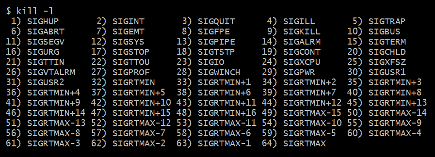

# Unix 操作系统组件

本章将重点关注 Unix 操作系统及用户将与之交互的组件：文件和文件系统、进程、用户和权限等。它还将解释基本的进程通信以及系统程序错误处理的工作原理。所有这些操作系统部分都是我们在创建系统应用程序时将要交互的对象。

本章将涵盖以下主题：

*   内存管理
*   文件和文件系统
*   进程
*   用户、组和权限
*   进程通信

## 技术要求

与上一章一样，本章不需要安装任何软件：任何其他符合 POSIX 标准的 Shell 即可。

例如，你可以选择 Bash（<https://www.gnu.org/software/bash/>），这是推荐的，Zsh（<http://www.zsh.org/>）或 fish（<https://fishshell.com/>）。

## 内存管理

操作系统处理应用程序的主存和辅存使用情况。它跟踪内存的使用量、由哪个进程使用以及哪些部分是空闲的。它还处理来自进程的新内存分配，以及进程完成时的内存释放。

### 管理技术

有不同的内存处理技术，包括以下几种：

*   **Single allocation（单一分配）**：除操作系统保留的部分外，所有内存均可供应用程序使用。这意味着同一时间只能有一个应用程序在执行，就像在 **Microsoft Disk Operating System**（**MS-DOS**）中一样。

*   **Partitioned allocation（分区分配）**：这将内存划分为称为分区的不同块。每个进程使用其中一个块，使得可以同时执行多个进程。分区可以被重定位和压缩，以便为下一个进程获得更多连续内存空间。

*   **Paged memory（分页内存）**：内存被划分为称为帧的部分，它们具有固定大小。进程的内存被划分为相同大小的部分，称为**页面**。页面和帧之间存在映射，使进程将其自己的虚拟内存视为连续的。此过程也称为**分页**。

### 虚拟内存

Unix 使用分页内存管理技术，将每个应用程序的内存抽象为连续的虚拟内存。它还使用一种称为交换的技术，利用交换文件将虚拟内存扩展到辅存（硬盘驱动器或**固态硬盘**（**SSD**））。

当内存稀缺时，操作系统会将处于睡眠状态的进程的页面放入交换分区，以便为请求更多内存的活动进程腾出空间，执行一个称为**换出**的操作。当执行中的进程需要交换文件中的页面时，它会被加载回主内存以执行。这称为**换入**。

交换的主要问题是与辅存交互时的性能下降，但它对于扩展多任务处理能力以及处理比物理内存更大的应用程序非常有用，因为它只在给定时间加载实际需要的部分。创建内存高效的应用程序是通过避免或减少交换来提高性能的一种方法。

`top` 命令显示关于可用内存、交换空间以及每个进程内存消耗的详细信息：

*   `RES` 是进程使用的物理主内存。
*   `VIRT` 是进程使用的总内存，包括交换内存，因此它等于或大于 `RES`。
*   `SHR` 是 `VIRT` 中实际可共享的部分，例如已加载的库。

## 理解文件和文件系统

文件系统是用于构建磁盘数据结构的方法，**文件**是用于指示一段自包含信息的抽象。如果文件系统是分层的，意味着文件被组织在**目录**树中，目录是用于排列存储文件的特殊文件。

### 操作系统与文件系统

在过去 50 年里，发明并使用了大量文件系统，每个文件系统在空间管理、文件名和目录、元数据以及访问限制方面都有其自身的特性。每个现代操作系统**主要**使用单一类型的文件系统。

#### Linux

Linux 选择的**文件系统**（**FS**）是**扩展文件系统**（**EXT**）家族，但也支持其他文件系统，包括 XFS、**日志文件系统**（**JFS**）和 **B 树文件系统**（**Btrfs**）。它还兼容较旧的**文件分配表**（**FAT**）家族（FAT16 和 FAT32）以及**新技术文件系统**（**NTFS**）。最常用的文件系统仍然是 EXT 的最新版本（EXT4），它于 2006 年发布，扩展了其前身的容量，包括对更大磁盘的支持。

#### macOS

macOS 使用 **Apple File System**（**APFS**），它支持 Unix 权限并具有日志功能。它也是元数据丰富且保留大小写的，同时是一个不区分大小写的文件系统。它支持其他文件系统，包括 HFS+ 和 FAT32，支持 NTFS 进行只读操作。要写入此类文件系统，我们可以使用实验性功能或第三方应用程序。

#### Windows

Windows 使用的主要文件系统是 NTFS。除了不区分大小写外，区分 Windows FS 与其他文件系统的标志性特征是使用字母后跟冒号来表示路径中的分区，并结合使用反斜杠作为文件夹分隔符，而不是正斜杠。驱动器字母，以及将 C 用于主分区，源自 MS-DOS，其中 A 和 B 是保留的驱动器字母，用于软盘驱动器。

Windows 还**原生**支持其他文件系统，例如 FAT，这是一种文件系统家族，在 70 年代末到 90 年代末非常流行，以及**扩展文件分配表**（**exFAT**），这是微软在 FAT 基础上为可移动设备开发的一种格式。

### 文件、硬链接和软链接

大多数文件是常规文件，包含一定量的数据。例如，文本文件包含由特定编码表示的人类可读字符序列，而位图包含关于大小和每个像素使用的位的元数据，随后是每个像素的内容。


文件被安排在目录内部，这使得可以拥有不同的命名空间以复用文件名。这些目录通过名称（其人类可读的标识符）来引用，并以树形结构组织。路径是代表目录的唯一标识符，它由从根目录降至所需叶节点的所有父目录名称通过分隔符连接而成（Unix 中为 `/`，Windows 中为 `\\`）。例如，如果一个名为 `a` 的目录位于名为 `b` 的目录下，而 `b` 又位于名为 `c` 的目录下，那么它将拥有一个从根目录开始并连接所有目录直到文件的路径：`/c/b/a`。

当多个文件指向相同内容时，我们称之为**硬链接**，但并非所有文件系统都允许这样做（例如 NTFS 和 FAT）。**软链接**是一个指向另一个软链接或硬链接的文件。硬链接可以被移除或删除而不破坏原始链接，但软链接不具备这一特性。**符号链接**是一个拥有自身数据的普通文件，该数据是另一个文件的路径。它还可以链接其他文件系统，或链接不存在的文件和目录（这将形成一个损坏的链接）。

在 Unix 中，一些并非实际文件的资源被表示为文件，通过向其对应文件写入或读取数据来实现与这些资源的通信。例如，`/dev/sda` 文件代表整个磁盘，而 `/dev/stdout`、`dev/stdin` 和 `/dev/stderr` 分别代表标准输出、输入和错误。*一切皆文件* 的主要优势在于，用于文件的相同工具也可以用来与其他设备（网络和管道）或实体（进程）进行交互。

# Unix 文件系统

## 根目录和 inode

在 Linux 和 macOS 中，每个文件和目录都由一个 **inode** 表示，这是一种特殊的数据结构，存储了关于文件的所有信息，除其名称和实际数据外。

Inode `0` 用于空值，表示不存在 inode。Inode `1` 用于记录磁盘上的坏块。文件系统层级结构的根目录使用 inode `2`。它用 `/` 表示。

从最新的 Linux 内核源码中，我们可以看到前几个 inode 是如何被保留的。如下所示：

```c
#define EXT4_BAD_INO 1 /* Bad blocks inode */
#define EXT4_ROOT_INO 2 /* Root inode */
#define EXT4_USR_QUOTA_INO 3 /* User quota inode */
#define EXT4_GRP_QUOTA_INO 4 /* Group quota inode */
#define EXT4_BOOT_LOADER_INO 5 /* Boot loader inode */
#define EXT4_UNDEL_DIR_INO 6 /* Undelete directory inode */
#define EXT4_RESIZE_INO 7 /* Reserved group descriptors inode */
#define EXT4_JOURNAL_INO 8 /* Journal inode */
```

此链接为上述代码块的来源：[`elixir.bootlin.com/linux/latest/source/fs/ext4/ext4.h#L212`](https://elixir.bootlin.com/linux/latest/source/fs/ext4/ext4.h#L212)。

## 目录结构

在 Unix 文件系统中，根目录下有一系列其他目录，每个目录用于特定目的，这使得在不同操作系统之间保持一定的互操作性成为可能，并使编译后的软件能够在不同的操作系统上运行，从而实现二进制文件的可移植性。

以下是包含其作用范围的目录综合列表：

| **目录** | **描述** |
| --- | --- |
| `/bin` | 所有用户的可执行文件 |
| `/boot` | 系统启动所需文件 |
| `/dev` | 设备驱动程序 |
| `/etc` | 应用程序和系统的配置文件 |
| `/home` | 用户的主目录 |
| `/kernel` | 内核文件 |
| `/lib` | 共享库文件和其他内核相关文件 |
| `/mnt` | 临时文件系统，从软盘和光盘到闪存驱动器 |
| `/proc` | 包含活动进程进程号的文件 |
| `/sbin` | 管理员的可执行文件 |
| `/tmp` | 可安全删除的临时文件 |
| `/usr` | 管理命令、共享文件、库文件及其他 |
| `/var` | 可变长度文件（日志和打印文件） |

## 导航与交互

在使用 Shell 时，其中一个目录将是**工作目录**，当路径为相对路径时（例如 `file.sh` 或 `dir/subdir/file.txt`）。工作目录被用作前缀以获取绝对路径。这通常显示在命令行提示符中，但也可以使用 `pwd` 命令（print working directory，打印工作目录）来输出。

`cd`（change directory，更改目录）命令可用于更改当前工作目录。要创建新目录，可以使用 `mkdir`（make directory，创建目录）命令。

要显示目录的文件列表，可以使用 `ls` 命令，它接受一系列选项，包括显示更多信息（`-l`）、显示隐藏文件和目录（`-a`）、按时间排序（`-t`）和按大小排序（`-S`）。

还有一系列其他命令可用于与文件交互：`touch` 命令创建一个具有给定名称的新空文件，要编辑其内容可以使用一系列编辑器，包括 `vi` 和 `nano`，而 `cat`、`more` 和 `less` 是一些使读取文件成为可能的命令。

## 挂载与卸载

操作系统将硬盘分割为称为分区的逻辑单元，每个分区可以是不同的文件系统。当操作系统启动时，它会使用 `mount` 命令为 `/etc/fstab` 文件的每一行使某些分区可用，该文件大致如下所示：

```
# device # mount-point # fstype # options # dumpfreq # passno
/dev/sda1     /           ext4    defaults     0            1
```

此配置使用 `ext4` 文件系统和默认选项将 `/dev/sda1` 挂载到 `*/*disk`，不备份（`0`），并进行根完整性检查（`1`）。`mount` 命令可随时用于在文件系统中暴露分区。其对应命令 `umount` 用于从主文件系统中移除这些分区。用于操作的空目录称为**挂载点**，它代表文件系统连接所在的根目录。

## 进程

当应用程序启动时，它就成为一个进程：由操作系统提供的一个特殊实例，包含正在运行的应用程序所使用的所有资源。该程序必须采用**可执行与可链接格式**（**ELF**），以便操作系统能够解释其指令。

### 进程属性

每个进程都是一个五位数的标识符**进程 ID**（**PID**），它在其整个生命周期中代表该进程。这意味着同一时间不能有两个具有相同 PID 的进程。它们的唯一性使得通过已知 PID 即可访问特定进程。一旦进程终止，其 PID 必要时可被另一个进程复用。

与 PID 类似，还有其他属性来表征进程。如下所示：

*   **PPID**：启动该进程的父进程的进程 ID
*   **Nice 值**：该进程对其他进程的友好程度
*   **终端或 TTY**：进程连接的终端
*   **RUID/EUID**：真实/有效用户 ID，属于进程的所有者
*   **RGID/EGID**：真实/有效组 ID，进程的组所有者

要查看活动进程列表，可以使用 `ps`（process status，进程状态）命令，它显示当前活动用户的运行进程列表：

```
> ps -f
UID    PID  PPID  C  STIME  TTY    TIME      CMD
user   8    4     0  Nov03  pts/0  00:00:00  bash -l -i
user   43   8     0  08:53  pts/0  00:00:00  ps -f
```

### 进程生命周期

创建新进程可以通过两种不同的方式发生：

*   使用 `fork`：这会复制调用进程。子进程（新进程）是父进程（调用进程）的精确副本（内存），除了以下情况：


# 进程创建

*   PID 各不相同。
*   子进程的 `PPID` 等于父进程的 `PID`。
*   子进程**不**从父进程继承以下内容：
    *   内存锁
    *   信号量调整
    *   未完成的异步 I/O 操作
    *   异步 I/O 上下文
*   使用 `exec`：这会用一个新的进程映像替换当前的进程映像，将程序加载到当前进程空间并从其入口点开始运行。

# 前台与后台

当启动一个进程时，它通常位于**前台**，这将阻止与 Shell 的交互，直到作业完成或被中断。在命令末尾加上 `&` 符号启动进程（例如 `cat file.txt &`）将使其在**后台**运行，从而可以继续使用 Shell。可以通过 `Ctrl + Z` 发送 `SIGTSTP` 信号，允许用户从 Shell 挂起前台进程。可以使用 `fg` 命令恢复，或使用 `bg` 命令在后台恢复。

`jobs` 命令报告正在运行的作业及其编号。在输出中，方括号中的数字是作业编号，供进程控制命令（如 `fg` 和 `bg`）使用。

# 终止作业

前台进程可以通过 `Ctrl + C` 发送 `SIGINT` 信号来终止。要终止后台进程，或向进程发送任何信号，可以使用 `kill` 命令。

`kill` 命令接收一个参数，可以是以下两者之一：

*   发送给进程的信号
*   `PID` 或作业编号（带 `%` 前缀）

较常用的信号如下：

*   `SIGINT`：表示由用户输入导致的终止，可通过 `kill` 命令配合 `-2` 值发送。
*   `SIGTERM`：表示通用的终止请求，非由用户生成，也是 `kill` 命令配合 `-15` 值时的默认信号。
*   `SIGKILL`：由操作系统直接处理的终止，会立即杀死进程，对应 `-9` 值。

# 用户、组与权限

用户、组以及权限，是 Unix 操作系统中用于控制资源访问的主要实体。

## 用户与组

对文件和其他资源的授权由用户和组提供。用户拥有唯一的用户名作为人类友好的标识符，但在操作系统层面，每个用户由一个唯一的正整数表示：**用户 ID**（`UID`）。组是另一种授权机制，与用户一样，它们有名称和**组 ID**（`GID`）。在操作系统中，每个进程都关联一个用户，每个文件和目录同时属于一个用户和一个组。

`/etc/passwd` 文件包含所有这些信息及更多内容：

```
# username : encrypted password : UID : GID : full name : home directory : login shell
root:x:0:0:root:/root:/bin/bash
daemon:x:1:1:daemon:/usr/sbin:/usr/sbin/nologin
bin:x:2:2:bin:/bin:/usr/sbin/nologin
sys:x:3:3:sys:/dev:/usr/sbin/nologin
...
user:x:1000:1000:"User Name":/home/user:/bin/bash
```

用户不直接使用 `UID`；他们使用用户名和密码的组合来启动他们的第一个进程——交互式 Shell。第一个 Shell 的子进程从它那里继承 `UID`，因此它们仍属于同一用户。

`UID` `0` 保留给称为 root 的用户，该用户拥有特殊权限，几乎可以在系统上执行任何操作，例如读/写/执行任意文件、杀死任意进程、更改正在运行进程的 `UID`。

组是用户的逻辑集合，用于在它们之间共享文件和目录。每个组独立于其他组，它们之间没有特定关系。要列出当前用户所属的组，可以使用 `groups` 命令。要更改文件的组所有权，可以使用 `chgrp`。

## 所有者、组与其他人

Unix 文件属于一个用户和一个组。这创建了三级授权层级：

*   **所有者**：与文件关联的 `UID`
*   **组**：属于与文件关联的 `GID` 的 `UID`
*   **其他人**：除上述以外的所有人

可以为这些组中的每一个指定不同的权限，这些权限通常从所有者到其他人依次递减。文件所有者对该文件的权限低于其所属组或组外用户是不合理的。

## 读、写与执行

用户和组作为访问文件的前两层保护。拥有文件的用户拥有一组权限，这与文件所属组的权限不同。既不是所有者也不属于该组的用户拥有不同的权限。这三组权限被称为**所有者**、**组**和**其他人**。

对于集合中的每个元素，有三种可执行的操作：读取、写入和执行。这对文件来说非常直观，但对目录含义不同。读取使列出内容成为可能，写入用于在其中添加新链接，执行用于进入目录。

三种权限用一个八进制值表示，其中第一位是读权限，第二位是写权限，第三位是执行权限。它们也可以用按顺序排列的字母 `r`、`w` 和 `x` 表示，可能的值如下：

*   `0` 或 `---`：无权限
*   `1` 或 `--x`：执行权限（执行文件或进入目录）
*   `2` 或 `-w-`：写入权限（写入文件或在目录中添加新文件）
*   `3` 或 `-wx`：写入和执行
*   `4` 或 `r--`：读取权限（读取文件或列出目录内容）
*   `5` 或 `r-x`：读取和执行
*   `6` 或 `rw-`：读取和写入
*   `7` 或 `rwx`：读取、写入和执行

三个八进制值的序列分别代表用户、组和其他人的权限：

*   `777`：所有人可读、写、执行。
*   `700`：所有者可读、写、执行。
*   `664`：所有者和组可读、写。
*   `640`：所有者可读、写，组可读。
*   `755`：所有者可读、写、执行，组和其他人可读、执行。

带有 `-l` 标志的 `ls` 命令（或其别名 `ll`）显示当前目录下文件和文件夹的列表及其权限。

## 更改权限

`chmod` 命令允许更改文件或目录的权限。这可用于覆盖当前权限或修改它们：

*   要替换权限，必须发出 `chmod xxx file` 命令。`xxx` 可以是代表各层级权限的三个八进制值，或指定权限的字符串，如 `u=rwx`、`g=rx` 或 `o=r`。
*   要添加或移除一个或多个权限，可以使用 `chmod +x file` 或 `chmod -x file`。

更多信息，请使用带有帮助标志的 `chmod` 命令（`chmod --help`）。

# 进程通信

操作系统负责进程间的通信，并拥有不同的机制来交换信息。这些机制可以是单向的，如退出码、信号和管道；也可以是双向的，如套接字。

## 退出码

应用程序通过返回一个称为**退出状态**的值向操作系统传达其结果。这是一个在进程结束时传递给父进程的整数值。常见退出码列表可以在 `/usr/include/sysexits.h` 文件中找到。


# Unix 组件概览

## 退出代码

```c
#define EX_OK 0 /* successful termination */
#define EX__BASE 64 /* base value for error messages */
#define EX_USAGE 64 /* command line usage error */
#define EX_DATAERR 65 /* data format error */
#define EX_NOINPUT 66 /* cannot open input */
#define EX_NOUSER 67 /* addressee unknown */
#define EX_NOHOST 68 /* host name unknown */
#define EX_UNAVAILABLE 69 /* service unavailable */
#define EX_SOFTWARE 70 /* internal software error */
#define EX_OSERR 71 /* system error (e.g., can't fork) */
#define EX_OSFILE 72 /* critical OS file missing */
#define EX_CANTCREAT 73 /* can't create (user) output file */
#define EX_IOERR 74 /* input/output error */
#define EX_TEMPFAIL 75 /* temp failure; user is invited to retry */
#define EX_PROTOCOL 76 /* remote error in protocol */
#define EX_NOPERM 77 /* permission denied */
#define EX_CONFIG 78 /* configuration error */
#define EX__MAX 78 /* maximum listed value */
```

其来源如下：[`elixir.bootlin.com/linux/latest/source/fs/ext4/ext4.h#L212`](https://elixir.bootlin.com/linux/latest/source/fs/ext4/ext4.h#L212)。

上一条命令的退出代码存储在 `$?` 变量中，可以对其进行测试以控制操作流程。常用的运算符是 `&&`（双与号），它仅在第一条指令的退出代码为 `0` 时才执行下一条指令，例如 `stat file && echo something >> file`，仅当文件存在时才向文件追加内容。

## 信号

退出代码将进程及其父进程连接起来，但信号使得任何进程都能与另一个进程（包括其自身）进行交互。它们也是异步且单向的，但它们代表来自进程外部的通信。

最常见的信号是 `SIGINT`，它通知应用程序终止，可以在 Shell 中通过 *Ctrl* + *C* 组合键发送给前台进程。不过，还有更多选项，如下表所示：

| 名称 | 编号 | 描述 |
|------|--------|-------------|
| `SIGHUP` | 1 | 控制终端关闭 |
| `SIGINT` | 2 | 中断信号（*Ctrl* + *C*） |
| `SIGQUIT` | 3 | 退出信号（*Ctrl* + *D*） |
| `SIGFPE` | 8 | 尝试非法数学运算 |
| `SIGKILL` | 9 | 立即退出应用程序 |
| `SIGALRM` | 14 | 闹钟信号 |

`kill` 命令允许你向任何应用程序发送信号，可用的信号完整列表可以通过 `-l` 标志显示：



## 管道

管道是进程间最后一种单向通信方法。顾名思义，管道连接两端——一个进程的输入与另一个进程的输出——使得同一主机上的进程能够通信以交换数据。

这些分为匿名管道和命名管道：

*   匿名管道将一个进程的标准输出链接到另一个进程的标准输入。在 Shell 中可以使用 `|` 运算符轻松实现，将管道前命令的输出作为管道后命令的输入。`ls -l | grep "user"` 获取 `ls` 命令的输出并将其作为 `grep` 的输入。
*   命名管道使用特定文件来执行重定向。输出可以通过 `>`（大于号）运算符重定向到文件，而 `<`（小于号）符号允许你将文件作为另一个进程的输入。`ls -l > file.txt` 将命令输出保存到文件。`cat < file.txt` 将文件内容发送到命令的标准输入，标准输入再将其复制到标准输出。

也可以使用 `>>`（双大于号）运算符向命名管道追加内容，这将从文件末尾开始写入。

## 套接字

Unix 域套接字是同一机器上应用程序之间的双向通信方法。它们是由内核处理并管理数据交换的逻辑端点。

套接字的特性允许将其用作面向流或面向数据报。面向流的协议确保在移动到下一个数据块之前消息已送达，以保持消息完整性。相比之下，面向消息的协议忽略未接收到的数据并继续发送后续消息，这使其成为一种更快但可靠性较低、延迟极低的协议。

套接字分类如下：

*   `SOCK_STREAM`：面向连接、有序、可靠的数据流传输
*   `SOCK_SEQPACKET`：面向连接、有序、可靠的带记录边界的消息数据传输
*   `SOCK_DGRAM`：无序且不可靠的消息传输

## 总结

本章概述了主要 Unix 组件及其相互交互的方式。我们从内存管理及其在 Unix 中的工作原理开始，理解**分页**和**交换**等概念。

然后我们分析了文件系统，了解现代操作系统的支持，并解释了现有文件类型的区别：文件、目录、硬链接和软链接。

在了解 inode 概念后，我们查看了 Unix 操作系统中目录的结构，并解释了如何导航和与文件系统交互，以及如何挂载和卸载其他分区。

接着我们转到进程、Unix 中运行的应用程序及其结构和属性。我们分析了进程生命周期，从通过 `fork` 或 `exec` 创建，到通过 `kill` 命令结束或终止。

另一个重要主题是用户、组和权限。我们了解了什么是用户、什么是组、如何加入它们，以及这些概念如何用于将权限划分为三组：用户、组和其他人。这有助于更好地理解 Unix 权限模型，以及如何更改文件和目录的权限。

最后，我们了解了进程间通信如何通过单向通道（如信号和退出代码）或双向通信（如套接字）工作。

## 问题

1.  现代操作系统使用哪种文件系统？
2.  什么是 inode？Unix 中的 inode `0` 是什么？
3.  PID 和 PPID 有什么区别？
4.  如何终止在后台运行的进程？
5.  用户和组有什么区别？
6.  Unix 权限模型的范围是什么？
7.  你能解释信号和退出代码的区别吗？
8.  什么是交换文件？
