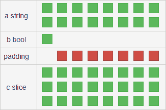
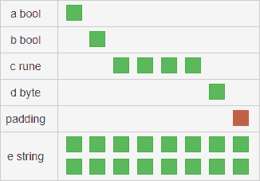
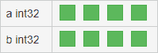
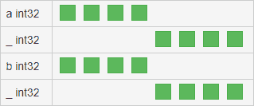

# 使用 CGO

本章将向你介绍 CGO，这是一个用于 C 语言的 Go 运行时。它使得从 Go 应用程序调用 C 代码成为可能，由于 C 语言拥有大量可用的库，这意味着它们可以在 Go 中被利用。

本章将涵盖以下主题：

*   从 C 和 Go 使用 CGO
*   理解类型差异

## 技术要求

本章要求已安装 Go 并设置好你喜欢的编辑器。更多信息请参阅 第 3 章 *Go 概览*。

此外，它要求你的机器上已安装 GCC 编译器。这可以在你的 Unix 机器上使用包管理器轻松完成。对于 Ubuntu，命令如下：

```
sudo apt install gcc
```

## CGO 简介

CGO 是使在 Go 应用程序中运行 C 代码成为可能的工具。自 2009 年 Go 达到 1.0 版本以来，此功能就已存在，它允许我们在当时可用的标准库外包比今天少得多的情况下使用现有的 C 库。

C 代码通过 `C` 伪包访问，并通过包名后跟标识符来访问和调用，例如 `C.print`。

`import` 声明前面有一系列特殊注释，指定应用程序应导入哪个 C 源文件：

```
package example

// #include <stdio.h>
import "C"
```

该语句也可以是多行注释，可以包含更多的 `include` 指令，如前面示例中的那样，甚至可以直接包含实际的 C 代码：

```
package example

/*
#include <stdio.h>
#include <stdlib.h>
#include <errno.h>

void someFunction(char* s) {
    printf("%s\n", s);
}
*/
import "C"
```

重要的是避免在 C 注释和 `import` 语句之间有空行，否则库和代码将不会被 CGO 导入到应用程序中。

## 从 Go 调用 C 代码

要使用由我们或他人编写的现有 C 代码，我们需要从 Go 调用 C。让我们执行一个快速、完整的示例，仅使用 C 功能将字符串打印到标准输出：

```
package main

/*
#include <stdio.h>
#include <stdlib.h>

void customPrint(char* s) {
    printf("%s\n", s);
}
*/
import "C"

import "unsafe"

func main() {
    s := C.CString(`Printing to stdout with CGO
        Using <stdio.h> and <stdlib.h>`)
    defer C.free(unsafe.Pointer(s))
    C.customPrint(s)
}
```

我们在这里导入了两个 C 核心库，它们分别是：

*   `stdio.h`：包含输入和输出方法。我们使用的是 `printf`。
*   `stdlib.h`：包含通用函数，包括内存管理。

查看前面的代码，我们注意到我们要打印的变量不是普通的 Go `string`，而是由 `C.CString` 函数获得的，该函数接受一个字符串并返回一个 `char` 切片，因为这是字符串在 C 中的处理方式。该函数定义如下：

```
func C.CString(string) *C.char
```

我们观察到的第二件事是我们推迟了对 `C.free` 的调用，传递我们定义的 `s` 变量，但将其转换为不同的类型。此函数调用至关重要，因为该语言没有垃圾回收，为了释放已使用的内存，应用程序需要专门调用 C 的 `free` 函数。该函数接收一个通用指针，在 Go 中由 `unsafe.Pointer` 类型表示。根据 Go 文档，以下内容适用：

"任何类型的指针值都可以转换为 Pointer。"


这正是我们正在做的事情，因为字符串变量的类型是 `*C.char` 指针。

# 从 C 调用 Go 代码

我们刚才看到了如何使用 C 包和 `import` 语句从 Go 应用程序调用 C 代码。现在，我们将看到如何从 C 调用 Go 代码，这需要使用另一个称为 `export` 的特殊语句。这是一个注释，需要放在我们要导出的函数的上一行，后跟该函数的名称：

```
//export theAnswer
func theAnswer() C.int {
    return 42
}
```

Go 函数需要在 C 代码中声明为外部函数。这将允许 C 代码使用它：

```
extern int theAnswer();
```

我们可以通过创建一个导出函数的 Go 应用程序来测试此功能，该函数被 C 函数使用。这在 Go `main` 函数内部被调用：

```
package main

// extern int goAdd(int, int);
//
// static int cAdd(int a, int b) {
//     return goAdd(a, b);
// }
import "C"
import "fmt"

//export goAdd
func goAdd(a, b C.int) C.int {
    return a + b
}

func main() {
    fmt.Println(C.cAdd(1, 3))
}
```

我们可以在前面的示例中看到，我们有 `goAdd` 函数，它通过 `export` 语句导出到 C。导出名称与函数名称匹配，并且注释与函数之间没有空行。

我们可以注意到，导出函数签名中使用的类型不是常规的 Go 整数，而是 `C.int` 变量。我们将在下一节中看到 C 和 Go 系统有何不同。

# C 和 Go 类型系统

为了在 C 和 Go 之间传递数据，我们需要通过执行正确的转换来传递正确的类型。

## 字符串和字节切片

`string` 类型是 Go 中的基本类型，在 C 中不存在。它有 `char` 类型，表示一个字符，类似于 Go 的 `rune` 类型，字符串由 `char` 类型的数组表示，并以 `\0` 结尾。

该语言允许直接将字符数组声明为数组或字符串。第二种声明不以 `0` 值结尾来结束字符串：

```
char lang[7] = {'G', 'o', 'l', 'a', 'n', 'g', '\0'};

char lang[] = "Golang";
```

我们已经看到了如何使用以下函数将 Go 字符串转换为 C 字符数组：

```
func C.CString(string) *C.char
```

此函数将在堆上分配字符串，因此释放此类内存将成为应用程序的责任，使用 `C.free` 函数。

为了将字节切片转换为名为 `*char` 的 C 字符指针，我们可以使用以下函数：

```
func C.CBytes([]byte) unsafe.Pointer
```

就像 `C.CString` 一样，应用程序在堆上分配数据，并将释放它的责任留给 Go 应用程序。

这两个函数的主要区别在于第一个生成 `char[]`，而另一个创建 `*char`。这两种类型分别等同于 Go 的 `string` 和 `[]byte`，因为第一种类型的字节不能更改，而第二种类型的字节可以。

有一系列函数用于将 C 类型转换回 Go 类型。就字符串而言，有两个函数：`C.GoString` 从整个数组创建字符串，而 `C.GoStringN` 允许使用显式长度创建字符串：

```
func C.GoString(*C.char) string

func C.GoStringN(*C.char, C.int) string
```

要将 C `*char` 转换回 Go `[]byte`，有一个函数：

```
func C.GoBytes(unsafe.Pointer, C.int) []byte
```

我们可以使用 `C.CBytes` 函数使用 C 修改字节切片并将其转换回 Go 切片：

```
package main

/*
#include <stdio.h>
#include <stdlib.h>
#include <string.h>

char* reverseString(char* s) {
    int l = strlen(s);
    for (int i=0; i < l/2; i++) {
        char a = s[i];
        s[i] = s[l-1-i];
        s[l-1-i] = a;
    }
    return s;
}
*/
import "C"

import (
    "fmt"
    "unsafe"
)

func main() {
    b1 := []byte("A byte slice")
    c1 := C.CBytes(b1)
    fmt.Printf("Go ptr: %p\n", b1)
    fmt.Printf("C ptr: %p\n", c1)
    defer C.free(c1)
    c2 := unsafe.Pointer(C.reverseString((*C.char)(c1)))
    b2 := C.GoBytes(c2, C.int(len(b1)))
    fmt.Printf("Go ptr: %p\n", b2)
    fmt.Printf("%q -> %q", b1, b2)
}
```

执行此应用程序将显示，当将字节切片 `b1` 转换为 C 类型作为 `c1` 变量时，它将改变地址。C 函数返回的 C 切片 `c2` 将具有与 `c1` 相同的地址，因为它是同一个切片。当再次转换回 Go 并赋值给 `b2` 时，它将拥有另一个地址，该地址不同于初始的 Go 字节切片 `b1`。

我们可以使用 C 字符串函数获得相同的结果。让我们使用前一个示例中的相同 C 代码并更改其余部分：

```
package main

/*
#include <stdio.h>
#include <stdlib.h>
#include <string.h>

char* reverseString(char* s) {
    int l = strlen(s);
    for (int i=0; i < l/2; i++) {
        char a = s[i];
        s[i] = s[l-1-i];
        s[l-1-i] = a;
    }
    return s;
}
*/
import "C"

import (
    "fmt"
    "unsafe"
)

func main() {
    s1 := "A byte slice"
    c1 := C.CString(s1)
    defer C.free(unsafe.Pointer(c1))
    c2 := C.reverseString(c1)
    s2 := C.GoString(c2)
    fmt.Printf("%q -> %q", s1, s2)
}
```

重要的是要注意，当将 Go 字符串和字节值传递给 C 时，值会被复制。因此，C 代码无法直接编辑它们，而是会编辑副本，从而保持原始 Go 值完好无损。

## 整数

在 C 中，可用的整数类型与 Go 有许多相似之处，因为两种语言中每种整数类型都有有符号和无符号版本，但它们在名称和字节大小方面有所不同。C `sizeof` 函数可以检查这些类型中每一种的大小。

以下是 C 中可用的整数类型列表：

### 有符号类型

| 类型 | 大小 | 范围 |
|------|------|-------|
| `char` | 1 字节 | [-128, +127] |
| `int` | 2 或 4 字节 | 见 `short` 和 `long` |
| `short` | 2 字节 | [-32 768, +32 767] |
| `long` | 4 字节 | [-2 147 483 648, +2 147 483 647] |
| `long long` | 8 字节 | [-9 223 372 036 854 775 808, +9 223 372 036 854 775 807] |

### 无符号类型

| 类型 | 大小 | 范围 |
|------|------|-------|
| unsigned `char` | 1 字节 | [0, +255] |
| unsigned `int` | 2 或 4 字节 | 见 unsigned `short` 或 unsigned `long` |
| unsigned `short` | 2 字节 | [0, +65 535] |
| unsigned `long` | 4 字节 | [0, +4 294 967 295] |
| unsigned `long long` | 8 字节 | [0, +18 446 744 073 709 551 615] |

C 中 `int` 的大小取决于架构——它过去在 16 位处理器上是 2 字节，但在现代处理器（32 位和 64 位）上是 4 字节。

当我们从 Go 的领域转移到 C 的领域，反之亦然时，我们会丢失所有变量溢出信息。当我们尝试将一个整数变量塞入另一个没有足够大小的变量时，编译器不会警告我们。我们可以通过一个简短的例子看到这一点，如下所示：

```
package main

import "C"

import "fmt"

func main() {
    a := int64(0x1122334455667788)

    // a 适合 64 位
    fmt.Println(a)
    // short 溢出，它是 16 位
    fmt.Println(C.short(a), int16(0x7788))
    // long 也溢出，它是 32 位
    fmt.Println(C.long(a), int32(0x55667788))
    // longlong 没问题，它是 64 位
    fmt.Println(C.longlong(a), int64(0x1122334455667788))
}
```

我们可以看到 `a` 的值是一个特定的数字，但 `short` 和 `long` 变量没有足够的字节，所以它们将有不同的值。转换显示转换时仅取变量的最后几个字节，其他字节被丢弃。

这是一个有用的 C 类型与可比较的 Go 类型的列表，以及如何在 Go 代码中使用它们：


| C 类型 | Go 类型 | CGO 类型 |
| --- | --- | --- |
| `char` | `int8` | `C.char` |
| `short` | `int16` | `C.short` |
| `long` | `int32, rune` | `C.long` |
| `long long` | `int64` | `C.longlong` |
| `int` | `int` | `C.int` |
| unsigned `char` | `uint8, byte` | `C.uchar` |
| unsigned `short` | `uint16` | `C.ushort` |
| unsigned `long` | `uint32` | `C.ulong` |
| unsigned `long long` | `uint64` | `C.ulonglong` |
| unsigned `int` | `uint` | `C.uint` |

在执行转换时，你可以参考此表，避免因使用错误类型而导致的错误，因为使用 CGO 时没有溢出警告。

# 浮点类型

在 C 语言中，`float` 类型与 Go 语言中的非常相似：

*   C 提供 `float`（32 位）和 `double`（64 位）。
*   Go 有 `float32` 和 `float64`。

当从 64 位值转换为 32 位值时，这可能导致舍入错误，如下面的代码所示：

```go
package main

import "C"

import (
    "fmt"
    "math"
)

func main() {
    a := float64(math.Pi)

    fmt.Println(a)
    fmt.Println(C.float(a))
    fmt.Println(C.double(a))
    fmt.Println(C.double(C.float(a)) - C.double(a))
}
```

前面的示例展示了 `math.Pi` 的值如何从 `3.141592653589793` 变为 `3.1415927`，导致约 `1/10⁷` 的误差。

# 不安全转换

现在我们将看到如何使用 `unsafe` 包从 C 语言编辑 Go 变量。

## 直接编辑字节切片

也可以使用一个“脏技巧”直接编辑 Go 字节切片。从 Go 的角度来看，切片是三个值的组合：

*   指向第一个元素的指针
*   切片的长度
*   切片的容量

在 C 语言中，字节切片只是一系列字节，而字符串是以 `\0` 结尾的字符切片。

如果我们使用 `unsafe` 包传递指向切片第一个元素的指针，就能直接编辑现有的字节切片，而无需执行复制和转换。我们可以在以下应用程序中看到如何执行此转换：

```go
package main

/*
#include <stdio.h>
#include <stdlib.h>
#include <string.h>

void reverseString(char* s) {
    int l = strlen(s);
    for (int i=0; i < l/2; i++) {
        char a = s[i];
        s[i] = s[l-1-i];
        s[l-1-i] = a;
    }
}
*/
import "C"

import (
  "fmt"
  "unsafe"
)

func main() {
    b1 := []byte("A byte slice")
    fmt.Printf("Slice: %s\n", b1)
    C.reverseString((*C.char)(unsafe.Pointer(&b1[0])))
    fmt.Printf("Slice: %s\n", b1)
}
```

转换使用表达式 `(*C.char)(unsafe.Pointer(&b1[0]))` 执行，它执行以下操作：

*   获取切片中元素零的指针
*   将其转换为不安全指针
*   将 `byte` 指针转换为 `C.char` 指针，二者共享内存表示

## 数字

使用 `unsafe` 包，我们还可以将数字变量指针转换为其 C 语言对应类型。这允许我们直接在 C 代码中编辑它：

```go
package main

/*
void half(double* f) {
    *f = *f/2;
}
*/
import "C"

import (
    "fmt"
    "math"
    "unsafe"
)

func main() {
    a := float64(math.Pi)
    fmt.Println(a)
    C.half((*C.double)(unsafe.Pointer(&a)))
    fmt.Println(a)
}
```

前面的示例正是如此；它在 C 函数中将 `a` 的值减半，而无需在 Go 中复制和赋值新值。

# 处理切片

Go 切片和 C 切片在一个基本方面有所不同——Go 版本同时嵌入了长度和容量，而在 C 语言中，我们只有指向第一个元素的指针。这意味着在 C 语言中，长度和容量必须存储在别处，例如另一个变量中。

让我们看看以下 Go 函数，它计算一系列 `float64` 数字的平均值：

```go
func mean(l []float64) (m float64) {
    for _, a := range l {
        m += a
    }
    return m / float64(len(l))
}
```

如果我们想在 C 语言中有一个类似的函数，我们需要传递一个指针及其长度。这将避免段错误等错误，当应用程序试图访问未分配给它的内存时会发生段错误。如果内存仍分配给该应用程序，结果是它提供对具有未知值的内存区域的访问，导致不可预测的结果：

```c
double mean(int len, double *a) {
    if (a == NULL || len == 0) {
        return 0;
    }
    double m = 0;
    for (int i = 0; i < len; i++) {
        m+=a[i];
    }
    return m / len;
}
```

我们可以使用一个 Go 包装器来尝试此函数，该包装器接受一个切片并将长度也传递给 C 函数：

```go
func mean(a []float64) float64 {
    if len(a) == 0 {
        return 0
    }
    return float64(C.mean(C.int(len(a)), (*C.double)(&a[0])))
}
```

为了验证会发生什么，我们还可以创建一个类似的函数，传递一个不正确的长度：

```go
func mean2(a []float64) float64 {
    if len(a) == 0 {
        return 0
    }
    return float64(C.mean(C.int(len(a)*2), (*C.double)(&a[0])))
}
```

使用此函数时，我们将看到应用程序不应引发任何段错误，但获得的结果将不同。这是因为第二个函数会将一系列额外的值添加到平均值计算中，如下所示：

```go
var a = make([]float64, 10)

func init() {
    for i := range a {
        a[i] = float64(i + 1)
    }
}

func main() {
    cases := [][]float64{a, a[1:4], a[:0], nil}
    for _, slice := range cases {
        fmt.Println(slice, mean(slice))
    }
    for _, slice := range cases {
        fmt.Println(slice, mean2(slice))
    }
}
```

# 处理结构体

在了解切片如何工作后，我们将知道如何使用结构体在 C 和 Go 中处理复杂数据。为此，让我们看看以下部分。

## Go 中的结构体

Go 结构体使用一种称为**对齐**的技术，即向数据结构添加一个或多个字节，以使其更好地适应内存地址。考虑以下数据结构：

```go
struct {
    a string
    b bool
    c []byte
}
```

在 64 位架构上对该结构体调用 `unsafe.Sizeof` 会给出一个意想不到的结果。我们预期的结果如下：

*   字符串占 16 字节；指向第一个元素的指针占 8 字节，长度占 8 字节
*   布尔值占 1 字节
*   切片占 24 字节；地址占 8 字节，长度占 8 字节，容量占 8 字节

总计应为 41，但函数返回 48。之所以发生这种情况，是因为编译器在布尔值后插入额外字节，以达到 8 字节（64 位）并针对 CPU 优化操作。该结构体在内存中可表示如下：



我们可以看到布尔变量占 1 位，编译器添加了 7 个额外位。这非常有帮助，因为它避免了其他变量一半存储在一个内存槽中，另一半存储在另一个中。那将需要每次操作两次读取和两次写入，导致性能显著下降。

如果两个或多个字段足够小，能放入一个 64 位槽中，它们将按顺序存储。我们可以通过以下示例看到这一点：

```go
struct {
    a, b bool
    c rune
    d byte
    e string
}
```

在 64 位架构上，此结构体转换为以下内存表示：



我们可以清楚地看到，两个布尔变量、`rune` 和 `byte` 位于同一内存地址，并添加了一个字节的填充以对齐最后一个字段。

## 手动填充

Go 允许使用空标识符为字段手动指定结构体中的填充。采用以下数据结构：

```go
struct{
    a int32
    b int32
}
```

这将具有以下表示：



我们可以使用空标识符手动指定填充，并针对 64 位架构优化数据结构：


```
struct{
    a int32
    _ int32
    b int32
    _ int32
}
```

这将允许应用程序将每个 `int32` 存储在其自己的内存位置中，因为空白字段将充当填充：



# C 语言中的结构体

C 语言中的结构体共享 Go 所使用的相同对齐概念，但它们总是使用 4 字节填充进行对齐。与 Go 不同，C 语言可以完全避免填充，这有助于通过减少内存使用来节省空间。让我们在以下章节中了解更多相关内容。

## 未打包结构体

除非另有说明，我们定义的每个结构体都是未打包的。我们可以按如下方式在 C 中定义一个结构体：

```c
typedef struct{
  unsigned char a;
  char b;
  int c;
  unsigned int d;
  char e[10];
} myStruct;
```

我们可以直接在 Go 代码中使用它并填充值，而不会出现任何问题：

```go
func main() {
    v := C.myStruct{
        a: C.uchar('A'),
        b: C.char('Z'),
        c: C.int(100),
        d: C.uint(10),
        e: [10]C.char{'h', 'e', 'l', 'l', 'o'},
    }
    log.Printf("%#v", v)
}
```

这个小测试将给我们以下输出：

```
main._Ctype_struct___0{
    a:0x41, 
    b:90, 
    c:100, 
    d:0xa, 
    e:[10]main._Ctype_char{104, 101, 108, 108, 111, 0, 0, 0, 0, 0},
     _:[2]uint8{0x0, 0x0},
}
```

这告诉我们有一个额外的空白字段用于填充，因为最后一个字段是 10 字节，距离 4 的倍数（即 12 字节）还差 2 字节。

## 打包结构体

我们可以使用 `pragma pack` 指令在 C 中定义一个打包结构体。我们可以按如下方式打包之前的结构体：

```c
#pragma pack(1)
typedef struct{
  unsigned char a;
  char b;
  int c;
  unsigned int d;
  char e[10];
} myStruct;
```

如果我们尝试在 Go 代码中使用该 C 结构体，如果使用字段 `c` 和 `d`，将会得到一个编译错误：

```go
pack := C.myStruct{
    a: C.uchar('A'),
    b: C.char('Z'),
    c: C.int(100),
    d: C.uint(10),
    e: [10]C.char{},
}
```

如果我们尝试像对待未打包版本那样打印该结构体，我们将看到原因：

```
main._Ctype_struct___0{
    a:0x41, 
    b:90, 
    _:[8]uint8{0x0, 0x0, 0x0, 0x0, 0x0, 0x0, 0x0, 0x0}, 
    e:[10]main._Ctype_char{104, 101, 108, 108, 111, 0, 0, 0, 0, 0},
}
```

从输出中我们可以看到，`c` 和 `d` 字段（均为 4 字节）被一个 8 字节的空字段取代了，Go 无法访问该字段。因此，我们无法从 Go 填充该结构体，但可以在应用程序的 C 部分访问此字段：

```c
myStruct makeStruct(){
  myStruct p;
  p.a = 'A';
  p.b = 'Z';
  p.c = 100;
  p.d = 10;
  p.e[0] = 'h';
  p.e[1] = 'e';
  p.e[2] = 'l';
  p.e[3] = 'l';
  p.e[4] = 'o';
  p.e[5] = '\0';
  p.e[6] = '\0';
  p.e[7] = '\0';
  p.e[8] = '\0';
  p.e[9] = '\0';
  return p;
}
```

这将允许我们返回一个具有正确值的结构体。我们可以打印它，并看到 `_` 字段包含 `c` 和 `d` 的值：

```
main._Ctype_struct___0{
    a:0x41, 
    b:90, 
    _:[8]uint8{0x64, 0x0, 0x0, 0x0, 0xa, 0x0, 0x0, 0x0}, 
    e:[10]main._Ctype_char{104, 101, 108, 108, 111, 0, 0, 0, 0, 0}
}
```

现在我们有了数据，需要创建一个 Go 结构体来承载它：

```go
type myStruct struct {
    a uint8
    b int8
    c int32
    d uint32
    e [10]uint8
}
```

现在，我们需要从 C 结构体读取原始字节并手动解包：

```go
func unpack(i *C.myStruct) (m myStruct) {
    b := bytes.NewBuffer(C.GoBytes(unsafe.Pointer(i), C.sizeof_myStruct))
    for _, v := range []interface{}{&m.a, &m.b, &m.c, &m.d, &m.e} {
        binary.Read(b, binary.LittleEndian, v)
    }
    return
}
```

我们可以使用 `C.GoBytes` 函数，它适用于任何指针（不仅仅是字节），并指定我们定义的结构体的大小，该大小存储在常量 `C.sizeof_myStruct` 中。然后我们可以使用 `binary.Read` 函数并配合**小端序 (LE)** 编码，按顺序读取每个字段。

我们可以看到，生成的结构体在正确的字段中包含了所有数据：

```
main.myStruct{
    a:0x41, 
    b:90, 
    c:100, 
    d:0xa, 
    e:[10]uint8{0x68, 0x65, 0x6c, 0x6c, 0x6f, 0x0, 0x0, 0x0, 0x0, 0x0},
}
```

# CGO 建议

我们现在已经了解了如何将 CGO 与整数、浮点数、切片和结构体一起使用。这是一个非常强大的工具，极大地促进了在 Go 应用程序中使用现有 C 代码。正如我们在上一章对反射所做的那样，我们现在将讨论 CGO 不那么明显的缺点。

## 编译与速度

Go 的标志之一是极快的编译时间。当使用 CGO 时，编译涉及的工作量要大得多，不仅仅是将所有 `.go` 文件传递给 Go 编译器。编译过程大致如下：

*   CGO 需要创建 C 到 Go 和 Go 到 C 的存根。
*   需要调用 `make` 命令来编译所有 C 源文件。
*   所有文件被合并到一个 `.o` 文件中。
*   系统的链接器需要验证 Go 和 C 之间的所有引用是否有效。

如果这个过程顺利进行，你可以启动你的应用程序，但如果你遇到任何问题，你将需要检查 C 和 Go 之间的错误，这不像调试纯 Go 应用程序那样容易。

另一个缺点是，并非每个操作系统都自带 `make` 命令。C 部分可能需要一些额外的标志才能正确编译，而这无法通过 `go install` 或 `go build` 处理。你将需要为你的应用程序创建一个编译脚本，例如 `makefile` 脚本。

## 性能

在讨论如何让 C 和 Go 相互通信时，我们看到对于每种类型，都需要执行一个转换操作。这对于数字来说可能很简单，但对于字符串、字节或切片则稍微复杂一些，对于结构体则更甚。这些操作在内存使用和性能方面都不是零成本的。这对许多应用程序来说不是问题，但如果你试图实现高性能，这可能会成为你的瓶颈。

C 代码不知道其 Go 对应部分发生了什么。当需要被调用时，Go 需要以适合 C 的格式将其堆栈信息传递给 C。当 C 代码执行完毕后，堆栈状态和已用变量的信息需要以从 C 传回 Go 的方式传递。

## 对 C 的依赖

当使用 CGO 时，你面临着其他语言在创建 C 代码绑定或包装器时面临的相同问题。你完全依赖于它。

Go 应用程序必须处理 C 使用内存和其他资源的方式，而 C 应用程序不知道 Go 在做什么，也不使用任何类型的并发，既不使用 goroutine 也不使用线程。

此外，如果你不是 C 开发人员，C 代码很难调试、维护和替换。因此，有时从头编写一个库比依赖现有的 C 实现更好。

一个非常好的例子是 `go-git`（https://github.com/src-d/go-git），它通过模仿现有的 C 库 libgit2（https://libgit2.org/），用纯 Go 实现了 Git 协议功能。

# 总结

在本章中，我们看到了 Go 武器库中一个非常强大的工具：CGO。它允许 Go 应用程序运行 C 代码，而 C 代码反过来又可以调用 Go 函数。我们看到它需要一个特殊的 `import` 语句 `import "C"`，这是一个伪包，包含所有可供 Go 使用的 C 代码。要导出 Go 代码并使其可供 C 使用，有一个特殊的注释 `//export`，它使 Go 函数在 C 命名空间中可用。


# 简介

我们了解到，C 和 Go 的类型系统在某些方面非常相似，但在其他方面却截然不同。我们看到字符串和字节数组可以转换为 C 类型，反之亦然。C 和 Go 中的整数也非常相似，主要区别在于 `int` 类型。在 C 中，它占 4 字节，而在 Go 中，它根据架构不同可能是 4 或 8 字节。浮点数也很相似，C 和 Go 都有 4 字节和 8 字节版本，只是名称不同。

也可以直接编辑数值型 Go 变量或字节 `slice`，而无需创建副本。这可以通过 `unsafe.Pointer` 函数强制进行原本不允许的类型转换来实现。C 中的 `Slices` 只是指向第一个元素的指针，`slice` 的长度需要存储在另一个变量中。这就是为什么我们创建了接受 `slice` 并将这两个参数传递给其 C 对应函数的 Go 函数。

在讨论数据结构之前，我们必须提及什么是对齐，Go 如何实现它，以及 C 的对齐与 Go 有何不同。`CGO` 中的数据结构使用对齐，且使用起来非常直接。如果它们不是 `packed` 的，我们可以轻松地传递它们并提取值。如果结构体是 `packed` 的，我们就无法访问其某些字段，并需要一种变通方法来手动执行到 Go 的转换。

最后一个主题聚焦于 `CGO` 的缺点，从较慢的构建时间到因所需转换导致的性能下降，以及由于 C 代码的存在，应用程序将变得更难维护。

希望您喜欢这趟 Go 之旅，并希望它能帮助您编写现代、并发且高效的应用程序。

# 问题

1.  什么是 `CGO`？
2.  如何从 `Go` 调用 `C` 代码？
3.  如何在 `C` 中使用 `Go` 代码？
4.  `Go` 和 `C` 之间的数据类型有什么区别？
5.  如何在 `C` 代码中编辑 `Go` 值？
6.  `packed` 数据结构的主要问题是什么？
7.  `CGO` 的主要缺点是什么？

# 评估

# 第 1 章

1.  **应用编程和系统编程有什么区别？**

    应用编程专注于为最终用户解决问题，而系统编程是关于创建供其他软件使用的软件。

2.  **什么是 `API`？为什么 `API` 如此重要？**

    `API` 是软件暴露的用于控制其所控制资源访问的接口。它描述了其他应用程序应如何与该软件通信。

3.  **能解释一下保护环是如何工作的吗？**

    保护环是一种用于防止故障和提高安全性的系统。它们将安全性按层级结构排列，限制逐级增加，并通过使用特定的网关允许对更高权限级别的功能进行中介访问。

4.  **能提供一些在用户空间无法执行的操作示例吗？**

    `用户空间` 中的应用程序无法将其当前空间切换到 `内核`，无法无视 `文件系统` 直接访问硬盘，也无法修改 `页表`。

5.  **什么是 `系统调用`？**

    `系统调用` 是操作系统提供的用于访问机器资源的 `API`。

6.  **Unix 使用哪些调用来管理进程？**

    Unix 用于管理进程的调用如下：`fork`、`exit` 和 `wait`。

7.  **为什么 `POSIX` 很有用？**

    各种 `POSIX` 标准定义了进程控制、信号、分段、非法指令、文件和目录操作、管道、I/O 控制和 `C 库`、Shell 和工具，以及实时和多线程扩展。它在构建应用程序时对开发者极其有用，因为它有助于构建一个能在共享该标准的不同操作系统上运行的应用程序。

8.  **Windows 是 `POSIX` 兼容的吗？**

    Windows 不是 `POSIX` 兼容的，但正在尝试提供 `POSIX` 框架，例如 Windows Linux 子系统。

# 第 2 章

1.  **现代操作系统使用哪种文件系统？**

    现代操作系统使用不同的文件系统：Windows 和 macOS 分别使用其专有格式 `NTFS` 和 `APFS`，而 Linux 系统主要使用 `EXT4`。

2.  **什么是 `inode`？Unix 中的 `inode` `0` 是什么？**

    `inode` 是代表文件的文件系统数据结构。它存储关于文件的信息，不包括名称和数据。

    `inode` `0` 保留给 `/` 文件夹。

3.  **`PID` 和 `PPID` 有什么区别？**

    `PID` 是现有进程的唯一标识符，而 `PPID` 是父进程的标识符。当一个现有进程创建另一个进程时，新进程的 `PPID` 等于现有进程的 `PID`。

4.  **如何终止在后台运行的进程？**

    虽然可以通过按 `Ctrl` + `C` 向前台进程发送 `SIGINT` 信号，但对于后台进程，需要使用 `kill` 命令发送信号，即 `kill -2 PID`。

5.  **用户和组有什么区别？**

    用户标识一个可以拥有文件和进程的账户，而组是一种在文件上共享权限的机制。

6.  **Unix 权限模型的范围是什么？**

    Unix 权限模型通过三个不同的权限级别来限制对文件的访问：所有者、组和其他所有用户。

7.  **能解释一下信号和退出码的区别吗？**

    信号和退出码都是进程间通信的方法，但信号是从任意进程发送给另一个进程，而退出码用于从子进程向其父进程通信。

8.  **什么是 `交换文件`？**

    `交换文件` 是物理内存的扩展，用于存储不需要的页面以释放主内存。

# 第 3 章

1.  **`导出` 和 `未导出` 符号有什么区别？**

    `导出` 的符号可以被其他包使用，而 `未导出` 的符号则不能。前者的标识符以大写字母开头，而后者则不是。

2.  **为什么自定义类型很重要？**

    自定义类型允许定义方法并有效使用接口，或者继承另一个类型的数据结构，但摆脱其方法。

3.  **`短声明` 的主要限制是什么？**

    `短声明` 不允许定义由值推断出的变量类型。对值进行 `类型转换` 可以克服这一限制。

4.  **什么是 `作用域`？它如何影响变量 `遮蔽`？**

    变量的 `作用域` 代表其生命周期和可见性，可以是 `包级`、`函数级` 或 `块级`。`遮蔽` 是指在内部 `作用域` 中使用了相同的标识符，从而阻止外部 `作用域` 访问共享该标识符的符号。

5.  **如何访问方法？**

    方法是具有与其所属类型关联的命名空间的特殊函数。它们可以作为其类型实例的属性访问，也可以作为类型本身的属性访问，并将实例作为第一个参数传递。

6.  **解释一系列 `if`/`else` 语句和 `switch` 语句的区别。**

    一系列 `if` 和 `else` 语句允许为每个 `if` 语句执行 `短声明`，并且只会执行其中一种情况，跳过后续的声明。`switch` 语句只允许一个声明，并可以使用 `continue` 和 `break` 语句修改流程。

7.  **在典型用例中，通常由谁负责关闭通道？**

    `通道` 应始终由 `发送方` 关闭，因为该方负责通知没有更多信息要发送。此外，向已关闭的通道发送会引发 `panic`，而从中接收则是非阻塞操作。

8.  **什么是 `逃逸分析`？**


# 逃逸分析

逃逸分析是 Go 编译器执行的一种优化过程，它通过验证变量是否会在其定义所在的函数之外存活，来尝试减少在堆上分配的变量。

## 第 4 章

### 1. 绝对路径和相对路径有什么区别？

绝对路径以 `/`（根）路径开头，而相对路径则不是。要从相对路径获取绝对路径，必须将其与当前工作目录连接起来。

### 2. 如何获取或更改当前工作目录？

要查明当前工作目录，`os` 包提供了 `Getwd()` 函数，它返回当前工作目录。要更改当前工作目录，必须使用 `Chdir()` 函数。它同时接受相对路径和绝对路径。

### 3. 使用 `ioutil.ReadAll()` 的优缺点是什么？

`ioutil.ReadAll()` 函数将整个文件内容放入一个字节切片中，因此文件的大小会影响分配和释放的内存量。由于以这种方式分配的内存没有回收机制，这些切片在不再使用时会被垃圾回收。

### 4. 为什么缓冲区对读取操作很重要？

字节缓冲区限制了读取操作分配的内存量，但它们也需要一定数量的读取操作，每次操作都有一点开销，会影响速度和性能。

### 5. 何时应该使用 `ioutil.WriteFile()`？

如果内容大小不太大，可以使用 `ioutil.WriteFile()` 函数，因为整个内容需要驻留在内存中。它也更适合用于短生命周期的应用程序，并应避免用于反复的写入操作。

### 6. 使用允许预读的缓冲读取器时，有哪些可用操作？

预读操作允许在不移动当前读取器光标的情况下检查接下来字节的内容，这使我们能够进行上下文相关的操作，例如读取单词、读取行或任何基于自定义令牌的操作。

### 7. 何时最好使用字节缓冲区读取内容？

使用读取缓冲区是降低应用程序内存使用量的一种方式。当不需要一次性拥有所有内容时可以使用它。

### 8. 缓冲区如何用于写入？使用它们有什么优势？

在写入操作中，应用程序已经处理了即将写入的字节，因此会使用底层缓冲区来优化系统调用的次数，仅在缓冲区满时才进行调用，以避免当传递给写入器的数据不足时增加系统调用的开销。

## 第 5 章

### 1. 什么是流？

流是一种抽象，表示传入或传出数据的通用流动。

### 2. 哪些接口抽象了传入流？

`io.Reader` 接口是传入流的抽象。

### 3. 哪个接口代表传出流？

`io.Writer` 接口是传出流的抽象。

### 4. 何时应使用字节读取器？何时应改用字符串读取器？

当原始数据是字节切片时应使用字节读取器，而处理字符串时应使用字符串读取器。从一种数据类型转换为另一种会导致拷贝，且不方便。

### 5. 字符串构建器和字节缓冲区有什么区别？

字节缓冲区可以被重用和覆写。字符串构建器用于在不拷贝的情况下创建字符串，因此它使用一个字节切片并通过 `unsafe` 包将其转换为字符串而无需拷贝。

### 6. 为什么读取器和写入器的实现应该接受接口作为输入？

接受接口作为输入意味着对具有相同行为的不同类型保持开放。这使得现有的读取器和写入器（如缓冲区和文件）能够被使用。

### 7. 管道与 `TeeReader` 有何不同？

管道将一个写入器连接到一个读取器。写入写入器的任何内容都会被读取器读取。`TeeReader` 则相反，它将一个读取器连接到一个写入器，因此读取的内容也会被写入到别处。

## 第 6 章

### 1. 什么是终端，什么是伪终端？

终端是一种表现得像电传打字机的应用程序，通过显示一个 2 x 2 的字符矩阵。伪终端是在终端下运行并通过交互性来模拟其行为的应用程序。

### 2. 伪终端应该能做什么？

伪终端应用程序应该能够接收用户的输入，根据接收到的指令执行操作，并将结果显示回给用户。

### 3. 我们使用了哪些 Go 工具来模拟终端？

为了管理用户输入，我们在标准输入中使用了一个缓冲扫描器，它将逐行读取用户输入。每个命令都使用相同的接口实现。为了理解调用的命令，我们使用了第一个参数与可用命令之间的比较。一个写入器被传递给命令以打印其输出。

### 4. 我的应用程序如何从标准输入获取指令？

应用程序可以使用标准输入并结合一个扫描器，每当遇到新行时它就会返回一个新的令牌。

### 5. 使用接口作为命令有什么优势？

将接口用于命令允许我们和我们包的使用者通过实现他们自己的接口版本来扩展行为。

### 6. 什么是莱文斯坦距离？为什么它在伪终端中很有用？

莱文斯坦距离是将一个字符串转换为另一个字符串所需的更改次数。当用户指定一个不存在的命令时，它可用于向用户建议其他命令。

## 第 7 章

### 1. Go 应用程序中当前进程可用的应用程序有哪些？

进程可用的应用程序包括 `PID`（进程 ID）、`PPID`（父进程 ID）、`UID` 和 `GID`（用户和组 ID）以及工作目录。

### 2. 如何创建子进程？

`exec.Cmd` 数据结构可用于定义子进程。当调用 `Run()`、`Start()`、`Output()` 和 `CombinedOutput()` 方法之一时，进程就会被创建。

### 3. 如何确保子进程在其父进程终止后仍然存活？

默认情况下，在 Unix 系统中，如果父进程终止，子进程会存活。此外，你可以更改子进程的进程组和会话 ID，以确保它能存活过父进程。

### 4. 可以访问子进程属性吗？它们如何使用？

最大的优势之一是访问子进程的 `PID` 并将其持久化到某处，例如磁盘上。这将允许应用程序的另一个实例，或任何其他应用程序，知道子进程的标识符并验证它是否仍在运行。

### 5. Linux 中什么是守护进程，它们是如何被处理的？

Linux 中的守护进程是在后台运行的进程。为了创建守护进程，一个进程可以创建自身的一个分支并终止，将 `init` 进程设置为分支的父进程，将分支的当前工作目录设置为根目录，将子进程的输入设置为 `null`，并使用日志文件作为输出和错误。

## 第 8 章

### 1. 什么是退出码？谁会使用它？

退出码是一个从进程传递给其父进程的整数值，用于在进程结束时发出信号。它代表进程的结果，如果没有错误则为 `0`。父进程可以使用此值来决定下一步做什么，例如如果有错误则再次运行该进程。

### 2. 当应用程序发生 panic 时会发生什么？返回什么退出码？

如果 `panic` 未被恢复，应用程序将执行所有延迟函数并以状态 `2` 退出。


# 第 8 章

**3. Go 应用程序接收所有信号时的默认行为是什么？**

Go 应用程序处理信号的默认行为是提前退出。

**4. 如何拦截信号并决定应用程序的行为？**

可以使用 `channel` 上的 `signal.Notify` 函数来拦截接收到的信号，并指定要处理的信号类型。`channel` 接收到的值可以与信号值进行比较，应用程序可以据此做出相应行为。

**5. 可以向其他进程发送信号吗？如果可以，如何发送？**

可以在 Go 应用程序中向另一个进程发送信号。为此，应用程序需要使用查找函数获取 `os.Process` 结构体的一个实例，然后使用该结构体的 `Signal` 方法发送信号。

**6. 什么是管道，为什么它们很重要？**

管道是两个连接在一起的流，一个用于输出，另一个用于输入。写入输出的内容可在输入端获取，这促进了一个进程的输出与另一个进程的输入之间的连接。

# 第 9 章

**1. 使用通信模型有什么优势？**

通信模型允许你抽象模型所处理的数据类型，使不同端点之间的通信变得容易。

**2. TCP 连接和 UDP 连接有什么区别？**

TCP 是面向连接的——这使其具有可靠性，因为它会在发送新数据前验证目标是否正确接收了数据。UDP 连接持续发送数据，无需确认目标是否收到数据包。这可能导致丢包，但连接速度更快且不会累积延迟。

**3. 发送请求时谁关闭请求体？**

发起 HTTP 调用时关闭请求是应用程序的责任。

**4. 在服务端接收请求时谁关闭请求体？**

当连接关闭时，请求体会自动关闭，但服务端如果愿意，可以更早地关闭它。

# 第 10 章

**1. 文本编码和二进制编码之间有什么权衡？**

基于文本的编码更便于人类阅读，也更易于调试和编写，但因此占用更多空间。二进制编码对人类而言难以编写、阅读和调试，但体积更小。

**2. Go 在编码时默认如何处理数据结构？**

Go 的默认行为是使用 `reflection`（反射）来读取字段及其值。

**3. 如何改变这种行为？**

可以通过实现所用编码的 marshaller 接口来改变这种行为，例如用于 JSON 的 `json.Marshaller`。

**4. 结构体字段如何被编码为 XML 属性？**

结构体字段需要在其标签中指定 `,attr` 值。

**5. 解码 `gob` 接口值需要什么操作？**

实现该接口的数据类型需要使用 `gob.Register` 函数在 `gob` 包中注册。

**6. 什么是 Protocol Buffers 编码？**

Protocol Buffers 是 Google 开发的一种编码协议，它使用定义文件来描述数据结构和服务。该文件用于生成数据模型、客户端和服务端存根，只留下服务端的实现工作给开发者。

# 第 11 章

**1. 什么是线程，谁负责管理它？**

线程是进程的一部分，可以由特定的核心或 CPU 分配。它携带关于应用程序状态的信息，就像进程一样，并由操作系统调度器管理。

**2. Goroutine 与线程有何不同？**

与线程相比，`Goroutine` 体积微小，比例约为 1:100，且不由操作系统管理。Go 运行时负责 `goroutine` 的调度。

**3. 启动 goroutine 时，参数何时求值？**

传递给启动 `goroutine` 的函数的所有参数，都在创建 `goroutine` 时求值。这意味着如果参数的值在 `goroutine` 真正被调度器选中并开始运行之前发生了变化，该变化不会反映在 `goroutine` 中。

**4. 有缓冲和无缓冲 channel 有何不同？**

如果不指定容量或容量为 `0`，`make` 函数创建的是无缓冲 `channel`。对此类 `channel` 的每次发送操作都会阻塞当前 `goroutine`，直到另一个 `goroutine` 执行接收操作。有缓冲 `channel` 可以支持数量等于其容量的非阻塞发送操作。这意味着如果 `channel` 容量为 `n`，前 `n-1` 个未被任何接收操作匹配的发送操作将不会阻塞。

**5. 单向 channel 为什么有用？**

它们仅允许一部分操作，明确告知用户 `channel` 的作用范围。只接收 `channel` 不允许发送数据或关闭它，这非常合理，因为这不是接收者的责任。只发送 `channel` 不允许接收数据，但允许发送数据和关闭 `channel`，这隐含地表明关闭 `channel` 以发出无更多数据信号是发送者的责任。

**6. 在 `nil` 或已关闭的 channel 上执行操作会发生什么？**

向 `nil` `channel` 发送或接收会永远阻塞，关闭它会引发 panic。从已关闭的 `channel` 接收会立即返回零值和 `false`，而向已关闭的 `channel` 发送会引发 panic，再次关闭它也会引发 panic。

**7. 定时器和计时器有什么用？**

`Timers` 和 `tickers` 都会创建一个只接收 `channel`。`Timers` 可以在循环中配合 `select` 语句使用，代替 `default`，以降低选择频率，减少应用程序空闲时的 CPU 使用率。`Tickers` 非常适合每隔固定时间段执行一次操作，一个实际用例是速率限制器，它限制在一定时间段内某应用程序片段的执行次数。

# 第 12 章

**1. 什么是竞态条件？**

竞态条件是指应用程序试图同时对同一资源执行两个操作，而该资源的特性一次只允许一个操作的情况。

**2. 并发执行 map 的读写操作会发生什么？**

当 map 上的读写操作同时发生时，会导致运行时错误：`concurrent map writes`。

**3. `Mutex` 和 `RWMutex` 有什么区别？**

普通 `Mutex` 允许资源被加锁和解锁，每种操作具有相同的优先级。读写 `RWMutex` 有两种锁，分别用于读和写操作。读锁允许多个操作同时进行，同时具有排他性。如果资源上有许多连续的读操作，写锁可能会延迟。这被称为写饥饿。

**4. 为什么等待组很有用？**

`WaitGroup`（或 `sync.WaitGroup`）是同步不同 `goroutine` 执行的完美工具。这为经典场景提供了简洁优雅的解决方案：存在多个并发操作，主 `goroutine` 必须等待它们全部结束才能继续执行。

**5. `sync.Once` 的主要用途是什么？**

`sync.Once` 可用于仅执行一次并发操作。例如，可用于关闭 `channel` 一次以避免 panic。另一个用例是变量的惰性初始化，以实现线程安全的单例设计模式。

**6. 如何使用对象池？**


# 资源池

资源池允许短生命周期的对象被重复使用。资源池的一个良好用例是字节切片和字节缓冲区，因为资源池会防止这些资源被垃圾回收器回收，同时也防止了新资源的分配。

# 第 13 章

## 1. 什么是 Go 中的 Context？

Context 是一个包，包含一个通用接口和一些用于返回 Context 实例的辅助函数。它用于同步应用程序各部分之间的操作，并用于传递值。

## 2. 取消、截止时间和超时有什么区别？

Context 有三种不同的过期类型：取消是应用程序显式调用取消函数；截止时间是指 Context 超过指定时间点；超时是指 Context 存活特定时长。

## 3. 使用 Context 传递值的最佳实践是什么？

随 Context 传递的值应与当前作用域或请求相关。不应将其用作传递可选函数参数或应用程序必需变量的方式。使用自定义私有类型作为键也是个好主意，因为内置值可能被其他包覆盖。指向值的指针也是解决此类问题的一种方案。

## 4. 哪些标准包已经使用了 Context？

不同的包使用了 Context。最著名的是 `net/http`，它将 Context 用于请求和服务器关闭；`net`，将 Context 用于 `Dial` 或 `Listen` 等函数；以及 `database/sql`，将 Context 用作取消查询等操作的方式。

# 第 14 章

## 1. 什么是生成器？它的职责是什么？

生成器是一个返回一系列值的工具——每次调用时返回序列中的下一个值。它负责按需生成序列中的值。在 Go 中，这可以通过使用通道来接收由创建值的 goroutine 发送的值来实现。

## 2. 如何描述管道？

管道是一种应用程序流类型，将执行拆分为不同阶段。这些阶段通过某种通信方式（如网络）或运行时内部机制（如通道）相互通信。

## 3. 哪种阶段接收一个通道并返回一个通道？

中间阶段将从只接收通道接收数据，并返回另一个只接收通道。

## 4. 扇入和扇出有什么区别？

扇入也称为解复用，指将来自不同来源的消息汇集到一起。扇出或多路复用则相反——它指将单一消息源分发给多个接收者。

# 第 15 章

## 1. Go 中接口的内存表示是什么？

Go 中的接口由两个值表示——第一个是接口的具体类型，第二个是该类型的值。

## 2. 当接口类型转换为另一个接口类型时会发生什么？

由于接口值必须是具体值，不能是另一个接口，因此会创建一个具有不同类型但相同具体值的新接口。

## 3. 反射中的 `Value`、`Type` 和 `Kind` 是什么？

`Value` 顾名思义，表示变量的内容；`Type` 表示变量的 Go 类型；`Kind` 是 `Type` 的内存表示，仅指代内置类型。

## 4. 什么是可寻址值？

可寻址值是指可以被编辑的值，因为它是通过指针获得的。

## 5. 为什么结构体字段标签在 Go 中很重要？

结构体字段标签是一种简单的方式，用于添加关于结构体字段的额外信息，这些信息易于阅读，可通过反射 `Type` 接口访问。

## 6. 反射的一般权衡是什么？

反射允许代码处理未知类型的数据，使包或应用程序具有通用性，但会带来性能成本。它还会使代码更晦涩、难以维护。

## 7. 使用反射的良好方法是什么？

反射的最佳方法是标准库中许多部分采用的方法；例如在 `encoding` 包中。它们将反射作为最后的手段，通过为编码和解码操作提供接口来实现。如果某类型满足这些接口，包将使用相应的方法，而不是依赖反射。

# 第 16 章

## 1. 什么是 CGO？

CGO 是一个强大的 Go 工具，用于处理 C 代码和 Go 代码之间的通信。这允许在 Go 应用程序中使用 C 代码，并利用大量现有的 C 库。

## 2. 如何从 Go 调用 C 代码？

Go 提供了一个名为 `C` 的伪包，暴露了 C 类型（如 `C.int`），以及一些将 Go 字符串和字节转换为 `C` 字符数组的函数，反之亦然。`import "C"` 语句前的注释将被解释为 C 代码，其中定义的所有函数（无论是直接定义还是通过导入文件）都将在 Go 中作为 `C` 包的函数可用。

## 3. 如何在 C 中使用 Go 代码？

如果 Go 函数前面有特殊注释 `//export`，该函数将可供 C 代码使用。在 C 中也必须将其声明为外部函数。

## 4. Go 和 C 的数据类型有什么区别？

即使它们有不同的数据类型，C 和 Go 共享大多数内置数值类型。Go 中的字符串是内置不可变类型，但在 C 中，它们只是以 `\\0` 值结尾的字符数组。

## 5. 如何在 C 代码中编辑 Go 值？

使用 `unsafe` 包，可以转换在 C 和 Go 中具有相同内存表示的数据类型。需要将指向值的指针转换为其 C 对应类型，这将允许从应用程序的 `C` 部分编辑指针内容。

## 6. 紧凑数据结构的主要问题是什么？

紧凑数据结构节省内存空间，但其字段可能未对齐，意味着它们分布在多个内存区域之间。这导致读写操作耗时加倍。还有一个不便之处——某些紧凑字段无法直接从 Go 访问。

## 7. CGO 的主要缺点是什么？

即使它是一个非常强大的工具，CGO 也有许多缺点：从 C 到 Go 以及反之的性能成本；编译时间增加，因为 C 编译器参与了该过程；Go 代码依赖 C 代码才能工作，这可能更难维护和调试。

# 其他推荐书籍

如果您喜欢这本书，可能对 Packt 的以下书籍感兴趣：


**Go 全栈开发实战**

Mina Andrawos

ISBN: 978-1-78913-075-1

*   通过构建真实应用程序理解 Go 编程
*   学习 React 框架为应用程序开发前端
*   利用 GopherJS 框架理解同构 Web 开发
*   探索使用 Gin 框架在 Go 中编写 RESTful Web API 的方法


*   学习实用主题，如 ORM 层、安全通信和 Stripe API
*   学习在 Go 中对 Web API 进行基准测试和测试的方法


# 使用 Golang 学习数据结构与算法

**Bhagvan Kommadi**

ISBN: 978-1-78961-850-1

*   使用最合适的数据结构和算法来提升应用程序性能
*   探索广泛的经典算法，如递归和哈希算法
*   使用垃圾回收等算法进行高效的内存管理
*   分析成本与收益的权衡，以确定用于解决问题的算法和数据结构
*   探索编写伪代码算法的技巧，并在面试中轻松应对白板编程
*   通过预测速度和效率，发现选择数据结构和算法时的陷阱

## 留下评论 - 让其他读者知道你的想法

请通过在购买网站上留下评论，与他人分享您对本书的看法。如果您是在 Amazon 上购买的本书，请在本书的 Amazon 页面留下诚实的评论。这至关重要，因为其他潜在读者可以看到并利用您的公正意见做出购买决定，我们可以了解客户对我们产品的看法，而作者也能看到您对他们与 Packt 合作创作的书名的反馈。这只会花费您几分钟时间，但对其他潜在客户、我们的作者和 Packt 来说却很有价值。谢谢！
