## Power E1080 简介

Power E1080 是 IBM Power 家族的最新成员，是业界领先的安全性和可靠性服务器平台。Power E1080 引入了必不可少的企业混合云平台，该平台专为帮助您在混合云中的任何位置安全高效地扩展核心运营和人工智能（AI）应用而设计。

Power E1080 简化了端到端加密，并在您的数据存储位置带来 AI，以实现更快的洞察。此配置有助于实现更大的工作负载部署灵活性和敏捷性，同时完成更多工作。

Power E1080 可帮助您实现以下优势：

+   从核心到云保护信任
+   在不影响性能的情况下，通过混合云实现大大简化的端到端加密，以保护传输中和静态数据。

+   享受企业级服务质量
+   Power E1080 可以在硬件中自动检测、隔离和从软错误中恢复，而无需停机或依赖操作系统来管理故障。

+   通过可持续且可扩展的计算实现更高效率
+   处理器性能、巨大的系统吞吐量和内存容量使 Power E1080 服务器成为完美的工作负载整合平台。此性能带来了机房空间、能源消耗和运营支出成本的显著节省。

本章包含以下主题：

+   1.1，“系统概述”第 2 页

+   1.2，“系统节点”第 6 页

+   1.3，“系统控制单元”第 10 页

+   1.4，“服务器规格”第 11 页

+   1.5，“系统特性”第 15 页

+   1.6，“I/O 抽屉”第 26 页

+   1.7，“系统机架”第 34 页

+   1.8，“硬件管理控制台概述”第 42 页

### 1.1 系统概述

Power E1080，也称为其 9080-HEX 机器类型型号，是 IBM Power 产品组合中最强大和最可扩展的服务器。它由称为 *节点*（或 *系统节点*）的 CEC 机箱组合以及更多单元和抽屉组成。

#### 1.1.1 系统节点、处理器和内存

在本节中，我们对系统节点、处理器和内存进行了总体概述。有关系统节点的更多信息，请参阅 1.2，“系统节点”第 6 页。

系统节点是一个机箱，提供连接处理器与内存、内部磁盘、适配器以及扩展所需互连的连接和支持电子设备。

每台服务器支持一个、两个、三个或四个系统节点的组合。

每个系统节点提供四个 Power10 处理器芯片插槽和 64 个差分 DIMM（DDIMM）插槽，用于双倍数据速率 4（DDR4）技术 DIMM。

每个插槽容纳一个 Power10 单芯片模块（SCM）。一个 SCM 可包含 10、12 或 15 个 Power10 处理器核心。它还保存额外的基础设施逻辑，以提供电力和数据连接至 Power10 处理器芯片。

系统节点的处理器配置由所选的处理器特性定义。每个特性定义一组四个具有相同核心密度（10、12 或 15）的 Power10 处理器芯片。

4 节点 Power E1080 服务器可扩展至 16 个处理器插槽和 160、192 或 240 个核心，具体取决于配置的 SCM 类型的核心数量。

所有具有 Power E1080 服务器的系统节点必须配置相同的处理器特性。

每个系统节点最多可支持使用最大可用内存 DIMM 密度时的 16 TB 系统内存。完全配置的 4 节点 Power E1080 最多可支持 64 TB 内存。

为了支持内部启动功能，每个系统节点可使用多达四个非易失性内存 express（NVMe）驱动器托架。更多驱动器托架通过扩展抽屉提供。

每个系统节点提供八个 Peripheral Component Interconnect Express（PCIe）Gen 5 能力插槽，Power E1080 服务器最多为 32 个。

任何一个、两个、三个或四个系统节点配置都需要系统控制单元（SCU）才能运行。SCU 通过冗余的 Flexible Service Processors（FSPs）提供系统硬件、固件和虚拟化控制。每个 Power E1080 服务器只需要并支持一个 SCU。有关系统控制单元的更多信息，请参阅 1.3，“系统控制单元”第 10 页。

有关服务器的环境和物理方面的更多信息，请参阅 1.4，“服务器规格”第 11 页。

#### 1.1.2 扩展抽屉和存储机箱

您可以通过使用扩展抽屉和存储机箱来增加系统容量。

可选的 19 英寸 PCIe Gen 3 4U I/O 扩展抽屉提供 12 个 PCIe Gen 3 插槽。I/O 扩展抽屉通过一对 PCIe x16 到 CXP 转换卡连接到系统节点，该卡位于系统节点内。每个系统节点最多可支持四个 I/O 扩展抽屉，共计 48 个 PCIe Gen 3 插槽。完全配置的 Power E1080 最多可支持 16 个 I/O 扩展抽屉，提供总共 192 个 PCIe Gen 3 插槽。

可选的 EXP24SX SAS 存储机箱提供 24 个 2.5 英寸小型型因子（SFF）串行连接 SCSI（SAS）托架。它支持多达 24 个热插拔硬盘驱动器（HDD）或固态驱动器（SSD），仅占用 19 英寸机架中 2U 机架单元的空间。EXP24SX 通过插入系统节点 PCIe 插槽或 I/O 扩展抽屉插槽的 SAS 适配器连接到 Power E1080 服务器。

有关机箱和抽屉的更多信息，请参阅 1.6，“I/O 抽屉”第 26 页。

有关 IBM 存储产品的更多信息，请参阅此网页。

#### 1.1.3 硬件概览

Power E1080 服务器提供以下硬件组件和特性：

+   - 10、12 或 15 核 Power10 处理器芯片，封装在每个插槽的单芯片模块中
+   - 一个、两个、三个或四个系统节点，每个系统节点有四个 Power10 处理器插槽
+   - 每个系统节点中的冗余时钟
+   - 每个系统节点多达 60 个 Power10 处理器核心，整个系统多达 240 个
+   - 每个系统节点多达 16 TB DDR4 内存，整个系统多达 64 TB
+   - 每个系统节点 8 个 PCIe Gen 5 插槽，整个系统最多 32 个 PCIe Gen 5 插槽
+   - 系统节点支持 PCIe Gen 1、Gen 2、Gen 3、Gen 4 和 Gen 5 适配器卡
+   - 每个系统节点多达 4 个 PCIe Gen 3 4U I/O 扩展抽屉，提供最多 48 个额外的 PCIe Gen 3 插槽
+   - 使用 16 个 PCIe Gen 3 I/O 扩展抽屉，整个系统多达 192 个 PCIe Gen 3 插槽
+   - 通过 EXP24SX SFF 抽屉直接连接多达 4,000 多个 SAS HDD 或 SSD
+   - 系统控制单元，提供冗余 Flexible Service Processors 并支持操作面板、系统 VPD 和外部连接 DVD

Power E1080 服务器硬件的巨大计算能力、卓越的系统容量和前所未有的可扩展性，由独特的企业级固件和系统软件功能和特性展开。IBM Power 企业平台提供以下重要特性和功能：

+   - 支持 IBM AIX、IBM i 和 Linux 操作系统环境
+   - 集成在每个 Power10 处理器核心中的创新密集数学引擎，可加速 AI 推理工作负载
+   - 在每个 Power10 处理器核心中实现的优化加密单元
+   - 由 Power10 处理器技术提供的专用数据压缩引擎

+   - 硬件和固件辅助并强制执行的<|message|> 安全性提供可信启动和全内存加密支持
+   - 每个系统多达 1,000 个虚拟机（VM）或逻辑分区（LPAR）
+   - 动态 LPAR 支持，可根据工作负载在不中断业务的情况下修改可用处理器和内存资源
+   - 按需容量（CoD）处理器和内存选项，可帮助更快速、更无缝地响应不断变化的业务需求和增长
+   - 具有 Power Enterprise Pools 2.0 的 IBM Power System Private Cloud Solution with Dynamic Capacity，支持实时工作负载平衡、系统维护和运营支出成本管理的无与伦比的企业灵活性。

表 1-1 根据 IBM POWER9™ 处理器技术，比较了 Power E1080 服务器与 Power System E980 服务器的重要技术特性。

## 表 1-1 Power E980 与 Power E1080 服务器的比较

| 特性 | Power E980 服务器 | Power E1080 服务器 |
|---|---|---|
| 处理器 | POWER9 | Power10 |
| 处理器封装 | 单芯片模块 | 单芯片模块 |
| 每个单芯片模块的核心数 | 6、8、10、11、12 | 10、12、15 |
| 每个系统的核心数 | 多达 192 核心 | 多达 240 核心 |
| 每个节点的插槽数 | 4 | 4 |
| 系统配置选项 | 1、2、3 和 4 节点系统 | 1、2、3 和 4 节点系统 |
| 每个节点最大内存 | 16 TB | 16 TB |
| 每个系统最大内存 | 64 TB | 64 TB |
| 每个节点最大内存带宽 | 920 GBps | 1636 GBps |
| 每个系统聚合最大内存带宽 | 3680 GBps | 6544 GBps |
| 全内存加密 | 否 | 是 |
| 每个节点 PCIe 插槽 | 八个 PCIe Gen 4 插槽 | 八个 PCIe Gen 5 插槽 |
| I/O 抽屉扩展选项 | 是 | 是 |
| 加速端口 | 是 CAPI 2.0 & OpenCAPI 3.0ᵃ | 是 OpenCAPI 3.0、3.1 |
| PCIe 热插拔支持 | 是 | 是 |
| 每个节点 I/O 带宽 | 545 GBps | 576 GBps |
| 集成 USB | USB 3.0 | 不可用 |
| 每个节点内部存储托架 | 四个 NVMe PCIe Gen 3 托架ᵇ | 四个 NVMe PCIe Gen 4 托架 |
| 插槽间每通道比特率 | 25 Gbps | 32 Gbps |

| 特性 | Power E980 服务器 | Power E1080 服务器 |
|---|---|---|
| 可靠性、可用性和可服务性 (RAS) | SMPᶜ 电缆并发维修 | 非活动 SMP 电缆，具有并发维护能力及 TDRᵈ 故障隔离 |
| 安全且可信的启动 | 是 | 是 |

+   a. CAPI 指定相干加速器处理器接口技术，OpenCAPI 指定开放相干加速器处理器接口技术。有关架构规范及周边系统的更多信息，请参阅此网页。
+   b. NVMe 指定由 NVM Express 协会监督的非易失性内存 Express 接口规范：https://nvmexpress.org。
+   c. SMP 指定对称多处理架构，用于将多个处理器实体构建成单片服务器。
+   d. 时域反射测量 (TDR) 使服务器能够主动检测电缆中的故障并定位连接器中的不连续点。

图 1-1 显示了一个安装在 IBM 机架中的 4 节点 Power E1080 服务器。每个系统节点由一组五个风扇冷却，风扇并排排列在一行中。冷却组件可通过机架的前门看到。

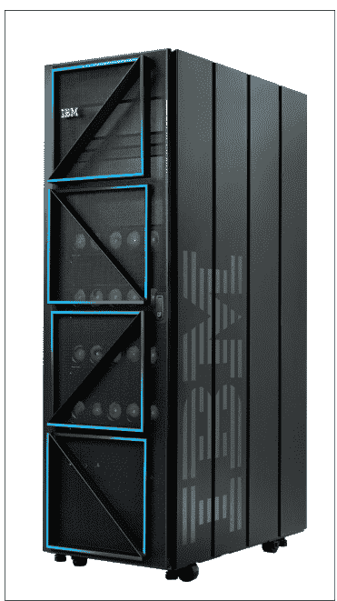

图 1-1 安装在 S42 机架并带 #ECRT 门的 Power E1080 4 节点服务器

### 1.1.4 系统容量和特性

在任何初始订单中，Power E1080 支持多达四个系统节点。每个节点支持的最大内存容量为 4 TB。

每个系统节点最多支持四个 PCIe Gen 3 I/O 扩展抽屉。每个 I/O 扩展抽屉可配备两个 Fanout 模块。每个 Fanout 模块反过来通过一个 PCIe x16 到 CXP 转换卡连接到一个系统节点。

内存特性 #EMC1 128 GB、#EMC2 256 GB、#EMC3 512 GB 和 #EMC4 1024 GB 可用。

以下特性可用：

- 最大 4 个 #EDN1 5U 系统节点抽屉
- 每个节点抽屉最多 16 TB 系统内存
- 最多 16 个 #EMX0 PCIe Gen 3 I/O 扩展抽屉
- 最多 32 个 #EMXH PCIe Gen 3 6 槽 Fanout 模块用于 PCIe Gen 3 扩展抽屉
- 最多 32 个 #EJ24 PCIe x16 到 CXP 转换卡

### 1.2 系统节点

完整的 Power E1080 运行系统包括一个 SCU 和一个、两个、三个或四个系统节点。系统节点也称为中央电子复合体 (CEC) 或 CEC 抽屉。

每个系统节点高 5U 机架单元，容纳四个风冷 Power10 单芯片模块 (SCM)，针对性能、可扩展性和 AI 工作负载进行了优化。SCM 由一个 Power10 处理器芯片和更多逻辑、引脚和连接器构成，使 SCM 能够插入到系统节点平面上的相关插座中。

Power E1080 Power10 SCM 有 10 核、12 核或 15 核容量可选。每个内核均可以八路同时多线程 (SMT) 模式运行，提供八个独立硬件线程的并行执行能力。

10 核 SCM 采用处理器特性 #EDP2 以每系统节点四套的方式订购。这样，特性 #EDP2 为一个系统节点提供 40 个核心的处理能力，4 节点 Power E1080 服务器的总系统容量为 160 个核心。10 核 SCM 的最大频率为 3.9 GHz，使其成为入门级 Power E1080 服务器的理想构建模块。

12 核 SCM 采用处理器特性 #EDP3 以每系统节点四套的方式订购。这样，特性 #EDP3 为每个系统节点提供 48 个核心容量，完全配置的 4 节点 Power E1080 服务器最多可达 192 个核心。此 SCM 类型提供最高的处理频率，最高为 4.15 GHz，如果最高线程性能是最重要的设计目标之一，则是完美选择。

15 核 SCM 采用处理器特性 #EDP4 以每系统节点四套的方式订购。这样，特性 #EDP4 为每个系统节点提供 60 个核心，4 节点 Power E1080 的总系统容量令人印象深刻，达到 240 个核心。15 核 SCM 的最大运行频率为 4.0 GHz，满足对线程性能要求高且需要高计算容量密度的环境需求。

注意：系统节点内的所有 Power10 SCM 必须为同一类型：10 核、12 核或 15 核。此外，特定 Power E1080 服务器内的所有系统节点必须配置一致，具有相同的处理器特性。

每个 Power10 处理器芯片使用三个 PowerAXON¹ 18 位宽总线，在 CEC 抽屉内跨越一个全连接结构。这样，系统节点内的每个 SCM 都直接以 32 Gbps 速度连接到同一抽屉的每个其他 SCM。此平面内互连提供 128 Gbps 芯片到芯片数据带宽，相对于 Power E980 系统中基于 POWER9 处理器的平面内互连实现，增加了 33%。吞吐量可计算为 16 b 链路 * 32 gbps = 64 GBps 每方向 * 2 方向，总速率为 128 GBps。

Power E1080 CEC 抽屉中的四个 Power10 处理器芯片中的每一个都直接连接到多节点系统中的每个其他 CEC 抽屉中相同位置的 Power10 处理器芯片。此连接是通过使用每连接一条对称多处理 (SMP) PowerAXON 18 位宽总线以 32 Gbps 速度运行来实现的。

Power10 SCM 在模块上直接提供八个 PowerAXON 连接器，其中六个用于将 SMP 总线路由到 CEC 机箱的后部尾架。这种创新实现允许使用无源 SMP 电缆，从而降低数据传输延迟并增强抽屉到抽屉 SMP 互连的稳健性。如 1.2 节“系统节点”第 6 页所述，电缆特性 #EFCH、#EFCE、#EFCF 和 #EFCG 需要将系统节点抽屉连接到系统控制单元。它们也需要在多节点 Power E1080 配置中促进每个抽屉之间的 SMP 互连。

为了访问主内存，Power10 处理器技术引入了新的开放内存接口 (OMI)。16 个可用的高速 OMI 链路由 8 个片上内存控制器单元 (MCU) 驱动，提供每个 SCM 高达 409 GBps 的总聚合带宽。此设计代表内存带宽相比基于 POWER9 处理器的技术能力增加了 78%。

每个 Power10 OMI 链路直接连接到一个基于内存缓冲器的差分 DIMM (DDIMM) 插槽。因此，一个系统节点的四个插座提供总共 64 个 DDIMM 插槽，聚合最大内存带宽为 1636 GBps。Power E1080 服务器支持的 DDIMM 密度为 32 GB、64 GB、128 GB 和 256 GB，均使用双倍数据速率 4 (DDR4) 技术。

Power E1080 内存选项作为 128 GB (#EMC1)、256 GB (#EMC2)、512 GB (#EMC3) 和 1024 GB (#EMC4) 内存特性提供。每个内存特性提供四个 DDIMM。

1 PowerAXON 代表 Power10 处理器的 A 总线/X 总线/OpenCAPI/网络接口。

每个系统节点最多支持 16 个内存特性，覆盖 64 个 DDIMM 插槽。使用 1024 GB DDIMM 特性可实现每个节点最多 16 TB。2 节点系统的最大容量为 32 TB。4 节点系统的最大容量为 64 TB。需要至少激活已安装容量的 50% 的内存。

> 注意：Power10 处理器内存逻辑和 Power E1080 服务器的内存 I/O 子系统设计为支持 DDR4 DIMM，但也可以使用下一代 DDR5 动态随机存取存储器技术。

Power10 处理器 I/O 子系统由 32 GHz 差分 Peripheral Component Interconnect Express 5.0 (PCIe Gen 5) 总线驱动，提供 32 条通道，分成两组，每组 16 条通道。32 条 PCIe 通道为每个系统节点提供 576 GBps 的聚合带宽，用于支持 8 个半长、低轮廓 (半高) 适配器插槽以实现外部连接，以及 4 个非易失性内存 Express (NVMe) 主流固态驱动器 (SSD)，采用 U.2 形式因子用于内部存储。

八个外部 PCIe 插槽中的六个可用于 PCIe Gen 4 x16 或 PCIe Gen 5 x8 适配器，其余两个提供 PCIe Gen 5 x8 能力。所有 PCIe 插槽均支持 PCIe 标准的早期版本，例如 PCIe Gen 1 (PCIe 1.0)、PCIe Gen 2 (PCIe 2.0)、PCIe Gen 3 (PCIe 3.0) 和 PCIe Gen 4 (PCIe 4.0)。

为了获得额外连接，最多可将四个 19 英寸 PCIe Gen 3 4U 高 I/O 扩展单元 (#EMX0) 可选地连接到一个系统节点。每个扩展抽屉包含一个或两个 PCIe Fanout 模块 (#EMXH)，每个模块有六个 PCIe Gen 3 全长、全高插槽。

完全配置的 4 节点 Power E1080 服务器提供总共 32 个内部 PCIe 插槽，以及通过 I/O 扩展单元最多 192 个 PCIe 插槽。

图 1-2 显示了系统节点的前视图。风扇和电源单元 (PSU) 是冗余且可并发维护的。风扇为 n+1 冗余；因此，系统在任何一个风扇故障时仍能继续运行。由于电源为 n+2 冗余，即使任何两个电源故障，系统仍能继续运行。

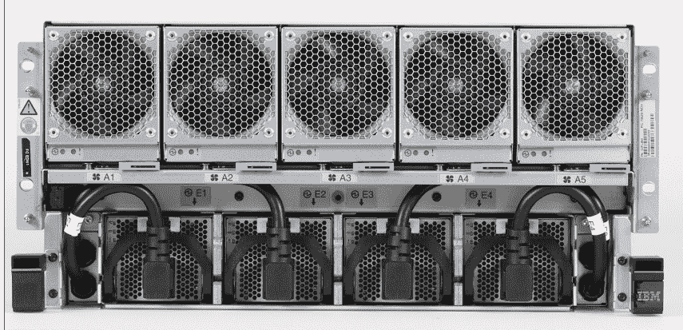

Figure 1-3 shows the rear view of a system node with the locations of the external ports and features.

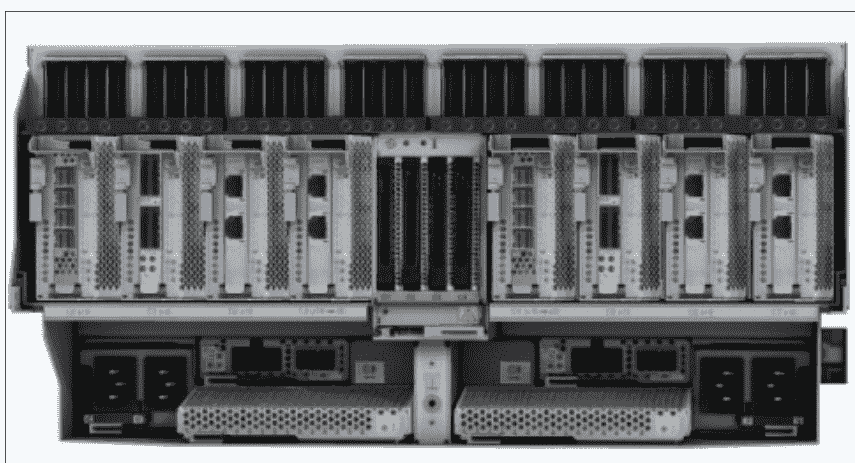

Figure 1-3 Rear view of a Power E1080 server node

Figure 1-4 shows the internal view of a system node and some of the major components like heat sinks, processor voltage regulator modules (VRMs), VRMs of other miscellaneous components, differential DIMM (DDIMM) slots, DDIMMs, system clocks, trusted platform modules (TPMs), and internal SMP cables.

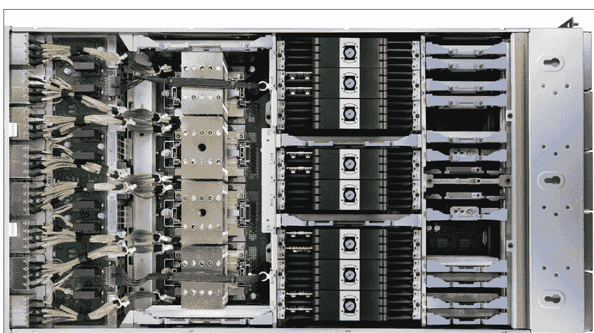

Figure 1-4 Top view of a Power E1080 server node with the top cover assembly removed

### 1.3 System control unit

The system control unit (SCU) is implemented in a 2U high chassis and provides system hardware, firmware, and virtualization control functions through a pair of redundant Flexible Service Processor (FSP) devices. It also contains the operator panel and the electronics module that stores the system vital product data (VPD). The SCU is also prepared to facilitate USB connectivity that can be used by the Power E1080 server.

One SCU is required and supported for each Power E1080 server (any number of system nodes) and, depending on the number of system nodes, the SCU is powered according to the following rules:

- Two universal power interconnect (UPIC) cables are used to provide redundant power to the SCU.
- In a Power E1080 single system node configuration, both UPIC cables are provided from the single system node to be connected to the SCU.
- For a two, three, or four system nodes configuration, one UPIC cable is provided from the first system node and the second UPIC cable is provided from second system node to be connected to the SCU.

The set of two cables facilitate a 1+1 redundant electric power supply. In case of a failure of one cable, the remaining UPIC cable is sufficient to feed the needed power to the SCU.

Two service processor cards in SCU are ordered by using two mandatory #EDFP features. Each one provides two 1 Gb Ethernet ports for the Hardware Management Console (HMC) system management connection. One port is used as primary connection and the second port can be used for redundancy. To enhance resiliency, it is recommended to implement a dual HMC configuration by attaching separate HMCs to each of the cards in the SCU.

Four FSP ports per FSP card provide redundant connection from the SCU to each system node. System nodes connect to the SCU by using the cable features #EFCH, #EFCE, #EFCF, and #EFCG. Feature #EFCH connects the first system node to the SCU and it is included by default in every system node configuration. It provides FSP, UBIC, and USB cables, but no symmetric multiprocessing (SMP) cables. All the other cable features are added depending on the number of extra system nodes that are configured and includes FSP and SMP cables.

The SCU implementation also includes the following highlights:

- Elimination of clock cabling since the introduction of POWER9 processor-based servers
- Front-accessible system node USB port
- Optimized UPIC power cabling
- Optional external DVD
- Concurrently maintainable time of day clock battery

Figure 1-5 shows the front and rear view of a SCU with the locations of the external ports and features.

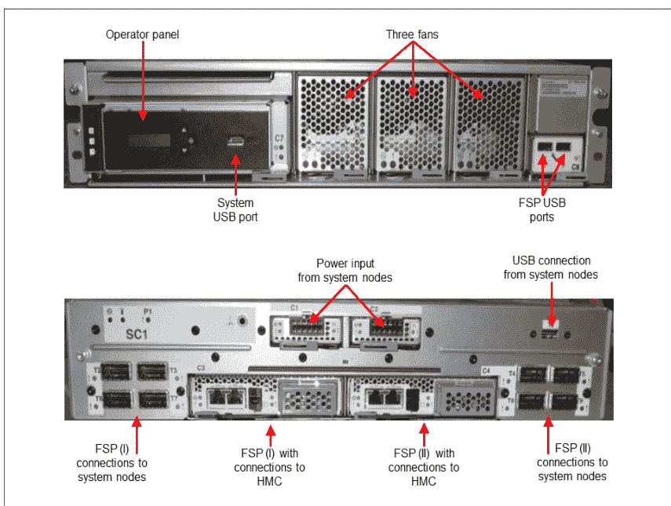

Figure 1-5 Front and rear view of the system control unit

### 1.4 Server specifications

The Power E1080 server specifications are essential to plan for your server. For a first assessment in the context of your planning effort, this section provides you with an overview related to the following topics:

- Physical dimensions
- Electrical characteristics
- Environment requirements and noise emission

For more information about the comprehensive Model 9080-HEX server specifications product documentation, see IBM Documentation.

#### 1.4.1 Physical dimensions

The Power E1080 is a modular system that is built of a single SCU and one, two, three, or four system nodes.

Each system component must be mounted in a 19-inch industry standard rack. The SCU requires 2U rack units and each system node requires 5U rack units. Thus, a single-node system requires 7U, a two-node system requires 12U, a three-node system requires 17U, and a four-node system requires 22U rack units. More rack space must be allotted; for example, to PCIe I/O expansion drawers, a hardware management console, flat panel console kit, network switches, power distribution units, and cable egress space.

Table 1-2 lists the physical dimensions of the Power E1080 server control unit and a Power E1080 server node. The component height is also given in Electronic Industries Alliance (EIA) rack units. (One EIA unit corresponds to one rack unit (U) and is defined as 1 3/4 inch or 44.45 mm respectively).

Table 1-2 Physical dimensions of the Power E1080 server components

| Dimension | Power E1080 server control unit | Power E1080 server node |
|---|---|---|
| Width | 445.6 mm (17.54 in) | 445 mm (17.51 in) |
| Depth | 779.7 mm (30.7 in) | 866.95 mm (34.13 in) |
| Height | 86 mm (3.39 in) / 2 EIA units | 217.25 mm (8.55 in) / 5 EIA units |
| Weight | 22.7 kg (50 lb) | 81.6 kg (180 lb) |

#### Lift tools

It is recommended to have a lift tool available at each site where one or more Power E1080 servers are located to avoid any delays when servicing systems. An optional lift tool #EB2Z is available for order with a Power E1080 server. One #EB2Z lift tool can be shared among many servers and I/O drawers. The #EB2Z lift tool provides a hand crank to lift and position up to 159 kg (350 lb). The #EB2Z lift tool is 1.12 meters x 0.62 meters (44 in x 24.5 in).

> Note: A single system node can weigh up to 86.2 kg (190 lb). Also available are a lighter, lower-cost lift tool #EB3Z and wedge shelf tool kit for #EB3Z with feature code #EB4Z.

#### 1.4.2 Electrical characteristics

Each Power E1080 server node has four 1950 W bulk power supplies. The hardware design provides N+2 redundancy for the system power supply, and any node can continue to operate at full function in nominal mode with any two of the power supplies functioning.

Depending on the specific Power E1080 configuration, the power for the SCU is provided through two UPIC cables connected to one or two system nodes, as described in 1.2, “System nodes” on page 6.

Table 1-3 lists the electrical characteristics per Power E1080 server node. For planning purposes, use the maximum values that are provided. However, the power draw and heat load depends on the specific processor, memory, adapter, and expansion drawer configuration and the workload characteristics.

Table 1-3 Electrical characteristics per Power E1080 server node

| Electrical characteristics | Properties |
|---|---|
| Operating voltage | 200 - 208 / 220 - 240 V AC |
| Operating frequency | 50 or 60 Hz +/- 3 Hz AC |
| Maximum power consumption | 4500 W |
| Maximum power source loading | 4.6 kVA |
| Maximum thermal output | 15355 BTU/h |
| Phase | Single |

> Note: The Power E1080 must be installed in a rack with a rear door and side panels for electromagnetic compatibility (EMC) compliance.

#### 1.4.3 Environment requirements and noise emission

> Environmental assessment: The IBM Systems Energy Estimator tool can provide more accurate information about power consumption and thermal output of systems based on a specific configuration.

The environment requirements for the Power E1080 servers are classified in operating and non-operating environments. The operating environments are further segmented regarding the recommended and allowable conditions.

The recommended operating environment designates the long-term operating environment that can result in the greatest reliability, energy efficiency, and reliability. The allowable operating environment represents where the equipment is tested to verify functionality. Because the stresses that operating in the allowable envelope can place on the equipment, these envelopes must be used for short-term operation, not continuous operation.

The condition of a non-operating environment pertains to the situation when equipment is removed from the original shipping container and is installed, but is powered down. The allowable non-operating environment is provided to define the environmental range that an unpowered system can experience short term without being damaged.

Table 1-4 on page 14 lists the environment requirements for the Power E1080 server regarding temperature, humidity, dew point, and altitude. It also lists the maximum noise emission level for a fully configured Power E1080 server.

## 表 1-4 Power E1080 环境要求和噪声排放

| 属性 | 环境 |  |  |
|  | 运行 |  | 非运行 |
|  | 推荐 | 允许 |  |
| 温度 | 18.0°C – 27.0°C (64.4°F – 80.6°F) | 5.0°C – 40.0°C (41.0°F – 104.0°F) | 5°C - 45°C (41°F - 113°F) |
| 低端湿度 | -9.0°C (15.8°F) 露点 | -12.0°C (10.4°F) 露点 和 8% 相对湿度 | N/A |
| 高端湿度 | 60% 相对湿度 和 15°C (59°F) 露点 | 85% 相对湿度 和 24.0°C (75.2°F) 露点 | N/A |
| 相对湿度 | N/A | N/A | 8% 至 85% |
| 最大露点 | N/A | N/A | 27.0°C (80.6°F) |
| 最大海拔 | N/A | 3,050 m (10,000 ft) | N/A |
| 最大噪声水平 | 10.0 B LWA,m a (单台全配置 16 插槽四节点系统重负载，35°C (95°F) 于 500 m (1640 ft)) | N/A | N/A |

a. 声明的等级 LWA,m 是以贝尔 (B) 为单位测量的 A 加权声功率级的上限。

> 注意：IBM 不建议在高于 27C 的温度下运行，然而，对于这些系统，可以预期在最高 35C 下实现全性能。超过 35C 后，系统仍可运行，但可能会出现性能下降以保护系统组件的完整性。超过 40C 后，系统组件的可靠性可能存在问题。

Power E1080 产品文档提供了各种不同 Power E1080 服务器配置的噪声排放值综合列表。有关噪声排放的更多信息，请在 IBM 文档中搜索“Model 9080-HEX server specifications”。

> 注意：政府法规，例如职业安全健康管理局 (OSHA) 或欧洲共同体指令发布的法规，可以规范工作场所的噪声水平暴露，可能适用于您和您的服务器安装。Power E1080 服务器提供可选的隔音门功能，可帮助降低该系统发出的噪声。
> 
> 您的安装中的声压级取决于多种因素，包括安装中的机架数量；您指定安装机架的房间的大小、材料和配置；其他设备的噪声水平；房间环境温度，以及员工相对于设备的位置。
> 
> 此外，是否符合此类政府法规还取决于其他多种因素，包括员工的暴露时长以及员工是否佩戴听力保护装置。IBM 建议您咨询该领域的合格专家，以确定您是否符合适用的法规。

### 1.5 系统特性

本节列出并解释了 Power E1080 服务器上可用的系统特性。这些特性描述了系统默认可用或通过采购可配置特性代码而获得的资源。

各种特性代码的概述以及基本信息也同时呈现，可帮助用户使用合适的特性设计系统配置，以满足应用计算需求。此信息还有助于围绕应用构建高可用性、可扩展、可靠且灵活的系统。

#### 1.5.1 最小配置

最小配置使用户能够订购一套完全合格且经过测试的 Power 系统硬件配置，具有最少的一组提供的技术特性。Power E1080 服务器的模块化设计使用户能够从最小配置开始，并在需要时垂直扩展。

表 1-5 列出了具有最小特性的 Power E1080 服务器配置。

表 1-5 最小配置

| 特性 | FC | 特性代码描述 | 最小数量 |
|---|---|---|---|
| 主操作系统特性代码 | ► 2145 ► 2146 ► 2147 | ► 主操作系统 - IBM i ► 主操作系统 - AIX ► 主操作系统 - Linux | 1 |
| 系统机箱 | EDN1 | 5U 系统节点指示器抽屉 | 1 |
| 灵活服务处理器 | EDFP | 灵活服务处理器 | 2 |
| 面板 | EBAB | IBM 架装抽屉面板和硬件 | 1 |
| 处理器 | ► EDP2 ► EDP3 ► EDP4 | ► 40 核 (4x10) 典型 3.65 至 3.90 GHz (最大) Power10 处理器，带 5U 系统节点抽屉 ► 48 核 (4x12) 典型 3.60 至 4.15 GHz (最大) Power10 处理器，带 5U 系统节点抽屉 ► 60 核 (4x15) 典型 3.55 至 4.00 GHz (最大) Power10 处理器，带 5U 系统节点抽屉 | 1 个任一 FC |
| 处理器激活 | ► EDPB ► EDPC ► EDPD | ► #EDBB/#EDP2 的 1 核处理器激活 ► #EDBC/#EDP3 的 1 核处理器激活 ► #EDBD/#EDP4 的 1 核处理器激活 | ► 16 ► PEP 2.0 中为 1 |
| 内存 | ► EVC1 ► EVC2 ► EVC3 ► EVC4 | ► 128 GB (4x32 GB) DDIMMs，3200 MHz，16 GBIT DDR4 内存 ► 256 GB (4x64 GB) DDIMMs，3200 MHz，16 GBIT DDR4 内存 ► 512 GB (4x128 GB) DDIMMs，2933 MHz，16 GBIT DDR4 ► 1 TB (4x256 GB) DDIMMs，2933 MHz，16 GBIT DDR4 | 8 个任一 FC 的特性 |

| 特性 | FC | 特性代码描述 | 最小数量 |
|---|---|---|---|
| 内存激活 | EMAZ | HEX 的 1 GB 内存激活 | PEP 2.0 中为 50% 或 256 GB |
| DASD 背板 | EJBC | 4-NVMe U.2 (7mm) 闪存驱动器托架 | 1 |
| 数据保护 | 0040 | 镜像系统磁盘级别，指定代码 | ► 如为 IBM i 则为 1 ► 其他操作系统为 0 |
| UPIC 电缆 | EFCH | 抽屉 1 的系统节点到系统控制单元电缆套件 | 1 |

注意：IBM 配置器生成的最小配置包含更多管理性和指示性特性。

#### 1.5.2 处理器特性

Power E1080 服务器中的每个系统节点提供四个插槽以容纳 Power10 单芯片模块 (SCM)。每个处理器特性代码代表这四个插槽中的四个，以 10 核、12 核和 15 核密度提供。

表 1-6 列出了 Power E1080 服务器可用的处理器特性代码。系统配置需要根据系统节点数量使用一种、两种、三种或四种相同处理器特性。

表 1-6 处理器特性。

| 特性代码 | CCIN | 描述 | 操作系统支持 |
|---|---|---|---|
| EDP2 | 5C6C | 40 核 (4x10) 典型 3.65 至 3.90 GHz (最大) Power10 处理器，带 5U 系统节点抽屉 | AIX、IBM i 和 Linux |
| EDP3 | 5C6D | 48 核 (4x12) 典型 3.60 至 4.15 GHz (最大) Power10 处理器，带 5U 系统节点抽屉 | AIX、IBM i 和 Linux |
| EDP4 | 5C6E | 60 核 (4x15) 典型 3.55 至 4.00 GHz (最大) Power10 处理器，带 5U 系统节点抽屉 | AIX、IBM i 和 Linux |

系统节点通过电缆连接特性连接到其他系统节点和系统控制单元。表 1-7 列出了单节点、双节点、三节点和四节点配置所需的一组电缆特性。

表 1-7 电缆套件特性数量

| 系统配置 | Qty EFCH | Qty EFCG | Qty EFCF | Qty EFCE |
|---|---|---|---|---|
| 1 节点 | 1 | 0 | 0 | 0 |
| 2 节点 | 1 | 0 | 0 | 1 |
| 3 节点 | 1 | 0 | 1 | 1 |
| 4 节点 | 1 | 1 | 1 | 1 |

表 1-6 中列出的每个特性代码在第 16 页提供处理器核心，而非其激活。处理器核心必须被激活后才能分配为逻辑分区的资源。激活通过多种永久和临时激活特性提供。有关这些选项的更多信息，请参阅 2.4，“Capacity on-demand” 第 76 页。

表 1-8 列出了处理器特性代码和相关的永久激活特性。任何这些激活特性代码都可以永久激活一个核心。

表 1-8 处理器和激活特性

| 处理器特性 | 静态激活特性 | 仅限静态 Linux 激活特性 |
|---|---|---|
| EDP2 | EDPB | ELCL |
| EDP3 | EDPC | ELCQ |
| EDP4 | EDPD | ECLM |

以下类型的永久激活可用：

**静态**
这些特性永久激活系统中的核心或内存资源。这些激活不能在多个系统之间共享，并与订购时关联的系统保持关联。

**常规**
常规静态激活可以运行任何受支持的操作系统工作负载。

**仅限 Linux**
仅限 Linux 的静态激活只能运行 Linux 工作负载，且价格低于常规静态激活。

**移动**
这些特性永久激活核心或内存资源。它们的价格高于静态激活特性，因为它们可以在参与 Power Enterprise Pool 的多个合格系统之间共享。它们还可以在无需 IBM 参与的情况下在系统之间动态移动，这为客户带来比静态激活更大的价值。

**基础**
在 Power Enterprise Pool 2.0 (PEP 2.0) 环境中，系统会使用一些初始计算容量进行订购。此初始容量是通过使用基础激活特性采购的。这些激活不会像 PEP 1.0 环境中的移动激活那样移动，但可以在 PEP 2.0 池中的多个合格系统之间共享。

**任意操作系统基础**
这些基础激活在 PEP 2.0 环境中支持任何操作系统 (AIX、IBM i 或 Linux)。

**仅限 Linux 基础**
这些基础激活的价格低于任意操作系统基础激活，但在 PEP 2.0 环境中仅支持 Linux 工作负载。

必须始终使用静态激活特性激活至少 16 个处理器核心，而不论 Power E1080 配置如何。此外，如果服务器关联到 PEP 2.0，则至少需要一个基础激活。

有关 Power E1080 服务器可用的其他临时激活产品的信息，请参阅 2.4，“Capacity on-demand” 第 76 页。

Regular and PEP 2.0 associated activations for Power E1080 are listed in Table 1-9. The Order type table column includes the following designations:

**Initial**
Denotes the orderability of a feature for *only* the new purchase of the system.

**MES**
Denotes the orderability of a feature for *only* the MES upgrade purchases on the system.

**Both**
Denotes the orderability of a feature for new *and* MES upgrade purchases.

**Supported**
Denotes that feature is not orderable, but is supported. That is, the feature can be migrated only from existing systems.

## Table 1-9 Processor activation features

| Feature code | Description | Order type |
|---|---|---|
| EPS0 | 1 core Base Proc Act (Pools 2.0) for #EDP2 any OS (from Static) | MES |
| EPS1 | 1 core Base Proc Act (Pools 2.0) for #EDP3 any OS (from Static) | MES |
| EPS2 | 1 core Base Proc Act (Pools 2.0) for #EDP4 any OS (from Static) | MES |
| EPS5 | 1 core Base Proc Act (Pools 2.0) for #EDP2 Linux (from Static) | MES |
| EPS6 | 1 core Base Proc Act (Pools 2.0) for #EDP3 Linux (from Static) | MES |
| EPS7 | 1 core Base Proc Act (Pools 2.0) for #EDP4 Linux (from Static) | MES |
| EPSK | 1 core Base Proc Act (Pools 2.0) for #EDP2 any OS (from Prev) | MES |
| EPSL | 1 core Base Proc Act (Pools 2.0) for #EDP3 any OS (from Prev) | MES |
| EPSM | 1 core Base Proc Act (Pools 2.0) for #EDP4 any OS (from Prev) | MES |
| EDP2 | 40-core (4x10) Typical 3.65 to 3.90 GHz (max) Power10 Processor with 5U system node drawer | Both |
| EDP3 | 48-core (4x12) Typical 3.60 to 4.15 GHz (max) Power10 Processor with 5U system node drawer | Both |
| EDP4 | 60-core (4x15) Typical 3.55 to 4.00 GHz (max) Power10 Processor with 5U system node drawer | Both |
| ED2Z | Single 5250 Enterprise Enablement | Both |
| ED30 | Full 5250 Enterprise Enablement | Both |
| EDPB | 1 core Processor Activation for #EDBB/#EDP2 | Both |
| EDPC | 1 core Processor Activation for #EDBC/#EDP3 | Both |
| EDPD | 1 core Processor Activation for #EDBD/#EDP4 | Both |
| EDPZ | Mobile processor activation for HEX/80H | Both |
| EPDC | 1 core Base Processor Activation (Pools 2.0) for EDP2 any OS | Both |
| EPDD | 1 core Base Processor Activation (Pools 2.0) for EDP3 any OS | Both |
| EPDS | 1 core Base Processor Activation (Pools 2.0) for EDP4 any OS | Both |
| EPDU | 1 core Base Processor Activation (Pools 2.0) for EDP2 Linux only | Both |
| EPDW | 1 core Base Processor Activation (Pools 2.0) for EDP3 Linux only | Both |
| EPDX | 1 core Base Processor Activation (Pools 2.0) for EDP4 Linux only | Both |
| ELCL | Power Linux processor activation for #EDP2 | Both |
| ELCM | Power Linux processor activation for #EDP4 | Both |
| ELCQ | Power Linux processor activation for #EDP3 | Both |

### 1.5.3 Memory features

This section describes the memory features that are available on a Power E1080 server. Careful selection of these features helps the user to configure their system with the correct amount of memory that can meet the demands of memory intensive workloads. On a Power E1080 server, the memory features can be classified into the following feature categories:

- Physical memory
- Memory activation

These features are described next.

#### Physical memory features

Physical memory features that are supported on Power E1080 are the next generation differential dual inline memory modules, called DDIMM (see 2.3, “Memory subsystem” on page 72). DDIMMs that are used in the E1080 are Enterprise Class 4U DDIMMs.

The memory DDIMM features are available in 32-, 64-, 128-, and 256-GB capacity. Among these DDIMM features, 32 GB and 64 GB DDIMMs run at 3200 MHz frequency and 128 GB and 256 GB DDIMMs run at 2933 MHz frequency.

Each system node provides 64 DDIMM slots that support a maximum of 16 TB memory and a four system node E1080 can support a maximum of 64 TB memory. DDIMMs are ordered by using memory feature codes, which include a bundle of four DDIMMs with the same capacity.

Consider the following points regarding improved performance:

- Plugging DDIMMs of same density provides the highest performance.
- Filling all the memory slots provides maximum memory performance.
- System performance improves when more quads of memory DDIMMs match.
- System performance also improves as the amount of memory is spread across more DDIMM slots.

For example, if 1TB of memory is required, 64 x 32 GB DDIMMs can provide better performance than 32 x 64 GB DDIMMs

Figure 1-6 shows a DDIMM memory feature.

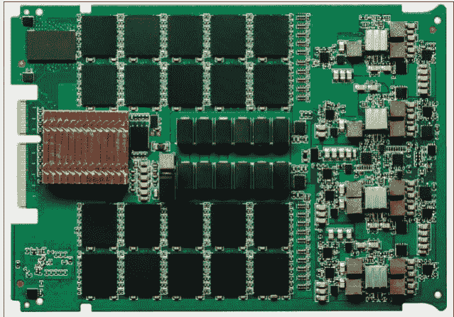

Figure 1-6 New DDIMM feature

Table 1-10 lists the available memory DDIMM feature codes for the Power E1080.

## Table 1-10 E1080 memory feature codes

| Feature code | CCIN | Description | OS support |
|---|---|---|---|
| EMC1 | 32AB | 128 GB (4x32 GB) DDIMMs, 3200 MHz, 16 GBIT DDR4 Memory | AIX, IBM i, and Linux |
| EMC2 | 32AC | 256 GB (4x64 GB) DDIMMs, 3200 MHz, 16 GBIT DDR4 Memory | AIX, IBM i, and Linux |
| EMC3 | 32AD | 512 GB (4x128 GB) DDIMMs, 2933 MHz, 16 GBIT DDR4 | AIX, IBM i, and Linux |
| EMC4 | 32AE | 1 TB (4x256 GB) DDIMMs, 2933 MHz, 16 GBIT DDR4 | AIX, IBM i, and Linux |

### Memory activation features

Software keys are required to activate part or all of the physical memory that is installed in the Power E1080 to be assigned to logical partitions (LPAR). Any software key is available when memory activation feature is ordered and can be ordered at any time during the life-cycle of the server to help the user scale up memory capacity without outages, unless more physical memory upgrade and activation are required.

A server administrator or user cannot control which physical memory DDIMM features are activated when memory activations are used.

The amount of memory to activate depends on the feature code ordered; for example, if an order contains two of feature code EDAB (100 GB DDR4 Mobile Memory Activation for HEX), these feature codes activate 200 GB of the installed physical memory.

Different types of memory activation features that are available for the Power E1080 server are known to the PowerVM hypervisor as total quantity for each type. The PowerVM hypervisor determines the physical DDIMM memory to be activated and assigned to the LPARs.

Similar to processor core activation features, different types of permanent memory activation features are offered on the Power E1080 server. For more information about the available types of activations, 1.5.2, “Processor features” on page 16.

Orders for memory activation features must consider the following rules:

- The system must have a minimum of 50% activated physical memory. It can be activated by using static or static and mobile memory activation features.
- The system must have a minimum of 25% of physical memory activated by using static memory activation features.
- When a Power E1080 is part of a PEP 2.0 environment, the server must have a minimum of 256 GB of base memory activations.

Consider the following examples:

- For a system with 4 TB of physical memory, at least 2 TB (50% of 4 TB) must be activated.
- When a Power E1080 is part of a PEP 1.0 environment, a server with 4 TB of physical memory and 3.5 TB of activated memory requires a minimum of 896 GB (25% of 3.5 TB) of physical memory activated by using static activation features.
- When a Power E1080 is part of a PEP 2.0 environment, a server with 4 TB of physical memory requires a minimum of 256 GB of memory activated with base activation features.

Table 1-11 lists the available memory activation feature codes for Power E1080. The Order type column indicates whether the feature code is available for an initial order only, or also with a MES upgrade on a existing server only, or both.

## Table 1-11 Memory activation features.

| Feature code | Description | Order type |
|---|---|---|
| EDAB | 100 GB DDR4 Mobile Memory Activation for HEX | Both |
| EDAG | 256 GB Base Memory Activation (Pools 2.0) | Both |
| EDAH | 512 GB Base Memory Activation (Pools 2.0) | Both |
| EDAL | 256 GB Base Memory Activation Linux only | Both |
| EDAM | 512 GB Base Memory Activation Linux only | Both |
| EDAP | 1 GB Base Memory activation (Pools 2.0) from Static | Both |
| EDAQ | 100 GB Base Memory activation (Pools 2.0) from Static | Both |
| EDAR | 512 GB Base Memory activation (Pools 2.0) from Static | Both |
| EDAS | 500 GB Base Memory activation (Pools 2.0) from Static | Both |
| EDAT | 1 GB Base Memory activation (Pools 2.0) MES only | Both |
| EDAU | 100 GB Base Memory activation (Pools 2.0) MES only | Both |
| EDAV | 100 GB Base Memory Activation (Pools 2.0) from Mobile | Both |
| EDAW | 500 GB Base Memory Activation (Pools 2.0) from Mobile | Both |

| 功能代码 | 描述 | 订单类型 |
|---|---|---|
| EDAX | 512 GB 基础内存激活 Linux 专用 - 转换 | Both |
| ELME | 512 GB Power Linux 内存激活 HEX 用 | Both |
| EMAZ | 1 GB HEX 用内存激活 | Both |
| EMBK | 500 GB DDR4 移动内存激活 HEX/80H 用 | Both |
| EMBZ | 512 GB HEX 用内存激活 | Both |
| EMQZ | 100 GB 的 #EMAZ HEX 用内存激活 | Both |

### 1.5.4 系统节点 PCIe 功能

每个系统节点提供八个 PCIe Gen 5 热插拔启用插槽；因此，双系统节点服务器提供 16 个插槽，三系统节点服务器提供 24 个插槽，四系统节点系统提供 32 个插槽。

表 1-12 列出了 Power E1080 服务器节点抽屉内支持的所有 PCIe 适配器功能代码。

表 1-12 Power E1080 服务器节点支持的 PCIe 适配器

| 功能代码 | CCIN | 描述 | OS 支持 |
|---|---|---|---|
| EN1A | 578F | PCIe Gen 3 32 Gb 2 端口光纤通道适配器 | AIX, IBM i, and Linux |
| EN1B | 578F | PCIe Gen 3 LP 32 Gb 2 端口光纤通道适配器 | AIX, IBM i, and Linux |
| EN1C | 578E | PCIe Gen 3 16 Gb 4 端口光纤通道适配器 | AIX, IBM i, and Linux |
| EN1D | 578E | PCIe Gen 3 LP 16 Gb 4 端口光纤通道适配器 | AIX, IBM i, and Linux |
| EN1F | 579A | PCIe Gen 3 LP 16 Gb 4 端口光纤通道适配器 | AIX, IBM i, and Linux |
| EN1H | 579B | PCIe Gen 3 LP 2 端口 16 Gb 光纤通道适配器 | AIX, IBM i, and Linux |
| EN1K | 579C | PCIe Gen 4 LP 32 Gb 2 端口光纤光纤通道适配器 | AIX, IBM i, and Linux |
| EN2A | 579D | PCIe Gen 3 16 Gb 2 端口光纤通道适配器 | AIX, IBM i, and Linux |
| EN2B | 579D | PCIe Gen 3 LP 16 Gb 2 端口光纤通道适配器 | AIX, IBM i, and Linux |
| 5260 | 576F | PCIe2 LP 4 端口 1 GbE 适配器 | AIX, IBM i, and Linux |
| 5899 | 576F | PCIe2 4 端口 1 GbE 适配器 | AIX, IBM i, and Linux |
| EC2T | 58FB | PCIe Gen 3 LP 2 端口 25/10 Gb NIC&ROCE SR/Cu 适配器ᵃ | AIX, IBM i, and Linux |
| EC2U | 58FB | PCIe Gen 3 2 端口 25/10 Gb NIC&ROCE SR/Cu 适配器ᵃ | AIX, IBM i, and Linux |
| EC67 | 2CF3 | PCIe Gen 4 LP 2 端口 100 Gb ROCE EN LP 适配器 | AIX, IBM i, and Linux |
| EN0S | 2CC3 | PCIe2 4 端口 (10 Gb+1 GbE) SR+RJ45 适配器 | AIX, IBM i, and Linux |
| EN0T | 2CC3 | PCIe2 LP 4 端口 (10 Gb+1 GbE) SR+RJ45 适配器 | AIX, IBM i, and Linux |
| EN0X | 2CC4 | PCIe2 LP 2 端口 10/1 GbE BaseT RJ45 适配器 | AIX, IBM i, and Linux |

a. 需要 SFP 以提供 10 Gb、2 Gb 或 1 Gb BaseT 连接

### 1.5.5 系统节点磁盘和媒体功能

截至本文撰写时，Power E1080 服务器节点支持多达四个 7 mm NVMe U.2 驱动器，这些驱动器插入 4 盘位 NVMe 载体背板（功能代码 EJBC）。每个系统节点都需要一个背板，即使未选择 NVMe U.2 驱动器。

每个 NVMe U.2 驱动器可以独立分配给不同的 LPAR 以托管操作系统并从中启动。它们也可以用于非数据密集型工作负载。NVMe U.2 驱动器可并发更换。

表 1-13 列出了 Power E1080 可用的 NVMe 驱动器功能代码以及操作系统支持。

表 1-13 NVMe 功能

| 功能代码 | CCIN | 描述 | OS 支持 |
|---|---|---|---|
| EC5J | 59B4 | 主流 800 GB SSD NVMe U.2 模块 | AIX and Linux |
| EC5K | 59B5 | 主流 1.6 TB SSD NVMe U.2 模块 | AIX and Linux |
| EC5L | 59B6 | 主流 3.2 TB SSD NVMe U.2 模块 | AIX and Linux |
| EC7Q | 59B4 | 800 GB 主流 NVMe U.2 SSD 4k for AIX/Linux | AIX and Linux |

有关更多信息，请参阅第 87 页的 2.5.2，“内部 NVMe 存储子系统”。

对于运行 IBM i 的系统，扩展或存储抽屉可以满足 NVMe 需求。

### 1.5.6 系统节点 USB 功能

Power E1080 支持一个与功能代码 EUA5 关联的独立外部 USB 驱动器。该功能代码包括将 USB 驱动器连接到 SCU 上首选前面板可访问 USB 端口的电缆。

Power E1080 服务器节点不提供集成 USB 端口。USB 3.0 适配器功能代码 EC6J 需要提供对可选外部 USB DVD 驱动器的连接，并占用一个系统节点或 I/O 扩展抽屉 PCIe 插槽。适配器通过与功能代码 EC6N 关联的电缆连接到 SCU 后部的 USB 端口。由于该电缆长 1.5 m，因此对于具有多个系统节点的 Power E1080，USB 3.0 适配器只能用于第一个或第二个系统节点。

USB 3.0 适配器功能代码 EC6J 支持分配给 LPAR，并可从一个运行的 LPAR 迁移到另一个 LPAR，包括连接的 DVD 驱动器。这种设计允许根据需要将 DVD 驱动器功能分配给任何 LPAR。

系统资源的动态分配，例如处理器、内存和 I/O，也称为 *dynamic LPAR* 或 *DLPAR*。

有关 USB 子系统的更多信息，请参阅第 23 页的 1.5.6，“系统节点 USB 功能”。

### 1.5.7 电源功能

每个 Power E1080 服务器节点都有四个 1950 W 批量电源单元，在 240 V 下运行。这些电源单元功能是每个 Power E1080 系统节点的默认配置。每个系统节点的四个单元没有关联的功能代码，并且在开始新的配置任务时始终由 IBM 配置器自动选择。

来自电源分配单元（PDU）的四根电源线为这些电源供电，这些电源连接到系统后部线缆导管上的四个 C13/C14 型插座。电源线缆导管从后部获取源电源，并连接到系统前部的电源单元。

系统设计为系统批量电源提供 N+2 冗余，允许系统在任意两个电源单元正常工作时继续运行。故障单元必须保留在系统中，直到有新的电源单元可供更换为止。

电源单元可热插拔，允许在不中断系统的情况下更换故障单元。电源单元放置在系统前面，这使得任何必要的维护都变得更加容易。

图 1-7 显示了电源单元及其在系统中的物理位置，标记为 E1、E2、E3 和 E4。

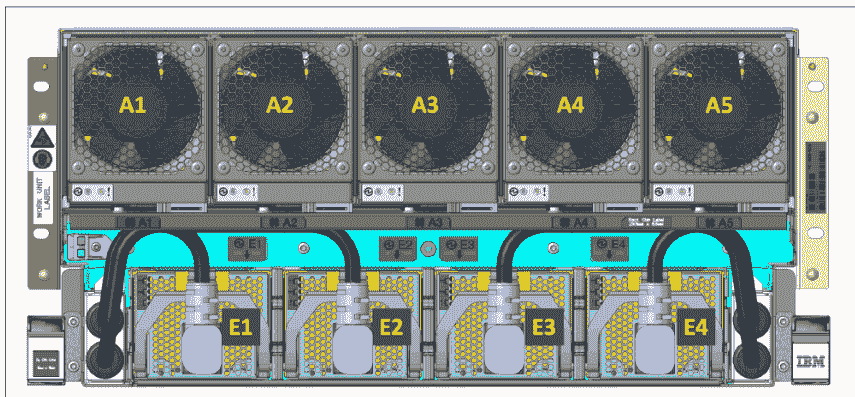

### 1.5.8 系统节点 PCIe 互连功能

每个系统节点提供 8 个 PCIe Gen5 热插拔启用插槽；因此，2 节点系统提供 16 个插槽，3 节点系统提供 24 个插槽，4 节点系统提供 32 个插槽。

最多可将四个 I/O 扩展抽屉功能 #EMX0 连接到每个节点，以实现表 1-14 中列出的插槽容量。

表 1-14 不同系统节点配置的 PCIe 插槽可用性

| 系统节点 # | I/O 扩展 # | LP 插槽 | 全高插槽 |
|---|---|---|---|
| 1 | 4 | 8 | 48 |
| 2 | 8 | 16 | 96 |
| 3 | 12 | 24 | 144 |
| 4 | 16 | 32 | 192 |

每个 I/O 扩展抽屉由两个风扇模块功能 #EMXH 组成，每个风扇模块提供六个 PCIe 插槽。每个风扇模块通过一对 CXP 电缆功能连接到系统。CXP 电缆功能列在第 27 页的表 1-16 中。

表 1-15 光纤 CXP 电缆功能

| 功能代码 | CCIN | 描述 | OS 支持 | 订单类型 |
|---|---|---|---|---|
| ECCR |  | PCIe Gen 3 扩展抽屉用 2 M 有源光缆对 |  | Both |
| ECCY |  | PCIe Gen 3 扩展抽屉用 10 M 有源光缆对 |  | Both |
| ECCZ |  | PCIe Gen 3 扩展抽屉用 20 M 有源光缆对 |  | Both |

此列表中的 RPO 仅限电缆不可用于新订单或 MES 升级，但可用于从源系统迁移。选择更长的长度功能代码以在机架间连接系统节点和扩展抽屉。

一对 CXP 光纤电缆通过一个 2 端口 PCIe 光纤电缆适配器功能 EJ24 连接到系统节点，该适配器放置在 CEC 中。

CXP 光纤电缆对和光纤电缆适配器功能均可并发维护。因此，通过冗余 EMX0 扩展抽屉、不同系统节点仔细平衡 I/O 并分配适配器，可以确保分配给分区的 I/O 资源的高可用性。

**注意：** 截至本文撰写时，功能 EMXH 是唯一受支持或可订购的风扇模块。之前的风扇模块功能 EMXF 和 EMXG 不受 Power E1080 系统支持。

有关内部总线以及内部和外部 I/O 子系统架构的更多信息，请参阅第 83 页的 2.5，“内部 I/O 子系统”。

### 1.6 I/O 抽屉

如果需要超出系统节点插槽的更多 PCIe 插槽，Power E1080 服务器支持添加 I/O 扩展抽屉。

初始可用时，每个系统节点支持零个、一个、两个、三个或四个 PCIe Gen 3 I/O 扩展抽屉。要连接一个 I/O 扩展抽屉，使用一个 PCIe 插槽将 6 槽扩展模块连接到 I/O 抽屉中。PCIe Gen 3 I/O 扩展抽屉（#EMX0）容纳两个扩展模块，这两个扩展模块可连接到同一系统节点中的任意两个 PCIe 插槽或不同系统节点中的 PCIe 插槽。

对于 SAS 磁盘的连接，提供了一个仅磁盘 I/O 抽屉。EXP24SX 是唯一受支持的磁盘抽屉。

#### 1.6.1 PCIe Gen 3 I/O 扩展抽屉

19 英寸 4 EIA（4U）PCIe Gen 3 I/O 扩展抽屉（#EMX0）和两个 PCIe 分线模块（#EMXH）提供 12 个 PCIe I/O 全长、全高插槽。一个分线模块提供标有 C1 - C6 的六个 PCIe 插槽。C1 和 C4 为 x16 插槽，C2、C3、C5 和 C6 为 x8 插槽。支持 PCIe Gen1、Gen2 和 Gen 3 全高适配器。

盲插盒式磁带机（BSC）用于容纳安装在这些插槽中的全高适配器。BSC 与上一代服务器的 12X 附加 I/O 抽屉（#5802、#5803、#5877 和 #5873）使用的 BSC 相同。抽屉随附一套完整的 BSC，即使 BSC 为空。

通过 HMC 引导菜单或操作系统支持实用程序进行并发维修以及添加或移除 PCIe 适配器。

PCIe CXP 转换适配器和有源光缆（AOC）将系统节点连接到 I/O 扩展抽屉中的 PCIe 分线模块。每个 PCIe Gen 3 I/O 扩展抽屉有两个电源。

抽屉可以稍后添加到服务器，但添加 PCIe Gen 3 光缆适配器或 PCIe Gen 3 I/O 抽屉（#EMX0）或分线模块时必须安排系统停机。

图 1-8 显示了 PCIe Gen 3 I/O 扩展抽屉。

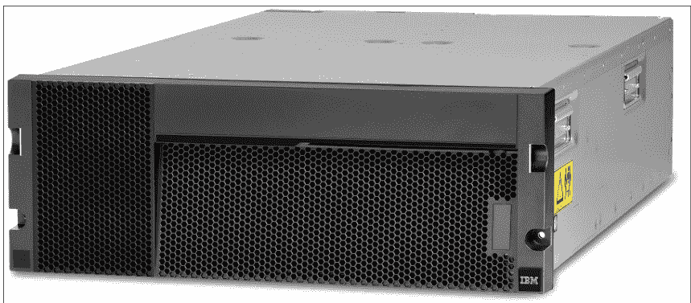

AOC 电缆功能代码在表 1-16 中列出。还列出了支持的订单类型。与仅支持 RPO 的电缆关联的功能代码不可用于新订单或 MES 升级。相反，它们用于管理从以前的基于 IBM POWER® 技术的服务器到 Power E1080 的受支持 I/O 扩展抽屉的迁移。与更长长度电缆关联的功能代码是必需的，以支持系统节点与 I/O 扩展抽屉之间机架间连接。

表 1-16 有源光缆功能代码

| Feature code | Description | Order type |
|---|---|---|
| ECCR | 2M Active Optical Cable Pair for PCIe Gen 3 Expansion Drawer | Both |
| ECCY | 10M Active Optical Cable Pair for PCIe Gen 3 Expansion Drawer | Both |
| ECCZ | 20M Active Optical Cable Pair for PCIe Gen 3 Expansion Drawer | Both |

仔细平衡 I/O、通过冗余 EMX0 扩展抽屉分配适配器以及连接到不同系统节点，可以确保分配给 LPAR 的 I/O 资源具有高可用性。

注意：请考虑以下几点：

- 旧的 PCIe Gen 3 分线模块（#EMXG、#ELMF 和 #ELMG）不能与同一 I/O 扩展抽屉中的 PCIe Gen 3 分线模块（功能 #EMXH）混合使用。
- 旧的 I/O 扩展抽屉可以与 PCIe Gen 3 分线模块（#ELMF、#ELMG）和具有 PCIe Gen 3 分线模块 #EMXH 的 I/O 扩展抽屉在同一配置中混合使用。
- 旧的 PCIe Gen 3 分线模块（#ELMF、#ELMG）可以连接到旧的 PCIe Gen 3 光缆适配器（#EJ05 或 #EJ08）。
- PCIe Gen 3 光缆适配器（#EJ20 或 #EJ1R）需要使用光缆（#ECCR、#ECCX、ECCY 或 #ECCZ，或铜缆 #ECCS）。

#### 1.6.2 I/O 抽屉和可用 PCIe 插槽

第 28 页的图 1-9 显示了 PCIe Gen 3 I/O 扩展抽屉的后视图，其中显示了 PCIe Gen 3 6 槽分线模块中 PCIe 适配器插槽的位置代码。

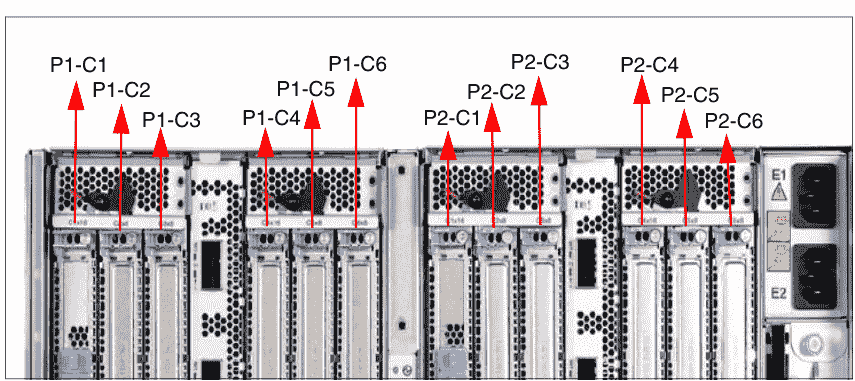

图 1-9 带有 PCIe 插槽位置代码的 PCIe Gen 3 I/O 扩展抽屉后视图

表 1-17 列出了 PCIe Gen 3 I/O 扩展抽屉中的 PCIe 插槽。

表 1-17 PCIe Gen 3 I/O 扩展抽屉的 PCIe 插槽位置和描述

| Slot | Location code | Description |
|---|---|---|
| Slot 1 | P1-C1 | PCIe Gen 3, x16 |
| Slot 2 | P1-C2 | PCIe Gen 3, x8 |
| Slot 3 | P1-C3 | PCIe Gen 3, x8 |
| Slot 4 | P1-C4 | PCIe Gen 3, x16 |
| Slot 5 | P1-C5 | PCIe Gen 3, x8 |
| Slot 6 | P1-C6 | PCIe Gen 3, x8 |
| Slot 7 | P2-C1 | PCIe Gen 3, x16 |
| Slot 8 | P2-C2 | PCIe Gen 3, x8 |
| Slot 9 | P2-C3 | PCIe Gen 3, x8 |
| Slot 10 | P2-C4 | PCIe Gen 3, x16 |
| Slot 11 | P2-C5 | PCIe Gen 3, x8 |
| Slot 12 | P2-C6 | PCIe Gen 3, x8 |

请考虑有关表 1-17 中信息以下几点：

- 所有插槽均支持全长、常规高度适配器或带常规高度尾架的短型（低轮廓）适配器，位于单宽、Gen 3 BSC 中。
- 每个 PCIe Gen 3 6 槽分线模块中的插槽 C1 和 C4 为 x16 PCIe Gen 3 总线；插槽 C2、C3、C5 和 C6 为 x8 PCIe 总线。
- 所有插槽均支持增强错误处理（EEH）。
- 所有 PCIe 插槽均可热插拔并支持并发维护。

表 1-18 列出了支持的最大 I/O 抽屉数量以及当扩展抽屉由单一抽屉类型组成时可用的总 PCIe 插槽数。

表 1-18 支持的最大 I/O 抽屉数量和总 PCIe 插槽数

| System nodes | Maximum #EMX0 drawers | Total number of slots |  |  |
|---|---|---|---|---|
|  |  | PCIe Gen 3, x16 | PCIe Gen 3, x8 | Total PCIe Gen 3 |
| One system node | 4 | 16 | 32 | 48 |
| Two system nodes | 8 | 32 | 64 | 96 |
| Three system nodes | 12 | 48 | 96 | 144 |
| Four system nodes | 16 | 64 | 128 | 192 |

#### 1.6.3 EXP24SX SAS 存储机箱

如果您需要的磁盘数量超过内部磁盘托架提供的数量，您可以附加更多外部磁盘子系统，例如 EXP24SX SAS 存储机箱（#ESLS）。

EXP24SX 抽屉是一个存储扩展机箱，具有 24 个 2.5 英寸 SFF SAS 托架。它支持在 19 英寸机架的 2 EIA 空间内最多 24 个热插拔 HDD 或 SSD。EXP24SX SFF 托架使用 SFF Gen2（SFF-2）载体或托盘。

使用 AIX/Linux/VIOS 时，EXP24SX 可以按四组 6 个托架（模式 4）、两组 12 个托架（模式 2）或一组 24 个托架（模式 1）订购。使用 IBM i 时支持一组 24 个托架（模式 1）。可以通过使用软件命令以及专门记录的程序在现场更改模式设置。

**重要提示：** 更改模式时，技术合格的人员必须遵循特殊记录的程序。不当更改模式可能会破坏 RAID 阵列，从而阻止访问数据，或允许其他分区访问另一个分区的数据。

EXP24SX 抽屉与 PCIe Gen 3 SAS 适配器之间的连接通过 SAS YO12 或 X12 电缆进行。PCIe Gen 3 SAS 适配器支持 6 Gb 吞吐量。如果未来的 SAS 适配器支持该功能，EXP24SX 抽屉可支持高达 12 Gb 吞吐量。

EXP24SX 抽屉包括冗余交流电源和两根电源线。

图 1-10 显示了 EXP24SX 抽屉。

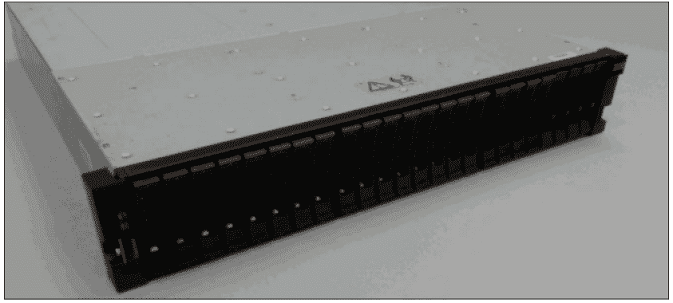

图 1-10 EXP24SX 抽屉

**注意：** 对于 EXP24SX 抽屉，#ESLS 24 个 SAS 托架中最多支持 24 个 2.5 英寸 SSD 或 2.5 英寸 HDD。HDD 和 SSD 不能在同一模式 1 抽屉中混合。HDD 和 SSD 可以在模式 2 或模式 4 抽屉中混合，但不能在抽屉的逻辑分割内混合。例如，在具有两组 12 个托架的模式 2 抽屉中，一组可以容纳 SSD，一组可以容纳 HDD，但不能在同一组 12 个托架中混合 SSD 和 HDD。

有关 SAS 布线和布线配置的更多信息，请参阅 IBM 文档。

表 1-19 列出了截至本文撰写时 Power E1080 在扩展抽屉中支持的 SFF-2 SSD 和 HDD 功能代码。

表 1-19 扩展抽屉中支持的 SFF-2 和 HDD 功能代码

| Feature code | CCIN | Description | OS support |
|---|---|---|---|
| ES94 | 5B10 | 387 GB Enterprise SAS 4k SFF-2 SSD for AIX/Linux | AIX and Linux |
| ES95 | 5B10 | 387 GB Enterprise SAS 4k SFF-2 SSD for IBM i | IBM i |
| ESB2 | 5B16 | 387 GB Enterprise SAS 5xx SFF-2 SSD for AIX/Linux | AIX and Linux |
| ESB6 | 5B17 | 775 GB Enterprise SAS 5xx SFF-2 SSD for AIX/Linux | AIX and Linux |
| ESBA | 5B10 | 387 GB Enterprise SAS 4k SFF-2 SSD for AIX/Linux | AIX and Linux |
| ESBB | 5B10 | 387 GB Enterprise SAS 4k SFF-2 SSD for IBM i | IBM i |
| ESBG | 5B11 | 775 GB Enterprise SAS 4k SFF-2 SSD for AIX/Linux | AIX and Linux |
| ESBH | 5B11 | 775 GB Enterprise SAS 4k SFF-2 SSD for IBM i | IBM i |
| ESBL | 5B12 | 1.55 TB Enterprise SAS 4k SFF-2 SSD for AIX/Linux | AIX and Linux |
| ESBM | 5B12 | 1.55 TB Enterprise SAS 4k SFF-2 SSD for IBM i | IBM i |
| ESGV | 5B16 | 387 GB Enterprise SAS 5xx SFF-2 SSD for AIX/Linux | AIX and Linux |
| ESGZ | 5B17 | 775 GB Enterprise SAS 5xx SFF-2 SSD for AIX/Linux | AIX and Linux |

| 功能代码 | CCIN | 描述 | 操作系统支持 |
|---|---|---|---|
| ESJ0 | 5B29 | 931 GB 主流 SAS 4k SFF-2 SSD，适用于 AIX/Linux | AIX 和 Linux |
| ESJ1 | 5B29 | 931 GB 主流 SAS 4k SFF-2 SSD，适用于 IBM i | IBM i |
| ESJ2 | 5B21 | 1.86 TB 主流 SAS 4k SFF-2 SSD，适用于 AIX/Linux | AIX 和 Linux |
| ESJ3 | 5B21 | 1.86 TB 主流 SAS 4k SFF-2 SSD，适用于 IBM i | IBM i |
| ESJ4 | 5B2D | 3.72 TB 主流 SAS 4k SFF-2 SSD，适用于 AIX/Linux | AIX 和 Linux |
| ESJ5 | 5B2D | 3.72 TB 主流 SAS 4k SFF-2 SSD，适用于 IBM i | IBM i |
| ESJ6 | 5B2F | 7.45 TB 主流 SAS 4k SFF-2 SSD，适用于 AIX/Linux | AIX 和 Linux |
| ESJ7 | 5B2F | 7.45 TB 主流 SAS 4k SFF-2 SSD，适用于 IBM i | IBM i |
| ESJJ | 5B29 | 931 GB 主流 SAS 4k SFF-2 SSD，适用于 AIX/Linux | AIX 和 Linux |
| ESJK | 5B29 | 931 GB 主流 SAS 4k SFF-2 SSD，适用于 IBM i | IBM i |
| ESJL | 5B21 | 1.86 TB 主流 SAS 4k SFF-2 SSD，适用于 AIX/Linux | AIX 和 Linux |
| ESJM | 5B21 | 1.86 TB 主流 SAS 4k SFF-2 SSD，适用于 IBM i | IBM i |
| ESJN | 5B2D | 3.72 TB 主流 SAS 4k SFF-2 SSD，适用于 AIX/Linux | AIX 和 Linux |
| ESJP | 5B2D | 3.72 TB 主流 SAS 4k SFF-2 SSD，适用于 IBM i | IBM i |
| ESJQ | 5B2F | 7.44 TB 主流 SAS 4k SFF-2 SSD，适用于 AIX/Linux | AIX 和 Linux |
| ESJR | 5B2F | 7.44 TB 主流 SAS 4k SFF-2 SSD，适用于 IBM i | IBM i |
| ESK1 | 5B16 | 387 GB 企业级 SAS 5xx SFF-2 SSD，适用于 AIX/Linux | AIX 和 Linux |
| ESK3 | 5B17 | 775 GB 企业级 SAS 5xx SFF-2 SSD，适用于 AIX/Linux | AIX 和 Linux |
| ESK8 | 5B10 | 387 GB 企业级 SAS 4k SFF-2 SSD，适用于 AIX/Linux | AIX 和 Linux |
| ESK9 | 5B10 | 387 GB 企业级 SAS 4k SFF-2 SSD，适用于 IBM i | IBM i |
| ESKC | 5B11 | 775 GB 企业级 SAS 4k SFF-2 SSD，适用于 AIX/Linux | AIX 和 Linux |
| ESKD | 5B11 | 775 GB 企业级 SAS 4k SFF-2 SSD，适用于 IBM i | IBM i |
| ESKG | 5B12 | 1.55 TB 企业级 SAS 4k SFF-2 SSD，适用于 AIX/Linux | AIX 和 Linux |
| ESKH | 5B12 | 1.55 TB 企业级 SAS 4k SFF-2 SSD，适用于 IBM i | IBM i |
| ESKK | 5B29 | 931 GB 主流 SAS 4k SFF-2 SSD，适用于 AIX/Linux | AIX 和 Linux |
| ESKM | 5B29 | 931 GB 主流 SAS 4k SFF-2 SSD，适用于 IBM i | IBM i |
| ESKP | 5B21 | 1.86 TB 主流 SAS 4k SFF-2 SSD，适用于 AIX/Linux | AIX 和 Linux |
| ESKR | 5B21 | 1.86 TB 主流 SAS 4k SFF-2 SSD，适用于 IBM i | IBM i |
| ESKT | 5B2D | 3.72 TB 主流 SAS 4k SFF-2 SSD，适用于 AIX/Linux | AIX 和 Linux |
| ESKV | 5B2D | 3.72 TB 主流 SAS 4k SFF-2 SSD，适用于 IBM i | IBM i |
| ESKX | 5B2F | 7.44 TB 主流 SAS 4k SFF-2 SSD，适用于 AIX/Linux | AIX 和 Linux |
| ESKZ | 5B2F | 7.44 TB 主流 SAS 4k SFF-2 SSD，适用于 IBM i | IBM i |
| ESMB | 5B29 | 931 GB 主流 SAS 4k SFF-2 SSD，适用于 AIX/Linux | AIX 和 Linux |
| ESMD | 5B29 | 931 GB 主流 SAS 4k SFF-2 SSD，适用于 IBM i | IBM i |
| ESMF | 5B21 | 1.86 TB 主流 SAS 4k SFF-2 SSD，适用于 AIX/Linux | AIX 和 Linux |
| ESMH | 5B21 | 1.86 TB 主流 SAS 4k SFF-2 SSD，适用于 IBM i | IBM i |
| ESMK | 5B2D | 3.72 TB 主流 SAS 4k SFF-2 SSD，适用于 AIX/Linux | AIX 和 Linux |
| ESMS | 5B2D | 3.72 TB 主流 SAS 4k SFF-2 SSD，适用于 IBM i | IBM i |
| ESMV | 5B2F | 7.44 TB 主流 SAS 4k SFF-2 SSD，适用于 AIX/Linux | AIX 和 Linux |
| ESMX | 5B2F | 7.44 TB 主流 SAS 4k SFF-2 SSD，适用于 IBM i | IBM i |
| ESNA | 5B11 | 775 GB 企业级 SAS 4k SFF-2 SSD，适用于 AIX/Linux | AIX 和 Linux |
| ESNB | 5B11 | 775 GB 企业级 SAS 4k SFF-2 SSD，适用于 IBM i | IBM i |
| ESNE | 5B12 | 1.55 TB 企业级 SAS 4k SFF-2 SSD，适用于 AIX/Linux | AIX 和 Linux |
| ESNF | 5B12 | 1.55 TB 企业级 SAS 4k SFF-2 SSD，适用于 IBM i | IBM i |
| ETK1 |  | 387 GB 企业级 SAS 5xx SFF-2 SSD，适用于 AIX/Linux | AIX 和 Linux |
| ETK3 |  | 775 GB 企业级 SAS 5xx SFF-2 SSD，适用于 AIX/Linux | AIX 和 Linux |
| ETK8 |  | 387 GB 企业级 SAS 4k SFF-2 SSD，适用于 AIX/Linux | AIX 和 Linux |
| ETK9 |  | 387 GB 企业级 SAS 4k SFF-2 SSD，适用于 IBM i | IBM i |
| ETKC |  | 775 GB 企业级 SAS 4k SFF-2 SSD，适用于 AIX/Linux | AIX 和 Linux |
| ETKD |  | 775 GB 企业级 SAS 4k SFF-2 SSD，适用于 IBM i | IBM i |
| ETKG |  | 1.55 TB 企业级 SAS 4k SFF-2 SSD，适用于 AIX/Linux | AIX 和 Linux |
| ETKH |  | 1.55 TB 企业级 SAS 4k SFF-2 SSD，适用于 IBM i | IBM i |
| 1953 | 19B1 | 300 GB 15k RPM SAS SFF-2 磁盘驱动器（AIX/Linux） | AIX 和 Linux |
| 1964 | 19B3 | 600 GB 10k RPM SAS SFF-2 磁盘驱动器（AIX/Linux） | AIX 和 Linux |
| ESEU | 59D2 | 571 GB 10K RPM SAS SFF-2 磁盘驱动器 4K 块 - 4224 | IBM i |
| ESEV | 59D2 | 600 GB 10K RPM SAS SFF-2 磁盘驱动器 4K 块 - 4096 | AIX 和 Linux |
| ESF2 | 59DA | 1.1 TB 10K RPM SAS SFF-2 磁盘驱动器 4K 块 - 4224 | IBM i |
| ESF3 | 59DA | 1.2 TB 10K RPM SAS SFF-2 磁盘驱动器 4K 块 - 4096 | AIX 和 Linux |
| ESFS | 59DD | 1.7 TB 10K RPM SAS SFF-2 磁盘驱动器 4K 块 - 4224 | IBM i |
| ESFT | 59DD | 1.8 TB 10K RPM SAS SFF-2 磁盘驱动器 4K 块 - 4096 | AIX 和 Linux |
| ESNL | 5B43 | 283 GB 15K RPM SAS SFF-2 4k 块缓存磁盘驱动器（IBM i） | IBM i |
| ESNM | 5B43 | 300 GB 15K RPM SAS SFF-2 4k 块缓存磁盘驱动器（AIX/Linux） | AIX 和 Linux |
| ESNQ | 5B47 | 571 GB 15K RPM SAS SFF-2 4k 块缓存磁盘驱动器（IBM i） | IBM i |
| ESNR | 5B47 | 600 GB 15K RPM SAS SFF-2 4k 块缓存磁盘驱动器（AIX/Linux） | AIX 和 Linux |

### 1.6.4 IBM System Storage

IBM System Storage 磁盘系统产品和方案为从入门级到高端存储系统的所有业务级别提供具有卓越价值的引人注目的存储解决方案。

IBM Storage 通过使用底层软件基础来简化数据基础设施，从而加强并简化混合云环境中的存储，该环境采用简化的容器化、管理和数据保护方法。有关各种方案的更多信息，请参阅此网页。

以下部分重点介绍了一些方案。

## IBM FlashSystem Family

IBM FlashSystem® 系列是一系列云启用存储系统组合，旨在易于部署并快速扩展，以帮助优化存储配置、简化问题解决并降低存储成本。

IBM FlashSystem 采用 IBM Spectrum® Virtualize 软件构建，有助于部署复杂的混合云存储解决方案，加速基础设施现代化，应对安全需求，并通过利用人工智能的力量最大化价值。这些产品旨在提供企业级功能，同时不影响经济性或性能。它们还提供端到端 NVMe 的优势、IBM FlashCore® 技术的创新以及 SCM 超低延迟。有关更多信息，请参阅此网页。

## IBM System Storage DS8000

IBM DS8900F 是下一代企业数据系统，采用最先进的 Power 处理器技术构建，具有超低应用响应时间。

DS8900F 专为数据密集型和任务关键型工作负载而设计，通过超低延迟、优于七个 9（99.99999）的可用性、透明云、层级化和针对恶意软件和勒索软件的先进数据保护，在混合云解决方案中增加了下一级性能、数据保护、弹性和可用性。此企业级存储解决方案提供卓越的性能和更高的容量，从而能够将所有任务关键型工作负载集中到一个位置。

IBM DS8900F 可提供 100% 的数据在静态、传输中和云中的加密。此灵活的存储支持 IBM Power、IBM Z® 和 IBM LinuxONE。有关更多信息，请参阅此网页。

## IBM SAN Volume Controller

IBM SAN Volume Controller 是一款企业级系统，可将来自 500 多个 IBM 和第三方存储系统的存储进行整合，以提高效率、简化管理和运营、通过新功能实现存储现代化，并为无论存储系统类型如何的混合云提供通用方法。

IBM SAN Volume Controller 提供完整的数据弹性功能，具有高可用性、业务连续性和数据安全功能。存储支持采用 AI 驱动的 IBM Easy Tier® 的自动化分层，可帮助以更低的成本提高性能。有关更多信息，请参阅此网页。

### 1.7 系统机架

Power E1080 服务器符合标准 19 英寸机架。服务器已在 IBM 企业级机架（7965-S42、7014-T42、7014-T00 或 7965-94Y）中获得认证并经过测试。客户如果确信这些机架具有所需的强度、刚度、深度和孔距特征，可以选择将服务器放置在其他机架中。请联系 IBM 支持部门以确定其他机架是否适用。

> **订购信息：** 强烈建议您订购 Power E1080 服务器时搭配 IBM 42U 企业级机架 7965-S42 功能。此机架为 IBM 制造系统装配和测试提供更完整、更高质量的环境，并提供完整的套件。

如果系统安装在非 IBM 的机架或机柜中，请确保机架符合 1.7.7 节“原始设备制造商机架”第 41 页所述的要求。

> **责任：** 客户有责任确保抽屉安装在首选机架或机柜中时，所形成的配置在稳定性、可维护性、安全性以及与抽屉对电源、冷却、线缆管理、重量和导轨安全的要求方面兼容。

#### 1.7.1 新机架注意事项

订购机架时请考虑以下几点：

- 新的 IBM 企业级 42U Slim 机架 7965-S42 在纤薄的占地面积中提供 42 个 EIA 单位（U）的空间。
- 7014-T42、7014-T00 和 7965-94Y 机架已不再可与 Power E1080 服务器一起购买。Power E1080 服务器仍可安装在这些机架中并获得支持。

> **垂直 PDU：** 所有安装在包含 Power E1080 服务器的机架中的 PDU 必须水平安装，以便在机架侧面进行线缆布线。

#### 1.7.2 IBM 企业级 42U Slim 机架 7965-S42

2.0 米（79 英寸）型号 7965-S42 与过去和现在的 IBM Power 服务器兼容，并为数据中心提供出色的 19 英寸机架外壳。其 600 mm（23.6 in.）宽度结合 1100 mm（43.3 in.）深度以及 42 EIA 外壳容量，为系统提供出色的占地面积效率。它可以轻松放置在标准 24 英寸地板瓷砖上。

与 7965-94Y Slim 机架相比，企业级 Slim 机架提供额外的强度以及运输和安装灵活性。

7965-S42 机架包括侧袋中最多可容纳四个 PDU 的空间。超过四个的额外 PDU 水平安装，每个占用 1U 机架空间。

企业级 Slim 机架前面门，可为 Basic Black/Flat（#ECRM）或 High-End 外观（#ECRT），采用冲孔钢板，提供通风、物理安全以及对安装设备内指示灯的可见性。

标准配置为与后门锁相同的锁。门（#ECRG）可向左侧或右侧铰接。

除 #ECRT 门外，您还可以订购 #ECRF 高端外观门（图 1-11）

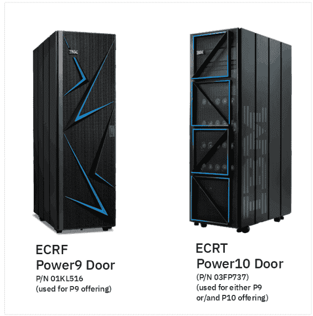

图 1-11 #ECRF 和 #ECRT 机架门。

方向：#ECRT 必须不得翻转，因为 IBM 标志会倒置。

#### 1.7.3 交流配电单元和机架内容

在工厂集成到机架中的 Power E1080 服务器配备的 PDU 在机架中水平安装。每个 PDU 在机架中占用 1U 空间。将 PDU 垂直安装在机架侧面可能会导致线缆布线问题并干扰最佳服务访问。

支持两种可能的 PDU 额定值：60A/63A（大多数国家可订购）和 30A/32A。请考虑以下几点：

- 60A/63A PDU 支持四个系统节点电源和一个 I/O 扩展抽屉或八个 I/O 扩展抽屉。
- 30A/32A PDU 支持两个系统节点电源和一个 I/O 扩展抽屉或四个 I/O 扩展抽屉。

机架集成系统订单至少需要两个 #7109、#7188 或 #7196。

高功能 PDU 提供更高的每 PDU 电力，并提供更好的“PDU 占地面积”效率。此外，它们是智能 PDU，可提供按插座的用电量洞察以及远程开关机能力，便于按单个插座进行支持。新的 PDU 可作为 #ECJJ、#ECJL、#ECJN 和 #ECJQ 订购。

高功能 PDU 功能代码列于表 1-20。

##### 表 1-20 可用的高功能 PDU

| PDU | 1 相或 3 相取决于国家布线标准 | 3 相 208 V 取决于国家布线标准 |
|---|---|---|
| 九个 C19 插座 | ECJJ | ECJL |
| 十二个 C13 插座 | ECJN | ECJQ |

此外，以下高功能 PDU 可用：

- 高功能 9xC19 PDU 加（#ECJJ）
  此智能、开关式 200-240 伏交流 PDU 在 PDU 前部包括九个 C19 插座。PDU 安装在机架后部，使九个 C19 插座易于访问。
- 高功能 9xC19 PDU 加 3 相（#ECJL）
  此智能、开关式 208 伏 3 相交流 PDU 在 PDU 前部包括九个 C19 插座。PDU 安装在机架后部，使九个 C19 插座易于访问。
- 高功能 12xC13 PDU 加（#ECJN）
  此智能、开关式 200-240 伏交流 PDU 在 PDU 前部包括 12 个 C13 插座。PDU 安装在机架后部，使 12 个 C13 插座易于访问。
- 高功能 12xC13 PDU 加 3 相（#ECJQ）
  此智能、开关式 208 伏 3 相交流 PDU 在 PDU 前部包括 12 个 C13 插座。PDU 安装在机架后部，使 12 个 C13 插座易于访问。

两个或更多额外的 PDU 可以水平安装在机架后部。水平安装 PDU 使用每个 PDU 1U，并减少可用于其他机架组件的空间。水平安装 PDU 时，首选方法是使用填充件填充这些 PDU 占用的 EIA 单位，以促进机架内的适当气流和通风。

每个 PDU 需要一根 PDU 到墙电源线。各种电源线功能可用于各种国家和应用，通过改变 PDU 到墙电源线提供，必须单独订购。

每根电源线提供特定电源需求的独特设计特征。为了匹配新的电源需求并保留之前的投资，这些电源线可以随机架的初始订单一起请求，也可以在机架功能后期升级时请求。

表 1-21 列出了 7188 和高功能 PDU 以及 iPDU 功能的可用墙电源线选项，必须单独订购。

##### 表 1-21 PDU 和 iPDU 功能的墙电源线选项

| 功能代码 | 墙插头 | 额定电压（V AC） | 相位 | 额定电流 | 地理区域 |
|---|---|---|---|---|---|
| 6653 | IEC 309，3P+N+G，16 A | 230 | 3 | 16 安培/相 | 国际通用 |
| 6489 | IEC309 3P+N+G，32 A | 230 | 3 | 32 安培/相 | EMEA |
| 6654 | NEMA L6-30 | 200 - 208，240 | 1 | 24 安培 | 美国、加拿大、拉美和日本 |
| 6655 | RS 3750DP（防水） | 200 - 208，240 | 1 | 24 安培 | 美国、加拿大、拉美和日本 |
| 6656 | IEC 309，P+N+G，32 A | 230 | 1 | 24 安培 | EMEA |
| 6657 | PDL | 230-240 | 1 | 32 安培 | 澳大利亚、新西兰 |
| 6667 | PDL | 380-415 | 3 | 32 安培 | 澳大利亚、新西兰 |
| 6658 | 韩国插头 | 220 | 1 | 30 安培 | 韩国南北 |
| 6492 | IEC 309，2P+G，60 A | 200 - 208，240 | 1 | 48 安培 | 美国、加拿大、拉美和日本 |
| 6491 | IEC 309，P+N+G，63 A | 230 | 1 | 63 安培 | EMEA |

> 注：确保配置合适的电源线功能以支持所提供的电力。根据所使用的电源线，PDU 可提供 4.8 - 19.2 kVA。插入 PDU 的所有抽屉的功率不得超过电源线限制。

为了更好地实现电气冗余，每个 CEC 具有四个电源，必须连接到不包含在基础订单中的单独 PDU。

为了获得最大可用性，首选方法是将同一系统的电源线连接到机架中的两个单独 PDU，并将每个 PDU 连接到独立的电源。

有关 7965-94Y 机架的电源要求和电源线的更多信息，请参阅 IBM 文档。

### 1.7.4 PDU 连接限制

支持两种可能的 PDU 额定值：60/63 安培和 30/32 安培。PDU 额定值由用于将 PDU 连接到电气供电的电源线确定。每个电源线支持的系统节点数和 I/O 扩展抽屉数列于表 1-22。

表 1-22 按电源线最大支持机柜数

| Feature code | Wall plug | PDU Rating | Maximum supported system nodes per PDU pair | Maximum supported I/O drawers with no system nodes |
|---|---|---|---|---|
| 6653 | IEC 309, 3P+N+G, 16 A | 60 Amps | Two system nodes and 1 I/O expansion drawer | 8 |
| 6489 | IEC309 3P+N+G, 32 A | 60 Amps | Two system nodes and 1 I/O expansion drawer | 8 |
| 6654 | NEMA L6-30 | 30 Amps | One system node and 1 I/O expansion drawer | 4 |
| 6655 | RS 3750DP (watertight) | 30 Amps | One system node and 1 I/O expansion drawer | 4 |
| 6656 | IEC 309, P+N+G, 32 A | 30 Amps | One system node and 1 I/O expansion drawer | 4 |
| 6657 | PDL | 30 Amps | One system node and 1 I/O expansion drawer | 4 |
| 6658 | Korean plug | 30 Amps | One system node and 1 I/O expansion drawer | 4 |
| 6492 | IEC 309, 2P+G, 60 A | 60 Amps | Two system node and 1 I/O expansion drawer | 4 |
| 6491 | IEC 309, P+N+G, 63 A | 60 Amps | Two system nodes and 1 I/O expansion drawer | 8 |

### 1.7.5 架装规则

将系统安装到机架时，请考虑以下主要规则：

- 为保证机架稳定性，从底部开始填充机架。
- IBM 建议在任何 IBM 或非 IBM 机架中安装系统时使用 IBM 批准的升降工具。
- IBM 不支持将服务器节点安装在 29U 位置以上。
- 机架中剩余的空间可用于安装其他系统或外围设备。确保不超过机架的最大允许重量并遵循这些设备的安装规则。
- 在将系统置于服务位置之前，请遵循机架制造商关于机架稳定性的安全说明。

### 1.7.6 有用的机架附加件

本节重点介绍 IBM Power 机架式系统的几种机架附加件解决方案。

#### IBM System Storage 7226 Model 1U3 多媒体机箱

IBM System Storage 7226 Model 1U3 多媒体机箱可容纳多达两台磁带驱动器、两个 RDX 可移动磁盘驱动器停靠站，或多达四个 DVD-RAM 驱动器。

IBM System Storage 7226 多媒体机箱支持 LTO Ultrium 和 DAT160 磁带技术、DVD-RAM 和 RDX 可移动存储需求，适用于以下 IBM 系统：

- IBM POWER6 处理器系统
- IBM POWER7 处理器系统
- IBM POWER8® 处理器系统
- IBM POWER9 处理器系统
- IBM Power10 处理器系统

IBM System Storage 7226 多媒体机箱提供广泛的驱动器功能选项，如表 1-23 所列。

表 1-23 7226-1U3 支持的驱动器功能

| Feature code | Description | Status |
|---|---|---|
| 1420 | DVD-RAM SAS Optical Drive | Available |
| 1422 | DVD-RAM Slim SAS Optical Drive | Available |
| 5762 | DVD-RAM USB Optical Drive | Available |
| 5763 | DVD Front USB Port Sled with DVD-RAM USB Drive | Available |
| 5757 | DVD RAM Slim USB Optical Drive | Available |
| 8348 | LTO Ultrium 6 Half High Fibre Tape Drive | Available |
| 8341 | LTO Ultrium 6 Half High SAS Tape Drive | Available |
| 8441 | LTO Ultrium 7 Half High SAS Tape Drive | Available |
| 8546 | LTO Ultrium 8 Half High Fibre Tape Drive | Available |
| EU03 | RDX 3.0 Removable Disk Docking Station | Available |

以下选项可用：

- LTO Ultrium 6 Half-High 2.5 TB SAS and FC Tape Drive：数据传输速率最高可达 320 MBps（假设压缩比为 2.5:1），LTO Ultrium 6 驱动器可读写 LTO Ultrium 6 和 5 介质，并可只读 LTO Ultrium 4。通过使用数据压缩，LTO-6 磁带盒可存储多达 6.25 TB 的数据。
- LTO Ultrium 7 驱动器提供最高 300 MBps 的数据速率，带压缩。它还提供与 Ultrium 7 和 Ultrium 6 介质格式的读写兼容性，以及与 Ultrium 5 介质格式的只读兼容性。通过使用数据压缩，LTO-7 磁带盒可存储多达 15TB 的数据。
- LTO Ultrium 8 驱动器提供最高 300 MBps 的数据速率，带压缩。它还提供与 Ultrium 8 和 Ultrium 7 介质格式的读写兼容性。它与其它 Ultrium 介质格式不兼容读写。通过使用数据压缩，LTO-8 磁带盒可存储多达 30 TB 的数据。

- DVD-RAM：9.4 GB SAS Slim 光驱，具有 SAS 和 USB 接口选项，与大多数标准 DVD 光盘兼容。
- RDX 可移动磁盘驱动器：RDX USB 停靠站在使用相同操作系统时与大多数 RDX 可移动磁盘驱动器盒兼容。7226 提供以下 RDX 可移动驱动器容量选项：
  - 500 GB (#1107)
  - 1.0 TB (#EU01)
  - 2.0 TB (#EU2T)

可移动 RDX 驱动器位于坚固的盒中，插入 RDX 可移动（USB）磁盘停靠站（#1103 或 #EU03）中。RDX 驱动器与停靠站兼容，这些停靠站安装在 POWER8、POWER9 和 Power10 处理器服务器内部，视情况而定。

图 1-12 显示了 IBM System Storage 7226 多媒体机箱。

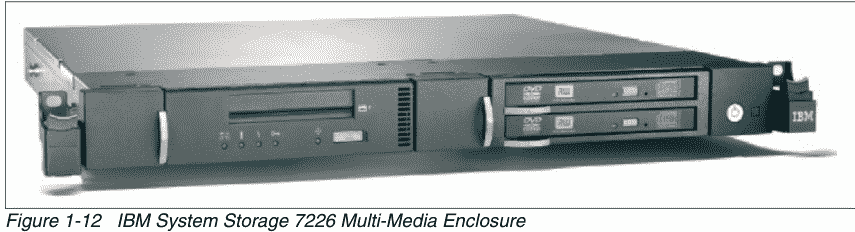

IBM System Storage 7226 多媒体机箱提供客户可更换单元（CRU）维护服务，以帮助使新驱动器的安装或更换更高效。其他 7226 组件也设计用于 CRU 维护。

IBM System Storage 7226 多媒体机箱与提供当前级别 AIX、IBM i 和 Linux 操作系统的多数 POWER8、POWER9 和 Power10 处理器系统兼容。

> Unsupported: IBM i does not support 7226 USB devices.

有关支持 IBM System Storage 7226 多媒体机箱的主机软件版本和发布级别的完整列表，请参阅 System Storage Interoperation Center（SSIC）。

> Note: Any of the existing 7216-1U2, 7216-1U3, and 7214-1U2 multimedia drawers are also supported.

#### 平板显示器选项

IBM 7316 Model TF5 是一款机架式平板控制台套件，还可配置为托盘向前拉出且显示器向上折叠，提供 HMC 操作员的完整查看和操作功能。

Model TF5 是 Model TF4 的后续产品，提供以下功能：

- 仅占用 19 英寸标准机架 1U（1.75 英寸）空间的纤薄、时尚、轻量级显示器设计
- 18.5 英寸（409.8 mm x 230.4 mm）平板 TFT 显示器，图像真实准确，几乎无失真
- 可将 IBM Travel Keyboard 安装在 7316-TF5 机架键盘托盘中
- 支持 IBM 1x8 Rack Console Switch（#4283）IBM 键盘/视频/鼠标（KVM）开关

#4283 是一款 1x8 控制台开关，安装在 TF5 后面的 1U 空间中。它是基于 CAT5 的开关。它包含八个模拟机架接口（ARI）端口，用于连接 PS/2 或 USB 控制台开关线缆。它支持使用 IBM Conversion Options 开关线缆（#4269）进行服务器的链式连接。该功能提供四根线缆，可将 KVM 开关连接到系统，或可在菊花链场景中使用，将多达 128 个系统连接到单个 KVM 开关。它还支持服务器端 USB 连接

### 1.7.7 原始设备制造商机架

如果机架符合 19 英寸机架的 EIA-310-D 标准，则系统可安装在合适的 OEM 机架中。该标准由电气工业联盟发布。有关更多信息，请参阅 IBM Documentation。

IBM Documentation 提供了一般的机架规格，包括以下信息：

- 机架或机柜必须符合 1992 年 8 月 24 日发布的 19 英寸机架 EIA 标准 EIA-310-D。EIA-310-D 标准规定了内部尺寸，例如机架开口的宽度（机箱宽度）、模块安装法兰的宽度以及安装孔间距。
- 前机架开口的最小宽度必须为 450 mm（17.72 in.），导轨安装孔的中心间距必须为 465 mm 加减 1.6 mm（18.3 in. 加减 0.06 in.）。

图 1-13 是显示机架规格尺寸的俯视图。

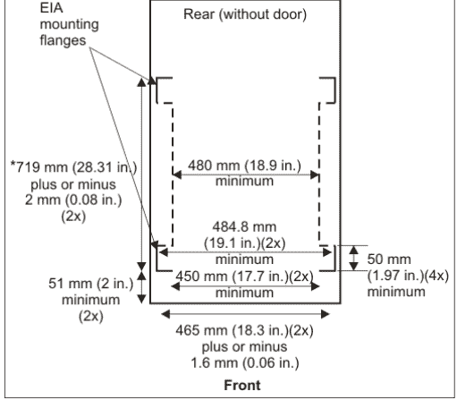

图 1-13 机架规格（俯视图）

- 安装孔之间的垂直距离必须由三孔组组成，从底部到顶部间距分别为 15.9 mm（0.625 in.）、15.9 mm（0.625 in.）和 12.7 mm（0.5 in.）中心距，使得每个三孔组的垂直孔间距为 44.45 mm（1.75 in.）中心距。

图 1-14 显示了安装孔之间的垂直距离。

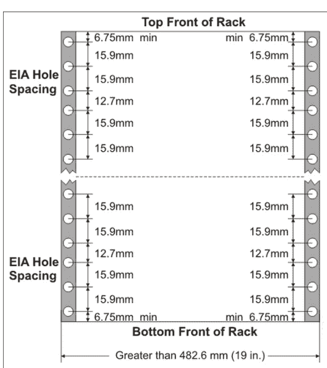

图 1-14 安装孔之间的垂直距离

对于安装有 IBM 硬件的机架，支持以下机架孔尺寸：

- 7.1 mm（0.28 in.）加减 0.1 mm（圆形）
- 9.5 mm（0.37 in.）加减 0.1 mm（方形）

机架或机柜必须能够承受平均负载为 20 kg（44 lb.）每 EIA 单位的产品重量。例如，四 EIA 抽屉的最大抽屉重量为 80 kg（176 lb.）。

### 1.8 硬件管理控制台概述

硬件管理控制台（HMC）可以是硬件设备或虚拟设备，可用于配置和管理您的系统。HMC 连接到一个或多个受管系统，并提供以下主要功能的能力：

- 系统管理功能，例如关机、开机、系统设置、按需容量、企业池、共享处理器池、性能和容量监控，以及为受管系统启动高级系统管理接口（ASMI）。
- 通过支持创建、管理和删除逻辑分区、实时分区迁移、远程重启、配置 SRIOV、管理虚拟 I/O 服务器、动态资源分配和操作系统终端，提供虚拟化管理。
- 作为系统服务的焦点并支持服务功能，包括呼叫回家、转储管理、引导修复和验证、受管系统的并发固件更新，以及全天候错误报告与电子服务代理以获得更快的支持。
- 提供设备管理功能，用于配置 HMC 上的网络、用户、更新和升级 HMC

我们接下来讨论可用的 HMC 产品。

#### 1.8.1 HMC 7063-CR2

7063-CR2 IBM Power Systems HMC（见图 1-15）是第二代基于 Power 处理器的 HMC。

CR2 型号包括以下功能：

- 6 核 POWER9 130W 处理器芯片
- 64 GB（4x16 GB）或 128 GB（4x32 GB）的内存 RAM
- 1.8 TB 内部磁盘容量，带 RAID1 保护
- 4 端口 1 Gb 以太网（RJ-45）、2 端口 10 Gb 以太网（RJ-45）、两个 USB 3.0 端口（前面板）和两个 USB 3.0 端口（后面板），以及 1 Gb IPMI 以太网（RJ-45）
- 两个 900W 电源单元
- 远程管理服务：IPMI 端口（OpenBMC）和 Redfish 应用程序编程接口（API）
- 基础保修为 1 年 9x5，可选升级

未包含 USB Smart Drive。

> 注意：V10R1 的恢复介质对于 7063-CR2 和 7063-CR1 相同。

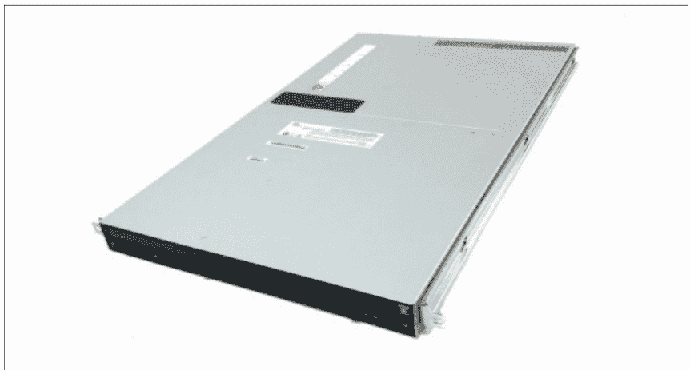

7063-CR2 与平板控制台套件 7316-TF3、TF4 和 TF5 兼容。

> 注意：7316-TF3 和 TF4 已停止销售。

#### 1.8.2 虚拟 HMC

最初，HMC 仅作为预装 HMC 固件的硬件设备出售。然而，IBM 扩展了此产品以允许购买硬件设备和可在 ppc64le 架构上部署并可在 x86 平台上部署的虚拟设备。

任何具有有效合同的客户都可以从 ESS 站点下载它，或可在初始 Power E1080 订单中包含。

虚拟 HMC 支持以下 hypervisor：

- 在基于 x86 处理器的服务器上：
  - KVM
  - Xen
  - VMware
- 在基于 Power 处理器的服务器上：PowerVM

安装虚拟 HMC 必须满足以下最低要求：

- 16 GB 内存
- 4 个虚拟处理器
- 2 个网络接口（最多允许 4 个）
- 1 个磁盘驱动器（500 GB 可用磁盘驱动器）

对于使用 IBM 配置器（e-config）的初始 Power E1080 订单，可通过选择添加软件 → 其他系统产品（作为产品选择）找到 HMC 虚拟设备，然后：

- 5765-VHP 用于 IBM HMC 虚拟设备 Power V10
- 5765-VHX 用于 IBM HMC 虚拟设备 x86 V10

有关虚拟 HMC 概述的更多信息，请参阅此网页。

有关如何安装虚拟 HMC 设备和所有要求的更多信息，请参阅 IBM 文档。

#### 1.8.3 7063-CR2 的基板管理控制器网络连接规则

7063-CR2 HMC 具有基板管理控制器（BMC），这是一个专门的服务处理器，通过使用传感器监控系统的物理状态。7063-CR2 上使用的 OpenBMC 提供了一个图形用户界面（GUI），可以从具有与 BMC 网络连接的工作站访问。此连接需要配置一个以太网端口供 BMC 使用。

7063-CR2 提供两个网络接口（eth0 和 eth1）用于在设备上配置 BMC 的网络连接。

每个接口映射到系统上的不同物理端口。不同的管理工具以不同方式命名接口。HMC 任务 控制台管理 → 控制台设置 → 更改 BMC/IPMI 网络设置 仅修改专用接口。

BMC 端口列出见表 1-24。

# 表 1-24 BMC 端口

| 管理工具 | 逻辑端口 | 共享/专用 | CR2 物理端口 |
|---|---|---|---|
| OpenBMC UI | eth0 | 共享 | eth0 |
| OpenBMC UI | eth1 | 专用 | 仅管理端口 |
| ipmi tool | lan1 | 共享 | eth0 |
| ipmi tool | lan2 | 专用 | 仅管理端口 |
| HMC task (change BMC/IPMI Network settings | lan2 | 专用 | 仅管理端口 |

图 1-16 显示了 HMC 的 BMC 接口。

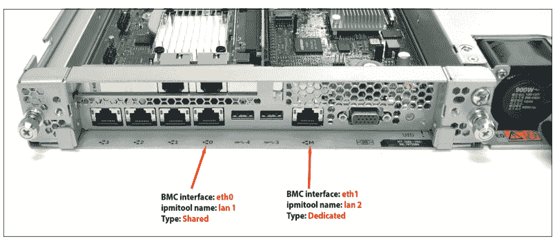

主要区别在于共享和专用接口可以共存于 BMC。每个都有自己的 LAN 编号和物理端口。理想情况下，客户配置一个端口，但两者都可以配置。连接 Power 系统到 HMC 的规则与以前版本保持不变。

#### 1.8.4 高可用性 HMC 配置

为了获得最佳的可管理性和冗余，建议采用双 HMC 配置。此配置可以是两个硬件设备，也可以是一个硬件设备和一个虚拟设备，或两个虚拟设备。

必须满足以下要求：

- 两个 HMC 处于同一版本。
- HMC 使用不同的子网连接到 FSP。
- HMC 可以通过公共网络与服务器的分区通信以允许完全同步和功能。

#### 1.8.5 Power E1080 的 HMC 代码级别要求

Power E1080 所需的最低 HMC 版本为 V10R1。V10R1 仅支持 7063-CR1、7063-CR2 和虚拟 HMC 设备。不支持 7042 机型。运行 V10R1 的 HMC 不能管理基于 POWER7 处理器的系统。

运行 V10R1 M1010 的 HMC 包括以下功能：

- 7063-CR2 设备的 HMC OS 安全启动支持
- 能够配置登录重试和暂停时间，并支持密码策略中的非活动过期
- 能够指定 HMC 位置和组的数据复制
- VIOS 管理增强：
  - 准备 VIOS 维护：
    - 对 VIOS 为客户分区提供的存储和网络的冗余进行验证
    - 切换冗余存储和网络路径以启动故障转移
    - 在准备失败时回滚到原始配置
    - 审核执行的各种验证和准备步骤
    - 报告准备过程中出现的任何失败
  - 命令行和计划操作支持 VIOS 备份或恢复 VIOS 配置和 SSP 配置
  - 在 HMC 中备份或恢复共享存储池配置的选项
  - 将备份文件导入或导出到外部存储的选项
  - 将所有虚拟 NIC 从一个 VIOS 故障转移到另一个 VIOS 的选项
- 支持 128 MB 和 256 MB LMB 大小
- 自动选择 LPM 内存传输的最快网络
- HMC 用户体验增强：
  - 可用性和性能改进
  - 增强帮助连接全局搜索
  - 可服务事件的快速查看
  - UI 向导的更多进度信息
- 允许在虚拟光学设备分配给分区时进行 LPM/远程重启
- 更新访问密钥支持

计划操作功能：在电子服务代理中，一个新功能允许客户仅在计划操作失败时接收消息警报（见图 1-17）。

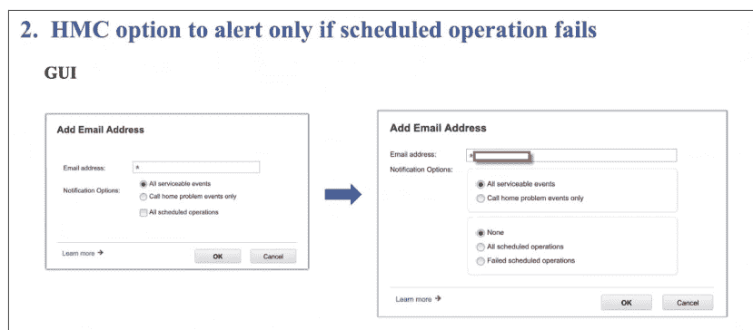

图 1-17 HMC 警报功能

HMC 审计跟踪的日志保留时间也已增加。

### 1.8.6 HMC 时效性

近年来，网络安全已成为国家安全问题，以及 CIO 和企业 IT 管理员日益关注的重点。

基于 IBM Power 处理器的架构在端到端安全性方面一直名列前茅，这也是其仍然成为关键任务企业工作负载首选平台的原因。

维护安全的 Power 环境的一个关键方面是确保 HMC（或虚拟 HMC）保持最新并得到完全支持（包括硬件、软件和 Power 固件更新）。

过时或不受支持的 HMC 代表着技术风险，可以通过升级到当前版本来快速、轻松地缓解。
