## 架构和技术概述

本章描述了 IBM Power E1080（9080-HEX）服务器的整体系统架构。文中提供的带宽均为理论最大值，仅供参考。所示速度为单个组件级别。多个组件和应用程序实现是实现最佳性能的关键。

始终在应用程序工作负载环境级别完成性能规划，并使用真实的性能测量和生产工作负载来评估性能。

本章包含以下主题：

- 2.1，“IBM Power10 处理器”第 50 页
- 2.2，“SMP 互连”第 70 页
- 2.3，“内存子系统”第 72 页
- 2.4，“按需容量”第 76 页
- 2.5，“内部 I/O 子系统”第 83 页
- 2.6，“受支持的 PCIe 适配器”第 92 页
- 2.7，“外部 I/O 子系统”第 96 页
- 2.8，“外部磁盘子系统”第 106 页
- 2.9，“系统控制和时钟分配”第 109 页
- 2.10，“操作系统支持”第 114 页
- 2.11，“可管理性”第 121 页
- 2.12，“可服务性”第 129 页

### 2.1 IBM Power10 处理器

图 2-1 显示了 Power E1080 服务器的逻辑系统架构。

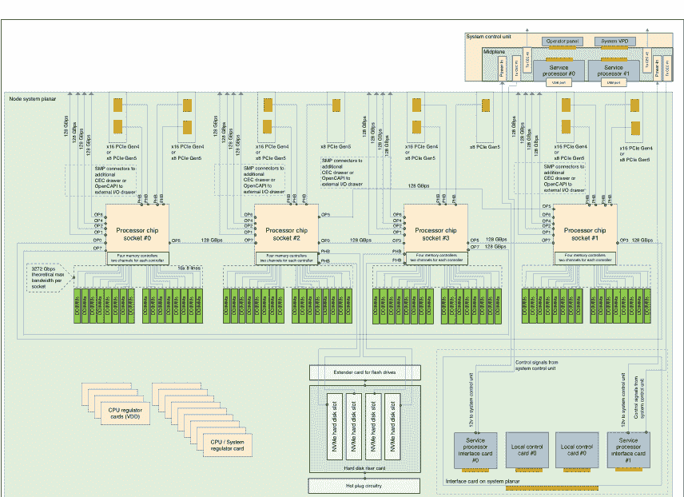

图 2-1 Power E1080 逻辑系统

IBM Power10 处理器于 2020 年 8 月 17 日在第 32 届 HOT CHIPS¹ 半导体会议上向公众发布。在该会议上，最新 Power 处理器微架构和 Power 指令集架构（ISA）v3.1B 的新功能和特性被揭示，并根据以下 Power10 处理器设计优先关注领域进行分类：

- ► 数据平面带宽关注领域
处理器功能接口每秒兆兆位级信号带宽、PB 级系统内存容量、16 路对称多处理（SMP）可扩展性，以及内存集群和内存入侵能力。

- ► 强大的企业核心关注领域
新的核心微架构、灵活性、更大的缓存和更低的延迟。

- ► 端到端安全关注领域
硬件启用安全功能，与 PowerVM hypervisor 支持协同优化。

- ► 能源效率关注领域
与 POWER9 处理器技术相比，能源效率最高可提高三倍。

1 https://hotchips.org/

- 人工智能（AI）增强核心关注领域
与 POWER9 处理器技术能力相比，每插槽矩阵数学性能提升 10-20 倍。

本节的其余部分提供了有关 Power10 处理器技术的更具体信息，该技术用于 Power E1080 扩展企业级服务器。

IBM 的 Power10 Processor 会议材料在第 32 届 HOT CHIPS 会议上展示，可通过 HC32 会议论文集档案在此网页上获取。

#### 2.1.1 Power10 处理器概述

Power10 处理器是一种超标量对称多处理器，采用互补金属氧化物半导体（CMOS）7 nm 光刻工艺制造，金属层数为 18 层。处理器包含最多 15 个核心，支持八路同时多线程（SMT8）独立执行上下文。

每个核心可私有访问 2 MB L2 缓存，并可本地访问 8 MB L3 缓存容量。特定核心的本地 L3 缓存区域也可被处理器芯片上的所有其他核心访问。一个 Power10 处理器的核心共享最多 120 MB 的延迟优化非一致缓存访问（NUCA）L3 缓存。

处理器支持以下三种不同的功能接口，所有接口均可运行高达 32 GTps² 的信号速率：

- 开放内存接口
Power10 处理器具有八个内存控制器单元（MCU）通道，每个通道支持一个开放内存接口（OMI）端口，每个端口有两个 OMI 链路³。 一个 OMI 链路聚合 8 条以 32 GTps 速度运行的通道，并连接到一个内存缓冲差分 DIMM（DDIMM）插槽以访问主内存。 物理上，OMI 接口实现在两个独立的裸片区域，每个区域有 8 个 OMI 链路。 所有 128 个 OMI 通道的聚合最大理论全双工带宽为 1 TBps。

- SMP 结构互连（PowerAXON）
Power10 处理器中总共提供 144 条通道，用于在对称多处理（SMP）架构配置中与其他处理器连接。 每个 SMP 连接需要 18 条通道，每个方向 8 条数据通道加 1 条备用通道（2 x(8+1)）。 这样处理器最多可支持八个 SMP 连接，每个处理器总共 128 条数据通道。 这种配置在所有 SMP 连接上的聚合最大理论全双工带宽为 1 TBps。
接口实现的通用性也允许使用 128 条数据通道通过 OpenCAPI 协议潜在地连接加速器或内存设备。 它还可支持内存集群和内存拦截架构。
由于该技术的多功能特性，它也被称为 PowerAXON 接口（Power A-bus/X-bus/OpenCAPI/Networking⁴）。 OpenCAPI 以及内存集群和内存拦截用例可在未来进行，并目前未被现有技术产品使用。

#### PCIe 版本 5.0 接口

为了支持外部 I/O 连接和访问内部存储设备，Power10 处理器提供差分外围组件互连快速版 5.0 接口总线（PCIe Gen 5），总共 32 条通道。 通道分为两组，每组 16 条，可用于以下配置之一：

- 1 x16 PCIe Gen 4
- 2 x8 PCIe Gen 4
- 1 x8, 2 x4 PCIe Gen 4
- 1 x8 PCIe Gen 5, 1 x8 PCIe Gen 4
- 1 x8 PCIe Gen 5, 2 x4 PCIe Gen 4

图 2-2 显示了带有多个功能单元标记的 Power10 处理器裸片。 请注意，显示了 16 个 SMT8 处理器核心，但 Power E1080 服务器配置中仅提供 10、12 或 15 核心处理器选项。

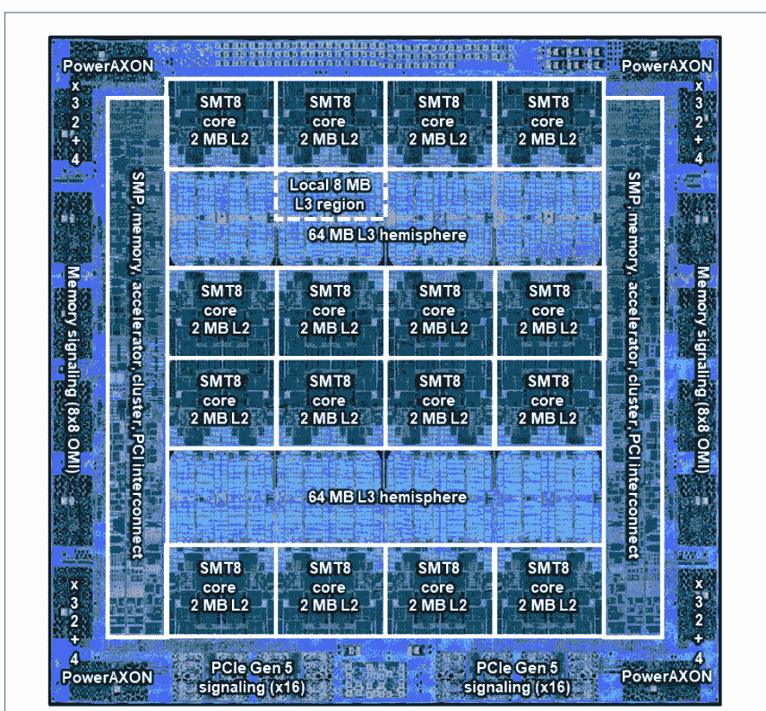

图 2-2 Power10 处理器芯片（Die 照片由 Samsung Foundry 提供）

重要 Power10 处理器特性列于 2-1。

## 表 2-1 Power10 处理器芯片和处理器核心技术摘要

| 技术 | Power10 处理器 |
|---|---|
| 处理器裸片尺寸 | 602 mm² |
| 制造技术 | ► CMOSᵃ 7-nm 光刻<br>► 18 层金属 |
| 每芯片最大处理器核心数 | 15 |
| 每核心/每芯片最大执行线程数 | 8 / 120 |
| 每核心最大 L2 缓存 | 2 MB |
| 每核心/每芯片最大片上 L3 缓存 | 8 MB / 120 MB |
| 晶体管数量 | 180 亿 |
| 处理器兼容模式 | 支持 POWER8 和 POWER9 的 Power ISAᵇ |

a. 互补金属氧化物半导体（CMOS）
b. Power 指令集架构（Power ISA）

Power10 处理器被封装为单芯片模块（SCM），专用于 Power E1080 服务器。 SCM 包含 Power10 处理器以及实现电源供应和芯片外部连接所需的更多逻辑。 它还保存连接器，可将 SMP 电缆直接插入插座以构建 2、3 和 4 节点 Power E1080 服务器。

图 2-3 显示了 Power10 SCM 的逻辑图。

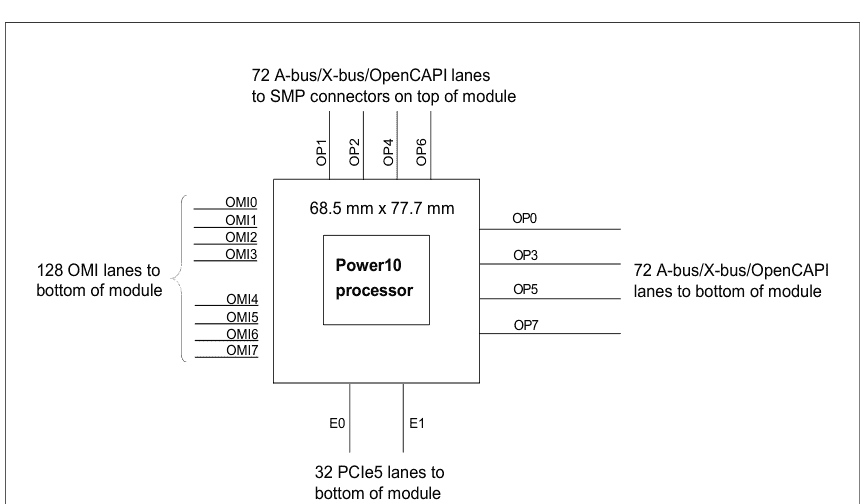

# 图 2-3 Power10 单芯片模块


正如第 53 页图 2-3 所示，PowerAXON 接口通道被分为两组，每组 72 条通道。其中一组提供四个接口端口（OP1、OP2、OP4 和 OP6），这些端口可由物理放置在 SCM 模块顶部的 SMP 连接器访问。

第二组端口（OP0、OP3、OP5 和 OP7）用于在系统节点内的四个插槽之间实现全互联的 SMP 结构。八个开放内存接口端口（OMI0 至 OMI7），每个端口有两个 OMI 链路，提供对带缓冲主内存差分 DIMM（DDIMM）的访问。32 条 PCIe Gen 5 通道被分为两个 PCIe 主桥（E0、E1）。

图 2-4 显示了 Power10 SCM 的物理图。八个 SMP 连接器（OP1A、OP1B、OP2A、OP2B、OP4A、OP4B、OP6A 和 OP6B）对外提供 4 条 SMP 总线，用于连接 2、3 和 4 节点 Power E1080 配置中的系统节点抽屉。OpenCAPI 连接选项也已标出，尽管它们未被任何商用产品使用。

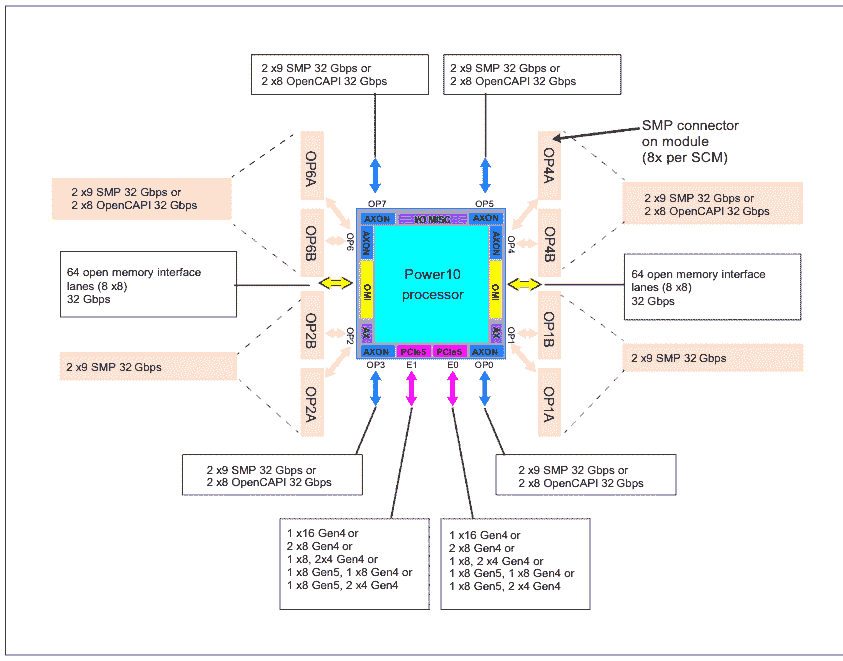

图 2-4 Power10 单芯片模块物理图

### 2.1.2 Power10 处理器核心

Power10 处理器核心继承了 POWER9 处理器核心的模块化架构，但重新设计并增强的微架构显著提升了处理器核心性能和处理效率。通过新的执行能力和优化的缓存带宽特性，峰值计算吞吐量得到明显改善。额外的矩阵数学加速引擎可为机器学习带来显著的性能提升，尤其适用于 AI 推理工作负载。

Power E1080 服务器使用 Power10 企业级处理器变体，其中每个核心可运行多达八个基本独立的硬件线程。如果所有线程都处于活动状态，则操作模式称为 8 路同时多线程（SMT8）模式。具有 SMT8 能力的 Power10 核心称为 Power10 SMT8 核心或简称为 SMT8 核心。Power10 核心还支持四个活动线程（SMT4）模式；即两个活动线程（SMT2）和一个单活动线程（ST）。

SMT8 核心包含两个执行资源域。每个域提供功能单元以服务多达四个硬件线程。

图 2-5 显示了所有 8 个线程处于活动状态的 SMT8 核心的功能单元。两个执行资源域用两种不同深浅的蓝色背景突出显示。

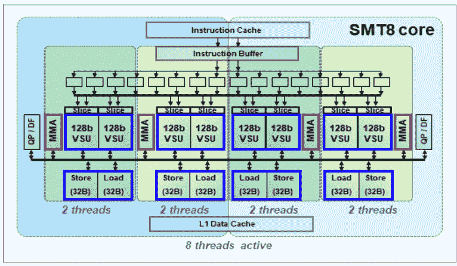

图 2-5 Power10 SMT8 核心

两个执行资源域中的每一个都支持一到四个线程，并包括 4 个 128 位宽度的向量标量单元（VSU）、两个矩阵乘法辅助（MMA）加速器，以及一个四精度浮点（QP）和十进制浮点（DF）单元。

一个 VSU 及其直接关联的逻辑称为执行切片。两个相邻切片也可以用作组合的执行资源，然后命名为超切片。在 SMT8 模式下，八个 SMT 线程被细分为成对的形式，共同运行在两个相邻切片上，如不同深浅的绿色背景所示。

在 SMT4 或更低线程模式下，一个到两个线程各自共享一个四切片资源域。图 2-5 还指出了 SMT 线程之间共享的其他关键资源，例如指令缓存、指令缓冲和 L1 数据缓存。

SMT8 核心支持自动工作负载平衡以改变操作 SMT 线程级别。根据工作负载特征，运行在单个芯片上的线程数量可以从四个减少到两个，甚至进一步减少到仅一个活动线程。如果运行在核心执行资源上的线程更少，单个线程在性能方面可以受益。

微架构性能和效率优化导致与之前的 POWER9 核心实现相比，每瓦性能显著提升。整体能效提高了约 2.6 倍，这体现了 Power10 所体现的处理器设计进步。

Power10 处理器核心包括以下影响性能的关键特性和改进：

- 增强的加载和存储带宽
- 更深更宽的指令窗口
- 增强的数据预取
- 分支执行和预测增强
- 指令融合

计算资源、工作集大小和数据访问延迟方面的改进将在下文描述。与 POWER9 处理器核心实现的变更在括号中给出。

#### 增强的计算资源

以下为主要的计算资源增强：

- 八个向量标量单元（VSU）执行切片，每个切片支持 64 位标量或 128 位单指令多数据（SIMD）+100% 用于置换、定点、浮点和加密（高级加密标准（AES）/SHA）+400% 操作。
- 四个用于矩阵数学辅助（MMA）加速的单元，每个单元每周期可产生 512 位结果（新增），+400% 单精度和双精度 FLOPS 并支持降精度 AI 加速）。
- 两个用于四精度浮点和十进制浮点操作的单元 新增指令类型

#### 更大的工作集

以下为工作集大小的主要变更：

- L1 指令缓存：2 x 48 KB 6 路（总计 96 KB）。（+50%）
- L2 缓存：2 MB 8 路。（+400%）
- L2 转换后援缓冲器（TLB）：2 x 4K 条目（总计 8K）。（+400%）

#### 数据访问延迟降低

以下主要变更可降低加载数据的延迟：

- L1 数据缓存访问在标称四周期内完成，存储转发零惩罚。（- 2 周期）用于存储转发
- L2 数据访问在标称 13.5 周期内完成。（-2 周期）
- L3 数据访问在标称 27.5 周期内完成。（-8 周期）
- 转换后援缓冲器（TLB）访问在标称 8.5 周期内完成，用于有效地址到实地址转换（ERAT）未命中，包括嵌套转换。（-7 周期）

补充物理和逻辑设计技术的微架构创新，并专门针对能效，包括以下示例：

- 改进的时钟门控
- 提高分支预测准确率从而降低刷新率
- 融合和聚集操作合并
- 减少端口数量并减少对选定结构的访问
- 有效地址（EA）标记的 L1 数据和指令缓存仅在缓存未命中时才产生 ERAT 访问

除了性能和能效的显著提升外，安全性也是一个重要的架构关注领域。Power10 处理器核心支持以下安全特性：

- 增强的硬件支持，在缓解基于推测的攻击的同时提供更好的性能
- 动态执行控制寄存器（DEXCR）支持
- 返回定向编程（ROP）保护

### 2.1.3 同时多线程

Power10 处理器的每个核心都支持多个硬件线程，表示独立的执行上下文。如果仅使用一个硬件线程，处理器核心以单线程（ST）模式运行。

如果多于一个硬件线程处于活动状态，处理器以同时多线程（SMT）模式运行。除了 ST 模式外，Power10 处理器还支持以下不同的 SMT 模式：

- SMT2：两个硬件线程活动
- SMT4：四个硬件线程活动
- SMT8：八个硬件线程活动

SMT 使单个物理处理器核心能够同时从多个硬件线程上下文调度指令。计算工作负载可以以更高的并行度使用处理器核心的执行单元。这种能力显著增强了多线程应用程序的吞吐量和可扩展性，并优化了单线程工作负载的计算密度。

SMT 主要在商业环境中受益，在这些环境中，单个事务的速度不如执行的总事务数重要。SMT 通常会提高大多数工作负载的吞吐量，尤其是那些具有大或频繁变化工作集的工作负载，例如数据库服务器和 Web 服务器。


表 2-2 列出了自 POWER4 以来 IBM Power Architecture® 的每个实现所支持的 SMT 功能的历史记录。

表 2-2 Power 处理器支持的 SMT 级别

| Technology | Cores/system | Supported hardware threading modes | Maximum hardware threads per partition |
|---|---|---|---|
| IBM POWER4 | 32 | ST | 32 |
| IBM POWER5 | 64 | ST, SMT2 | 128 |
| IBM POWER6 | 64 | ST, SMT2 | 128 |
| IBM POWER7 | 256 | ST, SMT2, SMT4 | 1024 |
| IBM POWER8 | 192 | ST, SMT2, SMT4, SMT8 | 1536 |
| IBM POWER9 | 192 | ST, SMT2, SMT4, SMT8 | 1536 |
| IBM Power10 | 240 | ST, SMT2, SMT4, SMT8 | 1920ᵃ |

a. PHYP 支持最大 240 x SMT8 = 1920。AIX 从 AIX v7.3 + Power10 开始支持单分区最多 1920 个（240xSMT8）总线程。

### 2.1.4 矩阵乘法辅助 AI 工作负载加速

矩阵乘法辅助（MMA）功能由 Power 指令集架构（ISA）v3.1 引入。相关指令在小矩阵上实现数值线性代数运算，旨在加速计算密集型内核，例如矩阵乘法、卷积和离散傅里叶变换。

为了高效加速 MMA 操作，Power10 处理器核心实现了密集数学引擎（DME）微架构，有效为认知计算、机器学习和 AI 推理工作负载提供加速器。

DME 封装了计算高效的流水线、物理寄存器文件以及将累加器数据保持在计算单元本地的相关数据流。每个 MMA 流水线执行外积矩阵运算，从 512 位累加器寄存器读取并写回。

Power10 在不增加体系结构状态的情况下实现了 MMA 累加器架构。每个体系结构 512 位累加器寄存器由四个 128 位向量标量扩展（VSX）寄存器支持。

使用 MMA 指令的代码包含在 OpenBLAS 和 Eigen 库中。该库可使用最新版本的 GNU Compiler Collection（GCC）编译器构建。OpenBLAS 的最新版本可在该网页上获得。

OpenBLAS 被 Python-NumPy 库、PyTorch 和其他框架使用，这使得 Power10 MMA 加速器在 AI 工作负载中的性能优势易于使用。

有关 Power10 处理器高吞吐量数学引擎实现的更多信息，请参阅白皮书 A matrix math facility for Power ISA processors。

有关基本 MMA 架构原理、详细的指令集使用、寄存器文件管理概念以及各种支持设施的更多信息，请参阅 Matrix-Multiply Assist Best Practices Guide, REDP-5612。

### 2.1.5 Power10 兼容模式

Power10 核心实现了处理器兼容性寄存器（PCR），如 Power 指令集架构（ISA）版本 3.1 中所述，主要用于促进与 IBM Power 硬件前几代之间的实时分区迁移（LPM）。

根据 PCR 的具体设置，Power10 核心以与 POWER9（Power ISA 版本 3.0）或 POWER8（Power ISA 版本 2.07）处理器相关的兼容模式运行。对处理器兼容模式的支持还使 AIX、IBM i、Linux 或 Virtual I/O 服务器环境的旧操作系统版本能够在基于 Power10 处理器的系统上运行。

Power E1080 服务器的 Power10 处理器支持以下兼容模式：

- POWER8：由固件级别 FW810 启用
- POWER9 Base：由固件级别 FW910 启用
- POWER9：由固件级别 FW940 启用
- Power10：由固件级别 FW1010 启用

### 2.1.6 处理器功能代码

Power E1080 服务器中的每个系统节点提供四个插槽以容纳 Power10 单芯片模块（SCM）。提供三种不同核心密度为 10、12 和 15 核的 SCM 类型。系统节点的处理器配置由三个可用的处理器功能之一决定。每个功能代表一组四个核心密度相同的 Power10 SCM。Power E1080 服务器中的所有系统节点必须配置相同的处理器功能。

表 2-3 列出了可用于 Power E1080 服务器的处理器功能代码。Power10 处理器会根据工作负载要求、热条件和功耗特性自动优化其核心频率。每个列出的处理器功能代码都与 SCM 核心通常运行的处理器核心频率范围相关联。此外，还指出了相关 SCM 类型的最大频率。

表 2-3 Power E1080 处理器功能

| Feature code | Description |
|---|---|
| EDP2 | 40-core (4x10) Typical 3.65 to 3.90 GHz (max) Power10 Processor with 5U system node drawer |
| EDP3 | 48-core (4x12) Typical 3.60 to 4.15 GHz (max) Power10 Processor with 5U system node drawer |
| EDP4 | 60-core (4x15) Typical 3.55 to 4.00 GHz (max) Power10 Processor with 5U system node drawer |

### 2.1.7 片上 L3 缓存和智能缓存

Power10 处理器包含一个大型的片上 L3 缓存，最大可达 120 MB，采用非统一缓存访问（NUCA）架构，提供在 L3 缓存区域集合中分配和共享缓存占用空间的机制。每个处理器核心可以访问关联的本地 8MB L3 缓存。它还可以访问芯片上其他 L3 缓存区域以及系统中的数据。

每个 L3 区域充当其关联 L2 缓存的牺牲缓存，并且还可以为片上缓存占用空间提供聚合存储。

智能 L3 缓存管理使 Power10 处理器能够优化对 L3 缓存行的访问并最小化缓存延迟。L3 包含具有数据类型和重用感知的替换算法。它还支持来自核心的一系列预取请求，包括指令和数据，并与核心、内存控制器和 SMP 互连结构协同工作以管理预取流量，从而优化系统吞吐量和数据延迟。

L3 缓存支持以下关键特性：

- 增强的带宽，支持每个 SMT8 核心每个处理器周期高达 64 字节。
- 增强的数据预取，由 96 个 L3 预取请求机启用，为每个 SMT8 核心服务对内存的预取请求。
- 内存控制器的加一预取，以增强有效的预取深度和速率。
- Power10 软件预取模式，支持将数据块提取到 L3 缓存中。
- 具有降低延迟的数据访问。

### 2.1.8 开放内存接口

Power10 处理器引入了新的创新开放内存接口（OMI）。OMI 由 8 个片上内存控制器单元（MCU）驱动，并在 Power10 芯片的相对外边缘的两个独立物理构建块中实现。每个区域支持 64 个 OMI 通道，分成四个端口。每个端口又由两个每个 8 个通道的链路组成，以 32 Gbps 速度以延迟优化的方式运行，具有前所未有的带宽和扩展性。

OMI 接口的聚合最大理论全双工带宽达到 2 x 512 GBps = 1 TBps 每 Power10 单芯片模块（SCM）。

OMI 物理接口使处理器能够以低延迟、高带宽、技术无关的主机内存语义进行操作，并允许连接已建立和新兴的内存元件。Power E1080 服务器。OMI 最初支持每个 OMI 链路一个主层、低延迟、企业级双倍数据速率 4（DDR4）差分 DIMM（DDIMM）。此配置产生每个 SCM 总共 16 个 DDIMM 和每个 Power E1080 服务器节点 64 个 DDIMM。内存带宽取决于为特定 Power E1080 服务器配置的 DDIMM 密度。

如果使用运行在 3200 MHz 的 32 GB 或 64 GB DDIMM，则最大理论双工内存带宽为每个 SCM 409 GBps。如果使用运行在 2933 MHz 的 128 GB 或 256 GB DDIMM，则每个 SCM 的最大内存带宽略微降低至 375 GBps。


In summary, the Power10 SCM supports 128 OMI lanes with the following characteristics:

- 32 Gbps signaling rate
- Eight lanes per OMI link
- Two OMI links per OMI port (2 x 8 lanes)
- Eight OMI ports per single chip module (16 x 8 lanes)

### 2.1.9 Pervasive memory encryption

The Power10 MCU provides the system memory interface between the on-chip symmetric multiprocessing (SMP) interconnect fabric and the OMI links. This design qualifies the MCU as ideal functional unit to implement memory encryption logic. The Power10 on-chip MCU encrypts and decrypts all traffic to and from system memory that is based on the AES technology.

The Power10 processor supports the following modes of operation:

- AES XTS mode

XTS is an abbreviation for the xor–encrypt–xor based tweaked-codebook mode with ciphertext stealing. AES XTS provides a block cipher with strong encryption, which is particularly useful to encrypt persistent memory.

Persistent DIMM technology retains the data that is stored inside the memory DIMMs, even if the power is turned off. A malicious attacker who gains physical access to the DIMMs can steal memory cards. The data that is stored in the DIMMs can leave the data center in the clear if not encrypted.

Also, memory cards that leave the data center for repair or replacement can be a potential security breach. Because the attacker might have arbitrary access to the persistent DIMM data. the stronger encryption of the AES XTS mode is required for persistent memory. The AES XTS mode of the Power10 processor is supported for future use if persistent memory solutions become available for IBM Power servers.

- AES CTR mode

CTR stands for Counter mode of operation and designates a low-latency AES block cipher. Although the level of encrypting is not as strong as with the XTS mode, the low-latency characteristics make it the preferred mode for memory encryption of volatile memory. AES CTR makes it more difficult to physically gain access to data through the memory card interfaces. The goal is to protect against physical attacks, which becomes increasingly important in the context of cloud deployments.

The Power E1080 servers support the AES CTR mode for pervasive memory encryption. Each Power10 processor holds a 128-bit encryption key that is used by the processor’s MCU to encrypt the data of the differential DIMMs that are attached to the OMI links.

The MCU crypto engine is transparently integrated into the data path, which ensures that the data fetch and store bandwidth are not compromised by the AES CTR encryption mode. Because the encryption has no noticeable performance effect and because of the obvious security benefit, the pervasive memory encryption is enabled by default and cannot be switched off through any administrative interface.

> Note: The pervasive memory encryption of the Power10 processor does not affect the encryption status of a system dump content. All data that is coming from the DDIMMs is decrypted by the memory controller unit before it is passed onto the dump devices under the control of the dump program code. This statement applies to the traditional system dump under the operating system control and the firmware assist dump utility.

**Note:** The PowerVM Live Partition Mobility (LPM) data encryption does not interfere with the pervasive memory encryption. Data transfer during a LPM operation uses the following general flow:

1. On the source server, the Mover Server Partition (MSP) provides the hypervisor with a buffer.
2. The hypervisor of the source system copies the partition memory into the buffer.
3. The MSP transmits the data over the network.
4. The data is received by the MSP on the target server and copied in to the related buffer.
5. The hypervisor of the target system copies the data from the buffer into the memory space of the target partition.

To facilitate LPM data compression and encryption, the hypervisor on the source system presents the LPM buffer to the on-chip nest accelerator (NX) unit as part of process in Step 2. The reverse decryption and decompress operation is applied on the target server as part of process in Step 4.

The pervasive memory encryption logic of the MCU decrypts the memory data before it is compressed and encrypted by the NX unit on the source server. It also encrypts the data before it is written to memory but after it is decrypted and decompressed by the NX unit of the target server.

### 2.1.10 Nest accelerator

The Power10 processor has an on-chip accelerator called nest accelerator unit or NX unit. The coprocessor features that are available on the Power10 processor are similar to the features on the POWER9 processor. These coprocessors provide specialized functions, such as the following examples:

- IBM proprietary data compression and decompression
- Industry standard gzip compression and decompression
- AES and Secure Hash Algorithm (SHA) cryptography
- Random number generation

Figure 2-6 on page 63 shows a block diagram of the NX unit.

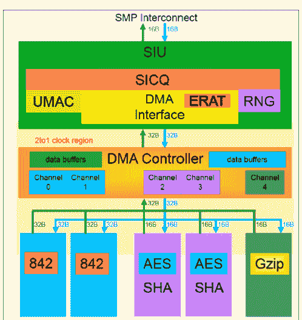

Figure 2-6 Block diagram of the NX unit

Each one of the AES/SHA engines, data compression, and Gzip units consist of a coprocessor type and the NX unit features three coprocessor types. The NX unit also includes more support hardware to support coprocessor invocation by user code, use of effective addresses, high-bandwidth storage accesses, and interrupt notification of job completion.

The direct memory access (DMA) controller of the NX unit helps to start the coprocessors and move data on behalf of coprocessors. SMP interconnect unit (SIU) provides the interface between the Power10 SMP interconnect and the DMA controller.

The NX coprocessors can be started transparently through library or operating system kernel calls to speed up operations that are related to data compression, live partition mobility migration, IPSec, JFS2 encrypted file systems, PKCS11 encryption, random number generation, and the most recently announced logical volume encryption.

In effect, this on-chip NX unit on Power10 systems implements a high throughput engine that can perform the equivalent work of multiple cores. The system performance can benefit by off-loading these expensive operations to on-chip accelerators, which in turn can greatly reduce the CPU usage and improve the performance of applications.

The accelerators are shared among the logical partitions (LPARs) under the control of the PowerVM hypervisor and accessed by way of hypervisor call. The operating system, along with the PowerVM hypervisor, provides a send address space that is unique per process requesting the coprocessor access. This configuration allows the user process to directly post entries to the first in - first out (FIFO) queues that are associated with the NX accelerators. Each NX coprocessor type has a unique receive address space corresponding to a unique FIFO for each of the accelerators.

For more information about the use of the xgzip tool that uses the gzip accelerator engine, see the following resources:

- IBM support article *Using the POWER9 NX (gzip) accelerator in AIX*
- IBM Power Systems community article *Power9 GZIP Data Acceleration with IBM AIX*
- AIX community article *Performance improvement in openssh with on-chip data compression accelerator in power9*
- IBM Documentation: *nxstat Command*

### 2.1.11 SMP interconnect and accelerator interface

The Power10 processor provides a highly-optimized, 32 Gbps differential signaling technology interface that is structured in 16 entities. Each entity consists of eight data lanes and one spare lane. This interface can facilitate the following functional purposes:

- First- or second-tier, symmetric multiprocessing link interface, enabling up to 16 Power10 processors to be combined into a large, robustly scalable, single-system image.
- Open Coherent Accelerator Processor Interface (OpenCAPI), to attach cache coherent and I/O-coherent computational accelerators, load/store addressable host memory devices, low latency network controllers, and intelligent storage controllers.
- Host-to-host integrated memory clustering interconnect, enabling multiple Power10 systems to directly use memory throughout the cluster.

> Note: The OpenCAPI interface and the memory clustering interconnect are Power10 technology option for future use.

Because of the versatile nature of signaling technology, the 32 Gbps interface is also referred to as Power/A-bus/X-bus/OpenCAPI/Networking (*PowerAXON*) interface. The IBM proprietary X-bus links connect two processors on a board with a common reference clock. The IBM proprietary A-bus links connect two processors in different drawers on different reference clocks by using a cable.

OpenCAPI is an open interface architecture that allows any microprocessor to attach to the following items:

- Coherent user-level accelerators and I/O devices
- Advanced memories accessible through read/write or user-level DMA semantics

The OpenCAPI technology is developed, enabled, and standardized by the OpenCAPI Consortium. For more information about the consortium’s mission and the OpenCAPI protocol specification, see OpenCAPI Consortium.

The PowerAXON interface is implemented on dedicated areas that are at each corner of the Power10 processor die. The Power E1080 server makes use of this interface to implement single-drawer chip-to-chip and drawer-to-drawer chip interconnects.

The Power E1080 single-drawer chip-to-chip SMP interconnect features the following properties:

- Three (2 x 9)-bit on planar buses per Power10 single chip module (SCM)
- Eight data lanes, plus one spare lane in each direction per chip-to-chip connection
- 32 Gbps signaling rate providing 128 GBps per chip-to-chip SMP connection bandwidth, an increase of 33% compared to the Power E980 single-drawer implementation


- 4 路 SMP 架构实现采用每抽屉四个 Power10 SCM 的 1 跳拓扑构建

Power E1080 抽屉到抽屉 SMP 互连具有以下特性：

- 每个 Power10 SCM 三个 (2 x 9)-位总线
- 每个芯片到芯片连接每个方向八个数据通道加一个备用通道
- 抽屉中的四个 SCM 中的每一个都直接连接到多节点系统中的每个其他抽屉中相同位置的 SCM
- 32 Gbps 信号速率，提供每个芯片到芯片节点间 SMP 连接 128 GBps 带宽
- 2 跳拓扑中的 8 插槽、12 插槽和 16 插槽 SMP 配置选项

图 2-7 显示了全配置 4 节点 16 插槽 Power E1080 系统的 SMP 连接。蓝色线代表系统节点内芯片到芯片连接。绿色线代表抽屉到抽屉 SMP 连接。

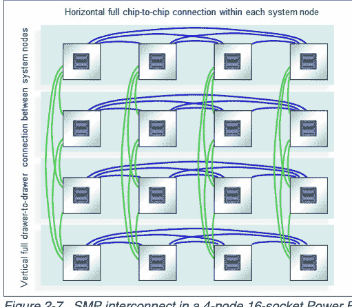

图 2-7 4 节点 16 插槽 Power E1080 系统中的 SMP 互连

从图 2-7 所示的图中可以很容易推断出，每个插槽直接连接到系统节点内的任何其他插槽，并且只需一个中间插槽即可从一个芯片到达另一个 CEC 抽屉中的任何其他芯片。

### 2.1.12 电源和性能管理

基于 Power10 处理器的服务器实现了增强版的电源管理 EnergyScale 技术。与之前的 POWER9 EnergyScale 实现一样，Power10 EnergyScale 技术支持动态处理器频率变化，该变化取决于多个因素，例如工作负载特征、活动核心数量和环境条件。

基于过去几年积累的丰富经验，Power10 EnergyScale 技术演进为使用以下有效且简化的操作模式集合：

- 节电模式
- 静态模式（标称频率）
- 最大性能模式（MPM）

POWER9 动态性能模式（DPM）与 POWER9 最大性能模式（MPM）具有许多共同特性。由于这种特性的冗余性，Power10 处理器系统的 DPM 被移除，转而采用增强的 MPM。例如，最大频率现在可以在 Power10 增强最大性能模式下实现（无论活动核心数量如何），而在基于 POWER9 处理器的服务器上并非总是如此。

基于 Power10 处理器的 Power E1080 系统默认启用 MPM。该模式动态调整处理器频率以最大化性能并实现更高的处理器频率范围。每个节电模式在满足标称运行环境限制时都能提供一致的系统性能而无任何变化。

对于受 PowerVM Hypervisor 控制的基于 Power10 处理器的系统，MPM 是系统范围的配置设置，但每个处理器模块频率单独优化。

以下因素决定处理器模块可运行的最大频率：

- 处理器利用率：负载越轻，频率越高。
- 活动核心数量：活动核心越少，频率越高。
- 环境条件：在较低环境温度下，核心可运行在更高频率。

以下 Power10 EnergyScale 模式可用：

- 节电模式
  频率设置为最低频率以降低能耗。启用此功能可通过将处理器时钟频率和电压降低到固定值来减少功耗。此配置在提供可预测性能的同时降低了系统的功耗。
- 静态模式
  频率设置为可在所有正常工作负载和所有正常环境条件下维持的固定点。该频率也称为标称频率。
- 最大性能模式
  工作负载以尽可能高的频率运行，具体取决于工作负载、活动核心数量和环境条件。在所有正常工作负载和所有正常环境条件下，频率不会低于静态频率。

在 MPM 中，工作负载以尽可能高的频率运行。更高的功耗使处理器模块能够在 MPM 典型频率范围（MTFR）内运行，其下限远高于标称频率，上限由系统的最大频率给出。

如果特定 Power10 系统默认以 MPM 运行，则 MTFR 会作为系统规格的一部分发布。更高的功耗可能会增加相应系统节点的风扇转速以满足更高的散热需求，进而导致噪音排放水平增加高达 15 分贝。

处理器频率通常保持在 MTFR 设定的限制范围内，但在高于 27 °C（80.6 °F）的高环境温度下，可降低至 MTFR 下限与标称频率之间的频率。如果数据中心环境温度低于 27 °C，则 MPM 中的频率始终处于 MTFR 的上部范围（比标称频率高约 10% - 20%）。在较低环境温度（低于 27 °C，或 80.6 °F）下，MPM 模式还提供确定性性能。随着环境温度升高超过 27 °C，确定性已无法保证。此模式是 Power E1080 的默认模式。

- 空闲节电模式（IPS）

IPS 模式在整个系统（所有插槽的所有核心）空闲时将频率降低到最低。它可以独立于所有其他模式启用或禁用。Power E1080 不支持此模式。

图 2-8 显示了 Power10 节电模式、静态或标称模式和最大性能模式的比较频率范围。不同工作负载特征、环境条件和空闲状态的频率调整也已标出。

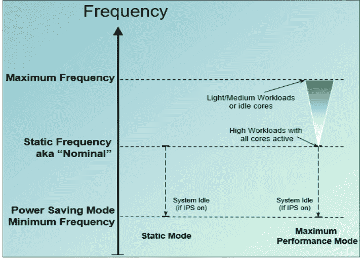

图 2-8 Power10 电源管理模式及相关频率范围

### 表 2-4 Power E1080 服务器的特征频率和频率范围

| Feature code | Cores per single-chip module | Power saving mode frequency [GHz] | Static mode frequency [GHz] | Maximum performance mode frequency range [GHz] |
|---|---|---|---|---|
| EDP2 | 10 | 3.25 | 3.65 | 3.65 to 3.90 GHz (max) |
| EDP3 | 12 | 3.40 | 3.60 | 3.60 to 4.15 GHz (max) |
| EDP4 | 15 | 3.25 | 3.55 | 3.55 to 4.00 GHz (max) |

对于 Power E1080 服务器，默认启用 MPM。

所有节电模式的控制均可在高级系统管理接口（ASMI）上使用并可动态修改。系统管理员还可以使用硬件管理控制台（HMC）设置节电模式或启用静态模式或 MPM。

图 2-9 显示了 Power E1080 服务器上电源和性能模式设置的 ASM 接口菜单。

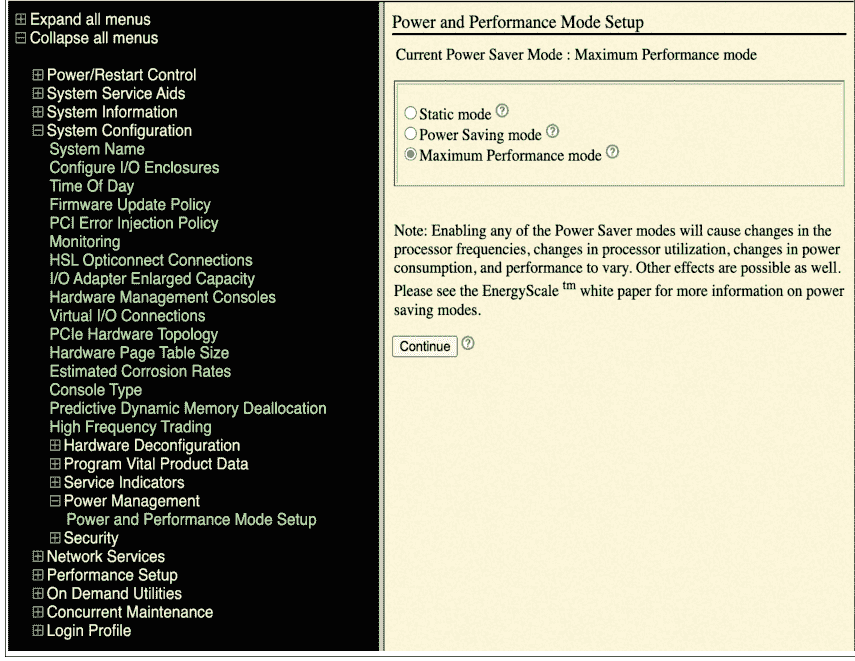

图 2-9 Power E1080 ASMI 菜单用于电源和性能模式设置

图 2-10 显示了电源和性能模式设置的 HMC 菜单。

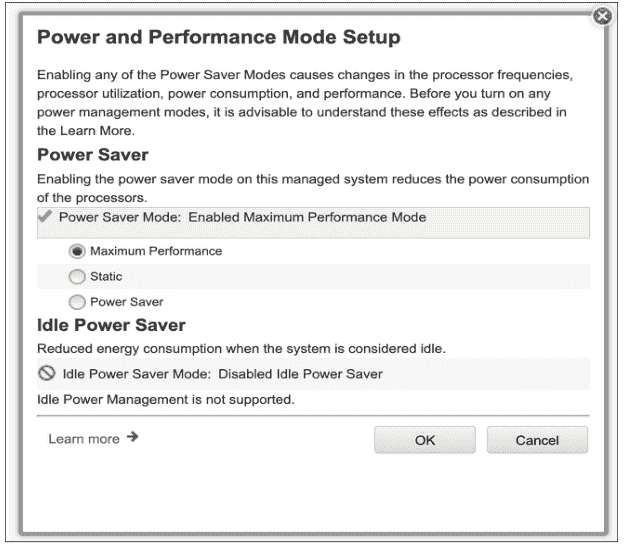

图 2-10 Power E1080 HMC 菜单用于电源和性能模式设置

### 2.1.13 比较 Power10、POWER9 和 POWER8 处理器

Power E1080 企业级系统 exclusively 使用单芯片模块（SCM），最多 15 个活动 SMT8 核心。这些 SCM 处理器模块在结构和性能上针对扩展多插槽系统中的使用进行了优化。

### 表 2-5 Power10 处理器技术与之前处理器世代的比较

| Characteristics | Power10 | POWER9 | POWER8 |
|---|---|---|---|
| Technology | 7 nm | 14 nm | 22 nm |
| Die size | 602 mm² | 693 mm² | 649 mm² |
| Processor module size | 68.5 mm x 77.5 mm | 68.5 mm x 68.5 mm | 71.5 mm x 71.5 mm |
| Number of transistors | 18 billion | 8 billion | 4.2 billion |
| Maximum cores | 15 | 12 | 12 |
| Maximum hardware threads per core | 8 | 8 | 8 |
| Maximum static frequency / high performance frequency range | 3.75 - 4.15 GHz | 3.9 - 4.0 GHz | 4.15 GHz |
| L2 Cache per core | 2048 KB | 512 KB | 512 KB |


| 特性 | Power10 | POWER9 | POWER8 |
|---|---|---|---|
| L3 缓存 | 每个核心 8 MB L3 缓存，每个核心可访问完整的 120 MB L3 缓存，片上高效率 SRAMᵃ | 每个核心 10 MB L3 缓存，每个核心可访问完整的 120 MB L3 缓存，片上 eDRAMᵇ | 每个核心 8 MB L3 缓存，每个核心可访问完整的 96 MB L3 缓存，片上 eDRAM |
| 支持的内存技术 | DDR4ᶜ | DDR4 和 DDR3ᵈ | DDR3 和 DDR4 |
| I/O 总线 | PCIe Gen 5 | PCIe Gen 4 | PCIe Gen 3 |

a. 静态随机存取存储器
b. 嵌入式动态随机存取存储器
c. Power10 处理器内存逻辑和 Power E1080 内存子系统可以使用 DDR5 技术 DIMM。
d. 仅支持在从 Power E870、Power E870C、Power E880 或 Power E880C 系统升级到 Power E980 服务器的模型升级过程中转移的 DDR3 内存 CDIMM。

### 2.2 SMP 互连

系统节点抽屉中的四个 Power10 处理器芯片中的每一个都通过 SMP OP 总线直接连接到每个其他系统节点抽屉中相同位置的 Power10 处理器芯片。任意两个系统节点抽屉之间的每个 OP 总线连接使用一对电缆进行连接，每根电缆承载数据通道的一半。

Power System E980 SMP 电缆不能在 Power E1080 上使用，因为基于 Power10 处理器的服务器使用不同的一组电缆。

图 2-11 显示了系统节点抽屉中每个 Power10 处理器插座如何将总线路由到机箱后部的尾架。第一个插座中的 Power10 处理器芯片（参见图 2-11 中的处理器芯片插座 #0）使用端口 T0 和 T1 用于 OP6 总线连接（参见图 2-11 中的左上角）。

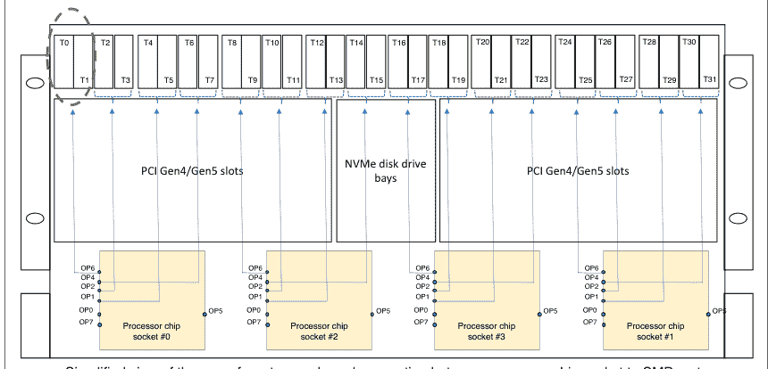

图 2-11 从处理器芯片插座到 SMP 外部端口的逻辑连接

每个 Power10 处理器芯片插座对外提供四个 SMP/OpenCAPI 总线：

- OP6：SMP 或 OpenCAPI
- OP2：仅 SMP
- OP1：仅 SMP
- OP4：SMP 或 OpenCAPI

相同的电缆用于两种不同的模式：

- 用于互连系统节点抽屉的 SMP
- OpenCAPI

每根电缆包含 9 个位通道：

- SMP 模式使用九个可用通道中的九个
- OpenCAPI 模式使用九个通道中的八个

#### 2.2.1 双系统节点抽屉 OP 总线连接

在双系统抽屉配置中，两个 OP 总线在两个抽屉之间互连处理器。图 2-12 显示了使用正确的一组电缆，通过 SMP 端口在第一个系统节点抽屉与第二个系统节点抽屉之间建立的所有连接。

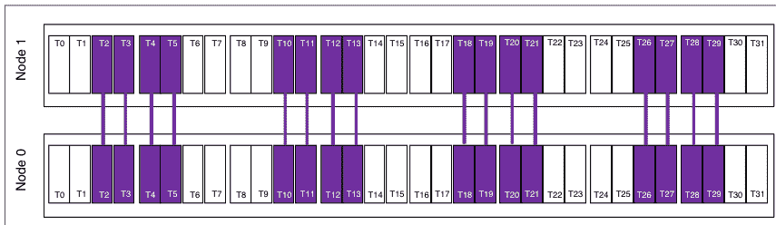

图 2-12 双系统节点抽屉 SMP 连接

每根电缆的长度为 775 mm（2.5 ft.），其胶带颜色为紫色。如图 2-12 所示，此配置需要 16 根电缆。

#### 2.2.2 SMP 电缆 RAS 属性

每个 SMP 总线有 18 个通道，并分为两根单独的电缆，每根电缆有九个通道。每个 SMP 电缆上使用一个 SMP 备用通道（八个通道用于数据，一个通道作为备用）。如果两根 SMP 电缆之一发生故障，所有流量都将路由到剩余的一根电缆，从而使带宽减半。

Power E1080 支持外部 SMP 电缆的并发修复；因此，更换外部 SMP 电缆时无需关闭整个服务器。

并发修复过程使系统能够在不中断系统的情况下将 OP 总线恢复到全功能状态。

### 2.3 内存子系统

Power E1080 服务器使用下一代差分双列直插内存模块（DIMMs），这是一种高性能、高可靠性、高功能内存卡，包含缓冲芯片、智能和 2933/3200 MHz DRAM 内存。

使用 DDR4 技术提供 2933/3200 MHz DRAM 内存。DDIMM 放置在系统节点的 DDIMM 插槽中。

每个 Power10 芯片内存控制器单元（MCU）提供片上 SMP 互连结构与 OpenCAPI 内存接口（OMI）链路之间的系统内存接口。逻辑上每个芯片上有八个基本独立的 MCU 通道，接口到总共 16 条高速 OMI 链路。

每个内存通道支持两条 OMI 链路（称为子通道 A 和 B），如图 2-13 第 73 页所示，该图还显示了与相关子通道、通道和内存控制器单元关联的内存插槽位置。

所有 16 个 OMI 子通道都来自 Power10 SCM，并布线到 16 个基于内存缓冲器的 DDIMM 插槽，每个 OMI 子通道连接一个 DDIMM。

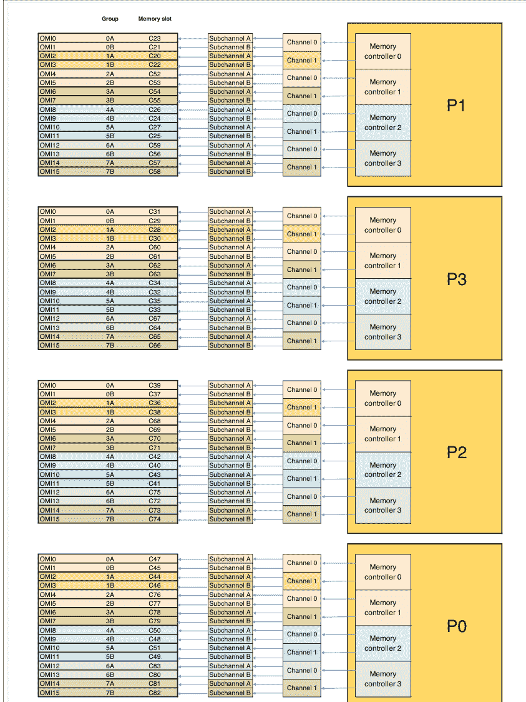

图 2-13 内存子系统逻辑图

每个 Power10 处理器芯片支持 16 个 DDIMM；因此，每个 Power E1080 CEC 抽屉最多可支持 64 个 DDIMM，可支持高达 16 TB 的内存 RAM 容量。

Power E1080 支持的 DDIMM 密度为 32 GB、64 GB、128 GB 和 256 GB，任何内存功能代码均提供四个 DDIMM。DDIMM 具有自己的电压调节器，并且为 n+1 冗余。使用两个 PMIC 加上两个备用。

需要两个电源管理 IC（PMIC）为 DDIMM 供电所需的所有电压等级。在 DDIMM 上，使用四个 PMIC，由两个冗余对组成。如果每个冗余对中的一个 PMIC 仍可运行，则不会要求更换 DDIMM。

如 1.5.3 节“内存功能”第 19 页所述，Power E1080 要求激活 50% 或更多已安装的物理内存。

PowerVM Hypervisor 提供主动内存镜像，旨在确保系统操作继续进行（即使在主内存中发生不可纠正错误的不太可能情况下）。

#### 2.3.1 内存带宽

Power10 单芯片模块（SCM）支持 16 条开放内存接口（OMI）链路，每条 OMI 链路依次驱动一个差分 DIMM（DDIMM）。一条 OMI 链路代表 8 个通道的捆绑，因此能够在一笔交易中传输 8 字节。

Power E1080 提供四种不同的 DDIMM 尺寸：32 GB、64 GB、128 GB 和 256 GB。32 GB 和 64 GB DDIMM 以 3200 Mbps 的数据速率运行；128 GB 和 256 GB DDIMM 以 2933 Mbps 的数据速率运行。

表 2-6 列出了可用的 DDIMM 容量及其相关的每条 OMI 链路和每个 Power10 SCM 的最大理论带宽。

表 2-6 支持的 DDIMM 尺寸的内存带宽

| DDIMM 容量 | 数据速率 | 每条 OMI 链路的最大理论带宽 | 每个 SCMᵃ 的最大理论带宽 |
|---|---|---|---|
| 32 GB / 64 GB | 3200 Mbps | 25.6 GBps | 409.6 GBps |
| 128 GB / 256 GB | 2933 Mbps | 23.5 GBps | 375.4 GBps |

a. 连接到一个 SCM 的 DDIMM 模块必须全部为相同尺寸

**重要提示：** 为了获得最佳性能，通常建议在所有内存插槽中安装内存，并在所有系统节点抽屉和系统中的所有 SCM 上均匀分布。

在已安装的系统平面卡上平衡内存可以以一致的方式实现内存访问，通常会为您的配置带来更好的性能。

主动内存扩展（AME）功能是一个选项，可以增加系统的有效内存容量。AME 使用片上嵌套加速器（NX）单元压缩或解压缩内存内容。此单独定价的硬件功能在分区（LPAR）级别启用。相关的 LPAR 配置文件参数允许根据内存容量需求和性能权衡考虑来配置压缩因子。

#### 2.3.2 内存放置规则

在 Power E1080 单节点系统中，每个 SCM 必须填充 16 个内存 DDIMM 插槽中的八个。仅支持四的倍数增量，所有这些容量相同。这四个 DDIMM 必须全部插入连接到 SCM 的八个剩余插槽中的四个。

DDIMM 不能以导致 SCM 后方有奇数个 DDIMM 插槽被填充的方式安装。DDIMM 也不能以导致 SCM 后方填充 10 或 14 个 DDIMM 插槽的配置安装。连接到特定 SCM 的插槽中插入的 DDIMM 的唯一有效数量是 8、12 或 16。

Power E1080 系统必须遵守以下 DDIMM 插拔规则：

- 允许的最小内存为 1 TB（参见 1.5.1“最小配置”第 15 页）。
- 每个 SCM 下的所有 DDIMM 必须具有相同的容量。
- DDIMM 必须以四的组（四组）插入。
- 每个 DDIMM 四组必须全部为相同尺寸和类型（彼此相同），并且必须与每个 SCM 下的其他 DDIMM 四组相同，但可以与其他 SCM 的 DDIMM 四组不同。

例如，在一个系统节点配置中：

- 第一个 SCM 可以连接到 8x32 GB DDIMMS
- 第二个 SCM 可以连接到 8x64 GB DDIMMS
- 第三个 SCM 可以连接到 8x128 GB DDIMMS
- 第四个 SCM 可以连接到 8x256 GB DDIMMS

当所有四组彼此匹配时，整体系统性能会提高。上一代服务器的物理内存功能不能迁移到 Power E1080。

为了获得最佳性能，通常建议在所有内存插槽中安装内存，并在所有系统节点抽屉和所有 SCM 上均匀分布。

在已安装的系统平面卡上平衡内存可以以一致的方式实现内存访问，通常会为您的配置带来更好的性能。

您必须在决定初始系统订购时使用的内存功能尺寸时考虑任何未来的内存升级计划。

最小内存的插拔顺序

Power E1080 抽屉至少需要 32 个 DDIMM。每个 SCM 需要两个 DDIMM 四组。

在两个内存控制器之间均匀分布 DDIMM 可提供最大性能。每个四组内的 DDIMM 必须为相同尺寸和类型，并且每个 SCM 下的所有 DDIMM 必须具有相同容量。

一个 DDIMM 四组可以与别处插入的 DDIMM 四组不同。

请按照以下顺序插入 32 个 DDIMM，并以第 73 页的图 2-13 为参考：

- C20、C21、C22、C23、C24、C25、C26、C27（连接到 SCM P1 的插槽）
- C28、C29、C30、C31、C32、C33、C34、C35（连接到 SCM P3 的插槽）
- C36、C37、C38、C39、C40、C41、C42、C43（连接到 SCM P2 的插槽）
- C44、C45、C46、C47、C48、C49、C50、C51（连接到 SCM P0 的插槽）


## 剩余 DDIMM 的插接顺序

对于 Power E1080 抽屉，本节描述了下一个 DDIMM 四件套的顺序和规则。

对于要安装在连接到四个 pSCM 之一的插槽中的下一个 DDIMM 四件套，请考虑以下规则：

- 每个四件套内的 DDIMM 必须具有相同的尺寸和类型。
- 每个 SCM 下的所有 DDIMM 必须具有相同的容量。
- DDIMM 四件套可以与别处插入的 DDIMM 四件套不同，包括连接到同一 SCM 的另一个四件套。
- 将剩余的 DDIMM 四件套插入任何剩余的空 DIMM 插槽四件套中，并且每个 SCM 下的所有 DDIMM 必须具有相同的容量

请遵守以下顺序并以第 73 页的图 2-13 为参考：

- C52、C53、C54、C55（连接到 SCM P1 的插槽）或
- C60、C61、C62、C63（连接到 SCM P3 的插槽）或
- C68、C69、C70、C71（连接到 SCM P2 的插槽）或
- C76、C77、C78、C79（连接到 SCM P0 的插槽）或
- C56、C57、C58、C59（连接到 SCM P1 的插槽）或
- C64、C65、C66、C67（连接到 SCM P3 的插槽）或
- C72、C73、C74、C75（连接到 SCM P2 的插槽）或
- C80、C81、C82、C83（连接到 SCM P0 的插槽）

> 注意：在多系统节点配置中，抽屉可以完全填充。其他抽屉可以部分填充或所有抽屉对称填充。

### 2.4 按需容量

从 IBM Power Systems Private Cloud with Shared Utility Capacity（Power Enterprise Pools 2.0）开始，Power E1080 服务器上提供多种类型的服务，以帮助在按需环境中满足不断变化的资源需求，使用已安装在系统上但未激活的资源。

有关 CoD 激活码的更多信息，请参阅 Power Systems Capacity on Demand。

#### 2.4.1 新的按需容量功能

Power E1080 服务器具有与 Power E980 服务器提供的类似功能，但有一些变化：

- 使用 IBM Power Systems Private Cloud with Shared Utility Capacity（Power Enterprise Pools 2.0）配置时，可以订购仅具有一个基本处理器激活和 256 GB 基本内存激活的 Power E1080 服务器。当使用 Power Enterprise Pools 2.0 配置时，所有资源都已激活；因此，其他 CoD 功能不受支持。
- 不使用 IBM Power Systems Private Cloud with Shared Utility Capacity 配置时：
  - 每个 Power System E1080 服务器需要至少 16 个永久处理器核心激活，使用静态激活或 Linux on Power 激活。其余核心可通过额外功能永久或临时激活。
  - 必须对已安装内存容量的至少 50% 进行激活。这些激活可以是静态的、移动的或 Linux on Power。
  - 内存容量的至少 25% 必须具有静态激活或 Linux on Power 激活。
  - Power E1080 服务器可以与 Power E980 服务器一起参与同一个 IBM Power Enterprise Pool 1.0，但不能与 Power E870C、Power E880 和 Power E880C 服务器一起参与。
  - CUoD、预付弹性按需容量（4586-COD）和试用按需容量（Trial CoD）可与 Power E1080 服务器一起使用。
  - 实用按需容量（Utility CoD）在 Power E1080 服务器上不受支持。
  - 后付弹性 CoD 服务在 Power E1080 服务器上不可用。
  - 企业容量备份（CBU）服务在 Power E1080 服务器上不可用。
  - Mobile-Enabled 激活在 Power E1080 服务器上不可用。

#### 2.4.2 IBM Power Systems Private Cloud with Shared Utility Capacity

IBM Power Systems Private Cloud with Shared Utility Capacity 解决方案（Power Enterprise Pools 2.0）是一种基础设施提供模式，可通过按使用付费的定价实现云敏捷性和成本优化。

池中系统的所有已安装处理器和内存都已激活，并在池启动时可供立即使用。每个服务器上的处理器和内存使用情况按分钟跟踪并在整个池中汇总。

该模型中的容量由基本激活和容量积分组成，这些容量积分在池中共享，无需在服务器之间移动。池中未购买的容量可以按需付费使用。

超过池汇总基本资源的资源使用量按分钟计费为计量容量。它还实时从购买的容量积分中扣除，如图 2-14 所示。

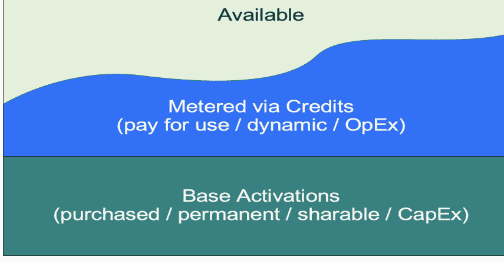

图 2-14 IBM Power Systems Private Cloud with Shared Utility Capacity

IBM Power Systems Private Cloud with Shared Utility Capacity 解决方案仅支持特定 POWER9 和 Power10 处理器系统的系统。Power E1080 服务器可以与同一池中的 Power E980 系统共存。

单个 Power Enterprise Pool 2.0 支持多达 2000 个 VM；每个 HMC 支持多达 1000 个 VM。截至本文撰写时，每个 Power E1080 服务器支持多达 200 个 VM，预计将增加到每个 Power E1080 750 个 VM。

除了处理器和内存计量外，Power Enterprise Pools 2.0 还支持在池中计量 AIX 和 IBM i 软件授权以及 SLES 和 RHEL 订阅。

有关更多信息和要求，请参阅 IBM Power Systems Private Cloud with Shared Utility Capacity，SG24-8478。

#### 2.4.3 静态、移动和基本激活

静态处理器和内存激活仅限于单个系统。它们是通过在管理系统的 HMC 中输入代码来启用的。额外的核心或内存可立即供系统上的工作负载使用。

静态激活有两种版本：

- 静态激活：此标准处理器或内存激活可运行 VIOS、AIX、IBM i 和 Linux 工作负载
- 适用于 Linux 的静态激活：此处理器或内存激活只能运行 VIOS 和 Linux 工作负载

移动激活针对特定服务器订购，但可以移动到 Power Enterprise Pool 1.0 中的任何服务器并支持任何类型的应用程序。移动激活可以在初始订单中购买，也可以用 MES 升级购买。

基本处理器和内存激活与单个系统相关联，最初充当静态激活。当系统添加到 Power Enterprise Pools 2.0 配置时，其所有基本激活都将添加到池的基本容量中。

处理器和内存资源的基本激活有以下类型：

- 基本激活：此处理器或内存激活可运行 VIOS、AIX、IBM i 和 Linux 工作负载。最初，基本激活就像静态激活一样，直到系统添加到 Power Enterprise Pool 2.0。静态和移动激活可以通过 MES 订单转换为基本激活。
- 适用于 Linux 的基本激活：此基本处理器激活只能运行 VIOS 和 Linux 工作负载。

表 2-7 列出了可在 Power E1080 服务器上初始订购的静态、移动和基本处理器激活功能。

表 2-7 静态、移动和基本处理器激活功能

| 处理器功能 | EDP2（3.65 - 3.90 GHz 40 核） | EDP3（3.60 - 4.15 GHz 48 核） | EDP4（3.55 - 4.00 GHz 60 核） |
|---|---|---|---|
| 静态激活 | EDPB | EDPC | EDPD |
| 适用于 Linux 的静态激活 | ELCL | ELCQ | ELCM |
| 基本激活 | EPDC | EPDD | EPDS |
| 适用于 Linux 的基本激活 | EPDU | EPDW | EPDX |
| 移动激活 | EDPZ | EDPZ | EDPZ |

表 2-8 列出了可在 Power E1080 服务器上初始订购的静态、移动和基本内存激活。

表 2-8 静态、移动和基本内存激活功能

| 功能代码 | 描述 |
|---|---|
| EMAZ | 1 GB 内存激活 HEX - 静态 |
| EMQZ | 100 GB 内存激活 HEX - 静态 |
| EMBZ | 512 GB 内存激活 HEX - 静态 |
| ELME | 512 GB 适用于 Linux on Power HEX 的内存激活 - 静态 |
| EDAG | 256 GB Pools 2.0 的基本内存激活 |
| EDAH | 512 GB Pools 2.0 的基本内存激活 |
| EDAB | 100 GB DDR4 移动内存激活 HEX |
| EMBK | 500 GB DDR4 移动内存激活 HEX |

#### 2.4.4 按需容量升级

Power E1080 服务器包括多个活动处理器核心和内存单元。它还可能包括非活动处理器核心和内存单元。

活动处理器核心或内存单元是在服务器从制造商处交付时可供您服务器使用的处理器核心或内存单元。非活动核心或单元是随服务器一起提供但在您激活它们之前不可使用的处理器核心或内存单元。

非活动处理器核心和内存单元可以通过购买名为 CUoD 的激活功能并在服务器的 HMC 上输入提供的激活代码来永久激活。

使用 CUoD 服务，您可以购买更多静态处理器或内存容量并在不重新启动服务器或中断业务的情况下动态激活它们。所有静态处理器或内存激活都仅限于单个服务器。

CUoD 具有多种优势，可实现更灵活的环境。一个优势是减少系统初始投资。使用其他技术进行的传统项目意味着系统必须配备支持整个项目生命周期的所有资源。因此，您在项目后期阶段甚至可能永远不需要的容量上提前支付，这会影响软件许可成本和软件维护。

通过使用 CUoD，公司从具有足够已安装资源以支持整个项目生命周期的系统开始，但仅使用初始项目阶段所需的活动资源。随着项目的进行，可以通过按需激活资源来添加资源。因此，公司可以减少硬件的初始投资，并在每个项目阶段需要时才获取软件许可证，从而降低解决方案的总拥有成本（TCO）和总采购成本（TCA）。


Figure 2-15 shows a comparison between two scenarios: a fully activated system versus a system with CUoD resources being activated along the project timeline.


Figure 2-15 Active cores scenarios comparison during a project lifecycle

### 2.4.5 Elastic Capacity on-Demand (Temporary)

With the Elastic CoD offering, you can temporarily activate and deactivate processor cores and memory units to help meet the demands of business peaks, such as seasonal activity, period-end, or special promotions. When you order an Elastic CoD feature, you receive an enablement code that allows a system user to make requests for more processor and memory capacity in increments of one processor day or 1 GB memory day. The system monitors the amount and duration of the activations. With Power E1080 server, only the prepaid Elastic Capacity on-Demand option is available with feature code 4586-COD in econfig or directly from ESS.

Processors and memory can be activated and turned off an unlimited number of times when more resources are needed.

This offering provides a system administrator an interface at the HMC to manage the activation and deactivation of resources. Before temporary capacity is used on your server, you must enable your server. To enable your server, an enablement feature (MES only) must be ordered and the required contracts must be in place. The 90-day enablement feature is not available for the Power E1080 processors.

For more information about enablement and usage of Elastic CoD, see Power Systems Capacity on Demand.

### 2.4.6 IBM Power Enterprise Pools 1.0 and Mobile Capacity on-Demand

Although static activations are valid for a single system, some customers might benefit from moving processor and memory activations to different servers because of workload rebalance or disaster recovery.

IBM Power Enterprise Pools 1.0 is a technology for dynamically sharing processor and memory activations among a group (or pool) of IBM Power Systems servers. By using Mobile Capacity on-Demand (CoD) activation codes, the systems administrator can perform tasks without contacting IBM.

With this capability, you can move resources between Power E1080 and Power E980 systems and have unsurpassed flexibility for workload balancing and system maintenance.

Note: Only two consecutive generation of Power servers are supported in the same Power Enterprise Pools 1.0; therefore, Power E1080 can be mixed with Power E980 servers only.

The supported Power Enterprise Pool 1.0 members are listed by pool type in Table 2-9.

Table 2-9 Supported Power Enterprise Pool 1.0 members by pool type

| Power Enterprise Pool type | Pool members |
|---|---|
| Midrange Power Enterprise Pool 1.0 | 770+, E870, E870C, E880C |
| High-end Power Enterprise Pool 1.0 | 780+, 795, E880, E870C, E880C |
| Power Enterprise Pool 1.0 | E870, E880, E870C, E880C, E980 |
| Power Enterprise Pool 1.0 (with Power E1080) | E980, E1080 |

A pool can support systems with different clock speeds or processor generations.

Mobile Capacity on Demand (Mobile CoD) features the following basic rules:

- The Power E1080 server requires a minimum of 16 static processor activations.
- The Power E980 server requires a minimum of eight static processor activations.
- For all systems, 50% of the installed memory must have activations, and a minimum of 25% of those must be static activations.

An HMC can manage multiple IBM Power Enterprise Pools and systems that are not part of an IBM Power Enterprise Pool. Systems can belong to only one IBM Power Enterprise Pool at a time. Powering down an HMC does not limit the assigned resources of participating systems in a pool, but does limit the ability to perform pool change operations.

After an IBM Power Enterprise Pool is created, the HMC can be used to perform the following tasks:

- Mobile CoD processor and memory resources can be assigned to systems with inactive resources. Mobile CoD resources remain on the system to which they are assigned until they are removed from the system.
- New systems can be added to the pool and existing systems can be removed from the pool.
- New Mobile CoD processor and memory resources can be added to the pool.
- Pool information can be viewed, including pool resource assignments, compliance, and history logs.

For the mobile activation features to be configured, an IBM Power Enterprise Pool and the systems that are going to be included as members of the pool must be registered with IBM. Also, the systems must have #EB35 for mobile enablement configured, and the required contracts must be in place.

> **Note:** The following convention is used in the Order type column in the tables in this section:
> - Initial: Only available when ordered as part of a new system
> - MES: Only available as a Miscellaneous Equipment Specification (MES) upgrade
> - Both: Available with a new system or as part of an upgrade
> - Supported: Unavailable as a new purchase, but supported when migrated from another system or as part of a model conversion

Table 2-10 lists the mobile processor and memory activation features that are available for the Power E1080 server.

### Table 2-10 Mobile activation features

| Feature code | Description | Maximum | Orderᵃ type |
|---|---|---|---|
| EDAB | 100 GB Mobile Memory activation for HEX | 480 | Both |
| EMBK | 500 GB Mobile Memory activation for HEX | 130 | Both |
| EDPZ | Mobile processor activation for HEX | 224 | Both |

a. For more information about order types, see 2.4, “Capacity on-demand” on page 76.

For more information about IBM Power Enterprise Pools, see *Power Enterprise Pools on IBM Power Systems*, REDP-5101.

### 2.4.7 Utility Capacity on-Demand

Utility CoD is *not* supported on Power E1080 server.

### 2.4.8 Trial Capacity on-Demand

A *standard request* for Trial CoD requires you to complete a form that includes contact information and vital product data (VPD) from your Power E1080 server with inactive CoD resources.

A standard request activates eight processors or 64 GB of memory for 30 days. Subsequent standard requests can be made after each purchase of a permanent processor activation. An HMC is required to manage Trial CoD activations.

An *exception request* for Trial CoD requires you to complete a form that includes contact information and VPD from your Power E1080 server with inactive CoD resources. An exception request activates all inactive processors or all inactive memory (or all inactive processor and memory) for 30 days. An exception request can be made only once over the life of the machine. An HMC is required to manage Trial CoD activations.

To request either a Standard or an Exception Trial, see Power Systems Capacity on Demand: Trial Capacity on Demand.

### 2.4.9 Software licensing and CoD

For software licensing considerations for the various CoD offerings, see the most recent revision of the Power Systems Capacity on Demand User’s Guide.

### 2.5 Internal I/O subsystem

This section provides more information about the internal PCIe architecture of the Power E1080 system.

#### 2.5.1 Internal PCIe Gen 5 subsystem and slot properties

The internal I/O subsystem on the Power E1080 server is connected to the PCIe Gen 5 controllers on a Power10 chip in the system. Each Power10 processor module has two PCIe host bridges (PHBs). The PHBs (PHB0 and PHB1) have 16 PCIe lanes each.

The PHBs provide different type of end point connections. Both the PHBs from Power10 sockets P0 and P1 and one PHB from sockets P2 and P3 connect directly to a PCIe Gen 4 x16 or PCIe Gen 5 x8 slot to provide six PCIe Gen 4 x16 or PCIe Gen 5 x8 slots per system node.

The second PHB on each Power10 socket P2 and P3 is split between a PCIe Gen 5 x8 slot and two Internal Non-Volatile Memory Express (NVMe) SSD PCIe Gen 4 x4 slots. The design overall provides each system node of Power E1080 with:

- Six PCIe Gen 4 x16 or PCIe Gen 5 x8
- Two PCIe Gen 5 x8
- Four Internal Non-Volatile Memory Express (NVMe) SSDs, each using a PCIe Gen 4 x4 connection

Bandwidths for the connections are listed in Table 2-11.

Table 2-11 Internal I/O connection speeds

| Connection | Type | Speed (duplex) |
|---|---|---|
| PCIe adapter slot | PCIe Gen4 x16 | 64 GBps |
| PCIe adapter slot | PCIe Gen5 x8 | 64 GBps |
| NVMe slot | PCIe Gen4 x4 | 16 GBps |

The following theoretical maximum I/O bandwidths in each system node are available:

- Six PCIe Gen 4 x16 / PCIe Gen 5 x8 slots at 64 GBps = 384 GBps
- Two PCIe Gen 5 x8 Slots at 64 GBps = 128 GBps
- Four NVMe slots at 16 GBps = 64 GBps

Total of 576 GBps = 384 GBps + 128 GBps + 64 GBps.


Power E1080 系统节点的背面视图如图 2-16 和图 2-17 所示。

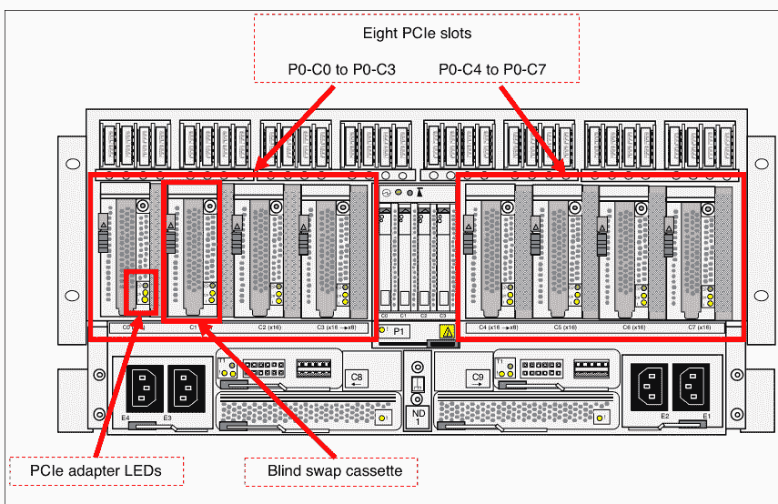

图 2-16 突出显示 PCIe 插槽的 Power E1080 服务器节点背面视图

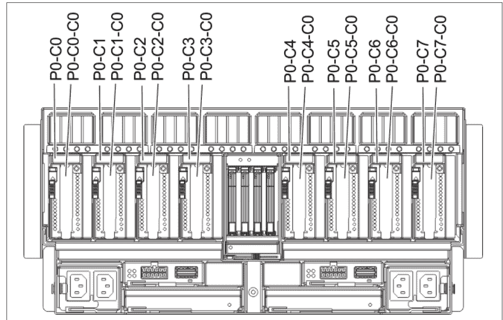

图 2-17 带 PCIe 插槽位置代码的 E1080 服务器节点背面视图

用于 Power E1080 服务器的适配器被封装在专门设计的适配器盒中。盒中包含一个用于将适配器固定在插座内的特殊机构，并有助于在服务器后侧的 PCIe 插槽中轻松插入和取出适配器。

盒的位置为 P0-C0 - P0-C7。适配器位置为 P0-C0-C0 - P0-C7-C0。

所有插槽均为低轮廓（LP）类型；即半高、半长（HHHL）。它们支持增强错误处理（EEH），并且可以在系统电源开启的情况下进行维护。插槽还支持 Gen 1 至 Gen 3 适配器。

所有 PCIe 插槽均支持单根 I/O 虚拟化（SR-IOV）适配器。

目前，没有任何适配器的功耗超过 25 瓦。要超过此限制需要特别考虑。

Power E1080 服务器支持 PCIe 适配器的并发维护（热插拔）。适配器盒配备了三个 LED，可指示电源和活动（绿色）、适配器（标记为 C0）的识别功能（琥珀色）以及盒的故障功能 LED（琥珀色）。服务器可以通过机箱上的蓝色识别 LED 进行定位。

内部连接如图 2-18 所示。

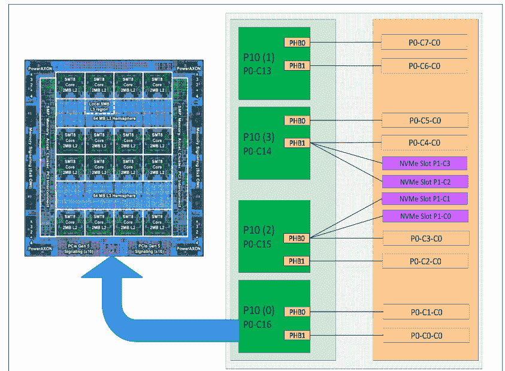

图 2-18 Power E1080 服务器节点到 PCIe 插槽内部连接示意图

PCIe 插槽编号为 P0-C0 - P0-C7。

Power E1080 服务器的插槽位置和描述列在第 86 页的表 2-12 中。

## 表 2-12 内部 PCIe 插槽编号和位置代码

| 位置代码 | 描述 | 插座 / PHB | 插槽编号 | SRIOV |
|---|---|---|---|---|
| P0-C0 | PCIe Gen 4 x16 或 PCIe Gen 5 x8 | P0/1 | 1 | Yes |
| P0-C1 | PCIe Gen 4 x16 或 PCIe Gen 5 x8 | P0/0 | 2 | Yes |
| P0-C2 | PCIe Gen 4 x16 或 PCIe Gen 5 x8 | P2/1 | 3 | Yes |
| P0-C3 | PCIe Gen 5 x8 | P2/0 | 4 | Yes |
| P1-C0 | PCIe Gen 4 x4 | P2/0 | NVMe Slot 1 | NA |
| P1-C1 | PCIe Gen 4 x4 | P2/0 | NVMe Slot 2 | NA |
| P1-C2 | PCIe Gen 4 x4 | P3/1 | NVMe Slot 3 | NA |
| P1-C3 | PCIe Gen 4 x4 | P3/1 | NVMe Slot 4 | NA |
| P0-C4 | PCIe Gen 5 x8 | P3/1 | 5 | Yes |
| P0-C5 | PCIe Gen 4 x16 或 PCIe Gen 5 x8 | P3/0 | 6 | Yes |
| P0-C6 | PCIe Gen 4 x16 或 PCIe Gen 5 x8 | P1/1 | 7 | Yes |
| P0-C7 | PCIe Gen 4 x16 或 PCIe Gen 5 x8 | P1/0 | 8 | Yes |

仅在 PCIe x16 插槽中支持 PCIe x16 卡，且插槽优先级为（1, 3, 7, 2, 6, 8）。

具有 x8 及以下通道的 PCIe 适配器可在所有 PCIe 插槽中使用，且插槽优先级为（1, 7, 3, 6, 2, 8, 4, 5）。

请先将 8x 和 16x 适配器放置在相同尺寸的插槽中，然后再混合连接器尺寸与插槽尺寸。较小的连接器允许用于较大的 PCIe 插槽尺寸，但较大的连接器与较小的 PCIe 插槽尺寸不兼容。

系统节点允许使用八个 PCIe 插槽，其中六个为 PCIe Gen4 x16 或 PCIe Gen5 x8 插槽，两个为 PCIe Gen5 x8 插槽。可以通过连接 PCIe 扩展抽屉来添加插槽；SAS 磁盘可以连接到 EXP24S SFF Gen2 扩展抽屉。在撰写本文时，仅支持以下扩展抽屉：

- EMX0 PCIe Gen3 I/O 扩展抽屉（#EMX0）
- EXP24SX I/O DASD 抽屉（#ESLS）

PCIe 扩展抽屉使用 #EJ24 适配器连接。EXP24S 存储机箱可以连接到系统节点或 PCIe 扩展抽屉上的 SAS 适配器。

有关适配器及其支持插槽的列表，请参阅第 92 页的 2.6，“支持的 PCIe 适配器”。

磁盘支持：直接安装在系统节点和 PCIe 扩展抽屉上的 SAS 磁盘不受支持。如果需要直接连接的 SAS 磁盘，则必须将其安装在 SAS 磁盘抽屉中并连接到 PCIe 插槽中受支持的 SAS 控制器之一。

建议将不需要高带宽的适配器放置在 EMX0 PCIe Gen 3 扩展抽屉中。将低带宽适配器放置在低延迟、高带宽插槽中并不是系统资源的最佳利用。

IBM 建议在系统包含 EMX0 PCIe Gen 3 扩展抽屉时使用所有适配器的高轮廓版本。此配置允许用户将大多数适配器放置在 EMX0 PCIe Gen 3 扩展抽屉内。通常建议使用节点插槽用于电缆适配器（#EJ24）或高带宽 PCIe Gen 4 或 PCIe Gen 5 适配器。

#### 2.5.2 内部 NVMe 存储子系统

Power E1080 支持 NVMe 存储技术。NVMe 子系统可在每个 E1080 服务器节点抽屉中使用。每个系统节点在系统后部中央均设有四个内部 NVMe U.2 驱动器插槽。插槽可以独立分配给任意分区（见图 2-19）。

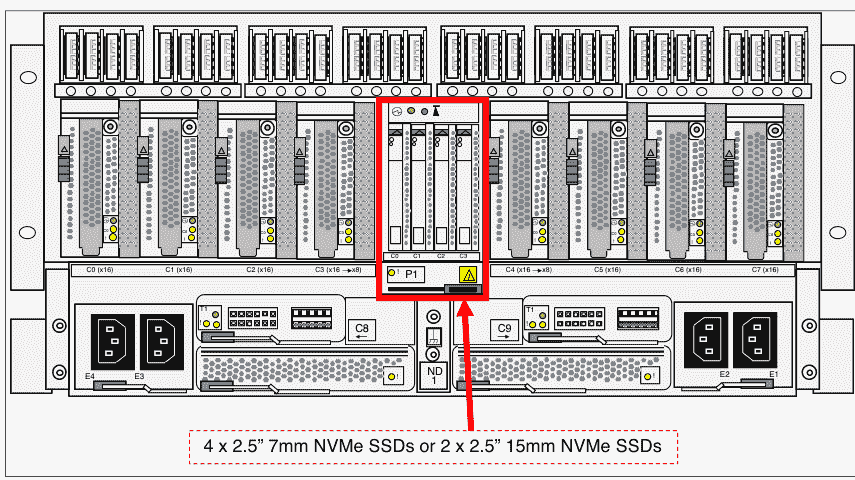

图 2-19 突出显示 NVMe 插槽的 E1080 服务器节点背面视图

截至撰写本文时，没有功能代码支持 IBM i 的内部 NVMe 子系统。这种情况下需要外部抽屉。

内部 7mm NVMe 设备仅支持一个命名空间。设备的主要用途是托管 Virtual I/O Servers。

系统节点中 NVMe U.2 驱动器的位置如图 2-20 第 88 页所示。

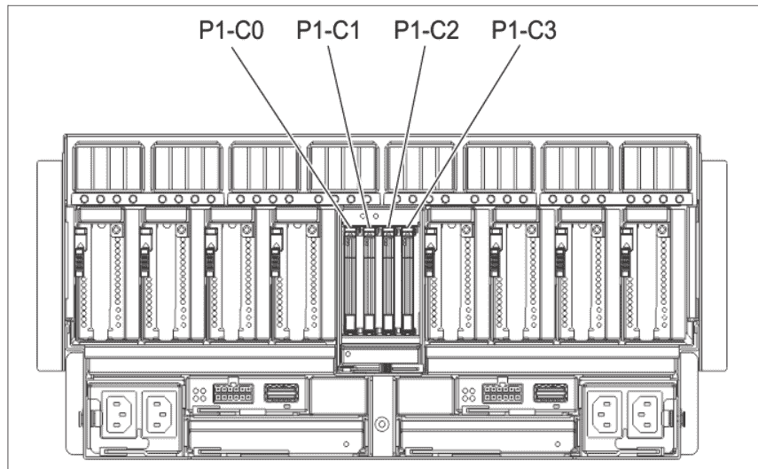

图 2-20 带 NVMe 插槽位置代码的 Power E1080 服务器节点背面视图

每个插槽均由 x4 PCIe 连接驱动，其中 2 个 SSD 连接到 P2 CPU 插座上的 PHB，2 个 SSD 连接到如图 2-18 第 85 页所示的 P3 CPU 插座的 PHB。总线通过系统平面从 CPU 路由到 NVMe 插槽接口卡，然后通过 SSD 升压卡向上路由并进入 SSD。

NVMe 插槽支持 U.2 NVMe 闪存 SSD 驱动器。可以使用的驱动器为四个 2.5 英寸 7 mm 规格 SSD 或两个 2.5 英寸 15 mm NVMe SSD。

如果选择 #EJBD 背板，则插槽位置 P1-C2 和 P1-C3 保持空置以留出 15 mm 选项的空间。

请仔细选择 NVMe SSD 驱动器的类型，因为某些驱动器仅用于启动驱动器和非数据密集型工作负载。

表 2-13 列出了截至撰写本文时可用的内部 NVMe 适配器功能代码。

## 表 2-13 可用的内部 NVMe SSD 功能代码

| 功能代码 | CCIN | 描述 | 最大值 | OS 支持 |
|---|---|---|---|---|
| EC5J | 59B4 | 主流 800 GB SSD NVMe U.2 模块 | 16 | AIX, and Linux |
| EC5K | 59B5 | 主流 1.6 TB SSD NVMe U.2 模块 | 16 | AIX, and Linux |
| EC5L | 59B6 | 主流 3.2 TB SSD NVMe U.2 模块 | 16 | AIX, and Linux |
| EC7Q | 59B4 | 800 GB 主流 NVMe U.2 SSD 4k for AIX/Linux | 16 | AIX, and Linux |

（#EC5J/#EC5K/#EC5L）- 800 GB/1.6 TB/3.2 TB 主流 SSD 的额定驱动写入每天（DWPD）次数有限，因此 intended 用于作为启动驱动器和非数据密集型工作负载使用。

### 内部 SSD 插拔顺序

出于冗余目的，如果存在，建议按以下方式在系统节点之间分配 NVMe 驱动器：

- 从节点 1 开始填充每个系统节点的 C0 插槽，然后如果存在其他节点，则填充其他 C0 插槽。
- 从节点 1 开始填充每个系统节点的 C2 插槽，然后如果存在其他节点，则填充其他 C2 插槽。
- 从节点 1 开始填充每个系统节点的 C1 插槽，然后如果存在其他节点，则填充其他 C1 插槽。
- 从节点 1 开始填充每个系统节点的 C3 插槽，然后如果存在其他节点，则填充其他 C3 插槽。

每个 NVMe U.2 驱动器在驱动器顶部有两个 LED，用于指示以下状态：

- 电源和活动 LED（绿色）
- 错误和识别功能 LED（琥珀色）。

系统中的 NVMe U.2 驱动器 LED 位置如图 2-21 所示。

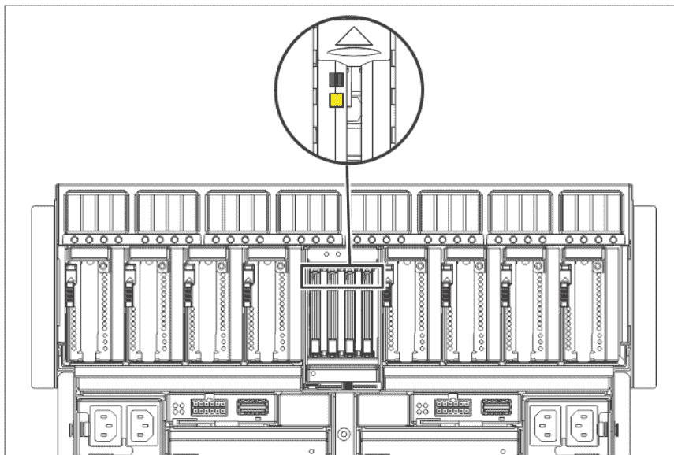

图 2-21 带 NVMe 插槽 LED 位置的 E1080 服务器节点背面视图

支持 NVMe 驱动器的并发维护。

您可以从拥有该设备的逻辑分区获取 NVMe 设备的剩余寿命。


要确定 NVMe 设备的剩余寿命，请完成以下步骤：

- 对于 IBM AIX 操作系统：
  a. 从 AIX 命令行输入 diag 并按 Enter。
  b. 从功能选择菜单中，选择任务选择 → NVMe 通用健康信息。
  c. 选择要检查剩余寿命的 NVMe 设备并按 Enter。
  d. 查看已使用的 NVM 子系统寿命百分比字段。

- 对于 Linux 操作系统。
  a. 从 Linux 命令行输入以下命令并按 Enter：
  `nvme smart-log /dev/nvmeX -H`
  其中 nvmeX 是 NVMe 设备的资源名称。
  b. 查看已使用百分比字段。

接近使用寿命末期的 NVMe 设备必须更换。设备很快将达到支持的写入操作次数限制。写入 NVMe 设备的操作会随着时间推移变慢，最终 NVMe 设备将成为只读设备。

当操作系统向只读设备写入数据时，写入操作将被拒绝，操作系统会将其视为发生故障。要支持正常的写入操作，必须更换 NVMe 设备。

#### 2.5.3 USB 子系统

Power E1080 在系统节点中没有集成 USB 控制器或端口。必须使用 USB PCIe 适配器来启用 USB 访问。系统节点支持 PCIe2 2 端口 USB 3.0 LP 适配器（#EC6J）。该适配器通常放置在系统节点 1 或节点 2 的 PCIe 插槽 4/5 中。

USB 电缆（#EC6N）用于将 #EC6J 适配器端口连接到系统控制单元（SCU）后侧的 USB 端口，该端口内部路由到 SCU 上的前面板可访问 USB 端口（见图 2-22）。

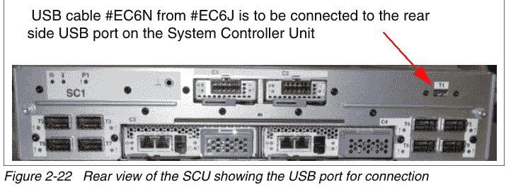

以下 USB 设备受支持并可用于 Power E1080：

- #EUA5 - 带电缆的独立 USB DVD 驱动器
- #EUA4 - RDX USB 外部停靠站

图 2-23 中显示了 SCU 的前面视图，其中突出显示了系统 USB 端口和 FSP USB 端口。

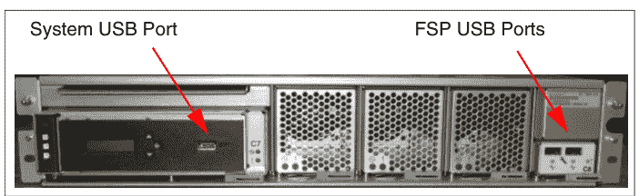

图 2-23 显示系统 USB 端口和 FSP USB 端口的 SCU 前视图

#### 2.5.4 PCIe 插槽功能

每个系统节点提供 8 个 PCIe Gen5 热插拔启用插槽；因此，1 节点系统提供八个插槽，2 节点系统提供 16 个插槽，3 节点系统提供 24 个插槽，4 节点系统提供 32 个插槽。

您可以在每个节点上连接多达四个 I/O 扩展抽屉功能 EMX0，其插槽容量如表 2-14 所列。

表 2-14 不同系统节点配置的 PCIe 插槽可用性

| 系统节点数 | I/O 扩展数 | LP 插槽 | 全高插槽 |
|---|---|---|---|
| 1 | 4 | 8 | 48 |
| 2 | 8 | 16 | 96 |
| 3 | 12 | 24 | 144 |
| 4 | 16 | 32 | 192 |

每个 I/O 扩展抽屉由两个风扇模块功能 EMXH 组成，每个模块提供六个 PCIe 插槽。每个风扇模块通过一对 CXP 电缆功能连接到系统。CXP 电缆功能列于表 2-15。列表中的仅 RPO 电缆不可用于新订购或 MES 升级，但可用于从源系统迁移。选择较长长度的功能以在机架间连接系统节点和扩展抽屉。

表 2-15 光纤 CXP 电缆功能

| 功能代码 | CCIN | 描述 | OS 支持 | 订单类型 |
|---|---|---|---|---|
| ECCR |  | PCIe Gen 3 扩展抽屉用 2M 有源光缆对 |  | 两者 |
| ECCY |  | PCIe Gen 3 扩展抽屉用 10M 有源光缆对 |  | 两者 |
| ECCZ |  | PCIe Gen 3 扩展抽屉用 20M 有源光缆对 |  | 两者 |

一对 CXP 光缆通过放置在 CEC 中的 2 端口 PCIe 光缆适配器功能 EJ24 连接到系统节点。

CXP 光缆对和光缆适配器功能可同时维护。因此，通过冗余 EMX0 扩展抽屉分配适配器，并通过不同系统节点进行仔细的 I/O 平衡，可以确保分配给分区的 I/O 资源的高可用性。

> **注意：** 在撰写本文时，功能 EMXH 是唯一受支持或可订购的风扇模块。之前的风扇模块功能 EMXF 和 EMXG 在 Power E1080 系统上不受支持。

有关内部总线以及内部和外部 I/O 子系统架构的更多信息，请参阅第 2.5 节，“内部 I/O 子系统”第 83 页。

### 2.6 支持的 PCIe 适配器

在本节中，我们提供了有关 Power E1080 服务器上支持的 PCIe I/O 适配器的更多信息，该信息截至系统普遍可用日期 2021 年 9 月 17 日。此列表倾向于频繁更新，因为有更多 PCIe I/O 适配器经过测试和认证。通过公告信函支持的最新适配器列表可在本网页上获得。

以下各小节中订单类型表列的定义为：

- **Initial** 表示该功能仅适用于系统新购买的订购性
- **MES** 表示该功能仅适用于系统 MES 升级购买的订购性
- **Both** 表示该功能适用于新购买和 MES 升级购买的订购性
- **Supported** 表示该功能*不可*订购，但*受支持*；即该功能只能从现有系统迁移。

#### 2.6.1 LAN 适配器

支持的 LAN 适配器列于表 2-16。

表 2-16 LAN 适配器

| 功能代码 | CCIN | 描述 | 最小 | 最大 | OS 支持 | 订单类型 |
|---|---|---|---|---|---|---|
| 5260 | 576F | PCIe2 LP 4 端口 1 GbE 适配器 | 0 | 32 | AIX, IBM i, 和 Linux | Supported |
| 5899 | 576F | PCIe2 4 端口 1 GbE 适配器 | 0 | 192 | AIX, IBM i, 和 Linux | Supported |
| EC2T | 58FB | PCIe Gen 3 LP 2 端口 25/10 Gb NIC&ROCE SR/Cu 适配器ᵃ | 0 | 32 | AIX, IBM i, 和 Linux | Both |
| EC2U | 58FB | PCIe Gen 3 2 端口 25/10 Gb NIC&ROCE SR/Cu 适配器ᵃ | 0 | 192 | AIX, IBM i, 和 Linux | Both |
| EC67 | 2CF3 | PCIe Gen 4 LP 2 端口 100 Gb ROCE EN LP 适配器 | 0 | 24 | AIX, IBM i, 和 Linux | Both |
| EC77 | 2CFA | PCIe4 LP 2 端口 100 Gb Crypto Connect-x6 DX QFSP56 | 0 | 24 | AIX, IBM i, 和 Linux | Both |
| EN0S | 2CC3 | PCIe2 4 端口（10 Gb+1 GbE）SR+RJ45 适配器 | 0 | 192 | AIX, IBM i, 和 Linuxᵇ | Supported |
| EN0T | 2CC3 | PCIe2 LP 4 端口（10 Gb+1 GbE）SR+RJ45 适配器 | 0 | 32 | AIX, IBM i, 和 Linuxᵃ | Supported |
| EN0W | 2CC4 | PCIe2 2 端口 10/1 GbE BaseT RJ45 适配器 | 0 | 192 | AIX, IBM i, 和 Linuxᵇ | Both |
| EN0X | 2CC4 | PCIe2 LP 2 端口 10/1 GbE BaseT RJ45 适配器 | 0 | 32 | AIX, IBM i, 和 Linuxᵃ | Both |
| EC2R | 58FA | PCIe3 LP 2 端口 10 Gb NIC&ROCE SR/Cu 适配器 | 0 | 32 | AIX, IBM i, 和 Linux | Supported |
| EC2S | 58FA | PCIe3 2 端口 10 Gb NIC&ROCE SR/Cu 适配器 | 0 | 192 | AIX, IBM i, 和 Linux | Supported |

a. 需要 SFP 以提供 10 Gb、2 Gb 或 1 Gb BaseT 连接
b. IBM i 通过 VIOS 支持

#### 2.6.2 Fibre Channel 适配器

支持的 Fibre Channel 适配器列于表 2-17。

表 2-17 Fibre Channel 适配器

| 功能代码 | CCIN | 描述 | 最小 | 最大 | OS 支持 | 订单类型 |
|---|---|---|---|---|---|---|
| EN1A | 578F | PCIe Gen 3 32 Gb 2 端口 Fibre Channel 适配器 | 0 | 192 | AIX, IBM i, 和 Linux | Both |
| EN1B | 578F | PCIe Gen 3 LP 32 Gb 2 端口 Fibre Channel 适配器 | 0 | 32 | AIX, IBM i, 和 Linux | Both |
| EN1C | 578E | PCIe Gen 3 16 Gb 4 端口 Fibre Channel 适配器 | 0 | 192 | AIX, IBM i, 和 Linux | Both |
| EN1D | 578E | PCIe Gen 3 LP 16 Gb 4 端口 Fibre Channel 适配器 | 0 | 32 | AIX, IBM i, 和 Linux | Both |
| EN1E | 579A |  | 0 | 192 | AIX, IBM i, 和 Linuxᵃ | Both |
| EN1F | 579A | PCIe Gen 3 LP 16 Gb 4 端口 Fibre Channel 适配器 | 0 | 32 | AIX, IBM i, 和 Linuxᵃ | Both |
| EN1G | 579B |  | 0 | 192 | AIX, Linux | Both |
| EN1H | 579B | PCIe Gen 3 LP 2 端口 16 Gb Fibre Channel 适配器 | 0 | 32 | AIX, Linux | Both |
| EN1J | 579C |  | 0 | 192 | AIX, IBM i, 和 Linux | Both |
| EN1K | 579C | PCIe Gen 4 LP 32 Gb 2 端口光纤 Fibre Channel 适配器 | 0 | 32 | AIX, IBM i, 和 Linux | Both |
| EN2A | 579D | PCIe Gen 3 16 Gb 2 端口 Fibre Channel 适配器 | 0 | 192 | AIX, IBM i, 和 Linux | Both |
| EN2B | 579D | PCIe Gen 3 LP 16 Gb 2 端口 Fibre Channel 适配器 | 0 | 32 | AIX, IBM i, 和 Linux | Both |

a. IBM i 通过 VIOS 支持

#### 2.6.3 SAS 适配器

支持的 SAS 适配器列于表 2-18。

表 2-18 SAS 适配器

| 功能代码 | CCIN | 描述 | 最小 | 最大 | OS 支持 | 订单类型 |
|---|---|---|---|---|---|---|
| EJ0J | 57B4 | PCIe Gen 3 RAID SAS 适配器四端口 6 Gb x8 | 0 | 128 | AIX, IBM i, 和 Linux | Both |
| EJ0M | 57B4 | PCIe Gen 3 LP RAID SAS 适配器四端口 6 Gb x8 | 0 | 32 | AIX, IBM i, 和 Linux | Both |


| 功能代码 | CCIN | 描述 | 最小值 | 最大值 | 操作系统支持 | 订购类型 |
|---|---|---|---|---|---|---|
| EJ10 | 57B4 | PCIe Gen 3 SAS 磁带/DVD 适配器 四端口 6 Gb x8 | 0 | 128 | AIX, IBM i, 和 Linux | 两者 |
| EJ11 | 57B4 | PCIe Gen 3 LP SAS 磁带/DVD 适配器 四端口 6 Gb x8 | 0 | 32 | AIX, IBM i, 和 Linux | 两者 |
| EJ14 | 57B1 | PCIe Gen 3 12 GB 缓存 RAID PLUS SAS 适配器 四端口 6 Gb x8 | 0 | 128 | AIX, IBM i, 和 Linux | 两者 |

### 2.6.4 加密适配器

支持的加密适配器列于表 2-19。

表 2-19 加密适配器

| 功能代码 | CCIN | 描述 | 最小值 | 最大值 | 操作系统支持 | 订购类型 |
|---|---|---|---|---|---|---|
| EJ37 | C0AF | PCIe Gen 3 加密协处理器 BSC-Gen3 4769 | 0 | 192 | AIX, IBM i, 和 Linux | 两者 |

### 2.6.5 USB 适配器

支持的 USB 适配器列于表 2-20。

表 2-20 USB 适配器

| 功能代码 | CCIN | 描述 | 最小值 | 最大值 | 操作系统支持 | 订购类型 |
|---|---|---|---|---|---|---|
| EC6J | 590F | PCIe2 LP 2 端口 USB 3.0 适配器 | 0 | 32 | AIX, IBM i, 和 Linux | 两者 |

### 2.6.6 I/O 扩展抽屉

支持的 I/O 扩展抽屉列于表 2-21。

表 2-21 I/O 扩展抽屉功能

| 功能代码 | CCIN | 描述 | 最小值 | 最大值 | 操作系统支持 | 订购类型 |
|---|---|---|---|---|---|---|
| EMX0 |  | PCIe Gen3 I/O 扩展抽屉 | 0 | 16 | AIX, IBM i, 和 Linux | 两者 |
| EMXH | 50CD | PCIe Gen 3 6 槽扇出模块 用于 PCIe Gen 3 扩展抽屉 | 0 | 32 | AIX, IBM i, 和 Linux | 两者 |

### 2.6.7 磁盘抽屉

支持的磁盘抽屉列于表 2-22。

表 2-22 磁盘抽屉功能

| 功能代码 | CCIN | 描述 | 最小值 | 最大值 | 操作系统支持 | 订购类型 |
|---|---|---|---|---|---|---|
| ESLS | 78D1 | EXP24SX SAS 存储机箱 | 0 | 168 | AIX, IBM i, 和 Linux | 两者 |

### 2.6.8 SFP 收发器

支持的 SFP 收发器列于表 2-23。SFP 为 #EC2T 和 EC2U LAN 适配器提供连接。

表 2-23 SFP / QSFP 功能

| 功能代码 | CCIN | 描述 | 最小值 | 最大值 | 操作系统支持 | 订购类型 |
|---|---|---|---|---|---|---|
| EB46 |  | 10 GbE 光学收发器 SFP+ SR | 0 | 9999 |  | 两者 |
| EB47 |  | 25 GbE 光学收发器 SFP28 | 0 | 9999 |  | 两者 |
| EB48 |  | 1 GbE Base-T 收发器 RJ45 | 0 | 9999 | AIX, IBM i, 和 Linux | 两者 |
| EB49 |  | QSFP28 到 SFP28 连接器 | 0 | 32 |  | 两者 |
| EB57 |  | QSFP+ 40 GbE Base-SR4 收发器 | 0 | 32 |  | 两者 |
| EB59 |  | 100 GbE 光学收发器 QSFP28 | 0 | 9999 |  | 两者 |

### 2.7 外部 I/O 子系统

可通过使用额外的外部 PCIe 扩展抽屉和外部 SAS 磁盘扩展抽屉来扩展 Power E1080 的 I/O 容量。

本节描述可连接到 Power E1080 服务器的 PCIe Gen3 I/O 扩展抽屉（#EMX0）。

在初始可用性时，Power E1080 每个系统节点支持四个 PCIe Gen3 I/O 抽屉，从而使每台 2 节点 Power E1080 服务器配置最多可达八个 I/O 抽屉。一个 I/O 抽屉支持两个扇出模块，每个模块提供六个 PCIe Gen 3 适配器插槽。此配置为每个系统节点提供额外的 48 个 PCIe Gen 3 插槽容量，2 节点服务器最多可达 96 个 PCIe Gen 3 插槽。

系统节点中的全部八个插槽可用于连接四个 I/O 抽屉。始终建议在可用的系统节点之间平衡 I/O 抽屉连接。

随着后期 GA 期间 3 节点和 4 节点 Power System E1080 配置的可用性，PCIe Gen 3 I/O 抽屉的数量相应扩展，4 节点 Power E1080 最多可达 16 个。在该日期时，每个系统节点最多可提供 48 个 PCIe Gen 3 插槽，每个 4 节点 Power E1080 服务器最多可提供 192 个 PCIe Gen 3 插槽。

PCIe Gen 3 I/O 扩展抽屉（#EMX0）中的每个扇出模块均由一根光缆适配器连接，该适配器占用系统节点的一个 x16 PCIe Gen 4 插槽。

支持的 I/O 抽屉最大数量和 PCIe 插槽总数量列于表 2-24。

表 2-24 支持的 I/O 抽屉最大数量和 PCIe 插槽总数量

| 系统节点 | 最大 #EMX0 抽屉数 | 总插槽数 |  |  |
| | | PCIe Gen 3, x16 | PCIe Gen 3, x8 | 总 PCIe Gen 3 |
| 一个系统节点 | 4 | 16 | 32 | 48 |
| 两个系统节点 | 8 | 32 | 64 | 96 |
| 三个系统节点 | 12 | 48 | 96 | 144 |
| 四个系统节点 | 16 | 64 | 128 | 192 |

#### 2.7.1 PCIe Gen 4 电缆适配器

PCIe Gen3 I/O 扩展抽屉（#EMX0）通过使用放置在系统节点内任意 PCIe 插槽中的 PCIe Gen 4 I/O 扩展卡（#EJ24）连接到系统节点。一个扩展卡适配器通过 CXP 16X 有源光缆（AOC）对连接到 PCIe Gen3 I/O 扩展抽屉（#EMX0）的 PCIe Gen 3 6 槽扇出模块（#EMXH）。因此，该适配器也称为 PCIe Gen 4 CXP 电缆适配器。

PCIe Gen 4 电缆适配器如图 2-24 所示。

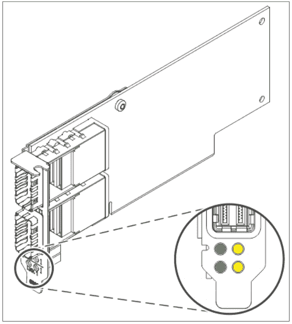

图 2-24 PCIe Gen 4 电缆适配器（#EJ24）

PCIe Gen 4 电缆适配器（#EJ24）是一款半高、半长、低轮廓的 PCIe Gen 4 x16 适配器。适配器提供两个端口用于连接 CXP 16x AOC 对。一个适配器支持连接到 EMX0 PCIe Gen3 I/O 扩展抽屉中的一个 PCIe Gen 3 6 槽扇出模块。

尽管这些电缆不可冗余，但一条电缆丢失会使 I/O 带宽降低 50%（即，可用于 I/O 模块的通道数）。

每个系统节点最多允许八个 PCIe Gen 4 电缆适配器（#EJ24）连接到最多八个 PCIe Gen 3 6 槽扇出模块（#EMXH）。每个扇出模块必须配有一对 CXP 16x AOC 电缆，两端口均布线到来自系统节点的同一 PCIe Gen 4 电缆适配器。

电缆适配器可放置在系统节点的任意插槽中。建议在系统节点中按以下适配器放置顺序进行：

```
System node slot 1, 7, 3, 6, 2, 8, 4, 5
```

支持的适配器最大数量为每个系统节点 8 个，每个系统最多 32 个，系统有四个节点。

每当使用 PCIe Gen3 I/O 扩展抽屉（#EMX0）时，建议为系统节点中的 PCIe Gen 4 电缆适配器（#EJ24）适配器预留插槽。将高轮廓适配器放置在 I/O 扩展抽屉内。

有三种不同类型的 CXP 16x AOC 电缆对可用于 PCIe Gen 4 电缆适配器（#EJ24）与 I/O 扩展抽屉的 PCIe Gen 3 扇出模块（#EMXH）之间的连接：

- 2.0M（#ECCR）
  当 I/O 抽屉与 E1080 服务器在 *同一* 机架中时使用此电缆。
- 10.0M（#ECCY）
  当 I/O 抽屉与 E1080 服务器在 *不同* 机架中时使用此电缆。
- 20.0M（#ECCZ）
  与 10.0M（#ECCY）电缆类似，这些电缆用于 I/O 抽屉与 E1080 服务器在不同机架中的情况。

> **注意：** 一个 #ECCR、一个 #ECCY 或一个 #ECCZ 包含两根 AOC 电缆。

#### 2.7.2 PCIe Gen3 I/O 扩展抽屉

PCIe Gen3 I/O 扩展抽屉（#EMX0）是一款 4U 高、基于 PCIe Gen3 且可机架安装的 I/O 抽屉。它提供两个 PCIe 扇出模块（#EMXH），每个模块提供六个 PCIe Gen3 全高、全长插槽（两个 x16 和四个 x8）。

Power E870、Power E870C、Power E880 和 Power E880C 系统使用的旧扇出模块（#EMXF 和 #EMXG）不能订购且与 Power system E1080 不兼容。

有关抽屉尺寸的更多信息，请参见第 1.6 节，“I/O 抽屉”，第 26 页。

PCIe Gen 4 电缆适配器（#EJ24）CXP 16X AOC 将系统节点连接到 I/O 扩展抽屉中的 PCIe 扇出模块。

通过使用 HMC 引导菜单或操作系统支持实用程序进行并发维修以及 PCIe 适配器的添加或移除。

盲插盒式磁带机（BSC）用于容纳安装到这些插槽中的全高适配器。BSC 与上一代服务器的 #5802、#5803、#5877 和 #5873 12X 附加 I/O 抽屉所使用的 BSC 相同。

功耗最高为每个适配器插槽 50W。


Figure 2-25 shows the rear view of the PCIe Gen3 I/O Expansion Drawer.

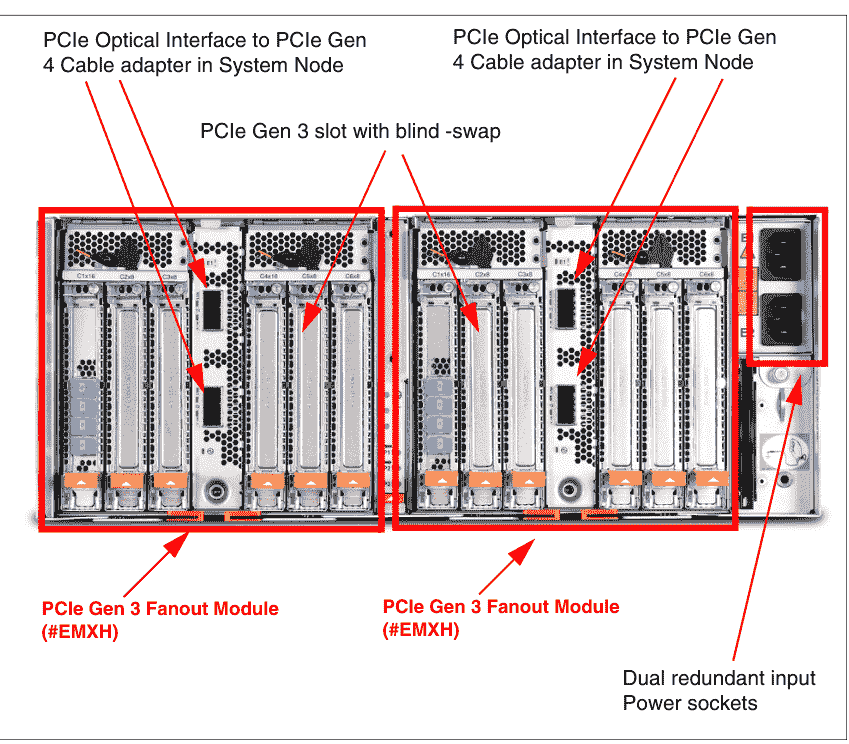

Figure 2-25 Rear view of the PCIe Gen3 I/O Expansion Drawer

#### 2.7.3 PCIe Gen3 I/O Expansion Drawer optical cabling

I/O drawers are connected to the adapters in the system node by any of the following data transfer cables:

- 2.0 m CXP 16x Active Optical Cable (AOC) Pair (#ECCR)
- 10.0 m CXP 16x Active Optical Cable (AOC) Pair (#ECCY)
- 20.0 m CXP 16x Active Optical Cable (AOC) Pair (#ECCZ)

> **Cable lengths:** Use the 2.0 m cables for intra-rack installations. Use the 10.0 m or 20.0 m cables for inter-rack installations.

Older cables #ECC6, #ECC8, and #ECC9 that are used in Power System E980 are not supported or orderable on Power System E1080. They are supported only as model conversions and announced as RPO.

A minimum of one PCIe Gen 4 Optical Cable Adapter for PCIe Gen 3 Expansion Drawer (#EJ24) is required to connect to the PCIe Gen 3 6-slot Fanout Module in the I/O expansion drawer. The top port of the Fanout Module must be cabled to the top port of the #EJ24 port. Also, the bottom two ports must be cabled together.

To perform the cabling correctly, complete the following steps:

- 1. Connect an AOC to connector T0 on the PCIe Gen 4 cable adapter (#EJ24) in your server.
- 2. Connect the other end of the optical cable to connector T1 on one of the PCIe Gen 3 6-slot Fanout Modules in your I/O expansion drawer.
- 3. Connect another AOC cable to connector T1 on the PCIe Gen 4 cable adapter (#EJ24).
- 4. Connect the other end of the cable to connector T2 on the same PCIe Gen 3 6-slot Fanout Module in I/O expansion drawer.
- 5. Repeat the steps 1 to 4 for the other PCIe Gen 3 6-slot Fanout Module in the I/O expansion drawer, if required.

**Drawer connections:** Each Fanout Module in a PCIe Gen 3 Expansion Drawer (#EMX0) can be connected to only a single PCIe Gen 4 Cable Adapter (#EJ24). However, the two Fanout Modules in a single I/O expansion drawer can be connected to different system nodes in the same server.

Figure 2-26 shows the connector locations of the PCIe Gen3 I/O Expansion Drawer.

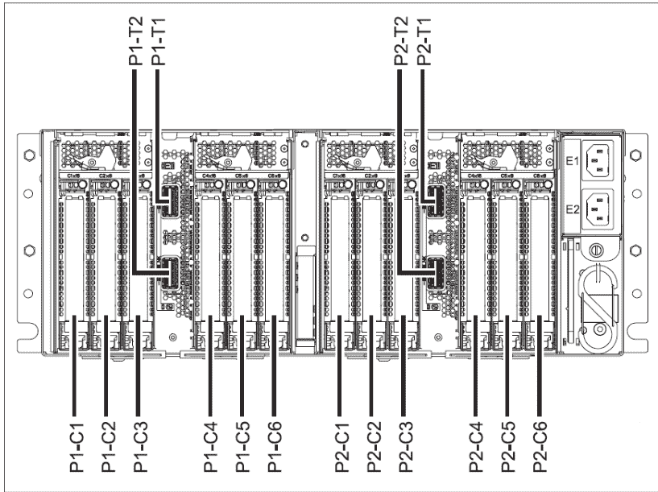

Figure 2-26 Connector locations for the PCIe Gen3 I/O Expansion Drawer

Table 2-25 lists the PCIe slots in the PCIe Gen3 I/O Expansion Drawer.

Table 2-25 PCIe slot locations and descriptions for the PCIe Gen3 I/O Expansion Drawer

| Slot | Location code | Description |
|---|---|---|
| Slot 1 | P1-C1 | PCIe Gen 3, x16 |
| Slot 2 | P1-C2 | PCIe Gen 3, x8 |
| Slot 3 | P1-C3 | PCIe Gen 3, x8 |
| Slot 4 | P1-C4 | PCIe Gen 3, x16 |
| Slot 5 | P1-C5 | PCIe Gen 3, x8 |
| Slot 6 | P1-C6 | PCIe Gen 3, x8 |
| Slot 7 | P2-C1 | PCIe Gen 3, x16 |
| Slot 8 | P2-C2 | PCIe Gen 3, x8 |
| Slot 9 | P2-C3 | PCIe Gen 3, x8 |
| Slot 10 | P2-C4 | PCIe Gen 3, x16 |
| Slot 11 | P2-C5 | PCIe Gen 3, x8 |
| Slot 12 | P2-C6 | PCIe Gen 3, x8 |

Consider the following points:

- All slots support full-length, regular-height adapters or short (low-profile) adapters with a regular-height tailstock in single-wide, Gen3 BSCs.
- Slots C1 and C4 in each PCIe Gen 3 6-slot Fanout Module are x16 PCIe Gen 3 buses, and slots C2, C3, C5, and C6 are x8 PCIe buses.
- All slots support enhanced error handling (EEH).
- All PCIe slots are hot-swappable and support concurrent maintenance.

Typical Slot priorities are listed in Table 2-26.

Table 2-26 PCIe adapter slot priorities for the PCIe Gen3 I/O Expansion Drawer

| Feature code | Description | Slot priorities |
|---|---|---|
| EMX0 | Typical Slot priorities | 1, 7, 4, 10, 2, 8, 3, 9, 5, 11, 6, 12 |

For more information about slot priorities for individual adapters, see IBM Documentation.

If the EMX0 PCIe Gen 3 Expansion Drawer is configured with two PCIe Gen 3 6-slot Fanout Modules, distribute the PCIe adapters across both I/O modules whenever possible

Slots 1, 7, 4, and 10 support SR-IOV capabilities. However, if the total amount of physical memory is less than 128 GB, Slot 4 (P1-C4) and Slot 10 (P2-C4) are not SR-IOV capable.

Figure 2-27 shows the connection schematics between system node and PCIe Gen3 I/O Expansion Drawer.

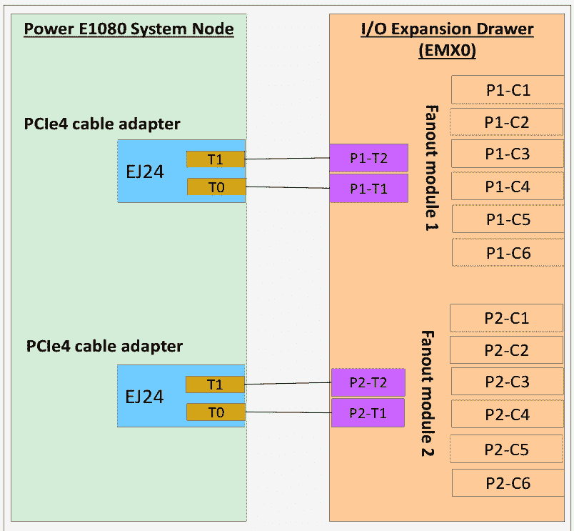

Figure 2-27 Connection schematics between system node and Expansion Drawer

## General rules for the PCIe Gen3 I/O Expansion Drawer configuration

The PCIe Gen 4 Cable Adapter (#EJ24) can be in any of the PCIe adapter slots in a Power E1080 server node. However, we advise that you first populate the PCIe adapter slots as per the slot priorities that are discussed in this section. If an I/O expansion drawer is present, the PCIe Gen 4 cable adapter (#EJ24) must be given the highest priority.

Each processor module drives two PCIe Gen5 slots, and all slots are equal regarding their bandwidth characteristics. If you first use the slots following the slot priorities, you ensure that one PCIe Gen5 slot per processor module is populated before you use the second PCIe Gen5 slot of the processor modules.

Table 2-27 lists the PCIe adapter slot priorities in the Power E1080 server. If the sequence is chosen as listed in the slot priority column, the adapters are assigned to the SCM in alignment with the internal enumeration order: SCM0, SCM1, SCM2, and SCM3.

Table 2-27 PCIe adapter slot priorities

| Feature code | Description | Slot priorities |
|---|---|---|
| EJ24 | PCIe Gen 4 Optical Cable Adapter for PCIe Gen 3 Expansion Drawer | 1, 7, 3, 6, 2, 8, 4, 5 |

The following figures show several examples of supported configurations. (For simplification, we do not show every possible combination of the I/O expansion drawer to server attachments.)

Figure 2-28 shows an example of a Power 1080 that features a single system node and four PCIe Gen3 I/O Expansion Drawers. Each lane between the #EJ24 adapter and I/O drawer fanout module represent an CXP 16x AOC pair.

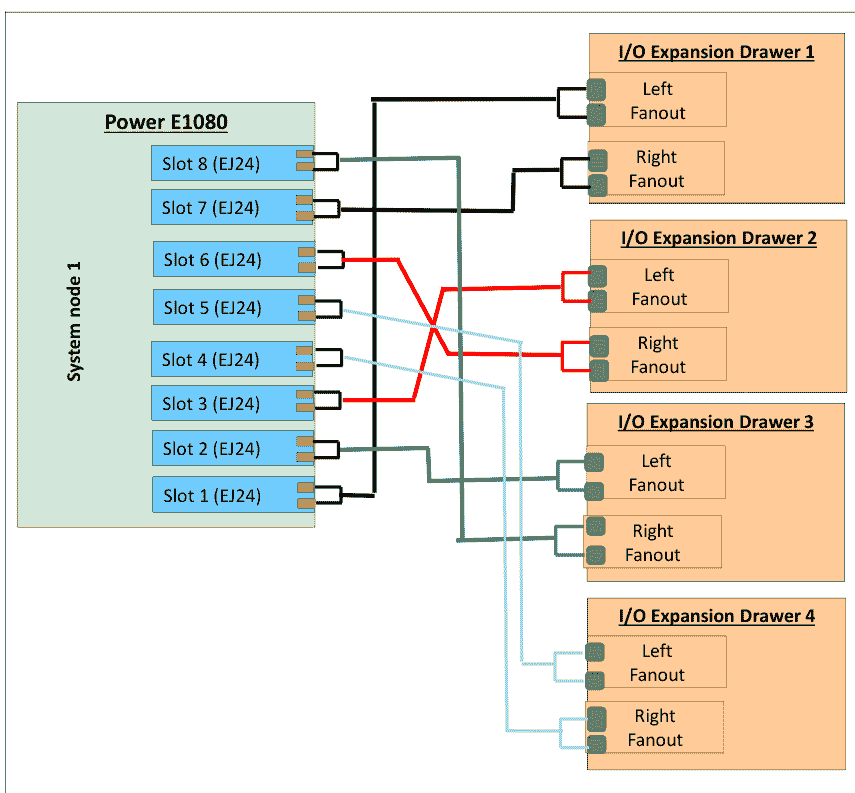

Figure 2-28 Single system node to four PCIe Gen3 I/O Expansion Drawer connections

Figure 2-29 shows an example of a Power E1080 having two system nodes and four PCIe Gen3 I/O Expansion Drawers. Each lane between the #EJ24 adapter and I/O drawer fanout module represent an CXP 16x AOC pair.

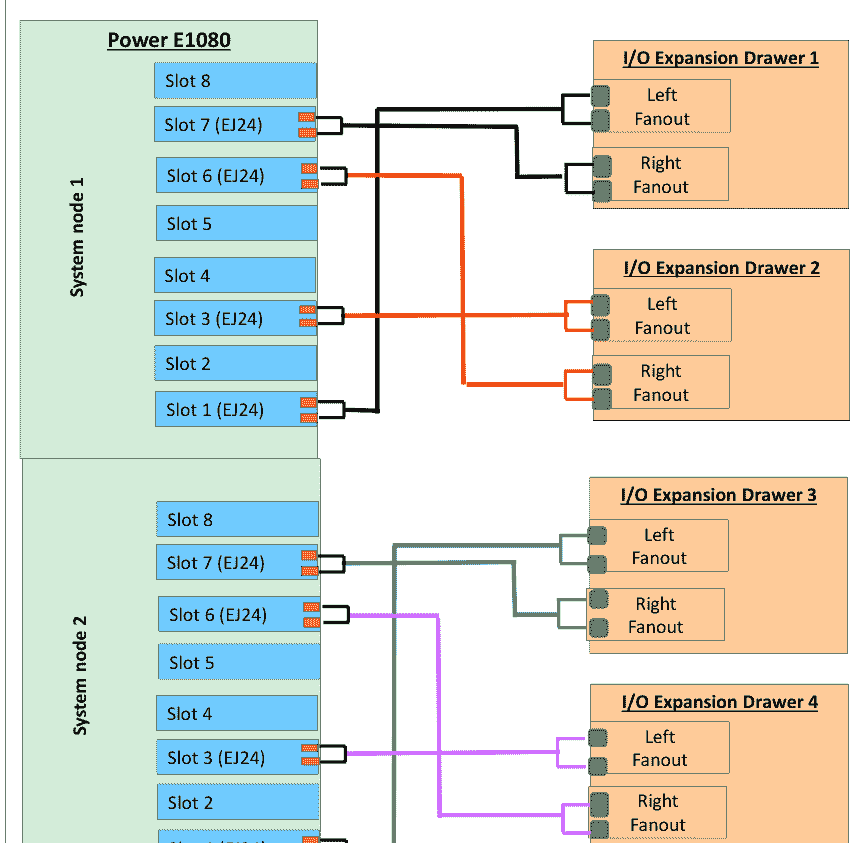

Figure 2-29 Dual system node to four PCIe Gen3 I/O Expansion Drawer connections

#### 2.7.4 PCIe Gen3 I/O Expansion Drawer SPCN cabling

No system power control network (SPCN) is used to control and monitor the status of power and cooling within the I/O drawer. SPCN capabilities are integrated into the optical cables.

### 2.8 External disk subsystems

This section describes the following external disk subsystems that can be attached to the Power E1080 server:

- EXP24SX SAS Storage Enclosures
- IBM System Storage

#### 2.8.1 IBM EXP24SX SAS Storage Enclosure

The EXP24SX SAS storage enclosure (#ESLS) is the only DASD drawer that is available for Power E1080 that provides extra disk drives. The ESLS supports SSDs and HDDs. The ESLS storage enclosures are connected to system units by using a serial-attached SCSI (SAS) port in the SAS adapters.

The EXP24SX is a storage expansion enclosure with 24 2.5-inch small form factor (SFF) SAS bays. It supports 10K and 15K SAS HDD having 512 and 4K format drives and enterprise and mainstream class SAS SSDs.

The enclosures can be split logically into one, two, or four independent groups:

- One set of 24 bays (mode 1) (D1-D24),
- Two sets of 12 bays (mode 2), (D1-D12) (D13-D24)or
- Four sets of 6 bays (mode 4).(D1-D6) (D7-D12) (D13-D18) (D19-D24)

The front view of the ESLS storage enclosure with drive locations is shown in Figure 2-30.

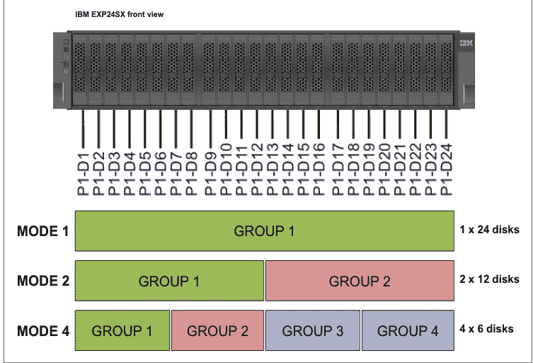

Figure 2-30 Front view of the ESLS storage enclosure with mode groups & drive locations

The SAS storage enclosures support the following operating systems:

- AIX
- IBM i
- Linux
- VIOS


以下 PCIe Gen 3 SAS 适配器支持 EXP24SX 抽屉：

- PCIe Gen 3 RAID SAS 适配器 四端口 6 Gb x8 (#EJ0J)
- PCIe Gen 3 LP RAID SAS 适配器 四端口 6 Gb x8 (#EJ0M)
- PCIe3 SAS 磁带/DVD 适配器 四端口 6 Gb x8 (#EJ10)
- PCIe3 LP SAS 磁带/DVD 适配器 四端口 6 Gb x8 (#EJ11)
- PCIe Gen 3 12 GB 缓存 RAID Plus SAS 适配器 四端口 6 Gb x8 (#EJ14)

IBM i 配置要求驱动器受保护（RAID 或镜像）。保护驱动器是强烈建议的，但对于其他操作系统并非必需。所有使用带写缓存 SAS 适配器的 Power 服务器操作系统环境都需要通过使用成对的适配器来保护缓存。

EXP24SX 抽屉具有以下高可靠性设计要点：

- 支持热插拔的 SAS 托架。
- 冗余且可热插拔的电源和风扇组件。
- 双电源线。
- 冗余且可热插拔的机箱服务管理器（ESMs）。
- 到所有驱动器的冗余数据路径。
- 驱动器、托架、ESMs 和电源上的 LED 指示灯支持问题识别。
- 通过 SAS 适配器和控制器，驱动器可通过 RAID 和镜像以及热备能力进行保护。

注意：考虑混合 SSD 和 HDD 的以下几点：

- 配置为模式 1 时，不能混合 SSD 和 HDD。
- 配置为模式 2 时，可以混合 SSD 和 HDD：一个磁盘分区可以是 SSD，另一个磁盘分区可以是 HDD，但不能在同一磁盘分区内混合。
- 配置为模式 4 时，可以混合 SSD 和 HDD。每个磁盘分区可以是 SSD 或 HDD，但不能在同一磁盘分区内混合。

例如，在具有两组 12 个托架的模式 2 抽屉中，一组可以放置 SSD，另一组可以放置 HDD，但不能在同一组 12 个托架中混合 SSD 和 HDD。

用于将 #ESLS 存储机箱连接到服务器的电缆与用于 5887 磁盘驱动器机箱的电缆不同。SAS 控制器与存储机箱 SAS 端口之间的连接通过合适的 SAS YO12 或 X12 电缆进行。PCIe Gen3 SAS 适配器支持 6 Gb 吞吐量。如果未来的 SAS 适配器支持该功能，EXP12SX 抽屉支持高达 12 Gb 吞吐量。

以下电缆选项可用：

- 3.0M SAS X12 电缆（双适配器到机箱 (#ECDJ)
- 4.5M SAS X12 AOC（双适配器到机箱 (#ECDK)
- 10M SAS X12 AOC（双适配器到机箱 (#ECDL)
- 1.5M SAS YO12 电缆（适配器到机箱 (#ECDT)
- 3.0M SAS YO12 电缆（适配器到机箱 (#ECDU)
- 4.5M SAS YO12 AOC（适配器到机箱 (#ECDV)
- 10M SAS YO12 AOC（适配器到机箱 (#ECDW)

EXP24SX 抽屉后部有六个 SAS 连接器，可连接 SAS 适配器或控制器。它们标记为 T1、T2 和 T3；两个 T1、两个 T2 和两个 T3 连接器。请考虑以下几点：

- 在模式 1 中，使用六个端口中的两个或四个。对于单个 SAS 适配器，使用两个 T2 端口；对于成对的两个适配器或双适配器配置，使用两个 T2 和两个 T3 端口。
- 在模式 2 或模式 4 中，使用四个端口，即两个 T2 和两个 T3 连接器，以访问所有 SAS 托架。
- T1 连接器未使用。

图 2-31 显示了 EXP24SX 存储机箱的连接器位置。

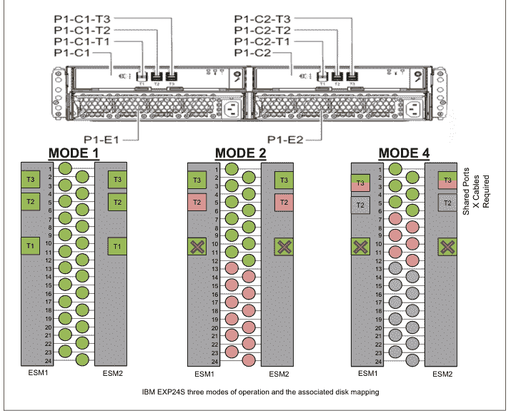

图 2-31 EXP24SX 后视图，位置代码和不同拆分模式

模式设置由 IBM 制造完成。如果安装后需要更改模式，请联系您的 IBM 系统服务代表（IBM SSR）寻求支持。

有关 SAS 布线和布线配置的更多信息，请参阅 IBM 文档中“将 #ESLS 存储机箱连接到您的系统”。

### 2.9 系统控制和时钟分配

Power E1080 服务器需要 UPIC、FSP 和 SMP 电缆用于机箱间连接：

- UPIC 电缆允许系统节点为系统控制单元（SCU）供电
- FSP 电缆用于向组件提供系统控制
- SMP 电缆用于扩展连接 Power10 处理器的 A 总线接口，使其跨系统节点延伸

与上一代 Power System E980 服务器类似，可提供两个服务处理器用于冗余。它们托管在 SCU 中，并通过位于 SCU 后部和系统节点的 FSI/PSI 总线连接器与系统节点通信。

所有服务处理器在控制单元和系统节点之间的通信都通过服务处理器电缆传输。与前几代相比，Power E1080 关联的 SCU 不再托管系统时钟。每个系统节点都托管自己的冗余时钟。

SCU 与系统节点之间通信所需的电缆取决于安装的系统节点数量。当添加系统节点时，必须同时添加新的一组电缆。

每个系统节点所需的电缆都归为一个功能代码下，以便于配置。每组电缆包括一对 FSP 电缆，以及在适用时 SMP 电缆和通用电源互连电缆（UPIC）电缆。

表 2-28 列出了可用的功能代码。

*表 2-28 电缆组功能*

| 功能代码 | 描述 |
|---|---|
| EFCH | 系统节点抽屉 1 的电缆组（FSP + UPIC） |
| EFCE | 系统节点抽屉 2 的电缆组（FSP + SMP） |
| EFCF | 系统节点抽屉 3 的电缆组（FSP + SMP） |
| EFCG | 系统节点抽屉 4 的电缆组（FSP + SMP） |

Power E1080 服务器的初始订单包含一个 #EFCH，这是连接系统节点与系统控制单元（SCU）所必需的。此配置不需要 SMP 电缆，SMP 电缆仅在两个或更多系统节点的配置中才需要。

电缆组功能代码是递增的，取决于安装的系统节点数量：

- 一个系统节点：#EFCH
- 两个系统节点：#EFCH 和 #EFCE
- 三个系统节点：#EFCH、#EFCE 和 #EFCF
- 四个系统节点：#EFCH、#EFCE、#EFCF 和 #EFCG

冗余的灵活服务处理器（FSP）提供专有接口通信，例如 FRU 服务接口（FSI）和处理器支持接口（PSI）到系统节点。

PSI 用于 FSP-主机处理器单元通信。PSI 是用于控制通信的时钟同步双向接口。SCU 中的每个 FSP 都有四个 PSI 接口，并且连接方式使得无论哪个 FSP 成为主用，都可以控制整个系统。

Power E1080 服务器中的 FSI 是用于整体系统控制结构设计中设备通信的串行点对点连接。

FSI 连接网络跨越 SCU 内部的 FSP 到 FSP 连接、FSP 到系统节点通过时钟和控制逻辑。它们将 SCU 中的 FSP 连接到系统节点元素以及系统节点内部系统节点平面上的 Power10 到 Power10 处理器芯片。与 PSI 网络类似，无论哪个 FSP 成为主用，都可以控制整个服务器。

图 2-32 显示了单个系统节点与 SCU 之间的 UPIC 和 FSP 布线。

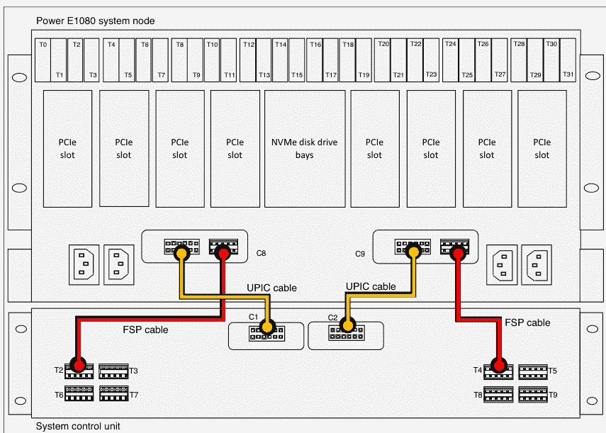

图 2-32 SCU 与单个系统节点之间的 UPIC 和 FSP 连接

图 2-33 显示了两个系统节点与 SCU 之间的 UPIC 和 FSP 布线。

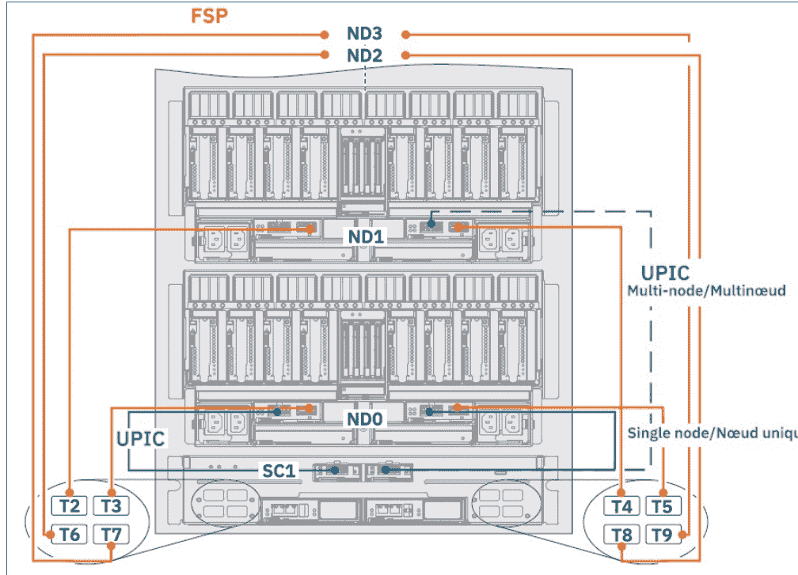

图 2-33 SCU 与两个系统节点之间的 UPIC 和 FSP 连接

在单个系统节点配置中，两个 UPIC 电缆连接到 SCU，并提供来自系统节点的冗余电源。两个或更多系统节点的 SCU 电源由第一个和第二个系统节点提供。当 Power E1080 支持超过两个系统节点时，第三个和第四个系统节点的电源输出端口不使用。

系统参考时钟源负责向所有功能单元提供同步时钟信号。Power E1080 服务器的每个系统节点都使用自己的一套两个冗余系统时钟或控制卡。如果任一时钟或控制卡发生故障，第二张卡可确保系统在安排更换前继续运行。与 Power E980 类似，Power E1080 服务器不需要系统控制中的全局参考时钟源。


图 2-34 显示了三个系统节点与 SCU 之间的 UPIC 和 FSP 布线。

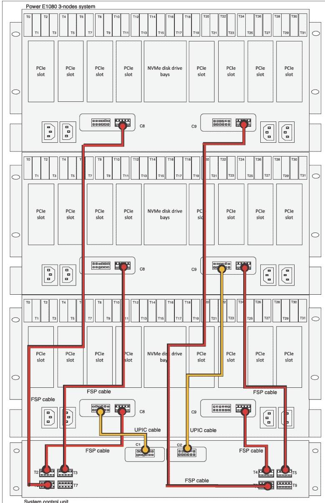

图 2-34 SCU 与三个系统节点之间的 UPIC 和 FSP 连接

图 2-35 显示了四个系统节点与 SCU 之间的 UPIC 和 FSP 布线。

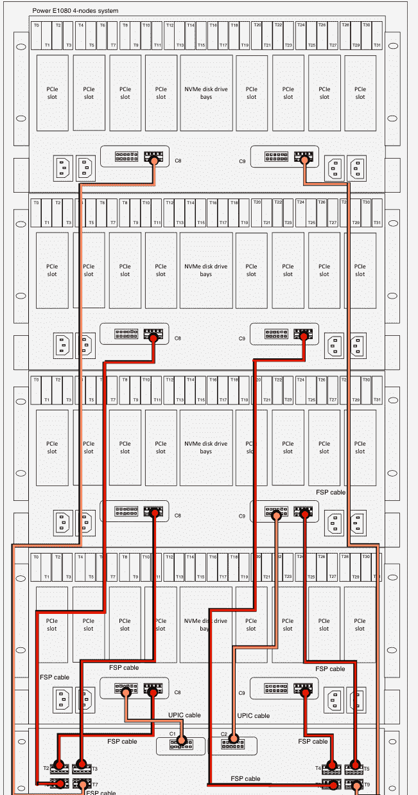

图 2-35 SCU 与四个系统节点之间的 UPIC 和 FSP 连接

### 2.10 操作系统支持

Power E1080 服务器支持以下操作系统：

- AIX
- IBM i
- Linux

此外，VIOS 可以安装在特殊分区中，为运行 AIX、IBM i 或 Linux 操作系统的其他分区提供支持，以使用各种功能，例如虚拟化 I/O 设备，或 PowerVM Live Partition Mobility (LPM)。

有关 Power Systems 上可用的软件的更多信息，请参阅 IBM Power Systems Software。

#### 2.10.1 Power E1080 先决条件

撰写本文时，IBM AIX、IBM i 和 Linux 的最低支持级别在以下各节中描述。有关硬件功能的更多信息，请参阅 IBM Power Systems Prerequisites。

此工具还有助于通过提供当前使用或计划添加到系统中的功能的先决条件信息来规划成功的系统升级。可以选择机器类型和型号（9080-HEX 代表 Power E1080）并查找所有先决条件、支持的操作系统级别和其他信息。

#### 2.10.2 AIX 操作系统

在发布时，Power E1080 支持以下最低级别的 AIX：

- AIX 7.1 TL 5 SP 5
- AIX 7.2 TL 4 SP 1

AIX 7.1 必须在 POWER8 兼容模式下的 LPAR 中运行，并使用基于 VIOS 的虚拟存储和网络。I/O 只能由 Virtual I/O Server 提供，并且系统已启用 LPM，排除了客户 LPAR 中直接的本机 VF（SR-IOV）。

AIX 7.2 可以使用物理和虚拟 I/O 运行，并需要 POWER9 兼容模式。

当使用 2 端口 32 Gb 适配器（#EN1A 或 #EN1B）和选定的 IBM FlashSystem 高端（FS9110）和中端（FS7200）型号时，NVMe over Fibre Channel 结构（NVMe-OF）现在可在运行 AIX 的 Power E1080 上使用。

IBM 定期为 AIX 操作系统发布维护包（服务包或技术级别）。有关这些包、下载和获取 CD-ROM 的更多信息，请参阅 Fix Central。

服务更新管理助手（SUMA），可帮助您自动化检查和下载操作系统下载的任务，是基本操作系统的一部分。有关 suma 命令的更多信息，请参阅 IBM 文档。

AIX 可通过独立版（标准版）、企业版或捆绑选项使用：

- AIX 7.1 Standard Edition
- AIX 7.1 Enterprise Edition V1.6
- AIX 7.2 Standard Edition
- AIX 7.2 Enterprise Edition
- AIX 7.2 Enterprise Cloud Edition

企业云版捆绑包的主要更新包括 PowerSC 2.0。

购买新 Power E1080 的客户可以随系统购买获得此堆栈。现有系统且使用任一捆绑包的客户以及具有有效 SWMA 的客户可以通过使用 ESS 获取此产品并立即使用。

### 订阅许可模式

根据 Power E1080 的发布公告，提供了一种新的订阅许可模式。此模式为客户提供了更多选择和灵活性，以使用软件。

订阅许可证是一种许可模式，提供在指定订阅期限（一年或三年）内访问 IBM 程序和 IBM 软件维护的权限。订阅期限从开始日期开始，到在 Entitled Systems Support (ESS) 中反映的到期日期结束。

客户被许可在 1 年或 3 年订阅期限的到期日期之前运行产品，然后可以在订阅期结束时续订以继续使用产品。此模式在特定期限内提供灵活且可预测的定价，前期投入成本较低。

此模式的另一个好处是许可证按客户编号授权，这意味着它们不像永久许可证那样绑定到特定的硬件序列号。因此，如果需要，许可证可以在本地和云之间移动，这对于混合工作负载来说变得越来越重要。

订阅许可证的新产品 ID 列在表 2-29 中。

表 2-29 新订阅许可证 PID（一或三年期限）

| PID | Description |
|---|---|
| 5765-2B1 | AIX 7 standard edition |
| 5765-2E1 | AIX 7 enterprise edition 1.6 |
| 5765-2C1 | Enterprise Cloud edition 1.6 with AIX 7 |
| 5765-6C1 | Enterprise Cloud edition 1.6 |

许可证可通过 IBM 配置器订购。标准版的 AIX 永久和月度期限许可证仍然可用。

### AIX 7.3 Open Beta

2021 年 2 月，宣布了新 AIX 7.3 操作系统 Open Beta 的注册。AIX 7.3 Open Beta 允许您在合适的 IBM 系统上下载、安装和运行软件的早期版本，采用非生产、非支持模式。

Open Beta 程序提供了一个机会，让您提前体验 AIX 7.3。AIX 的并非所有功能都在 Open Beta 中可用。

客户可以通过在此网页注册来申请加入 Open Beta 程序。

#### 2.10.3 IBM i

以下最低要求的级别在 Power E1080 服务器上受 IBM i 支持：

- IBM i 7.3 TR11 或更高版本
- IBM i 7.4 TR5 或更高版本

有关硬件功能兼容性信息和相应的 IBM i 技术级别，请参阅 IBM Prerequisites。

### IBM i 操作系统转移

IBM i 客户可以像之前的非序列保留升级/替换新系统一样迁移到新的 Power E1080 服务器。

IBM i 条款和条件要求 IBM i 操作系统许可授权保留在最初购买的机器上。在符合条件的条件下，IBM 允许将 IBM i 处理器和用户授权从一台机器转移到另一台机器。此功能有助于促进机器更换、服务器整合和负载再平衡，同时保护客户对 IBM i 软件的投资。当满足要求时，可以使用 IBM 配置器工具配置 IBM i 许可证转移。

转移必须满足以下先决条件：

- IBM i 授权由用户的企业拥有。
- 捐赠机器和接收机器由用户的企业拥有。
- 捐赠机器必须在与接收机器相同的用户企业中拥有至少一年。
- 捐赠机器上启用了软件维护（SWMA）。每个待转移的软件授权都有 SWMA 覆盖。
- 存在待转移授权的电子授权证明（ePoE）。
- 捐赠机器授权为 IBM i 5.4 或更高版本。
- 接收机器包括已激活的处理器，可用于容纳转移的授权。

转移到目标机器的每个 IBM i 处理器授权都包括一年免费的新 SWMA。额外年份的覆盖或 24x7 支持是额外收费的可选方案。

#### 2.10.4 Linux

以下类型的 Linux 发行版可运行在 Power E1080 上：

- 支持原生 Power10 处理器技术
- 在 POWER9 兼容模式下运行

支持原生 Power10 处理器技术的发行版也可以在 POWER9 兼容模式下运行。此功能在从基于 POWER9 处理器的服务器到 Power E1080 进行 LPM 时很重要。

### Red Hat

Red Hat Enterprise Linux (RHEL) 版本 8.4 及更高版本可在原生 Power10 处理器模式下运行。撰写本文时，RHEL 版本 8.4 可用。

OpenShift 和 CoreOS 也受支持。

### SUSE

SUSE 15 SP3 是第一个支持原生 Power10 处理器技术的版本。其常规支持周期为 18 个月，外加长期 SP 支持。

### 旧版发行版

以下选定的旧版发行版也在 Power E1080 上受支持：

- RHEL 8.2 仅在 POWER9 兼容模式下受支持
- SLES 12 SP5 仅在 POWER9 兼容模式下受支持

当 LPAR 在 POWER9 兼容模式下运行时，它受益于 Power10 处理器技术的大多数功能，包括每个核心最多八个线程。然而，使用新 Power10 指令或功能的程序和内核功能不可用。

在基于 POWER9 处理器的系统和基于 Power10 处理器的系统之间来回移动分区时需要 POWER9 兼容模式。在分区移动到基于 Power 10 处理器的系统后，可以升级到支持原生 Power10 技术支持的发行版并重新启动到原生 Power10 模式。

> 注意：对于 SLES 15 的旧服务包，例如 SLES 15 SP2，不提供官方的 POWER9 兼容模式支持。

### 增强功能

Power10 处理器芯片的主要功能之一是能够支持每个 SCM 最多 15 个核心。因此，在配置了最多 240 个处理器核心的 Power E1080 上（每个核心可运行多达八个线程，最多可达 1920 个线程），支持原生 Power10 技术支持的 Linux 发行版可以使用此功能。

在 POWER9 兼容模式下运行的 LPAR 限制为每个 LPAR 1536 个线程，这是基于 POWER9 处理器的服务器的最大值。表 2-30 列出了最大逻辑 CPU、最大内存和支持 LPM 的最大内存，根据 Linux 发行版而定。

表 2-30 最大线程与处理模式

| Linux distribution | Processor mode | Maximum logical CPUs | Maximum memory | Maximum memory with LPM |
|---|---|---|---|---|
| RHEL 8.2 | POWER9 | 1536 | 64 TB | 16 TB |
| RHEL 8.4 | Power10 | 1920 | 64 TB | 64 TB |
| SLES 12 SP5 | POWER9 | 1536 | 64 TB | 32 TB |
| SLES 15 SP3 | Power10 | 1920 | 64 TB | 64 TB |


Power10 专用的工具链在 Advance Toolchain 版本 15.0 中可用，该版本允许客户和开发人员在编程时使用所有新的基于 Power10 处理器的技术指令。由于新的 PC 相对寻址模式，跨模块函数调用开销降低了。

一个具体优势是，在推理工作负载方面，相比基于 POWER9 处理器的技术具有 10 倍至 20 倍的优势，这是由于新的内存带宽和新指令所致。一个例子是新的专用特殊用途矩阵数学加速器（MMA），该加速器针对机器学习和深度学习推理的需求进行了定制。它还包括许多 AI 数据类型。

网络虚拟化是一个具有显著演进和改进的领域，其优势惠及虚拟和容器化环境。以下是在 Power E1080 上针对 Linux 网络功能所做的最新改进：

- SR-IOV 允许在控制器级别对网络卡进行虚拟化，而无需在 VIOS 分区中创建虚拟共享以太网适配器。其增强功能包括 (vNIC) 虚拟网络接口控制器，该控制器允许数据直接从分区传输到或来自 SR-IOV 物理适配器，而无需经过 VIOS 分区。
- 混合网络虚拟化（HNV）允许 Linux 分区使用 SR-IOV 逻辑端口的效率和性能优势，并参与移动操作，例如活动和非活动的实时分区迁移（LPM）和简化远程重启（SRR）。HNV 是通过在配置 SR-IOV 逻辑端口时选择新的可迁移选项来启用的。
- NVMe over Fibre Channel 结构（NVMe-OF）现在在运行 Linux 的 Power E1080 上可用，当使用 2 端口 32 Gb 适配器（#EN1A 或 #EN1B）并且使用所选的 IBM FlashSystem 高端（FS9110）和中端（FS7200）型号时。
