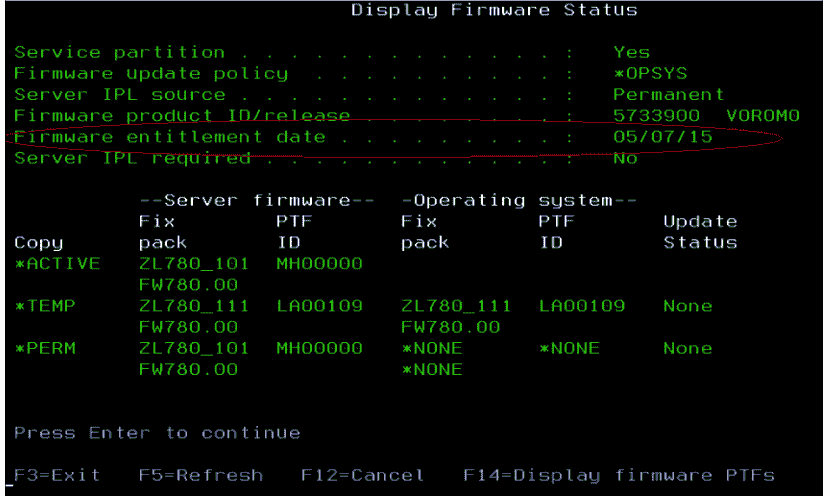
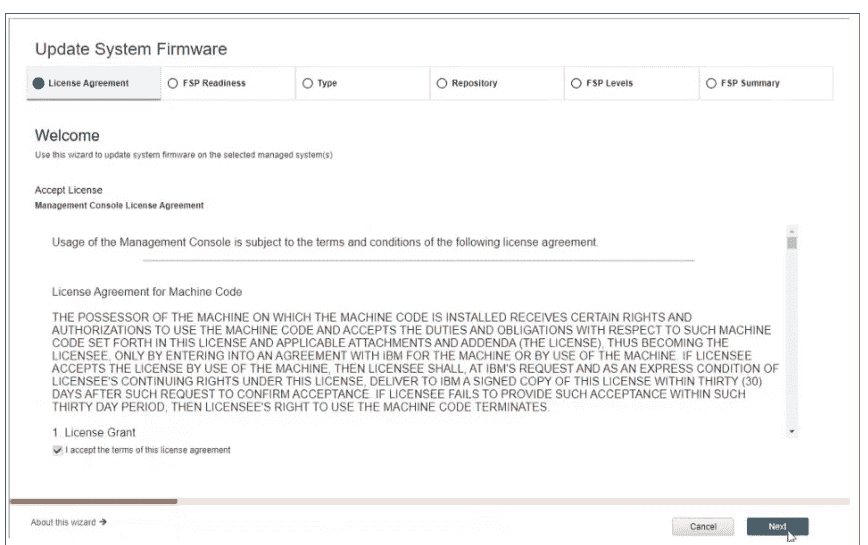
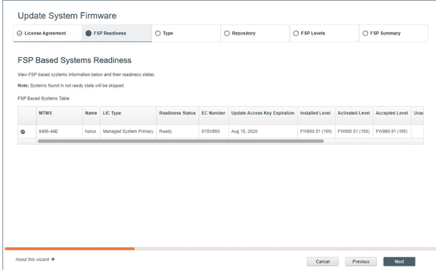
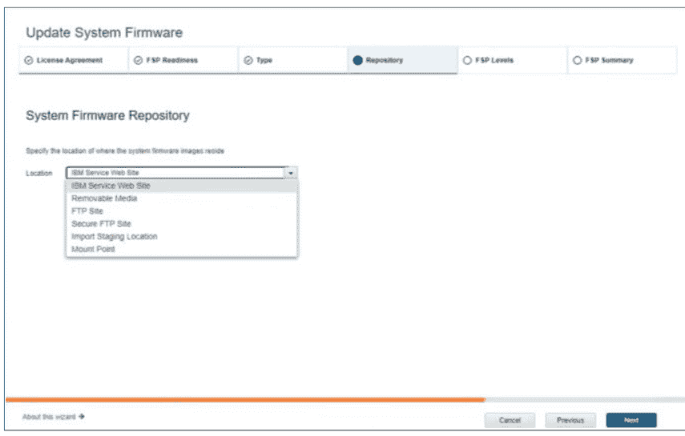
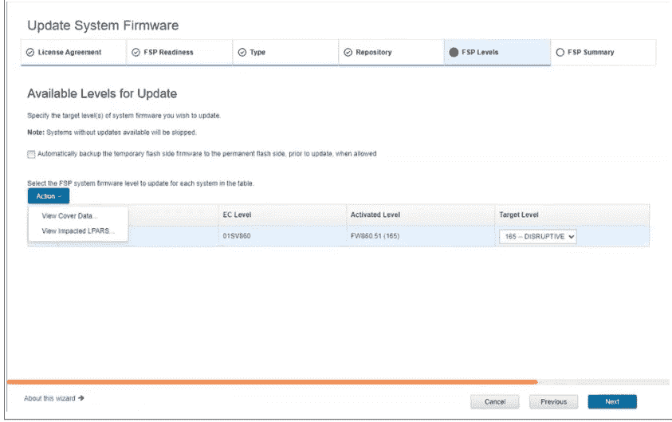
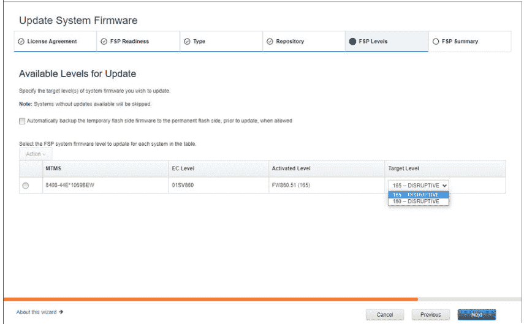
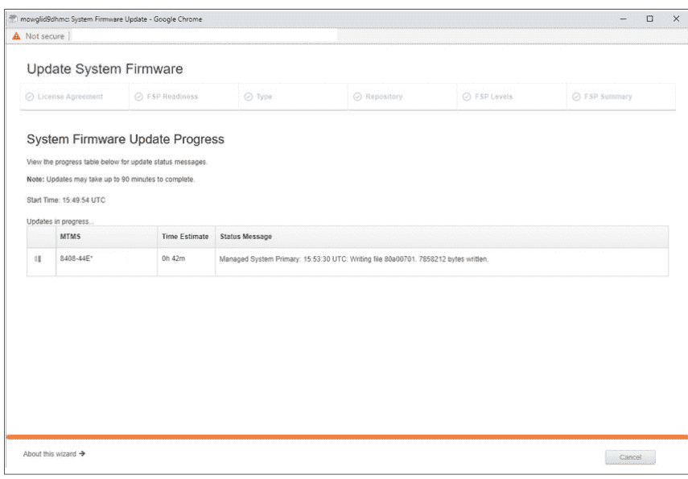
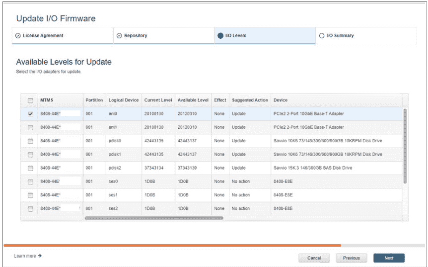

## Security

安全性是 IBM 及其分销合作伙伴的首要任务。IBM Power 上的 Linux 安全性是一个庞大的主题，可以作为详细的单独材料；然而，随着本节的介绍，在加固、完整性保护、性能、平台安全和认证方面引入了改进。

加固和完整性保护涉及在允许升级和维护内核的同时保护 Linux 内核免受未经授权的篡改。当在具有不可变操作系统的容器化环境中运行时，例如 OpenShift 中的 CoreOS，这些主题变得更加重要。

性能也是一个安全主题，因为特定的加固缓解策略（例如针对侧信道攻击）可能对性能产生显著影响。此外，密码学可能使用大量的计算周期。

Power E1080 具有在控制器级别的透明内存加密，可防止攻击者从物理内存或连接到处理器总线的存储类设备中检索数据。

### 2.10.5 Virtual I/O Server

Power E1080 服务器所需的最低 VIOS 级别为 VIOS 3.1.3.10 或更高版本。

IBM 定期更新 VIOS 代码。有关更多信息，请参阅 IBM Fix Central。

### 2.10.6 Entitled System Support

授权系统支持网站（ESS）是 IBM 查看和管理 Power 和存储软件和硬件的首选位置。一般而言，大多数通过我们的 IBM Digital Sales 代表或业务合作伙伴购买的 IBM Systems 提供的产品在使用 IBM Configurator 时可通过该网站访问。

该网站包含以下三个主要部分：

- My entitled software：与 Power 和存储软件相关的活动，提供下载许可、免费和试用软件媒体、订购软件更新和管理软件密钥。
- My entitled hardware：与 Power 和存储硬件相关的活动，提供续订更新访问密钥、购买和使用弹性容量按需、分配或购买企业池 2.0 中新旧池的积分、下载存储容量按需代码和管理混合容量积分。
- My inventory：与 Power 和存储库存相关的活动，提供浏览软件许可、软件维护和硬件库存、管理通过 Base Composer 的库存检索或生成多种类型的报告。

有关更多信息，请参阅此网页。

### 2.10.7 Update Access Keys

自 POWER8 处理器服务器推出以来，IBM 还引入了更新访问密钥（UAK）。

当系统固件更新应用于系统时，会检查 UAK 及其到期日期（见第 122 页图 2-37）。系统固件更新包括发布日期。

尝试应用系统固件更新时，如果固件更新的发布日期超过了更新访问密钥的到期日期，则更新不会被处理。随着更新访问密钥到期，需要使用硬件管理控制台（HMC）或服务处理器上的 ASMI 进行更换。

默认情况下，交付的新系统包含一个 UAK，通常在三年后到期。此后，只要存在维护合同，UAK 就可以每六个月延长一次。合同可以在 ESS 网站上验证（有关更多信息，请参阅第 119 页的 2.10.6“Entitled System Support”）。

确定当前更新访问密钥何时到期可通过 HMC 的 GUI 或 CLI 按以下示例提供。然而，也可以使用合适的 AIX 或 IBM i 命令显示到期日期。

## UAK expiration date by using AIX 7.1

对于 AIX 7.1，使用以下命令：

```
lscfg -vpl sysplanar0 | grep -p "System Firmware"
```

输出类似于示例 2-1 所示的输出（微代码授权日期代表 UAK 到期日期）。

## Example 2-1 Output of the command to check UAK expiration date via AIX 7.1

```
$ lscfg -vpl sysplanar0 | grep -p "System Firmware"
    System Firmware:
    ...
        Microcode Image..............SV860_138 SV860_103 SV860_138
        Microcode Level..............FW860.42 FW860.30 FW860.42
        Microcode Build Date........20180101 20170628 20180101
        Microcode Entitlement Date..20190825
        Hardware Location Code......U8284.22A.XXXXXXX-Y1
        Physical Location: U8284.22A.XXXXXXX-Y1
```

## UAK expiration date by using AIX 7.2

对于 AIX 7.2，输出与 AIX 7.1 略有不同。使用以下命令：

```
lscfg -vpl sysplanar0 |grep -p "System Firmware"
```

输出类似于示例 2-2 所示的输出（更新访问密钥到期日期代表 UAK 到期日期）。

## Example 2-2 Output of the command to check UAK expiration date via AIX 7.2

```
$ lscfg -vpl sysplanar0 |grep -p "System Firmware"
    System Firmware:
    ...
        Microcode Image..............SV860_138 SV860_103 SV860_138
        Microcode Level..............FW860.42 FW860.30 FW860.42
        Microcode Build Date........20180101 20170628 20180101
        Update Access Key Exp Date..20190825
        Hardware Location Code......U8284.22A.XXXXXXX-Y1
        Physical Location: U8284.22A.XXXXXXX-Y1
```

## UAK expiration date by using IBM i

使用 IBM i 作为操作系统，可以使用显示固件状态窗口检查 UAK 的状态。

如果更新访问密钥已过期，请前往 ESS 网站更换您的更新访问密钥。图 2-36 第 121 页显示了 IBM i 7.1 和 7.2 版本中的输出。在 7.3 版本中，文本更改为更新访问密钥到期日期。图 2-36 第 121 页中突出显示的行无论系统是操作系统管理还是 HMC 管理都会显示。



Figure 2-36 Display Firmware Status window

### 2.11 Manageability

系统的可管理性是客户管理、维护、测试和监控系统性能、安全性和可靠性的关键组成部分。

#### 2.11.1 Service user interface

为了管理和维护系统，E1080 提供了以下服务接口：

- ASMI
- HMC GUI/CLI
- Operator panel
- Operating system

ASMI 是服务处理器固件的一部分的图形界面。ASMI 管理并与服务处理器通信。ASMI 需要设置服务处理器并执行服务任务，例如读取服务处理器错误日志、读取重要产品数据和控制系统电源。

ASMI 可以通过 HMC GUI 或 CLI 访问，也可以通过以太网电缆交叉连接或通过交换机直接将笔记本电脑连接到 FSP 端口（需要相同的网络子网）。ASMI 中的某些功能仅限于 IBM 服务代表，在维修活动期间需要 celogin 或 dev 用户凭据。

控制面板功能允许您与服务器交互。控制面板功能从显示状态（例如 IPL 速度）的功能到只有服务代表可以访问的服务功能不等。

有关所有功能的完整列表，请参阅此网页。


The HMC GUI/CLI is the main manageable interface for customers. With HMC V10R1, the layout and the steps changed from previous versions.

#### 2.11.2 System firmware maintenance

Starting with HMC V10R1 M1010, the main menu was re-arranged to classify the features that makes more sense in grouping.

Complete the following steps to update the firmware:

- 1. Click **Update Firmware** → **System Firmware** → **Update**.
- 2. Accept the License Agreement (see Figure 2-37). You cannot proceed if you do not accept the agreement. Click **Next**.



Figure 2-37 Update System Firmware

3. In the next window, the Readiness Status column shows whether the system is ready. If the message is too long, hover around the box to see the entire message.

If two or more systems are selected and one is in a ready state and one is not in a ready state, the system that is not in a ready state is skipped and only the system with the ready state progresses (see Figure 2-38).

Click Next.



Figure 2-38 FSP Based Systems Readiness window

4. The System Firmware Type window opens. Two options are available: update or upgrade (see Figure 2-39). Click **Update** and then, click **Next.**

Figure 2-39 System Firmware Type window

5. The System Firmware Repository window opens (see Figure 2-40). Select from one of the following locations for the repository:

- IBM Service Web Site
- Removable Media
- FTP Site
- Secure FTP Site
- Import Staging Location
- Mount Point

Click Next.



Figure 2-40 System Firmware Repository window

6. The Available Levels for Update window opens. In the target level column, the nature of the update (disruptive or non-disruptive) is shown. If you want to see what is included in the update or upgrade and which LPARs are affected, select the system.
From the drop-down menu, select **View Cover Data** or **View Impacted LPARs** (see Figure 2-41). then, click **Next**.



Figure 2-41 Available Levels of Update window

7. The Update Summary window opens. In this window, the progress of the update and whether it was successfully completed is shown. If a disruptive upgrade is to occurs, select the **I acknowledge that system disruption will occur** option. If this option is not selected when a disruptive upgrade occurs, the wizard cannot progress (see Figure 2-42).

Click **Next**.



Figure 2-42 Update Summary window

In the system Firmware Update Progress window, window (see Figure 2-43), the estimated time for and the progress of the installation are displayed.



Figure 2-43 System Firmware Update Progress window

#### 2.11.3 I/O firmware update

The I/O firmware update was integrated in the old GUI. However, to make the GUI more clear and simple, now it features a new layout that is similar to the system firmware update GUI.

For example, the first and second steps of I/O firmware update includes the License Agreement and Repository windows, which are similar to the system firmware update windows.

The next step of the wizard shows the system name and partition name that owns the I/O device, the current level, the available level of the related device microcode, and suggested actions and device description (see Figure 2-44).



Figure 2-44 I/O firmware update interface

### 2.12 Serviceability

Instances exist in which maintenance procedures are performed on systems and subsystems, including replacing failed components, engineering change implementations, MES hardware upgrades, and migrations. Any of these procedures need the system operations to completely halt or run with a degradation in service.

The productive hours that are lost in performing the service negatively affects the business; therefore, the service strategy includes plans for not only how efficiently the system can be brought back to resume its operations normally, but also to reduce the hours that are needed to service the system.

The success of achieving these goals determines the availability of the system; that is, efficient serviceability means high availability. Power E1080 server carries forward the rich legacy of enterprise class Power systems to deliver the best enterprise RAS features compared to any OEM vendor.

Power E1080 server inherits the fundamental guiding principles and elements of serviceability from the Power E980 enterprise server. The following attributes of its service environment and the interfaces that help it achieve the objectives of serviceability are key:

- ► Errors detection
- ► Diagnose
- ► Reporting
- ► Notification
- ► Ease of location and service

These key attributes are discussed next.

#### 2.12.1 Error detection

System ability to detect errors immediately can greatly enhance its capabilities to take suitable actions in time. For many soft errors, it can recover by self-healing properties. For other non-recoverable errors, it can notify through service interfaces for further actions. The overview of these service interfaces as applicable for Power E1080 server are discussed next.

### Service interface

Service engineers are assisted by multiple system service interfaces that communicate with the service support applications in a server that is using the operator console, the GUI that is on the management console or service processor menu, or an operating system terminal. The service interface helps the support team to efficiently manage system resources and service information.

Applications that are available through the service interface are configured and placed to give service engineers access to important service functions. Depending on the system state, hypervisor, and the operating environment, one or more service interfaces can be useful in accessing logs and service information and communicating with the system. The following primary service interfaces are available:

- ► Light path diagnostics (LPD)
- ► Operator panel
- ► Service processor menu
- ► ASMI
- ► Operating system service menu
- ► Service focal point on the HMC or vHMC

The system can identify components for replacement by using Field Replaceable Unit (FRU) specific LEDs. The service engineer can use the identify function to set the Field replaceable unit (FRU) level LED to blink, which lights the blue enclosure locate and system locate LEDs. The enclosure LEDs turn on solid and guide the service engineer to follow the light path from the system to the enclosure and down to the specific FRU in error.

Similar to LPD notifies, other interfaces in the previous bulleted list provide tools to capture logs/dumps and other essential information to identify and detect errors.

For more information about service interfaces and the available service functions, see this web page.

### Error check, first failure data capture, and fault isolation registers

Power processor-based systems feature specialized hardware detection circuits that are used to detect erroneous hardware operations. Error-checking hardware ranges from parity error detection that is coupled with Processor Instruction Retry and bus try again, to ECC correction on caches and system buses.

Within the processor or memory subsystem error checker, error-checker signals are captured and stored in hardware FIRs. The associated logic circuitry is used to limit the domain of an error to the first checker that encounters the error. In this way, runtime error diagnostic tests can be deterministic so that for every check station, the unique error domain for that checker is defined and mapped to field-replaceable units (FRUs) that can be repaired when necessary.


首次故障数据捕获（FFDC）是一种技术，有助于确保在系统检测到故障时，无需重新创建问题或运行任何扩展跟踪或诊断程序，即可捕获故障的根本原因。对于大多数故障，良好的 FFDC 设计意味着根本原因也可以在无需服务工程师干预的情况下自动检测到。

FFDC 信息、错误数据分析和故障隔离是实施高级服务性技术的必要条件，这些技术可实现系统的高效服务，并有助于确定故障部件。

在极少数没有 FFDC 和错误数据分析的情况下，需要诊断来重新创建故障并确定故障部件。

#### 2.12.2 诊断

诊断是指识别错误、症状并确定已识别错误的潜在原因。

Power E1080 服务器通过多种服务接口提供了多种高级故障排除和诊断例程，如 2.12.1 “错误检测”第 130 页所述。有关可用帮助的更多信息，请参阅以下 IBM 文档网页：

- 分析问题
- 隔离程序

### 参考代码

这些代码代表系统 IPL 状态进度代码、操作系统 IPL 进度代码、转储进度代码、服务请求号（SRN）等，作为诊断辅助，帮助确定各种硬件错误的来源。诊断应用程序通过 SRN 报告问题。

支持团队和服务工程师使用此信息以及特定参考代码的信息来分析和确定错误的来源或查找有关其他隔离程序的更多信息。

### 自动诊断

处理器和内存 FFDC 设计为无需重新创建问题或用户干预即可执行。固态和间歇性错误会在早期被检测到，并在故障发生时进行隔离。运行时和启动时诊断属于此类。

### 独立诊断

这些例程提供使用打包在 CDROM 上的诊断来测试系统资源的方法。它们可以通过在服务模式下启动系统来访问。

### 服务处理器诊断

服务处理器能够在无需系统处理器资源的情况下自行监控系统处理器中的不可恢复错误。它还可以监控 HMC 连接和系统热环境及运行环境，以及远程电源控制、重置和维护功能。

## 2.12.3 报告

如果发生系统硬件或环境引起的故障，系统运行时错误诊断会分析硬件错误签名以确定故障原因。

分析结果存储在系统 NVRAM 中。已识别的错误会报告给操作系统并记录在操作系统的系统日志中。

对于在 PowerVM 环境中由 HMC 管理的系统，ELA 例程会分析错误，将事件转发给在 HMC 上运行的 Service Focal Point（SFP）应用程序，并通知系统管理员有关系统问题的可能原因的隔离。服务处理器事件日志还会记录不可恢复的停机条件并将其转发给 SFP 应用程序。

系统可以从 IBM i 和 AIX 操作系统呼叫回家，以报告平台可恢复错误以及与 PCIe 适配器和设备相关的错误。在 HMC 管理的系统环境中，Call Home 服务请求从 HMC 启动，并将携带部件信息和部件位置的故障报告发送给 IBM 服务组织。

除此信息外，客户联系信息和系统特定信息、机器类型、型号和序列号以及错误日志也会以电子方式发送给 IBM 服务组织。

## 2.12.4 通知

在本节中，我们描述了可用的通知类型。

### Call Home

HMC 可以通知需要 IBM 服务组织关注的服务事件，这使用的是 Call Home 功能。Call Home 有助于将错误日志、服务器状态或其他服务相关信息以电子方式传输给 IBM 服务组织。

此功能是可选的，但客户实施该功能可以获得显著优势，例如更快的故障确定和解决，并且在大多数情况下无需客户通知或直接参与。此功能还允许 IBM 服务组织注册自动服务工单并直接向客户发送客户可更换单元（CRU）或派遣服务工程师到客户现场。

### IBM 电子服务代理

电子服务代理（ESA）提供自动问题报告功能，并可通过早期检测潜在问题来预测和防止硬件错误。它由 IBM i 和 AIX 支持，并且不单独收费，因为它是基本操作系统的一部分。

ESA 监控并收集系统库存和服务信息，可通过安全 Web 门户访问。

有关 ESA 规划、实施和配置的更多信息，请参阅以下网页：

- For AIX
- For IBM i

对与 IBM 共享的信息持怀疑态度的客户可以放心，安全协议已到位。此外，通过注册 IBM 电子服务门户，客户可以访问服务信息。

## 2.12.5 定位和服务的便捷性

对于需要服务工程师与系统进行物理交互的维护程序，例如硬件 MES 执行、并发维护或更换非并发可维护组件，使用特定的系统辅助工具可以帮助更换程序，从而大大改善整体服务所需的时间。

Power E1080 系统提供的一些辅助工具将在下面讨论。

### 服务标签

放置在系统硬件的各个位置，这些标签提供以下即用型、基于图形的信息以对系统进行物理维护：

- 位置图
通常，这些图由服务器机箱内各种硬件组件（FRU 和 CRU）的放置视图组成。此信息可以帮助服务工程师找到正在维修或移除的 FRU 的位置。
- 移除/或更换程序
一种图示辅助，显示从服务器机箱中移除硬件组件的方法。例如，一张图片可以显示拇指按压锁扣，以帮助将组件从其位置释放。
- 箭头
编号箭头用于指示操作顺序和组件的可维护方向。某些可维护部件，例如锁扣、杠杆和触点，必须按特定方向和特定顺序拉动或推动，以便机械机构接合或分离。
- 物理地址图
这些图可以帮助将故障组件的逻辑地址映射到物理地址，以便只能识别和维修预期的组件。

### QR 标签

QR 标签放置在系统上，通过移动设备提供访问关键服务功能的方法。扫描 QR 标签后，移动设备会进入服务器特定的登陆网页，其中包含在数据中心服务器机架旁物理位置时感兴趣的许多服务功能。这些功能包括安装和维修说明、服务图和参考代码查找。

### 服务包装

Power 系统通过其易于服务操作设计和独特的物理包装提供了出色的体验，其中包括以下特点：

- 颜色编码（触点）：蓝色触点标示服务组件上的触点，在此触点上可以安全地处理组件进行服务操作，例如移除或安装。
- 无工具设计：选定的 IBM 系统支持无工具或简单工具设计。这些设计无需工具或仅需简单工具，例如一字螺丝刀，即可维修硬件组件。
- 正向保持：正向保持机构有助于确保硬件组件之间的正确连接，例如电缆与连接器之间，以及相互连接的两张卡之间。如果没有正向保持，硬件组件在运输或安装过程中有松动的风险，从而阻止良好的电气连接。

正向保持机构，例如锁扣、杠杆、拇指螺钉、pop Nylatches（U 夹）和电缆，都包含在内，以帮助防止连接松动并有助于正确安装（就位）部件。这些正向保持部件不需要工具。

### 并发维护

Power E1080 包含许多允许并发维护的物理组件，这使服务工程师能够在维护时保持系统运行。E1080 的以下并发可维护组件可用：

- EXP24S SAS 存储机箱抽屉
- EXP24S 存储机箱抽屉中的驱动器
- NVMe U.2 驱动器
- PCIe 扩展卡、光纤 PCIe 链路 I/O 扩展卡
- PCIe I/O 适配器
- PCIe I/O 抽屉
- PCIe 转 USB 转换卡
- SMP 电缆
- 系统节点交流电源：系统运行时必须始终安装两个功能电源
- 系统节点风扇
- 系统控制单元风扇
- 系统控制单元操作面板
- 实时时钟电池
- SCU 中的 UPIC 接口卡
- 从系统节点到系统控制单元的 UPIC 电源电缆


