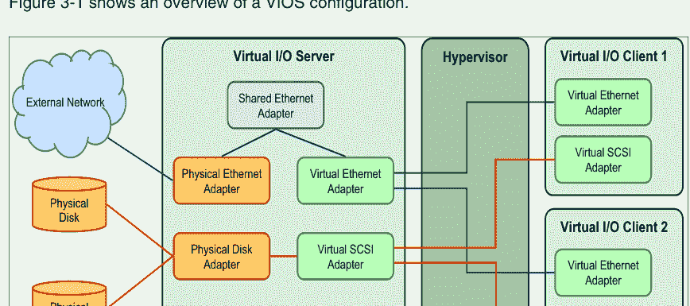
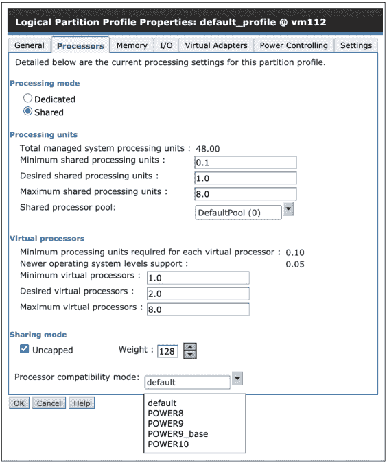
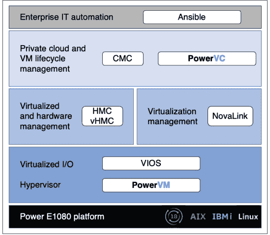
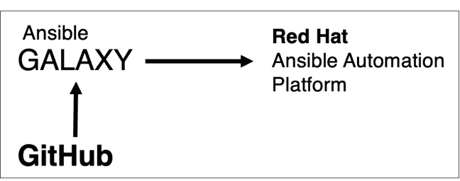
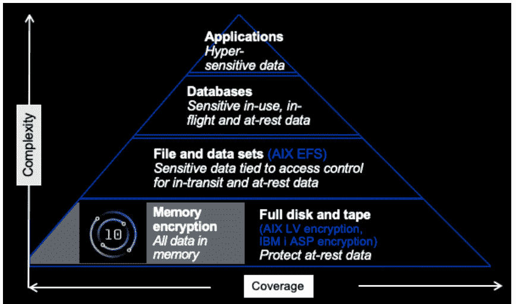
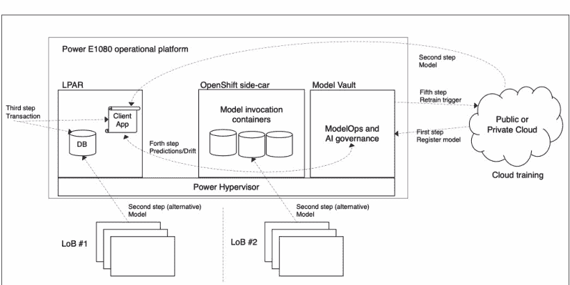

## 企业解决方案

在本章中，我们描述了可以帮助企业实现业务目标的主要支柱，以及 Power E1080 为此做出的重要贡献的原因。

本章包含以下主题：

- 3.1，“PowerVM” 第 136 页
- 3.2，“IBM PowerVC 概述” 第 145 页
- 3.3，“使用 Ansible 进行系统自动化” 第 146 页
- 3.4，“从核心到云保护信任” 第 149 页
- 3.5，“在运营数据存储位置运行人工智能” 第 152 页

### 3.1 PowerVM

PowerVM 平台是一系列技术、功能和产品组合，为企业提供业界领先的虚拟化。它是基于 Power 处理器的服务器虚拟化的总括品牌术语；即 IBM POWER Hypervisor、逻辑分区、IBM Micro-Partitioning®、VIOS、Live Partition Mobility (LPM) 等。PowerVM 是硬件使能和软件的结合。

> 注意：PowerVM Enterprise Edition License Entitlement 已包含在每台 Power E1080 服务器中。PowerVM Enterprise Edition 可作为硬件功能（#5228）提供，支持每个核心最多 20 个分区、VIOS、多个共享处理器池（MSPPs），并提供 LPM。

#### 3.1.1 IBM POWER Hypervisor

基于 Power 处理器的服务器结合 PowerVM 技术，提供以下关键功能，可帮助整合和简化 IT 环境：

- 提高服务器使用率并共享 I/O 资源，以降低总体拥有成本（TCO）并更好地利用 IT 资产。
- 通过根据需要动态重新分配资源给应用程序，提高业务响应能力和运营速度，更好地匹配不断变化的业务需求或应对需求的意外变化。
- 通过使工作负载独立于硬件资源，简化 IT 基础设施管理，以便可以使用基于时间、成本和服务级别要求的业务驱动策略来提供资源。

结合 Power E1080 中的功能，IBM POWER Hypervisor 提供启用其他系统技术的功能，包括逻辑分区（LPAR）技术、虚拟化处理器、IEEE 虚拟局域网（VLAN）兼容虚拟交换机、虚拟 SCSI 适配器、虚拟光纤通道适配器和虚拟控制台。

POWER Hypervisor 是系统固件的基本组件，提供以下功能：

- 在使用物理硬件资源的物理硬件资源与 LPAR 之间提供抽象。
- 通过在 LPAR 之间提供安全层来强制执行分区完整性。
- 控制虚拟处理器到物理处理器的调度。
- 在逻辑处理器上下文切换期间保存和恢复所有处理器状态信息。
- 控制 LPAR 的硬件 I/O 中断管理设施。
- 在 LPAR 之间提供 VLAN 通道，有助于减少分区间通信所需的物理以太网适配器。
- 监控 Flexible Service Processor（FSP）并在检测到 FSP 之一丢失时执行重置或重新加载，如果问题未得到纠正，则通知操作系统。

POWER Hypervisor 始终处于活动状态，无论系统配置如何或是否连接到管理控制台。它需要内存来支持服务器上 LPAR 的资源分配。POWER Hypervisor 固件所需的内存量根据以下几个因素而变化：

- 硬件页表（HPT）的内存使用量
- 支持 I/O 设备的内存使用量
- 虚拟化功能的内存使用量

### 硬件页表的内存使用量

系统上的每个分区都包含自己的硬件页表（HPT），这会增加 hypervisor 的内存使用量。HPT 由操作系统用来在硬件中将有效地址转换为物理实地址。这种从有效地址到实地址的转换允许多个操作系统在其各自的逻辑地址空间中同时运行。每当分区的虚拟处理器在物理处理器上调度时，hypervisor 就会指示硬件使用可用于地址转换的分区 HPT 的位置。

HPT 的内存量基于分区的最大内存大小和 HPT 比率。默认 HPT 比率为 1/128（适用于 AIX、Virtual I/O Server [VIOS] 和 Linux 分区）的分区最大内存大小。AIX、VIOS 和 Linux 使用更大的页面大小（16 和 64 KB），而不是使用 4 KB 页面。使用更大的页面大小可减少必须跟踪的页面总数；因此，HPT 的整体大小可以减小。例如，最大内存大小为 256 GB 的 AIX 分区的 HPT 为 2 GB。

在定义分区时，所指定的最大内存大小基于可以在不更改配置和重新启动分区的情況下动态添加到动态分区（DLPAR）的内存量。

除了设置最大内存大小外，还可以配置 HPT 比率。用于 chsyscfg 硬件管理控制台（HMC）命令的 hpt_ratio 参数可以发出以定义分区配置文件所使用的 HPT 比率。有效值是 1:32、1:64、1:128、1:256 或 1:512。

指定较小的绝对比率（1/512 是最小值）会减少分配给 HPT 的总体内存。更改 HPT 比率时需要进行测试，因为较小的 HPT 可能会导致 CPU 消耗增加，因为操作系统可能需要更频繁地重新加载 HPT 中的条目。大多数客户选择使用 IBM 提供的 HPT 比率默认值。

### I/O 设备的内存使用量

为支持 I/O 操作，hypervisor 维护称为转换控制实体（TCE）的结构，它们在 I/O 设备和分区之间提供信息路径。TCE 提供 I/O 缓冲区的地址、读与写请求的指示以及其他 I/O 相关属性。每个 I/O 设备使用许多 TCE，因此可以同时向同一物理设备发出多个请求。为了提供更好的亲和性，TCE 分布在多个处理器芯片或机箱中，以提高访问 TCE 时的性能。

对于物理 I/O 设备，TCE 的基础空间量由 hypervisor 定义，基于支持的 I/O 设备数量。支持高速适配器的系统也可以配置为分配更多内存以提高 I/O 性能。Linux 是唯一使用这些额外 TCE 的操作系统，因此如果系统仅使用 AIX，则内存可以释放供分区使用。

### 虚拟化功能的内存使用量

虚拟化需要 POWER Hypervisor 分配更多内存用于硬件状态保存区域和各种虚拟化技术。例如，在基于 Power10 处理器的系统上，每个处理器核心支持多达八个同时多线程（SMT）执行线程，每个线程包含超过 80 个不同的寄存器。

POWER Hypervisor 必须为配置的最大虚拟处理器数量预留寄存器内容的保存区域。物理硬件设备数量越多，虚拟设备数量越多，虚拟化程度越高，需要的 hypervisor 内存就越多。为了实现高效的内存消耗，各种属性（处理器、内存和虚拟适配器）的所需值和最大值必须基于业务需求，而不是设置为明显高于实际需求的值。

### 预测 POWER Hypervisor 使用的内存

IBM 系统规划工具（SPT）是可用于估算特定服务器配置所需 hypervisor 内存量的资源。在下载并安装 SPT 可执行文件后，您可以通过选择正确的硬件平台和已安装的处理器和内存，并定义分区和分区属性来定义配置。SPT 可以估算分配给 hypervisor 的内存量，这有助于您更改配置或部署新服务器时。

POWER Hypervisor 提供以下类型的虚拟 I/O 适配器：

- 虚拟 SCSI
  POWER Hypervisor 提供虚拟 SCSI 机制用于存储设备的虚拟化。存储虚拟化是通过使用一对适配器实现的：虚拟 SCSI 服务器适配器和虚拟 SCSI 客户适配器。
- 虚拟以太网
  POWER Hypervisor 提供虚拟以太网交换机功能，允许分区在同一服务器上进行快速且安全的通信，无需任何物理互连或服务器外部的连接，如果在 VIOS 分区中设置到物理以太网适配器的第 2 层桥接，则也称为共享以太网适配器（SEA）。
- 虚拟光纤通道
  虚拟光纤通道适配器是虚拟适配器，可为客户 LPAR 提供通过 VIOS 分区连接到存储区域网络的光纤通道连接。VIOS 分区在 VIOS 分区上的虚拟光纤通道适配器与受管系统上的物理光纤通道适配器之间提供连接。
- 虚拟（TTY）控制台
  每个分区必须能够访问系统控制台。诸如操作系统安装、网络设置和各种问题分析活动等任务需要专用的系统控制台。POWER Hypervisor 通过使用虚拟 TTY 或串行适配器以及操作它们的一组 hypervisor 调用提供虚拟控制台。虚拟 TTY 不需要购买任何其他功能或软件，例如 PowerVM Edition 功能。

## 逻辑分区

LPAR 和虚拟化提高了系统资源的利用率，并增加了配置可能性。

*逻辑分区*是指使一台服务器如同两台或多台独立服务器一样运行的能力。当你对服务器进行逻辑分区时，你将服务器上的资源划分为子集，称为 *LPAR*。你可以在 LPAR 上安装软件，并且 LPAR 作为一个独立的逻辑服务器运行，使用你分配给该 LPAR 的资源。

LPAR 在某些文档中也被称为 *虚拟机*（VM），这使其看起来与其它超visor提供的功能相似。然而，LPAR 提供了更高级别的安全性和隔离性以及本章中描述的其他功能。

处理器、内存和 I/O 设备可以分配给 LPAR。AIX、IBM i、Linux 和 VIOS 都可以在 LPAR 上运行。VIOS 为运行通用操作系统的其他 LPAR 提供虚拟 I/O 资源。

LPAR 共享一些系统属性，例如系统序列号、系统型号和处理器 FC。所有其他系统属性可以因 LPAR 而异。

## 微分区

当你使用微分区技术时，你可以将处理器的分数分配给一个 LPAR。使用处理器分数的 LPAR 也称为 *共享处理器分区* 或 *微分区*。微分区在称为 *共享处理器池*（SPP）的一组处理器上运行，并且使用虚拟处理器使操作系统能够管理分配给 LPAR 的处理能力分数。

从操作系统角度来看，除非操作系统得到增强以确定差异，否则虚拟处理器无法与物理处理器区分开来。物理处理器被抽象为可供分区使用的虚拟处理器。

在基于 Power10 处理器的服务器上，分区可以定义的处理能力低至 0.05 个处理单元。该数字代表 0.05 个物理核心。每个物理核心可被多达 20 个共享处理器分区共享，并且分区的授权可以以小至 0.05 个处理器的分数递增。共享处理器分区在 Power Hypervisor 的控制下在物理处理器上进行调度并进行时间片分配。共享处理器分区由 HMC 创建和管理。

Power E1080 支持单系统最多 240 个核心和 1000 个微分区（1000 是 PowerVM 支持的最大值）。

注意：虽然 Power E1080 支持多达 1000 个微分区，但实际限制取决于服务器上使用的应用程序工作负载需求。

## 处理模式

当你创建 LPAR 时，你可以为专用使用分配整个处理器，或从 SPP 分配部分处理单元。此设置定义了 LPAR 的处理模式。

## 专用模式

在专用模式下，物理处理器作为整体分配给分区。Power10 处理器核心中的 SMT 功能允许核心同时运行来自两个、四个或八个独立软件线程的指令。

## 共享专用模式

在基于 Power10 处理器的服务器上，你可以配置专用分区成为空闲处理器的处理器捐赠者，这些处理器归其所有，从而允许将专用处理器分区中的空闲 CPU 周期捐赠给 SPP。专用分区对专用 CPU 周期保持绝对优先级。启用此功能可以帮助提高系统使用率，而不会损害专用处理器模式 LPAR 中关键工作负载的计算能力。

## 共享模式

在共享模式下，LPAR 使用虚拟处理器访问物理处理器的分数。共享分区可以定义任意数量的虚拟处理器（最大数量为分配给分区的处理单元数的 20 倍）。Power Hypervisor 根据分区的处理单元授权将虚拟处理器调度到物理处理器。一个处理单元代表一个物理处理器的处理能力。所有分区获得的总 CPU 时间等于其处理单元的授权。逻辑处理器是在虚拟处理器之上定义的。因此，即使使用虚拟处理器，逻辑处理器的概念仍然存在，并且逻辑处理器的数量取决于 SMT 是否打开或关闭。

#### 3.1.2 多个共享处理器池

MSPP 在基于 Power10 处理器的服务器上受支持。此功能允许系统管理员创建一个微分区集，其目的是控制可以从物理 SPP 使用的处理器容量。

微分区被创建，然后被识别为默认处理器池或用户定义的 SPP 的成员。存在于微分区集内的虚拟处理器由 Power Hypervisor 监控。处理器容量根据用户定义的属性进行管理。

如果 Power 服务器负载很重，则 SPP 内的每个微分区都保证其处理器授权，外加如果微分区未限制时可能从保留池容量分配的任何容量。

如果 SPP 中的特定微分区未使用其处理能力授权，未使用的容量将被让出，并且同一 SPP 内的其他未限制微分区可以根据其未限制权重使用额外容量。这样，SPP 的授权池容量就分配给该 SPP 内的微分区集。

所有支持 MSPP 功能的 Power 服务器至少有一个（默认）SPP，最多可达 64 个 SPP。

此功能有助于客户在软件或数据库许可证的成本取决于分配的处理器核心数量时，显著降低总体拥有成本（TCO）。

#### 3.1.3 虚拟 I/O 服务器

虚拟 I/O 服务器（VIOS）是 PowerVM 的一部分。它是允许在 LPAR 之间共享物理资源以实现更高效使用（例如，整合）的特定设备。在这种情况下，VIOS 拥有物理 I/O 资源（SCSI、光纤通道、网络适配器或光学设备），并允许客户分区共享对其的访问，从而最大程度地减少并优化系统中的物理适配器数量。

VIOS 消除了每个分区都拥有专用网络适配器、磁盘适配器和磁盘驱动器的要求。VIOS 支持 OpenSSH 以实现安全远程登录。它还提供防火墙以按端口、网络服务和 IP 地址限制访问。

图 3-1 显示了 VIOS 配置的概述。

在每个物理服务器上运行双 VIO 服务器是推荐的做法。

## 共享以太网适配器

共享以太网适配器（SEA）可用于将物理以太网网络连接到虚拟以太网网络。SEA 通过将 Power Hypervisor VLAN 连接到外部交换机上的 VLAN 来提供此访问。由于 SEA 在第 2 层处理数据包，因此数据包的原始 MAC 地址和 VLAN 标签对物理网络上的其他系统可见。支持 IEEE 802.1 VLAN 标记。

通过使用 SEA，多个客户分区可以共享一个物理适配器。你还可以使用物理适配器连接内部和外部 VLAN。SEA 服务只能托管在 VIOS 中（不能在通用 AIX 或 Linux 分区中），并充当第 2 层网络桥，以安全地在虚拟以太网网络（内部）和一个或多个（Etherchannel）物理网络适配器（外部）之间传输网络流量。这些虚拟以太网网络适配器由 VIOS 上的 Power Hypervisor 定义。

## 虚拟 SCSI

虚拟 SCSI 用于查看 SCSI 协议的虚拟化实现。虚拟 SCSI 基于客户/服务器关系。VIOS LPAR 拥有物理 I/O 资源并充当服务器，或在 SCSI 术语中充当目标设备。客户端 LPAR 作为客户端访问由 VIOS 提供的虚拟 SCSI 后备存储设备。

虚拟 I/O 适配器（虚拟 SCSI 服务器适配器和虚拟 SCSI 客户端适配器）是通过 HMC 进行配置的。虚拟 SCSI 服务器（目标）适配器负责运行其收到的任何 SCSI 命令，并由 VIOS 分区拥有。虚拟 SCSI 客户端适配器允许客户端分区访问映射供客户端分区使用的物理 SCSI 和 SAN 连接的设备和 LUN。虚拟磁盘资源的供应由 VIOS 提供。

## N_Port ID 虚拟化

N_Port ID 虚拟化（NPIV）是一种技术，允许多个 LPAR 通过同一个物理光纤通道适配器访问一个或多个外部物理存储设备。该适配器连接到一个 VIOS 分区，该分区仅作为直通使用，管理通过 Power Hypervisor 的数据传输。

每个分区都具有一个或多个虚拟光纤通道适配器，每个适配器都有自己的一对唯一的全球端口名称。此配置使您能够将每个分区连接到 SAN 上的独立物理存储。与虚拟 SCSI 不同，只有客户端分区可以看到磁盘。

有关 NPIV 的更多信息和要求，请参阅 *IBM PowerVM Virtualization Managing and Monitoring*，SG24-7590。

### 3.1.4 Live Partition Mobility

LPM 允许您在不中断的情况下将正在运行的 LPAR 从一个系统移动到另一个系统。非活动分区迁移允许您将已关闭电源的 LPAR 从一个系统移动到另一个系统。

LPM 提供了系统管理灵活性，并通过避免以下情况提高了系统可用性：

- 硬件升级或固件维护的计划停机。
- 非计划停机时间。通过预防性故障管理，如果服务器指示潜在故障，您可以在故障发生前将其 LPAR 迁移到另一台服务器。

有关 LPM 的更多信息和要求，请参阅 *IBM PowerVM Live Partition Mobility*，SG24-7460。

HMCV10R1 和 VIOS 3.1.3 或更高版本为 Live Partition Mobility 功能提供了以下增强功能：

- 自动选择最快的网络用于 LPM 内存传输
- 允许在虚拟光学设备分配给分区时进行 LPM

### 3.1.5 Active Memory Expansion

Active Memory Expansion（AME）是一个可选功能代码（#EM8F），属于 PowerVM 伞下的技术，使系统能够进行内存扩展。

AME 是一种创新技术，支持 AIX 操作系统。它有助于使有效最大内存容量大于真实物理内存最大值。内存内容的压缩和解压缩可以使内存扩展高达 100% 或更多。此扩展可以使分区在相同的物理内存量下完成更多工作或支持更多用户。同样，它可以使服务器在相同的物理内存量下运行更多分区并完成更多工作。

AME 使用 CPU 资源来压缩和解压缩内存内容。以内存容量换取处理器周期的权衡可能是一个极佳的选择，但扩展程度取决于内存内容的可压缩性如何。它还取决于是否有足够的空闲 CPU 容量用于此压缩和解压缩。

Power E1080 包含一个硬件加速器，旨在提高 AME 效率并使用更少的处理器核心资源。每个 AIX 分区都可以打开或关闭 AME。控制参数设置每个分区想要的扩展量，以帮助控制 AME 功能使用的 CPU 量。

需要对正在打开内存扩展的特定分区进行 IPL。启用后，标准 AIX 性能工具中提供监控功能，例如 `lparstat`、`vmstat`、`topas` 和 `svmon`。

AIX 中包含了一个规划工具，可让您采样工作负载并估计分区的内存可扩展性以及需要多少 CPU 资源。该功能可以与 Power E1080 的初始订单一起订购，也可以作为 MES 订单订购。当启用功能被订购时，会提供一个软件密钥，该密钥应用于系统节点。启用系统节点不需要 IPL。密钥特定于单个系统并且是永久性的。不能将其移动到不同的服务器。

> **注意：** IBM i 不支持 AME。

### 3.1.6 Remote Restart

Remote Restart 是分区的<|message|> 可用性选项。如果发生导致服务器停机的错误，已配置为 Remote Restart 的分区可以在不同的物理服务器上重新启动。有时，启动服务器可能需要更长时间，在这种情况下，可以使用 Remote Restart 功能来更快地重新配置分区。通常，这比重新启动已停止的服务器然后重新启动分区更快。Remote Restart 功能依赖于类似于 LPM 的技术，其中分区配置为在 SAN 上使用存储，该存储可被托管分区的服务器共享（访问）。

HMC V10R1 为 Remote Restart 功能提供了增强功能，允许在虚拟光学设备分配给分区时进行远程重启。

### 3.1.7 POWER 处理器模式

尽管它们不是虚拟化功能，但 POWER 处理器模式在此描述，因为它们会影响各种虚拟化功能。

在 Power 服务器上，分区可以配置为在多种模式下运行，包括以下模式：

- POWER8
  POWER8 处理器的原生模式，实现 IBM Power ISA 的 2.07 版。有关更多信息，请参阅 IBM 文档。

- POWER9
  POWER9 处理器的原生模式，实现 IBM Power ISA 的 3.0 版。有关更多信息，请参阅 IBM 文档。

## POWER10

Power10 处理器的原生模式，实现 IBM Power ISA 的 3.1 版。有关更多信息，请参阅 IBM 文档。

图 3-2 显示了 Power E1080 上的可用处理器模式。

图 3-2 处理器模式

处理器兼容模式在计划在不同代服务器之间进行 LPM 迁移时非常重要。可能迁移到由另一代处理器管理的机器的 LPAR 必须以特定的兼容模式激活。

注意：使用 LPM 将 LPAR 从基于 POWER7 处理器的服务器迁移到 Power E1080 不受支持；但是，可以完成以下步骤来完成此任务：

- 1. 使用 LPM 将 LPAR 从基于 POWER7 处理器的服务器迁移到基于 POWER9 处理器的服务器。
- 2. 然后将 LPAR 从基于 POWER9 处理器的服务器迁移到 Power E1080。

### 3.1.8 Single Root I/O Virtualization

Single Root I/O Virtualization（SR-IOV）是 Peripheral Component Interconnect Express（PCIe）规范的扩展，允许多个操作系统同时共享一个 PCIe 适配器，而几乎不需要或不需要 hypervisor 或其他虚拟化中介的运行时参与。

SR-IOV 是 PCI 标准架构，使 PCIe 适配器能够自我虚拟化。它通过共享实现适配器整合，就像逻辑分区实现服务器整合一样。借助支持 SR-IOV 的适配器，您可以通过逻辑端口将单个物理适配器的虚拟切片分配给多个分区；所有这些都不需要 VIOS。

### 3.1.9 有关虚拟化功能的更多信息

以下 IBM Redbooks 出版物提供了有关虚拟化功能的更多信息：

- IBM PowerVM Best Practices, SG24-8062
- IBM PowerVM Virtualization Introduction and Configuration, SG24-7940
- IBM PowerVM Virtualization Managing and Monitoring, SG24-7590
- IBM Power Systems SR-IOV: Technical Overview and Introduction, REDP-5065

### 3.2 IBM PowerVC 概述

IBM Power Virtualization Center（PowerVC）是一个先进的虚拟化和云管理产品（基于 OpenStack 构建），为运行在 IBM Power Systems 上的 IBM AIX、IBM i 和 Linux 虚拟机提供简化的虚拟化管理和云部署。PowerVC 旨在提高管理员生产力并简化 Power Systems 服务器上虚拟机的云管理。

通过使用 PowerVC，您可以执行以下任务：

- 创建虚拟机并调整虚拟机的 CPU 和内存大小。
- 将磁盘卷或其他网络附加到这些虚拟机。
- 导入虚拟机和卷以便由 IBM PowerVC 管理。
- 监控环境中资源的使用情况。
- 对虚拟机进行快照或克隆。
- 在虚拟机运行时迁移虚拟机（物理服务器之间的实时迁移）。
- 在服务器故障时远程重启虚拟机。
- 使用高级存储技术，例如 VDisk 镜像或 IBM Global mirror。
- 提高资源使用率以降低资本支出和功耗。
- 提高敏捷性和执行力以快速响应不断变化的业务需求。
- 提高 IT 生产力和响应能力。
- 简化 Power Systems 虚拟化管理。
- 加速可重复、无错误的虚拟化部署。

IBM PowerVC 可以管理通过 HMC 连接或使用 NovaLink 运行在 PowerVM 虚拟化下的 AIX、IBM i 和基于 Linux 的虚拟机。本版本支持基于 IBM POWER8、IBM POWER9 和后续技术的扩展和企业 Power Systems 服务器。

#### 3.2.1 IBM PowerVC 功能和优势

为什么选择 IBM PowerVC？为什么您需要另一个虚拟化管理产品？当超过 70% 的 IT 预算花费在运营和维护上时，IT 客户完全有理由期望供应商将新的开发工作重点放在降低 IT 成本和促进 IT 部门创新上。

IBM PowerVC 为 IBM Power Systems 客户提供以下优势：

- 它与 Power Systems 深度集成。
- 它提供虚拟化管理工具。
- 它简化了由 PowerVM 管理的服务器在自动化 IT 环境（如云）中的集成。
- 它是基于 Power Systems 的 IBM 基础设施即服务（IaaS）的构建模块。
- PowerVC 与其他云管理工具（如 Ansible、Terraform 或 OpenShift）集成，并可集成到编排工具中，如 IBM Cloud® Automation Manager、VMware vRealize 或 SAP Landscape Management（LaMa）。
- PowerVC 还提供私有云和公有云之间 VM 镜像的便捷交换。

IBM PowerVC 是 PowerVM 企业虚拟化技术集的补充，提供虚拟化管理。它基于开放标准，并将服务器管理与存储和网络管理集成。

由于 IBM PowerVC 基于 OpenStack 计划，Power Systems 可由兼容 OpenStack 标准的工具进行管理。当系统由 IBM PowerVC 控制时，可以通过以下三种方式进行管理：

- 系统管理员使用 IBM PowerVC 图形用户界面（GUI）
- 使用包含 IBM PowerVC 表示状态传输（REST）应用程序编程接口（API）的脚本的系统管理员
- 通过标准 OpenStack API 调用 IBM PowerVC 的更高层工具

以下 PowerVC 方案在 Power Systems 云可用解决方案中定位如下：

- IBM PowerVC：高级虚拟化管理
- IBM PowerVC for Private Cloud：基础云
- IBM Cloud Automation Manager：高级云
- VMware vRealize：高级云

PowerVC 提供企业客户所需的系统管理产品，以有效管理 IBM 高端硬件提供的先进功能。它减少资源使用并管理工作负载以实现性能和可用性。

### 3.3 使用 Ansible 进行系统自动化

企业花费大量宝贵的管理员时间执行重复性任务和使用手动流程。诸如更新、修补、合规检查、配置新的虚拟机或 LPAR，以及确保正确的安全更新到位等任务，占用了本可用于更有价值业务活动的宝贵时间。

使用 Ansible 实现自动化可为系统管理员赢回宝贵时间。

Red Hat Ansible Automation Platform for Power 已完全启用，因此企业可以自动化 AIX、IBM i 和 Linux 中的多个任务，包括部署应用程序。Ansible 还可以与 HMC、PowerVC 和 Power Virtual Server 结合，在任何需要的地方配置基础设施，包括来自其他 IBM 业务合作伙伴或基于 Power 处理器服务器的第三方提供商的云解决方案。

在新 LPAR 初始安装或设置后的首要任务是确保安装了正确的补丁。此外，还必须安装额外的软件（无论是开源软件、ISV 软件还是他们自己的企业软件）。Ansible 拥有一套推出新软件的能力，这使其在持续交付/持续集成（CD/CI）环境中很受欢迎。编排和自动化与安全产品的集成代表了 Ansible 在数据中心中应用的另一种方式。

尽管 AIX 和 IBM i 在许多不同业务领域被不同类型的客户广泛采用，但 Ansible 可以帮助将基于 Power 处理器的技术引入那些认为 AIX 和 IBM i 技能是稀缺商品、难以在市场上找到但又想利用硬件平台所有功能的客户。Ansible 体验在基于 Power 或 x86 处理器的技术上完全相同，并且相同的步骤可以在 IBM Cloud 中重复。

AIX 和 IBM i 技能客户也可以从 Ansible 提供的极端自动化解决方案中受益。

基于 Power 处理器的架构在工程团队紧密协作以确保无缝工作的集成堆栈方面，相比商品服务器平台（如 x86）具有独特的优势。处理器、主板、虚拟化和管理设备上的工程团队密切合作以确保集成堆栈无缝运行。这种方法与多供应商基于 x86 处理器的技术方法形成鲜明对比，在后者中，处理器、服务器、管理、虚拟化必须从不同的（有时是竞争的）供应商处购买。

Power 堆栈工程团队密切合作交付企业服务器平台，从而实现具有业界领先性能、可扩展性和安全性的 IT 架构（见图 3-3）。

图 3-3 Power 堆栈

Power 堆栈中的每一层都经过优化，使基于 Power10 处理器的技术成为关键任务企业工作负载的首选平台。该堆栈包括接下来描述的 Ansible Automation Platform。

#### 3.3.1 Ansible Automation Platform

Ansible Automation Platform 与基于 IBM Power 处理器的技术集成，该集成包含在 Red Hat Ansible 网站的 Certified Integrations 部分。

用于基于 IBM Power 处理器的技术的各种 Ansible 集合（截至本文撰写时已被客户下载超过 25,000 次）现已包含在 Red Hat Ansible Automation Platform 中。因此，这些模块由 Red Hat 的 24x7 企业支持团队提供支持，该团队与相应的基于 Power 处理器的技术开发团队协作。

#### 3.3.2 Ansible 生态系统中的 Power Systems

一系列 Ansible 集合可用于基于 Power 处理器的平台。*集合*是一组模块、Playbooks 和角色。拥抱 Power 社区的 Ansible，我们的 AIX 和 IBM i 社区拥有合适的模块集。一些示例是开发用于管理 AIX 逻辑卷的工具，这些工具将模块接口置于安装密钥命令之上，或管理 AIX init tab 条目。

从 IBM i 角度来看，一个示例是能够对内置于 IBM i 平台的集成 IBM Db2® 数据库运行 SQL 查询、管理对象权限等。所有这些对 AIX 管理员或 IBM i 管理员都有意义。

我们的操作系统团队开发的模块会发送到开源社区（名为 Ansible Galaxy）。每个开发人员都可以将任何可以作为集合候选的对象发布到开放的 Ansible Galaxy 社区，并可能获得 IBM 的认证支持，通过订阅 Red Hat Ansible Automation Platform（见图 3-4）。

#### 3.3.3 用于 AIX 的 Ansible 模块

IBM Power Systems AIX 集合作为 Ansible Content for IBM Power Systems 的更广泛产品的一部分，可从 Ansible Galaxy 获得并提供社区支持。

该集合包括模块和示例 playbook，有助于自动化任务，并可从此网页开始使用。

#### 3.3.4 用于 IBM i 的 Ansible 模块

Ansible Content for IBM Power Systems - IBM i 提供模块、操作插件、角色和示例 playbook，用于自动化 IBM i 上的任务，包括以下示例：

- 命令执行
- 系统和应用程序配置
- 工作管理
- 修复管理
- 应用程序部署

有关集合的更多信息，请参阅此网页。

#### 3.3.5 用于 HMC 的 Ansible 模块

IBM Power Systems HMC 集合提供可用于管理 HMC 系统配置和部署的模块。该集合内容有助于通过 Ansible 生态系统将基于 Power 处理器平台的工作负载作为企业自动化战略的一部分纳入其中。

有关此集合的更多信息，请参阅此网页。

#### 3.3.6 用于 VIOS 的 Ansible 模块

IBM Power Systems VIOS 集合提供可用于管理 Power VIOS 系统配置和部署的模块。该集合内容有助于通过 Ansible 系统将基于 Power 处理器平台的工作负载作为企业自动化战略的一部分纳入其中。

有关更多信息，请参阅此网页。

### 3.4 从核心到云保护信任

尽管强制执行数据加密策略是最大限度降低数据泄露风险的有效方法，进而最大限度降低成本，但截至本文撰写时，只有 17% 的受访企业表示他们使用加密保护了超过 50% 的云中敏感数据¹。全球范围内只有少数企业在整个组织中一致应用加密策略，主要是因为它增加了复杂性、成本，并对性能产生负面影响，这意味着对业务的 SLA 未能实现。

快速发展的网络威胁格局需要关注网络弹性。持久且端到端的保护是降低威胁暴露的唯一方法。

基于 Power 处理器的平台始终提供其类别中最安全和最可靠的服务器。Power E1080 进一步扩展了基于 Power 处理器平台的业界领先的安全性和可靠性，重点在于保护跨所有混合云环境中的应用程序和数据。它还引入了以下主要方面的重大创新：

- 先进的数据保护，提供简单易用且高效的能力，通过加密和多因素身份验证等机制保护敏感数据。

¹ source: Thales Data Threat Report - Global Edition: https://cpl.thalesgroup.com/resources/encryption/2021/data-threat-report

- 平台安全确保服务器免受篡改的强化、持续保护其完整性，并确保多租户工作负载之间的强隔离。没有强大的平台安全，所有其他系统安全措施都将面临风险。
- 面向现代威胁的安全创新提供了利用新兴技术领先于新型网络安全威胁的能力。
- 集成安全管理解决了确保整个堆栈中众多安全功能正确配置、监控它们，并在检测到意外更改时做出反应的关键挑战。

Power E1080 已增强以简化并集成整个堆栈的安全管理，从而降低管理员错误发生的可能性。

在 Power E1080 中，所有数据均由大大简化的端到端加密保护，该加密扩展到混合云且无可检测的性能影响，并为未来的网络威胁做好准备。

Power10 处理器核心技术具有内置安全集成：

- 通过更好的加密性能以及对量子安全加密和全同态加密（FHE）的支持，领先于当前和未来的数据威胁。
- 通过更强的防御返回导向编程（ROP）攻击来增强应用程序的安全性。
- 无需任何设置即可实现简化的单接口混合云安全管理。
- 通过与基于 x86 处理器的服务器相关的超visor 相比，常见漏洞暴露（CVEs）低数个数量级，在业界提供最安全的虚拟机隔离来保护您的应用程序和数据。

此外，Power E1080 上的工作负载可受益于加密算法加速，这使得诸如高级加密标准（AES）、SHA2 和 SHA3 等算法的运行速度比基于 POWER9 处理器的服务器每个核心快得多。这种性能加速使得诸如 AIX 逻辑卷加密等功能能够以较低的性能开销启用。

#### 3.4.1 加密引擎和透明内存加密

Power10 处理器技术旨在实现显著更快的加密性能，AES 加密引擎数量增加四倍。与基于 IBM POWER9 处理器的服务器相比，Power E1080 已针对当今最苛刻的标准以及预期未来的加密标准进行了更新，例如后量子和全同态加密（FHE），并为容器安全带来了新增强。

透明内存加密旨在通过使用硬件功能实现无缝用户体验，从而简化加密并在不影响性能的情况下支持端到端安全。基础设施各层引入的保护如图 3-5 第 151 页所示。

图 3-5 使用透明内存加密保护内存中的数据

#### 3.4.2 量子安全加密支持

为迎接量子时代做好准备，Power E1080 构建为可高效支持未来加密，例如量子安全加密和 FHE。这些解决方案的软件库针对 Power10 处理器芯片指令集架构（ISA）进行了优化，并且已在或将会在各自的开源社区中提供。

量子安全加密是指为在构建大规模量子计算机时做好准备而识别出对经典计算机和量子计算机攻击具有抗性的算法的努力。

同态加密是指允许系统在不先解密数据的情况下对加密数据执行计算的加密技术。这些解决方案的软件库针对 Power 处理器芯片指令集架构（ISA）进行了优化。

#### 3.4.3 IBM PowerSC 支持

Power E1080 可受益于 IBM PowerSC 提供的集成安全管理功能：

- IBM PowerSC
- 用于在运行 AIX 的每个基于 Power 处理器的平台上管理安全和合规性的 Power 软件组合
- IBM i 或受支持的发行版
- Linux 版本

PowerSC 正在引入更多功能，以帮助客户在整个堆栈中端到端管理安全，以领先于各种威胁。具体而言，PowerSC 2.0 增加了对端点检测和响应（EDR）、基于主机的入侵检测、阻止列表和 Linux 的支持。

### 3.5 在运营数据存储位置运行人工智能

用于 AI 和业务应用程序的独立平台使得在生产中部署 AI 变得困难。其结果是应用程序和数据访问的端到端可用性降低、由于将运营数据发送到外部 AI 平台并接收预测而产生开销导致违反服务水平协议的风险增加，以及管理不同环境和外部加速器的复杂性和成本增加。

随着世界准备在任何地方部署 AI，关注点正从如何快速构建 AI 转向如何快速对 AI 进行推理。

为支持这一转变，Power E1080 通过在每个基于 Power10 技术的处理器核心上配备四个矩阵数学辅助（MMA）单元来加速 AI，从而实现就地运行 AI 以获得更快的业务洞察。处理器核心的强大执行能力，结合 MMA AI 加速、增强的 SIMD 和增强的数据带宽，为统计机器学习和推理工作负载的执行提供了外部加速器（如 GPU）及其相关设备管理的替代方案。这些功能，加上在 Power E1080 平台上将 AI 模型执行的多环境与其它不同类型的环境进行整合的可能性，降低了成本，并为 AI 带来了大大简化的解决方案堆栈。

直接在 Power E1080 上运营化 AI 推理使 AI 更接近数据。这种能力使 AI 能够继承并受益于 Power10 处理器平台的企业级服务质量（QoS）：可靠性、可用性和安全性，并支持性能提升。企业业务工作流程现在可以随时、一致地使用由 AI 支持构建的洞察。

Power10 处理器核心上的数据引力使用使得 AI 可以在数据库操作期间或与应用程序并发运行。例如，这对于时间敏感的用例至关重要。它能更快地将新鲜输入数据提供给 AI，并提高洞察的质量和速度。

随着无代码应用程序开发、按需使用模型仓库、自动机器学习和 AI 赋能的应用程序供应商的不断发展和增长，对应的软件产品被引入到 Power10 平台。Python 以及来自 TensorFlow、PyTorch 和 XGBoost 等主要框架和工具的代码可在基于 Power10 处理器的平台上无需任何更改即可运行。

开放神经网络交换（ONNX）模型可以从基于 x86 处理器的服务器或其他平台或小型虚拟机或 Power Virtual Server（PowerVS）迁移到 Power E1080 进行部署，这使客户能够在商品硬件上构建，但在企业服务器上部署。

Power10 处理器核心架构包含嵌入式矩阵数学加速器（MMA）。该 MMA 推算到 E1080 系统可提供高达 5 倍更快的 FP32 AI 推理，以将 AI 融入业务应用程序并推动更深入的洞察，或在使用 Bfloat16 和 INT8 等降低精度数据类型时提供高达 10 倍更快的 AI 推理，与上一代基于 Power9 的服务器相比。

IBM 优化了数学库，以便 AI 工具受益于 Power10 芯片的 MMA 单元提供的加速。MMA 动作的好处可用于统计机器学习和推理，这为外部加速器或 GPU 提供了具有成本效益的替代方案。

#### 3.5.1 在任何地方训练，在 Power E1080 上部署

IBM 基于 Power10 处理器的技术通过硬件和软件创新解决了挑战。在基于 Power 或 x86 处理器的服务器（即使字节序不同）的任何云上训练的模型都可以在 Power E1080 上部署并无需任何更改即可运行。

Power10 核心配备了四个用于矩阵和张量数学的数学引擎。应用程序可以在无需外部加速器、GPU 或额外 AI 平台的情况下，使用本地化数据运行模型。Power10 技术采用“在任何地方训练，在此部署”原则来运营化 AI。

模型可以在公共或私有云上进行训练（见图 3-6），使用以下流程：

1. 模型连同其版本一起在所谓的 *模型库* 中注册，该库是一个 VM 或 LPAR，其中包含 Watson Openscale、BentoML 或 Tensorflow Serving 等工具。
2. 模型被推送到目标（在本例中为运行数据库和应用程序的 VM 或 LPAR），模型可能被数据库或应用程序使用。
3. 数据库和应用程序接收的交易触发模型执行并生成预测或分类。这些预测也可以本地存储。例如，这些预测可以是与交易或产品分类相关的风险或欺诈，供下游应用程序使用。
4. 模型输出（预测或分类）的副本被发送到模型运营（ModelOps）引擎，用于通过与 Ground Truth 比较来计算漂移。
5. 如果漂移超过阈值，则会生成模型重训练触发器。
6. 重训练后的模型随后经过步骤 1 - 5。

图 3-6 运营化 AI

通过软件和硬件创新的结合，Power E1080 可以满足注入 AI 的数据库和应用程序的模型性能、响应时间和吞吐量 KPI。

## 相关出版物

本节列出的出版物被认为特别适合对本文档中涵盖的主题进行更详细的讨论。

## IBM Redbooks

以下 IBM Redbooks 出版物提供了有关本文件主题的更多信息。此列表中引用的某些出版物可能仅提供软拷贝：

- IBM Power Systems Private Cloud with Shared Utility Capacity: Featuring Power Enterprise Pools 2.0, SG24-8476
- SAP HANA Data Management and Performance on IBM Power Systems, REDP-5570
- IBM PowerAI: Deep Learning Unleashed on IBM Power Systems Servers, SG24-8409
- IBM Power System AC922 Technical Overview and Introduction, REDP-5494
- IBM Power System E950: Technical Overview and Introduction, REDP-5509
- IBM Power System E980: Technical Overview and Introduction, REDP-5510
- IBM Power System L922 Technical Overview and Introduction, REDP-5496
- IBM Power System S822LC for High Performance Computing Introduction and Technical Overview, REDP-5405
- IBM Power Systems H922 and H924 Technical Overview and Introduction, REDP-5498
- IBM Power Systems LC921 and LC922: Technical Overview and Introduction, REDP-5495
- IBM Power Systems S922, S914, and S924 Technical Overview and Introduction Featuring PCIe Gen 4 Technology, REDP-5595
- IBM PowerVM Best Practices, SG24-8062
- IBM PowerVM Virtualization Introduction and Configuration, SG24-7940
- IBM PowerVM Virtualization Managing and Monitoring, SG24-7590
- IBM PowerVC Version 2.0 Introduction and Configuration, SG24-8477

您可以在以下网站搜索、查看、下载或订购这些文档以及其他 Redbooks 出版物、Redpapers、网络文档、草案和附加材料：

ibm.com/redbooks

## 在线资源

以下网站也是进一步的信息来源：

- IBM Fix Central:
  http://www.ibm.com/support/fixcentral/
- IBM documentation:
  https://www.ibm.com/docs/en
- IBM Power10 documentation:
  https://www.ibm.com/docs/en/power10
- IBM Portal for OpenPOWER - POWER9 Monza Module:
  https://www.ibm.com/systems/power/openpower/tgcmDocumentRepository.xhtml?aliasId=POWER9_Monza
- IBM Power:
  https://www.ibm.com/it-infrastructure/power
- IBM Storage:
  https://www.ibm.com/it-infrastructure/storage
- IBM Systems Energy Estimator:
  https://ibm.biz/energy-estimator
- IBM System Planning Tool:
  https://www.ibm.com/support/pages/ibm-system-planning-tool-power-processor-based-systems-0
- OpenCAPI:
  http://opencapi.org/technical/use-cases/
- OpenPOWER Foundation:
  https://openpowerfoundation.org/
- Power Systems Capacity on Demand:
  http://www.ibm.com/systems/power/hardware/cod/
- Support for IBM Systems:
  https://www.ibm.com/mysupport/s/?language=en_US

## IBM 帮助

IBM Support and downloads
ibm.com/support

IBM Global Services
ibm.com/services

