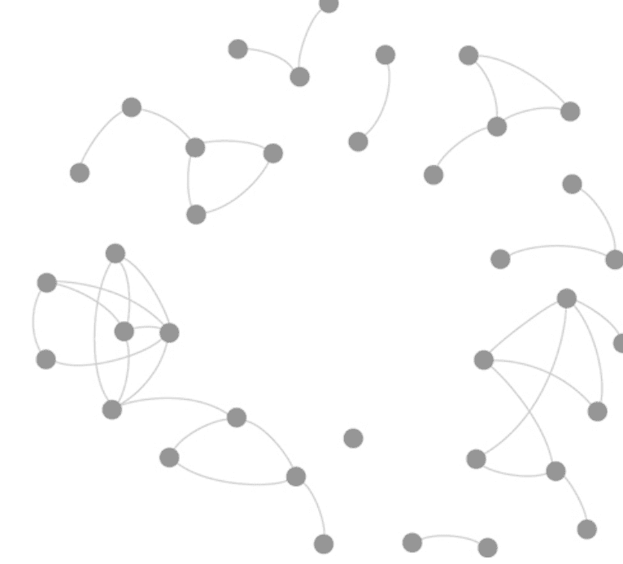
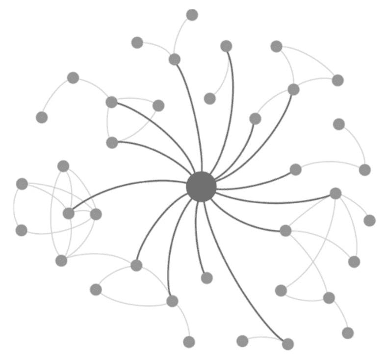
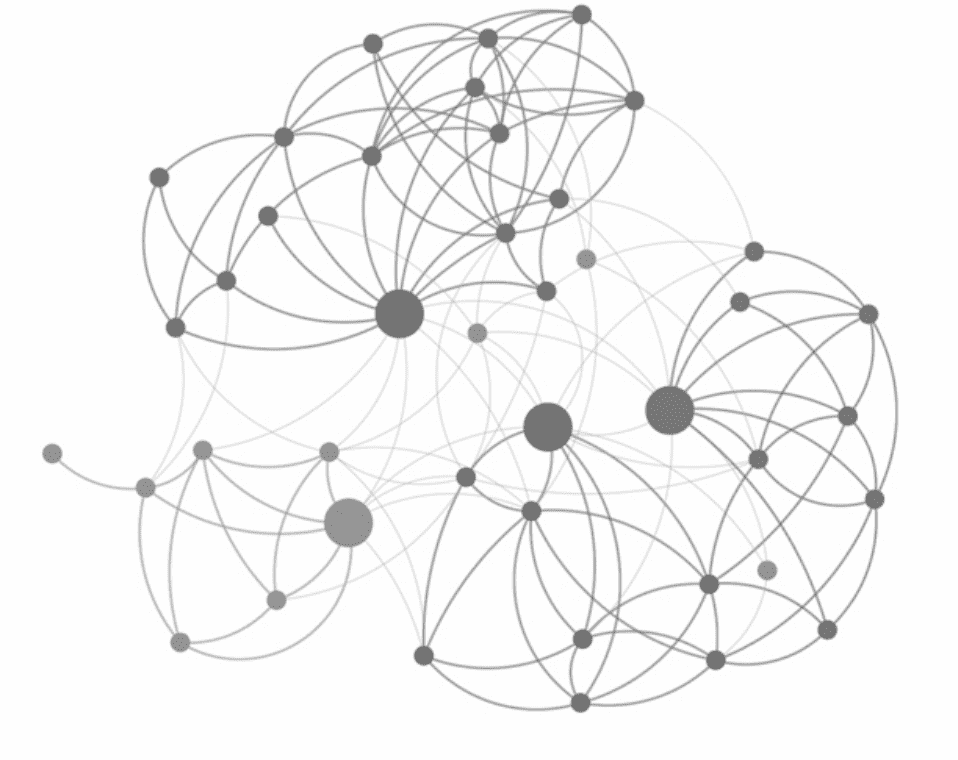
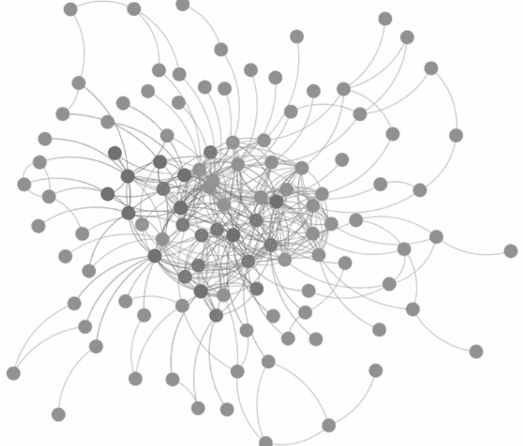
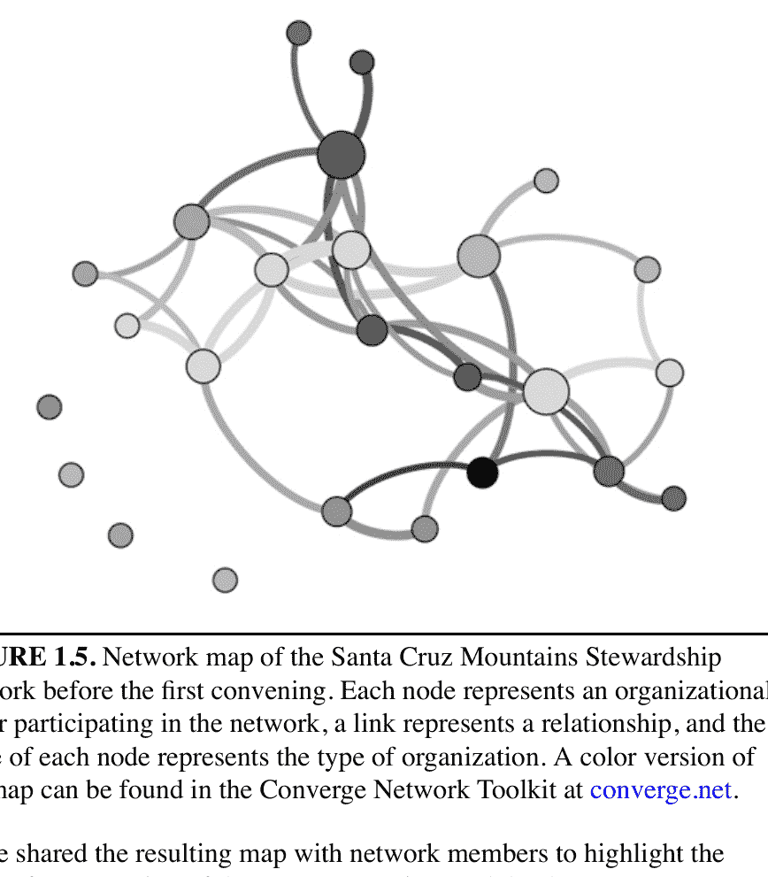
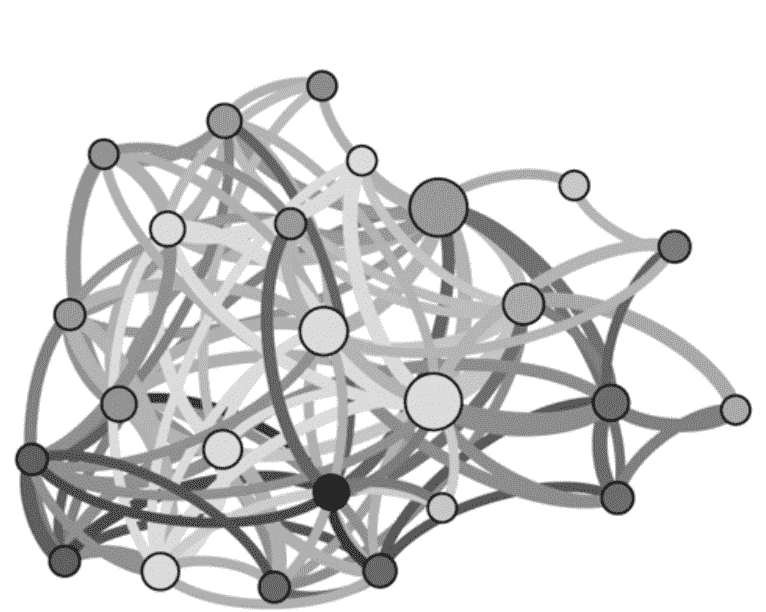

## 第1章

## 变革之网

> > *我们陷入了一个无法逃避的相互依存之网，*  
> > *被束缚在命运的单一件外衣之中。*  
> > *任何直接影响他人的事物，都会间接影响所有人。*
> >
> > ——马丁·路德·金，《伯明翰监狱来信》

网络无处不在，但它们常常隐藏于众目睽睽之下。在最基本的层面上，网络是关系的网状结构。有生物网络，如我们大脑中的神经网络；技术网络，如高速公路系统和电网；以及人类网络，如社交网络和专业网络。正如弗里特约夫·卡普拉所说，网络是“生命统一的基本模式”。¹

构成我们组织、社会和地球系统基础的网络，对这些系统最终的健康和有效性有着巨大的影响。将树木和真菌连接在一起的广泛网络就是一个典型例子。在森林地表之下，菌丝体（真菌的营养部分，由称为菌丝的网状线体组成）为土壤中不同生命形式之间的交流和资源共享提供了途径。森林中的树木和真菌存在共生关系——树木需要真菌能够接触到而树木本身无法获得的养分，而真菌需要树木提供的碳。菌丝体连接在一起，构成了所谓的*菌根网络*。正如森林生态学家苏珊娜·西马德所说，这些网络提供了“地下超级高速公路”，将树木连接在一个巨大的资源共享社区中。² 阳光充足的树木与需要碳的正在生长的树木分享碳，而养分则传递给受到入侵物种或疾病损害的树木。

自人类出现以来，我们也一直以网络的形式组织起来——为了保护、相互支持和分享资源。一个人可能同时与许多不同的网络相连接，例如家庭网络、朋友网络、专业网络、学校网络、社区网络、宗教网络和在线社交网络。网络可以是松散和无结构的，就像大多数社交网络那样；也可以是为了实现特定功能和推进特定目标而形成的，就像影响力网络那样。正如引言中所述，影响力网络是一种特殊类型的网络，它将个人和组织连接起来，以推进共同目标下的学习和行动。社交网络往往随着人们因邻近或共同兴趣而彼此连接而自然形成，而影响力网络则需要更高程度的有意性来推动其发展。

影响力网络有三种主要形式：学习网络、行动网络和运动网络。每种形式最适合特定的功能。

**学习网络**专注于连接*和*学习。它们旨在促进信息或知识的流动，以推进在特定议题上的集体学习。

**行动网络**专注于连接、学习*和*行动。它们旨在促进连接和学习，以服务于协调行动。

**运动网络**将许多其他学习网络和行动网络连接在一起，形成一个网络中的网络。虽然它们在核心上通常很像学习网络或行动网络，但运动网络还促进信息共享，并协调多个不同网络为共同目标采取行动。一些运动网络还帮助催化和支持新的影响力网络，这些新网络通常聚焦于特定地区或运动整体目标中较窄的方面。

学习网络、行动网络和运动网络都通过不同的方式被有意培育以创造影响力。没有哪种形式天生优于另一种，每种形式都可能因情境不同而最为合适。它们共同提供了一种变革性的方法来创造

connection, sparking collaboration, and catalyzing systemic change. More details on the structures and functions of each form can be found in [第三章](#)。

Impact networks provide value in many ways: they coordinate work among different actors and across organizations and silos without being controlling or directive; they are resilient to disruption, given their decentralized structures; they respond to urgent opportunities at a moment’s notice; and they integrate diverse perspectives to create new possibilities. By strengthening connection and collaboration across divides, impact networks are an essential way of organizing to meet the complexity of our world.

Throughout the remainder of [第一章](#), we will explore two case studies in detail to illuminate what impact networks are and why they matter. Then, as you progress through the rest of part 1, you will discover the fundamentals of what it takes to make impact networks thrive.

## Networks for Impact

To illustrate how impact networks develop and create change over time, we look to two examples: the Initiative for Multipurpose Prevention Technologies, a global learning network focused on reproductive health; and the Santa Cruz Mountains Stewardship Network, a cross-sector action network dedicated to protecting the ecological and cultural heritage of a 500,000-acre region in California.

## A Global Learning Network to Advance Sexual and Reproductive Health

The Initiative for Multipurpose Prevention Technologies (IMPT) brings together researchers, product developers, funders, policy makers, and advocates to advance sexual and reproductive health for women and girls worldwide through the development of multipurpose prevention technologies, or MPTs. MPTs are an innovative class of combination products designed to simultaneously prevent HIV, other sexually transmitted infections (STIs), and/or pregnancy.

Prior to the network’s formation, work on broad-spectrum sexual and reproductive health was fragmented. To connect the field, the nonprofit organization CAMI Health convened stakeholders working on HIV prevention, STI prevention, and contraceptive development for the first time (convenings are gatherings that bring all network members together simultaneously). The founding participants of the IMPT realized that there was an opportunity to develop single products that could address multiple risks concurrently by building upon decades of work in these traditionally siloed but interlinked areas.

At the time, “MPTs were a budding idea gaining some conversational interest, particularly in the microbicide and family planning fields,” says Bethany Young Holt, executive director and founder of CAMI Health. “But there was no organizing body poised to move MPTs from a concept to a reality.” As a result of the 2009 convening, the IMPT network was launched to help facilitate the progress of the MPT field.³

As a learning network, the IMPT focuses primarily on connecting participants and accelerating the flow of information in, out, and across the network to facilitate learning. The network gathers relevant information in from participants and a variety of external sources, using a shared database to organize field-relevant data. It then organizes and distributes that information back out to participants through a newsletter, publications, webinars, social media, and network calls. It also enables the flow of information across the network, directly from person to person, by organizing meetings, facilitating conversations on specific topics, and maintaining an online communication system. Through these multiple channels, researchers and advocates from around the world are sharing critical research, learning from one another’s work, and coordinating their efforts to advance the development of MPTs.

The IMPT grew through the four stages illustrated in figures 1.1 through 1.4. These stages, first defined by June Holley and Valdis Krebs in their seminal paper Building Smart Communities Through Network Weaving, and re-created by Kumu, a data visualization platform specializing in network mapping, represent how connections proliferate during a network’s formation.⁴

When systems are disconnected, they resemble Stage 1, Scattered Fragments, shown in figure 1.1. In this stage, some people know and interact with each other, but overall the whole system remains fragmented. People are represented by nodes (also known as elements or actors), and the connections between them are represented through links (also known as edges or ties). The groups within which some connections do exist are called clusters (also known as communities). Clusters are groups of people that are much more connected with each other than they are with those from other parts of the system.

FIGURE 1.1. Stage 1—Scattered Fragments

FIGURE 1.2. Stage 2—Hub and Spoke

FIGURE 1.3. Stage 3—Multi-Hub

**FIGURE 1.4.** Stage 4—Core/Periphery

Clusters are an extremely common phenomenon in networks, forming quite naturally as people gravitate toward those with whom they share similarities. People in distinct clusters tend to be more like-minded, have shared language, have similar conversations, and be located in the same region. Network limitations arise when clusters remain separated without a bridge to connect them. Bridges are essential links between two parts of a system that would otherwise be disconnected (the people responsible for creating bridges have been called *bridgers, boundary spanners,* and *brokers*).

Without a bridge to connect clusters together, information fails to flow between them, creating echo chambers—spaces where people merely reinforce each other’s beliefs. Locked in their echo chamber, people remain closed off from hearing new perspectives and are unlikely to collaborate with those from outside their bubble. Systems can overcome these issues by intentionally forming a network to strengthen the connections between clusters. This involves creating opportunities where people can come together to build relationships and learn about each other’s work.

In the case of the IMPT, Holt was the catalyst that brought participants together for the first time. When this happened, the network entered Stage 2, Hub and Spoke, shown in figure 1.2, with Holt as the central hub (hubs are highly connected nodes in a network). This was an improvement from when the field was completely siloed into scattered fragments. But staying at this stage too long has its shortcomings. The central hub becomes a gatekeeper and often creates a bottleneck, slowing the rate at which information flows. When connections are made only through a central hub, it limits the kind of spontaneous collaboration that happens when people form direct, personal relationships with one another.

Critically, Holt did not try to hoard these relationships for herself; instead, she saw her role as facilitating connections and communication across the system.⁵ As relationships formed, the IMPT evolved into a Stage 3, Multi-Hub network, shown in figure 1.3. Key actors from the MPT field were no longer dependent on any single individual to stay connected. In our experience, impact networks that do not evolve beyond the hub-and-spoke stage are significantly limited in what they can accomplish. Reaching the multi-hub stage is a necessary step toward unlocking the special qualities that make networks a powerful force for change.

Over time, the IMPT grew into a Stage 4, Core/Periphery network as shown in figure 1.4. At this stage, there is a highly interconnected group of participants in the network’s core, as well as a large and diverse periphery that serves as a source of new ideas and new connections to other networks. Less-active participants on the periphery may move into the network’s core over time as they become more engaged in its activities. Today, more than two hundred active participants make up the IMPT core, and more than two thousand individuals on the periphery receive its communications.⁶

Nearly a decade after the network’s founding, more than two dozen MPT products are in development, and MPTs have become widely recognized as a new class of comprehensive prevention products in sexual and

生殖健康。通过首次连接系统各地的个人和组织，IMPT 使网络成员能够以过去从未可能的方式相互联系和学习。MPT 领域绝不可能在没有 CAMI Health 的催化领导和 IMPT 网络的成长的情况下取得如此大的进展，或如此迅速的进展。

## 一个跨部门行动网络来守护土地

2014 年底，圣克鲁斯山脉地区主要土地所有者和土地管理组织的一群领导人意识到，尽管他们都致力于保护该地区 50 万英亩的自然资源，但他们并未以足以让景观长期繁荣的规模开展合作。为提高区域协调，他们成立了圣克鲁斯山脉管理网络 Santa Cruz Mountains Stewardship Network, SCMSN，并聘请 Converge 指导网络的发展、促进其首次聚会，并聘请并培训一名全职协调员，以支持网络的未来发展。

如今，SCMSN 是一个行动网络，连接了二十多个团体，包括政府机构、土地信托、非营利组织、研究机构、木材公司和一个美洲原住民部落。这些团体共同拥有或管理该地区大部分土地，他们围绕着共同的宗旨走到了一起，即帮助“培育一个充满韧性、充满活力的地区，让人类和自然系统世代繁荣”。⁷

作为一个行动网络，SCMSN 融合并发展了学习网络的特质，促进组织之间信息流动和知识共享。同时，它还支持成员之间相互协作，以影响整个地区的保护成果。例如，该网络推进了一个数百万美元的植被测绘项目，为土地管理者提供宝贵数据，帮助指导其管理工作。SCMSN 引发的另一项协作努力，并由其所属的更大运动网络加州景观管理网络 California Landscape Stewardship Network 推进，已导致一项重大的“剪掉绿色胶带”倡议，极大地改善了全州生态修复项目的许可和资金效率。然而，在 SCMSN 能够以这种规模开始协作之前，参与者首先需要澄清他们共同持有的目的，并建立有意义的信任关系。

建立信任关系的能力远非理所当然。在网络启动前夕，我们对参与者进行的初步访谈中了解到该地区的社会分裂和紧张历史。自 1960 年代以来，环保主义者和以土地为生计的圣克鲁斯县居民一直陷入一种典型的冲突，争论如何照顾该地区的红杉森林。几十年来，环保团体和土地信托一直追求保护主义使命，限制该地区的木材采伐并“拯救红杉”。木材公司自二十世纪中叶以来一直使用可持续的择伐技术，反对这种保护主义做法。

土地信托与木材公司之间的冲突因圣克鲁斯山脉两侧社区的差异而进一步复杂化。东侧的圣克拉拉县是硅谷所在地，拥有经济实力和政治影响力。西侧的圣克鲁斯县，人们大多生活在农村环境中，有些人靠土地为生。该地区最大的土地信托主要位于圣克拉拉县，而木材公司及其员工则倾向于生活和工作在圣克鲁斯县。

与此同时，我们访谈的一些领导人表达了对问题权力动态的担忧，小型保护组织不断被资金充足的土地信托 overshadow。其他人则对彼此怀有数年的怨恨，因为他们觉得自己在之前的合作中没有得到公平对待。还有其他人担心网络会被劫持以服务于私人利益。

与其最初关注网络成员将一起做什么，这在缺乏信任的情况下会遇到严重阻碍，我们专注于澄清他们共同持有的愿景和原则。我们还专注于培养能够促进长期创造性思考和合作的关系。

在网络第一年举行的三次聚会中，参与者了解了彼此的价值观和动机，并辩论了良好管理的实践应如何体现。尽管观点不同，他们发现自己都热爱这片土地。他们分享了关于祖先的故事、他们如何来到圣克鲁斯山脉地区生活，以及他们如何首次爱上当地的树木、动物、河流和山脉的故事。他们设想了他们想要的区域未来，并澄清了团结他们组织的共同愿景。他们建立了新的关系，并加深了与已认识的人的联系。到第三次聚会结束时，参与者制定了一份共同章程，定义了网络的目的、他们对良好管理的集体理解，以及他们将协调努力的具体优先领域。制定章程是一个具有里程碑意义的时刻，但这也只是个开始。

网络继续发展，增加了新成员并激发了新的合作。两名成员，如《水星新闻 Mercury News》所描述的，“在许多问题上传统上并不一致”——当地环保组织半岛开放空间信托 Peninsula Open Space Trust 和一家家族经营的木材公司 Big Creek Lumber——合作保护了近一千英亩的红杉森林，这是近十年来最大规模的交易之一。⁸ 单独一项，Amah Mutsun 部落、加州州立公园和 San Mateo 资源保护区之间的合作正在努力恢复 Quiroste Valley 的生态活力。该努力在第 7 章中有更详细的描述，由部落成员领导，他们采用祖先的管理实践，在过程中修复伤害并缓慢地与州机构建立信任。⁹

虽然成果令人鼓舞，但最值得关注的是关系。关系是网络得以运作的核心。“我们害怕说关系和信任有多重要，”San Mateo 资源保护区的执行主任 Kellyx Nelson 说，“但关系建设正是魔法的发生之处。关系引导我们去寻找‘可以’。”¹⁰

## 关系：网络的核心

关系是影响网络取得一切成就的核心。从对网络和其他多利益相关方协作长达二十年的研究来看，加州大学伯克利分校哈斯商学院的 Jane Wei-Skillern 发现，“所有成功协作背后最重要的单一因素是参与者之间基于信任的关系。许多协作努力最终未能充分发挥潜力，因为它们缺乏坚实的 relational 基础。”¹¹

虽然大量精力被投入到使任何系统的各个部分更有效，但人们常常忽视通过将系统联系在一起的关系网络来加强整个系统的机会。例如，基金会经常在单个组织上投入大量资源——并期望它们产生超大影响——却没有投资于协作基础设施，使多个组织能够以强大的方式结合其努力。一次又一次我们看到，个人和组织之间牢固的关系网络对于创造具有韧性、智能和创新性的系统至关重要。没有关系，有效的协作是不可能的。

为了更好地了解圣克鲁斯山脉地区存在的分裂程度，我们在网络首次聚会前进行了初步社会网络分析 Social Network Analysis, SNA，并在第二次聚会后六个月进行了第二次分析。在调查中，参与者被要求保密评估他们与网络中每个人的联系程度 选项包括 0–无联系、1–熟人、2–关系、3–牢固关系。如图 1.5 所示，关系很少存在，尤其是在不同类型组织的领导者之间。节点代表组织领导人，链接表示两个人之间存在关系或牢固关系，相关色调代表特定组织类型，如政府机构、土地信托或研究机构 为保护个人隐私，已删除具体识别信息。

图1.5. 圣克鲁斯山脉管护网络首次召集前的网络图。每个节点代表参与网络的一个组织领导者，连线代表关系，节点的颜色深浅代表组织类型。该地图的彩色版本可在 converge.net 上的 Converge Network Toolkit 中找到。

我们将生成的地图分享给网络成员，以突出系统目前碎片化的状态。我们还利用这些数据，在原本没有关系的人们之间建立联系，并组织对话小组，让他们了解彼此的价值观、动机和工作。当我们进行第二次分析时，网络已经变得更加互联，不同类型组织之间的联系也更加多样化，如图1.6所示（我们建议影响力网络定期进行SNA，以帮助评估网络的成长，并揭示支持其发展的机会——更多关于社会网络分析的信息见第10章）。

**图1.6.** 圣克鲁斯山脉管护网络启动六个月后的网络图。

回顾圣克鲁斯山脉管护网络的发展，网络协调员兼唯一全职员工迪伦·斯凯布鲁克（Dylan Skybrook）认为，关系是其成功的基础。斯凯布鲁克说，关系的力量最明显地体现在网络就争议话题展开对话、以及人们不遗余力地支持彼此工作的时候，但最重要的也许是，关系现在已经成为一种常态：“我认为人们甚至不再注意到他们彼此信任并建立了关系；事情本来就是这样的。每个人都在不断互动，寻找合作的方式。这在整个地区形成了一张无形的网，促进更好的土地管护。”¹²

正因为这些关系，整个系统现在才能协同运作。信息在组织、机构和政府机构之间自由共享。一位网络成员惊讶地表示，当他们对另一个组织的运作方式有意见时，现在可以“直接拿起电话沟通”。其他人则表示，新的关系拓展了他们的视野，使他们在臆测他人意图之前会先停下来思考。没有信任关系，网络的影响力是不可能实现的。
