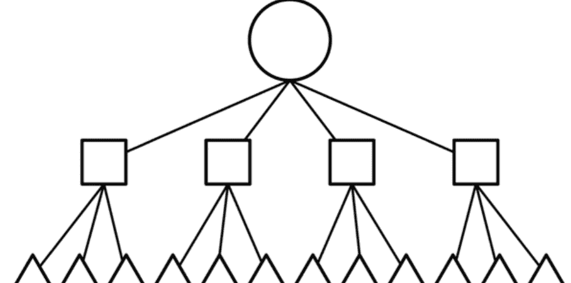
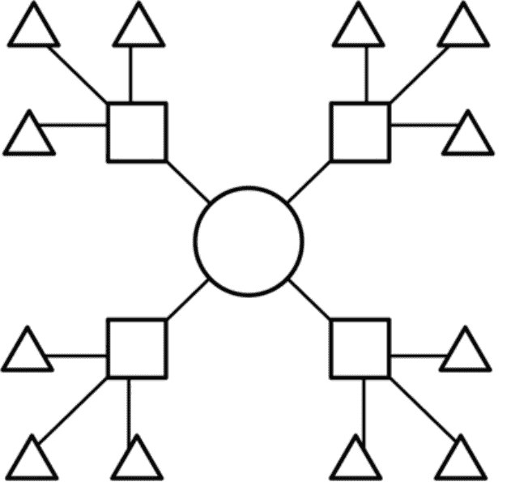
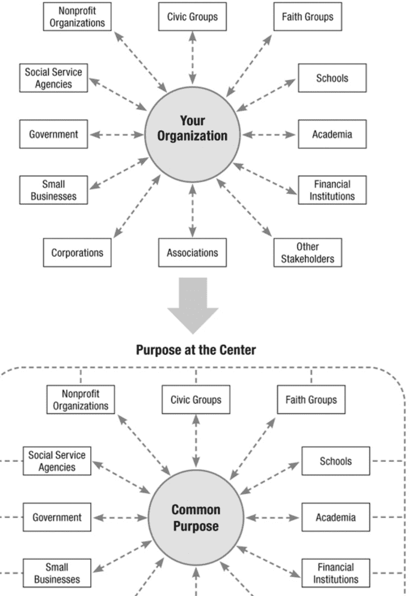
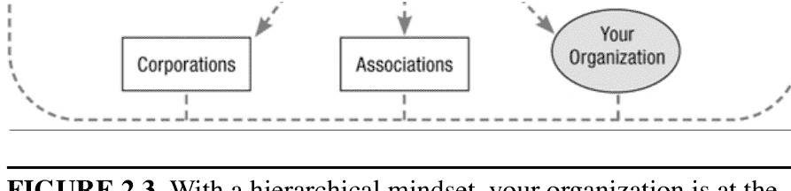

## 第2章

### 网络思维

> 你无法通过对抗现有现实来改变事物。要改变某些东西，就建立一个让现有模式过时的新模式。
> 
> ——巴克敏斯特·富勒，《富勒视野》

一旦你开始认识到构成我们世界的关系网络，你就再也回不去了。这就是我们所说的网络思维转变。采用网络思维，就是接受万物互联的现实——个人、组织和部门的行为会以深刻且往往出人意料的方式相互影响。最重要的是，网络思维的特点是“一种看待世界的方式，一种视角的转变……以关系性的眼光看待世界”，克里斯托弗·维塔莱在《网络学》中写道。¹ 实现这种思维转变，是通过网络进行思考、学习并创造变革的旅程中至关重要的一步。

那些接受了网络思维的人，将自己视为更大活动网络的一部分——是系统中的众多节点之一，而不是中心枢纽。这样，网络思维转变也可以被描述为焦点从“我”到“我们”的演变，或者如奥托·夏默和凯特琳·考费尔在《从未来领导》中所说，从“自我系统意识”到“生态系统意识”的演变。² 随着这种转变，领导者变得善于注意自己的努力与他人的关系，因此更容易发现合作的机会。他们不是试图扩大单个组织、建造一台越来越庞大高效的机器，而是寻求向外扩展，通过协作发展更强的联系来产生影响力。这种思考和工作方式对于我们有效应对复杂性至关重要。当各种资源——领导力、资金和人才——被跨系统地用于共同目标时，影响力的潜力会显著增加。

简·韦-斯基勒恩倡导的四项原则最简洁地概括了网络思维。³ 采用网络思维的领导者关注以下内容：

- 扩大影响力，而不是壮大自己的组织或职能
- 成为互联系统的一部分，而不是系统的中心
- 与同伴分享领导权和功劳，而不是囤积权力或试图成为英雄
- 建立基于信任的关系，而不是控制体系

当你拥抱网络思维时，你就不再孤立地工作。相反，你开始专注于培养联系、加强流动、共享资源，从而共同完成比单打独斗更多的事情。

### 层级思维

当今世界占主导地位的组织框架是一种层级的、命令-控制模式，决策由少数领导者做出，然后传递给指挥链中较低层级的人。层级制被定义为“一种人或群体按地位或权力高低排列的系统或组织”⁴，它具有高效追求并实现特定、明确目标的非凡能力，例如生产商品和服务。在应对罗恩·海费茨所说的“技术性挑战”时，层级制最为有效——这类挑战的问题定义、解决方案和实施路径都很清晰。⁵

许多人偏爱层级制，因为它具有可预测性和稳定性——员工和领导者都知道自己可以期待什么，而且活动可以提前很好地预测。另一方面，层级结构在应对复杂而多面的问题时能力有限。网络是从内向外运作，想法和行动源于个体之间的对话；而层级结构则是自上而下运作，强大的领导者通过层层管理向下级发送指令和资源。面对复杂性时，这种结构就会变成瓶颈。

虽然层级结构通常被描绘成金字塔，如图2.1所示，但我们也可以把它看作一个刚性的枢纽-辐射网络，如图2.2所示。想象CEO是中心节点，连线代表他们与直接下属的关系，直接下属又连接到更下一级的直接下属，以此类推。每经过一个连接，你就离中心枢纽更远一步。

**图2.1.** 层级结构，通常被描绘成金字塔。

**图2.2.** 层级结构，以枢纽-辐射网络的形式绘制。

身处层级结构的顶端（或刚性枢纽-辐射网络的中心）有其好处——你拥有更多控制权，也更容易被人需要。但这也是有代价的。你控制得越多，人们就越难以自行组织推进工作。你越被人需要，当你不在了的时候系统就越缺乏韧性。你越是维持层级结构，就越会造成瓶颈，限制信息的自由流动。被人极度需要并掌握控制权是一把双刃剑。

这在很大程度上解释了为什么层级制难以迅速适应不断变化的环境。当组织结构被预先定义且缺乏灵活性时，集体发现、自发协作和意外创新的空间就很小。层级制擅长实现其设立之初要达成的特定目标，但并不适合解决那些没有显而易见解决方案的复杂问题。

由于这些原因，层级结构对于多利益相关方合作来说是一个糟糕的选择。通过紧握控制权，处于……

顶层等级制度限制了系统其余部分的自我组织潜力。通过维持一种将某些人置于他人之上的僵化结构，等级制度造成了获取信息和权力的不平等，从而侵蚀信任。而在协作环境中，往往没有中央权威或共享的治理机构能够指导涉及的众多多元利益相关者群体。更糟糕的是，存在一个单一的指挥中心，其响应施加了过多的官僚主义，并且未能纳入应对复杂性所需的各种观点。

我们见过的最有效的协作努力都围绕着共同目的和关系构建了一个高度互联的网络，并且在网络的结构中嵌入了灵活性。建立蓬勃发展的多利益相关方协作，看起来与其说是建立模仿等级制组织的结构，不如说是培育动态且相互连接的网络。

## 网络与等级制度，共存

在许多情况下，消除现有的等级结构是不可能或不明智的。等级制度之所以存在是有原因的。它们是可预测且可靠的，并且在明确需要做什么时非常擅长执行战略。因此，与其改变其内部结构，一些组织支持网络与现有等级制度并行运作。如前所述，影响力网络特别适合解决复杂或系统性问题，这些问题没有明确的解决方案，以及追求需要站点或部门之间、或与外部利益相关者之间更高程度协作的机会。这些条件正是激发了 Google 食品实验室的启动。

当 Michiel Bakker 第一次作为食品团队的负责人来到 Google 时，他发现这是一个非常内向的组织。为了对 Google 关心的大多数最复杂的问题产生更广泛的影响，Bakker 看到需要促进 Google 系统内部以及与外部人士之间的联系。

在 Bakker 的领导下，Google 于 2012 年启动了食品实验室，以解决关键的粮食系统问题，并激励其员工培养更可持续的生活方式。此后，食品实验室将来自 Google 组织各层级的人们以及外部

具体网络能够实现的结果而言，它们为组织提供了一种释放员工创造力和参与度的方式。很大程度上是通过为员工提供有意义的机会，让他们为自己关心但超出日常职责范围的事情做出贡献来实现的。

正如上面的例子所说明的，网络和等级制度并不相互对立。它们可以和谐地并行运作。虽然我们将网络思维与等级制度思维区分开来，但在实践中，等级制度和网络以重要方式重叠和互动。所有组织——即使是等级制组织——都包含将人员和部门连接起来的有机和非正式网络。罗布·克罗斯和安德鲁·帕克在《社会网络的隐藏力量》中写道，这些网络“与组织的绩效、其制定和执行战略的方式以及其创新能力紧密交织”。他们的研究表明，“良好管理的网络连通性对绩效、学习和创新至关重要。”

同样，所有网络都包含自然的等级制度。与其由单一等级制度决定权威，网络拥有根据特定情境而产生的多重灵活等级制度。这就是所谓的*异构*结构。在异构结构中，正式权力和决策是分散的——没有人拥有与生俱来的结构性优势。与此同时，某些人在特定问题上可能比其他人更有影响力，这基于他们的知识、经验或角色。

在我与 Sterling Network NYC 的工作中，这是一个致力于推进纽约市五大行政区经济流动性的行动网络，我注意到一位参与者因其在该领域的专业知识和作为领导者的历史，成为关于公共住房信息的特别值得信赖的来源。他们在公共住房专业知识等级制度中处于顶端，但在其他方面则较低。另一位人士是一名擅长社会正义的律师，在刑事司法改革问题上具有影响力。与此同时，一位精通技术的参与者在网络应采用何种技术工具的问题上最具影响力。通过允许多种自然等级制度出现——而不是由单一权力等级制度决定权威——影响力网络释放了人们为团体带来的诸多才能。

## *等级制度思维与网络思维的区别。*

转向网络思维的主要影响之一在于我们如何思考领导力。等级制度领导是指令性的并集中控制。权力是集中的，应被追求或守护。相比之下，网络领导是促进性的，在他人之间建立联系并分散权力，使人们无需顶层领导即可组织起来。虽然等级制度领导者关注的是他们*自身*与其他人关系的数量和质量，但网络领导者关注的是增加*他人之间*关系的数量和质量。

同样，等级制度领导者常将自己（或其组织）视为太阳，坐在其宇宙的中心，所有其他行为者像绕行的行星一样围绕其旋转。他们是自己故事的主角，其他人则被 relegated 到次要角色。然而，采用了网络思维的领导者认识到他们是更大相互连接系统的一部分。与其只向内看，专注于内部指标和财务目标，他们向外看，超越组织的围墙。他们以对整个系统的意识行事，与有共同关切的其他团体建立紧密联系。他们将目的的追求置于自身组织的成长之上为中心。这种转变在图 2.3 中有所体现。

从等级制度思维转向网络思维也改变了我们对战略的思考方式。等级制度通常采用计划并交付的战略。这可以在制定冗长详细的战略计划的仪式中看到。但复杂情况违背了战略计划所擅长的因果关系。应对复杂问题需要实验、学习和灵活性。刻意的*和*涌现的战略都是必要的，以在规划与适应之间取得平衡。

当人们分享不同的观点并将想法融合在一起时，会产生无法预测的新可能性。就像我们的大脑表现出远超从研究其单个神经元的电脉冲所能预测的非凡特征一样，与水所具有的许多令人惊讶的特性无法通过仅单独观察氢和氧分子来预测或理解一样，网络也不能仅通过观察其各个部分来理解。正是部分之间的互动创造了新的事物。这个过程用一句话来说就是*涌现*。涌现是赋予网络指数级影响力潜力的神奇品质。

为了利用人们来自系统不同部分相互作用时所产生的无尽创造力，网络领导者避免了权威决策的诱惑。

## 以组织为中心

## 以目的为中心

图 2.3. 采用等级制度思维时，你的组织是你关注的中心。采用网络思维时，你将目的置于关注的中心，并将你的组织视为更大相互连接系统的一部分的一个部分。此图形基于 Jane Wei-Skillern 和 Marty Kooistra 开发的图表。

相反，他们拥抱涌现，支持网络自我组织成一个充满活力的生态系统——充满连接、学习和协作行动——而不单方面控制其发展路径。

自我组织发生在人们被邀请根据自己的判断注意到并抓住机会时。当人们可以自由尝试新事物、发起实验并与系统各地的他人建立联系和协作时，网络变得“领导力充沛”。¹⁰ 在等级制度中，领导机会对应于其在结构中的位置，而在网络中，领导机会无处不在。每个人都有能力介入并推进他们有热情的项目。因此，系统结果的责任是共享的，人们认识到他们可以参与塑造未来。这与大多数等级制度形成鲜明对比，在大多数等级制度中，一个小领导群体被委托去理解正在发生的事情并规划下一步。

有一个常见的误解认为自我组织意味着某种自发的自我生成，但自我组织并非随机发生或纯属运气。相反，网络的自我组织潜力是由仆人式领导者（借用罗伯特·格林利夫创造的术语¹¹）所培育的，他们培养连接、学习和行动出现的条件。这些领导者还确保这一切不是在真空中发生，而是在与人们可以导向的明确目的的关系中发生。因此，虽然群体的行动在战略和范围上可能相当多样，但它们仍然保持连贯和相互强化。在

在复杂的环境中，连贯的自组织是一股关键力量，它汇聚多元视角，并为共同利益促成广泛的实验。

从根本上说，网络领导者的角色是帮助不同的群体找到将他们团结在一起的共同目标，促进自组织，并协调由此涌现的行动，使它们相互启发、相互加强。我们或许无法预测如何最好地应对复杂挑战，但借助网络的涌现性和自组织能力，我们可以共同学习，走向未来。
