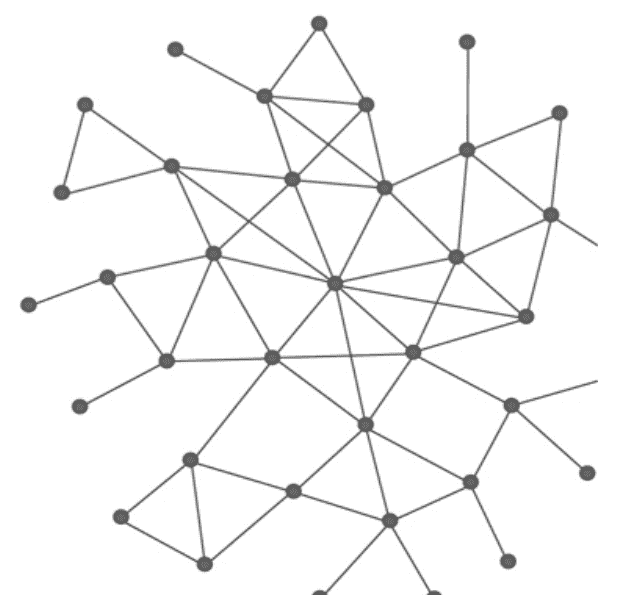
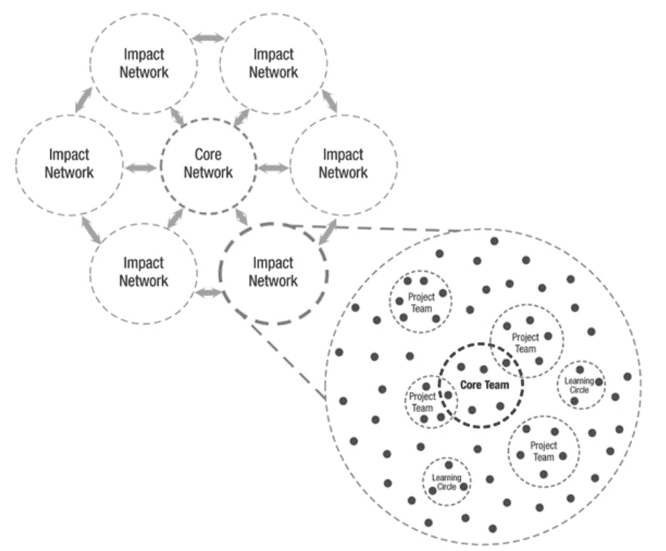

## 第三章

## 让网络发挥作用

> > *当一群兴趣相投的人为了共同目标而聚在一起时，会产生巨大的力量。*
> >
> > ——伊多乌·科耶尼坎，《全民财富》

网络不仅仅是一种观察或思考我们周围系统的方式；它们也是一种组织方式，以应对我们这个世界的复杂性。当两个条件得到满足时，影响力网络是一种可行的方法：（1）你面临一个自己无法解决的复杂问题，（2）需要个人和/或组织之间更高水平的连接来解决这个问题。[^1]

根据其具体关注点的不同，影响力网络可能以不同的形式呈现，每种形式都有独特的结构。正如[第1章](#)所介绍的，影响力网络的三种主要形式是学习网络、行动网络和运动网络。虽然我们用这些类别来区分关注点和结构上的重要差异，但在实践中，网络是如此流动和涌现，以至于它们很少能完全归入某一明确定义的类别。例如，影响力网络有时一开始是学习网络，但随着围绕共享项目进行协作需要更多结构，后来会演变为行动网络。

这并不是说，为了产生社会变革，成为行动网络或运动网络必须是所有影响力网络的最终目标。恰恰相反——每种形式都有其用武之地，而每一种都可能是最佳方法，具体取决于网络的目的和背景。如果你不确定哪种形式最适合你的网络，可以先采用最简单的结构——最小可行结构——来满足其当前需求。一点点结构就能发挥很大作用，如果需要的话，你以后随时可以发展出更多结构。

## 影响力网络的主要形式

学习网络侧重于连接和学习。行动网络侧重于连接、学习和行动。运动网络将多个学习网络或行动网络连接起来，以协调更广泛的运动。下面概述每种形式。

## 学习网络

全球有无数的学习网络例子，尽管许多网络使用不同的术语来描述自己，例如“实践社区”或“知识网络”等。学习网络的建立是为了促进信息交流、激发创新、增加协调，并增强成员将知识应用于本地挑战的能力。² 有时，它们也是为了提供同伴支持并促进参与者的个人发展，如领导力网络和奖学金项目。本书中提到的学习网络包括多用途预防技术倡议、司法动态捍卫者网络和适应火灾社区学习网络。

如图3.1所示，学习网络超越了典型社交网络的松散关系结构，鼓励信息在参与者之间以及与外部群体之间的持续流动，如图3.2所示。一些学习网络是开放的，允许任何人加入，但许多是封闭的，只接纳符合特定标准的参与者（确定参与标准的过程称为网络边界设定——详见第10章）。参与者还可以组成学习圈，聚在一起进行对话、分享知识，并收集与网络目的相关的特定主题信息。

虽然典型学习网络中的参与者不会直接合作——也就是说，建立伙伴关系并做出共同决策——但随着他们相互学习并寻找支持彼此工作的机会，他们的个人努力会变得更加紧密相连。因此，有前景的做法得以传播，资源更容易流向最需要的地方，信息传达更加一致，参与者的行动也开始相互加强。这样，建立一个强大的学习网络本身就可以成为创造变革的有效策略，即使不强调协作行动。

## 行动网络

行动网络将来自不同系统的行动者聚集在一起，进行连接、学习和协作，以应对复杂问题。本书中提到的行动网络例子包括圣克鲁斯山脉管理网络、清洁电子产品生产网络、加州大学旧金山分校健康协调护理网络、RE-AMP网络和100Kin10等。

## 社交网络

图3.1. 一个基本的社交网络，由一组个体（用节点表示）之间的一系列关系（用链接表示）构成。

## 学习网络

图3.2. 学习网络的基本结构，具有有界的参与、学习圈以及信息流入、流出和跨网络流动的持续特征。

行动网络在学习网络的所有特征基础上，加速信息流入、流出和跨网络流动，同时也迈出下一步，积极激发协作。它们促进协作的方式之一是通过项目团队（有时称为工作组或特别行动组），如图3.3所示。项目团队的存在是为了推进与网络目的相关的特定工作领域。一些学习网络也会组建项目团队——如前所述，影响力网络的形式往往是流动的——但这不太常见。学习网络和行动网络之间的区别与其说在于结构，不如说在于其主要关注点：是像学习网络那样促进信息和知识的流动，还是像行动网络那样推进协作行动。

行动网络还可能发展额外的参与式治理结构来指导集体活动。大多数行动网络（和一些学习网络）建立的这样一种治理结构是*核心团队*。核心团队（有时称为*领导团队*、*指导委员会*或*治理委员会*）由一组志愿者或被选举出来指导网络工作和活动的参与者组成。关于核心团队、项目团队和学习圈功能的更多细节，请参见第10章。

行动网络有许多名称，包括*联盟*、*联合体*、*集体影响倡议*、*联盟体*、*创新网络*等等。它们的结构程度可能各不相同：有些是松散的协作体，将各团体聚集在一起为一个事业而奋斗。另一些，如集体影响倡议，则是高度结构化的努力，强调以数据驱动的共享测量系统来确保活动相互加强。

它们的目标范围也可能大不相同。例如，联盟通常会寻求实现特定成果，比如通过一项新政策。一旦实现了该成果，联盟通常会解散。然而，本书中提到的大多数行动网络会同时采取许多行动来应对复杂的、系统性的问题，这些问题没有明确的终点。

（有时称为*分会*或*附属机构*）以半自主的方式运作，同时为了共同目标并遵循共同的原则而相互分享信息和协调。与此同时，核心网络的角色是促进信息共享，放大和支持其成员的工作，并在更广泛的范围内催化行动。就像行动网络的核心团队一样，核心网络提供领导角色来管理更大的整体。

农业企业市场生态系统联盟（AMEA）是一个在全球和地方层面同时运作的运动网络例子，旨在加速专业农民组织的发展，惠及八十个国家的数百万小农户。AMEA的核心网络由二十七个成员组织组成，包括国际小母牛组织、国际美慈组织和雨林联盟，它们正在合作实现农业部门的系统性变革。同时，核心网络也催化并支持区域网络，为农业企业利益相关者创造繁荣的地方生态系统。AMEA目前包括五个区域网络，分别设在埃塞俄比亚、肯尼亚、乌干达、科特迪瓦和洪都拉斯，并计划在未来几年支持拉丁美洲和西非更多网络的发展。区域网络可以自由地在当地背景下做出决策和采取行动，前提是他们同意一套指导整个运动网络的共同原则。

## Movement Network

FIGURE 3.4. The basic structure of a movement network, featuring multiple impact networks that are connected together through a core network to build relationships, share information, coordinate actions, and catalyze systemic change.

## Core Activities of Impact Networks

Impact networks are driven by a common set of activities. While the why (the purpose) and the what (the actions) of networks differ widely, the how (the major activities involved in forming them) is remarkably consistent.
The work of cultivating and sustaining impact networks involves five core activities. For ease of reference, they are referred to as the “Five Cs”:

- Clarify purpose and principles
- Convene the people
- Cultivate trust
- Coordinate actions
- Collaborate for systems change

While learning networks focus primarily on the first four activities (from clarify purpose and principles through coordinate actions), action and movement networks incorporate all five (including collaborate for systems change).

These five activities are dynamic and interdependent. Never fully complete and not strictly linear, they loop back and forth on each other as the network evolves, and they will be revisited over and over throughout a network’s life cycle. While it is impossible to know exactly what is going to happen until people start talking together, the purpose of the Five Cs is to outline the aspects of the network cultivation process that can be intentionally designed and facilitated.

An overview of each activity follows. In part 2 of this book, each activity is explained in depth, with practical exercises you can use to put the whole framework into practice.

## I. Clarify Purpose and Principles

The network’s purpose is an articulation of its reason for being, the point of alignment that brings disparate parts of a system together. Purpose inspires people to join and contribute their time and energy. Clarifying a common purpose is an essential early step in an impact network’s formation. Due to their self-organizing nature, impact networks cannot be *controlled*. They can, however, be *oriented* toward a shared purpose. This is how they stay coherent even as they grow. Purpose is “the invisible leader,” writes Samantha Slade, author of *Going Horizontal*.³

When relationships deepen to a point of mutual confidence, where two people feel they can count on each other to act in service to the purpose—even if they might disagree—we call that *trust*. Trust is the fundamental element that establishes a culture of openness, commitment, and collaboration.

Importantly, trust should not be confused with liking or agreement. To work together, people do not need to like each other. And they certainly do not need to agree with each other on every issue. When I talk about trust here, I mean trust *for impact*. This is the type of trusting relationship that allows people to hold the tension through disagreement and conflict, find common ground, and work together to achieve mutual goals.

Although it is widely accepted that trusting relationships are beneficial when it comes to collaboration, the common assumption is that trust is a by-product of other activities and that it takes a long time to develop. Rather than deliberately building trust, the norm is to focus on getting to action and letting relationships develop naturally over time. However, we have consistently found that trust is the single most important factor behind successful impact networks; networks move at the speed of trust.[^4]

Therefore, trust should be deliberately nurtured from the outset of a network’s development. [Chapter 7](#) is focused on how to cultivate relationships of trust.

## IV. Coordinate Actions

If networks are as strong as the connections that hold them together, connections are only as valuable as what’s moving *through* them. Connections are not just about relationships; they are also about flows—of information, knowledge, and resources. To truly grasp what’s happening in a network, it’s just as important (if not more important) to understand what’s flowing across the network, from node to node, as it is to understand how those nodes are connected.

When flows are accelerated across networks, new opportunities arise for data, expertise, and capacity to be distributed quickly to where they’re needed most. As a result, people are better able to coordinate their efforts.

Specific practices for accelerating flows and coordinating actions are detailed in [chapter 8](#).

## V. Collaborate for Systems Change

Increasing connections and flows across networks creates many positive benefits. But if the goal is to spark more substantial collaboration and create system-wide change, the network will need to dive deeper into an exploration of possible leverage points. These are places in a system where, as Donella Meadows put it, “a small shift in one thing can produce big changes in everything.”⁵ Then, networks can take action on opportunities where people and organizations can have greater impact by working together than is possible alone.

When identifying opportunities to create change, it’s necessary to first make sense of what’s happening in the system from many different perspectives. People and organizations are usually focused on a particular piece of the puzzle, and for good reason—each piece is important, and it takes focus to develop deep expertise and experience on a particular issue. But if they continue to work in isolation, they will be limited in their understanding of the whole.

The puzzle metaphor exemplifies three conditions that make a network approach so valuable:

- **Local knowledge:** People are engaged with different parts of the system, with expertise in their piece of the puzzle.
- **Separation:** People are disconnected and unable or unwilling to share knowledge and resources with one another.
- **Complexity:** The system is more complex than anyone can grasp on their own. Only by bringing the pieces together can groups make sense of the whole puzzle.

Without seeing the whole system, we have little chance of creating the systemic changes we wish to see in the world. Meaningfully addressing complex issues thus requires bringing people together who collectively hold

the pieces needed to engage the issue from many angles at once. We can then begin to recognize the bigger picture and make decisions that benefit the whole system, not just one part of it. [Chapter 9](#) offers potential pathways that networks can take to make sense of complex systems and create systemic change.

## Cultivating the Conditions for Networks to Thrive

How does one help guide a network through each of the Five Cs? To answer this question, it’s helpful to think of networks as like a garden. Unlike machines, which can be built to exact specifications, gardens cannot be forced to grow in a certain way. No two gardens are exactly the same, because every plant grows in relationship with its neighbors, soil, and climate. It’s also not possible to grow a garden overnight: it takes time for the plants to develop, no matter how much attention you give them.

You can, however, cultivate a garden, providing the nutrients, water, and sunlight that plants need to grow and thrive. You can tend to the garden, providing pollinators, using fertilizer, and pulling weeds, adapting your focus to attend to whatever the garden needs most in that moment. You can provide some structure in the form of stakes or trellises to give plants support as they grow.

Like gardens, impact networks are living systems—they have a life of their own. This is precisely why we think of *cultivating* networks as opposed to *building* them. *Cultivate*, an agricultural term, means “to nurture and help grow.”[^6] It implies that you’re creating the right conditions for something to emerge and flourish, just as you would cultivate the land so that crops could grow, rather than building a structure, brick-by-brick, based on a predetermined blueprint.

The individuals who support networks to grow—the gardeners, in this metaphor—are network leaders. Individual leaders who steward the development of impact networks with humility and care are an indispensable aspect of what makes networks thrive. Those who take on the responsibility of leading a network need to be prepared to put in months or even years of work before their efforts consistently bear fruit. While network leaders may notice and nurture early learnings and collaborations,

我们可能无法知道一个网络是一个对话还是距离一次非凡的“登月计划”尚有多远。然而，如果眼前的挑战值得投入，接下来的章节将帮助你通过实验的方式去引领和培育具有影响力的网络。
