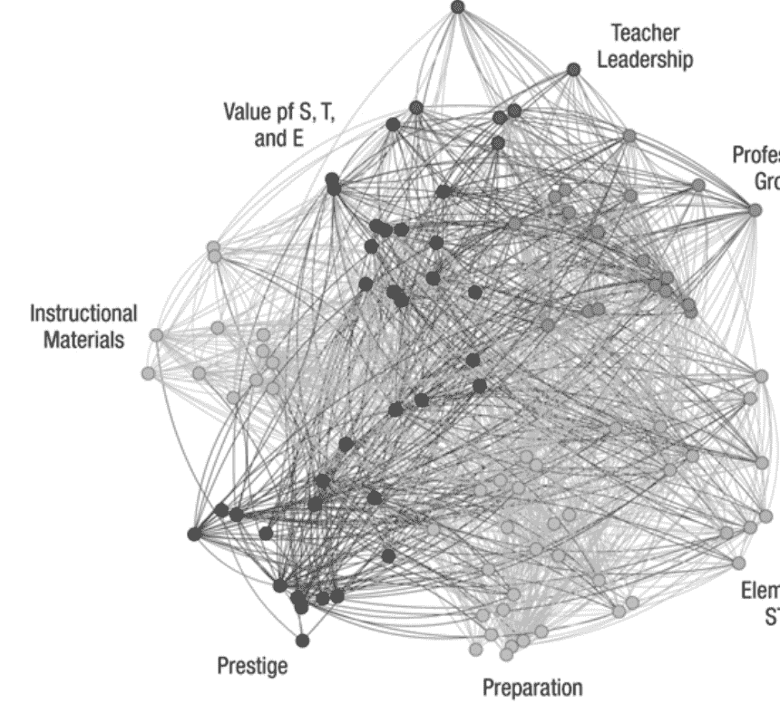

## CHAPTER 9

## Collaborate for Systems Change

> *Making systems work—whether in health care, education, climate change, making a pathway out of poverty—is the greatest task of our generation.*
> 
> — ATUL GAWANDE, “How Do We Heal Medicine?,” TED2012

The systemic challenges we face call for a systemic approach, in which we address issues from many angles, simultaneously, as part of a coordinated effort. It is simply not enough to scale the work of individual leaders, programs, or organizations. Creating change at the rate we need is going to require a whole new level of planetary collaboration.

*Systems change* is the process of reforming or transforming the structures, relationships, policies, power dynamics, narratives, and norms in a given system in order to create positive social or environmental results. A system is a group of interacting or interdependent elements forming a unified whole.¹ Systems may overlap—for instance, in the connections between health care and housing. And systems can be nested within other systems—a classroom is nested within a school, which is nested within a school district, which is nested within a state’s education system.

In *Who Do We Choose to Be?*, Margaret Wheatley shares that she’s basically given up on wholesale global systems change. The scale and complexity of the issues we face are overwhelming, and changemakers are burning out in droves. So, she reframed her aspiration, and so have we. Wheatley wants to create what she calls “islands of sanity that evoke and rely on our best human qualities to create, relate, and persevere.”² Instead of islands of sanity, I like to think of them as *pockets of possibility*. These

are the places all around the world where people are coming together to plant seeds for a positive future.

We may not be able to change the whole system all at once. But we can create positive changes locally. And when those local changes are connected together through networks—when they are coordinated, learn from one another, and reinforce one another—change can happen at larger and larger scales.

## Making Sense of the System

In any complex system, there are underlying structures, norms, and beliefs responsible for creating the presenting symptoms we see every day—the events and crises that flood the news and occupy most of our attention. More often than not, these underlying issues are intimately intertwined with structural racism, sexism, and other oppressive dynamics. Therefore, it is critical that any effort to create systems change aim “to transform the underlying power dynamics, narratives, and histories that built these structures and enable them to thrive,” states the social change group Change Elemental.³ Otherwise, if they do not, efforts are likely to reinforce existing inequities or merely replace one form of inequity with another.

In the absence of a deliberate process to make sense of the system it seeks to change, a network might inadvertently maintain most of its focus on the most obvious symptoms and miss important details about what is causing those symptoms in the first place. An essential step to creating systemic change, then, is to develop a deep, nuanced, and meaningful understanding of the past, present, and potential future states of the system, as well as the root causes that are driving the system’s behavior.⁴ This involves surfacing diverse perspectives, developing a broader understanding of the actors and organizations involved, and examining external trends and forces. It also involves considering the local context, learning about the histories of the place or system, identifying political and power dynamics, and unveiling hardwired assumptions. In the process, lots of questions are asked and answered, and patterns are surfaced. Relevant actors, forces, and flows are identified. Participants share their piece of the puzzle, and the big picture comes into view, illuminating new connections and opportunities to create change.

另一个。在超过750人分享他们的想法之后，100Kin10得以生成[图9.1](#)所示的系统图。这张图揭示了七个不同挑战高度相互关联的领域。它还揭示了每个焦点领域中特别有影响力的特定“催化挑战”。这些催化挑战指向系统中的杠杆点——尤其是那些能够创造广泛变革的重大机遇。通过这一过程，100Kin10得以明确以下七个焦点领域及其相关的杠杆点：

**图9.1.** 100Kin10绘制的当今STEM教育所面临的“重大挑战”系统图。每个挑战用一个节点表示，当两个挑战相互关联时，它们之间就会产生连接。借助这些数据，社会网络分析揭示了七个高度相互关联的挑战群组，从而得出了该网络的七个焦点领域。如需查看此地图的交互式版本以及构建过程的详细说明，请访问[grandchallenges.100kin10.org](http://grandchallenges.100kin10.org/)。

- **教师领导力：**招聘能够创造积极工作环境的学校领导者
- **专业成长：**在校期间促进更多的教师协作和专业发展
- **小学STEM：**增加具备小学数学和科学专业知识的教师教育师资
- **师资培养：**在全州范围内追踪STEM教师的供需情况
- **职业声望：**为成为STEM教师的STEM本科生提供奖学金或贷款减免
- **教学材料：**改进学区对高质量工程课程的识别
- **科学、技术和工程的价值：**扩大高中必修STEM课程的数量和范围

由于有了明确的优先事项集合，所有参与者都可以开始将他们的努力——以及他们的组织资源——指向同一方向；他们各自的各种努力最终将相互强化。参与者还开始自发组织成项目团队，以制定和实施行动策略。例如，一个项目团队承担了这样的挑战：将各州的重点转向留任策略，而不仅仅是最常见的招聘策略，并为学校领导者提供改善工作场所文化的实践方法。

项目团队得到网络的支持，由充满热情的参与者领导。它们提供了一种机制，将来自整个系统的行动者聚集在一起，围绕具体的、有时限的挑战开展协作。正如一位团队负责人所说：“在项目团队出现之前，我不知道还有任何其他方式能把全国那些能够对教师职业产生影响的人聚集在一起。我把我的想法抛出来，最终得到了许多优秀的合作伙伴。”⁸ 关于组建和领导项目团队的具体技巧，请参阅第10章。

识别杠杆点的努力也带来了一个意想不到的结果：参与者参与度大幅提升。“当一个网络能够选择聚焦于少数关键机遇时——不是因为你我或某个专家小组认为这些是应该聚焦的正确地方，而是因为整个社区共同识别出了它们——这非常具有动员力，”米尔格罗姆-埃尔科特（Milgrom-Elcott）说。如今，100Kin10正稳步实现在十年内培养十万名优秀STEM教师的目标，并已筹集超过1.3亿美元，用于支持其参与者推动系统的重大改革。

## 创造转型

在*《大胆者的变革》*中，史蒂夫·瓦德尔（Steve Waddell）概述了创造变革的三种策略：渐进式变革、改革和转型。[^9] 渐进式变革旨在系统现有规则内改善绩效。它涉及在已经发生的事物基础上继续建设，并分享经验教训、经历、能力和专业知识。这可以通过协调网络中的行动来实现，如上一章所述。

然而，从根本上改变系统需要改革或转型。改革旨在改变系统的运作方式，改变其规则、结构、信念和行为。转型则是创造全新系统的工作。虽然识别并作用于关键杠杆点可能为改革或转型开辟道路，但网络还可以追求另外两种特别强大的策略：转变社会规范和推动一场运动。在这两种情况下，影响力网络都是强大的催化剂。

## 转变社会规范

社会规范是使当前系统保持完整的不成文行为规则。就其本身而言，大多数规范并无固有的好坏之分。然而，如果规范未被明确命名且有意识地选择，它们可能是有害的。

> 正如肯尼斯·琼斯（Kenneth Jones）和泰玛·奥孔（Tema Okun）在他们的*《拆解种族主义》*工作手册中所写：“我们的许多组织虽然声称要成为多元文化组织，但实际上只允许其他人和文化在适应或符合既有文化规范的前提下进入。能够识别并说出你想要的规范与标准，是为一个真正多元文化的组织腾出空间的第一步。”[^10] 当规范未被承认时，它们会强化主流文化中那些可能
> 压抑多元认知方式、抑制表达、侵犯非主流群体尊严的方面。

例如，在美国以及世界许多其他地方，源于白人至上主义和资本主义文化的支配性价值观，如个人主义、竞争和结构，导致了诸如依赖单一领导者、强调个人成就以及依赖可预测规则（成文的和不成文的）等社会规范。

当这些规范作为一个组织或网络中未经审视的默认存在时，与之相反的规范——例如提升集体努力、以包容的“兼而有之”思维取代极化对立的“非此即彼”思维、以及拥抱涌现——就会被最小化或排除在外。

因此，对影响力网络而言，一项基本实践是自觉地选择并践行那些体现网络思维、推动其价值观和原则的规范。当这种情况发生时，它就能改变系统运作的一切。运动策略中心（Movement Strategy Center）的塔吉·詹姆斯（Taj James）表示：“转变我们的存在方式就是我们切实的成果。系统变革来自大型群体在存在方式上做出重大转变。”¹¹

在其发展早期，共振网络（Resonance Network）的领导者决定不复制等级制的工作方式。支配性的等级规范与其所愿景的、植根于深层关系、充满活力的社区以及与地球连接的世界直接冲突。网络的运作方式让人们花了一些时间才适应，但最终得到了回报。该网络的一位领导者亚历克西斯·弗拉纳根（Alexis Flanagan）回忆道：“起初，人们都在寻找谁负责，寻找自上而下的决策模式。有一些权衡取舍——我们建设得比许多利益相关者所期望的更慢、更有意为之——但这对我们建立文化和实践是必要的，这些文化和实践使我们受益，并让我们走到了现在的位置。”

要更充分地转向新的社会规范，需要持续的关注。弗拉纳根说：“我们不断回到对习惯的深度反思，以及我们可以练习什么来代替。我们相信，有意识的实践是打断这些习惯并转化它们的一种方式。”¹²

一旦一个网络完成了阐述并在实践中转变自身社会规范的工作，它就可以将注意力转向帮助在其所属的更大系统中复制这些新规范。

网络恰好非常适合做到这一点，因为根据社会学家、*《行为如何传播》*的作者达蒙·森托拉（Damon Centola）的说法，它们是“新社会规范传播的主要途径”。^13^

当网络践行它们希望看到的改变时，它们可以创造出向外扩散的新行为模式，就像池塘上的涟漪一样。随着新采用者的加入，他们会统一信息传递并进一步强化网络日益增长的影响力，因此改变会继续在初始群体之外得到复制。研究表明，一旦系统中 25% 的行为主体采纳了某种规范，就会达到临界点，从而触发整个群体的转变。^14^

考虑一下美国大多数医院系统对待重症患者的规范。临终的重症患者通常被归类为需要临终关怀，他们作为住院患者留在医院里，其身体疼痛通过药物管理直至去世。加州大学旧金山分校健康系统（UCSF Health system）也是如此。也就是说，直到史蒂夫·潘蒂拉特（Steve Pantilat）博士及其同事倡导了围绕姑息治疗的新规范。

潘蒂拉特是加州大学旧金山分校姑息治疗项目创始主任，也是全国姑息治疗质量协作组织的董事会主席，他知道姑息治疗不仅涉及患者经历的身体疼痛，还涉及严重疾病带来的社会、情感、心理和精神困扰。为了帮助在 UCSF Health 全面推广这种新的护理规范，我的同事大卫·索耶（David Sawyer）和我与潘蒂拉特合作催生了协调护理网络（Coordination of Care Network），这是一个行动网络，连接了该系统十二个站点和十个对姑息治疗感兴趣的健康学科。

该网络首次召集了来自系统各地的数十名领导人。他们共同努力，通过证明这些治疗重症患者的新规范能为患者和医院系统带来显著更好的结果，从而为姑息治疗建立案例。网络还为提供者提供姑息治疗教育，并确定了能够帮助提升姑息治疗服务知名度的倡导者。虽然该网络只是潘蒂拉特及其同事为在 UCSF Health 推广姑息治疗而进行的全面且为期多年的努力的一部分，但它在帮助协调信息传递、吸引广泛利益相关者参与以及建立势头方面发挥了重要作用。

协调护理网络成立几年后，UCSF 成立了姑息医学部，以提供一个永久性的枢纽，继续在整个医疗系统内推广和协调姑息治疗。除姑息治疗服务外，该部门还为学生和临床医生提供教育项目，进行研究以改善对重症患者的护理质量，并已成为希望建立和扩展自身姑息治疗服务的团队的关键资源。虽然仍有工作要做，但“全人姑息治疗”正在 UCSF Health 迅速成为常态，改变了重症患者及其家人的医疗体验。^15^

## 培育运动

几代以来，运动一直采用网络方法来保持凝聚力并扩大其影响力。莱斯利·克鲁奇菲尔德（Leslie Crutchfield）的研究发现，*《变革如何发生》*的作者指出，最成功的社会运动采用去中心化的结构，促进运动内部的联系和协调，而不是自上而下的等级结构来指挥其分支机构的行动。克鲁奇菲尔德写道，这些运动增长中最为核心的组织和领导者将自己视为“不是军队中的指挥官，而是一个网络中心的协调者”。^16^ 他们“有意将权力下放到基层，将权威授予地方分支机构，而不是从上而下控制。”^17^

这就是运动网络的功能。多个学习和行动网络（有时称为*分支机构*）自主地在本地创造改变，它们相互连接以促进沟通、协调行动并在更大范围内催化变革。作为一个网络的网络，运动网络保持了比大多数影响网络单独能够实现更大的覆盖范围和影响力。

例如，加州景观管理网络（CLSN）连接了三十个环境网络，以建立集体力量并在全州层面倡导政策变革。像典型的运动网络一样，CLSN 依靠圣克鲁斯山脉管理网络、One Tam 倡议和橙岸协作等区域网络来做出与当地环境相关的决策并采取行动。与此同时，CLSN 结合其成员的力量，推动全州政策努力，例如“ Cutting Green Tape”倡议，该倡议正在消除恢复、增强和保护加州自然资源方面的反生产性障碍。

塞尔维亚 Otpor 运动的成功提供了一个关于社会运动如何采用网络方法来加强其努力的良好案例研究。Otpor 在 2000 年塞尔维亚强人统治者斯洛博丹·米洛舍维奇（Slobodan Milosevic）的下台中发挥了关键作用（Otpor 在塞尔维亚语中意为“抵抗”）。

在 Otpor 成立之前，1990 年代曾多次发生试图推翻米洛舍维奇的大规模抗议。这些示威吸引了超过十万人上街，创造出似乎有望带来持久改变的旋风。然而，当时运动缺乏能够在一段时间内逐步增加压力的组织结构。当米洛舍维奇进一步巩固权力并残酷惩罚反对者时，运动逐渐消退。

从这些挫折中吸取教训，一群参与过早期示威的活动人士成立了 Otpor。作为一个运动网络，Otpor 在凝聚力和自发动员之间取得了平衡。地方分支机构团结在明确的目的——击败米洛舍维奇并确保公平自由的选举——之下，并且它们各自同意遵守一套明确的原则，确保行动与整个运动保持一致。

每个分支机构都可以自主运作，以开展最适合其当地情况的示威，只要其在运动共同协议的范围内行事。因此，创造性的示威和抵抗行为在全国各地以无法被塞尔维亚政府预料或阻止的方式出现。由于分支机构通过网络相互连接，它们还能够协调全国性示威，当米洛舍维奇在 2000 年选举中失利后拒绝下台时，他们全力出击。

凭借其网络结构，Otpor 获得了等级制度所不具备的韧性。米洛舍维奇通常的压迫行为不再像几年前的那样有效，因为移除任何一位 Otpor 领导人或关闭任何一个 Otpor 分支机构都无法阻止运动日益增长的力量。虽然一些关键人物承担了更高程度的责任，但运动的领导权在很大程度上分布在网络的众多分支机构中，因此 Otpor 没有明显的头面人物可以被针对并监禁。

Otpor 还与其他网络和社区团体建立了关系，以进一步深入塞尔维亚社会的制度化方面，与政党、民间社会团体和工会协调其努力。这使得米洛舍维奇在社会的多个支柱开始一致倡导变革时，更难维持权力。

马克·恩格勒和保罗·恩格勒在《This Is an Uprising》中写道：“没有任何内部官僚机构或中央权威，Otpor 成功地在数万名塞尔维亚人中创造了凝聚的运动认同。”^18^ 塞尔维亚的结果是一个凝聚的运动，它是去中心化却有结构的，破坏性却有策略的，自发却有协调的。通过持续的行动，Otpor 成功推翻了米洛舍维奇及其威权政权，用新的民主治理体系取而代之，永远改变了塞尔维亚。

## 种植红杉

易洛魁联盟（Iroquois Confederacy），一个来自北美东北部的原住民联盟，也被称为豪德诺索尼（Haudenosaunee），是地球上最古老的参与式民主之一。^19^ 他们长期秉持一种哲学，即在每一次审议中都有必要“考虑其决定对尚未出生的第七代的影响。”^20^ 这被称为第七代原则。世界各地许多原住民至今仍秉持这一哲学。

第七代原则强调了这样一个现实：系统不会在一夜之间得到改革或转型。需要时间。哲学家查尔斯·艾森斯坦（Charles Eisenstein）也同样分享了他以五-

百年时间尺度，“因为根源条件如此深远，而创伤如此古老，以至于它不可能一夜之间愈合。我持开放态度，但我并不指望它会发生，”他说。[^21]

面对我们所面临的挑战的令人望而生畏的规模，有必要在许多人渴望立即改变事物的紧迫感与认识到创造系统性变革是一场马拉松而非短跑的耐心之间取得平衡。温德尔·贝里在 *A Country of Marriage* 中写道：“投资千年。”“种植红杉。说你的主要作物是你没有种植的森林，你将无法活到收获的那一天。”[^22]

网络引发的变革乍看之下可能很缓慢，或几乎不可见，因为它们发生在人们内部并通过他们之间的联系发生。进步的最初迹象可能看起来只像是新的关系、新的对话，以及一个人以看似微小、一次性方式帮助另一个人的服务时刻。有时网络的早期实验可能看起来微不足道，不太可能带来任何重大转变。

但往往被忽视的是，在培育网络的过程中，系统实际上正在发生转变。当网络得到培育时，人们和组织开始以新的方式相互接触。信息和资源开始以前所未有的方式流动。来自问题对立面的不同的人找到了创造性合作的方式。一个曾经支离破碎的系统变得相互连接，能够迅速应对危机。新的领导者涌现。更健康的规范开始形成并传播。而地方行动可能发展成为一场运动，创造一个全新的系统。

自然界中的分形为我们提供了关于小型实验如何扩散成更大干预的线索。分形是重复形成更大结构的模式。我们在雪花构成的重复形状、蕨类植物叶片中一致的图案以及鹦鹉螺壳的螺旋设计中看到分形。分形教会我们从小处着手，从微观到宏观层面发展，创造随着成长而越来越大的模式。

同样，网络可以成为你正在创造的未来的模型，一个可以通过更大系统复制的实验性分形。adrienne maree brown 写道：“我们在小规模上实践的东西可以回响到最大规模。”²³“我们必须创造向上循环的模式。”²⁴

影响力网络不仅仅催化变革；它们*就是*变革。每当我们努力弥合分歧并为共同目的建立联系时，我们就播下了可能在许多世代中成长的种子。我们可以实践我们希望看到的改变，而网络掌握着关键。
