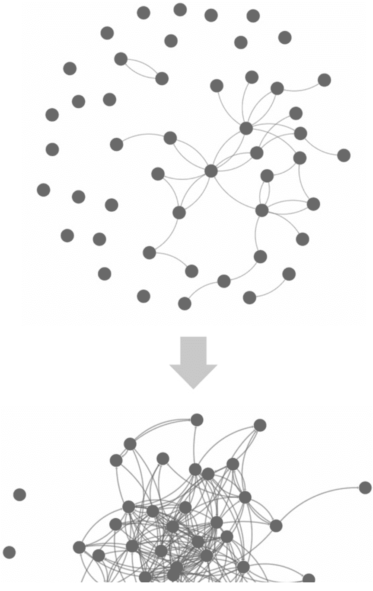
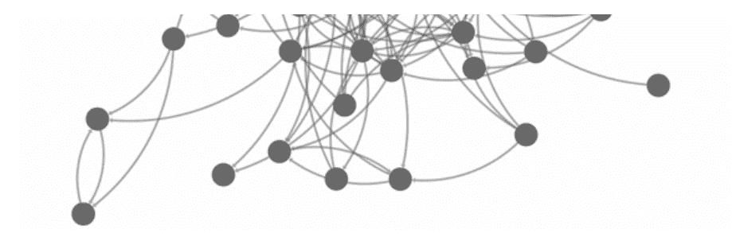

## CHAPTER 10

### The Enabling Infrastructure

> As for the future, your task is not to foresee it, but to enable it.

> —ANTOINE DE SAINT-EXUPÉRY, *The Wisdom of the Sands*

为了使参与者在一段时间内能够有效合作，影响力网络需要一个能够随网络一起成长的适应性基础设施。良好的组织结构可以让网络有效地引导参与者的创造力，而结构过多则可能扼杀个人主动性。我们建议网络采用最小可行结构——最简单且能有效满足其需求的结构，并且该结构能够随着网络的发展而演变。

城市规划者简·雅各布斯关于过度结构化的弊端的研究突出了另一种生命系统——美国城市的愚蠢。在 1950 年代，美国城市的设计使人们住在城市的一个部分、工作在另一个部分、购物在又一个部分。在大多数城市中这种情况仍然存在，这导致了广泛的社会碎片化和漫长的日常通勤。正如雅各布斯所观察到的，这发生的原因是城市规划者为他们认为*应该*发生的事情进行设计，忽视了人类基于日常生活自然组织自己的方式。更好的做法本应是“承认城市是一个不断变异的活有机体，一个涉及大量变量的高度复杂的网络……一个充满重叠和自发性的开放空间，在那里创造力、休闲和合作的自然条件可以轻松繁荣”，曼努埃尔·利马在 *Visual Complexity* 中写道，引用了雅各布斯。¹

我们可以将这些见解同样应用于影响力网络。影响力网络是活的系统，而不是机器；我们无法提前完全知道它们将如何演变。因此，在网络形成时避免对其结构进行过于僵化的定义是明智的。这样做只会限制其最终潜力。

例如，Cancer Free Economy Network 在网络启动四年后才定义了具体的治理协议。它们当时根本不需要。过早定义只会增加不必要的僵化。只有当网络开始显著增长时，才明显需要有完善的协议。到了那时，参与者对网络将如何运作以及哪些治理协议最能支持他们的协作工作也有了更深入的了解。²

在制定网络结构时，让形式追随功能。让参与者的能量和兴趣引领方向。让网络的自然演变根据其在任何给定时刻最需要的东西来定义其结构。RE-AMP Network 的催化者 Ruth Rominger 写道：“协作网络不需要在它们绝对有用之前建立任何结构要素或运营协议。”“放置足够的东西将使网络保持连接，同时保持足够的灵活性以适应变化。”³

影响力网络的赋能基础设施由一组为支持学习、行动或治理而组建的团队、共享参与协议、明确的决策流程、嵌入式评估实践以及灵活资源组成。本章将依次探讨这些组成部分。

### Organizing into Teams

影响力网络通常通过四种类型的团队组织，每种团队仅在需要时出现。设计团队形成以帮助催化新网络并组织网络聚会；核心团队形成以提供治理和咨询支持；项目团队形成以推进协作工作；学习圈形成以就感兴趣的话题进行对话并收集信息。虽然设计团队已在 [chapter 5] 中描述过，但核心团队、项目团队和学习圈的基本职能总结如下。

### Core Team

网络整体的领导职能由核心团队承担，有时称为 *leadership team, network council, governance circle,* 或 *steering committee*。核心团队与网络其他领导者合作协调网络的工作、活动和资源。由于它们并不总是必要，只有当网络足够复杂，需要额外的治理层来支持参与者做出更大贡献和协调行动时，才应创建核心团队。

乍一看，核心团队似乎是影响力网络中异常等级化的特征，事实上它们确实倾向于对网络的决策产生一定影响。然而，与传统权力等级制的主要区别在于，核心团队不对其他网络成员拥有正式权威。核心团队提出建议，但最终决策最终由整个网络做出。与传统等级制另一个不同之处在于，核心团队会定期轮换成员。它们通常由四到七人组成，每人代表不同的参与组织或网络的一部分，他们自愿在特定时期担任核心团队成员，通常是从一次聚会到下一次聚会。

核心团队的角色范围很广，取决于网络在任何给定时间最需要什么，包括但不限于以下内容：

- 为其他网络领导者提供咨询支持，例如领导项目团队和学习圈的人
- 努力确保网络的既定原则融入网络的实践中
- 就网络需要考虑的重要决策提出建议

- 在领导者、项目团队和整个网络之间充当联络人，编织网络，包括随时倾听和考虑参与者提出的想法与关切
- 在公开场合代表网络
- 支持新参与者的筛选与融入
- 推进为网络提供资源的工作

## 项目团队

项目团队（有时称为*工作组、任务小组*和*行动圈子*）由参与者组织，以推进与网络宗旨相关的一系列工作。在组建项目团队时，参与者认为应该发生什么不如他们将实际做什么重要。正如 Marvin Weisbord 和 Sandra Janoff 所建议的，设定优先事项应“基于有意愿的行动者而非好点子”。4

在网络形成初期，项目团队通常聚焦于内部建设，以构建网络本身。面向内部的项目团队可能负责确定决策流程、获取资金、明确沟通策略或制定资产地图。随着网络的发展，项目团队越来越转向外部，在社区或更广泛的系统中推进工作。

项目团队旨在将网络试图应对的复杂问题分解为可周密计划和推进的离散短期任务。因此，它们是锻炼项目管理能力的完美场所。为了平衡周密策略与涌现策略，项目团队只能在前一次召集会议到下一次召集会议之间，或在几个月内（以时间较短者为准）制定行动计划。然后，在完成任务后，他们可以评估所学，向网络汇报进展，并在必要时规划下一阶段工作。这种周期性过程使项目团队能够分配职责并取得持续进展，同时保持涌现性，并乐于接受网络的建议和支持。

## 学习圈子

学习圈子的形成是为了针对某个感兴趣的具体主题整合知识、收集信息并产生学习。它们可能旨在开展研究，帮助网络识别关键杠杆点，也可能只是在没有特定最终目标的情况下促进对话。例如，Sterling Network NYC 组织了学习圈子，支持参与者度过职业转型，以创造性的方式思考如何重新构想和加强有组织的劳工运动，并使用 People’s Supper 开发的问题就种族与身份进行深入对话。⁵

学习圈子通常只存在很短的时间，在与其他网络成员分享所学内容后便消失。在某些情况下，学习圈子会从收集信息转向采取行动，从而演变为项目团队。

## 领导网络团队

与整个网络一样，团队也极大地受益于良好的领导。核心团队通常由网络的主要协调员之一领导，作为其正常职责的一部分；而项目团队和学习圈子通常由主动承担领导角色的参与者领导。

理想的团队领导者是对团队成果有强烈兴趣或切身利益的人。当自身利益与共同利益一致时，领导者更能投入必要的时间来推动工作向前。不应期望团队领导者单枪匹马地完成团队的工作。相反，他们是促进型领导者，支持团队推进其宗旨。以下是组建新团队时需要考虑的问题列表，以及团队领导者的主要职责。

### 组建新团队时的问题
每当成立项目团队或学习圈子时，可以从回答以下问题开始：

- 这个团队的目的是什么？
- 谁参与其中？
- 至少在下次召集会议之前，由谁领导这个团队？
- 从现在到下次召集会议之间需要完成哪些任务？
- 每项任务由谁负责，截止日期是什么时候？
- 我们需要网络提供什么（如果有的话）？

### 团队领导职责
那些主动站出来领导项目团队或学习圈子的人可以提供以下类型的支持：

- 根据需要安排和主持电话会议或面对面会议
- 项目管理，包括确保每项任务都分配给具体的人，并设定具体的截止日期
- 让网络领导者和核心团队随时了解团队的进展
- 向网络汇报进展，分享团队的需求和学习成果，并为其他参与者提供贡献的机会

## 界定参与

参与其中的参与者是网络的命脉。当参与者参与进来时，他们会出席、表示同意，并为网络及其宗旨做出贡献。

在网络的发展过程中，参与者的可用时间、精力和注意力随着环境变化而增加或减少，这是正常且意料之中的。与此同时，一些新人可能会加入网络，另一些人则会选择完全离开。通过提供不同的参与方式，网络让人们可以灵活地决定他们希望如何以及在何处参与。

我们发现，提供四个主要的参与级别以供选择是有用的：主导、合作、跟随和尊重。这些参与级别既适用于整个网络，也适用于特定的项目团队：

- **主导：**“我将负责实现这个网络/团队。”
- **合作：**“我将与领导者积极合作，以实现这个网络/团队。”
- **跟随：**“我想随时了解这个网络/团队的进展。”
- **尊重：**“虽然我很感激你们的提议，但此时这个网络/团队对我来说并不是特别感兴趣。”

当网络刚刚启动时，我们要求参与者分享他们对整个网络的首选参与级别，以便更好地了解谁愿意参加未来的召集会议并及时收到网络通讯。*主导者*是那些希望特别参与培育网络工作的人——例如，帮助协调网络、参与核心团队或领导项目团队。网络*合作者*积极参与网络工作，并致力于参加召集会议和参与网络活动。*跟随者*希望及时了解情况，但目前无法积极参与。选择*尊重*的人是礼貌地拒绝参与，因此会从网络通讯中移除。随着网络的发展，我们要求参与者每年明确他们预期的参与级别，以帮助领导者进行规划、协调和预算编制。

务必不要忽视跟随者。任何看过 Derek Sivers 的 YouTube 视频“第一个跟随者：跳舞小伙的领导力课程”的人都知道，跟随者拥有激发和推进他人工作的力量。“如果领导者是打火石，”他说，“那么跟随者就是真正点燃火焰的火花。”⁶ 跟随者应随时了解未来参与和支持网络工作的机会的最新动态。

随着时间的推移，随着兴趣和能力的变化，他们可能会转向成为合作者或主导者——在网络的生命周期中，人们在不同参与级别之间流动是很常见的。

网络领导者的职责之一，是提供许多不同的机会让主导、合作和跟随涌现，并允许人们完全谢绝。要相信参与者会自我组织，将精力投入到他们最有灵感做出贡献、也最被需要的地方。

## 建立参与协议

网络参与并不是一种“一刀切”的主张。网络中的参与可以是开放的（任何人都可以加入）、封闭的（参与者同意满足某些标准才能加入并保持参与），或分层的（网络提供多种参与方式，每种方式都有不同的标准和责任）。网络需要决定需要哪些参与协议，以便在其演进过程中保持连续性。

虽然为了避开界定标准和排除某些人的复杂性，保持参与开放可能很诱人，但开放参与本身也有其挑战。在《社群的艺术》中，Charles Vogl 将“清晰的边界”确定为归属感的核心原则之一。Vogl 指出，为了发展一个强大的社区，人们通常需要知道成为社区的一部分*意义重大*，而且不是任何人都可以一时兴起加入。换句话说，边界与其说是排斥，不如说是为了在网络内培养更大的包容性。⁷

Enspiral 网络以惨痛的方式吸取了这一教训。Enspiral 是一个由 150 多名自由职业者和活动家组成的社区，主要位于欧洲和新西兰，他们通过自己的事业协作创造积极的社会影响。起初，Enspiral 是一个开放的网络，参与几乎没有什么界限。虽然这在最初是有效的，但随着时间的推移，当一些人滥用高度信任的氛围时，缺乏界限造成了不健康的工作环境。结果，Enspiral 被迫制定了更清晰的参与协议，并将其记录在他们开源的“手册”中。⁸ 他们从中得到的一个关键洞见是——

集体行动将节省时间、鼓舞士气，而且最重要的是，带来出色的决策。

在层级系统中，决策通常由位居顶层者做出，然后实施指令逐级向下传达。这种结构不仅使（来自成员的）输入最小化，而且使权力失衡常态化，从而消除了人们对自己生活有直接影响的事务进行决策的可能。简单来说，“权力就是参与决策”，辛迪·苏亚雷斯在*《权力手册》*¹⁰中写道。

在影响网络中，决策——如同领导力一样——是分布式的。这并不意味着每个人都会同意每一个决策——在许多情况下，这根本不现实。然而，这确实意味着所有参与者都被邀请来塑造提案、分享观点，同时表现出对彼此处境、利益和负担的真切考虑。只要决策过程是包容的、透明的，并且旨在服务于整体的福祉，人们通常能够接受一个决策，即使他们不同意——并且他们对一个能够带来进展的流程心存感激。

在需要网络做出集体决策的情况下，例如定义其参与协议，达成完全共识能够体现系统内部的连贯性。然而，共识决策存在重大局限——它可能速度缓慢，当行动停滞时会耗尽网络的能量，并且可能限制实验探索。

我们更倾向于另一种方法：基于同意的决策制定，它允许在不符合全体一致同意的情况下，推进符合整体最佳利益的行动。这种方法植根于从生态系统科学中借鉴的“耐受范围”原则：当生物发现自己所处的环境过热或过冷时，系统的某些部分会因温度超出其耐受范围而死亡。采用基于同意的决策制定时，我们要找到一个每个人都能接受的决策，即使不是他们的首选。当问题或反对意见出现时，参与者会花时间倾听彼此真实的关切，并共同完善最终提案，使其落在每个人的耐受范围之内。

## 基于同意的决策制定流程

基于同意的决策制定过程包括三个阶段：背景、澄清和征求同意：

**背景** 框定待做出的决策：相关因素有哪些？已考虑过哪些利弊？已经进行过哪些讨论？最后，向前推进的建议是什么？背景由参与讨论并制定提案的人来呈现。

**澄清** 允许网络成员在投票前提出任何进一步的问题或所需澄清的事项。促动者应帮助确保对话不会偏向对想法的评价，而是围绕对所建议内容的清晰理解。鼓励参与者考虑提案是否与网络的目标和原则一致，并从整个网络的最佳利益出发思考，而不是从“我”作为个人或作为某个组织或特殊利益代表的自身利益出发。

**征求同意** 采用0到5的投票框架，当全体成员准备好做出决定或评估支持程度以及是否需要进一步讨论时使用。首先，促动者重述提案并请参与者投票。然后，参与者用0到5中的数字（通过手指、纸笔或其他方式）来对应他们的支持程度。如果需要对投票保密、用手指或纸笔投票不切实际，或者需要保留详细记录，该过程也可以通过数字投票工具完成。

投票时，参与者需从以下选项中选择一项：

- **5—领导：** 该提案对网络很有价值，我愿意成为实施该提案的领导者之一。
- **4—伙伴：** 该提案对网络很有价值，我将作为伙伴支持领导者实施。
- **3—跟随：** 该提案可能对网络有价值，但我无法为实施提供任何精力。
- **2—关切：** 我对该提案有担忧，并将在实施推进过程中继续关注。
- **1—谨慎：** 我担心该提案可能造成伤害，希望进一步讨论。
- **0—反对：** 拟议的行动方案超出了耐受范围，需要做出修改后才能采取任何行动。

如果投票结果只有2分及以上，提案将按原定计划继续推进。如果有0分或1分，则可以选择实时讨论以解决异议，或安排0分和1分的参与者与4分和5分的参与者会面，以解决问题并找到推进的方法。

当我们采用基于同意的决策制定时，只要提案与网络的目标和原则一致，且不太可能造成伤害，就鼓励其推进。因此，这一过程赋予了那些自愿去领导实施他们感兴趣想法的人自主权。这创造了一种行动导向，同时承担着考虑整体影响的责任。因此，同意机制鼓励网络中的成员进入领导角色，追求他们多样化的创造性兴趣。这种行动的多样性培养了一种实验和赋权的文化，使网络成为一个更有趣和更具创新性的地方。

## 嵌入评估

评估对良好的网络领导力至关重要。任何影响网络都将从嵌入评估实践中受益，因为所收集的数据将产生宝贵的学习成果，并帮助引导其演化。因此，评估应从一开始就纳入，而不是在网络开始推进具体项目之后才进行。¹¹

一个好的评估方案能够定期评估网络的健康状况和运作情况，包括为参与者提供反馈的机会。这些数据帮助网络领导者突出优势领域和改进机会，指导集体决策，并为网络活动和会议的策划提供信息。此外，这些数据可能有助于证明网络正在取得进展，即使在明确的项目成果尚未实现之前。

鉴于网络的涌现性质，长期影响往往无法在一开始就明确界定。事实上，在参与者有机会共同思考和协作之前就确定长期结果，很可能会扼杀他们围绕自认为最重要的事项进行自我组织的能力。因此，评估长期影响需要一种深思熟虑的评估方法，使这种方法能随时间保持灵活性；而那些在很大程度上依赖预定且静态指标的方法通常不适用。

与此同时，健康的影响网络共享一套可界定的短期和中期结果，包括网络连通性的标志和对参与者而言已显现的价值。这些结果在记录上很重要，既可作为指导网络发展的可操作数据，也可向资助者和参与者展示进展。由于网络健康状况的各个方面相对通用，可以预先识别，并用相当标准化（但可定制）的工具进行评估。正因为如此，我们能够提供以下结构化的评估方法，它几乎适用于任何影响网络。

## 网络评估的四个基本要素

我们提出网络评估的四个基本组成部分，下文将详细说明，以帮助确保你的网络不断学习并朝着积极的方向演化：

- 协作基础设施
- 网络连通性
- 参与者体验
- 涌现活动

评估协作基础设施涉及跟踪关于网络参与和活动的基本信息。为了评估

通过参与，网络领导者可以跟踪网络规模（在每个参与层级有多少成员）、代表性（当前成员代表哪些群体或利益相关方）以及流动/更替（过去一年中有多少人和组织加入网络，有多少人离开网络）。

为了评估网络活动，网络领导者可以跟踪各类会议，包括频率和出席率，以及根据情况相关的其他重要功能，例如参与电话会议或订阅网络通讯。将此类信息与特定的参与者特征（例如行业、地区和人口统计特征）进行交叉对照也很有帮助，这有助于确定参与程度在不同参与者之间是否存在差异，以及做出哪些调整有利于让所有成员参与进来。

## 网络连通性

网络连通性反映了网络中关系的形成程度。由于任何网络的有效性从根本上取决于参与者之间连接关系的强弱，网络连通性通常是在网络形成的早期评估进展的主要手段。

社会网络分析（SNA），也称为网络映射，是目前用于可视化和评估这种连通性的最有效方法。SNA 提供了一种实证方法，用以表示在特定时间点参与者之间连接和断联的模式。这为了解集群在哪里形成、信息如何流动以及如何最好地编织关系提供了重要线索。¹²

SNA 可用于捕捉参与者之间建立关系的程度，以及他们是否在沟通（分享信息、想法或数据）、协调（他们的努力紧密相连，但保留独立的资源和责任）或协作（以伙伴关系工作、共享资源并进行共同决策）。我们旨在在首次网络会议之前收集这些信息以获取基线数据，然后在主要会议之后或以固定间隔（例如每六个月）再次收集，以评估随时间发生的变化。

SNA 可以通过多种方式支持网络的发展，例如：

- 评估网络的成长，如图 10.1 所示
- 识别关键影响者和参与度最低的人员
- 突出干预和编织的机会
- 揭示连接和断联的模式

为了帮助你们在演变过程中绘制和分析网络的连通性，我们开发了在实际应用 SNA 的示例，以及一份可修改的调查模板，用于捕捉构建网络地图所需的数据。请访问 Converge 网络工具包，了解如何进行社会网络分析。

## 参与者体验

评估网络健康状况包括评估网络在围绕共同目标凝聚以及发展积极协作文化方面的程度。下文强调的关键因素对影响网络的长期成功及其保持参与者参与的能力尤为关键。

健康的网络是指参与者感到已经明确了共同目的和一套共同原则的网络。网络包含了广泛的参与者群体，他们非常适合应对网络的目的并积极参与其发展。这些参与者正在建立信任关系，并且他们感到能够相互参与并解决冲突。

网络制定了组织工作和做出良好决策所需的结构和协议。这些结构和协议应该足够灵活，以便网络能够对环境变化做出响应，而不感到不必要的负担。

健康的网络拥有充足的*协调*，以确保必要的运营职责得到妥善安排。相关的*信息*容易获取并自由共享。参与者还感到网络拥有足够的*资源*来维持其活动，并且资助者正在支持网络而不控制其发展方向。

最后但同样重要的是，健康网络中的参与者感到他们从投入的时间中获得了良好的*价值*。他们感到自己作为个人在个人和专业方面都从中受益，他们的组织也得益于他们参与网络。

定期实施参与者调查可以很好地评估网络健康状况的核心指标。它们为参与者提供了一个定期提供反馈的空间，支持公平性并确保网络领导者能够很好地了解参与者对网络的看法。调查结果有助于阐明优势领域以及需要额外关注或支持的领域。参与者调查还可以帮助捕捉与为参与者提供价值的各种结果相关的细节，例如技能、知识、有意义的关系和专业效能的增长，以及为其各自组织带来的价值，例如扩大影响力或作用。这些结果使成员能够向其组织证明其参与的合理性，并支持整个网络向资助者证明其工作的价值。请访问 Converge 网络工具包，获取需要跟踪的网络健康状况综合指标列表，以及通用的网络参与者调查表。

## 涌现活动

虽然一些网络结果是可预测的（包括连通性的增加和参与带来的价值），但许多结果并非如此。网络的魔力在于其涌现的结果，这些结果无法事先定义，在不同网络之间也不尽相同，因此无法用标准化工具进行衡量。尽管这些结果的具体性质无法提前预测，但追踪它们在涌现过程中仍然很有价值。具体而言，追踪参与者之间激发出的协调工作和协作项目对于理解网络如何影响更大的系统至关重要。这些信息将帮助网络领导者和参与者推进有前景的机会和潜在创新，并讲述网络对更大系统影响的故事。它还将突出任何特别令人兴奋的项目，这些项目可以作为更详细案例研究的主题。

图 10.1。（跨页）Sterling Network NYC——一个致力于促进纽约市经济流动性的跨部门领导者网络——定期开展 SNA 以评估网络随时间的变化并确定提供支持的机会。对 Sterling Network 的两次分析显示，在其前 16 个月中，参与者之间的协作活动显著增加。首次分析在该网络 2018 年 1 月首次会议之前进行，提供了基线评估（上图），第二次分析于 2019 年 4 月进行（下图）。每个节点代表一个个人参与者，两人之间的连线表示他们正在彼此协作，基于自报的调查数据（当连线不是双向时，通常是由于缺少调查回复，以及参与者对调查的解释存在差异）。

收集并整理此类信息的一个关键目的是以高效的方式将网络的行为和成就反馈给参与者。这样做为参与者提供了关于网络中正在发生什么实时知识，并支持他们找到方式参与，如果他们注意到某个项目与 Their work 相关。

鉴于其角色，网络协调员尤其应当了解新的发展，包括参与者之间项目和伙伴关系。我们建议协调员记录这些信息并确保定期更新。他们可以通过定期与参与者交谈、在会议上领导互动活动，或在定期调查中包含关于这些活动的问题来非正式地收集这些信息。一旦收集好，协调员可以将信息汇编成仪表板或文档，供参与者访问，以便随时了解网络活动和参与机会。

## 更广泛的评估

除了这四个基本评估组成部分之外，具有能力和资源进行更全面评估活动的网络还可以考虑组织参与者访谈或焦点小组，并对这些数据定性分析。他们还可以评估参与者承担的一个或多个协作项目的影响，或者分析与网络目的相关的可用区域或流行病学数据，以说明随时间的变化。更广泛的评估实践可能需要大量的时间和专业知识，并且通常与专业评估人员紧密合作时最能有效开展。

发展性评估，¹³ 一种应用于受益于快速、战略性学习以推动创新环境的方法，似乎

特别适合影响力网络（impact networks）的涌现。然而，这种方法技术性很强，要求评估者具备广泛的研究技能，同时耗时巨大，要求评估者积极参与到网络领导层中，以密切跟踪进展，并持续实施最契合其需求的测量方法。虽然许多网络没有资源来承接如此密集的过程，但理解不同类型评估的益处，可以帮助网络领导者制定自己的评估方案，以符合其网络的需求。

## 为网络提供资源

支持影响力网络启动和成长所需的资源形式多种多样。需要资源来提供会议场地和餐饮，补偿网络领导者的投入，以及支持网络内涌现的项目。影响力网络的资源通常来自以下一个或多个渠道：

-   慈善资助
-   组织资源
-   实物贡献
-   参与者会费
-   网络项目产生的收入

下面简要概述各个渠道。

**慈善资助**在全球范围内发展影响力网络方面发挥了关键作用。基金会和慈善家拥有资源，可以支持协作努力相关的运营成本。凭借对复杂问题的系统级视角，其中一些人还处于有利地位，能够识别机会，催化新网络的诞生。网络资助者的独特角色将在本章后面更详细地探讨。

-   跟随网络的引领
-   作为同伴参与
-   放眼长远

下面将更详细地描述每种实践。

## 跟随网络的引领

资助者面临的主要挑战是：在支持网络的同时，不限制或控制其发展路径。有些资助者有意或无意地认为，因为他们提供了资金，所以应比参与者对网络方向拥有更大的影响力。然而，如果过于紧握控制权——例如，坚持为一组预定义的结果买单——他们就有可能扼杀网络的潜力。

对资助者而言，关键在于让网络自行引领，让参与者能够自由地创造他们自己想要塑造的未来，而不是资助者为他们设定的未来。“基金会不应做引领者，而应提供支持，”小基金会（Small Foundation）的高级管理者莉兹·威尔逊（Liz Wilson）指出。¹⁶ 比尔及梅琳达·盖茨基金会（Bill & Melinda Gates Foundation）的高级项目官员珍妮弗·哈斯本兹（Jennifer Husbands）认为，这要求资助者“懂得如何在提供结构与鼓励有机联系发展和繁荣之间走钢丝。”¹⁷ 作为网络资助者，要明确你支持的是什么：你资助的不是完成生产订单，也不是为特定数量的人提供服务；相反，你是在支持一个生态系统具备能力，去吸引多样化的视角，共同学习，并自主决定应对本地挑战的最佳方案。

## 作为同伴参与

当资助者在影响力网络的形成过程中扮演突出角色时，他们很可能加剧不健康的权力动态。前格劳斯坦纪念基金（Graustein Memorial Fund）总裁戴维·尼（David Nee）写道，对网络资助者来说，核心经验之一是“与社区和其他利益相关者分享权力，作为平等伙伴与同伴并肩工作。”¹⁸

特别是，网络资助者应仔细考虑自己在决策中的角色，以避免产生过大的影响力。例如，加菲尔德基金会（Garfield Foundation）在催化RE-AMP网络成立后不久，就确保自己在正式决策中的权力被降级为一票，与其他每一位网络成员一样。“加菲尔德基金会意识到，收回我们的核心角色很重要，”该基金会协作网络项目总监露丝·罗明格（Ruth Rominger）回忆道。“资助者往往有占有的倾向，但我们决定要更多扮演伙伴角色，同时继续资助该网络。”¹⁹

## 放眼长远

许多资助者期望受资助方在短短几年内就显示出成果。“考虑到许多问题的复杂性，其根源可能源于数百年的历史成因，这种期望实在是不切实际，”埃德加·比利亚努埃瓦（Edgar Villanueva）在《去殖民化财富》（*Decolonizing Wealth*）中写道。²⁰ 来自Ashoka等机构的题为《拥抱复杂性》（*Embracing Complexity*）的报告呼应了这一观点，强调要“为长期参与做好准备，对实现系统变革所需的时间抱有现实态度，承认倡议的路径会沿途变化，并鼓励现实的雄心。”²¹

就斯特林网络纽约（Sterling Network NYC）而言，网络的结果甚至持续时间都不是固定的：参与者每年重新承诺加入网络，但罗伯特·斯特林·克拉克基金会（Robert Sterling Clark Foundation）已承诺至少支持该网络十年。作为催化该网络成立的基金会主席，李（Li）表示：“基金会能提供的一大礼物，是让人们专注于试验，把心思投入到正在探索的问题上，而不是把所有时间都花在寻找维持工作的资金上。”²²

## 投资未来

尽管许多人认识到组织之间加强协调的必要性，但协作仍然资源不足。正如苏珊·沃尔夫·迪特科夫（Susan Wolf Ditkoff）和亚伯·格林德尔（Abe Grindle）在《哈佛商业评论》（*Harvard Business Review*）中所写：“很少有慈善家真正支持或参与协作，尽管大多数人都对各自为政的变革努力低效扩散感到沮丧。”²³

一些资助者认为网络尤其昂贵或难以资助，但事实是，网络并不必然如此——只要你投资于正确的事情，只要你让开道路，让网络投入工作。要起步，“找一个你信任的伙伴，他能帮助管理网络，并在你阻碍网络发展时向你如实反馈，”珍妮弗·哈斯本兹建议。²⁴ 我们还鼓励资助者专注于投资于专职的网络领导层，以及它所带来的所有角色——包括催化、促进、编织和协调。在我们所见导致影响力网络无法发挥其潜力的主要因素中，领导层资源不足是其中之一。

归根结底，对网络的投资，就是对我们跨越孤岛和部门协作成事能力的投资。要应对我们最紧迫的挑战，我们必须协作——而影响力网络提供了必要的基础设施，使个人和组织能够联系起来，共同学习，为了更美好的未来而携手努力。“采取边做边学的方法，迈出第一步，”莉兹·威尔逊鼓励道。²⁵ 现在是资助者拥抱网络之道的时候了。

接下来，你和其他人将成为网络编织者，培育将长久维系的信任关系。人们会变得更愿意分享信息、讨论失败，并在需要支持时伸出援手。一种互惠的文化就此诞生。

随着网络的发展，网络领导层的一项关键任务是提供协调，将网络众多流动部分整合为一个统一的整体。有了支持性的基础设施，网络在危机来袭时能迅速响应，将资源分配到最需要的地方。参与者自组织成团队，实施变革战略，同时也有更多的领导机会可供担任团队负责人。渐渐地，整个网络与其他从事类似议题的人建立连接，在更大范围内催化转型。

这就是变革发生的方式：一步一个脚印。起初，进展可能看起来微不足道，像新的连接、新的对话，或在需要时提供帮助的服务时刻。然而，这些正是协作的基石。没有这些，我们就无法有效推进创造系统性变革所需的更大规模转型。

如果有一件事我希望你们从这本书中带走，那就是：基于信任的关系，能够成就网络想要实现的其他一切。当人们开始以新的方式建立连接和共同创造——由他们关系的强度紧紧联结在一起时——奇迹就会发生。以前不可能进行的对话变得可能。曾经视彼此为竞争对手的群体之间形成了联盟。大胆的目标变得可以实现，影响力在系统层面显现。如果在任何时候你对如何前进感到不确定，那就投资于关系。做一名网络领导者，首先就是编织将我们联结在一起的纽带。这就是一个支离破碎的系统如何成为一个富有创造力、适应性强的互联整体。

在作为网络领导者的旅途中，你必然会遇到困难，也伴有喜悦和满足。培养影响力网络的过程永远无法被完全理解，也永远不会终结。做这项工作有许多途径，我们的机会正是在彼此相伴的社群中实践和学习。

如果你还没有，我邀请你访问 converge.net，在“汇聚网络工具箱”（Converge Network Toolkit）中获取更多工具和资源。在那里，你会

可以更深入地探讨本书未涉及的网络概念，并有机会受邀参加网络领导力学习体验。你还将获得与其他网络领导者直接联系和分享的机会。

我们中更多人学习如何在网络中催化、培育和领导的需求从未如此迫切。让我们回应时代的召唤：尊重彼此的相互依存；投资于跨越差异合作的能力；培育具有韧性的网络，以促进更公正、公平且充满活力的系统。让我们携手合作，共同服务于一个惠及所有人的世界。
