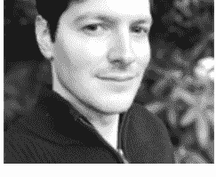

# 关于作者

**David Ehrlichman** 是 Converge ([converge.net](http://converge.net)) 的联合创始人和协调人。与他的同事们一起，他支持了数十个影响力网络的发展，这些网络在经济流动性、人权、科学获取和医疗保健改革等多样化议题上采取行动。

在催生 Converge 之前，David 是 Monitor Institute 的顾问，在那里他首次认识到网络的力量。他居住在华盛顿州西雅图附近，位于海岸萨利什人的传统土地上，具体为 Stillaguamish 和 Suquamish 部落。

当他不写作或与网络合作时，你通常会发现他与家人朋友共度时光、在大自然中，或演奏音乐。他与妻子 Nabetse、两只傻狗和他刚出生的女儿一起生活——在他出版本书时女儿三个月大。

你可以通过 **ehrlichman@converge.net** 联系 David。
