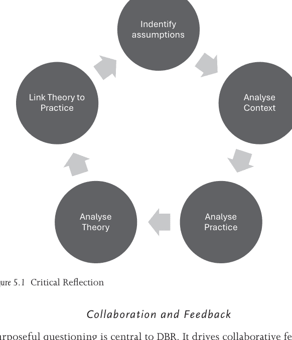
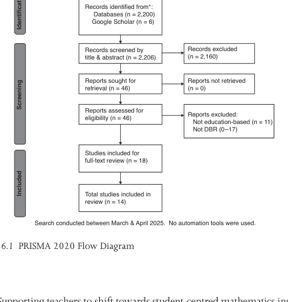

# 设计研究的人性要素

## 情境中的示例

在问题之前，在数据之前，在方法之前，有一个人。一个研究者，坐在深夜的厨房桌旁，或漫步在寂静的小径上，在脑海中反复琢磨一个想法。所有研究，无论多么结构化或严谨，都始于一个深具人性的起点：好奇、关切、希望，甚至是挫败感。我们有时想象研究是中立或临床的，仿佛它在真空中展开。但在每一次研究决策背后，都有一系列的生活经验、关系、价值观和身份认同。问题的提出方式、我们选择的方法、以及我们所聚焦的声音，都反映了我们是谁以及什么对我们重要。本章探讨研究的 human 层面：所产生的情感、我们所 navigating 的伦理张力，以及我们在途中建立的联系。它提醒我们，研究不仅仅是产生知识；更重要的是我们如何与知识相关，以及如何与彼此相关。要成为一名优秀的研究者，不仅要系统化，还要反思性和富有同理心。我们将自己带入过程的每一个部分。而这，远非弱点，正是赋予研究力量的所在。

### 第一部分：设计研究中的沟通与协作

口语与我们的物种一样古老；我们可以在从很小年龄就自然倾向于说话的孩子身上观察到这一点。言语本身是一种工具，超越了国界和文化，为我们带来一个人传达给另一个人的语言、方言和声音的混合体。值得注意的是，说话和沟通服务于不同的目的。说话涉及大声说出词语的生产，而沟通则涵盖通过各种方式交换意义，包括言语、姿势、语调和沉默，以确保相互理解。

作为成年人，现实是，我们经常发现说话很容易，但清晰有效地表达思想以进行沟通却很困难。例如，你是否曾与某人交谈后想，“那到底是怎么回事？”在研究情境中，我们可能难以清晰沟通，因为我们并不完全确定自己想说什么，甚至不知道如何将想法化为文字。作为专业人士，我们必须克服沟通挑战以避免混淆或误解。改善沟通有困难和更容易两种方式。困难的方式是无所作为并希望自己变好。更容易的方式是发展沟通技巧和策略，帮助将你的思考从想法转化为清晰传达的信息片段。

#### 设计研究中沟通的作用

在设计研究（DBR）中，沟通促进了协作、知识生成以及在整个研究研究时间线中创新解决方案的共同构建。换句话说，从一个想法的最初构想到一项研究的完成，沟通推动了DBR过程。

从一个想法的最初构思到制定研究提案，向多元受众有效传达你的想法最好的方式是使用清晰直接的语言。通过清晰地阐述你的想法，你可以确保你的研究目标、目的和目标有效地传达给所有相关合作伙伴，促进从研究提案到新研究项目被接受的无缝过渡。

另一个考虑是，沟通超越了词语的单纯清晰度；它还传达意图。例如，作为研究团队的一员，你有根本责任以合乎道德和专业的方式进行沟通。为此，你必须全面理解你旨在与团队成员协作完成的研究目标。此外，了解学习者的预期成果并进行沟通也是识别潜在挑战的有用方式。

本质上，通过从项目开始就清晰沟通，个人可以更好地理解正在调查的教育问题，并识别研究设计中的潜在挑战，协商目标，并建立整体研究优先事项。为说明这一点，请考虑以下示例：

**情境中的示例**

在一项探索基于游戏的数学课程的试点研究中，研究人员最初提议对每个课程进行视频录制。然而，一些参与者表示他们不舒服被拍摄。通过早期沟通，教育工作者强调了这一担忧并建议改用改编的学习日志。通过协商这一研究方法，团队解决了伦理挑战，并以课堂信息丰富了研究设计。

通过有效的沟通和对参与者观点的细致考虑，我们可以拓宽和丰富我们作为个人、专业人士和团队成员的视角。虽然沟通和研究侧重于信息和观点的交流，但协作更进一步，将这种对话转化为共同行动和对研究过程的集体拥有。

## DBR中的协作：多合作伙伴方法

协作是DBR的核心。它是一个动态的、参与性的过程，研究人员、教育工作者和其他合作伙伴共同努力，共同开发教育挑战的解决方案并产生创新想法（Bourdeau, 2017）。

该过程通常始于共同界定问题。虽然研究人员有时可能会提出一个初步的研究重点，但这绝不会孤立进行；相反，在教育工作者以及有时学生的共同参与下，想法会被不断完善和重塑，直到问题定义得到集体认可。

DBR 中协作的关键特征包括：

- **共享决策**：所有声音都被倾听和重视，所做出的决策在平衡研究和实践需求的同时得以达成。
- **迭代对话**：定期的交流使想法不断演进。
- **共享学习**：在持续专业发展的精神下，每个人都从彼此身上学习，架起理论与实践之间的桥梁。
- **持续反思**：持续的反思确保清晰性、相关性和改进。

## PAUSE AND REFLECT

- 与一个你可能了解多或少的主题进行协作，为你提供了从多个视角窥探学科世界的窗口。在得出结论之前，你通常会考虑多少种观点？

## Shared Decision-Making

共享决策可以是组织良好的协作研究会议的结果。这些会议可以在研究的各个阶段在团队成员中的部分或全部成员之间举行，为讨论和协调随着数据可用而出现的数据提供机会。

研究会议作为一个协作平台，主要侧重于从团队成员那里产生多样化的见解，同时也培养值得信赖的关系。这种协作方法促进了共享决策，使问题和解决方案能够共同界定。这些会议应以专业和互惠的方式进行，确保所有参与者都有机会在开放且不受评判的环境中表达自己的观点。通过这种方式，协作会议培养了团队成员之间的信任，并加深了对研究随发展而出现的不同阶段的相互理解。因此，在 DBR 的各个阶段进行协作，有助于识别和解决诸如数据不一致、方法论挑战等问题，以及在人际层面，工作中可能出现的任何人际冲突。

## Beyond Speaking: The Art of Listening

对话是一种主动的沟通过程，它迫使我们将自己的想法表达成语言（Fisher, 2013）。倾听的艺术将对话从被动的交流转变为主动的沟通过程；然而，有效的对话需要专业的倾听技巧，即个人专注于说话者的信息，而不是急于表达自己的想法。在实践中，这可能比预期更具挑战性。

> PAUSE AND REFLECT
> 
> 如果没有首先理解倾听的基本需求，任何人能否有效沟通？

我们倾听得越好，吸收的信息就越多，这使我们能够有意义地为对话做出贡献。通过认真倾听他人所想、所感、所经历的事情，我们可以利用他们的见解来启发和挑战我们自己的假设。在与学生的合作中，Robert Fisher（2013）警告说，虽然我们可能会听到，但并不总是真正倾听。这提醒我们在与同事和学习者的互动中练习积极倾听。

教育研究者在创造一个所有声音都被倾听和重视的支持性环境中发挥着关键作用。展示和实践积极倾听的一种方式是通过总结所说内容的要点，从而澄清所传达的意图信息是否被准确理解（Elder and Paul, 2019）。例如，你可以回应：“我是否正确理解了你认为教育系统可以得到改善？”然后你暂停，让说话者澄清你是否理解并解读了他们的原意。这种方法不仅增强了沟通，也传达了对他人贡献的真诚兴趣。

作为一名 DBR 研究者，你有独特的机会确保参与者的声音在整个研究期间被听到，确保每个团队成员都有机会表达自己并获得适当的回应。

## Iterative Dialogue as Pedagogical Practice

对话式教学领域的杰出人物 Robin Alexander 强调了对话在刺激和吸引学习者在课堂讨论中注意力的意义（Alexander, 2018）。他的对话原则源于他对对话式和阐述式的研究，而不是源于单一的确定答案。下一个场景说明了这一过程在实践中的应用：

EXAMPLE IN CONTEXT
当一名学前教育工作者问：“你认为下雨后水坑会发生什么？”孩子们提出了各种可能性，例如“蒸发、渗入地面、风把它带走了。”
每一次回应都引发了另一个问题，引导学习者共同完善和扩展他们的思考。

这一课堂实践的片段展示了知识如何通过倾听他人和分享想法而共同构建，即使是年幼的孩子。教育工作者不是追求即时的结论，而是鼓励一个过程，在这个过程中，孩子们的想法不断积累和相互联系。迭代对话因此不仅是一种教学策略，也是一种立场：它将学习框定为开放式和暂时的，始终可以通过进一步提问而得到扩展。

在 DBR 中，这种教学立场具有方法论上的意义。对话不仅发生在教师和学习者之间，也发生在研究者与参与者之间，或在协作工作的合作伙伴之间。它确保见解在研究进展过程中得到重新审视和重新检验，使研究过程对概念和人性需求都具有适应性和响应性。

这次早期的讨论介绍了迭代对话作为学习和课堂探究的基础。在第 2 部分，我们将从不同角度重新审视这一主题，探讨迭代对话如何在反思实践中发挥作用，塑造立场、挑战假设，并指导研究者在 DBR 过程中做出的决策。

## Collaboration and Feedback

有效的协作和建设性的反馈在教育实践中至关重要，因为它们使教育工作者能够共同构建知识并共同改善成果。协作和反馈的核心在于有目的的对话，其中提问成为反思和更深入理解的工具。在这种意义上，有目的的提问是协作的核心，因为它激发批判性思维并邀请团队进行更深入的反思。

当提问被有效构建时，问题可以作为产生建设性反馈的催化剂，并能引导同事以新的方式探究当下的教育挑战。将提问策略融入对话不仅推动迭代过程，还有助于完善新出现的想法，确保潜在的解决方案在理论上扎根且在实践中可行。通过这种方式，深思熟虑的提问成为协作环境的基石，在这种环境中，多元视角受到重视，知识被共同构建以加强设计成果。下面的示例说明了对话式问题以及相关行动如何在实践中用于产生有意义的反馈。

| Phase 1 Problem Statement Objective: Identify the problem, the study goals and objectives, and your plan for working with a team. |
| Key Questions to Consider | Supporting Actions |
| People: Who is DBR for? Who are the partners? Domain: What are the key issues, the nature of learning, and the tasks each team member will explore? Goals and outcomes: What is the primary purpose? What specific needs will be explored? Who will the study benefit? | Conduct a needs assessment through informal discussion. Talk to the people who use the service. Clarify what individual team members will contribute to the project. Identify the key educational outcomes to be explored. Reach out to participants with a clear vision of your purpose, goals, and vision for the study. |

| Phase 2 Preparation and Initial Design Objective: Define activities, communicative processes, and DBR members’ roles. |
| Key Questions to Consider | Supporting Actions |
| Activities: What kinds of activities are most likely to address the research problem effectively? Communication: How will you communicate on an ongoing basis with other DBR partners? Interaction: What kinds of interactions will drive the project forward? Knowledge sharing: How will you share your progress with different partners? (participants and funders) Collaboration: When do team members meet to collaborate? Roles: How will DBR roles be defined? | Identify the activities that are likely to meet the aims of the project. Discuss, with the team, a number of activities that may meet the demands of the study. Discuss how often you will meet. Develop a tentative schedule. Create a timeline where you will lead the team discussion concerning the DBR progression and encourage feedback. Determine the team members’ roles and provide any required support, resources or training. |

## 第三阶段 试点实施、测试与重新设计
*目标：与选定群体试点 DBR 研究，以测试和完善流程。*

| 需要考虑的关键问题 | 支持性行动 |
|---|---|
| 您设定的初始试点目标是什么？需要哪些活动/资源/IT 来支持试点？与执行试点的 DBR 团队进行了哪些开放沟通？DBR 引导者将采取何种互动基调？例如，与儿童互动时将是 playful 的。试点成功将如何衡量？ | 确保试点的所有细节都已与 DBR 团队明确讨论，并且他们能够提问。确保角色清晰。为任务选择最合适的活动/资源。设计环境以符合研究和参与者的要求。例如，您可能需要一个没有干扰的安静房间。按您在方法部分中报告的方式衡量成功并报告结果。 |

## 反思与反馈
*目标：在创造参与和贡献的循环的同时，让 DBR 团队参与协作学习和知识生成。*

| 需要考虑的关键问题 | 支持性行动 |
|---|---|
| 新出现的发现是什么？团队成员对他们正在发展的角色有何看法？团队的个人成员可以贡献哪些教育见解来支持学习？您如何向成员传达对他们见解和贡献的感激？哪些新出现的需要可能支持研究的进展？团队内部讨论的反馈中最重要的要素是什么？ | 促进团队会议以鼓励开放沟通和反馈。讨论新出现的角色并了解团队对其当前 DBR 角色的感受。为团队成员提供贡献其见解、自由发言和分享新想法的机会。根据需要进行多次协作研究会议。为参考和透明度目的记录所有会议。促进对迄今为止 DBR 研究所有要素的讨论。 |

总之，沟通、协作和反馈不仅仅是维持研究项目的功能性流程；它们是塑造知识共享和共同建构的深刻的人性化行为。通过积极倾听、相互尊重和迭代对话，DBR 超越了其作为方法论的地位，成为意义建构的集体实践。

然而，沟通只是人性要素的一个方面。虽然对话促进了我们与他人的外部互动，但研究也需要我们的内在反思。我们的身份、价值观、假设和个人特征都会深刻影响我们做出的每一个决定。为了全面把握 DBR 的人性维度，我们现在审视 *positionality* 和 *participation* 的概念，其中伦理、身份和自我反思被审视。

## 第二部分：Positionality 和 Participation：驾驭 DBR 中的伦理与角色

### Positionality：伦理研究的考量

借鉴我们开篇的短篇案例，在方法实施和数据获取之前，存在着一位研究者，一个由生活经历、文化背景和个人身份塑造的个体。就像沟通促进个体之间的联系一样，*positionality* 提醒我们，我们从未以完全中立的方式接近研究。我们的观点、假设和先入为主的观念深刻影响着研究问题的形成、关系的建立以及解释的构建。

在本节中，我们从协作的外部实践转向反思和伦理考量的内部实践。我们探讨研究者的身份、参与者的声音以及信任和权力动态如何共同促进 DBR 的发展。通过审视 *positionality* 和 *participation*，我们承认研究不仅包括知识的生成，还包括知识、个体以及彼此之间的复杂关系。

### Positionality 和 Identity

*Positionality* 指的是个体的世界观、身份和经历如何塑造其观点和实践。它不仅仅是认识你是谁，还在于承认自我认知如何影响你设计、开展和解释研究的方式 (Lin, 2015; Svyantek, 2021)。例如，如果被问到，“Catherine，你的 *positionality* 是什么？”我可能会这样回答：

我是一个白人爱尔兰女性，是一位母亲、姐姐、高等教育研究者、偶尔的艺术家，还有更多。我的个人身份和我所借鉴的理论对于我理解人们如何智力和情感上学习和发展至关重要。我特别感兴趣的是儿童的假装故事和生活经历如何在研究中得到表达。

我对我身份的这一描述旨在说明教育价值观和信念不可避免地会影响你的研究兴趣、决策和互动。因此，认识自己的 *positionality* 至关重要：它使研究者能够坦诚地说明他们的价值观和经历如何塑造研究过程。开始这项工作的一个实用方法是进行结构化自我反思，这有助于揭示身份的不同方面如何影响我们提出的问题以及我们在研究中建立的关系。

### EXAMPLE IN CONTEXT

在我研究生涯早期，我反思了以下问题：

- 作为一个白人爱尔兰女性，会影响我在爱尔兰以外国家进行研究的方式吗？
- 我的讲故事背景是否会让我更受具有相似兴趣的参与者欢迎？

起初，我用快速的答案安慰自己并继续前进，但后来意识到这种表面化的反思几乎没有揭示我的身份如何塑造我的研究。

我认识到自己实践中缺乏批判性思维，这是一个令人不舒服但重要的发现。这促使我寻求一种更有结构的方式来审视我的假设，我在 Elder 和 Paul (2019) 发展的批判性思维方法中找到了它。他们的模型帮助我超越了安慰，走向真正的反思，使我能够以更大的诚实和深度阐述我的 *positionality*。

### A Critical Thinking Strategy

Paul 和 Elder 的方法提供了一种系统的方式来审视我们的思维，重点关注推理的七个要素 (Elder and Paul, 2019; Paul, Niewoehner, and Elder, 2019)。推理要素可以与反思提示一起使用，使反思更具体，并帮助研究者深入挖掘第一印象之下。

- **PAUSE AND REFLECT**
- 1. **Purpose:** 我在这里试图实现什么？为什么这个问题很重要？
- 2. **Question:** 我到底在问自己什么，这个问题是对的吗？
- 3. **Information:** 我知道什么，还有什么需要了解？
- 4. **Concepts:** 哪些关键思想或理论塑造了我看待这个问题的方式？
- 5. **Assumptions:** 我在默认什么？这些假设公平吗？
- 6. **Inferences:** 我的结论是否确实源于我所拥有的证据？
- 7. **Point of View:** 我在使用谁的视角？其他人可能会如何不同地看待这个问题？

在考虑你自己的 *positionality* 时，你可以借鉴批判性思维框架来审视你的思维。想象一位大学学生在研究早期学龄课堂中的批判性思维。使用 Paul 和 Elder 的提示，他们的反思可能如下所示：

- **PRACTICAL TIPS**
- **Applying the Seven Elements to Positionality**

**Purpose:** 我想表明即使是非常年幼的孩子也具备批判性思维能力。
**Question:** 我是在问“孩子们如何质疑和推理？”还是“教师如何鼓励质疑？”我的框架揭示了我关注孩子还是教师的角色。

**Information:** 我在探索教学实践方面的背景使我重视论证和证据，但我可能会忽视其他形式的推理（例如，游戏、手势或讲故事）。
**Concepts:** 我倾向于依赖探究的哲学模型，这塑造了我对“批判性思维”的定义。
**Assumptions:** 我假设发展批判性思维 universally 有益，但家庭或教育工作者可能更重视和谐而非辩论。
**Inferences:** 如果孩子们互相争执，我可能会将其解释为推理的证据，但它也可能仅仅反映社会动态。
**Point of View:** 我倾向于从教师的视角看问题；我需要在分析中更集中地引入儿童的声音。

这个练习展示了结构化反思如何将你的思维从表面意识推进到对 *positionality* 如何塑造研究的更深理解。

注意：批判性思维工具的实用性会根据你的目标和偏好而有所不同。鼓励早期职业研究者根据自身需求调整这些策略。这样做不仅能加强学术实践，还能支持反思性、批判性意识的专业身份的发展。

### Positionality and Research

每个研究项目不仅受问题、方法和分析塑造，还受研究者的 *positionality* 塑造。它影响设计、协作和解释，以及我们如何应对挑战和披露 (Secules et al., 2021)。对 *positionality* 的认识强调了避免假设我们自己或他人的观点是稳定的必要性 (Holmes, 2020)。本质上，这意味着认识到我们并不拥有所有答案，并且我们某些答案可能不完整或有偏见。

Brady (2021) 扩展了这一对话，认为教育工作者和专业人士必须首先理解自己的倾向，以便对自己负责。虽然研究者的 *positionality* 反映了他们的观点和经历，进而影响数据和研究结果，但专业倾向体现了指导我们与同事和参与者在实践中互动的态度和价值观。例如，

一个优先考虑儿童声音的研究者可能会选择讲故事作为方法，类似于一位重视同理心的教育者将孩子的挑战性行为视为建立联系的机会而非纠正的对象。从这个角度来看，研究和实践永远不是中立的；事实上，它们是深刻的人性化的，并且不断受到我们的身份和贡献的塑造。

这一切听起来复杂且要求高吗？真实的答案是“是的”。研究中的位置性是复杂的，形成细致的理解需要时间和反思。然而，这样的努力是值得的。

## 主要要点

**伦理完整性：** 承认位置性是伦理实践的核心。通过认识到你的视角，你可以更好地关注权力动态，并在研究关系中维护伦理标准。

**偏见意识：** 反思你的背景如何塑造你对证据或反馈的态度？
- 这项研究如何与 DBR 团队以及更广泛的教育社区的共同目标保持一致？

## 定位你的位置性

作为一名硕士或博士学生或早期职业研究者，你可能已经被要求反思你的位置性。如果没有，请考虑：你的位置性是什么，以及它如何影响你的研究？这些问题可能感觉具有挑战性，但它们至关重要，因为你的回答将塑造你工作的方向和质量。Holmes（2020）建议通过三个领域来审视位置性：

- 1. 研究对象 – 为什么这个主题对你感兴趣？
- 2. 研究参与者 – 为什么你选择了这一群体？
- 3. 研究情境和过程 – 你旨在产生何种知识，又在寻求什么答案？

## 上下文中的示例

在我关于幼儿批判性思维技能发展的博士研究中，我认识到探究式学习的重要性。我坚信探究和辩论是有效家庭沟通的重要组成部分。我作为学前教育工作者的背景指导了研究参与者的选择。我的工作经验加上我的研究发现，影响了我对研究情境和过程以及研究对象的决策。

审视这些相互关联的元素可以帮助澄清你不断演变的位置性。重要的是，位置性并非固定不变；它会随着你拓宽对知识及其目的的视角，以及对学习者多样化需求的认识而发展。这种反思之旅也是专业和个人成长的途径，尤其是在教育研究、政策和实践中。

## 阐述你的陈述

你起草过位置性陈述吗？如果是，你是自己慢慢、批判性地撰写的，还是使用了模板？虽然人工智能工具和在线模板可以生成尚可的文本，但外包这项工作会带来肤浅的风险，并削弱位置性的伦理目的：即审视你的价值观和经历如何在研究过程中塑造决策。如果使用此类工具，也仅限于激发思考；你的位置性陈述必须由你本人撰写。由于位置性是多方面的且会随时间演变，建议在整个项目中进行反思性自我反思。

### 暂停并反思

- 我带入这项研究的假设或期望是什么，它们可能如何塑造我的互动和解读？
- 我对研究情境的信念如何影响我所做的选择？

这些或类似的问题可以帮助你批判性地反思假设和信念如何塑造你的位置性。有关哲学和解释框架的更全面讨论，包括局内人-局外人理论，请参阅 Creswell 和 Poth（2016）。

本质上，位置性深刻地塑造了研究的质量，提醒我们伦理不仅延伸到方法论，还包括我们如何代表自己和我们的工作。与此同时，研究人员还必须通过仔细关注数据保护来保障参与者的权利。两者都是建立信任和开展负责任研究的核心。

## 数据保护

在进行 DBR 时，解决数据保护问题并制定有效策略以保护参与者的隐私并在开展和记录研究时遵守伦理和法律法规至关重要。数据保护政策因国家和机构而异，但各司法管辖区之间存在共同原则。以下清单可能有助于确保你的研究满足核心数据保护要求并体现伦理责任：

## 实用建议：你的数据保护清单

### 管理

- 向你的机构数据保护委员会提交审查表（如有要求）。
- 在提交伦理申请前确认要求，以避免延误。
- 联系你的伦理委员会或研究委员会寻求指导。
- 记录已完成的数据保护培训的详细信息。

### 研究细节

- 明确概述与人类参与者合作的伦理措施。
- 具体说明参与者个人数据将如何得到保护。
- 为参与者提供书面信息，包括目标、数据使用和存储程序。
- 使用清晰、无术语的语言以支持知情同意。
- 以受限访问方式安全保存所有数据以维护保密性。

遵守这些要求以及你的机构规定的其他要求不仅可以保护参与者，还可以加强你研究的伦理基础，在研究团队和社区内强化信任和问责。

### 暂停并反思

继续之前，请自问：

- 我是否清楚我所在机构的伦理申请要求？
- 我是否起草了处理敏感数据的明确数据保护协议？
- 我的团队是否接受了适当的数据保护培训？
- 我是否准备并分享了所有必要的数据保护表格？

根据你的研究和伦理委员会的规定，可能还有额外的要求。保持井然有序的一个有用的方法是创建表格形式的清单。这使你能够跟踪进度、标记已完成的任务，并快速查看已完成或待处理的内容。例如，下表显示了一个用于在 DBR 项目期间监控进度的清单模板：

| Task Description | Completed | In Progress |
|---|---|---|
| 我已记录了如何安全存储参与者的数据，并说明了谁将有权访问这些数据。 | ☑ 10/10/2020 | |
| 在参与者信息表中，我已明确概述了数据保护协议，以确保符合大学规章和指南的合乎道德的数据处理。 | ☑ 15/10/2020 | |
| 列出数据收集方法，例如音频和视频录音、文本数据和照片。 | | × |
| 列出其他数据保护法规，例如数据将存储多长时间以及如何安全处置数据。 | | × |
| 已获得伦理批准。 | 20/11/2020 | |

## PRACTICAL TIPS
在日后回顾工作时，添加完成任务的日期可能很有用。

在做好这些基础工作后，下一步是通过电子邮件、电话或面对面会议与参与者启动沟通。用专业和镇定的态度进行这些互动，表明你已充分准备并获得了必要的许可。开放、尊重的沟通为牢固的研究者-参与者关系奠定了基础。正如反思性和数据保护强化了伦理责任一样，认识到使 DBR 成为可能的人以及他们在塑造其成果中所扮演的角色也同样重要。

## Understanding People and Their Roles in DBR

DBR 旨在改进促进有意义的教学和学习的教育实践。为实现这一目标，研究人员与教育工作者和学生合作，找到解决真实课堂挑战的方案。DBR 研究的成功、其设计、实施和再设计取决于所有团队成员的积极参与，包括研究人员和参与者。本节探讨研究团队的构成、他们在 DBR 过程中的角色，以及他们在更广泛的教育社区中的相互联系。

### Who Is the Research Team and What Are Their Roles?

DBR 将个人聚集在一起作为研究团队，通常在真实环境如课堂中工作。团队成员可能承担多重角色，包括促进关于教育挑战的对话、开展试点研究、分析研究结果以及与他人分享见解。

分配反映参与者技能和专长的角色至关重要。这不仅支持团队的有效运作，还能培养能力、认可和动力。角色和责任应与每个人的能力、权限和可用性相一致，同时尊重个人现有的承诺。

因此，规划 DBR 研究始于对参与者局限性的诚实考虑，例如时间限制、对变量进行操纵的范围、优势以及参与的热情。密切关注这些因素有助于项目顺利推进，对课堂常规的干扰降到最低。

### Allocating DBR Roles

了解教育工作者和学习者等合作伙伴的兴趣有助于确定参与者在研究设计中的代表性和参与方式。动机在 DBR 中发挥关键作用，促使团队成员朝着共同目标前进：这些信息应在你的研究提案和参与者信息表中概述。参与者的动机可能源于对教育改革的承诺、满足学习者需求、专业发展，或仅仅是参与某项新颖且有意义的事物的愿望。

在 DBR 研究中，角色可以保持一致，也可以随时间变化。转变通常会随着关系的建立和个人优势变得更清晰而自然发生，从而使责任得以共享或委托给最合适的参与者。与此同时，如果某人对其角色充满信心并感到舒适，研究人员不应在实施阶段打断该角色，除非有充分理由这样做。在研究的各个阶段，角色仍可能演变，为团队提供灵活性和稳定性。以这种方式对待角色既支持合乎道德和尊重的合作，也保护了参与者、研究人员和更广泛合作伙伴的尊严和自主权。这引发了进一步的问题；请考虑以下内容：

## PAUSE AND REFLECT
- 我们如何在角色的灵活性与确保整个研究期间信任和稳定的明确界限之间取得平衡？

### Understanding Boundaries

在 DBR 中，个人建立界限来塑造研究者、参与者和合作伙伴之间的互动。这些界限可以是伦理的、文化的、时间的、协作的或情感的。尊重它们对于合乎道德的实践和有效的团队合作至关重要。

- **Ethical boundaries** 涉及提供清晰准确的信息、确保知情同意、保护保密性，并在学校环境中特别关注权力动态。伦理实践超越了签署的同意书；它需要持续致力于保护参与者的权利。
- **Cultural and contextual boundaries** 反映了环境的价值观、规范和实践。研究人员可能需要根据当地需求调整方法，同时仍维护研究完整性。
- **Temporal boundaries** 涉及参与者时间承诺和课堂责任。任务必须切实可行，研究人员应通过让参与者保持知情和被重视来在迭代的 DBR 周期中保持参与。
- **Collaboration boundaries** 支持共同决策。关于角色和责任的明确协议，最好在初始会议中建立，有助于避免任务与技能不匹配。例如，在一项关于儿童单词识别的研究中，一位教育工作者可能更喜欢大声朗读故事，而另一位则主导口头叙述；根据最有可能实现课程或干预目标的方式分配角色，能够赋能团队并增强信任。
- **Emotional boundaries** 承认参与者投入的努力和精力。尊重这些界限有助于维持合乎道德的专业关系，这些关系通常会随着研究项目生命周期中技能和信心的提升而演变。

> PAUSE AND REFLECT
> 
> - 研究人员如何在仍促进 DBR 中真正合作所需的灵活性和开放性的同时，认识并尊重这些不同的界限？

### Focus on Phases

DBR 项目的阶段通常标志着影响力和关键关系的转变，不同团队成员承担更积极的角色。虽然领导权可能在各阶段之间发生变化，但研究人员的稳定存在很重要，因为它提供方向并确保质量。

- **Phase 1: Problem Identification and Analysis:** 此阶段通常涉及对研究问题和潜在解决方案的协作讨论。根据设计，它可能是学生主导的，例如赋权学生声音，或研究者主导的，例如通过文献综述。
- **Phase 2: Design and Development:** 通常由研究者主导，但教育工作者可能根据研究目标和设计承担主要角色。
- **Phase 3: Implementation:** 通常由教育工作者主导，因为它涉及在实践中试点研究。研究人员通过协助和促进来支持此阶段。
- **Phase 4: Evaluation and Reflection:** 一个协作阶段，团队在与文献、现有知识和项目目标相关的情况下分析研究结果，从而实现集体决策。

有时，所有成员都可能被期望平等地贡献；例如，通过保持反思日记或拍摄实践的照片或视频。规模更大的研究可能涉及日益复杂、可互换的角色。研究提案提供了指导原则，而成功的关键在于在正确阶段安排合适的人担任合适的角色。

实现有意义的变革需要对当前实践进行深入分析，找出改进领域并制定可行的解决方案。正如 Hall（2020）所强调的，DBR 以人为中心且以解决方案为导向，研究人员和合作伙伴共同协作以应对教育挑战。

## 教育者的声音

让教育者直接参与 DBR 过程不仅增强了他们对研究的参与度，而且通过在实践中共同构建研究，例如专业发展项目的设计（Getenet, 2019），改善了课堂实践。然而，必须理解的是，当邀请教育者以研究者的身份参与时，你是在增加他们的工作量。

教育者作为课堂教师的角色与其作为 DBR 中的共同研究者的角色大不相同。参与通常要求他们在日常工作之外承担额外的任务。因此，如果课堂常规和研究责任没有得到谨慎管理，教育者可能会感到不堪重负或压力。以下来自一位教育者参与者的引文说明了这一挑战：

> EXAMPLE IN CONTEXT
> 
> Educator’s Experience Participating in a DBR Study
> 
> 当我第一次被邀请加入一项 DBR 研究时，我几乎没有多想就同意了。项目信息很有趣，但我不确定会有什么样的预期。多次，我都考虑过退出，因为我已经非常忙了。尽管存在挑战，我选择继续并感谢这次经历，尽管并不总是容易。

在培养专业关系时，承认并感谢研究参与者，包括教育者和学习者，真的非常重要。同样，教育者在承担共同研究者角色时需要适当的支持。其中一些支持应记录在研究信息表中，可能包括：

## PRACTICAL TIPS

- 研究人员可在（例如，提供电子邮件地址）提供支持，并鼓励就研究的各个方面进行开放沟通。
- 专门安排时间回复教育者的询问或反馈。
- 明确界限（例如，工作日上午 9:00 至下午 5:00 可联系）。

## 专业关系与权力

尽管协作式、体验式和基于问题的学习在教育中已得到充分确立，但教育者并不总是深入参与干预措施的理论基础，也不理解它们如何转化为实践（Loughran, 2012）。DBR 通过创造理论与实践相交的空间来解决这一差距，使教育者能够充当共同研究者，并将其专业专长贡献给研究过程。

权力动态不可避免地塑造了这些工作关系。正如 McDonagh 等人（2019）所指出的，成年人对其课堂角色的认知会影响其权力和控制感。因此，对于 DBR 研究人员而言，承认并尊重教育者的专业身份至关重要，将他们视为具有独特见解的共同研究者（Bakker, 2018）。仔细倾听他们的经历既验证了他们的自主性，也产生了加强实践和研究的知识。

然而，当教育者在日常实践中缺乏强烈的能动性感时，挑战就会出现。在这种情况下，关于专业身份和成就的问题可能会浮现，这使得 DBR 创造包容和赋权的空间变得更加重要。以下示例取自 2024 年课堂干预早期阶段的一次协作研究会议。这一小插曲说明了对话如何促进专业关系并重新分配权力。

### EXAMPLE IN CONTEXT

### COLLABORATIVE RESEARCH MEETING

RESEARCHER: “感谢你们两位与我会面，我非常期待与你们合作，我想强调这个项目将共同开发。你们作为教育者的经验非常宝贵，我把自己看作是一名促进者，我没有所有答案，也没有打算在不考虑你们想法的情况下强加我的想法。”

EDUCATOR 1: “听到这个很不错，我确实担心你可能没有意识到我们每天在课堂上处理的挑战，以及正常例行程序是否会妨碍你的研究。但如果这是我们的研究，而不是你的研究，我就更容易分享我的想法。”

RESEARCHER: “感谢你的坦诚。你的想法对研究至关重要，我们可以从轮流分享想法开始达成一致。”

EDUCATOR 2: “是的，我喜欢这个想法，这也让我更有信心发言，因为想法不必超级复杂，对吗？”

RESEARCHER: “完全不是。实用且有趣的想法往往是最有用的。”

这段对话展示了协作式对话如何验证教育者的贡献，并开始在 DBR 中重新平衡权力。通过认可专业身份并培养开放性，DBR 不仅加强了关系，还支持了实用、符合情境的解决方案的创建。

## 学习者的声音

在 DBR 中，学生声音是指将学习者作为积极参与者和共同创造者，参与塑造教育实践、技术和干预措施（Gros & López, 2016）。虽然这一概念经常被强调，但许多 DBR 研究仍然优先考虑教育者和研究者，学生的投入有限。然而，学生参与的好处是显著的：增强相关性和包容性，产生新见解，并通过使教育更有意义来赋予学习者权力（Barab & Squire, 2016）。

教育者在支持学生参与方面发挥着核心作用。他们与学习者建立的稳固关系有助于创造安全的环境，让学生有信心分享观点。研究人员可以利用这些关系，在不破坏课堂动态的情况下纳入学生声音。一个简单的起点可能是教育者向全班提问，例如，“你认为我该如何改进这堂历史课的教学？”

## PRACTICAL TIPS

**Small Group Activity**: 促进小组讨论以培养社区意识和共同责任。这些讨论鼓励批判性分析，放大学生声音，并加深对关键问题的理解。

**Class Presentations**: 请学生小组准备他们对课堂挑战的解决方案的简短展示。展示将学生观点整合到研究设计中，并激发对话以指导决策。

批判性思维框架可以进一步扩展反思。学习者可能会质疑当前实践是否符合他们的期望，审视“良好教育”的假设，或考虑同伴、教育者和政策制定者的观点（Alexander, 2020; Roche, 2014）。

## PAUSE AND REFLECT

你如何通过对话支持学习者共同创造教育解决方案？可能的问题包括：

- 你觉得哪些科目最吸引人或最令人提不起兴趣？
- 哪些教学或学习方式最适合你？
- 课堂中的哪些因素影响你的学习？
- 你心目中的理想课堂是什么样的？

通过运用这些策略并共同开发新策略，教育者和研究人员可以确保学生观点真正融入 DBR。

## PAUSE AND REFLECT

- 你会在教学和研究中采用这种对话式方法吗？
- 为什么？为什么不？

## 沟通是关键

有效的沟通是 DBR 的基石。从最早阶段开始，它使研究人员、教育者和学习者能够分享知识、协商目标并共同制定解决方案。清晰的沟通确保所有参与者都了解项目的目标、目标和实际步骤，减少混淆或误解的风险。同样重要的是，DBR 中的沟通不仅是传递信息；它还涉及建立信任、认真倾听并创造一个共同空间，在那里想法可以被表达、挑战和完善。

Steven Pinker（2014）认为，口语对话是天生的，源于人类互动的社会性以及我们相互理解的能力。然而，尽管如此，成年人经常发现很难清晰地表达自己的想法。我们大多数人都经历过离开对话后想，“那到底是怎么回事？”在专业环境中，这种不确定性会使有效沟通难以捉摸。因此，研究人员和教育者必须积极努力克服沟通障碍，以建立清晰度，避免误解并支持真正的协作。

## 协作：从对话到行动

DBR 中的协作不仅仅是一个起点，而是一个随着时间推移而加深的过程。一旦共同问题被界定，协作就会通过设计、实施和反思的循环而演进。最初的对话逐渐成为集体行动，研究人员、教育者和学习者以互补的方式贡献。

DBR 中有效的协作建立在几个相互关联的特征之上：

- **Shared Decision-Making**:  equally 尊重所有声音，使成果反映研究和实践的需要。
- **Iterative Dialogue**: 保持定期、开放的沟通，无论是通过正式会议还是非正式对话。

- **共享学习**：依托研究者、教育者和学习者的优势，将理论知识与实践应用相衔接。
- **持续反思**：在项目全过程中为个人和集体反思创造空间。

在参与者并非都熟悉的主题上进行协作参与，提供了一个从新视角看待问题并开发更具包容性解决方案的机会。

当协作超越对话并开始塑造真正的选择时，协作才变得真正有意义。这正是*共享决策*成为核心的时刻，将讨论转化为推动 DBR 进程的集体行动。

## 研究会议的作用

研究会议为共享决策提供了主要结构。在项目的不同阶段举行，它们使参与者能够：

- 分享新出现的数据；
- 测试新想法；
- 协作完善解决方案。

当这些会议以专业性和互惠性进行时，它们会：

- 培养信任和相互尊重；
- 为多元声音提供空间，包括较安静或边缘化的参与者；
- 创建应对挑战的机制，例如数据不一致、方法论问题或人际紧张。

此外，真正的协作不仅仅是倾听所有声音；它还需要找到平衡这些声音的方法。这可能意味着：

- 制定缓解权力失衡的策略；
- 确保较安静的成员有机会贡献；或
- 构建议程，使讨论保持聚焦而不扼杀创造力。

这些实践将共享决策从例行讨论转变为对 DBR 过程的真正集体拥有，从而超越表面层面的协作进入行动。

### 暂停并反思

- 你如何构建研究会议，使所有声音——研究者、教育者和学习者——都能平等被听见？
- 在协作讨论中，你可能会使用哪些策略来应对权力失衡或主导声音？
- 协作在哪些方面可以从对话转变为对决策的共同责任？

## 反思实践中的迭代对话

在课堂实践之外，迭代对话也塑造了我们在 DBR 中如何批判性地反思研究。批判性反思很少容易；它在认知上要求很高且常常令人不舒服，因为它要求我们直面偏见并与挑战我们自身观点的视角互动（Elder & Paul, 2020）。然而，这种不适感正是成长所必需的。

如前所述，在介绍批判性证据和协作时（图 5.1）。

图 5.1 批判性反思

## 协作与反馈

有目的的提问是 DBR 的核心。它推动协作反馈，激发批判性思维，并支持反思，使团队能够为教育挑战生成创新解决方案。融入对话中，提问策略不仅能使想法更清晰，还能确保新出现的解决方案既切实可行又具有理论基础。这样，提问构成了协作的基础，创造出多元观点受到重视的空间，并在其中集体知识带来更强的设计成果。实践示例请参见第 87 和 88 页。

## 章节总结

在 DBR 中，人性因素至关重要。本章强调了伦理意识、有效沟通、共同责任以及对位置性的反思性参与如何构成成功研究的基石。通过认识到人际互动的复杂性，研究者可以建立牢固的专业关系，促进有意义的协作，并设计出既具情境敏感性又具包容性的干预措施。

对于早期职业研究者而言，这意味着要拥抱 DBR 所包含的情感和智力劳动。与其将这些挑战视为障碍，不如将其视为成长的机会——个人发展和不断演进的世界观丰富了与他人共同创造的知识。最终，DBR 不仅关乎为教育实践生成解决方案；它还关乎转变参与其中的研究者、教育者和学习者。

## 参考文献

Alexander, R. (2018). Developing dialogic teaching: Genesis, process, trial. Research Papers in Education, 33(5), 561–598. https://doi.org/10.1080/02671522.2018.1481140.

Alexander, R. (2020). A dialogic teaching companion. Routledge.

Bakker, A. (2018). Design research in education: A practical guide for early career researchers. Routledge.

Barab, S., & Squire, K. (2016). Design-based research: Putting a stake in the ground. In Design-based research (pp. 1–14). Psychology Press. https://doi.org/10.1207/s15327809jls1301_1.

Bourdeau, J. (2017). The DBR methodology for the study of context in learning. In Modeling and Using Context: 10th International and Interdisciplinary Conference, CONTEXT 2017, Paris, France, June 20–23, 2017, Proceedings 10 (pp. 541–553). Springer International Publishing. https://doi.org/10.1007/978-3-319-57837-8_44.

Brady, A. M. (2021). Response and responsibility: Rethinking accountability in education. Journal of Philosophy of Education, 55(1), 25–40.

Creswell, J. W., & Poth, C. N. (2016). Qualitative inquiry and research design: Choosing among five approaches. Sage Publications.

Elder, L., & Paul, R. (2019). The art of asking essential questions: Based on critical thinking concepts and Socratic principles. Rowman & Littlefield.

Elder, L., & Paul, R. (2020). Critical thinking: Tools for taking charge of your learning and your life. Rowman & Littlefield.

Fisher, R. (2013). Creative dialogue: Talk for thinking in the classroom. Routledge.

Getenet, S. (2019). Using design-based research to bring partnership between researchers and practitioners. Educational Research, 61(4), 482–494. https://doi.org/10.1080/00131881.2019.1677168.

Gros, B., & López, M. (2016). Students as co-creators of technology-rich learning activities in higher education. International Journal of Educational Technology in Higher Education, 13(1), 28. https://link.springer.com/content/pdf/10.1186/s41239-016-0026-x.pdf.

Hall, T. (2020). Bridging practice and theory: The emerging potential of design-based research (DBR) for digital innovation in education. Education Research and Perspectives, 47, 157–173. https://www.erpjournal.net/wp-content/uploads/2021/02/07_ERPV47_Hall_1.pdf.

Hibbert, P. (2013). Approaching reflexivity through reflection: Issues for critical management education. Journal of Management Education, 37(6), 803–827.

Holmes, A. G. D. (2020). Researcher positionality—A consideration of its influence and place in qualitative research—A new researcher guide. Shanlax International Journal of Education, 8(4), 1–10. https://files.eric.ed.gov/fulltext/EJ1268044.pdf.

Lin, A. M. (2015). Researcher positionality. In Research methods in language policy and planning: A practical guide (pp. 21–32). https://doi.org/10.1002/9781118340349.ch3.

Loughran, J. (2012). What expert teachers do: Enhancing professional knowledge for classroom practice. Routledge. https://doi.org/10.4324/9780203851470.

McDonagh, C., Roche, M., Sullivan, B., & Glenn, M. (2019). Enhancing practice through classroom research: A teacher’s guide to professional development. Routledge.

Paul, R., Niewoehner, R., & Elder, L. (2019). The thinker’s guide to engineering reasoning: Based on critical thinking concepts and tools. Rowman & Littlefield.

Pinker, S. (2014). The sense of style: The thinking person’s guide to writing in the 21st century. Allen Lane.

Roche, M. (2014). Developing children’s critical thinking through picturebooks: A guide for primary and early years students and teachers. Routledge.

Secules, S., McCall, C., Mejía, J. A., Beebe, C., Masters, A. S., L. Sánchez-Peña, M., & Svyantek, M. (2021). Positionality practices and dimensions of impact on equity research: A collaborative inquiry and call to the community. Journal of Engineering Education, 110(1), 19–43. https://doi.org/10.1002/jee.20377.

Sullivan, B., Glenn, M., Roche, M., & McDonagh, C. (2016). Introduction to critical reflection and action for teacher researchers. Oxon: Routledge.

Svyantek, M. (2021). Positionality practices and dimensions of impact on equity research: A collaborative inquiry and call to the community. Journal of Engineering Education, 110(1), 19–43. https://onlinelibrary.wiley.com/doi/full/10.1002/jee.20377.

# PHASE 1 建立基础

## 文献综述

## 上下文示例

想象走进一座宽敞、阳光充足的图书馆。书架向各个方向延伸，装满了前辈们的声音——教育者、研究者，以及虚构与现实故事的作者。它并非真正寂静。如果你驻足片刻，你会感受到思想交谈的轻微嗡鸣：尝试过什么，失败了什么，又是什么点燃了变革。教育理论的关键人物 Jerome Bruner 认为，教学的目的是超越所给出的信息。他相信教育应该为可能发生的事情打开可能性，而不仅仅是传递既成事实。从某种意义上说，这一原则同样指导着文献综述。这就是你的研究开始的地方。文献不仅仅是背景阅读。它是这片领域的地图：他人曾涉足之处、他们发现了什么、差距和张力所在。它告诉你过去发生了什么、现在是什么，并暗示着仍可能发生什么。开展文献综述就是打开这座鲜活档案馆的大门。这是你迈向创造新事物的第一步。你开始时要提出以下问题：

- 我们已经知道什么？
- 什么仍然不确定？
- 而现在，我们又可以去向何方？

## 引言

全面的文献综述是任何设计本位研究 Design-Based Research, DBR 研究中的关键第一步。本章解释了综述的重要性、开始前需要考虑的关键决策，以及可能采用的不同类型的综述。它包括一次实时快速文献综述的演示，为读者提供对流程的实践感，同时也解决常见的挑战和局限性。在奠定这一基础后，我们现在转向文献综述对 DBR 至关重要的原因，以及它如何为研究奠定基础。

## 文献综述的理由

在教育研究中，DBR 在从幼儿教育到高等教育乃至更广泛的情境中发挥着至关重要的作用。作为一种方法论，DBR 旨在通过借鉴现有知识，在真实环境中设计和测试创新，从而建立循证的教学与学习实践。

如果你旨在生成新的教育实践，了解先前的工作既能激发你的设计，也能增强你的研究。回顾文献可以让你看到他人如何开展 DBR，他们使用的方法、产生的发现，以及对研究和实践的影响。同样重要的是要审视支撑 DBR 研究的理论框架，因为这些框架塑造了设计选择和分析方法。综述还能确保你的工作不会简单重复已完成的工作。

最终，文献综述提供灵感和方向，同时确保你的研究既有根基又有原创性。在确立这一理由后，下一步是考虑可用的不同综述方法及其各自的优势和局限性。

## 文献综述的类型

选择合适的文献综述类型取决于你的研究目标、可用时间和资源，以及你所需的分析深度。有几种类型的综述，每种都有其自身的优势和局限性。常见的方法包括系统综述、范围综述、快速综述、叙述性综述和荟萃分析等。参见 Grant and Booth (2009) 对文献综述类型的全面概述。

- **系统综述**旨在通过评估现有研究的质量、确定已知的知识并指出证据中的差距来综合知识（O’Reilly et al., 2022）。
- **范围综述**则用于绘制研究领域的广阔图景并突出新兴趋势，对质量评估的重视程度较低（Arksey & O’Malley, 2005）。虽然这两种方法都很有价值，但它们也耗时且可能不适用于所有项目。
- **快速综述**通过快速总结当前证据提供更高效的替代方案，通常用于为政策或实践提供信息（Wollscheid & Tripney, 2021）。代价是快速综述可能无法涵盖所有相关研究或探索文献中的所有细微差别。

在本章中，采用了快速综述。这种综述类型在回顾近期出版物时特别有用，因为它允许研究人员缩小数据库搜索范围或排除某些研究类型以有效管理时间（Smela et al., 2023）。通过实时分享一次快速综述，本章旨在让新研究者对流程有实践感，并突出塑造综述范围和结果的关键决策。

一旦你选择了最合适的综述类型，挑战就在于如何以清晰、可管理的方式组织流程。

> **关键要点**
> 
> 没有一种综述类型是“最好”的；最合适的选择取决于你研究的用途、你提出的问题以及你可用的资源。

## 综述的结构

创建清晰的结构是重要第一步。它可以减少在庞大的学术文献中搜索知识空白时常有的不知所措感，同时也有助于你跟踪进度。无论综述是作为论文章节还是学术论文撰写，典型的结构包括摘要、引言、方法、结果、讨论和结论。

综述的方法部分尤其重要。它应详细说明所进行的综述类型、使用的搜索策略、纳入/排除标准、分析方法以及任何局限性。务必根据你的机构和目标期刊的指南检查所需格式和期望。

## 方法

为了使本部分更具实践性，本章现在演示一次快速综述的实际操作，展示决策如何逐步展开。

## 快速综述方法

文献综述通过汇集当前、循证的研究来解决紧迫问题。虽然系统综述通常涉及大型团队和较长的周期，但快速综述可以由单一研究者在更紧的限制下完成。即便如此，仍需要仔细规划以保持质量和透明度。

Wollscheid and Tripney (2021) 指出，快速综述比系统综述更容易产生偏倚，主要是因为它们涵盖的文献范围较小。为了降低这种风险并提高严谨性，研究人员可以遵循既定的报告框架，例如 PRISMA 指南（Liberati et al., 2009）。PRISMA 提供了一种系统化记录综述每个阶段的方法，从搜索策略到纳入标准。

使用 PRISMA 等结构化方法不仅增强了透明度，也使他人能够复制该过程。理论上，如果另一位研究者再次应用本综述中概述的相同标准，结果应是相同的。以这种方式报告可提高综述的可靠性和可信度（Levac et al., 2010）。

快速综述可以高效且实用，但遵循清晰的报告框架对于保障严谨性和可信度至关重要。

## 实时快速综述

以下部分示范了如何为论文或期刊文章构建和记录快速综述。需要注意的是，这仅代表一种可能的方法；根据情境、目的和学科惯例，报告快速综述的有效方式有很多。

一个有用的起点是引言。尽管一些研究人员在完成综述后才撰写这一部分，但及早起草它可以作为工作指南，明确焦点和意图。引言应明确概述综述的目的、范围、理由和相关性，并以一组指导性问题或目标结束，以证明使用快速综述方法的合理性。

为支持这一过程，请考虑以下反思性问题：

### 暂停并反思

- 这次快速综述的目的是什么？
- 这次快速综述的范围是什么？
- 这次快速综述的理由是什么？
- DBR 的方法是什么？
- DBR 的相关性是什么？

这次快速综述的指导性问题或目标是什么？

在处理这些反思性问题时，你可能会发现它们需要仔细关注和反思。然而，其中很大一部分基础工作可能已在你的研究提案中建立，许多问题可能已在其中得到更详细的探讨。在提案的基础上，当前任务是建立这一基础并以与研究目标一致的方式构建你的综述。

## 快速综述流程的阶段

综述流程分为四个关键阶段：

- Stage 1: Identifying the Research Question
- Stage 2: Search Strategies

- Stage 3: Screening and Selection
- Stage 4: Results

## Identifying the Research Question (RQ)

As with most literature reviews, the search is guided by the RQs and objectives of the study. This rapid review was designed to synthesise literature on specific aspects of DBR within a relatively short period of six to eight weeks (March–April 2025). Although this is an unusually brief timeframe for a review, for the purpose of this chapter, it serves as a practical illustration of the process.

Because of this constraint, careful choices had to be made about the scope of enquiry and the type of data to extract. For instance, the number of questions addressed and the level of detail reported had to be feasible within the available time to complete the review while still ensuring it is conducted to a high standard.

The following RQs guided this rapid review:

- **RQ1**: What is the purpose and process employed in recent DBR studies?
- **RQ2**: Which theoretical frameworks are guiding DBR studies?
- **RQ3**: What key findings are researchers reporting?
- **RQ4**: What are the implications for research, policy, and practice?

> **KEY TAKEAWAY**
> 
> Time and resource constraints require practical choices. This may mean limiting the number of databases searched, refining search terms, or narrowing inclusion criteria. These decisions, while necessary, can introduce bias and affect comprehensiveness.

It is important to document such limitations clearly in your report writing. Common limitations in rapid reviews include:

- Narrow inclusion/exclusion criteria, which may lead to biased results.
- Limited database selection, which can restrict the scope of findings.
- Incomplete or imprecise keywords, which might miss relevant studies.
- Limited time for hand-searching or reviewing grey literature.

Every review involves trade-offs, but documenting your decisions and limitations helps maintain transparency and credibility.

## Search Strategy

A search strategy is the systematic plan for identifying and selecting relevant literature. Developing a clear and replicable search strategy is a critical step in the review process. This stage in the process ensures the review is transparent, consistent, and reproducible, which is especially important for systematic and rapid reviews.

A search string should include carefully selected keywords and Boolean operators (such as AND and OR) to filter results effectively. Each decision – such as which databases to search, which terms to use, and which studies to include – should be explicitly documented. This not only strengthens the rigour of the review but also allows others to understand and potentially replicate your process.

The inclusion and exclusion criteria can significantly affect both the scope of the findings and the time required to complete the review. In the Real Work Example that follows, the decisions made for the current rapid review’s search strategy are reported.

### EXAMPLE IN CONTEXT

The current review selection is reported here:

## DATABASES:

Two electronic databases were searched:

- 1. Academic Search Complete
- 2. ERIC (on EBSCOhost)

## GREY LITERATURE IDENTIFICATION:

Google Scholar was used to identify grey literature using keywords such as “targeted review methodology,” “focused review methodology,” or “rapid review methodology.”

## SEARCH STRING:

“Design-Based Research” OR “DBR” OR “theoretical” AND “methodology” OR “design” OR “policy” OR “case study”

## INCLUSION/EXCLUSION CRITERIA:

## Inclusion:

- Design-based research methodology
- Peer-reviewed journal articles
- Grey literature in Google Scholar
- Published from 2023 to 2025
- Published in English language

## Exclusion:

- Published before 2023
- Non-English language
- Not design-based research

In this review, there were no geographical or educational context limitations. While this decision expanded the scope, it also increased the number of articles to screen and analyse. These choices reflect the practical constraints of the project timeline and the resources available.

Note: As a new researcher, it is normal to make mistakes in this process, such as omitting key terms or casting too wide a net. Reflecting on and learning from such oversights is part of developing as a stronger researcher. With this in mind, pause to consider the following questions:

## PAUSE AND REFLECT

- Are there any missing search terms that could potentially identify further relevant articles?
- Are the inclusion or exclusion criteria sufficient to address the RQs?
- Would it be beneficial to include different or more databases in the search?

The purpose of this reflective prompt is to remind us that no search strategy is perfect. Oversights are possible, such as overlooking important keywords or being overly ambitious in defining the scope of educational settings. Acknowledging and learning from these limitations, whether our own or others’, helps build both transparency and professional skill in research practice.

## Screening and Selection

Using the defined search string, 2,200 articles were retrieved. After an initial screening of titles and abstracts, most were excluded because they did not meet the inclusion criteria. Ultimately, only 14 full-text articles were retained for the final analysis. This large drop in numbers is typical: it is common for hundreds or even thousands of articles to be retrieved initially, with only a small proportion included in the final review.

To manage this process, each record is screened systematically. First, titles are checked for relevance. Next, abstracts are read to assess whether the article meets the review’s objectives and criteria. Only those that remain relevant are taken forward for full-text review. The aim is to ensure that the articles included are directly aligned with the RQs guiding the review.

Do not be discouraged if most articles are excluded – screening is designed to narrow the field so that only the most relevant and high-quality studies remain.

## PRACTICAL TIPS

Consult your subject librarian when planning your search strategy. They can help you choose databases, refine keywords, and improve the efficiency of your search.

- Once you have selected articles for full-text review, create a simple spreadsheet (e.g., in Excel or Google Sheets) to extract key information consistently. Suggested fields include:
  - Research problem
  - Methods and data collection
  - Theoretical framework
  - Policy or practice implications
  - Key findings
  - Additional notes

During the initial review of titles and abstracts, some papers may appear relevant but later prove unsuitable once read in full. For example, in the current review, a paper met the keyword criteria for DBR but, on closer inspection, turned out to be an exploratory case study rather than a DBR study. When this happens, it is important to exclude the paper with a clear reason (e.g., not a DBR study). In some cases, a fuller explanation may be necessary.

### EXAMPLE IN CONTEXT

Some literature initially considered relevant was later removed from full-text review because the focus was on social design-based experiments (SDBEs) rather than DBR. SDBEs and DBR are methodologies in education that differ in their stakeholder involvement. SDBE, for instance, emphasises enhancing learning outcomes to address the social dimensions of educational innovation through collaborative co-construction with stakeholders (Gutiérrez & Jurow, 2018; Gutiérrez et al., 2025). In contrast, traditional DBR focuses on creating and refining educational interventions through iterative cycles of design, implementation, and analysis in authentic contexts (Design-Based Research Collective, 2003).

**Additional Consideration:** The large reduction in the number of articles was partly due to overlaps in terminology and methodological language. These similarities meant that articles outside the scope of DBR were still captured by the search strategy. This highlights the importance of carefully selecting descriptors to improve the relevance of search results. After this initial stage, the full texts of potentially relevant papers were reviewed to determine whether they addressed the RQs.

## 数据提取

如何有效地从文章中提取信息？从文章中提取有用数据取决于你的研究问题、对学术写作的熟悉程度以及解读关键发现的能力。该任务涉及大量信息，因此为避免不堪重负，请将任务分解为更小、更易管理的步骤。以下是一些策略：

## 实用技巧

- 阅读摘要：总结主题、方法及关键发现。
- 浏览引言：揭示研究的 purpose 和背景。
- 查看结论：突出主要发现、空白及未来方向。
- 阅读标题和子标题：引导你找到相关章节。
- 快速浏览方法部分：了解研究是如何开展的。
- 阅读讨论部分：展示研究发现与其他工作的关联。
- 做笔记：记录以后需要的见解、引语或要点。
- 创建编码系统：有助于组织数据并使综合更容易。

## 内容分析

内容分析是文献综述中广泛使用的方法。它通过识别主题、比较理论框架、发现知识空白以及追踪研究间的共识或分歧领域来帮助综合研究结果（Creswell & Creswell, 2018）。

在承诺使用此方法之前，请考虑它是否与你的研究目标一致。在本次综述中，选择内容分析是因为它提供了一种系统地组织和解释多项研究发现的方法。它还可以根据不同规模的研究进行调整，使其适用于小型和大型综述。

内容分析的主要步骤是：

- 准备数据：收集所有相关文献。
- 阅读并做笔记：记录关键思想和发现。
- 编码数据：为文本中有意义的部分分配标签。
- 生成主题：将代码归入更广泛的类别。
- 解释主题：将它们与研究问题或理论框架联系起来。
- 呈现结果：使用列表、表格或叙述格式总结发现。

在完成搜索、筛选和分析后，下一个部分将根据指导性研究问题呈现快速综述的发现。

内容分析是一种灵活的工具，有助于将大量文本转化为有组织的、有意义的见解，直接回应你的研究问题。

## 结果

在本快速综述的背景下，结果说明了 DBR 在不同教育环境中的应用，突出了创新和挑战。所有流程——筛选、阅读、编码和数据提取——均已完成，且研究结果按照四个指导性研究问题呈现。

总共从 Academic Search Complete 和 ERIC 检索到 2,220 篇文章，Google Scholar 另有六个补充来源。去除重复并应用筛选标准后，剩下 46 篇文章。经过全文筛选后，14 篇文章被纳入最终综述。文章选择的流程在图 6.1 的 PRISMA 2020 流程图中有总结。

数据已提取到与研究问题一致的电子表格中。为清晰起见，结果按每个问题的三个标题呈现：

- 文献特征；
- 研究发现摘要；
- 研究发现的意义。

这种结构确保研究结果能够系统地报告，并在问题之间易于比较。

## RQ1：DBR 目的与流程

### 文献特征

最近的 DBR 研究（2023–2025）涉及不同的目的，从数字学习创新到包容性课堂工具。例如：

- 设计用于计算思维和自主科学学习的数字平台（Agustiningrum et al., 2024）。
- 支持教师转向以学生为中心的数学教学（Soforon et al., 2024）。
- 开发眼动追踪工具以帮助有身体残疾的学生（Donmez & Cagiltay, 2024）。
- 创建用于识别科学天赋的诊断工具（Peperkorn & Wegner, 2024）。
- 设计英语发音和自主学习的支架任务（Iskandar et al., 2024）。
- 通过螺旋课程教授机器人技术以培养教师的数字教育能力（Schröer et al., 2024）。
- 通过原型开发实施跨学科教学（Kramer & Wegner, 2024）。

PRISMA 2020 Flow Diagram (Page et al., 2021)

Search conducted between March & April 2025. No automation tools were used.

图 6.1 PRISMA 2020 流程图

### 研究发现摘要

这些研究说明了 DBR 应用的多样性。它们通过设计数字工具、开发干预措施和创造新的学习体验来解决教育挑战。研究方法包括观察、访谈和调查，参与者涵盖教师、学生和研究人员。

### 研究发现的意义

DBR 的广度突出了其适应性和对现实教育问题的相关性。这些研究表明 DBR 既能产生实际解决方案，又能加深对真实情境中教学与学习的理解。通过回顾此类示例，研究人员可以从早期工作中汲取经验来指导自己的设计。

## RQ2：理论框架

### 文献特征

DBR 研究采用了多种理论框架，包括：

- 以学生为中心和建构主义模型（Dibaba et al., 2024; Soforon, 2024）。
- 基于项目的和共创方法（Iskandar, 2024; Martel & Garcias, 2024）。
- 社会建构主义和实践共同体（Dibaba, 2024; Jita & Dhliwayo, 2024）。
- 更专业的取向，如具身认知主义（Poizat, 2024）、情境兴趣（Tillmann & Wegner, 2024）和跨学科性（Parth et al., 2024）。
- 一些研究仅依赖 DBR 原则而未命名明确的框架（Donmez & Cagiltay, 2024; Peperkorn & Wegner, 2024）。

### 研究发现摘要

所综述的研究表明 DBR 与多样化的理论取向兼容。设计原则通常塑造了这些理论在实践中的解读和应用方式。

### 研究发现的意义

这种多样性证明了 DBR 的灵活性。研究人员可以将研究与最适合其情境的理论保持一致，而不必受单一框架的限制。这种广泛的选择使得研究目标、价值观与实践之间能够更紧密地契合，从而产生更有意义和更相关的成果。

## RQ3：关键发现

### 文献特征

研究产生了广泛的研究发现，例如：

- 教师的专业发展收益和情境特定的创新（Agustiningrum, 2024）。
- 在结构化干预支持下转向以学生为中心的任务（Soforon, 2024）。
- 眼动追踪技术改善可及性（Donmez & Cagiltay, 2024）。
- 天赋诊断工具（Peperkorn & Wegner, 2024）。
- 机器人技术和螺旋课程增强计算思维（Schröer et al., 2024）。
- 引导性游戏和共创课程显示出潜力，但在课堂采纳方面面临挑战（Martel & Garcias, 2024; Ndabezitha & Gravett, 2024）。
- 工作量、时间以及薄弱的实验设计等障碍限制了影响（Dibaba, 2024; Kramer, 2024）。

### 研究发现摘要

DBR 显示出设计创新和支持专业学习的巨大潜力，但成功取决于情境因素，如教师参与度、领导支持以及实施所需的时间。

### 研究发现的意义

这些发现强化了 DBR 不仅是一种研究方法，也是一种协作的、适应性的过程。通过尊重人的和系统性的因素，DBR 可以推动真实课堂中的有意义变革。对于早期职业研究人员而言，这强调了需要现实地规划，预见机遇和障碍。

## RQ4：对研究或实践的启示

### 文献特征

在所综述的研究中，启示包括：

- 需要持续的专业发展，尤其是在技术丰富的环境中（Agustiningrum, 2024; Jita & Dhliwayo, 2024）。
- 更好地理解以学生为中心教学的障碍和促进因素（Soforon, 2024）。
- 通过眼动追踪等技术实现包容性解决方案（Donmez & Cagiltay, 2024）。
- 方法论进步，如天赋诊断的改进（Peperkorn & Wegner, 2024）。
- DBR 的跨部门和跨学科应用（Kramer, 2024; Martel & Garcias, 2024）。

### 研究发现摘要

一个一致的主题是长期、情境特定的专业发展对支持教师的价值。DBR 不仅是一种研究方法论，也是专业成长和协作学习的载体。

### 研究发现的意义

这些启示突出了 DBR 在推进教育研究和赋能实践者方面的双重作用。为了使 DBR 有效，干预措施必须对情境敏感、能对挑战做出响应并支持持续的专业学习。这确保创新不仅被检验，而且被嵌入教育共同体，从而带来持久的变革。

在学术论文中，用汇总表（表 6.1）报告研究发现可能是更可取的。

# 表 6.1 快速综述发现汇总表

| 研究问题 (RQ) | 主要发现 | 关键启示 |
|---|---|---|
| RQ1：DBR 目的与流程 | DBR 研究涉及多样化的目的：数字平台、包容性技术、教师专业发展、 giftedness 诊断、机器人技术、跨学科学习。方法包括访谈、观察和调查。 | DBR 具有高度适应性，能够应对各种教育挑战。研究人员可以从过往项目中学习，以设计符合情境的创新。 |
| RQ2：理论框架 | 框架范围广泛：建构主义、社会文化理论、项目式学习、具身主义、情境兴趣、共创、实践共同体。有些研究仅依赖 DBR 原则而未命名框架。 | DBR 具有灵活性：研究人员可根据情境选择合适的理论。审慎的框架选择能增强研究结果的相关性和意义。 |
| RQ3：关键发现 | DBR 支持教师专业发展，创建新的学习工具，改善可及性，并提高学生参与度。成功受教师参与度、领导支持、时间和资源的影响。部分研究报告影响有限或设计挑战。 | DBR 具有协作性和情境依赖性。研究人员必须预见障碍，并设计尊重人力和系统因素的研究，以实现可持续影响。 |
| RQ4：对研究和实践的启示 | 持续、情境特定的专业发展被视为至关重要。DBR 推动了技术、教学法、包容性和跨部门协作方面的创新。 | DBR 具有双重作用：推进研究同时赋能教育者。要有效，必须关注本地情境、支持长期专业发展并促进协作。 |

在全部四个问题中，DBR 呈现出灵活、协作和响应性，但同时也依赖于审慎的设计选择、情境敏感性和对教育者的长期支持。

## 反思性实践与研究诚信

到目前为止，综述围绕四个指导性 RQ 组织，呈现了目的、框架、关键成果和启示方面的发现。然而，文献综述不仅仅是记录他人所做的工作；它也是反思我们作为研究者如何开展这一过程。现转向这一反思性维度，强调诚信、透明和批判性自我意识的重要性。通过暂停反思差距、局限性和不断演进的见解，我们既能增强综述的可信度，也能促进我们自身作为研究者的发展。

## PAUSE AND REFLECT

- 你是否发现快速综述中我可能忽略的任何方面，或 DBR 的重要方面未纳入我的综述问题？

研究诚信要求研究人员识别、承认并报告其研究原始范围的任何变更。做到这一点不仅促进诚实和透明，也帮助他人避免类似挑战。

例如，在本次快速综述中，一个重要缺口是缺少关于设计原则的 RQ。这一遗漏凸显了研究的动态性，即即使经过精心规划，关键要素有时仍会被遗漏。对此类问题的反思提醒我们，研究是一个持续的学习过程，无论是在学术研究、教学实践还是政策协作中。

在这种情况下，我重新审视数据以评估设计原则在文献中的体现，并将该分析纳入综述。通过承认并解决这一疏忽，综述变得更加透明，也对他人更有用。因此，反思性实践不仅增强研究诚信，也提升 DBR 研究的相关性和影响力。

## 解决任何疏忽

在本综述中，我最初忽略了在指导性 RQ 中纳入设计原则的重要性。反思后，我重新审视数据，发现虽然一些文章明确提及设计原则，但其他文章仅暗示或弱化整合（Iskandar, 2024; Parth et al., 2024），而有些则完全未涉及（Agustiningrum, 2024; Kramer, 2024; Martel & Garcias, 2024）。另外两项研究（Donmez & Cagiltay, 2024; Peperkorn & Wegner, 2024）指出其理论框架受设计原则影响，四项研究将其作为关键发现的一部分提及。其中一项研究（Poizat et al., 2024）更进一步，将设计原则直接与政策贡献联系起来。

**EXAMPLE IN CONTEXT**

Poizat et al. (2024) 调查了支持职业和继续教育培训从业者的方法。该研究重点在于实施和评估具身主义启发的培训设计原则。DBR 被用作科学方法，以探索此类原则如何造福实践。研究结果表明，具身主义设计原则有助于加强工作场所学习、培训实践与更广泛教育情境之间的联系。该研究通过提供职业教育全面原则以及培训设计的更具体具身主义启发原则，为设计知识做出了贡献。

疏忽是研究中的自然组成部分。重要的是认识到它们、记录它们，并在可能的情况下重新审视数据以加强研究。

## 局限性

本次快速综述存在两个重要局限性：

- 1. 综述在六周时间内完成，限制了检索和分析的全面性。
- 2. 综述由单一研究者完成。更严谨的过程应包括第二位评审者的独立验证（见 Gough, 2007）。

这些局限性意味着研究结果应被视为当前 DBR 实践的快照，而非详尽的描述。尽管如此，综述提供了宝贵的见解，可指导研究人员和实践者。以下讨论将探讨这些发现的实践意义。

## 讨论

本次快速综述展示了文献综述不仅整合知识，也揭示理论和实践中的差距。DBR 研究中理论框架的多样性既体现了该领域的丰富性，也带来了理解的挑战。例如，遇到诸如兴趣的四阶段模型（Tillmann & Wegner, 2024）和关于认知、学习和培训的具身视角（Poizat et al., 2024）等模型，凸显了研究者最初不熟悉的领域，强调了文献综述如何拓宽专业知识并塑造新兴研究概念。

所综述的研究表明，DBR 可同时支持专业发展和情境创新（Agustiningrum et al., 2024）。与此同时，成功在很大程度上受教师承诺、工作量以及理论与实践有意义整合程度的影响。这一发现凸显了对长期专业发展的需求，特别是为教师准备技术丰富和以学生为中心的教学环境（Jita & Dhliwayo, 2024）。对早期职业研究者而言，这表明认识机会的同时，也要认识可能制约创新的情境障碍的重要性。

另一个重要反思是设计原则最初未被纳入综述问题。解决这一差距加强了分析，并凸显了设计原则在 DBR 中作为理论与实践桥梁的功能。它们指导干预的发展，并确保研究结果可转移到现实环境中。其最初的缺失凸显了关键要素易被忽略，以及反思性对研究过程至关重要的程度。

本质上，文献综述不仅仅是学术练习，而是一个塑造研究者知识、身份和实践的形成性过程。通过批判性和反思性地参与，研究人员可以创建既严谨又具有个人转变意义的综述，为后续的 DBR 研究奠定更坚实的基础。

讨论不仅关乎文献说了什么，也关乎与之互动如何改变你作为研究者。

## 章节总结

本章不仅展示了如何进行快速综述，也说明了其重要性。文献综述提供的不仅仅是现有研究的目录；它是研究者学习批判性思考、面对局限并完善研究重点的空间。对学生和早期职业研究者而言，关键经验有三：过程透明、始终关注设计原则，并承认塑造工作的情境制约。当这些价值观从一开始就被嵌入时，文献综述既成为 DBR 的基础，也是研究诚信的训练场。通过将综述视为现有知识的地图和反思性实践的镜子，我们为自己准备设计严谨、响应性和有意义的研究。

## 参考文献

Agustiningrum, P. D., Fadly, W., & Demboh, P. (2024). Design-based research as professional development: Results of prospective teachers’ participation in the development of electrical circuit augmented reality sites for students to increase scientific thinking skills. Journal of Science Learning, 7(1), 93–107. https://eric.ed.gov/?id=EJ1424811.

Creswell, J. W., & Creswell, J. D. (2018). 研究设计：定性、定量和混合方法研究方法. Sage Publications.
Design-Based Research Collective. (2003). 设计本位研究：教育探究的新兴范式. Educational Researcher, 32(1), 5–8. https://doi.org/10.3102/0013189X032001005.
Dibaba, T. Y., Wedajo, A. L., Maina, F., & Hunde, A. B. (2024). 通过课程研究提高中学数学教师的有效课程实施. IAFOR Journal of Education, 12(3), 373–397. https://eric.ed.gov/?id=EJ1453343.
Donmez, M., & Cagiltay, K. (2024). 通过眼动追踪技术为一名瘫痪学生提供教育无障碍：一个设计本位研究. Turkish Online Journal of Distance Education, 25(3), 28–43. https://dergipark.org.tr/en/pub/tojde/issue/85948/1340570.
Gough, D. (2007). 证据权重：质量和相关性评估框架. Research Papers in Education, 22(2), 213–228. https://doi.org/10.1080/02671520701296189.
Grant, M. J., & Booth, A. (2009). 综述的类型学：14种综述类型及其相关方法学的分析. Health Information & Libraries Journal, 26, 91–108. https://doi.org/10.1111/j.1471-1842.2009.00848.x
Gutiérrez, K. D., & Jurow, A. S. (2018). 社会设计实验：以设计实现公平. In Cultural-historical activity theory approaches to design-based research (pp. 79–112). [online] https://www.taylorfrancis.com/chapters/edit/10.4324/9780203703106-5/social-design-experiments-toward-equity-design-kris-gutiérrez-susan-jurow
Gutiérrez, K. D., Jurow, A. S., & Vakil, S. (2025). 社会设计本位实验：理解学习新可能性的乌托邦方法论. In N. Nasir, C. Lee, R. Pea, & D. Spencer (Eds.), Handbook of the cultural foundations of learning (2nd ed., pp. 52–66). Routledge.
Iskandar, I., Dewanti, R., Sulistyaningrum, S. D., & Santosa, I. (2024). 为调和对项目式学习英语发音和自学的不情愿而支架化作业. International Journal of Language Education, 8(2), 199–227. https://eric.ed.gov/?id=EJ1434627.
Jita, T., & Dhliwayo, A. (2024). 技术创新的设计本位方法：南非教师教育者使用平板电脑作为教学工具的经验. Contemporary Educational Technology, 16(3). https://doi.org/10.30935/cedtech/14850.
Kramer, N., & Wegner, C. (2024). 通过跨学科教学单元增强学科特定兴趣. Global Education Review, 11(1), 55–75. https://ger.mercy.edu/index.php/ger/article/view/638.
Levac, D., Colquhoun, H., & O'brien, K. K. (2010). 范围研究：推进方法学. Implementation Science, 5, 1–9. https://link.springer.com/article/10.1186/1748-5908-5-69.
Martel, J. S. S., & Garcias, A. P. (2024). 高等教育技术增强学习环境中评估共创的模型. Digital Education Review, 45, 204–213. https://eric.ed.gov/?id=EJ1434322.
Ndabezitha, L. B., & Gravett, S. (2024). 引导性游戏作为低年级的教学工具. South African Journal of Childhood Education, 14(1), 1345.
Peperkorn, C., & Wegner, C. (2024). 在设计本位研究（DBR）背景下开发科学天赋诊断工具. Global Education Review, 11(2), 25–45. https://files.eric.ed.gov/fulltext/EJ1434447.pdf.

Poizat, G., Drakos, A., Ambrosetti, É., Flandin, S., Ria, L., & Leblanc, S. (2024). 职业教育与继续教育中的具身设计本位研究. Vocations and Learning, 17(3), 537–563. https://link.springer.com/article/10.1007/s12186-024-09348-z.
Schröer, F., Tenberge, C., Schemel, N., Osnabrügge, M., & Schneider, L. (2024). 在小学学习教学机器人并教授学习机器人：整合理论与实践的包容性技术教育专业化. Design and Technology Education, 29(2), 295–318. https://eric.ed.gov/?id=EJ1449978.
Soforon, O. G., Sikko, S. A., & Tesfamicael, S. A. (2024). 让南苏丹两所私立小学数学教师参与其中：关于问题解决和数学话语中以学生为中心教学的案例研究. Pythagoras, 45(1), 1–17. https://doi.org/10.4102/pythagoras.v45i1.775.
Tillmann, J., & Wegner, C. (2024). “当我开始时，我对这类事情真的没什么兴趣” – 捕捉并保持对计算机科学和技术的兴趣. International Journal of Research in Education and Science (IJRES), 10(3), 524–542. https://doi.org/10.46328/ijres.3406.
Wollscheid, S., & Tripney, J. (2021). 快速综述作为教育证据综合的新兴方法. London Review of Education, 19(1), 1–17. https://doi.org/10.14324/LRE.19.1.32.

## 7
